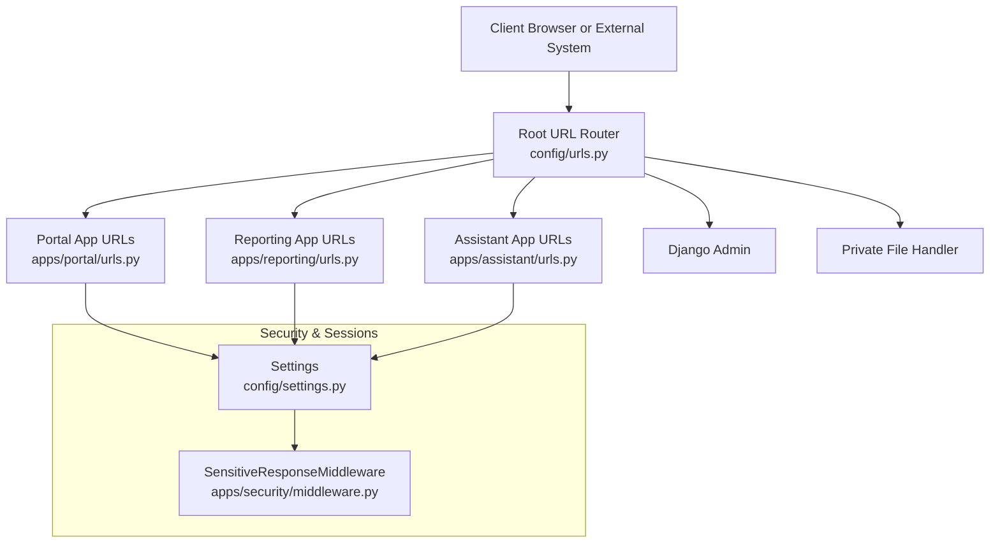
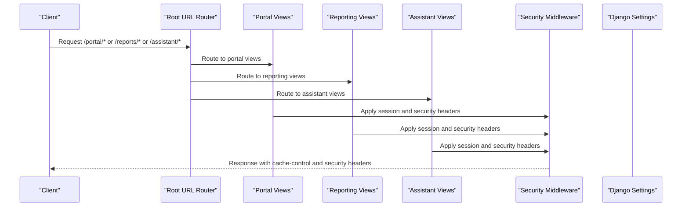
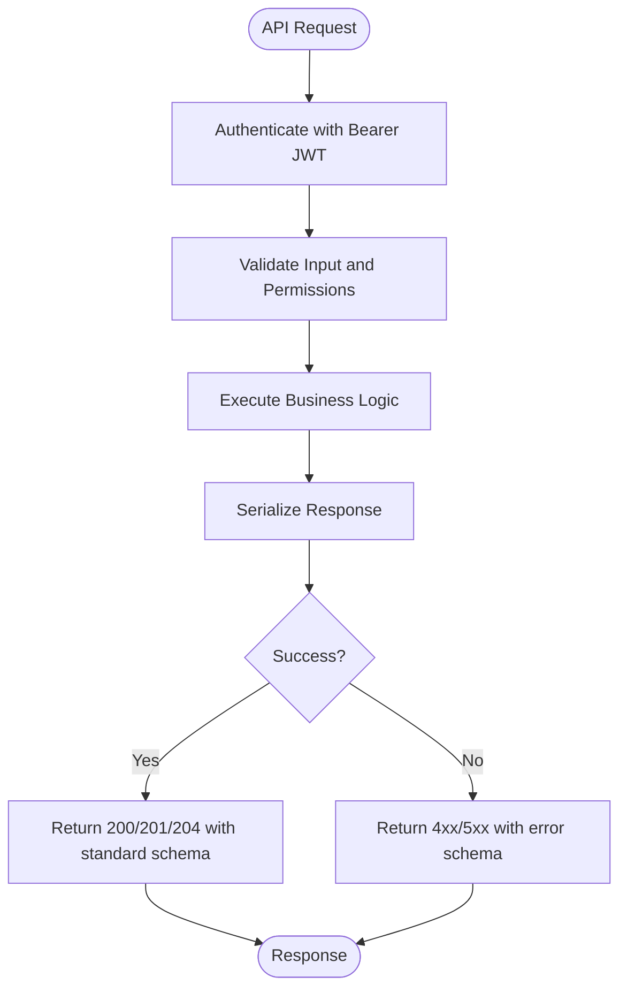
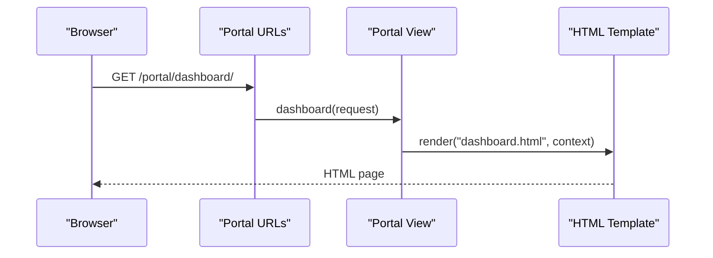
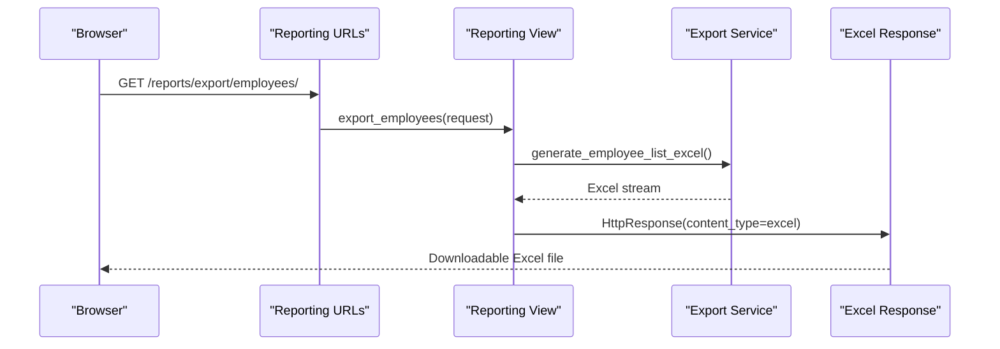
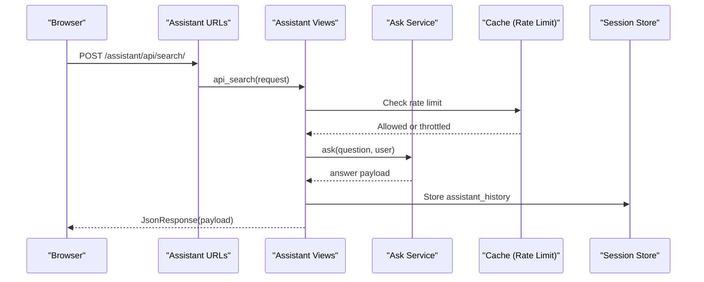
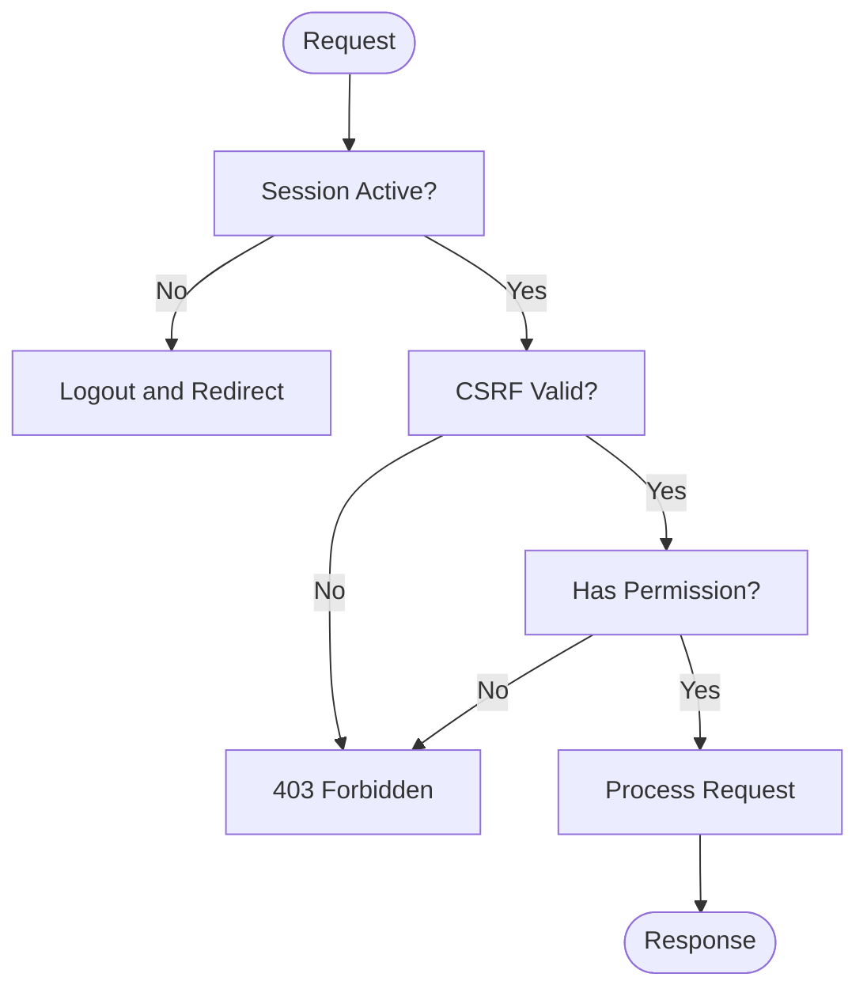
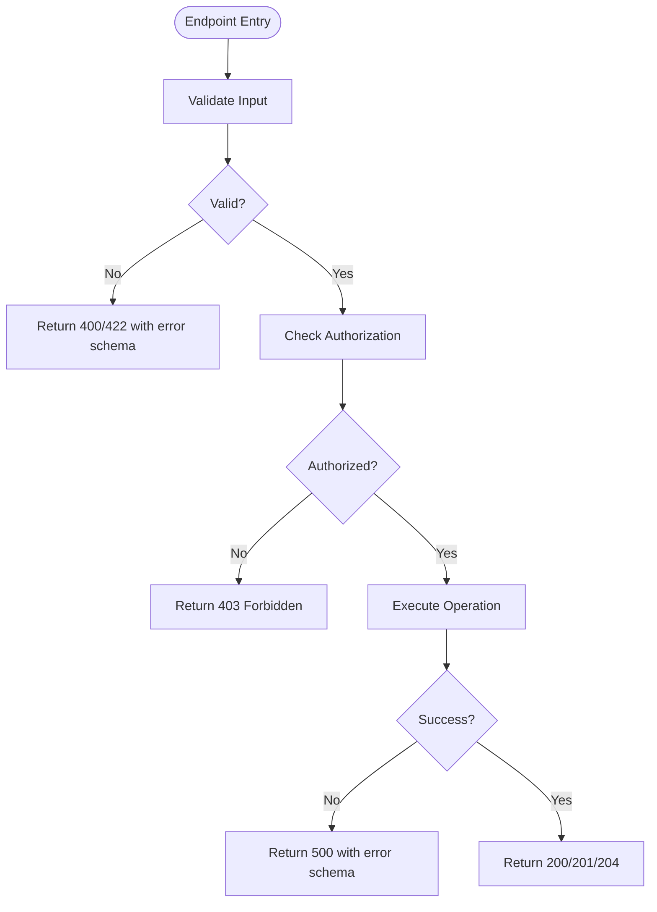
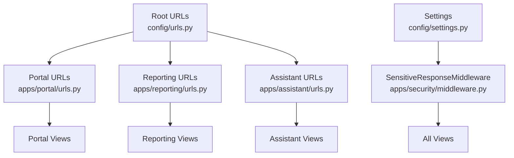

# API Documentation

<cite>
**Referenced Files in This Document**
- [15_API_Contract_Specification.md](file://docs/15_API_Contract_Specification.md)
- [urls.py](file://src/config/urls.py)
- [urls.py](file://src/apps/portal/urls.py)
- [urls.py](file://src/apps/assistant/urls.py)
- [urls.py](file://src/apps/reporting/urls.py)
- [settings.py](file://src/config/settings.py)
- [middleware.py](file://src/apps/security/middleware.py)
- [views.py](file://src/apps/assistant/views.py)
- [views.py](file://src/apps/reporting/views.py)
</cite>

## Table of Contents
1. [Introduction](#introduction)
2. [Project Structure](#project-structure)
3. [Core Components](#core-components)
4. [Architecture Overview](#architecture-overview)
5. [Detailed Component Analysis](#detailed-component-analysis)
6. [Dependency Analysis](#dependency-analysis)
7. [Performance Considerations](#performance-considerations)
8. [Troubleshooting Guide](#troubleshooting-guide)
9. [Conclusion](#conclusion)

## Introduction
This document defines the IHRMS RESTful API surface and internal web endpoints. It covers:
- The planned `/api/v1` contract for future Django REST Framework development, including authentication, pagination, filtering, sorting, error formats, and versioning.
- Existing internal view-based endpoints under `/portal`, `/reports`, and `/assistant`, which serve HTML templates and JSON responses for AJAX calls.
- Authentication using Django sessions and CSRF protection, role-based authorization checks, and session management.
- Error handling strategies, rate limiting considerations, CORS guidance, security controls, client implementation guidelines, debugging approaches, and performance optimization tips.

The planned API is documented as a specification artifact; existing endpoints are implemented with Django views and URL routing.

## Project Structure
IHRMS uses a modular Django application layout:
- Root URL configuration mounts portal, reports, assistant, admin, and private file routes.
- Portal URLs define most user-facing pages and workflows (login, dashboard, HR, leave, payroll, tasks, etc.).
- Assistant URLs expose an AJAX search/history endpoint and a secure file download route.
- Reporting URLs provide report dashboards and Excel export endpoints.
- Settings configure authentication, CSRF, session behavior, security headers, logging, and optional Microsoft 365 integration.

**Diagram sources**
- [urls.py:12-20](file://src/config/urls.py#L12-L20)
- [urls.py:14-156](file://src/apps/portal/urls.py#L14-L156)
- [urls.py:6-11](file://src/apps/reporting/urls.py#L6-L11)
- [urls.py:7-12](file://src/apps/assistant/urls.py#L7-L12)
- [settings.py:145-169](file://src/config/settings.py#L145-L169)
- [middleware.py:7-28](file://src/apps/security/middleware.py#L7-L28)

**Section sources**
- [urls.py:12-20](file://src/config/urls.py#L12-L20)
- [urls.py:14-156](file://src/apps/portal/urls.py#L14-L156)
- [urls.py:6-11](file://src/apps/reporting/urls.py#L6-L11)
- [urls.py:7-12](file://src/apps/assistant/urls.py#L7-L12)
- [settings.py:145-169](file://src/config/settings.py#L145-L169)

## Core Components
- Planned REST API Contract (`/api/v1`)
  - Base URL: `/api/v1`
  - Content-Type: `application/json`
  - Authentication: Bearer JWT token (planned)
  - Response encoding: UTF-8
  - Standard success response includes `success`, `message`, `data`, `errors`, `timestamp`.
  - Pagination standard returns `items` and `pagination` with `page`, `page_size`, `total_records`, `total_pages`.
  - Error response includes `success=false`, `message`, and `errors` array with field-level messages.
  - HTTP status codes include 200, 201, 204, 400, 401, 403, 404, 409, 422, 500.
  - Pagination defaults to page size 20, maximum 100.
  - Filtering supports common query parameters like keyword, status, department_id, employee_id, date ranges.
  - Sorting supports sort_by and sort_order.
  - Versioning strategy: current v1, future v2, v3.

- Existing Internal Endpoints
  - Portal: login/logout, dashboard, HR, leave, payroll, tasks, recruitment, procurement, assets, notifications, timesheet, reports, rooms, vehicles, supplies, disposal, etc.
  - Reporting: dashboard and Excel exports for employees, contracts, dispatches.
  - Assistant: chat page, JSON search/history endpoints, secure SharePoint file download.

- Authentication and Authorization
  - Django sessions via `SessionMiddleware` and `AuthenticationMiddleware`.
  - CSRF protection enabled by default; many views use `@login_required`.
  - Role-based permission checks via `has_permission` and data access helpers.
  - Session idle timeout enforced by `SensitiveResponseMiddleware`.

- Security Controls
  - HTTPS enforcement flags, HSTS options, secure cookies, XSS protections, clickjacking protection.
  - Referrer-Policy and Permissions-Policy headers set by middleware.
  - Private file storage and restricted media access.

**Section sources**
- [15_API_Contract_Specification.md:40-70](file://docs/15_API_Contract_Specification.md#L40-L70)
- [15_API_Contract_Specification.md:74-121](file://docs/15_API_Contract_Specification.md#L74-L121)
- [15_API_Contract_Specification.md:125-183](file://docs/15_API_Contract_Specification.md#L125-L183)
- [15_API_Contract_Specification.md:187-231](file://docs/15_API_Contract_Specification.md#L187-L231)
- [15_API_Contract_Specification.md:235-293](file://docs/15_API_Contract_Specification.md#L235-L293)
- [15_API_Contract_Specification.md:1130-1146](file://docs/15_API_Contract_Specification.md#L1130-L1146)
- [urls.py:14-156](file://src/apps/portal/urls.py#L14-L156)
- [urls.py:6-11](file://src/apps/reporting/urls.py#L6-L11)
- [urls.py:7-12](file://src/apps/assistant/urls.py#L7-L12)
- [settings.py:48-100](file://src/config/settings.py#L48-L100)
- [settings.py:145-169](file://src/config/settings.py#L145-L169)
- [middleware.py:7-28](file://src/apps/security/middleware.py#L7-L28)

## Architecture Overview
The system follows a layered architecture:
- Client layer: browser-based UI consuming portal pages and AJAX endpoints; external systems may consume `/api/v1` once implemented.
- Routing layer: root URL router delegates to app-specific URL configurations.
- View/service layer: Django views render templates or return JSON; services encapsulate business logic.
- Security layer: middleware enforces session timeouts, cache control, and security headers; settings configure CSRF, HTTPS, and authentication backends.
- Data layer: models and database queries accessed through services and ORM.

**Diagram sources**
- [urls.py:12-20](file://src/config/urls.py#L12-L20)
- [urls.py:14-156](file://src/apps/portal/urls.py#L14-L156)
- [urls.py:6-11](file://src/apps/reporting/urls.py#L6-L11)
- [urls.py:7-12](file://src/apps/assistant/urls.py#L7-L12)
- [middleware.py:7-28](file://src/apps/security/middleware.py#L7-L28)
- [settings.py:145-169](file://src/config/settings.py#L145-L169)

## Detailed Component Analysis

### Planned REST API Contract (/api/v1)
- Base URL and content type are standardized.
- Authentication uses Bearer JWT tokens in the planned design.
- Success, pagination, and error response schemas are defined.
- HTTP status codes are enumerated for consistent client handling.
- Pagination, filtering, and sorting standards are provided.
- Versioning strategy outlines current and future versions.

**Diagram sources**
- [15_API_Contract_Specification.md:40-70](file://docs/15_API_Contract_Specification.md#L40-L70)
- [15_API_Contract_Specification.md:74-121](file://docs/15_API_Contract_Specification.md#L74-L121)
- [15_API_Contract_Specification.md:125-183](file://docs/15_API_Contract_Specification.md#L125-L183)
- [15_API_Contract_Specification.md:187-231](file://docs/15_API_Contract_Specification.md#L187-L231)
- [15_API_Contract_Specification.md:1130-1146](file://docs/15_API_Contract_Specification.md#L1130-L1146)

**Section sources**
- [15_API_Contract_Specification.md:40-70](file://docs/15_API_Contract_Specification.md#L40-L70)
- [15_API_Contract_Specification.md:74-121](file://docs/15_API_Contract_Specification.md#L74-L121)
- [15_API_Contract_Specification.md:125-183](file://docs/15_API_Contract_Specification.md#L125-L183)
- [15_API_Contract_Specification.md:187-231](file://docs/15_API_Contract_Specification.md#L187-L231)
- [15_API_Contract_Specification.md:1130-1146](file://docs/15_API_Contract_Specification.md#L1130-L1146)

### Existing Internal Endpoints

#### Portal Endpoints
- Authentication: login/logout handled by Django auth views.
- Dashboard and profile pages served by portal views.
- HR, leave, payroll, tasks, recruitment, procurement, assets, notifications, timesheet, reports, rooms, vehicles, supplies, disposal endpoints follow similar patterns.
- Most views require login and enforce permissions.

**Diagram sources**
- [urls.py:24-26](file://src/apps/portal/urls.py#L24-L26)
- [urls.py:14-156](file://src/apps/portal/urls.py#L14-L156)

**Section sources**
- [urls.py:24-26](file://src/apps/portal/urls.py#L24-L26)
- [urls.py:14-156](file://src/apps/portal/urls.py#L14-L156)

#### Reporting Endpoints
- Report dashboard renders summary statistics and requires permission.
- Export endpoints generate Excel files for employees, expiring contracts, and dispatches.
- Exports log security events and apply permission checks.

**Diagram sources**
- [urls.py:6-11](file://src/apps/reporting/urls.py#L6-L11)
- [views.py:71-82](file://src/apps/reporting/views.py#L71-L82)

**Section sources**
- [urls.py:6-11](file://src/apps/reporting/urls.py#L6-L11)
- [views.py:24-68](file://src/apps/reporting/views.py#L24-L68)
- [views.py:71-121](file://src/apps/reporting/views.py#L71-L121)

#### Assistant Endpoints
- Chat page served by assistant view.
- Search endpoint accepts JSON payload, validates input, applies rate limiting, checks session validity, and stores conversation history in session.
- History endpoint returns stored turns.
- Secure file download endpoint verifies signed token, enforces allowed folders, logs security events, and sets strict security headers.

**Diagram sources**
- [urls.py:7-12](file://src/apps/assistant/urls.py#L7-L12)
- [views.py:69-93](file://src/apps/assistant/views.py#L69-L93)
- [views.py:36-50](file://src/apps/assistant/views.py#L36-L50)

**Section sources**
- [urls.py:7-12](file://src/apps/assistant/urls.py#L7-L12)
- [views.py:69-93](file://src/apps/assistant/views.py#L69-L93)
- [views.py:99-116](file://src/apps/assistant/views.py#L99-L116)
- [views.py:119-170](file://src/apps/assistant/views.py#L119-L170)

### Authentication Methods
- Django built-in authentication via `AuthenticationMiddleware` and `AUTHENTICATION_BACKENDS`.
- Login/logout handled by Django auth views mounted at `/portal/login/` and `/portal/logout/`.
- Session management configured with secure cookie attributes, idle timeout, and browser-close expiration.
- CSRF protection enabled by default; views requiring state changes typically need valid CSRF tokens.
- Rate limiting on assistant search prevents abuse using cache-backed counters.

**Diagram sources**
- [settings.py:145-169](file://src/config/settings.py#L145-L169)
- [settings.py:91-100](file://src/config/settings.py#L91-L100)
- [middleware.py:7-28](file://src/apps/security/middleware.py#L7-L28)
- [views.py:69-93](file://src/apps/assistant/views.py#L69-L93)

**Section sources**
- [settings.py:145-169](file://src/config/settings.py#L145-L169)
- [settings.py:91-100](file://src/config/settings.py#L91-L100)
- [middleware.py:7-28](file://src/apps/security/middleware.py#L7-L28)
- [views.py:69-93](file://src/apps/assistant/views.py#L69-L93)

### Error Handling Strategies
- Standardized error response schema includes `success=false`, `message`, and `errors` array.
- HTTP status codes cover validation errors (422), unauthorized (401), forbidden (403), not found (404), conflict (409), and server errors (500).
- Assistant search returns specific error payloads for invalid JSON, short questions, rate limiting, and session expiration.
- Reporting exports return forbidden responses when permissions are insufficient.

**Diagram sources**
- [15_API_Contract_Specification.md:108-155](file://docs/15_API_Contract_Specification.md#L108-L155)
- [views.py:77-93](file://src/apps/assistant/views.py#L77-L93)
- [views.py:71-82](file://src/apps/reporting/views.py#L71-L82)

**Section sources**
- [15_API_Contract_Specification.md:108-155](file://docs/15_API_Contract_Specification.md#L108-L155)
- [views.py:77-93](file://src/apps/assistant/views.py#L77-L93)
- [views.py:71-82](file://src/apps/reporting/views.py#L71-L82)

### Protocol-Specific Examples
- Employee lookup (planned):
  - GET `/api/v1/employees?keyword=tan&status=active`
  - Headers: `Authorization: Bearer <JWT>`
  - Response: paginated list with standard schema.
- Leave request submission (planned):
  - POST `/api/v1/leave-requests`
  - Body: leave request fields per contract spec.
  - Response: created resource with standard schema.
- Dashboard data retrieval (existing):
  - GET `/portal/dashboard/`
  - Requires authenticated session and CSRF if submitting forms.
  - Response: HTML template rendering dashboard data.

Note: These examples reflect the planned contract and existing portal routes; actual implementations should align with the specified schemas and permissions.

**Section sources**
- [15_API_Contract_Specification.md:187-231](file://docs/15_API_Contract_Specification.md#L187-L231)
- [15_API_Contract_Specification.md:556-594](file://docs/15_API_Contract_Specification.md#L556-L594)
- [urls.py:24-26](file://src/apps/portal/urls.py#L24-L26)

### Rate Limiting Considerations
- Assistant search implements per-user rate limiting using cache-backed counters with a configurable window and limit.
- For external integrations consuming `/api/v1`, consider implementing IP/user-based rate limiting at the gateway or middleware layer.
- Use appropriate HTTP 429 responses and retry-after headers for clients.

**Section sources**
- [views.py:36-50](file://src/apps/assistant/views.py#L36-L50)
- [views.py:77-93](file://src/apps/assistant/views.py#L77-L93)

### CORS Policy for Frontend-Backend Communication
- CSRF trusted origins can be configured via environment variables.
- For cross-origin frontend-backend communication, configure `CSRF_TRUSTED_ORIGINS` and ensure proper CORS headers are set at the reverse proxy or middleware level.
- Keep session cookies secure and SameSite=Lax for typical cross-site scenarios.

**Section sources**
- [settings.py:42-46](file://src/config/settings.py#L42-L46)
- [settings.py:98-100](file://src/config/settings.py#L98-L100)

### API Versioning Strategy
- Current version is v1.
- Future versions v2 and v3 are planned.
- Maintain backward compatibility and deprecation policies for older versions.

**Section sources**
- [15_API_Contract_Specification.md:1130-1146](file://docs/15_API_Contract_Specification.md#L1130-L1146)

### Security Considerations
- Input validation: assistant search validates JSON structure and question length.
- SQL injection prevention: rely on Django ORM and parameterized queries.
- XSS protection: secure content type sniffing disabled, X-Frame-Options DENY, CSP headers on sensitive responses.
- Sensitive data filtering: private file storage and restricted media access; security events logged for sensitive operations.

**Section sources**
- [views.py:53-66](file://src/apps/assistant/views.py#L53-L66)
- [settings.py:87-90](file://src/config/settings.py#L87-L90)
- [urls.py:9-14](file://src/config/urls.py#L9-L14)
- [views.py:147-162](file://src/apps/assistant/views.py#L147-L162)

### Client Implementation Guidelines
- Consume `/api/v1` endpoints with Bearer JWT tokens once implemented.
- For existing portal endpoints, handle CSRF tokens for form submissions and AJAX requests.
- Implement robust error handling based on standard error schema and HTTP status codes.
- Respect pagination, filtering, and sorting parameters.

**Section sources**
- [15_API_Contract_Specification.md:40-70](file://docs/15_API_Contract_Specification.md#L40-L70)
- [15_API_Contract_Specification.md:187-231](file://docs/15_API_Contract_Specification.md#L187-L231)
- [urls.py:24-26](file://src/apps/portal/urls.py#L24-L26)

### Performance Optimization Tips
- Use pagination for large datasets; default page size 20, max 100.
- Apply selective field retrieval where possible in service layers.
- Cache frequently accessed data (e.g., organization charts, reference lists).
- Optimize database queries with select_related/prefetch_related in services.

**Section sources**
- [15_API_Contract_Specification.md:159-183](file://docs/15_API_Contract_Specification.md#L159-L183)

## Dependency Analysis
The following diagram shows how URL routing connects to app views and how security middleware interacts with requests.

**Diagram sources**
- [urls.py:12-20](file://src/config/urls.py#L12-L20)
- [urls.py:14-156](file://src/apps/portal/urls.py#L14-L156)
- [urls.py:6-11](file://src/apps/reporting/urls.py#L6-L11)
- [urls.py:7-12](file://src/apps/assistant/urls.py#L7-L12)
- [settings.py:145-169](file://src/config/settings.py#L145-L169)
- [middleware.py:7-28](file://src/apps/security/middleware.py#L7-L28)

**Section sources**
- [urls.py:12-20](file://src/config/urls.py#L12-L20)
- [urls.py:14-156](file://src/apps/portal/urls.py#L14-L156)
- [urls.py:6-11](file://src/apps/reporting/urls.py#L6-L11)
- [urls.py:7-12](file://src/apps/assistant/urls.py#L7-L12)
- [settings.py:145-169](file://src/config/settings.py#L145-L169)
- [middleware.py:7-28](file://src/apps/security/middleware.py#L7-L28)

## Performance Considerations
- Plan API responses to support pagination and filtering to reduce payload sizes.
- Use caching strategically for read-heavy endpoints (e.g., dashboards, reference data).
- Monitor database query performance and optimize N+1 queries.
- Implement rate limiting for external integrations to protect backend resources.

[No sources needed since this section provides general guidance]

## Troubleshooting Guide
- Debugging:
  - Enable Django debug toolbar during development to inspect requests, responses, and SQL queries.
  - Review application logs in `Logs/app.log` and error logs in `Logs/error.log`.
- Monitoring:
  - Track API performance metrics such as response time, error rates, and throughput.
  - Use structured logging to capture key events (e.g., data exports, file downloads).
- Common Issues:
  - CSRF errors: ensure CSRF tokens are included for state-changing requests.
  - Session expiration: check idle timeout and browser-close session settings.
  - Permission denied: verify user roles and permissions for endpoints.

**Section sources**
- [settings.py:477-545](file://src/config/settings.py#L477-L545)
- [views.py:71-82](file://src/apps/reporting/views.py#L71-L82)
- [views.py:147-162](file://src/apps/assistant/views.py#L147-L162)

## Conclusion
IHRMS provides a comprehensive internal web platform with extensive portal functionality and emerging API capabilities. The planned `/api/v1` contract establishes a clear foundation for future RESTful services, while existing endpoints deliver robust HTML and JSON responses for internal workflows. Security, authentication, and session management are well-configured, and error handling follows consistent patterns. Clients should adopt best practices for CSRF handling, error processing, and performance optimization, and teams should leverage logging and monitoring to maintain reliability and observability.

[No sources needed since this section summarizes without analyzing specific files]