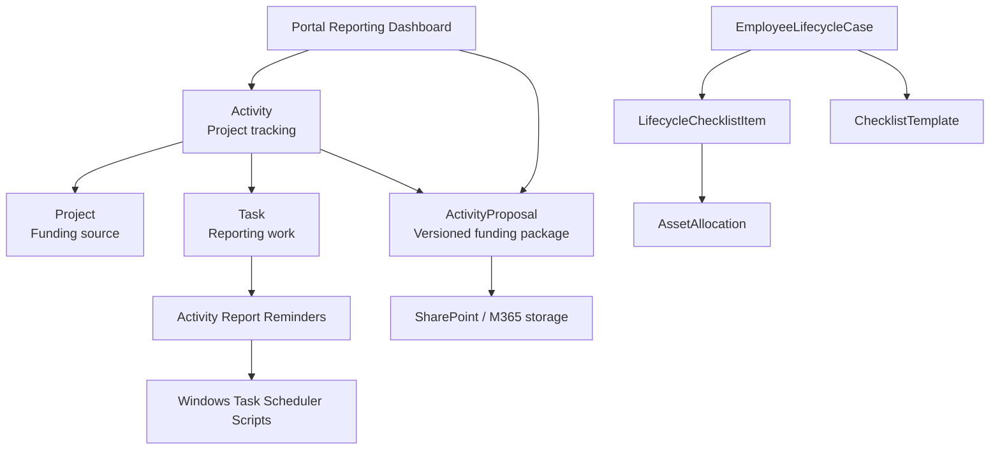
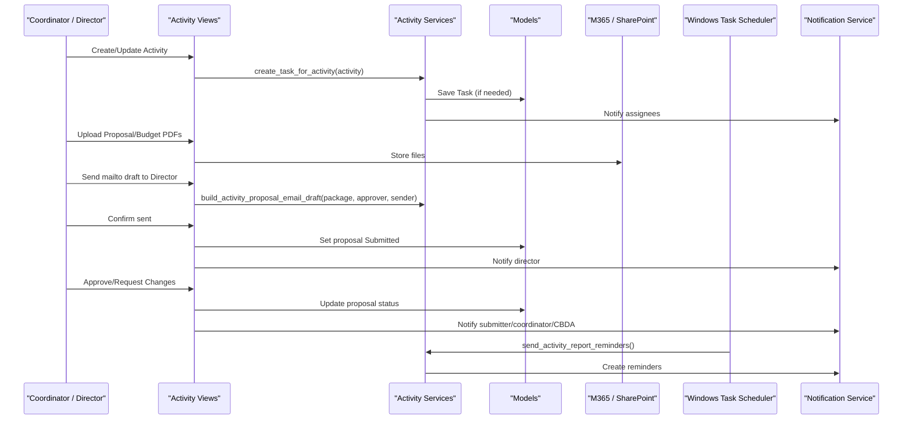
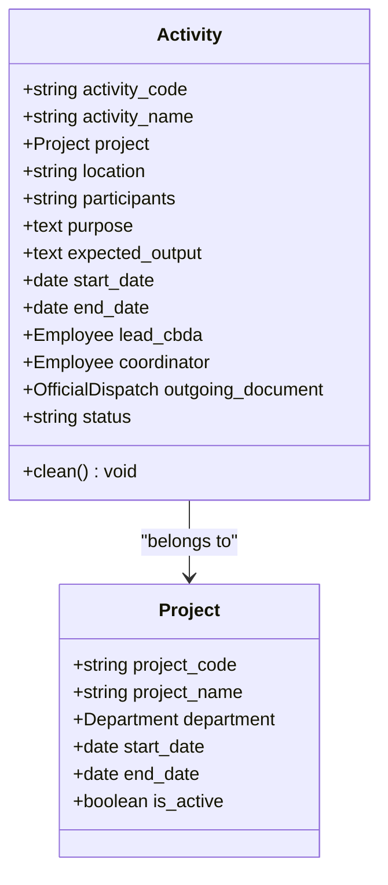
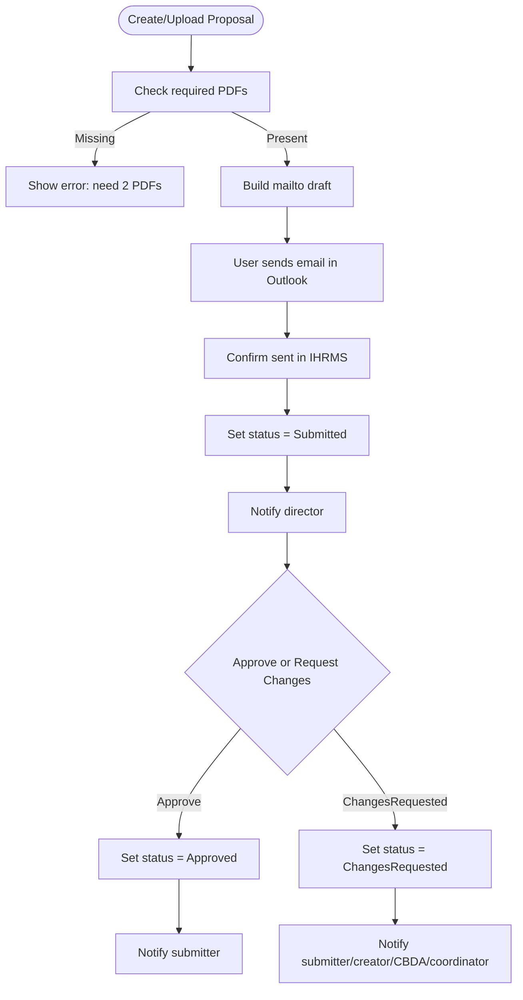
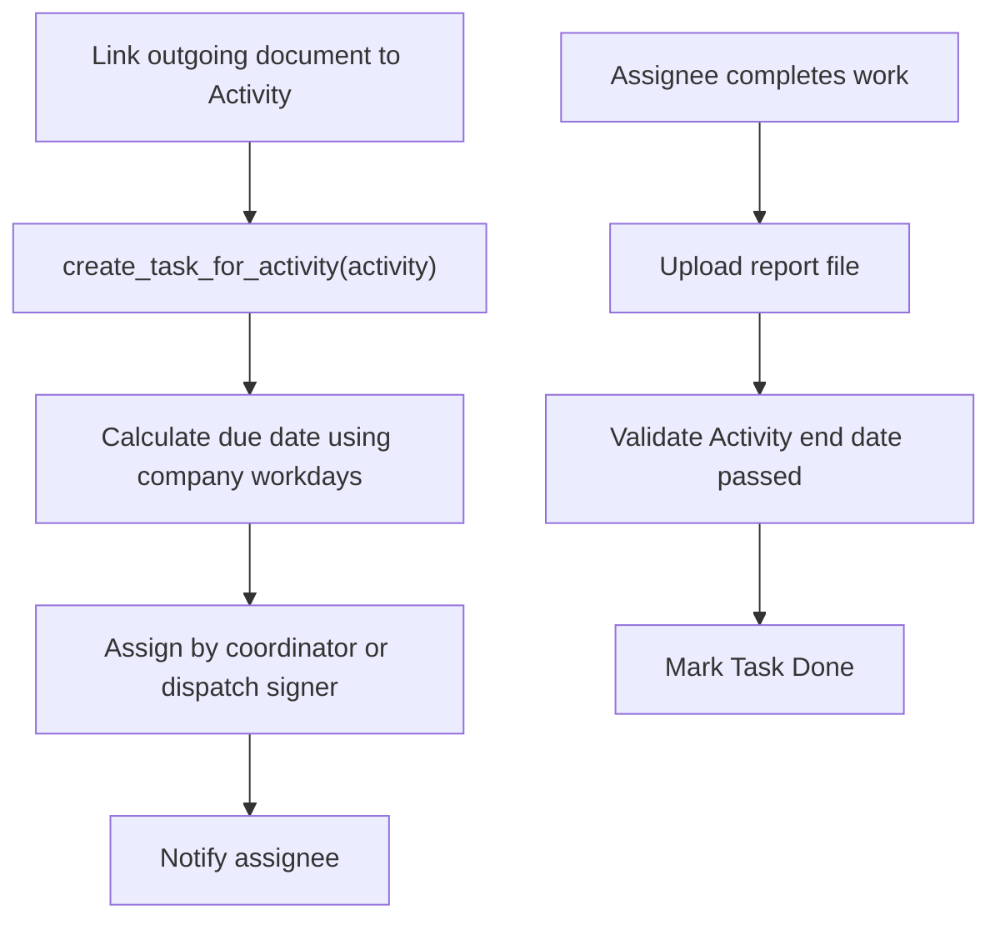
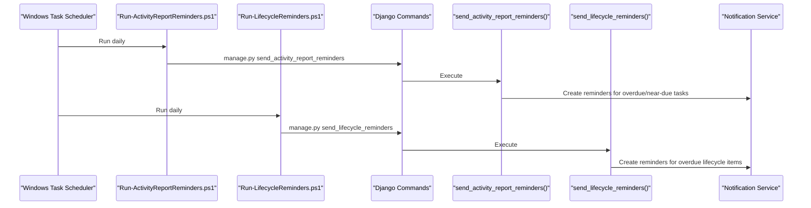
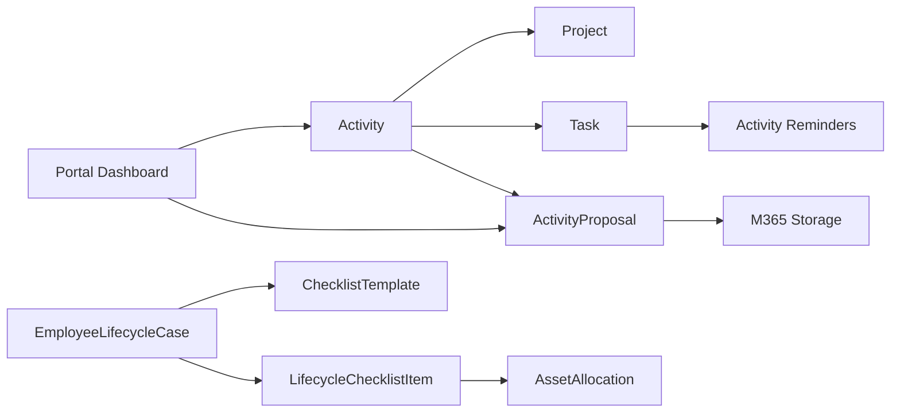

# Activity & Lifecycle Management

<cite>
**Referenced Files in This Document**
- [models.py](file://src/apps/activity/models.py)
- [services.py](file://src/apps/activity/services.py)
- [views.py](file://src/apps/activity/views.py)
- [tests.py](file://src/apps/activity/tests.py)
- [models.py](file://src/apps/project/models.py)
- [models.py](file://src/apps/task/models.py)
- [services.py](file://src/apps/task/services.py)
- [models.py](file://src/apps/lifecycle/models.py)
- [services.py](file://src/apps/lifecycle/services.py)
- [views.py](file://src/apps/lifecycle/views.py)
- [Run-ActivityReportReminders.ps1](file://ops/scheduler/Run-ActivityReportReminders.ps1)
- [Run-LifecycleReminders.ps1](file://ops/scheduler/Run-LifecycleReminders.ps1)
- [reporting_dashboard.py](file://src/apps/portal/reporting_dashboard.py)
- [SKILL.md](file://.agents/skills/ihrms-operations/SKILL.md)
</cite>

## Table of Contents
1. [Introduction](#introduction)
2. [Project Structure](#project-structure)
3. [Core Components](#core-components)
4. [Architecture Overview](#architecture-overview)
5. [Detailed Component Analysis](#detailed-component-analysis)
6. [Dependency Analysis](#dependency-analysis)
7. [Performance Considerations](#performance-considerations)
8. [Troubleshooting Guide](#troubleshooting-guide)
9. [Conclusion](#conclusion)
10. [Appendices](#appendices)

## Introduction
This document explains the activity and lifecycle management capabilities for NGO project tracking, proposal approval, lifecycle case handling, and item assignment. It focuses on:
- Project activity tracking through the Activity model and its associated Task reporting workflow.
- Funding proposal management through ActivityProposal with versioned packages and director approval.
- Employee lifecycle cases using ChecklistTemplate, EmployeeLifecycleCase, and LifecycleChecklistItem.
- Automated reminders for activity report deadlines and lifecycle checklist due dates.
- Reporting integration points for project status, budget utilization, and impact indicators.
- External system integration for grant-related documents via SharePoint storage and Outlook email drafts.

The scope emphasizes progress tracking, deadline enforcement, approvals, and notifications rather than full financial settlement or receipt validation.

## Project Structure
The relevant functionality is implemented across several Django apps:
- `apps.activity`: Activity planning, proposal upload, approval workflow, scheduling, and reminder generation.
- `apps.project`: Project metadata that activities belong to.
- `apps.task`: Task model for activity reporting and manual task creation utilities.
- `apps.lifecycle`: Employee lifecycle templates, cases, and checklist items.
- `ops.scheduler`: Windows Task Scheduler scripts that invoke reminder commands.
- `apps.portal.reporting_dashboard`: Dashboard metrics including active projects and pending proposals.



**Diagram sources**
- [models.py:9-86](file://src/apps/activity/models.py#L9-L86)
- [models.py:88-157](file://src/apps/activity/models.py#L88-L157)
- [models.py:5-22](file://src/apps/project/models.py#L5-L22)
- [models.py:9-104](file://src/apps/task/models.py#L9-L104)
- [models.py:6-95](file://src/apps/lifecycle/models.py#L6-L95)
- [reporting_dashboard.py:151-158](file://src/apps/portal/reporting_dashboard.py#L151-L158)

**Section sources**
- [models.py:9-86](file://src/apps/activity/models.py#L9-L86)
- [models.py:88-157](file://src/apps/activity/models.py#L88-L157)
- [models.py:5-22](file://src/apps/project/models.py#L5-L22)
- [models.py:9-104](file://src/apps/task/models.py#L9-L104)
- [models.py:6-95](file://src/apps/lifecycle/models.py#L6-L95)
- [reporting_dashboard.py:151-158](file://src/apps/portal/reporting_dashboard.py#L151-L158)

## Core Components
- Activity: Represents a concrete NGO project activity with schedule, location, participants, purpose, expected output, lead coordinator, optional outgoing document linkage, and status.
- ActivityProposal: Versioned proposal/budget package linked to an Activity, storing PDF/Excel files, approver, submission metadata, decision metadata, and status transitions.
- Task: Tracks reporting work for an Activity; enforces report file requirements before completion and prevents completion before activity end date.
- ChecklistTemplate and ChecklistTemplateItem: Define reusable lifecycle checklists for onboarding/offboarding.
- EmployeeLifecycleCase: A lifecycle instance tied to an employee, template, effective date, and status.
- LifecycleChecklistItem: Per-case checklist tasks with assignee, due date, status, asset allocation linkage, and reminder tracking.

Key responsibilities:
- Activity drives scheduling and Task creation when an outgoing dispatch is linked.
- ActivityProposal manages proposal versions, file uploads, and director approval workflow.
- Task enforces business rules for activity reporting and completion.
- Lifecycle models manage HR lifecycle processes with automated reminders.

**Section sources**
- [models.py:9-86](file://src/apps/activity/models.py#L9-L86)
- [models.py:88-157](file://src/apps/activity/models.py#L88-L157)
- [models.py:9-104](file://src/apps/task/models.py#L9-L104)
- [models.py:6-95](file://src/apps/lifecycle/models.py#L6-L95)

## Architecture Overview
The system integrates user interfaces, services, models, external storage, and scheduled reminders:



**Diagram sources**
- [views.py:170-218](file://src/apps/activity/views.py#L170-L218)
- [views.py:228-363](file://src/apps/activity/views.py#L228-L363)
- [views.py:366-424](file://src/apps/activity/views.py#L366-L424)
- [services.py:83-195](file://src/apps/activity/services.py#L83-L195)
- [services.py:314-339](file://src/apps/activity/services.py#L314-L339)
- [services.py:251-306](file://src/apps/activity/services.py#L251-L306)

## Detailed Component Analysis

### Activity Model and Project Tracking
Activity tracks NGO project activities with fields for code, name, project linkage, location, participants, purpose, expected output, start/end dates, lead CBDA, coordinator, optional outgoing document linkage, and status. Validation ensures:
- End date is not before start date.
- Linked outgoing document must be of type Outgoing.
- Coordinator or outgoing document signer must exist when linking an outgoing document.

Activity dashboard and calendar views aggregate monthly activities, related tasks, and latest proposal history. Schedule conflict warnings are provided when multiple activities overlap for the same lead CBDA.



**Diagram sources**
- [models.py:9-86](file://src/apps/activity/models.py#L9-L86)
- [models.py:5-22](file://src/apps/project/models.py#L5-L22)

**Section sources**
- [models.py:9-86](file://src/apps/activity/models.py#L9-L86)
- [views.py:74-109](file://src/apps/activity/views.py#L74-L109)
- [views.py:112-151](file://src/apps/activity/views.py#L112-L151)
- [views.py:154-168](file://src/apps/activity/views.py#L154-L168)
- [views.py:170-218](file://src/apps/activity/views.py#L170-L218)

### ActivityProposal Approval Workflow
ActivityProposal stores versioned proposal and budget files, approver, submission metadata, decision metadata, and status. The workflow includes:
- Uploading proposal and budget PDFs.
- Building an Outlook mailto draft for the director.
- Confirming email sent and setting proposal status to Submitted.
- Director approving or requesting changes.
- Notifications to submitter, creator, lead CBDA, and coordinator.



**Diagram sources**
- [models.py:88-157](file://src/apps/activity/models.py#L88-L157)
- [views.py:228-363](file://src/apps/activity/views.py#L228-L363)
- [views.py:366-424](file://src/apps/activity/views.py#L366-L424)
- [services.py:314-339](file://src/apps/activity/services.py#L314-L339)

**Section sources**
- [models.py:88-157](file://src/apps/activity/models.py#L88-L157)
- [views.py:228-363](file://src/apps/activity/views.py#L228-L363)
- [views.py:366-424](file://src/apps/activity/views.py#L366-L424)
- [services.py:314-339](file://src/apps/activity/services.py#L314-L339)
- [tests.py:447-460](file://src/apps/activity/tests.py#L447-L460)
- [tests.py:462-486](file://src/apps/activity/tests.py#L462-L486)

### Task Assignment and Reporting Rules
Task represents reporting work for an Activity. Business rules include:
- Task created automatically when an outgoing document is linked to an Activity.
- Due date calculated as company workdays after Activity end date.
- Completion requires uploading a report file and Activity end date has passed.
- Cancelled Activities cannot have reopened non-cancelled Tasks.



**Diagram sources**
- [services.py:83-195](file://src/apps/activity/services.py#L83-L195)
- [models.py:9-104](file://src/apps/task/models.py#L9-L104)

**Section sources**
- [services.py:83-195](file://src/apps/activity/services.py#L83-L195)
- [models.py:9-104](file://src/apps/task/models.py#L9-L104)
- [tests.py:830-868](file://src/apps/activity/tests.py#L830-L868)

### Lifecycle Case Handling and Item Assignment
Lifecycle management uses templates, cases, and checklist items:
- Templates define checklist steps with responsible roles and due offsets.
- Cases open per employee with effective dates and generate checklist items.
- Items can be assigned to users, completed, skipped, or linked to asset allocations.
- Overdue items trigger reminders.

```mermaid
classDiagram
class ChecklistTemplate {
+string template_code
+string template_name
+string template_type
+boolean is_active
}
class ChecklistTemplateItem {
+ChecklistTemplate template
+int sequence
+string item_name
+string responsible_role_code
+int due_offset_days
+boolean requires_asset_return
}
class EmployeeLifecycleCase {
+Employee employee
+ChecklistTemplate template
+string case_type
+date effective_date
+string status
+string triggering_event_ref
}
class LifecycleChecklistItem {
+EmployeeLifecycleCase case
+ChecklistTemplateItem template_item
+string item_name
+string responsible_role_code
+boolean requires_asset_return
+User assigned_to_user
+date due_date
+string status
+User completed_by
+datetime completed_at
+string skip_reason
+date last_reminded_on
+AssetAllocation asset_allocation
}
ChecklistTemplate ||--o{ ChecklistTemplateItem : "defines"
EmployeeLifecycleCase --> ChecklistTemplate : "uses"
EmployeeLifecycleCase ||--o{ LifecycleChecklistItem : "generates"
LifecycleChecklistItem --> ChecklistTemplateItem : "copies"
LifecycleChecklistItem --> AssetAllocation : "links"
```

**Diagram sources**
- [models.py:6-95](file://src/apps/lifecycle/models.py#L6-L95)

**Section sources**
- [models.py:6-95](file://src/apps/lifecycle/models.py#L6-L95)
- [services.py:10-43](file://src/apps/lifecycle/services.py#L10-L43)
- [views.py:33-74](file://src/apps/lifecycle/views.py#L33-L74)
- [views.py:77-94](file://src/apps/lifecycle/views.py#L77-L94)
- [views.py:97-115](file://src/apps/lifecycle/views.py#L97-L115)
- [views.py:118-181](file://src/apps/lifecycle/views.py#L118-L181)

### Automated Reminder System
Two reminder systems operate:
- Activity report reminders: Idempotent in-app notifications based on company workdays and configurable offsets.
- Lifecycle checklist reminders: Overdue item notifications with per-day deduplication.

Scheduled PowerShell scripts invoke Django management commands daily.



**Diagram sources**
- [Run-ActivityReportReminders.ps1:1-34](file://ops/scheduler/Run-ActivityReportReminders.ps1#L1-L34)
- [Run-LifecycleReminders.ps1:1-41](file://ops/scheduler/Run-LifecycleReminders.ps1#L1-L41)
- [services.py:251-306](file://src/apps/activity/services.py#L251-L306)
- [services.py:46-69](file://src/apps/lifecycle/services.py#L46-L69)

**Section sources**
- [services.py:251-306](file://src/apps/activity/services.py#L251-L306)
- [services.py:46-69](file://src/apps/lifecycle/services.py#L46-L69)
- [Run-ActivityReportReminders.ps1:1-34](file://ops/scheduler/Run-ActivityReportReminders.ps1#L1-L34)
- [Run-LifecycleReminders.ps1:1-41](file://ops/scheduler/Run-LifecycleReminders.ps1#L1-L41)

### Examples and Usage Scenarios
- Creating an activity proposal:
  - Upload proposal and budget PDFs for an Activity.
  - Build Outlook mailto draft and send manually.
  - Confirm sent in IHRMS to set proposal status to Submitted.
  - Director reviews and approves or requests changes.
- Managing project lifecycles:
  - Open an onboarding or offboarding case for an employee.
  - Review generated checklist items and assign responsible users.
  - Complete or skip items; link asset allocations where required.
  - Monitor due dates and receive automated reminders.
- Tracking deliverables:
  - Link an outgoing document to an Activity to auto-generate a reporting Task.
  - Upload activity report files before marking Task Done.
  - Ensure Activity end date has passed before completion.

**Section sources**
- [views.py:228-363](file://src/apps/activity/views.py#L228-L363)
- [views.py:366-424](file://src/apps/activity/views.py#L366-L424)
- [views.py:33-74](file://src/apps/lifecycle/views.py#L33-L74)
- [views.py:118-181](file://src/apps/lifecycle/views.py#L118-L181)
- [services.py:83-195](file://src/apps/activity/services.py#L83-L195)
- [models.py:9-104](file://src/apps/task/models.py#L9-L104)

### Integration with External Systems
- Grant management documents:
  - Proposal and budget PDFs are stored via configured M365 storage.
  - Excel source files are not uploaded by the current user flow per operational guidance.
- Reporting and dashboards:
  - Portal dashboard aggregates active projects, active activities, and pending proposals.
- Outlook email:
  - Coordinator prepares mailto drafts; user attaches PDFs and sends manually.
  - IHRMS records confirmation and notifies stakeholders.

**Section sources**
- [models.py:106-125](file://src/apps/activity/models.py#L106-L125)
- [SKILL.md:24-31](file://.agents/skills/ihrms-operations/SKILL.md#L24-L31)
- [reporting_dashboard.py:151-158](file://src/apps/portal/reporting_dashboard.py#L151-L158)
- [views.py:247-321](file://src/apps/activity/views.py#L247-L321)

## Dependency Analysis
The following diagram shows key dependencies among components:



**Diagram sources**
- [models.py:9-86](file://src/apps/activity/models.py#L9-L86)
- [models.py:88-157](file://src/apps/activity/models.py#L88-L157)
- [models.py:5-22](file://src/apps/project/models.py#L5-L22)
- [models.py:9-104](file://src/apps/task/models.py#L9-L104)
- [models.py:6-95](file://src/apps/lifecycle/models.py#L6-L95)
- [reporting_dashboard.py:151-158](file://src/apps/portal/reporting_dashboard.py#L151-L158)

**Section sources**
- [models.py:9-86](file://src/apps/activity/models.py#L9-L86)
- [models.py:88-157](file://src/apps/activity/models.py#L88-L157)
- [models.py:5-22](file://src/apps/project/models.py#L5-L22)
- [models.py:9-104](file://src/apps/task/models.py#L9-L104)
- [models.py:6-95](file://src/apps/lifecycle/models.py#L6-L95)
- [reporting_dashboard.py:151-158](file://src/apps/portal/reporting_dashboard.py#L151-L158)

## Performance Considerations
- Workday calculations use holiday lookups within bounded ranges to avoid excessive queries.
- Task creation uses atomic transactions and selective updates to minimize contention.
- Manual task code allocation retries under lock conflicts with exponential backoff.
- Reminder generation filters by due dates and statuses, then creates idempotent notifications.

Recommendations:
- Keep holiday tables updated to ensure accurate workday calculations.
- Monitor database locks during peak proposal submissions and Task creations.
- Tune reminder offsets via settings to balance notification frequency and workload.

[No sources needed since this section provides general guidance]

## Troubleshooting Guide
Common issues and resolutions:
- Proposal missing required PDFs:
  - Ensure both proposal and budget PDFs are uploaded before sending approval request.
- Cannot mark Task Done without report file:
  - Upload the activity report file before completing the Task.
- Cannot complete Task before Activity end date:
  - Wait until the Activity end date has passed before marking Task Done.
- Cancelled Activity blocks reopening Tasks:
  - Do not reopen non-cancelled Tasks for cancelled Activities.
- Lifecycle item requires asset return:
  - Link an asset allocation with return confirmation before marking item Done.
- Reminder script failures:
  - Verify Python path and environment variables; check logs for Unicode encoding issues.

**Section sources**
- [models.py:72-86](file://src/apps/activity/models.py#L72-L86)
- [models.py:64-88](file://src/apps/task/models.py#L64-L88)
- [views.py:247-321](file://src/apps/activity/views.py#L247-L321)
- [views.py:118-181](file://src/apps/lifecycle/views.py#L118-L181)
- [Run-LifecycleReminders.ps1:18-30](file://ops/scheduler/Run-LifecycleReminders.ps1#L18-L30)

## Conclusion
The activity and lifecycle management system provides robust support for NGO project tracking, proposal approvals, and HR lifecycle processes. It integrates scheduling, validation, notifications, and external storage while maintaining clear boundaries around scope. Automated reminders and dashboard metrics help maintain accountability and visibility. Future enhancements may expand financial settlement features and centralize reporting policies, but current design preserves module independence and security.

[No sources needed since this section summarizes without analyzing specific files]

## Appendices
- Operational notes:
  - Proposal workflow stores two PDFs in SharePoint; Excel source files are not uploaded by the current user flow.
  - Outlook email is user-sent via mailto draft; IHRMS does not attach files or verify delivery.
  - Windows Task Scheduler reminders require proper setup and log verification.

**Section sources**
- [SKILL.md:24-31](file://.agents/skills/ihrms-operations/SKILL.md#L24-L31)