# Activity Management

<cite>
**Referenced Files in This Document**   
- [models.py](file://src/apps/activity/models.py)
- [views.py](file://src/apps/activity/views.py)
- [services.py](file://src/apps/activity/services.py)
- [forms.py](file://src/apps/activity/forms.py)
- [activity_codes.py](file://src/apps/activity/activity_codes.py)
- [task_models.py](file://src/apps/task/models.py)
- [document_models.py](file://src/apps/document/models.py)
- [ActCode.md](file://docs/ActCode.md)
</cite>

## Table of Contents
1. [Introduction](#introduction)
2. [Project Structure](#project-structure)
3. [Core Components](#core-components)
4. [Architecture Overview](#architecture-overview)
5. [Detailed Component Analysis](#detailed-component-analysis)
6. [Dependency Analysis](#dependency-analysis)
7. [Performance Considerations](#performance-considerations)
8. [Troubleshooting Guide](#troubleshooting-guide)
9. [Conclusion](#conclusion)

## Introduction
This document explains the Activity Management system used to track project activities, manage their status lifecycle, and automate follow-up tasks. It covers:
- The Activity data model, including activity codes, project relationships, location and participant fields, timeline control, coordinator assignment, and official dispatch linkage.
- The five-stage status workflow: Planned → DispatchIssued → InProgress → Completed → Cancelled.
- Integration with official outgoing documents for authorization and automated task generation.
- Validation rules for date ranges, coordinator requirements, and document associations.
- Examples of creating activities, managing timelines, assigning coordinators, and tracking progress.
- Automated task assignment that generates report tasks based on activity dates and company workdays.
- Reporting guidance and integration considerations for external grant management systems.

## Project Structure
The Activity Management feature is implemented as a Django application under `apps/activity`. Its main responsibilities are split across models, forms, views, services, and activity code definitions. Related behavior also touches the Task and OfficialDispatch domains.

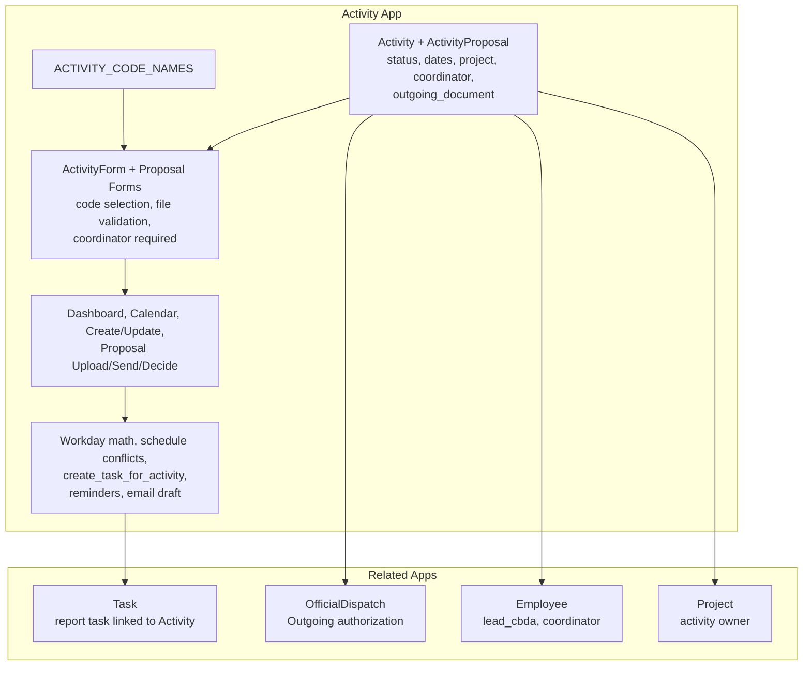

**Diagram sources**
- [models.py:9-86](file://src/apps/activity/models.py#L9-L86)
- [forms.py:12-137](file://src/apps/activity/forms.py#L12-L137)
- [views.py:74-218](file://src/apps/activity/views.py#L74-L218)
- [services.py:12-340](file://src/apps/activity/services.py#L12-L340)
- [activity_codes.py:1-22](file://src/apps/activity/activity_codes.py#L1-L22)
- [task_models.py:9-104](file://src/apps/task/models.py#L9-L104)
- [document_models.py:193-276](file://src/apps/document/models.py#L193-L276)

**Section sources**
- [models.py:9-86](file://src/apps/activity/models.py#L9-L86)
- [forms.py:12-137](file://src/apps/activity/forms.py#L12-L137)
- [views.py:74-218](file://src/apps/activity/views.py#L74-L218)
- [services.py:12-340](file://src/apps/activity/services.py#L12-L340)
- [activity_codes.py:1-22](file://src/apps/activity/activity_codes.py#L1-L22)
- [task_models.py:9-104](file://src/apps/task/models.py#L9-L104)
- [document_models.py:193-276](file://src/apps/document/models.py#L193-L276)

## Core Components
- **Activity**: Represents a concrete project activity with a unique activity code, name, project link, optional location and participants, purpose and expected output, start/end dates, lead CBDA, optional coordinator, optional outgoing document, and status.
- **ActivityProposal**: Versioned proposal/budget package attached to an activity, with PDF/Excel uploads, approval workflow, approver, submission metadata, and decision history.
- **Task (related)**: Report task automatically generated when an outgoing dispatch is linked; it tracks assignee, due date, completion, and report file upload.
- **OfficialDispatch (related)**: Administrative document record; only outgoing dispatched documents can authorize activity reporting tasks.

Key behaviors:
- Activity status choices define the five-stage lifecycle.
- Form logic enforces coordinator requirement and restricts outgoing document selection.
- Service logic computes company workday deadlines and creates or updates report tasks.
- Views provide dashboard, calendar, create/update, and proposal upload/send/decision flows.

**Section sources**
- [models.py:9-157](file://src/apps/activity/models.py#L9-L157)
- [forms.py:12-137](file://src/apps/activity/forms.py#L12-L137)
- [services.py:83-249](file://src/apps/activity/services.py#L83-L249)
- [task_models.py:9-104](file://src/apps/task/models.py#L9-L104)
- [document_models.py:193-276](file://src/apps/document/models.py#L193-L276)

## Architecture Overview
The Activity Management architecture connects user-facing views to domain models and automation services.

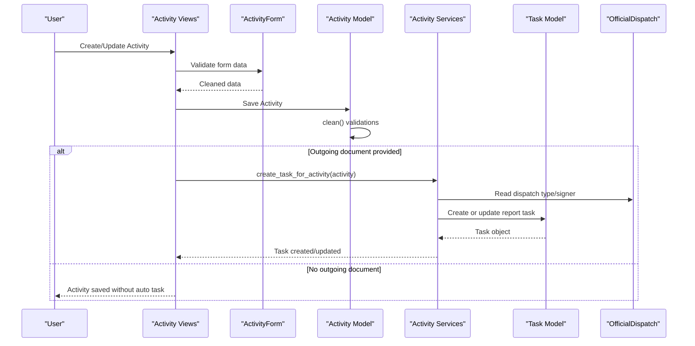

**Diagram sources**
- [views.py:170-218](file://src/apps/activity/views.py#L170-L218)
- [forms.py:60-137](file://src/apps/activity/forms.py#L60-L137)
- [models.py:72-86](file://src/apps/activity/models.py#L72-L86)
- [services.py:83-195](file://src/apps/activity/services.py#L83-L195)
- [task_models.py:9-104](file://src/apps/task/models.py#L9-L104)
- [document_models.py:193-276](file://src/apps/document/models.py#L193-L276)

## Detailed Component Analysis

### Activity Model and Status Workflow
The Activity model defines the core entity for project activity tracking.

- **Identity and naming**: Unique activity code and activity name.
- **Project relationship**: Foreign key to Project; activities belong to one project.
- **Location and participants**: Optional text fields for implementation location and participant composition.
- **Purpose and expected output**: Optional descriptive fields for planning context.
- **Timeline control**: Start and end dates drive scheduling and task deadlines.
- **People**: Lead CBDA is mandatory; Coordinator is optional but enforced by form logic.
- **Authorization**: Optional link to OfficialDispatch; only outgoing dispatched documents are allowed.
- **Status**: Five-stage lifecycle: Planned, DispatchIssued, InProgress, Completed, Cancelled.

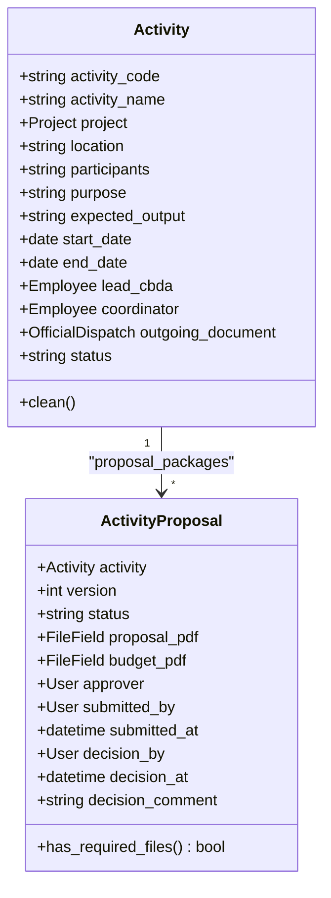

**Diagram sources**
- [models.py:9-157](file://src/apps/activity/models.py#L9-L157)

**Section sources**
- [models.py:9-86](file://src/apps/activity/models.py#L9-L86)

#### Status Lifecycle and Transitions
The Activity status supports the following states:
- Planned: Activity is planned but not yet authorized by an outgoing document.
- DispatchIssued: An outgoing official dispatch has been linked.
- InProgress: Activity is being executed.
- Completed: Activity execution is complete.
- Cancelled: Activity was cancelled.

Important notes:
- The model stores status as a choice field; explicit transition enforcement is not implemented at the model level.
- UI and business processes should guide users through the intended sequence.
- Cancelled activities suppress schedule conflict checks and cancel associated report tasks.

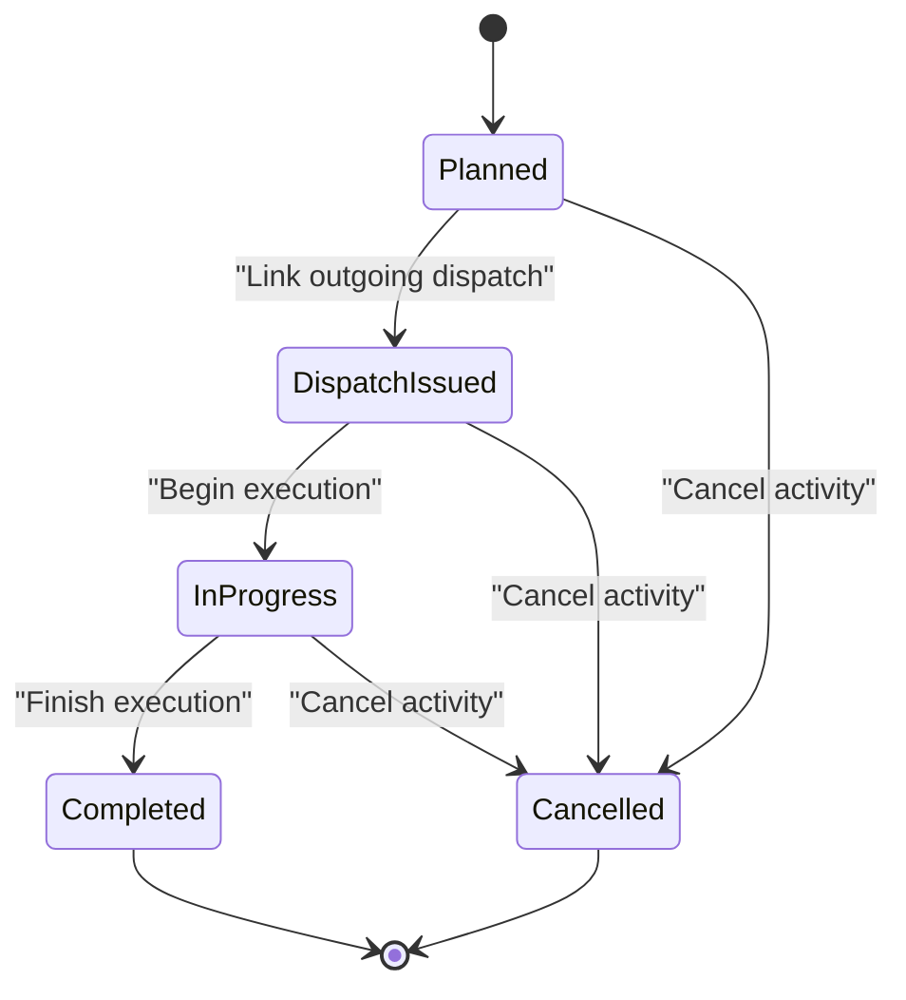

**Diagram sources**
- [models.py:21-27](file://src/apps/activity/models.py#L21-L27)
- [services.py:93-99](file://src/apps/activity/services.py#L93-L99)

**Section sources**
- [models.py:21-27](file://src/apps/activity/models.py#L21-L27)
- [services.py:93-99](file://src/apps/activity/services.py#L93-L99)

### Activity Codes and Names
Activity codes are defined centrally and reused by forms and tests.

- The canonical list is transcribed from documentation into a Python dictionary.
- Forms populate activity names automatically based on selected codes.
- Tests verify that task titles use canonical activity names.

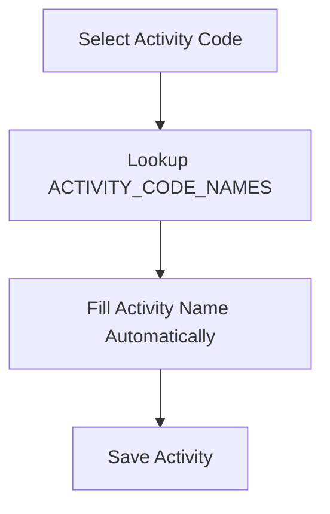

**Diagram sources**
- [activity_codes.py:1-22](file://src/apps/activity/activity_codes.py#L1-L22)
- [forms.py:87-137](file://src/apps/activity/forms.py#L87-L137)
- [ActCode.md:1-20](file://docs/ActCode.md#L1-L20)

**Section sources**
- [activity_codes.py:1-22](file://src/apps/activity/activity_codes.py#L1-L22)
- [forms.py:87-137](file://src/apps/activity/forms.py#L87-L137)
- [ActCode.md:1-20](file://docs/ActCode.md#L1-L20)

### Timeline Control and Workday Calculation
Activity timelines are controlled by start_date and end_date. Report task deadlines are calculated using company workdays.

- Company workdays exclude weekends and declared holidays.
- Report deadline is 10 company workdays after the activity end date.
- Rescheduling an activity updates the linked task’s start and due dates.
- If a task was completed before the new end date, it is reopened and cleared so the assignee can submit a current report.

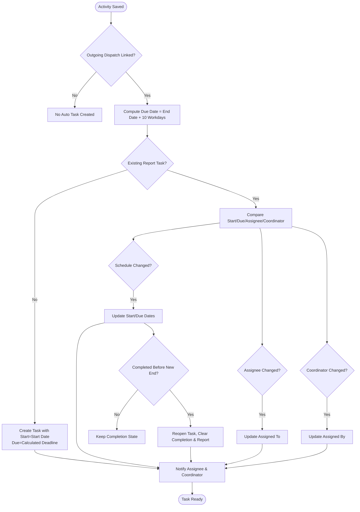

**Diagram sources**
- [services.py:16-66](file://src/apps/activity/services.py#L16-L66)
- [services.py:83-195](file://src/apps/activity/services.py#L83-L195)

**Section sources**
- [services.py:16-66](file://src/apps/activity/services.py#L16-L66)
- [services.py:83-195](file://src/apps/activity/services.py#L83-L195)

### Coordinator Requirements and Validation Rules
Validation ensures data integrity and business compliance.

- **Date range validation**: End date must be on or after start date.
- **Document association validation**: Only outgoing dispatched documents can be linked.
- **Coordinator requirement**: When linking an outgoing document, either a coordinator must be selected or the document must have a signer; otherwise, the system requires a coordinator to record who assigns the report task.
- **Form-level coordinator requirement**: The coordinator field is required in the ActivityForm.
- **Activity code/name consistency**: Activity name is auto-filled from the selected code; custom codes are preserved for existing records.

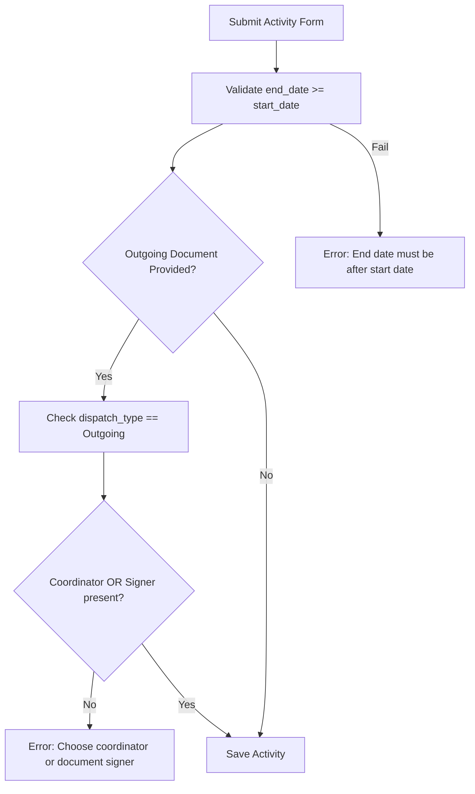

**Diagram sources**
- [models.py:72-86](file://src/apps/activity/models.py#L72-L86)
- [forms.py:100-137](file://src/apps/activity/forms.py#L100-L137)

**Section sources**
- [models.py:72-86](file://src/apps/activity/models.py#L72-L86)
- [forms.py:100-137](file://src/apps/activity/forms.py#L100-L137)

### Official Dispatch Integration
Activities can be authorized by official outgoing documents.

- Only OfficialDispatch records with dispatch_type "Outgoing" are selectable in the form.
- Linking an outgoing document triggers automatic creation of a report task.
- The task assigner is the activity coordinator if present; otherwise, the dispatch signer is used.
- The dispatch issue date does not determine activity schedule; activity start/end dates do.

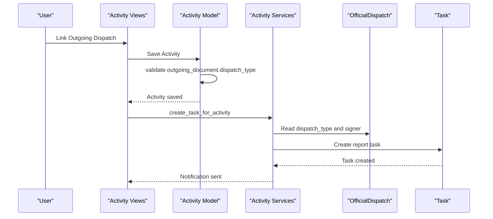

**Diagram sources**
- [views.py:170-218](file://src/apps/activity/views.py#L170-L218)
- [models.py:56-86](file://src/apps/activity/models.py#L56-L86)
- [services.py:83-195](file://src/apps/activity/services.py#L83-L195)
- [document_models.py:193-276](file://src/apps/document/models.py#L193-L276)

**Section sources**
- [views.py:170-218](file://src/apps/activity/views.py#L170-L218)
- [models.py:56-86](file://src/apps/activity/models.py#L56-L86)
- [services.py:83-195](file://src/apps/activity/services.py#L83-L195)
- [document_models.py:193-276](file://src/apps/document/models.py#L193-L276)

### Automated Task Assignment System
The system generates follow-up tasks for activity reporting.

- Trigger: Linking an outgoing OfficialDispatch to an Activity.
- Assignee: Activity’s lead CBDA.
- Assigner: Activity’s coordinator if present; otherwise, the dispatch signer.
- Start date: Activity start date.
- Due date: 10 company workdays after activity end date.
- Updates: Rescheduling changes task dates; reassigning updates assignee/coordinator; early completion may reopen the task if the new end date extends beyond the previous completion.
- Notifications: Assignee and coordinator receive notifications on creation and schedule changes.

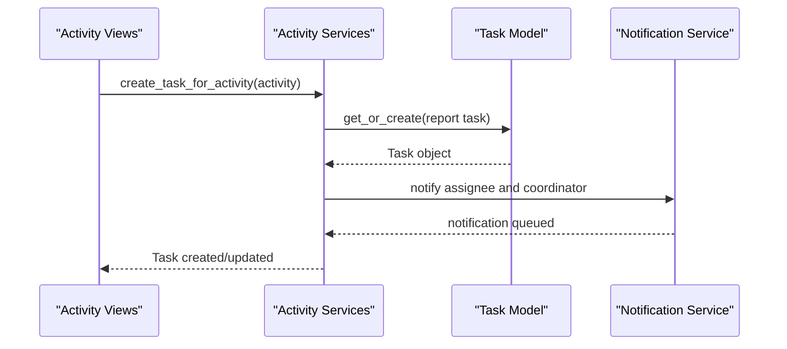

**Diagram sources**
- [services.py:83-249](file://src/apps/activity/services.py#L83-L249)
- [task_models.py:9-104](file://src/apps/task/models.py#L9-L104)

**Section sources**
- [services.py:83-249](file://src/apps/activity/services.py#L83-L249)
- [task_models.py:9-104](file://src/apps/task/models.py#L9-L104)

### Activity Dashboard and Calendar
The dashboard and calendar provide visibility into activities and related tasks.

- Dashboard shows monthly activities filtered by user permissions, with overdue detection and proposal history.
- Calendar renders activity spans and task due dates within the selected month.
- Filtering supports lead CBDA selection.
- Overdue calculation considers task status and due date relative to today.

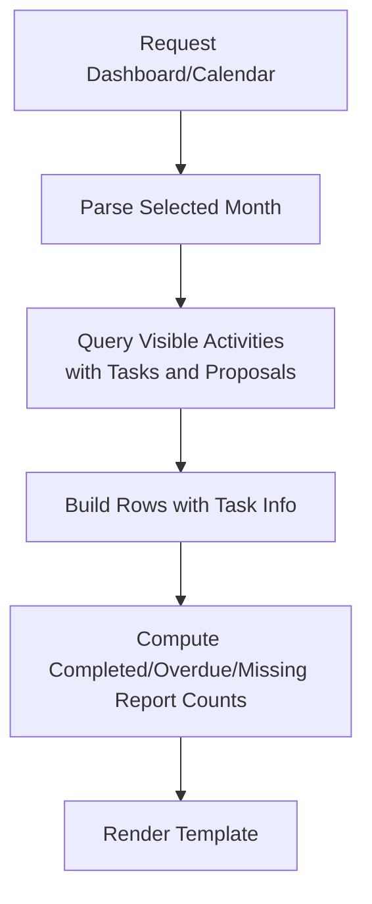

**Diagram sources**
- [views.py:31-109](file://src/apps/activity/views.py#L31-L109)
- [views.py:112-151](file://src/apps/activity/views.py#L112-L151)

**Section sources**
- [views.py:31-109](file://src/apps/activity/views.py#L31-L109)
- [views.py:112-151](file://src/apps/activity/views.py#L112-L151)

### Activity Proposal Workflow
Activities support versioned proposal packages with approval workflows.

- Upload: Proposal and budget PDFs are validated and stored.
- Send: Coordinator prepares an email draft to the director; upon confirmation, the package is marked Submitted.
- Decide: Director approves or requests changes; notifications are sent accordingly.
- History: Latest version is displayed; full history is available.

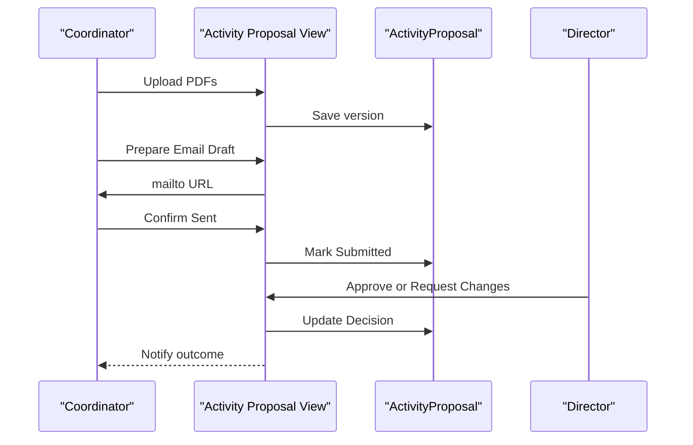

**Diagram sources**
- [views.py:221-424](file://src/apps/activity/views.py#L221-L424)
- [forms.py:12-57](file://src/apps/activity/forms.py#L12-L57)
- [models.py:88-157](file://src/apps/activity/models.py#L88-L157)

**Section sources**
- [views.py:221-424](file://src/apps/activity/views.py#L221-L424)
- [forms.py:12-57](file://src/apps/activity/forms.py#L12-L57)
- [models.py:88-157](file://src/apps/activity/models.py#L88-L157)

## Dependency Analysis
The Activity Management module depends on several internal components.

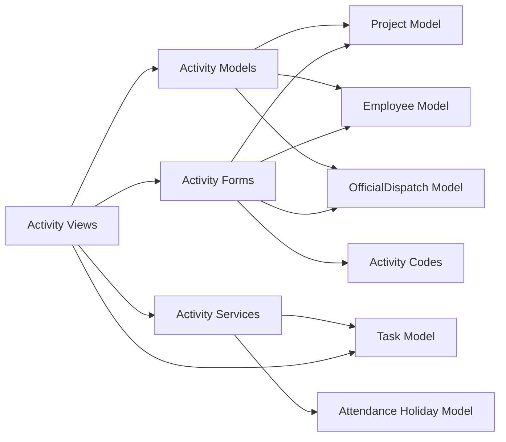

**Diagram sources**
- [models.py:9-86](file://src/apps/activity/models.py#L9-L86)
- [forms.py:12-137](file://src/apps/activity/forms.py#L12-L137)
- [services.py:16-66](file://src/apps/activity/services.py#L16-L66)
- [services.py:83-249](file://src/apps/activity/services.py#L83-L249)
- [views.py:74-218](file://src/apps/activity/views.py#L74-L218)
- [task_models.py:9-104](file://src/apps/task/models.py#L9-L104)
- [document_models.py:193-276](file://src/apps/document/models.py#L193-L276)

**Section sources**
- [models.py:9-86](file://src/apps/activity/models.py#L9-L86)
- [forms.py:12-137](file://src/apps/activity/forms.py#L12-L137)
- [services.py:16-66](file://src/apps/activity/services.py#L16-L66)
- [services.py:83-249](file://src/apps/activity/services.py#L83-L249)
- [views.py:74-218](file://src/apps/activity/views.py#L74-L218)
- [task_models.py:9-104](file://src/apps/task/models.py#L9-L104)
- [document_models.py:193-276](file://src/apps/document/models.py#L193-L276)

## Performance Considerations
- Query optimization: Dashboard queries use select_related and prefetch_related to reduce N+1 queries for project, lead CBDA, coordinator, outgoing document, tasks, and proposal history.
- Workday calculation: Holiday queries are bounded by a computed end date to avoid excessive database hits during iteration.
- Idempotent reminders: Reminder notifications are deduplicated per employee, notification type, link, and day to prevent duplicate alerts.
- Task updates: create_task_for_activity avoids unnecessary saves when no meaningful change occurs.

[No sources needed since this section provides general guidance]

## Troubleshooting Guide
Common issues and resolutions:

- **End date before start date**: The model raises a validation error; correct the date range.
- **Invalid outgoing document**: Only outgoing dispatched documents can be linked; ensure dispatch_type is "Outgoing".
- **Missing coordinator when linking dispatch**: Either select a coordinator or ensure the document has a signer; otherwise, the system requires a coordinator to assign the task.
- **Report task not created**: Verify that an outgoing dispatch is linked and the activity is not cancelled.
- **Task due date incorrect**: Confirm activity end date and company holiday configuration; deadlines are calculated using company workdays.
- **Cannot mark task Done before activity ends**: The task model prevents completion until the activity end date has passed.
- **Cannot reopen task for cancelled activity**: Tasks linked to cancelled activities cannot be reopened except for specific completion transitions.

**Section sources**
- [models.py:72-86](file://src/apps/activity/models.py#L72-L86)
- [services.py:83-195](file://src/apps/activity/services.py#L83-L195)
- [task_models.py:64-104](file://src/apps/task/models.py#L64-L104)

## Conclusion
The Activity Management system provides robust tracking of project activities with clear status lifecycle, strong validation, and automated task generation tied to official dispatch authorization. Timelines are controlled by activity dates and company workdays, ensuring realistic deadlines. Coordinators and lead CBDA roles are central to assignment and oversight. The proposal workflow adds governance for activity packages, while dashboards and calendars offer operational visibility. For external grant management integration, consider mapping activity codes, statuses, and report tasks to external identifiers, and synchronize outgoing document references to maintain auditability.

[No sources needed since this section summarizes without analyzing specific files]