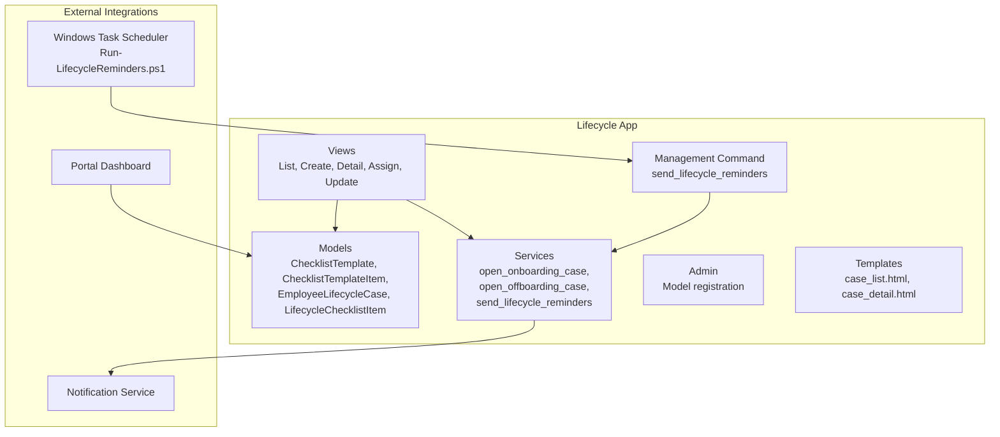
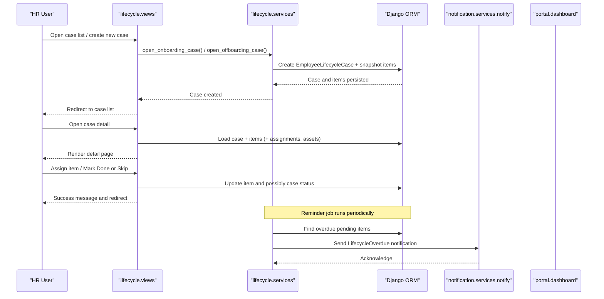
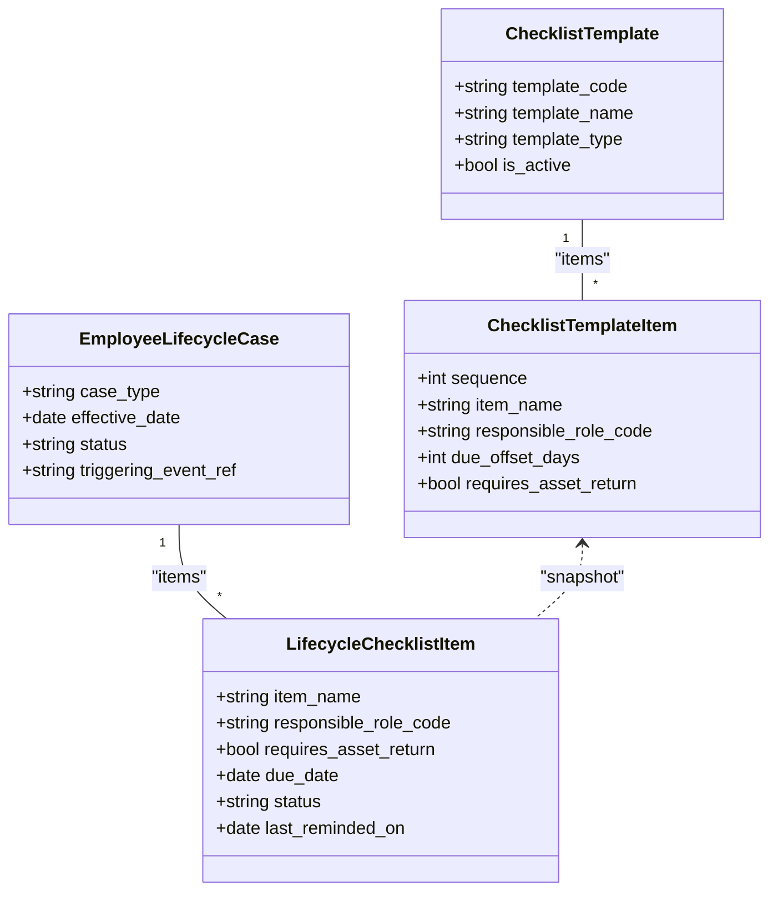
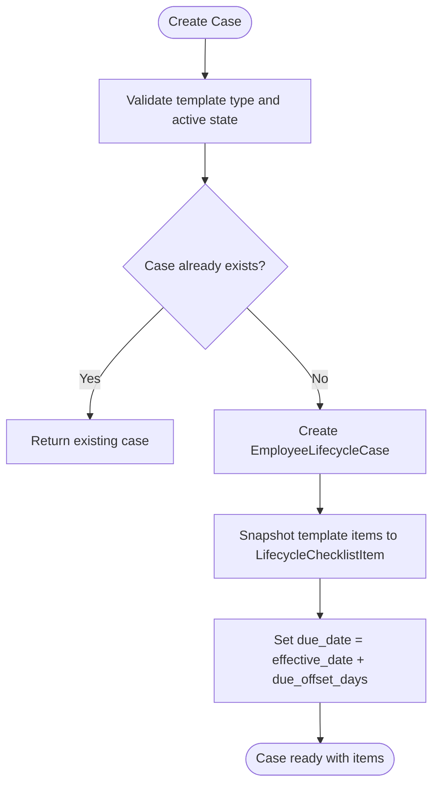
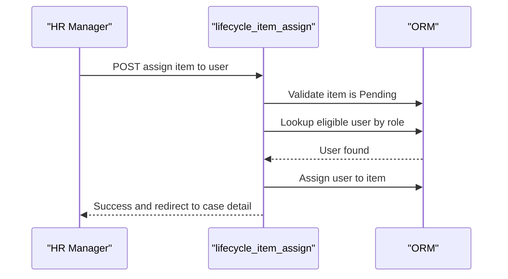
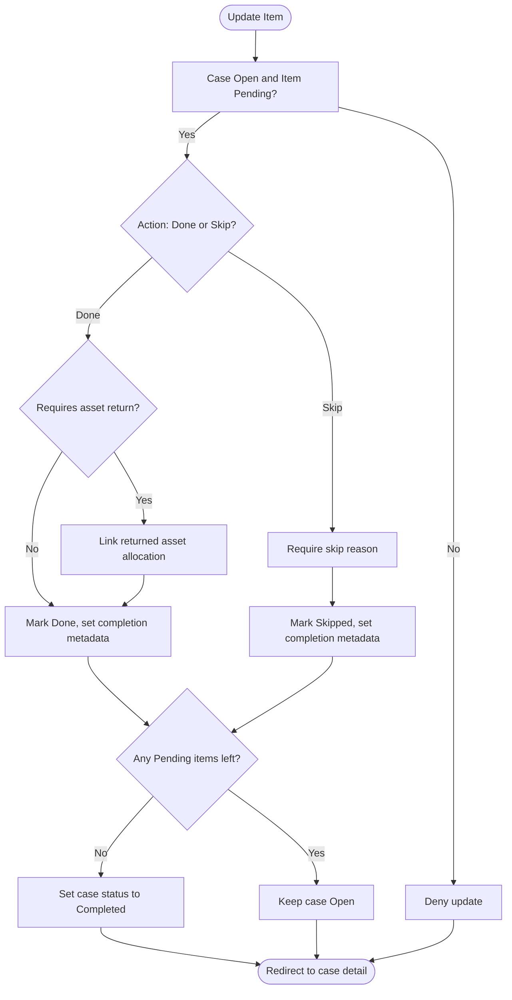
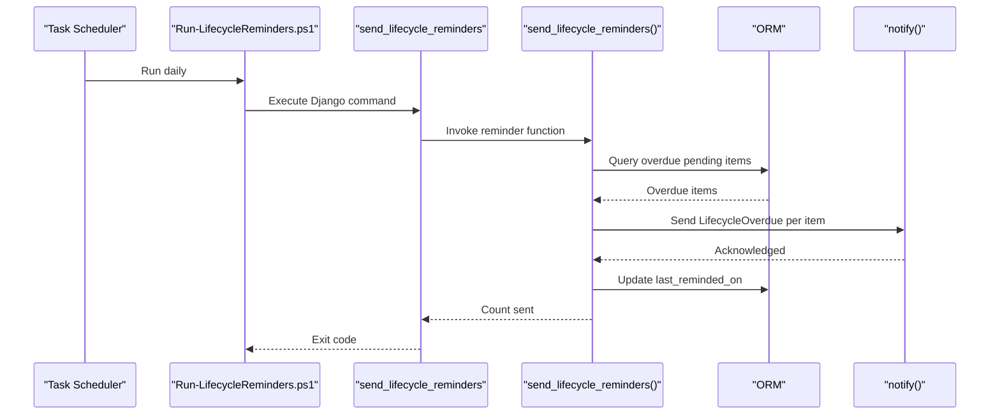
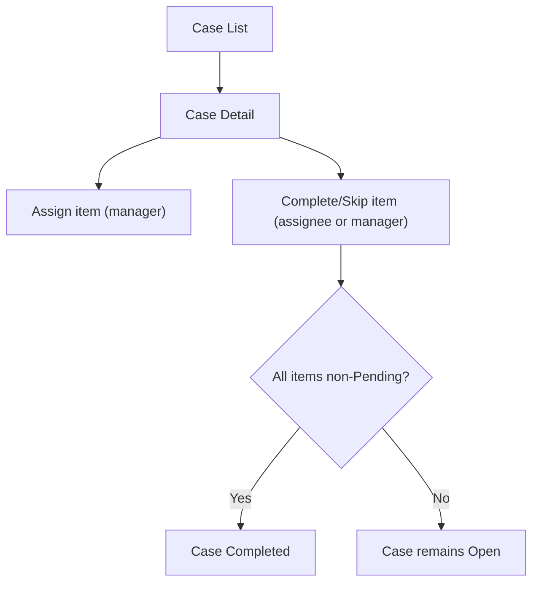
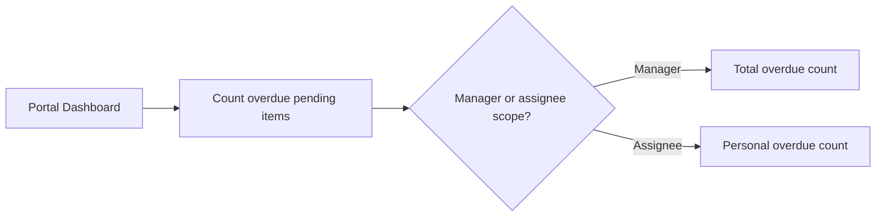
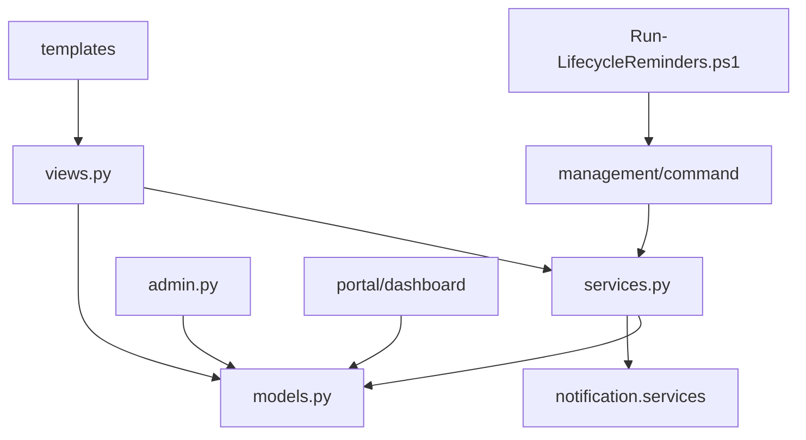

# Lifecycle Case Management

<cite>
**Referenced Files in This Document**
- [models.py](file://src/apps/lifecycle/models.py)
- [views.py](file://src/apps/lifecycle/views.py)
- [services.py](file://src/apps/lifecycle/services.py)
- [admin.py](file://src/apps/lifecycle/admin.py)
- [case_list.html](file://src/apps/lifecycle/templates/lifecycle/case_list.html)
- [case_detail.html](file://src/apps/lifecycle/templates/lifecycle/case_detail.html)
- [send_lifecycle_reminders.py](file://src/apps/lifecycle/management/commands/send_lifecycle_reminders.py)
- [Run-LifecycleReminders.ps1](file://ops/scheduler/Run-LifecycleReminders.ps1)
- [core.py](file://src/apps/portal/views/core.py)
</cite>

## Table of Contents
1. [Introduction](#introduction)
2. [Project Structure](#project-structure)
3. [Core Components](#core-components)
4. [Architecture Overview](#architecture-overview)
5. [Detailed Component Analysis](#detailed-component-analysis)
6. [Dependency Analysis](#dependency-analysis)
7. [Performance Considerations](#performance-considerations)
8. [Troubleshooting Guide](#troubleshooting-guide)
9. [Conclusion](#conclusion)

## Introduction
This document explains the Lifecycle Case Management system used for NGO-style HR case handling, item assignment, and workflow automation. It covers:
- Case models for onboarding and offboarding cases
- Checklist templates and snapshot-based item generation
- Status tracking, assignment workflows, and completion logic
- Integration with reminders and notifications
- UI flows for creating cases, assigning items, marking work done or skipped
- Reporting hooks and dashboard integration points

The system is designed to be simple, auditable, and template-driven, while allowing HR staff to assign tasks to appropriate roles and track progress until a case is completed.

## Project Structure
The lifecycle feature lives under `src/apps/lifecycle` and includes:
- Data models for templates, cases, and checklist items
- Views for listing, creating, viewing details, assigning, and updating items
- Services for opening cases and sending overdue reminders
- Admin configuration for managing templates and cases
- Templates for list and detail pages
- A management command and PowerShell scheduler script for reminders

**Diagram sources**
- [models.py:6-94](file://src/apps/lifecycle/models.py#L6-L94)
- [views.py:33-181](file://src/apps/lifecycle/views.py#L33-L181)
- [services.py:10-69](file://src/apps/lifecycle/services.py#L10-L69)
- [admin.py:13-33](file://src/apps/lifecycle/admin.py#L13-L33)
- [case_list.html:1-18](file://src/apps/lifecycle/templates/lifecycle/case_list.html#L1-L18)
- [case_detail.html:1-32](file://src/apps/lifecycle/templates/lifecycle/case_detail.html#L1-L32)
- [send_lifecycle_reminders.py:1-12](file://src/apps/lifecycle/management/commands/send_lifecycle_reminders.py#L1-L12)
- [Run-LifecycleReminders.ps1:1-41](file://ops/scheduler/Run-LifecycleReminders.ps1#L1-L41)
- [core.py:83-98](file://src/apps/portal/views/core.py#L83-L98)

**Section sources**
- [models.py:6-94](file://src/apps/lifecycle/models.py#L6-L94)
- [views.py:33-181](file://src/apps/lifecycle/views.py#L33-L181)
- [services.py:10-69](file://src/apps/lifecycle/services.py#L10-L69)
- [admin.py:13-33](file://src/apps/lifecycle/admin.py#L13-L33)
- [case_list.html:1-18](file://src/apps/lifecycle/templates/lifecycle/case_list.html#L1-L18)
- [case_detail.html:1-32](file://src/apps/lifecycle/templates/lifecycle/case_detail.html#L1-L32)
- [send_lifecycle_reminders.py:1-12](file://src/apps/lifecycle/management/commands/send_lifecycle_reminders.py#L1-L12)
- [Run-LifecycleReminders.ps1:1-41](file://ops/scheduler/Run-LifecycleReminders.ps1#L1-L41)
- [core.py:83-98](file://src/apps/portal/views/core.py#L83-L98)

## Core Components
- ChecklistTemplate: Defines reusable checklists (e.g., Onboarding, Offboarding).
- ChecklistTemplateItem: Ordered steps within a template, including responsible role and due offset days.
- EmployeeLifecycleCase: A case instance tied to an employee, template, effective date, and status.
- LifecycleChecklistItem: Snapshot of a template step into a case, with assignment, due date, status, completion metadata, optional asset linkage, and reminder tracking.

Key behaviors:
- Cases are created from active templates; items are snapshotted at creation time.
- Items can be assigned to users matching the required role.
- Items can be marked Done or Skipped; when all items are no longer Pending, the case becomes Completed.
- Overdue reminders are sent via the notification service.

**Section sources**
- [models.py:6-94](file://src/apps/lifecycle/models.py#L6-L94)

## Architecture Overview
The lifecycle flow spans UI views, business services, data models, and external integrations.

**Diagram sources**
- [views.py:33-181](file://src/apps/lifecycle/views.py#L33-L181)
- [services.py:10-69](file://src/apps/lifecycle/services.py#L10-L69)
- [models.py:41-94](file://src/apps/lifecycle/models.py#L41-L94)

## Detailed Component Analysis

### Data Model and Relationships

**Diagram sources**
- [models.py:6-94](file://src/apps/lifecycle/models.py#L6-L94)

**Section sources**
- [models.py:6-94](file://src/apps/lifecycle/models.py#L6-L94)

### Case Creation and Template Snapshots
- Onboarding case uses the employee’s join date as the effective date.
- Offboarding case uses a provided leave date as the effective date.
- When a case is first created, the system snapshots each template item into a LifecycleChecklistItem with:
  - Due date = effective date + due_offset_days
  - Required role code and asset return flag copied from template
- Duplicate triggers are idempotent: re-opening the same event does not duplicate cases or items.

**Diagram sources**
- [services.py:10-43](file://src/apps/lifecycle/services.py#L10-L43)

**Section sources**
- [services.py:10-43](file://src/apps/lifecycle/services.py#L10-L43)

### Assignment Workflow
- Only users with manage permission can assign pending items.
- The target user must match the item’s responsible role code and be active with an associated employment record.
- Assignment updates audit fields and redirects back to the case detail.

**Diagram sources**
- [views.py:97-115](file://src/apps/lifecycle/views.py#L97-L115)

**Section sources**
- [views.py:97-115](file://src/apps/lifecycle/views.py#L97-L115)

### Completion and Skipping Logic
- Assigned user or manager can mark an item Done or Skipped.
- For Done:
  - If the item requires asset return, an asset allocation must be linked and returned (for offboarding).
  - Sets completion metadata (user, timestamp) and clears skip reason.
- For Skip:
  - Requires a reason.
- When no items remain Pending, the case status transitions to Completed.

**Diagram sources**
- [views.py:118-181](file://src/apps/lifecycle/views.py#L118-L181)

**Section sources**
- [views.py:118-181](file://src/apps/lifecycle/views.py#L118-L181)

### Reminder System Integration
- A management command triggers reminder dispatch for overdue pending items.
- The service finds overdue items where:
  - Case status is Open
  - Item status is Pending
  - Due date is before today
- It sends a notification per item once per day using last_reminded_on deduplication.
- Windows Task Scheduler can run the command daily via a PowerShell script that sets UTF-8 encoding for Python output.

**Diagram sources**
- [send_lifecycle_reminders.py:1-12](file://src/apps/lifecycle/management/commands/send_lifecycle_reminders.py#L1-L12)
- [services.py:46-69](file://src/apps/lifecycle/services.py#L46-L69)
- [Run-LifecycleReminders.ps1:1-41](file://ops/scheduler/Run-LifecycleReminders.ps1#L1-L41)

**Section sources**
- [send_lifecycle_reminders.py:1-12](file://src/apps/lifecycle/management/commands/send_lifecycle_reminders.py#L1-L12)
- [services.py:46-69](file://src/apps/lifecycle/services.py#L46-L69)
- [Run-LifecycleReminders.ps1:1-41](file://ops/scheduler/Run-LifecycleReminders.ps1#L1-L41)

### UI Flows and Permissions
- Case list shows all cases for managers; regular users see only their own cases or items assigned to them.
- Case detail shows:
  - Case header with type, employee, template, effective date, and status badge
  - Instructions for using the checklist
  - Each item with due date, responsible role, assignee, status, and optional asset info
  - Forms to assign (manager), or complete/skip (assignee or manager)
- Permission checks:
  - Manage permission allows full control
  - View permission allows seeing own cases/items
  - Updating an item requires being the assignee or having manage permission

**Diagram sources**
- [views.py:33-181](file://src/apps/lifecycle/views.py#L33-L181)
- [case_list.html:1-18](file://src/apps/lifecycle/templates/lifecycle/case_list.html#L1-L18)
- [case_detail.html:1-32](file://src/apps/lifecycle/templates/lifecycle/case_detail.html#L1-L32)

**Section sources**
- [views.py:33-181](file://src/apps/lifecycle/views.py#L33-L181)
- [case_list.html:1-18](file://src/apps/lifecycle/templates/lifecycle/case_list.html#L1-L18)
- [case_detail.html:1-32](file://src/apps/lifecycle/templates/lifecycle/case_detail.html#L1-L32)

### Dashboard and Reporting Hooks
- The portal dashboard counts overdue lifecycle items for both managers and individual users.
- This enables quick visibility into backlog without leaving the homepage.

**Diagram sources**
- [core.py:83-98](file://src/apps/portal/views/core.py#L83-L98)

**Section sources**
- [core.py:83-98](file://src/apps/portal/views/core.py#L83-L98)

## Dependency Analysis
- Models depend on common base model and external apps:
  - Employee reference to HR app
  - AssetAllocation reference to Asset app
  - Notification service integration for reminders
- Views depend on permissions and related models for safe operations
- Services encapsulate transactional case creation and reminder dispatch
- Admin provides operational visibility and editing for templates and cases

**Diagram sources**
- [views.py:1-181](file://src/apps/lifecycle/views.py#L1-L181)
- [models.py:1-94](file://src/apps/lifecycle/models.py#L1-L94)
- [services.py:1-69](file://src/apps/lifecycle/services.py#L1-L69)
- [admin.py:1-33](file://src/apps/lifecycle/admin.py#L1-L33)
- [send_lifecycle_reminders.py:1-12](file://src/apps/lifecycle/management/commands/send_lifecycle_reminders.py#L1-L12)
- [Run-LifecycleReminders.ps1:1-41](file://ops/scheduler/Run-LifecycleReminders.ps1#L1-L41)
- [core.py:83-98](file://src/apps/portal/views/core.py#L83-L98)

**Section sources**
- [views.py:1-181](file://src/apps/lifecycle/views.py#L1-L181)
- [models.py:1-94](file://src/apps/lifecycle/models.py#L1-L94)
- [services.py:1-69](file://src/apps/lifecycle/services.py#L1-L69)
- [admin.py:1-33](file://src/apps/lifecycle/admin.py#L1-L33)
- [send_lifecycle_reminders.py:1-12](file://src/apps/lifecycle/management/commands/send_lifecycle_reminders.py#L1-L12)
- [Run-LifecycleReminders.ps1:1-41](file://ops/scheduler/Run-LifecycleReminders.ps1#L1-L41)
- [core.py:83-98](file://src/apps/portal/views/core.py#L83-L98)

## Performance Considerations
- Use select_related and select_for_update in views and services to reduce queries and avoid race conditions during updates.
- Database indexes exist on item status and due date to optimize overdue queries.
- Snapshotting items avoids repeated joins to template definitions after case creation.
- Reminder processing locks rows and filters efficiently; ensure scheduled runs are limited to necessary times.

[No sources needed since this section provides general guidance]

## Troubleshooting Guide
Common issues and resolutions:
- Cannot create case:
  - Ensure the selected template matches the case type and is active.
  - For offboarding, provide a valid effective date.
- Cannot assign item:
  - Verify the target user has the required role and is active.
- Cannot mark item Done:
  - If asset return is required, link a returned asset allocation first.
- Cannot mark item Skipped:
  - Provide a skip reason.
- No reminders received:
  - Confirm the management command runs successfully.
  - Check logs generated by the PowerShell scheduler script.
  - Ensure last_reminded_on is updated and not preventing repeat notifications.

Operational tips:
- Run the reminder command manually to test: `python src\manage.py send_lifecycle_reminders`.
- Inspect logs in the project Logs directory for daily runs.
- Validate that the PowerShell script sets UTF-8 environment variables to avoid encoding errors on Windows.

**Section sources**
- [views.py:48-74](file://src/apps/lifecycle/views.py#L48-L74)
- [views.py:97-181](file://src/apps/lifecycle/views.py#L97-L181)
- [services.py:46-69](file://src/apps/lifecycle/services.py#L46-L69)
- [send_lifecycle_reminders.py:1-12](file://src/apps/lifecycle/management/commands/send_lifecycle_reminders.py#L1-L12)
- [Run-LifecycleReminders.ps1:1-41](file://ops/scheduler/Run-LifecycleReminders.ps1#L1-L41)

## Conclusion
The Lifecycle Case Management system provides a robust, template-driven approach to managing onboarding and offboarding cases. It enforces clear status transitions, supports assignment and completion workflows, integrates with reminders and dashboards, and offers admin tools for oversight. With careful scheduling of reminders and attention to permissions and asset linkage rules, teams can reliably track and close HR lifecycle processes.

[No sources needed since this section summarizes without analyzing specific files]