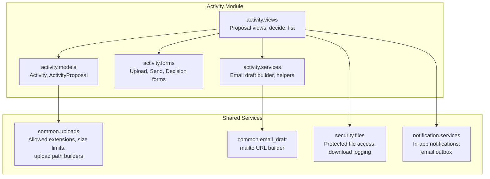
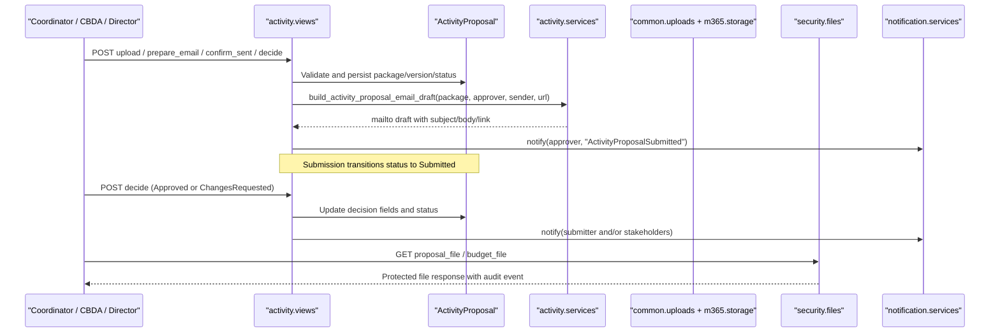
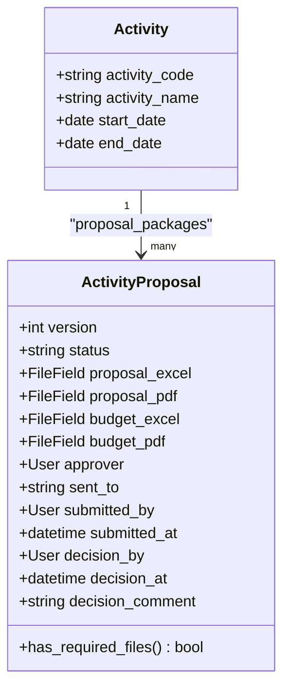
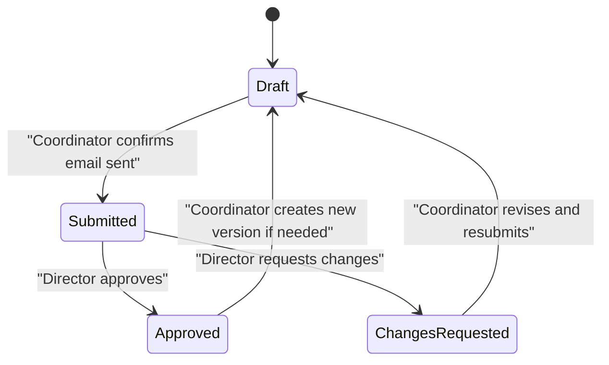
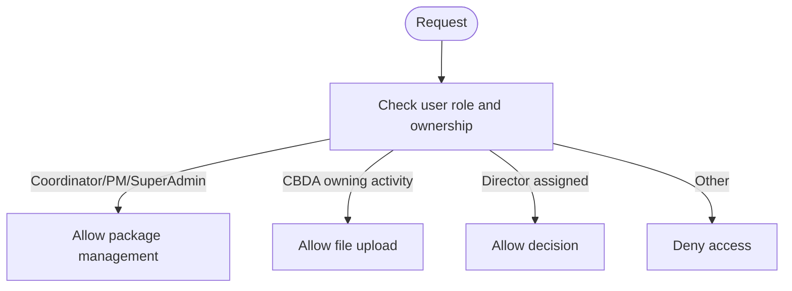
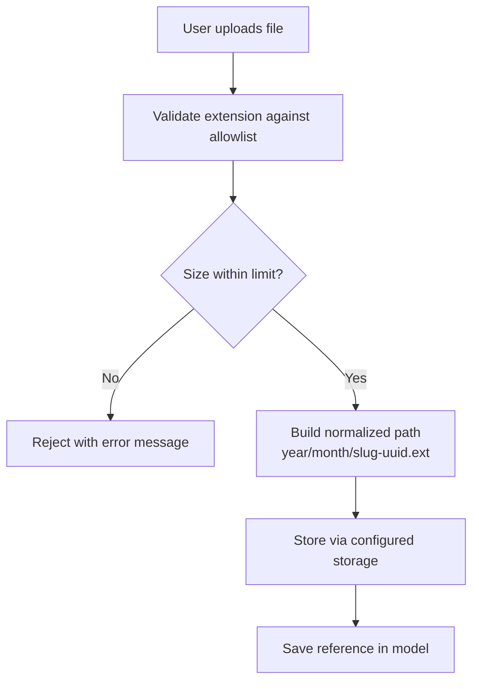
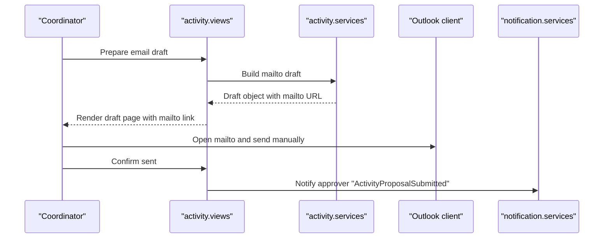
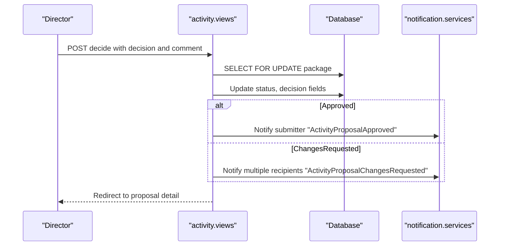
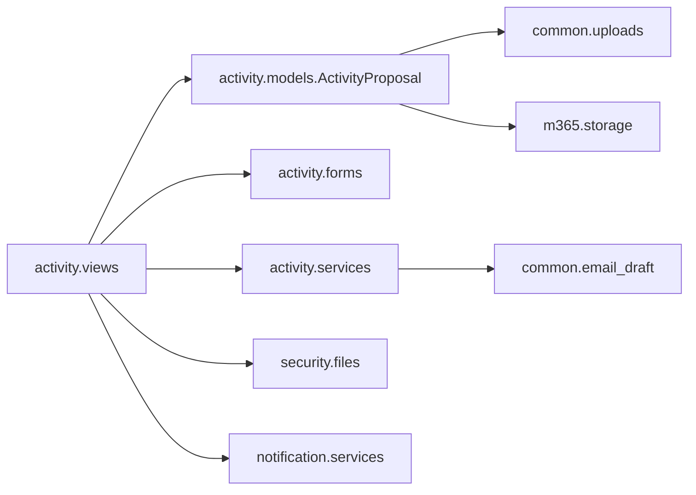

# Proposal & Budget Workflow

<cite>
**Referenced Files in This Document**
- [models.py](file://src/apps/activity/models.py)
- [views.py](file://src/apps/activity/views.py)
- [forms.py](file://src/apps/activity/forms.py)
- [services.py](file://src/apps/activity/services.py)
- [uploads.py](file://src/apps/common/uploads.py)
- [email_draft.py](file://src/apps/common/email_draft.py)
- [files.py](file://src/apps/security/files.py)
- [services.py](file://src/apps/notification/services.py)
- [0005_activityproposal.py](file://src/apps/activity/migrations/0005_activityproposal.py)
- [tests.py](file://src/apps/activity/tests.py)
</cite>

## Table of Contents
1. [Introduction](#introduction)
2. [Project Structure](#project-structure)
3. [Core Components](#core-components)
4. [Architecture Overview](#architecture-overview)
5. [Detailed Component Analysis](#detailed-component-analysis)
6. [Dependency Analysis](#dependency-analysis)
7. [Performance Considerations](#performance-considerations)
8. [Troubleshooting Guide](#troubleshooting-guide)
9. [Conclusion](#conclusion)

## Introduction
This document explains the Activity Proposal and Budget Workflow system that manages versioned proposal packages, approval processes, and secure document management for project activities. It covers:

- The `ActivityProposal` model with version control, file attachments (Excel and PDF), approval workflow fields, and decision tracking.
- The four-stage lifecycle: Draft → Submitted → Approved or ChangesRequested.
- Role-based permissions for coordinators, project directors, and activity owners.
- Dual-document structure supporting both proposal packages and budget estimates.
- Email draft generation for proposal submissions and notification delivery for decisions.
- File validation, storage routing, protected downloads, and audit trail maintenance.
- Practical guidance for creating versions, uploading documents, submitting for approval, processing decisions, generating reports, and managing budget revisions.

## Project Structure
The workflow is implemented as a Django application under `apps.activity`, with shared utilities in `apps.common`, security controls in `apps.security`, and notifications in `apps.notification`.

**Diagram sources**
- [models.py:88-156](file://src/apps/activity/models.py#L88-L156)
- [views.py:228-453](file://src/apps/activity/views.py#L228-L453)
- [forms.py:12-57](file://src/apps/activity/forms.py#L12-L57)
- [services.py:314-339](file://src/apps/activity/services.py#L314-L339)
- [uploads.py:20-35](file://src/apps/common/uploads.py#L20-L35)
- [email_draft.py:5-9](file://src/apps/common/email_draft.py#L5-L9)
- [files.py:12-24](file://src/apps/security/files.py#L12-L24)
- [services.py:18-29](file://src/apps/notification/services.py#L18-L29)

**Section sources**
- [models.py:88-156](file://src/apps/activity/models.py#L88-L156)
- [views.py:228-453](file://src/apps/activity/views.py#L228-L453)
- [forms.py:12-57](file://src/apps/activity/forms.py#L12-L57)
- [services.py:314-339](file://src/apps/activity/services.py#L314-L339)
- [uploads.py:20-35](file://src/apps/common/uploads.py#L20-L35)
- [email_draft.py:5-9](file://src/apps/common/email_draft.py#L5-L9)
- [files.py:12-24](file://src/apps/security/files.py#L12-L24)
- [services.py:18-29](file://src/apps/notification/services.py#L18-L29)

## Core Components
- ActivityProposal model: Stores versioned proposal/budget packages, links to an Activity, tracks approver, submitter, timestamps, and decision details. Enforces unique `(activity, version)` pairs and orders by newest version first.
- Forms:
  - Upload form restricts uploads to PDF files for proposal and budget exports.
  - Send form selects an active Director user as approver.
  - Decision form enforces a comment when requesting changes.
- Views:
  - Proposal detail view handles upload, email draft preparation, submission confirmation, decision taking, and file download.
  - Approval list shows pending proposals for the current director.
- Services:
  - Builds Outlook mailto drafts with recipient, subject, body, and attachment links.
- Storage and Security:
  - Centralized upload validators enforce allowed extensions and size limits.
  - Protected file responses log downloads and apply safe headers.
- Notifications:
  - In-app notifications are created for submission and decision outcomes.

**Section sources**
- [models.py:88-156](file://src/apps/activity/models.py#L88-L156)
- [forms.py:12-57](file://src/apps/activity/forms.py#L12-L57)
- [views.py:228-453](file://src/apps/activity/views.py#L228-L453)
- [services.py:314-339](file://src/apps/activity/services.py#L314-L339)
- [uploads.py:106-124](file://src/apps/common/uploads.py#L106-L124)
- [files.py:27-51](file://src/apps/security/files.py#L27-L51)
- [services.py:18-29](file://src/apps/notification/services.py#L18-L29)

## Architecture Overview
The workflow integrates UI actions, business logic, storage, security, and notifications.

**Diagram sources**
- [views.py:228-453](file://src/apps/activity/views.py#L228-L453)
- [services.py:314-339](file://src/apps/activity/services.py#L314-L339)
- [models.py:88-156](file://src/apps/activity/models.py#L88-L156)
- [uploads.py:103-124](file://src/apps/common/uploads.py#L103-L124)
- [files.py:27-51](file://src/apps/security/files.py#L27-L51)
- [services.py:18-29](file://src/apps/notification/services.py#L18-L29)

## Detailed Component Analysis

### ActivityProposal Model and Versioning
- Fields include:
  - Version number with uniqueness per activity.
  - Status choices: Draft, Submitted, Approved, ChangesRequested.
  - Four file fields: proposal Excel/PDF and budget Excel/PDF.
  - Approver, sent_to email, submitted_by/at, decision_by/at, decision_comment.
- Ordering ensures latest version appears first; constraints prevent duplicate versions.
- Helper method checks required PDF exports before submission.

**Diagram sources**
- [models.py:88-156](file://src/apps/activity/models.py#L88-L156)

**Section sources**
- [models.py:88-156](file://src/apps/activity/models.py#L88-L156)
- [0005_activityproposal.py:26-38](file://src/apps/activity/migrations/0005_activityproposal.py#L26-L38)

### Lifecycle States and Transitions
- Draft: Initial state; coordinator/CBDA can upload files and revise.
- Submitted: Coordinator confirms email was sent; approver becomes the assigned Director.
- Approved: Director approves; submitter receives notification.
- ChangesRequested: Director requests changes with comments; submitter and related parties receive notifications.

**Diagram sources**
- [views.py:228-453](file://src/apps/activity/views.py#L228-L453)
- [models.py:91-105](file://src/apps/activity/models.py#L91-L105)

**Section sources**
- [views.py:228-453](file://src/apps/activity/views.py#L228-L453)
- [models.py:91-105](file://src/apps/activity/models.py#L91-L105)

### Role-Based Permissions
- Coordinator roles:
  - Super admin, project manager, or project coordinator linked to the activity can manage proposal packages.
- CBDA role:
  - Can upload files for their own activity.
- Director role:
  - Can approve or request changes only on submitted packages assigned to them.

**Diagram sources**
- [views.py:221-233](file://src/apps/activity/views.py#L221-L233)
- [views.py:345-363](file://src/apps/activity/views.py#L345-L363)

**Section sources**
- [views.py:221-233](file://src/apps/activity/views.py#L221-L233)
- [views.py:345-363](file://src/apps/activity/views.py#L345-L363)

### File Validation and Storage Management
- Allowed extensions include common office and image formats; size limit enforced centrally.
- Upload paths are normalized and organized by year/month with unique suffixes.
- Proposal-specific upload function routes files to the activity-proposals folder.
- Form-level validation ensures proposal and budget uploads are PDFs.

**Diagram sources**
- [uploads.py:20-35](file://src/apps/common/uploads.py#L20-L35)
- [uploads.py:38-59](file://src/apps/common/uploads.py#L38-L59)
- [uploads.py:103-124](file://src/apps/common/uploads.py#L103-L124)
- [forms.py:21-31](file://src/apps/activity/forms.py#L21-L31)

**Section sources**
- [uploads.py:20-35](file://src/apps/common/uploads.py#L20-L35)
- [uploads.py:38-59](file://src/apps/common/uploads.py#L38-L59)
- [uploads.py:103-124](file://src/apps/common/uploads.py#L103-L124)
- [forms.py:21-31](file://src/apps/activity/forms.py#L21-L31)

### Email Notification System for Submissions and Decisions
- Submission:
  - Coordinator prepares an Outlook mailto draft with recipient, subject, body, and attachment links.
  - On confirmation, the package status becomes Submitted and the approver receives an in-app notification.
- Decisions:
  - Approved: Notifies the submitter.
  - ChangesRequested: Notifies submitter, creator, activity lead, and coordinator.

**Diagram sources**
- [views.py:247-321](file://src/apps/activity/views.py#L247-L321)
- [services.py:314-339](file://src/apps/activity/services.py#L314-L339)
- [email_draft.py:5-9](file://src/apps/common/email_draft.py#L5-L9)
- [services.py:18-29](file://src/apps/notification/services.py#L18-L29)

**Section sources**
- [views.py:247-321](file://src/apps/activity/views.py#L247-L321)
- [services.py:314-339](file://src/apps/activity/services.py#L314-L339)
- [email_draft.py:5-9](file://src/apps/common/email_draft.py#L5-L9)
- [services.py:18-29](file://src/apps/notification/services.py#L18-L29)

### Decision Processing and Audit Trail
- Only the assigned Director can process a Submitted package.
- Decision updates status, comment, decision timestamp, and decision maker.
- Concurrency protection uses row locking during decision save.
- All file downloads are protected and logged as security events.

**Diagram sources**
- [views.py:366-424](file://src/apps/activity/views.py#L366-L424)
- [services.py:18-29](file://src/apps/notification/services.py#L18-L29)

**Section sources**
- [views.py:366-424](file://src/apps/activity/views.py#L366-L424)
- [files.py:27-51](file://src/apps/security/files.py#L27-L51)

### Examples and Usage Guidance

- Creating a proposal version:
  - CBDA or coordinator uploads proposal and budget PDFs.
  - If revising an approved or changed-requested package, a new version is created automatically.
  - Reference: [views.py:323-343](file://src/apps/activity/views.py#L323-L343)

- Uploading supporting documents:
  - Use the upload form restricted to PDF files for proposal and budget exports.
  - Reference: [forms.py:12-31](file://src/apps/activity/forms.py#L12-L31)

- Submitting for approval:
  - Coordinator prepares Outlook draft, attaches PDFs, sends manually, then confirms submission.
  - Package status becomes Submitted and approver is notified.
  - Reference: [views.py:247-321](file://src/apps/activity/views.py#L247-L321), [services.py:314-339](file://src/apps/activity/services.py#L314-L339)

- Processing decisions:
  - Director chooses Approved or ChangesRequested with optional comment.
  - Appropriate notifications are sent to relevant parties.
  - Reference: [views.py:366-424](file://src/apps/activity/views.py#L366-L424)

- Generating approval reports:
  - Use the approval list view filtered by the current Director’s pending submissions.
  - Reference: [views.py:427-436](file://src/apps/activity/views.py#L427-L436)

- Tracking proposal history:
  - Latest version is displayed; full history is available via ordered query.
  - Reference: [views.py:234-236](file://src/apps/activity/views.py#L234-L236)

- Managing budget revisions across versions:
  - When revising after approval or change request, previous PDF references are carried forward unless replaced.
  - Reference: [views.py:323-331](file://src/apps/activity/views.py#L323-L331)

**Section sources**
- [views.py:234-343](file://src/apps/activity/views.py#L234-L343)
- [views.py:366-436](file://src/apps/activity/views.py#L366-L436)
- [forms.py:12-31](file://src/apps/activity/forms.py#L12-L31)
- [services.py:314-339](file://src/apps/activity/services.py#L314-L339)

## Dependency Analysis
Key dependencies and relationships:

- `activity.views` depends on:
  - `activity.models.ActivityProposal`
  - `activity.forms`
  - `activity.services.build_activity_proposal_email_draft`
  - `notification.services.notify`
  - `security.files.protected_file_response`
- `activity.models.ActivityProposal` depends on:
  - `common.uploads.upload_to_activity_proposals`
  - `common.uploads.validate_upload`
  - `m365.storage.get_storage`
- `activity.services` depends on:
  - `common.email_draft.build_mailto_url`
- `security.files` defines allowed models and fields for protected downloads, including `ActivityProposal`.

**Diagram sources**
- [views.py:15-28](file://src/apps/activity/views.py#L15-L28)
- [models.py:4-6](file://src/apps/activity/models.py#L4-L6)
- [services.py:9](file://src/apps/activity/services.py#L9)
- [files.py:12-24](file://src/apps/security/files.py#L12-L24)

**Section sources**
- [views.py:15-28](file://src/apps/activity/views.py#L15-L28)
- [models.py:4-6](file://src/apps/activity/models.py#L4-L6)
- [services.py:9](file://src/apps/activity/services.py#L9)
- [files.py:12-24](file://src/apps/security/files.py#L12-L24)

## Performance Considerations
- Database queries:
  - Proposal history is prefetched to avoid N+1 queries on dashboards and detail pages.
  - Decision endpoint uses row locking to serialize concurrent approvals.
- File handling:
  - Protected file responses set safe headers and cache-control policies.
  - Upload validation prevents large or disallowed files early.
- Notifications:
  - Batch creation helper exists for bulk notifications; single notify used for workflow events.

[No sources needed since this section provides general guidance]

## Troubleshooting Guide
Common issues and resolutions:

- Cannot upload non-PDF files:
  - The upload form enforces PDF-only for proposal and budget exports.
  - Resolution: Export proposal and budget as PDFs before uploading.
  - Reference: [forms.py:21-31](file://src/apps/activity/forms.py#L21-L31)

- Cannot submit without required PDFs:
  - Submission requires both proposal and budget PDFs.
  - Resolution: Ensure both PDFs are attached before preparing email draft.
  - Reference: [views.py:251-253](file://src/apps/activity/views.py#L251-L253), [services.py:319-320](file://src/apps/activity/services.py#L319-L320)

- Director cannot decide:
  - Only the assigned Director can process a Submitted package.
  - Resolution: Verify approver assignment and status.
  - Reference: [views.py:366-379](file://src/apps/activity/views.py#L366-L379)

- File download returns 404:
  - Access is protected and requires permission; missing files also return 404.
  - Resolution: Confirm user has read access and file exists.
  - Reference: [files.py:27-51](file://src/apps/security/files.py#L27-L51)

- Duplicate or conflicting decisions:
  - Row locking prevents simultaneous saves; tests verify only one decision persists.
  - Resolution: Retry after conflict; ensure single approver session.
  - Reference: [views.py:372-385](file://src/apps/activity/views.py#L372-L385), [tests.py:516-580](file://src/apps/activity/tests.py#L516-L580)

**Section sources**
- [forms.py:21-31](file://src/apps/activity/forms.py#L21-L31)
- [views.py:251-253](file://src/apps/activity/views.py#L251-L253)
- [views.py:366-385](file://src/apps/activity/views.py#L366-L385)
- [files.py:27-51](file://src/apps/security/files.py#L27-L51)
- [tests.py:516-580](file://src/apps/activity/tests.py#L516-L580)

## Conclusion
The Activity Proposal and Budget Workflow provides a robust, versioned approach to managing proposal packages and budget estimates. It enforces clear lifecycle states, role-based permissions, secure file handling, and comprehensive notifications. The dual-document structure supports both proposal and budget artifacts, while version control preserves history and enables iterative revision. With centralized validation, protected downloads, and audit trails, the system ensures compliance and traceability throughout the approval process.

[No sources needed since this section summarizes without analyzing specific files]