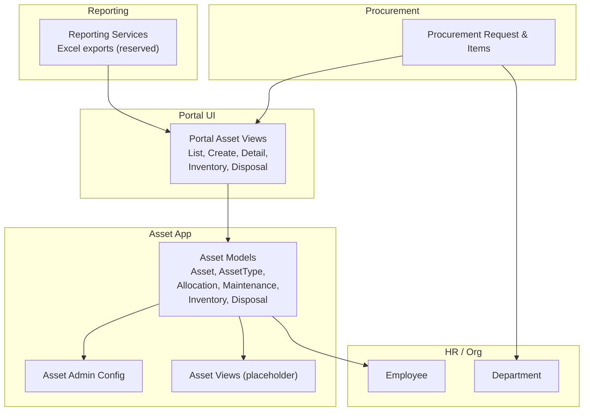
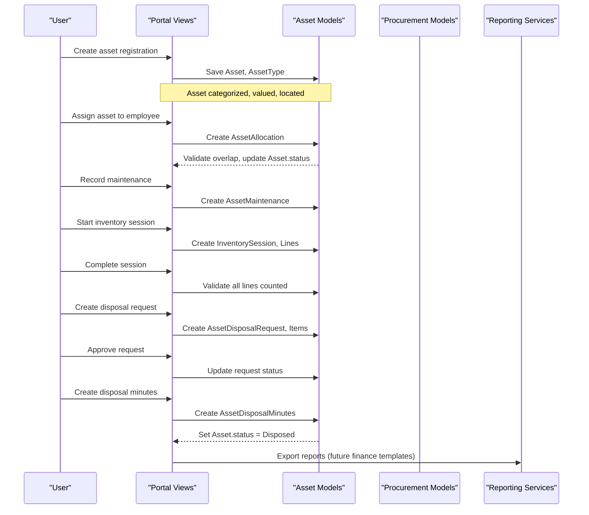
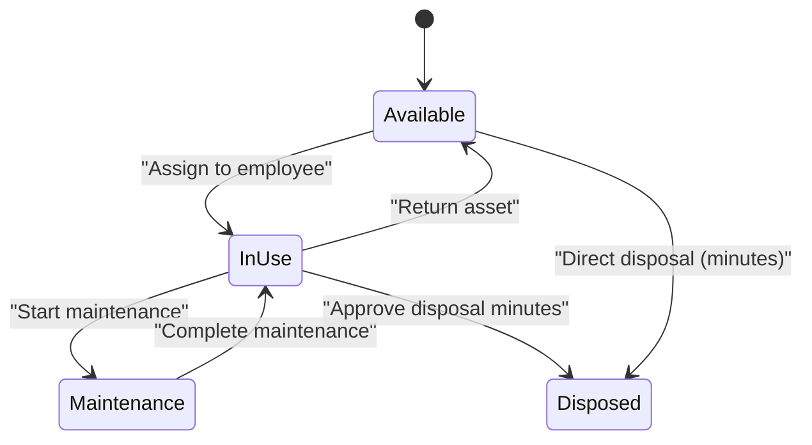
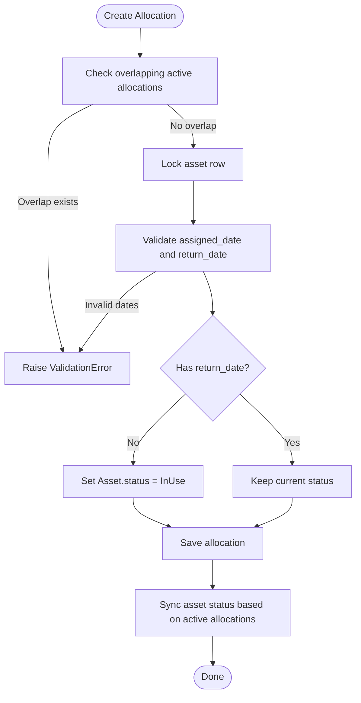
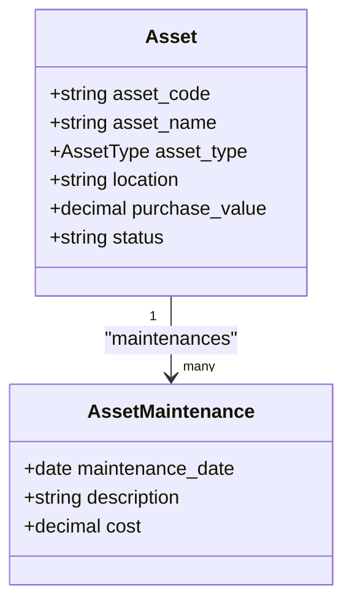
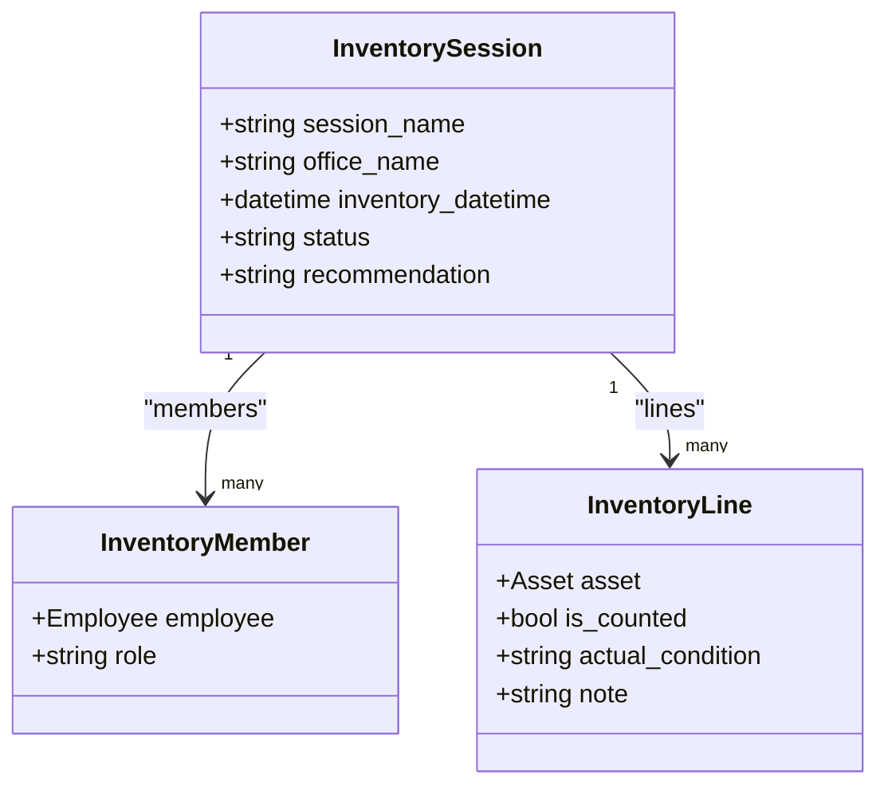
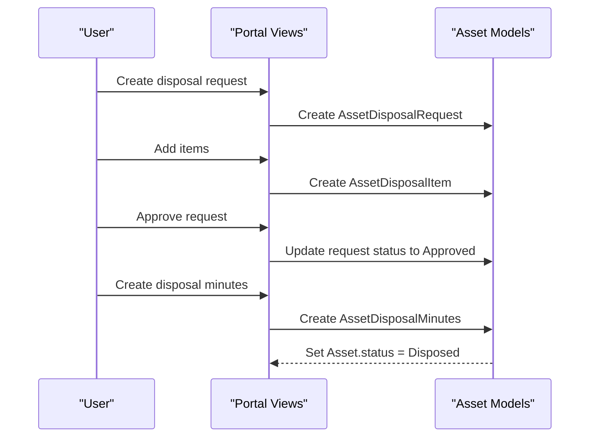
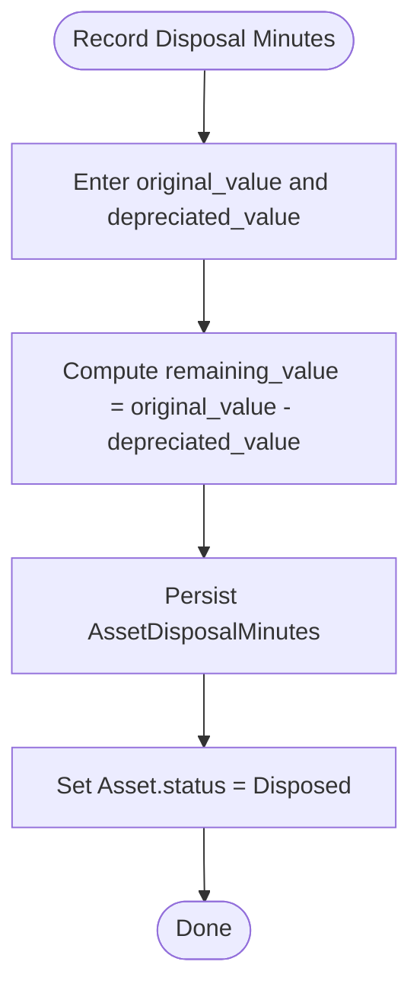
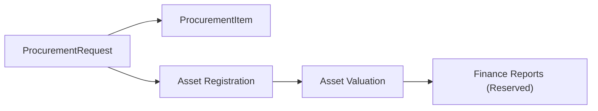
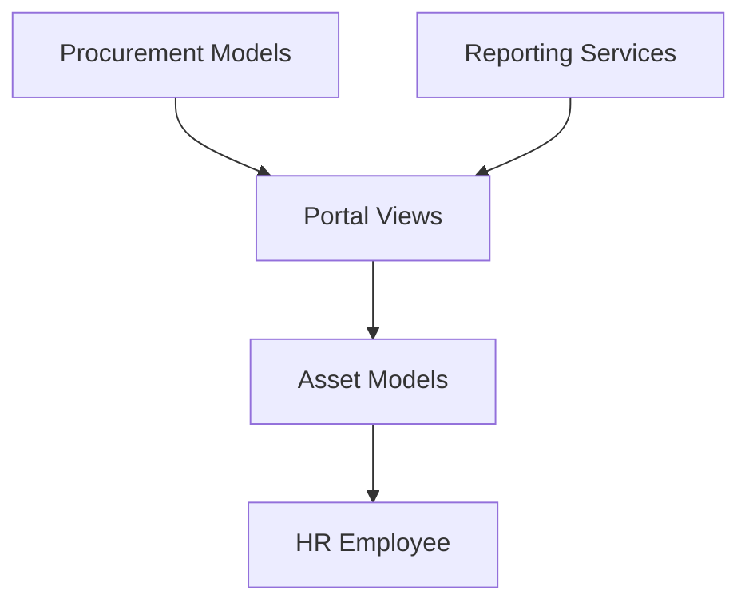

# Asset Management

<cite>
**Referenced Files in This Document**
- [models.py](file://src/apps/asset/models.py)
- [admin.py](file://src/apps/asset/admin.py)
- [views.py](file://src/apps/asset/views.py)
- [assets.py](file://src/apps/portal/views/assets.py)
- [models.py](file://src/apps/procurement/models.py)
- [services.py](file://src/apps/reporting/services.py)
- [tests.py](file://src/apps/asset/tests.py)
</cite>

## Table of Contents
1. [Introduction](#introduction)
2. [Project Structure](#project-structure)
3. [Core Components](#core-components)
4. [Architecture Overview](#architecture-overview)
5. [Detailed Component Analysis](#detailed-component-analysis)
6. [Dependency Analysis](#dependency-analysis)
7. [Performance Considerations](#performance-considerations)
8. [Troubleshooting Guide](#troubleshooting-guide)
9. [Conclusion](#conclusion)
10. [Appendices](#appendices)

## Introduction
This document explains the asset management capability implemented in the repository. It covers inventory tracking, maintenance scheduling, disposal processing, and asset lifecycle management. The Asset model supports categorization via AssetType, valuation through purchase value, and location tracking. Allocation to employees is enforced with overlap protection and status synchronization. Maintenance records are attached to assets for repair history. Inventory sessions provide structured audits with members and line-level checks. Disposal workflows include request creation, approval, itemized evaluation, minutes recording, and final asset state changes. Procurement integration is modeled through procurement requests, while finance-related reporting hooks are reserved for future compliance templates.

## Project Structure
The asset domain lives under the asset application and integrates with HR, organization, procurement, portal UI, and reporting services.

**Diagram sources**
- [models.py:8-390](file://src/apps/asset/models.py#L8-L390)
- [admin.py:1-66](file://src/apps/asset/admin.py#L1-L66)
- [views.py:1-4](file://src/apps/asset/views.py#L1-L4)
- [assets.py:50-437](file://src/apps/portal/views/assets.py#L50-L437)
- [models.py:1-87](file://src/apps/procurement/models.py#L1-L87)
- [services.py:1-262](file://src/apps/reporting/services.py#L1-L262)

**Section sources**
- [models.py:8-390](file://src/apps/asset/models.py#L8-L390)
- [admin.py:1-66](file://src/apps/asset/admin.py#L1-L66)
- [assets.py:50-437](file://src/apps/portal/views/assets.py#L50-L437)

## Core Components
- AssetType: Categorizes assets into groups such as machinery or other equipment.
- Asset: Represents a physical asset with code, name, type, location, brand, serial number, funding source, purchase date, quantity, unit, purchase value, condition, note, and status.
- AssetAllocation: Tracks assignment of an asset to an employee over time, preventing overlapping assignments and synchronizing asset status.
- AssetMaintenance: Records maintenance events including date, description, and cost.
- InventorySession, InventoryMember, InventoryLine: Provide audit sessions with roles, per-asset checks, and completion validation.
- AssetDisposalRequest, AssetDisposalRequestMember, AssetDisposalItem, AssetDisposalMinutes: Model the disposal workflow from request through approval, item evaluation, minutes, and final asset disposition.

Key behaviors:
- Asset status transitions between Available, InUse, Maintenance, and Disposed.
- Allocation overlaps are prevented; active allocation sets asset to InUse; return clears to Available when no active allocations remain.
- Inventory sessions cannot be completed until all lines are counted; completed sessions lock line edits.
- Disposal minutes set the asset status to Disposed upon save.

**Section sources**
- [models.py:8-390](file://src/apps/asset/models.py#L8-L390)
- [tests.py:11-92](file://src/apps/asset/tests.py#L11-L92)

## Architecture Overview
The asset system combines data models with portal views that enforce business rules and permissions. Procurement requests represent planned acquisitions that can later become assets. Reporting services provide export utilities and reserve placeholders for finance-compliant reports.

**Diagram sources**
- [assets.py:50-437](file://src/apps/portal/views/assets.py#L50-L437)
- [models.py:24-390](file://src/apps/asset/models.py#L24-L390)
- [models.py:1-87](file://src/apps/procurement/models.py#L1-L87)
- [services.py:1-262](file://src/apps/reporting/services.py#L1-L262)

## Detailed Component Analysis

### Asset Model and Lifecycle
- Categorization: AssetType defines groupings and codes used to classify assets.
- Valuation: Purchase value captures acquisition cost; depreciation fields exist at disposal minutes level for accounting purposes.
- Location: Location field tracks where the asset is used.
- Status lifecycle:
  - Available: Ready to assign.
  - InUse: Assigned to an employee without a return date.
  - Maintenance: Under maintenance (status available in choices).
  - Disposed: Finalized by disposal minutes.

**Diagram sources**
- [models.py:24-57](file://src/apps/asset/models.py#L24-L57)
- [models.py:383-386](file://src/apps/asset/models.py#L383-L386)

**Section sources**
- [models.py:8-57](file://src/apps/asset/models.py#L8-L57)
- [models.py:383-386](file://src/apps/asset/models.py#L383-L386)

### Asset Allocation and Assignment Rules
- Overlap prevention: Creating an allocation that overlaps with an existing open allocation raises a validation error.
- Status synchronization:
  - When assigning without a return date, the asset is locked to InUse if not already.
  - Returning an allocation updates the asset back to Available only if no active allocations remain.
- Concurrency safety: Uses atomic transactions and row locking to prevent race conditions during save and soft-delete operations.

**Diagram sources**
- [models.py:74-177](file://src/apps/asset/models.py#L74-L177)

**Section sources**
- [models.py:63-177](file://src/apps/asset/models.py#L63-L177)
- [tests.py:26-69](file://src/apps/asset/tests.py#L26-L69)

### Maintenance Scheduling and Repair Tracking
- Maintenance records capture maintenance date, description, and cost.
- Admin interface includes inline maintenance entries for quick editing.
- Preventive maintenance alerts and scheduling logic are not implemented in the provided models; they can be extended by adding scheduled tasks or alerting services that query upcoming maintenance dates.

**Diagram sources**
- [models.py:24-57](file://src/apps/asset/models.py#L24-L57)
- [models.py:183-196](file://src/apps/asset/models.py#L183-L196)
- [admin.py:23-34](file://src/apps/asset/admin.py#L23-L34)

**Section sources**
- [models.py:183-196](file://src/apps/asset/models.py#L183-L196)
- [admin.py:23-34](file://src/apps/asset/admin.py#L23-L34)

### Inventory Tracking and Auditing
- InventorySession represents an audit period with office name, datetime, status, and recommendation.
- InventoryMember assigns roles like Chairman, Member, Recorder.
- InventoryLine links assets to sessions, tracks whether counted, actual condition, and notes.
- Completion validation ensures all lines are counted before marking a session Completed; completed sessions prevent further edits.

**Diagram sources**
- [models.py:202-274](file://src/apps/asset/models.py#L202-L274)

**Section sources**
- [models.py:202-274](file://src/apps/asset/models.py#L202-L274)
- [tests.py:71-92](file://src/apps/asset/tests.py#L71-L92)

### Disposal Processing and Asset Lifecycle Closure
- AssetDisposalRequest captures request metadata, disposal type, reason, requester, decision details, and execution info.
- AssetDisposalRequestMember lists committee participants and roles.
- AssetDisposalItem associates specific assets with damage descriptions.
- AssetDisposalMinutes records financial and operational details, including original value, depreciated value, conclusion, disposal cost, recovery value, and signers. Saving minutes sets the asset status to Disposed.

**Diagram sources**
- [assets.py:412-437](file://src/apps/portal/views/assets.py#L412-L437)
- [models.py:281-390](file://src/apps/asset/models.py#L281-L390)

**Section sources**
- [models.py:281-390](file://src/apps/asset/models.py#L281-L390)
- [assets.py:412-437](file://src/apps/portal/views/assets.py#L412-L437)

### Depreciation Calculation Methods and Valuation Tracking
- Depreciation fields are present in AssetDisposalMinutes (original_value, depreciated_value), enabling calculation of remaining value.
- No automated depreciation engine is implemented in the provided models; calculations are represented as stored values within disposal minutes.
- Finance integration points are reserved in reporting services for official templates pending confirmation.

**Diagram sources**
- [models.py:354-390](file://src/apps/asset/models.py#L354-L390)

**Section sources**
- [models.py:354-390](file://src/apps/asset/models.py#L354-L390)
- [services.py:14-40](file://src/apps/reporting/services.py#L14-L40)

### Integration with Procurement and Finance
- Procurement requests model planned purchases with estimated costs and quantities. These can be converted into assets after acquisition.
- Finance reporting services currently raise configuration exceptions for compliance reports, indicating placeholders awaiting finance confirmation.

**Diagram sources**
- [models.py:1-87](file://src/apps/procurement/models.py#L1-L87)
- [services.py:14-40](file://src/apps/reporting/services.py#L14-L40)

**Section sources**
- [models.py:1-87](file://src/apps/procurement/models.py#L1-L87)
- [services.py:14-40](file://src/apps/reporting/services.py#L14-L40)

## Dependency Analysis
- Asset models depend on HR Employee for allocation and disposal roles.
- Procurement models are independent but conceptually upstream of asset creation.
- Portal views orchestrate user interactions and call asset models to enforce business rules.
- Reporting services are decoupled and currently reserved for finance templates.

**Diagram sources**
- [models.py:63-390](file://src/apps/asset/models.py#L63-L390)
- [assets.py:50-437](file://src/apps/portal/views/assets.py#L50-L437)
- [models.py:1-87](file://src/apps/procurement/models.py#L1-L87)
- [services.py:1-262](file://src/apps/reporting/services.py#L1-L262)

**Section sources**
- [models.py:63-390](file://src/apps/asset/models.py#L63-L390)
- [assets.py:50-437](file://src/apps/portal/views/assets.py#L50-L437)
- [models.py:1-87](file://src/apps/procurement/models.py#L1-L87)
- [services.py:1-262](file://src/apps/reporting/services.py#L1-L262)

## Performance Considerations
- Allocation saves use atomic transactions and row locking to avoid race conditions during concurrent assignments and returns.
- Queries related to active allocations and asset status synchronization should leverage selective filtering to minimize overhead.
- Inventory completion validation counts uncounted lines; consider indexing frequently filtered fields if datasets grow large.
- Reporting services generate Excel files in memory; ensure appropriate resource limits for large exports.

[No sources needed since this section provides general guidance]

## Troubleshooting Guide
Common issues and resolutions:
- Cannot assign asset to another employee: Overlapping active allocation detected. Return the current allocation or wait until it ends.
- Asset remains InUse after return: Another active allocation still exists; verify all allocations have return dates.
- Cannot complete inventory session: Uncounted lines remain; mark all lines as counted.
- Cannot edit inventory line after completion: Session is Completed; edits are blocked to preserve audit integrity.
- Cannot create disposal minutes: Disposal request must be Approved first.

Operational references:
- Allocation overlap and status sync behavior validated by tests.
- Inventory completion constraints validated by tests.

**Section sources**
- [tests.py:26-92](file://src/apps/asset/tests.py#L26-L92)
- [models.py:74-177](file://src/apps/asset/models.py#L74-L177)
- [models.py:220-274](file://src/apps/asset/models.py#L220-L274)

## Conclusion
The asset management module provides robust support for asset categorization, valuation, location tracking, employee assignment, maintenance logging, inventory auditing, and disposal workflows. Business rules enforce data integrity around allocation overlaps and inventory completeness. Procurement integration is modeled for future conversion to assets, and finance reporting hooks are reserved for compliance templates. Extending preventive maintenance scheduling and automated depreciation engines would further strengthen the lifecycle management capabilities.

[No sources needed since this section summarizes without analyzing specific files]

## Appendices

### Example Workflows

- Asset registration:
  - Create AssetType for categorization.
  - Create Asset with code, name, type, location, purchase value, and initial status.

- Assignment to employee:
  - Create AssetAllocation with assigned date; asset becomes InUse.
  - Set return date to release asset back to Available.

- Disposal workflow:
  - Create AssetDisposalRequest and add AssetDisposalItem(s).
  - Approve request.
  - Create AssetDisposalMinutes; asset status becomes Disposed.

**Section sources**
- [models.py:8-390](file://src/apps/asset/models.py#L8-L390)
- [assets.py:313-437](file://src/apps/portal/views/assets.py#L313-L437)