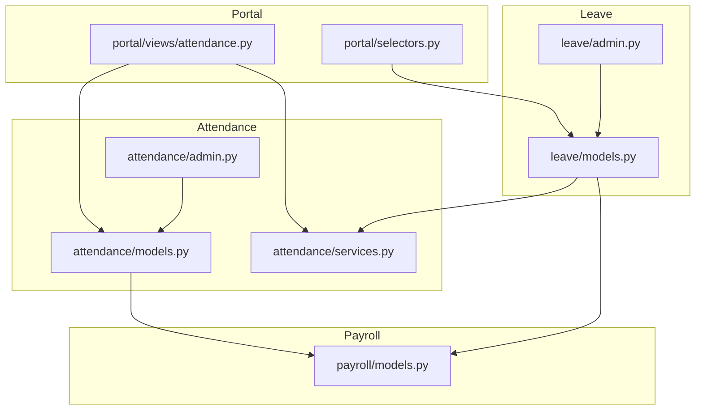
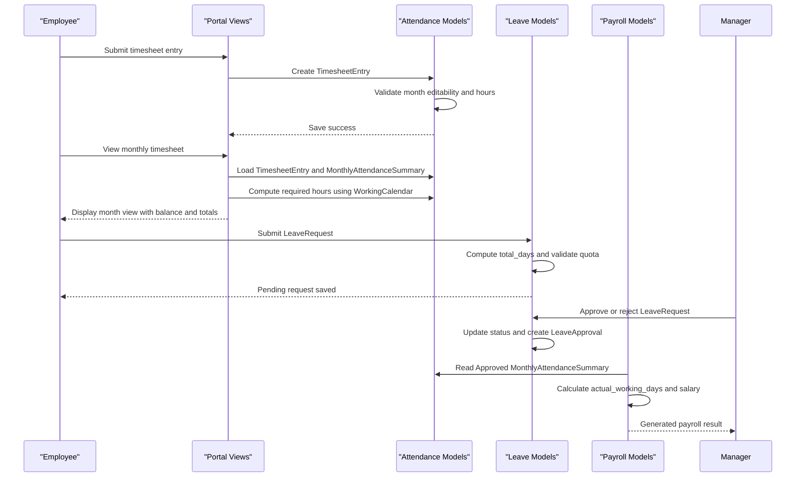
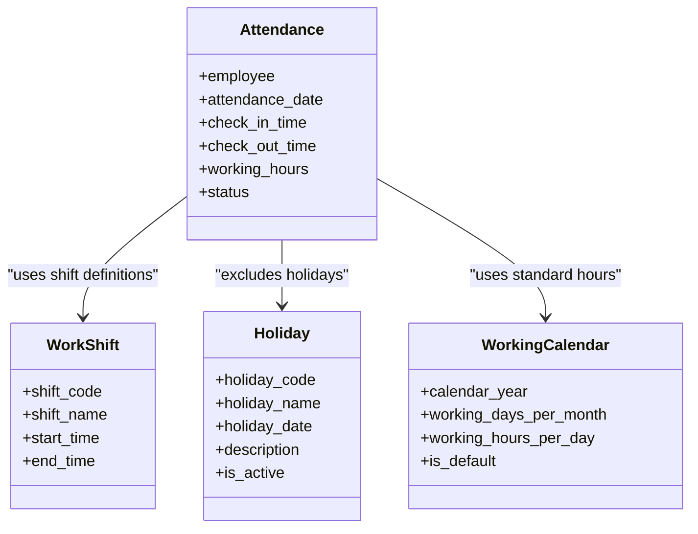
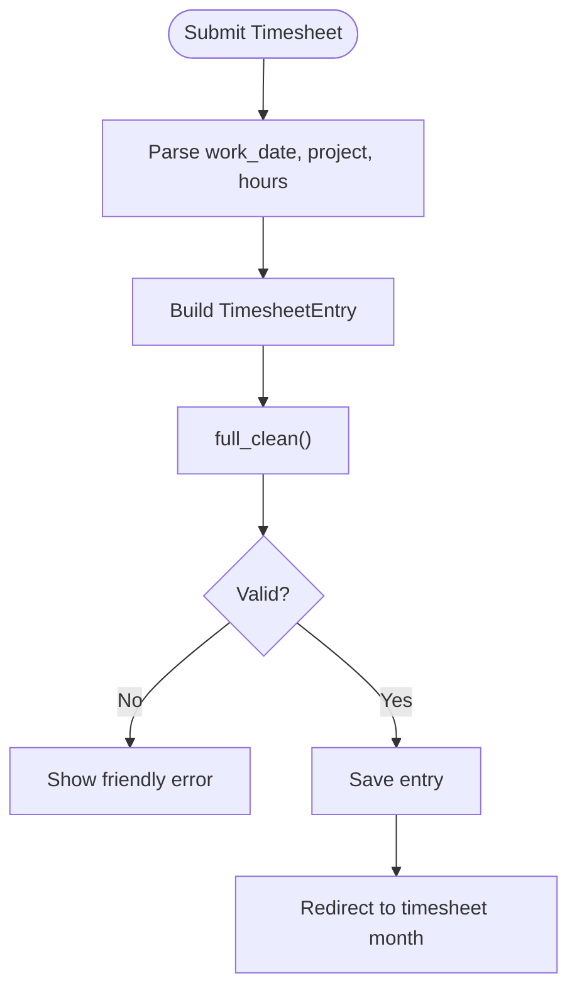
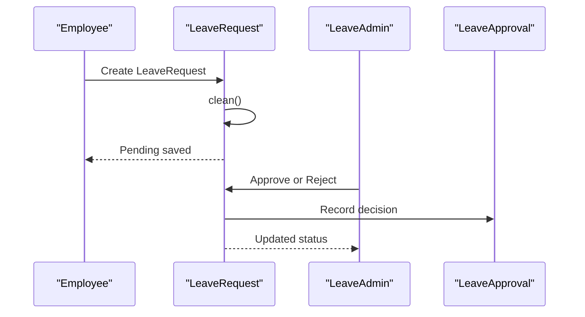
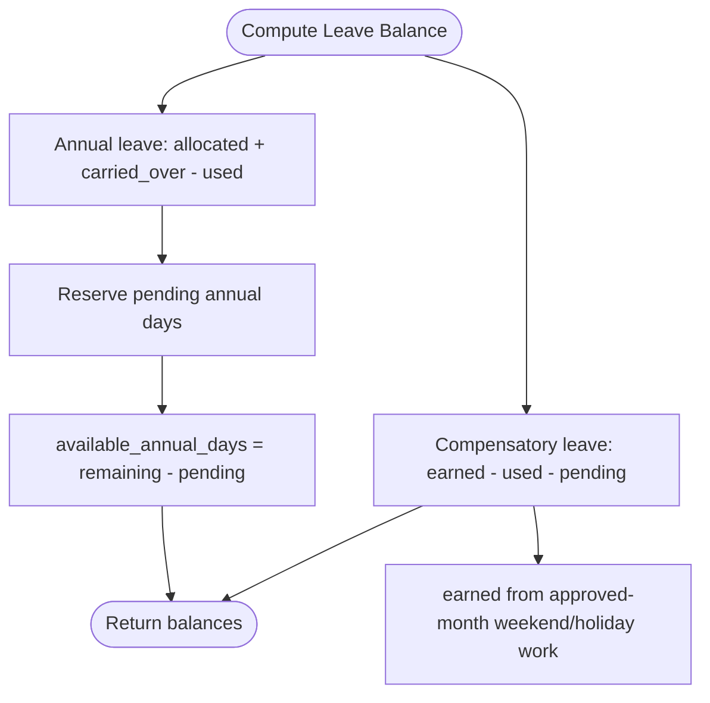
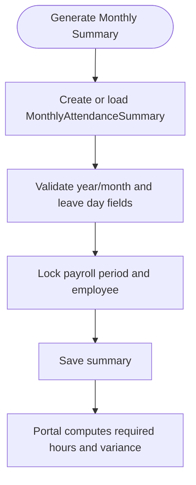
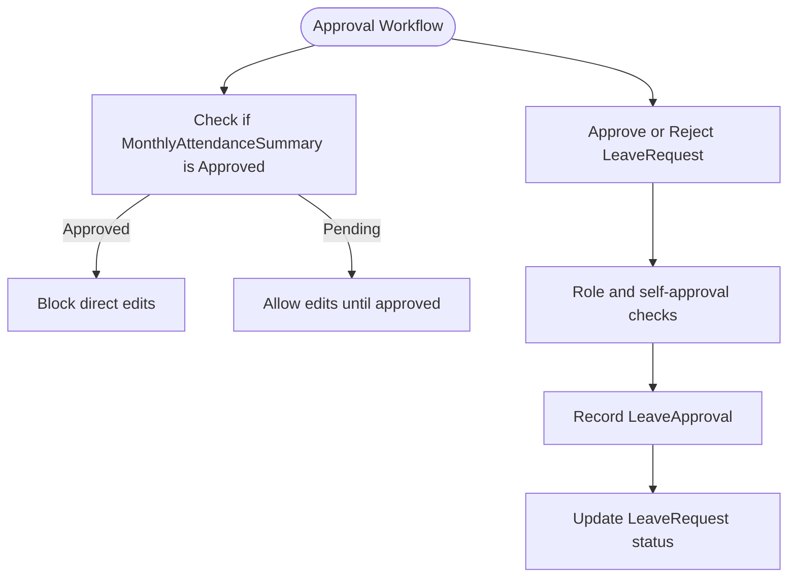
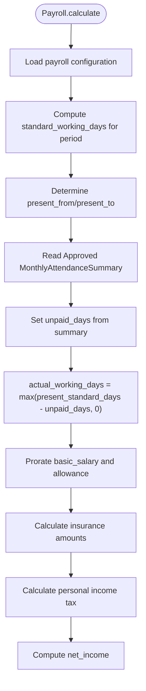
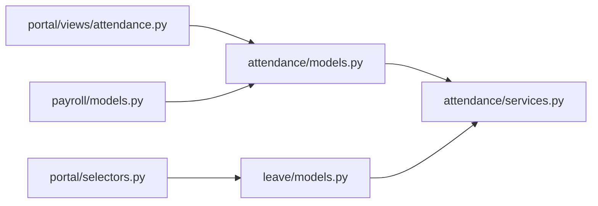

# Attendance & Leave Management

<cite>
**Referenced Files in This Document**
- [attendance/models.py](file://src/apps/attendance/models.py)
- [attendance/services.py](file://src/apps/attendance/services.py)
- [attendance/admin.py](file://src/apps/attendance/admin.py)
- [leave/models.py](file://src/apps/leave/models.py)
- [leave/admin.py](file://src/apps/leave/admin.py)
- [portal/views/attendance.py](file://src/apps/portal/views/attendance.py)
- [portal/selectors.py](file://src/apps/portal/selectors.py)
- [payroll/models.py](file://src/apps/payroll/models.py)
- [attendance/tests.py](file://src/apps/attendance/tests.py)
- [leave/tests.py](file://src/apps/leave/tests.py)
</cite>

## Table of Contents
1. [Introduction](#introduction)
2. [Project Structure](#project-structure)
3. [Core Components](#core-components)
4. [Architecture Overview](#architecture-overview)
5. [Detailed Component Analysis](#detailed-component-analysis)
6. [Dependency Analysis](#dependency-analysis)
7. [Performance Considerations](#performance-considerations)
8. [Troubleshooting Guide](#troubleshooting-guide)
9. [Conclusion](#conclusion)

## Introduction
This document explains the attendance and leave management domain implemented across the attendance, leave, portal, and payroll applications. It covers:
- Daily attendance tracking through `Attendance`
- Project-based timesheet management through `TimesheetEntry`
- Leave request workflows through `LeaveRequest`, `LeaveType`, `LeaveApproval`, and `LeaveBalance`
- Holiday calendar and working calendar configuration
- Automatic leave balance calculations
- Monthly attendance summary generation and approval
- Approval workflows for attendance corrections and leave requests
- Integration with payroll for accurate salary calculations based on approved attendance data

The system follows a clear rule: standard working days are Monday to Friday excluding active holidays; work on weekends or holidays generates compensatory leave rather than counting as standard working days.

## Project Structure
The relevant code is organized by Django apps:
- `apps.attendance`: daily attendance records, holiday calendar, working calendar, timesheet entries, monthly summaries, and shared calculation services
- `apps.leave`: leave types, leave requests, approvals, and leave balances
- `apps.portal.views.attendance`: user-facing timesheet submission, month view, and approval selection helpers
- `apps.payroll.models`: payroll calculation that consumes approved monthly attendance data

**Diagram sources**
- [portal/views/attendance.py:317-364](file://src/apps/portal/views/attendance.py#L317-L364)
- [portal/selectors.py:7-12](file://src/apps/portal/selectors.py#L7-L12)
- [attendance/models.py:25-302](file://src/apps/attendance/models.py#L25-L302)
- [attendance/services.py:14-85](file://src/apps/attendance/services.py#L14-L85)
- [attendance/admin.py:32-82](file://src/apps/attendance/admin.py#L32-L82)
- [leave/models.py:38-279](file://src/apps/leave/models.py#L38-L279)
- [leave/admin.py:32-83](file://src/apps/leave/admin.py#L32-L83)
- [payroll/models.py:405-515](file://src/apps/payroll/models.py#L405-L515)

**Section sources**
- [attendance/models.py:25-302](file://src/apps/attendance/models.py#L25-L302)
- [leave/models.py:38-279](file://src/apps/leave/models.py#L38-L279)
- [portal/views/attendance.py:317-364](file://src/apps/portal/views/attendance.py#L317-L364)
- [payroll/models.py:405-515](file://src/apps/payroll/models.py#L405-L515)

## Core Components
This section summarizes the main models and their responsibilities.

### Attendance and Daily Records
- `WorkShift`: defines shift codes, names, start time, and end time
- `Attendance`: one record per employee per day, capturing check-in/out times, computed working hours, and status such as Present, Late, Absent, or HalfDay
- `Holiday`: active holiday dates used to exclude non-working days from standard working-day calculations
- `WorkingCalendar`: yearly configuration including standard working days per month and standard working hours per day

Key behaviors:
- `Attendance` enforces uniqueness per employee and date
- `Holiday` and `WorkingCalendar` provide reference data for attendance and leave calculations
- `WorkShift` supports shift scheduling but is not directly consumed by the core attendance service functions shown here

**Section sources**
- [attendance/models.py:10-87](file://src/apps/attendance/models.py#L10-L87)

### Timesheet Entry and Project Time Allocation
- `TimesheetEntry`: project-based time allocation per work date, with manual project name support, task description, and hour validation
- `MonthlyAttendanceSummary`: monthly leave-day breakdown with approval workflow and locking against locked payroll periods
- `ProjectTimeAllocation`: planned percentage allocation of an employee’s time to a project per month/year

Key behaviors:
- `TimesheetEntry` prevents edits when the month is approved or the payroll period is locked
- `TimesheetEntry` validates total hours per day do not exceed 24
- `MonthlyAttendanceSummary` protects approved data and requires reopening for changes
- `ProjectTimeAllocation` provides planning context for timesheet reporting

**Section sources**
- [attendance/models.py:89-302](file://src/apps/attendance/models.py#L89-L302)

### Leave Request Workflow and Balance Calculation
- `LeaveType`: configurable leave categories, including paid/unpaid flags
- `LeaveRequest`: leave application with date range, computed total working days, reason, attachment, and status
- `LeaveApproval`: audit trail of approver decisions and decision timestamps
- `LeaveBalance`: annual leave and compensatory leave balances, including allocated, carried over, used, pending, and remaining values

Key behaviors:
- `LeaveRequest.compute_total_days` uses standard working days, excluding weekends and holidays
- `LeaveRequest.clean` validates date order, overlapping requests, and quota availability
- Annual leave and compensatory leave quotas are enforced per year
- `LeaveBalance.available_annual_days` reserves pending days so employees cannot double-book leave
- Compensatory leave earned is derived from approved-month timesheet hours worked on weekends or holidays

**Section sources**
- [leave/models.py:38-279](file://src/apps/leave/models.py#L38-L279)

### Shared Attendance Services
- `get_hours_per_day`: resolves standard hours per day from the working calendar
- `holiday_dates`: returns active holiday dates within a date range
- `standard_working_days`: counts standard working days between two dates
- `compensatory_days_earned`: calculates compensatory leave earned from weekend/holiday work in approved months

**Section sources**
- [attendance/services.py:14-85](file://src/apps/attendance/services.py#L14-L85)

## Architecture Overview
The attendance and leave system integrates four layers:
1. Data models define entities and constraints
2. Services compute standard working days, holidays, and compensatory leave
3. Portal views expose timesheet submission and approval selection
4. Payroll consumes approved monthly attendance data to calculate actual working days and prorated salary

**Diagram sources**
- [portal/views/attendance.py:317-364](file://src/apps/portal/views/attendance.py#L317-L364)
- [attendance/models.py:89-302](file://src/apps/attendance/models.py#L89-L302)
- [leave/models.py:52-176](file://src/apps/leave/models.py#L52-L176)
- [payroll/models.py:405-515](file://src/apps/payroll/models.py#L405-L515)

## Detailed Component Analysis

### AttendanceEntry Model for Daily Check-in/out Records
The daily attendance model captures:
- Employee reference
- Attendance date
- Optional check-in and check-out times
- Computed working hours
- Status choices: Present, Late, Absent, HalfDay

Constraints and integrity:
- One attendance record per employee per day via unique constraint
- Referential protection ensures attendance records remain consistent with employee data

Operational notes:
- The attendance list view renders historical attendance records for the logged-in employee
- Admin interface allows HR roles to manage attendance records with department-scoped visibility for managers

**Diagram sources**
- [attendance/models.py:10-87](file://src/apps/attendance/models.py#L10-L87)

**Section sources**
- [attendance/models.py:25-52](file://src/apps/attendance/models.py#L25-L52)
- [attendance/admin.py:32-49](file://src/apps/attendance/admin.py#L32-L49)
- [portal/views/attendance.py:56-64](file://src/apps/portal/views/attendance.py#L56-L64)

### TimesheetEntry for Project Time Allocation
`TimesheetEntry` represents project-based time logging:
- Links to employee and optional project
- Supports manual project name input
- Stores task description and hours
- Enforces uniqueness per employee/date/project combination
- Validates total daily hours do not exceed 24
- Prevents edits when the month is approved or the payroll period is locked

Submission flow:
- Portal creates a `TimesheetEntry` from POST data
- Validation runs before saving
- User is redirected back to the timesheet month view

**Diagram sources**
- [portal/views/attendance.py:317-350](file://src/apps/portal/views/attendance.py#L317-L350)
- [attendance/models.py:89-170](file://src/apps/attendance/models.py#L89-L170)

**Section sources**
- [attendance/models.py:89-170](file://src/apps/attendance/models.py#L89-L170)
- [portal/views/attendance.py:317-364](file://src/apps/portal/views/attendance.py#L317-L364)

### LeaveRequest for Time-off Management
`LeaveRequest` manages time-off applications:
- Date range validation
- Computation of total working days using standard working days
- Overlap prevention with existing pending or approved requests
- Quota enforcement for annual leave and compensatory leave
- Attachment support for supporting documents

Approval workflow:
- Admin actions allow approve/reject operations
- Department managers cannot approve their own requests
- Decisions are recorded in `LeaveApproval`

**Diagram sources**
- [leave/models.py:52-176](file://src/apps/leave/models.py#L52-L176)
- [leave/admin.py:32-83](file://src/apps/leave/admin.py#L32-L83)

**Section sources**
- [leave/models.py:52-176](file://src/apps/leave/models.py#L52-L176)
- [leave/admin.py:32-83](file://src/apps/leave/admin.py#L32-L83)

### Holiday Calendar Management and Working Calendar Configuration
- `Holiday`: centralizes official holidays with activation flags
- `WorkingCalendar`: defines yearly standards for working days per month and working hours per day
- Services use these configurations to compute standard working days and compensatory leave

Usage:
- `standard_working_days` excludes weekends and active holidays
- `get_hours_per_day` resolves standard hours per day from the current or default calendar
- `compensatory_days_earned` uses approved monthly timesheet hours worked on weekends or holidays

**Section sources**
- [attendance/models.py:54-87](file://src/apps/attendance/models.py#L54-L87)
- [attendance/services.py:14-85](file://src/apps/attendance/services.py#L14-L85)

### Automatic Leave Balance Calculations
`LeaveBalance` computes:
- Annual leave: allocated plus carried over minus used; pending days reserved
- Compensatory leave: earned from approved-month weekend/holiday work minus used and pending

Quota checks:
- Annual leave requires an existing balance record; otherwise, the system prompts HR to allocate days
- Compensatory leave uses earned value minus used and pending

**Diagram sources**
- [leave/models.py:206-279](file://src/apps/leave/models.py#L206-L279)
- [attendance/services.py:50-85](file://src/apps/attendance/services.py#L50-L85)

**Section sources**
- [leave/models.py:206-279](file://src/apps/leave/models.py#L206-L279)
- [attendance/services.py:50-85](file://src/apps/attendance/services.py#L50-L85)

### Monthly Attendance Summary Generation and Reporting
`MonthlyAttendanceSummary` aggregates leave days by category:
- Sick days
- Maternity days
- Compensatory days
- Annual leave days
- Unpaid leave days

It includes:
- Approval status: Pending or Approved
- Approver and approval timestamp
- Locking against locked payroll periods
- Protection against editing approved records without reopening

Reporting integration:
- Portal month view computes required hours using base working days minus approved leave days multiplied by standard hours per day
- Planning reports combine timesheet totals, approved summaries, and leave balances to show variance and pending status

**Diagram sources**
- [attendance/models.py:172-275](file://src/apps/attendance/models.py#L172-L275)
- [portal/views/attendance.py:245-300](file://src/apps/portal/views/attendance.py#L245-L300)

**Section sources**
- [attendance/models.py:172-275](file://src/apps/attendance/models.py#L172-L275)
- [portal/views/attendance.py:245-300](file://src/apps/portal/views/attendance.py#L245-L300)

### Approval Workflows for Attendance Corrections and Leave Requests
Attendance corrections:
- Admin interface restricts editing of approved monthly summaries
- Tests enforce that once approved, summary fields cannot be changed without reopening

Leave requests:
- Admin actions approve or reject pending requests
- Department managers cannot self-approve
- Decisions are audited via `LeaveApproval`

**Diagram sources**
- [attendance/admin.py:65-82](file://src/apps/attendance/admin.py#L65-L82)
- [leave/admin.py:32-83](file://src/apps/leave/admin.py#L32-L83)

**Section sources**
- [attendance/admin.py:65-82](file://src/apps/attendance/admin.py#L65-L82)
- [leave/admin.py:32-83](file://src/apps/leave/admin.py#L32-L83)

### Integration with Payroll for Accurate Salary Calculations
Payroll calculation consumes approved monthly attendance data:
- Reads `MonthlyAttendanceSummary` only when status is Approved
- Computes `actual_working_days` by subtracting unpaid leave days from standard present days
- Uses work ratio to prorate basic salary and allowance
- Calculates insurance, tax, and net income based on configuration and brackets

**Diagram sources**
- [payroll/models.py:405-515](file://src/apps/payroll/models.py#L405-L515)
- [attendance/models.py:172-275](file://src/apps/attendance/models.py#L172-L275)

**Section sources**
- [payroll/models.py:405-515](file://src/apps/payroll/models.py#L405-L515)
- [attendance/models.py:172-275](file://src/apps/attendance/models.py#L172-L275)

## Dependency Analysis
The attendance and leave modules depend on shared services and integrate with payroll and portal views.

**Diagram sources**
- [attendance/models.py:89-302](file://src/apps/attendance/models.py#L89-L302)
- [attendance/services.py:14-85](file://src/apps/attendance/services.py#L14-L85)
- [leave/models.py:52-279](file://src/apps/leave/models.py#L52-L279)
- [portal/views/attendance.py:317-364](file://src/apps/portal/views/attendance.py#L317-L364)
- [portal/selectors.py:7-12](file://src/apps/portal/selectors.py#L7-L12)
- [payroll/models.py:405-515](file://src/apps/payroll/models.py#L405-L515)

**Section sources**
- [attendance/models.py:89-302](file://src/apps/attendance/models.py#L89-L302)
- [leave/models.py:52-279](file://src/apps/leave/models.py#L52-L279)
- [portal/views/attendance.py:317-364](file://src/apps/portal/views/attendance.py#L317-L364)
- [portal/selectors.py:7-12](file://src/apps/portal/selectors.py#L7-L12)
- [payroll/models.py:405-515](file://src/apps/payroll/models.py#L405-L515)

## Performance Considerations
- Use of `select_related` in portal views reduces N+1 queries when loading timesheet entries and projects
- `select_for_update` locks payroll periods and employees during critical save paths to prevent concurrent modifications
- Aggregation of daily hours avoids repeated database scans where possible
- Compensatory leave calculation iterates only approved months and aggregates by day to limit overhead

Recommendations:
- Keep timesheet entries granular but avoid excessive micro-entries per day
- Ensure payroll periods are locked promptly after finalization to stabilize calculations
- Index frequently filtered fields such as employee, year, month, and status where appropriate

[No sources needed since this section provides general guidance]

## Troubleshooting Guide
Common issues and resolutions:
- Cannot edit timesheet entries: occurs when the monthly summary is approved or the payroll period is locked
- Cannot edit monthly summary: occurs when the summary is approved; reopen it first
- Leave request rejected due to overlap: another pending or approved request exists for the same date range
- Leave request rejected due to insufficient quota: annual leave balance missing or compensatory leave exhausted
- Payroll calculation fails: missing insurance, deduction, or tax bracket configuration for the period

Validation messages:
- Timesheet daily hours exceed 24
- Month must be between 1 and 12
- Leave date range invalid or contains no standard working days
- Locked payroll period prevents changes
- Approved summary cannot be deleted or edited without reopening

**Section sources**
- [attendance/models.py:113-170](file://src/apps/attendance/models.py#L113-L170)
- [attendance/models.py:214-268](file://src/apps/attendance/models.py#L214-L268)
- [leave/models.py:91-176](file://src/apps/leave/models.py#L91-L176)
- [payroll/models.py:405-425](file://src/apps/payroll/models.py#L405-L425)

## Conclusion
The attendance and leave management system provides robust daily attendance tracking, project-based timesheet management, structured leave request workflows, and reliable balance calculations. Its design emphasizes data integrity through constraints, approval workflows, and payroll integration. By relying on approved monthly attendance summaries, the system ensures that salary calculations reflect verified attendance and leave data. The portal interfaces enable employees to submit timesheets and view monthly requirements, while administrators can manage approvals and maintain configuration data for holidays and working calendars.

[No sources needed since this section summarizes without analyzing specific files]