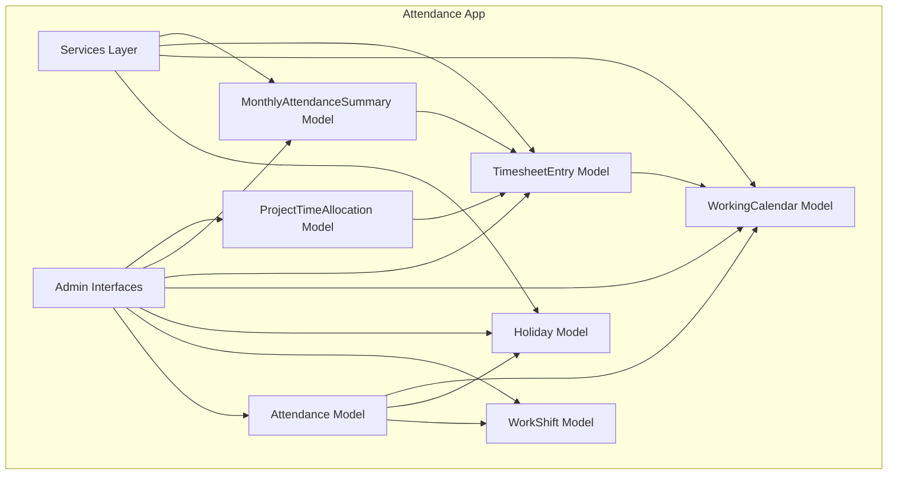
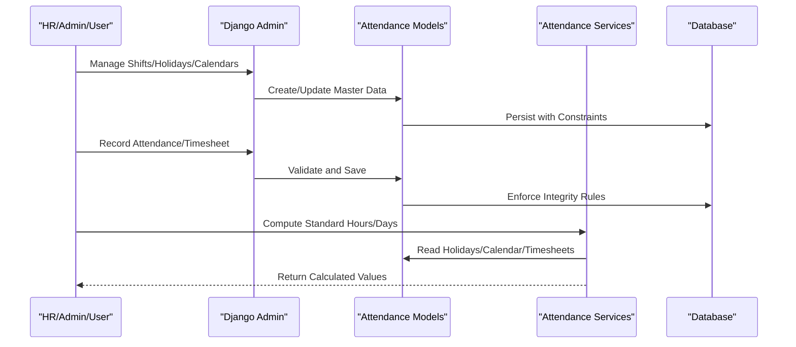
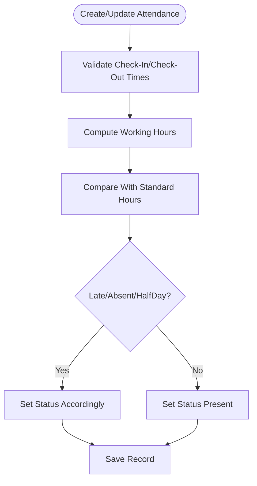
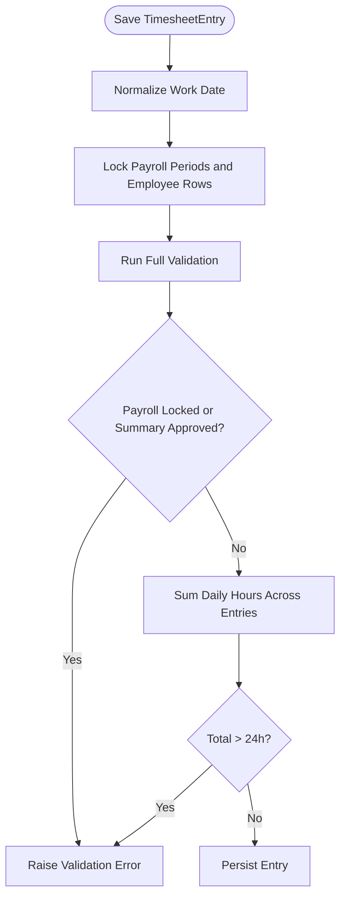
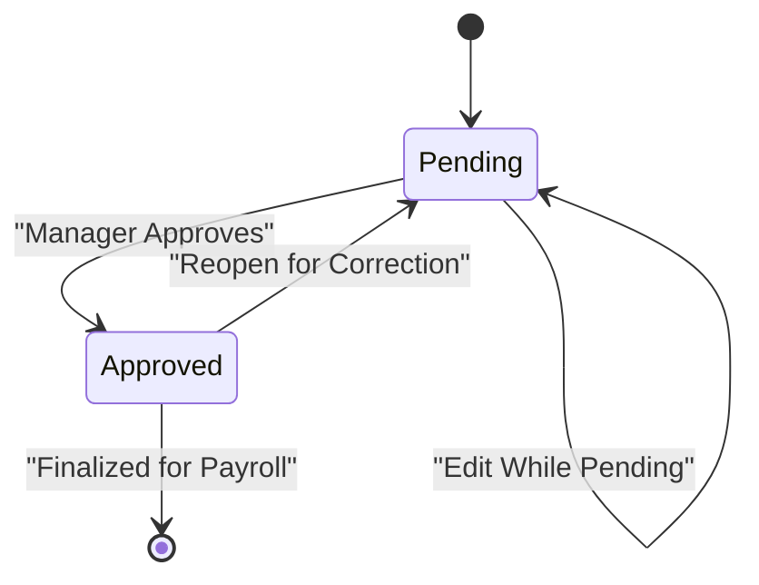
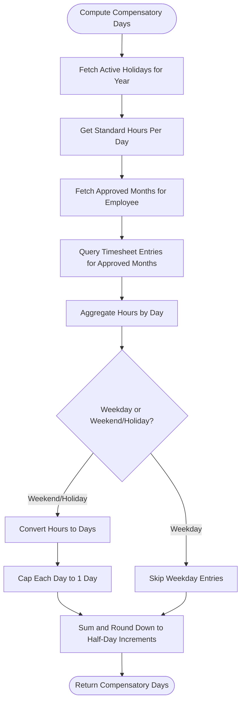

# Attendance Tracking

<cite>
**Referenced Files in This Document**
- [models.py](file://src/apps/attendance/models.py)
- [services.py](file://src/apps/attendance/services.py)
- [admin.py](file://src/apps/attendance/admin.py)
- [0001_initial.py](file://src/apps/attendance/migrations/0001_initial.py)
- [0002_holiday_workingcalendar.py](file://src/apps/attendance/migrations/0002_holiday_workingcalendar.py)
- [0005_monthlyattendancesummary_and_more.py](file://src/apps/attendance/migrations/0005_monthlyattendancesummary_and_more.py)
</cite>

## Table of Contents
1. [Introduction](#introduction)
2. [Project Structure](#project-structure)
3. [Core Components](#core-components)
4. [Architecture Overview](#architecture-overview)
5. [Detailed Component Analysis](#detailed-component-analysis)
6. [Dependency Analysis](#dependency-analysis)
7. [Performance Considerations](#performance-considerations)
8. [Troubleshooting Guide](#troubleshooting-guide)
9. [Conclusion](#conclusion)

## Introduction
This document explains the attendance tracking system implemented in the attendance application. It covers daily check-in and check-out management, work shift configuration, holiday calendar management, working calendar standards, timesheet-based project time allocation, monthly attendance summaries with approval workflow, and compensatory day calculation. The documentation focuses on data models, validation rules, integrity constraints, processing logic, and reporting-related structures.

## Project Structure
The attendance feature is implemented as a Django app under `src/apps/attendance`. The key files are:
- Data models for attendance records, shifts, holidays, working calendars, timesheets, monthly summaries, and project allocations.
- Shared services for standard working hours, holiday sets, standard working days, and compensatory day computation.
- Admin interfaces for managing master data and reviewing attendance/timesheet data.
- Migrations defining database tables, constraints, and relationships.



**Diagram sources**
- [models.py:10-301](file://src/apps/attendance/models.py#L10-L301)
- [services.py:14-85](file://src/apps/attendance/services.py#L14-L85)
- [admin.py:8-90](file://src/apps/attendance/admin.py#L8-L90)

**Section sources**
- [models.py:10-301](file://src/apps/attendance/models.py#L10-L301)
- [services.py:1-86](file://src/apps/attendance/services.py#L1-L86)
- [admin.py:1-90](file://src/apps/attendance/admin.py#L1-L90)

## Core Components
This section summarizes the primary entities and their responsibilities.

- WorkShift: Defines standard start and end times for a shift. Used to establish expected working periods.
- Attendance: Records an employee’s daily attendance, including check-in/check-out times, computed working hours, and status (Present, Late, Absent, HalfDay). Enforces one record per employee per date.
- Holiday: Manages official non-working dates with optional descriptions and activation flags.
- WorkingCalendar: Sets yearly standards such as working days per month and working hours per day; supports a default calendar.
- TimesheetEntry: Captures project-based working hours per day, with validations to prevent exceeding 24 hours per day and to protect approved or locked payroll periods.
- MonthlyAttendanceSummary: Aggregates leave and compensatory days by month, with Pending/Approved workflow and approval metadata.
- ProjectTimeAllocation: Allocates percentage of employee time to projects per month/year.

Key behaviors:
- Attendance stores raw check-in/out and derived working hours and status.
- Services compute standard working hours/days based on WorkingCalendar and Holidays.
- Compensatory days are calculated from weekend/holiday timesheet entries using approved months.
- Monthly summary enforces numeric validation, payroll lock protection, and approval state transitions.

**Section sources**
- [models.py:10-301](file://src/apps/attendance/models.py#L10-L301)
- [services.py:14-85](file://src/apps/attendance/services.py#L14-L85)

## Architecture Overview
The attendance system integrates three layers:
- Data layer: Models define tables, constraints, and business rules.
- Processing layer: Services provide reusable calculations for working hours, holidays, standard days, and compensatory days.
- Management layer: Admin interfaces expose CRUD operations with role-based permissions and scoped views.



**Diagram sources**
- [admin.py:8-90](file://src/apps/attendance/admin.py#L8-L90)
- [models.py:10-301](file://src/apps/attendance/models.py#L10-L301)
- [services.py:14-85](file://src/apps/attendance/services.py#L14-L85)

## Detailed Component Analysis

### WorkShift Model
Purpose:
- Define standard shift periods with unique codes and names.
- Provide reference data for expected start/end times.

Key attributes:
- Unique shift code and human-readable name.
- Start and end time fields.

Constraints and behavior:
- No explicit model-level validation beyond field types.
- Managed via admin with restricted edit roles.

Usage examples:
- Configure morning and afternoon shifts for different departments.
- Use shift definitions to inform expected working windows when evaluating attendance status.

**Section sources**
- [models.py:10-23](file://src/apps/attendance/models.py#L10-L23)
- [admin.py:8-13](file://src/apps/attendance/admin.py#L8-L13)

### Attendance Model
Purpose:
- Record daily attendance per employee with check-in/check-out timestamps, working hours, and status.

Key attributes:
- Employee foreign key.
- Attendance date with uniqueness constraint per employee.
- Optional check-in and check-out times.
- Decimal working hours.
- Status choices: Present, Late, Absent, HalfDay.

Validation and integrity:
- UniqueConstraint ensures one attendance record per employee per date.
- Default status is Present.

Processing notes:
- Working hours can be computed from check-in/check-out times and compared against standard hours.
- Status determination should consider shift start time and tolerance thresholds (implementation-specific).

Example scenarios:
- Creating an attendance record after clocking in/out.
- Updating working hours and recalculating status if check-in occurs late relative to shift start.



**Diagram sources**
- [models.py:25-52](file://src/apps/attendance/models.py#L25-L52)

**Section sources**
- [models.py:25-52](file://src/apps/attendance/models.py#L25-L52)
- [0001_initial.py:17-41](file://src/apps/attendance/migrations/0001_initial.py#L17-L41)

### Holiday Model
Purpose:
- Maintain official holidays and non-working days.

Key attributes:
- Unique holiday code and name.
- Unique holiday date.
- Optional description.
- Activation flag to enable/disable holidays.

Behavior:
- Ordered by date for consistent listing.
- Active holidays are used by services to exclude non-working days from standard working day counts and compensatory day calculations.

Example usage:
- Add national holidays and company-specific non-working days.
- Toggle holidays active/inactive for planning purposes.

**Section sources**
- [models.py:54-68](file://src/apps/attendance/models.py#L54-L68)
- [0002_holiday_workingcalendar.py:16-39](file://src/apps/attendance/migrations/0002_holiday_workingcalendar.py#L16-L39)

### WorkingCalendar Model
Purpose:
- Define yearly standards for working days per month and working hours per day.
- Support a default calendar for fallback values.

Key attributes:
- Calendar year (unique).
- Working days per month (decimal).
- Working hours per day (decimal).
- Default flag.

Behavior:
- Services resolve hours per day by preferring the calendar for a given year, then falling back to the default calendar, then to a hard-coded default.

Example usage:
- Configure 8 hours per day and ~26 working days per month for the current year.
- Mark one calendar as default for consistency across years without explicit year context.

**Section sources**
- [models.py:71-87](file://src/apps/attendance/models.py#L71-L87)
- [0002_holiday_workingcalendar.py:40-61](file://src/apps/attendance/migrations/0002_holiday_workingcalendar.py#L40-L61)

### TimesheetEntry Model
Purpose:
- Capture project-based working hours per day for employees.
- Integrate with project module to attribute hours to specific projects.

Key attributes:
- Employee foreign key.
- Work date.
- Optional project association and manual project name.
- Task description.
- Hours with validators ensuring range between 0 and 24.

Validation and integrity:
- UniqueConstraint prevents duplicate entries per employee/date/project.
- Clean method enforces total hours per day not exceeding 24.
- Approval and payroll lock checks prevent edits when monthly summary is Approved or payroll period is Locked.
- Atomic save with row locking to avoid race conditions during concurrent edits.

Example scenarios:
- An employee logs hours for a project on weekdays and weekends.
- HR adjusts timesheet entries only when allowed by approval/payroll locks.



**Diagram sources**
- [models.py:89-170](file://src/apps/attendance/models.py#L89-L170)

**Section sources**
- [models.py:89-170](file://src/apps/attendance/models.py#L89-L170)

### MonthlyAttendanceSummary Model
Purpose:
- Aggregate leave and compensatory days per employee per month.
- Provide an approval workflow to ensure payroll and reporting accuracy.

Key attributes:
- Employee foreign key.
- Year and month.
- Leave categories: sick, maternity, compensatory, annual leave, unpaid leave.
- Status: Pending or Approved.
- Approval metadata: approver and timestamp.

Validation and integrity:
- UniqueConstraint per employee/year/month.
- Month must be valid (1–12).
- Negative or invalid leave day values raise validation errors.
- Editing is blocked when payroll period is Locked.
- Once Approved, changes require reopening to Pending before modification.

Example scenarios:
- Employee submits leave days; manager approves them.
- After approval, payroll uses these figures for compensation calculations.



**Diagram sources**
- [models.py:172-275](file://src/apps/attendance/models.py#L172-L275)

**Section sources**
- [models.py:172-275](file://src/apps/attendance/models.py#L172-L275)
- [0005_monthlyattendancesummary_and_more.py:16-47](file://src/apps/attendance/migrations/0005_monthlyattendancesummary_and_more.py#L16-L47)

### ProjectTimeAllocation Model
Purpose:
- Allocate percentage of employee time to projects per month/year.

Key attributes:
- Employee and project associations.
- Year and month.
- Allocation percent.

Validation and integrity:
- UniqueConstraint prevents duplicate allocations per employee/project/year/month.

Example usage:
- Assign 60% to Project A and 40% to Project B for a given month.

**Section sources**
- [models.py:277-301](file://src/apps/attendance/models.py#L277-L301)

### Services Layer
Purpose:
- Provide reusable calculations for standard working hours, holiday sets, standard working days, and compensatory days.

Key functions:
- get_hours_per_day(year): Returns standard hours per day based on WorkingCalendar.
- holiday_dates(from_date, to_date): Returns set of active holiday dates within a range.
- standard_working_days(from_date, to_date, *, holidays=None): Counts Monday–Friday excluding holidays.
- compensatory_days_earned(employee, year): Computes compensatory days from weekend/holiday timesheet entries for approved months.

Behavioral notes:
- Uses Decimal arithmetic for precision.
- Rounds compensatory days down to nearest half-day increments.
- Relies on approved monthly summaries to include only finalized timesheet data.



**Diagram sources**
- [services.py:14-85](file://src/apps/attendance/services.py#L14-L85)

**Section sources**
- [services.py:14-85](file://src/apps/attendance/services.py#L14-L85)

### Admin Interfaces
Purpose:
- Provide role-based administrative access to manage shifts, holidays, calendars, attendance, timesheets, monthly summaries, and project allocations.

Key features:
- Restricted view/edit roles per model.
- Department-scoped queryset filtering for department managers.
- Readonly fields for approved monthly summaries.
- Permission overrides to prevent editing/deleting approved records.

Example usage:
- HR Manager configures shifts and holidays.
- Department Manager reviews attendance and timesheets for managed departments.
- Finance Officer manages project time allocations.

**Section sources**
- [admin.py:8-90](file://src/apps/attendance/admin.py#L8-L90)

## Dependency Analysis
The attendance module depends on several external components:
- hrm.Employee: Referenced by Attendance, TimesheetEntry, MonthlyAttendanceSummary, and ProjectTimeAllocation.
- project.Project: Referenced by TimesheetEntry and ProjectTimeAllocation.
- settings.AUTH_USER_MODEL: Referenced by BaseAuditModel and MonthlyAttendanceSummary.approved_by.
- apps.payroll.models.PayrollPeriod: Referenced by TimesheetEntry and MonthlyAttendanceSummary for lock checks.

Relationships:
- Attendance -> hrm.Employee
- TimesheetEntry -> hrm.Employee, project.Project
- MonthlyAttendanceSummary -> hrm.Employee
- ProjectTimeAllocation -> hrm.Employee, project.Project
- Services -> Holiday, WorkingCalendar, TimesheetEntry, MonthlyAttendanceSummary

```mermaid
classDiagram
class WorkShift
class Attendance {
+employee
+attendance_date
+check_in_time
+check_out_time
+working_hours
+status
}
class Holiday
class WorkingCalendar
class TimesheetEntry {
+employee
+work_date
+project
+hours
}
class MonthlyAttendanceSummary {
+employee
+year
+month
+status
+approved_by
}
class ProjectTimeAllocation {
+employee
+project
+year
+month
+allocation_percent
}
Attendance --> "hrm.Employee" : "FK"
TimesheetEntry --> "hrm.Employee" : "FK"
TimesheetEntry --> "project.Project" : "FK"
MonthlyAttendanceSummary --> "hrm.Employee" : "FK"
ProjectTimeAllocation --> "hrm.Employee" : "FK"
ProjectTimeAllocation --> "project.Project" : "FK"
```

**Diagram sources**
- [models.py:10-301](file://src/apps/attendance/models.py#L10-L301)

**Section sources**
- [models.py:10-301](file://src/apps/attendance/models.py#L10-L301)

## Performance Considerations
- Use Decimal for financial and time calculations to maintain precision.
- Avoid unnecessary queries by batching lookups for holidays and approved months.
- Leverage indexes on frequently filtered fields such as employee_id, work_date, year, and month.
- Keep transaction scopes minimal while preserving atomicity for critical updates.
- Prefer precomputed standard hours/days where possible to reduce repeated calculations.

[No sources needed since this section provides general guidance]

## Troubleshooting Guide
Common issues and resolutions:
- Duplicate attendance per employee/date: Ensure only one record exists per employee per date; rely on the unique constraint to prevent duplicates.
- Timesheet exceeds 24 hours: Verify that daily totals across all project entries do not exceed 24 hours; adjust entries accordingly.
- Cannot edit timesheet or summary: Check whether the monthly summary is Approved or the payroll period is Locked; reopen or unlock as appropriate.
- Invalid month value in summary: Ensure month is between 1 and 12; correct input before saving.
- Negative or invalid leave days: Correct leave day inputs to non-negative finite decimals.

Operational tips:
- Use admin filters to quickly locate problematic records.
- Review approval workflows to understand why certain fields are readonly.
- Confirm holiday activation status when calculating standard working days or compensatory days.

**Section sources**
- [models.py:113-170](file://src/apps/attendance/models.py#L113-L170)
- [models.py:214-268](file://src/apps/attendance/models.py#L214-L268)

## Conclusion
The attendance tracking system provides robust modeling and processing capabilities for daily attendance, work shifts, holidays, working calendars, timesheets, and monthly summaries. It enforces strong data integrity through constraints and validations, supports approval workflows for payroll safety, and offers service utilities for standard working hour/day computations and compensatory day calculations. Admin interfaces enable controlled management with role-based permissions and department scoping. Together, these components support accurate attendance recording, reliable reporting, and integration with payroll processes.

[No sources needed since this section summarizes without analyzing specific files]