# Leave Management

<cite>
**Referenced Files in This Document**
- [models.py](file://src/apps/leave/models.py)
- [admin.py](file://src/apps/leave/admin.py)
- [services.py](file://src/apps/attendance/services.py)
- [models.py](file://src/apps/attendance/models.py)
- [tests.py](file://src/apps/leave/tests.py)
- [run_browser_uat.py](file://ops/run_browser_uat.py)
- [reports_planning.py](file://src/apps/portal/views/reports_planning.py)
- [dashboard_data.py](file://src/apps/portal/dashboard_data.py)
- [home_presentation.py](file://src/apps/portal/home_presentation.py)
- [selectors.py](file://src/apps/portal/selectors.py)
- [attendance.py](file://src/apps/portal/views/attendance.py)
- [models.py](file://src/apps/payroll/models.py)
</cite>

## Table of Contents
1. [Introduction](#introduction)
2. [Project Structure](#project-structure)
3. [Core Components](#core-components)
4. [Architecture Overview](#architecture-overview)
5. [Detailed Component Analysis](#detailed-component-analysis)
6. [Dependency Analysis](#dependency-analysis)
7. [Performance Considerations](#performance-considerations)
8. [Troubleshooting Guide](#troubleshooting-guide)
9. [Conclusion](#conclusion)

## Introduction
This document explains the leave management system implemented in the project. It covers how leave requests are modeled, validated, and approved; how annual leave and compensatory leave balances are calculated; how conflicts and policy rules are enforced; and how leave data integrates with attendance summaries and payroll calculations. The goal is to make the workflow, data model, and business rules clear for both technical and non-technical readers.

## Project Structure
The leave feature lives under the `leave` application and integrates with attendance, portal, and payroll modules:

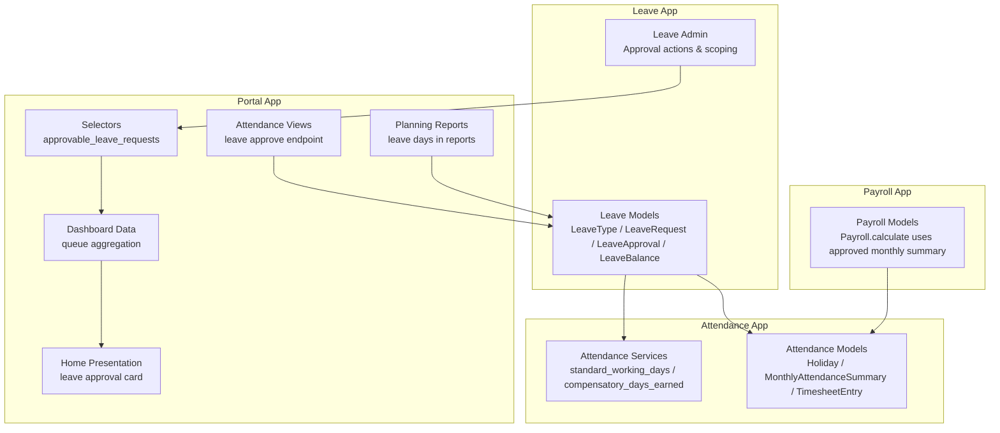

**Diagram sources**
- [models.py:38-279](file://src/apps/leave/models.py#L38-L279)
- [admin.py:17-103](file://src/apps/leave/admin.py#L17-L103)
- [services.py:35-85](file://src/apps/attendance/services.py#L35-L85)
- [models.py:54-302](file://src/apps/attendance/models.py#L54-L302)
- [selectors.py:7-7](file://src/apps/portal/selectors.py#L7-L7)
- [dashboard_data.py:142-153](file://src/apps/portal/dashboard_data.py#L142-L153)
- [home_presentation.py:48-62](file://src/apps/portal/home_presentation.py#L48-L62)
- [attendance.py:151-151](file://src/apps/portal/views/attendance.py#L151-L151)
- [reports_planning.py:104-121](file://src/apps/portal/views/reports_planning.py#L104-L121)
- [models.py:405-446](file://src/apps/payroll/models.py#L405-L446)

**Section sources**
- [models.py:38-279](file://src/apps/leave/models.py#L38-L279)
- [admin.py:17-103](file://src/apps/leave/admin.py#L17-L103)
- [services.py:35-85](file://src/apps/attendance/services.py#L35-L85)
- [models.py:54-302](file://src/apps/attendance/models.py#L54-L302)
- [selectors.py:7-7](file://src/apps/portal/selectors.py#L7-L7)
- [dashboard_data.py:142-153](file://src/apps/portal/dashboard_data.py#L142-L153)
- [home_presentation.py:48-62](file://src/apps/portal/home_presentation.py#L48-L62)
- [attendance.py:151-151](file://src/apps/portal/views/attendance.py#L151-L151)
- [reports_planning.py:104-121](file://src/apps/portal/views/reports_planning.py#L104-L121)
- [models.py:405-446](file://src/apps/payroll/models.py#L405-L446)

## Core Components
- LeaveType: Master definition of leave categories such as annual leave and compensatory leave.
- LeaveRequest: Employee’s leave request with date range, computed working days, reason, attachment, and status.
- LeaveApproval: Audit trail of approvals or rejections by managers.
- LeaveBalance: Annual balance tracking for annual leave and compensatory leave, including allocated, carried over, used, pending, and remaining days.
- Attendance services and models: Provide standard working day calculation, holiday handling, and compensatory leave accrual from timesheet entries.
- Portal integration: Provides UI flows for creating leave requests, viewing balances, approving requests, and reporting.
- Payroll integration: Uses approved monthly attendance summaries to compute actual working days and salary.

**Section sources**
- [models.py:38-279](file://src/apps/leave/models.py#L38-L279)
- [services.py:35-85](file://src/apps/attendance/services.py#L35-L85)
- [models.py:54-302](file://src/apps/attendance/models.py#L54-L302)
- [dashboard_data.py:142-153](file://src/apps/portal/dashboard_data.py#L142-L153)
- [home_presentation.py:48-62](file://src/apps/portal/home_presentation.py#L48-L62)
- [models.py:405-446](file://src/apps/payroll/models.py#L405-L446)

## Architecture Overview
The leave system enforces policy at validation time, tracks approvals, and exposes queues and dashboards through the portal. Attendance services provide the core calendar logic, while payroll consumes only approved attendance summaries.

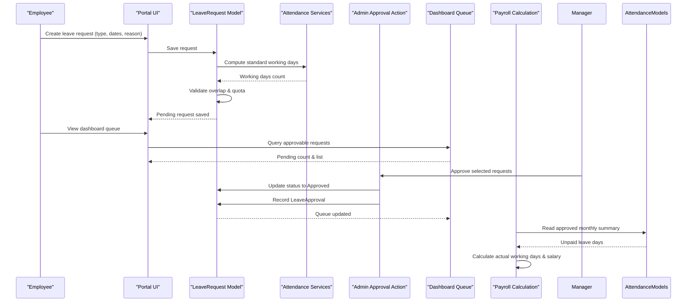

**Diagram sources**
- [models.py:85-176](file://src/apps/leave/models.py#L85-L176)
- [services.py:35-47](file://src/apps/attendance/services.py#L35-L47)
- [admin.py:53-83](file://src/apps/leave/admin.py#L53-L83)
- [dashboard_data.py:142-153](file://src/apps/portal/dashboard_data.py#L142-L153)
- [models.py:405-446](file://src/apps/payroll/models.py#L405-L446)

## Detailed Component Analysis

### Leave Request Workflow
- Submission: Employees submit a leave request via the portal. The request includes leave type, date range, and optional reason/attachment.
- Validation:
  - Date range must be valid and include at least one standard working day.
  - Overlapping requests with Pending or Approved status are rejected.
  - Quota checks apply for annual leave and compensatory leave codes.
- Status: Requests start as Pending and move to Approved or Rejected after manager action. Cancelled requests do not block new requests.

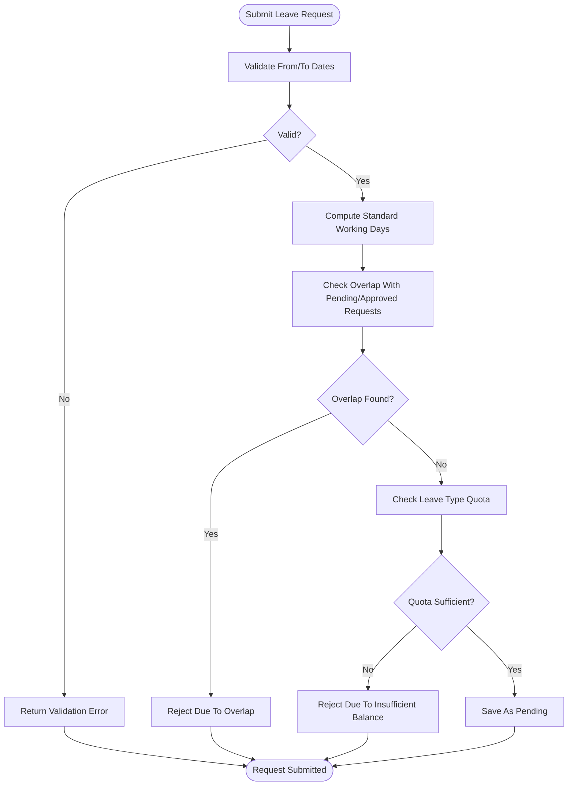

**Diagram sources**
- [models.py:91-176](file://src/apps/leave/models.py#L91-L176)
- [services.py:35-47](file://src/apps/attendance/services.py#L35-L47)

**Section sources**
- [models.py:91-176](file://src/apps/leave/models.py#L91-L176)
- [tests.py:248-293](file://src/apps/leave/tests.py#L248-L293)

### Leave Type Definitions and Eligibility Rules
- Annual leave code: Enforced against annual leave balance; requires an existing balance record per year.
- Compensatory leave code: Enforced against compensatory leave earned from approved weekend/holiday work hours.
- Other leave types (e.g., unpaid leave) are not subject to these quota checks.

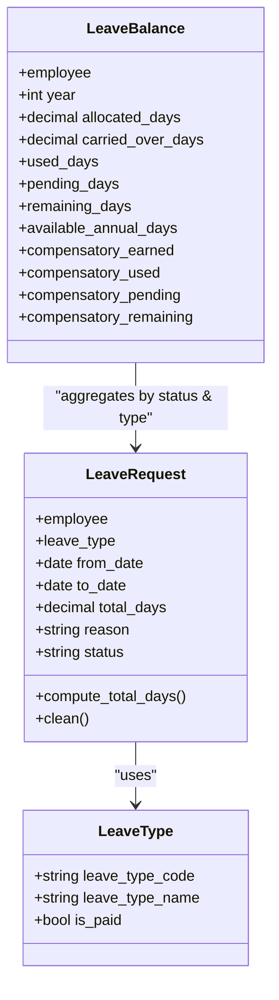

**Diagram sources**
- [models.py:38-279](file://src/apps/leave/models.py#L38-L279)

**Section sources**
- [models.py:38-78](file://src/apps/leave/models.py#L38-L78)
- [models.py:128-171](file://src/apps/leave/models.py#L128-L171)
- [models.py:206-279](file://src/apps/leave/models.py#L206-L279)

### Balance Calculations
- Annual leave:
  - Used days: Sum of approved annual leave days within the year.
  - Pending days: Sum of pending annual leave days within the year.
  - Remaining days: Allocated plus carried over minus used.
  - Available annual days: Remaining minus pending.
- Compensatory leave:
  - Earned: Derived from approved monthly attendance summaries; counts weekend/holiday worked hours converted to days, capped at one day per day, rounded down to half-day increments.
  - Used/Pending: Aggregated from compensatory leave requests by status.
  - Remaining: Earned minus used minus pending.

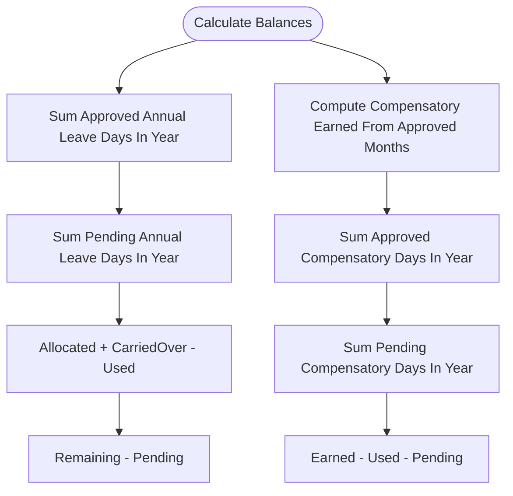

**Diagram sources**
- [models.py:226-276](file://src/apps/leave/models.py#L226-L276)
- [services.py:50-85](file://src/apps/attendance/services.py#L50-L85)

**Section sources**
- [models.py:226-276](file://src/apps/leave/models.py#L226-L276)
- [services.py:50-85](file://src/apps/attendance/services.py#L50-L85)
- [tests.py:169-230](file://src/apps/leave/tests.py#L169-L230)

### Approval Process
- Admin actions allow bulk approve/reject for scoped requests.
- Approval records are created automatically when a decision is made.
- Department managers cannot self-approve their own requests.
- Dashboard queue aggregates pending leave requests visible to the current user.

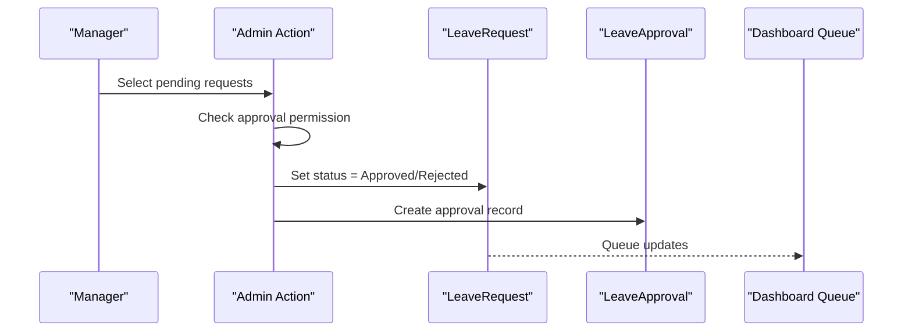

**Diagram sources**
- [admin.py:49-83](file://src/apps/leave/admin.py#L49-L83)
- [dashboard_data.py:142-153](file://src/apps/portal/dashboard_data.py#L142-L153)

**Section sources**
- [admin.py:49-83](file://src/apps/leave/admin.py#L49-L83)
- [dashboard_data.py:142-153](file://src/apps/portal/dashboard_data.py#L142-L153)

### Examples
- Creating a leave request:
  - Use the portal create-leave page to select leave type, set future weekday dates, add a reason, and submit.
  - The system computes working days and saves the request as Pending.
- Checking leave balances:
  - View personal leave balances showing available annual days and compensatory remaining days.
- Processing approvals:
  - Managers use the dashboard queue to drill into pending requests and confirm approval.

**Section sources**
- [run_browser_uat.py:321-349](file://ops/run_browser_uat.py#L321-L349)
- [tests.py:169-230](file://src/apps/leave/tests.py#L169-L230)

### Integration With Attendance Tracking
- Standard working days exclude weekends and active holidays.
- Compensatory leave accrues from approved monthly attendance summaries based on weekend/holiday worked hours.
- Monthly attendance summaries have a Pending/Approved state; only Approved summaries contribute to compensatory leave calculations.

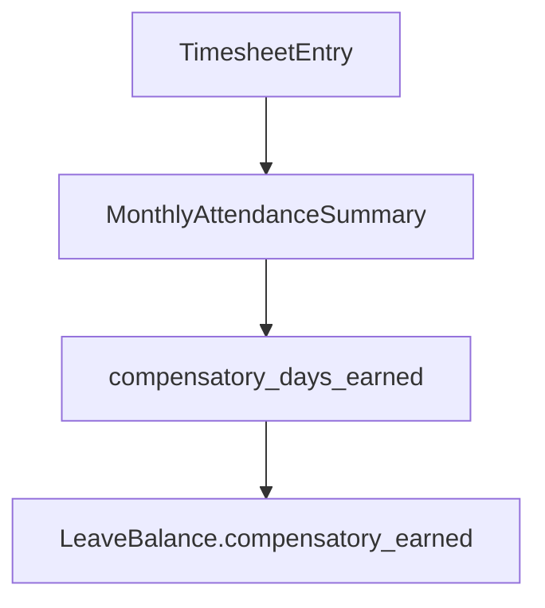

**Diagram sources**
- [services.py:50-85](file://src/apps/attendance/services.py#L50-L85)
- [models.py:259-276](file://src/apps/leave/models.py#L259-L276)
- [models.py:172-275](file://src/apps/attendance/models.py#L172-L275)

**Section sources**
- [services.py:35-85](file://src/apps/attendance/services.py#L35-L85)
- [models.py:172-275](file://src/apps/attendance/models.py#L172-L275)
- [models.py:259-276](file://src/apps/leave/models.py#L259-L276)

### Integration With Payroll Calculations
- Payroll calculates standard working days for the period and adjusts actual working days using unpaid leave days from approved monthly attendance summaries.
- Only approved summaries affect payroll; pending summaries are ignored until approved.

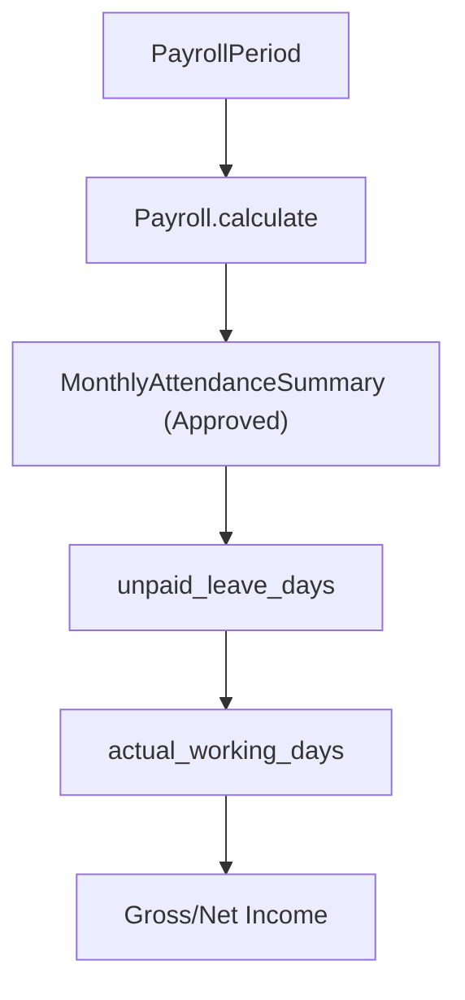

**Diagram sources**
- [models.py:405-446](file://src/apps/payroll/models.py#L405-L446)
- [models.py:172-275](file://src/apps/attendance/models.py#L172-L275)

**Section sources**
- [models.py:405-446](file://src/apps/payroll/models.py#L405-L446)
- [models.py:172-275](file://src/apps/attendance/models.py#L172-L275)

### Leave Policy Enforcement and Conflict Resolution
- Overlap prevention: Rejects new requests that overlap with existing Pending or Approved requests for the same employee.
- Quota enforcement:
  - Annual leave requires a pre-defined balance per year; missing balance blocks submission.
  - Compensatory leave cannot exceed earned amount considering pending usage.
- Non-working-day ranges are rejected if they contain no standard working days.

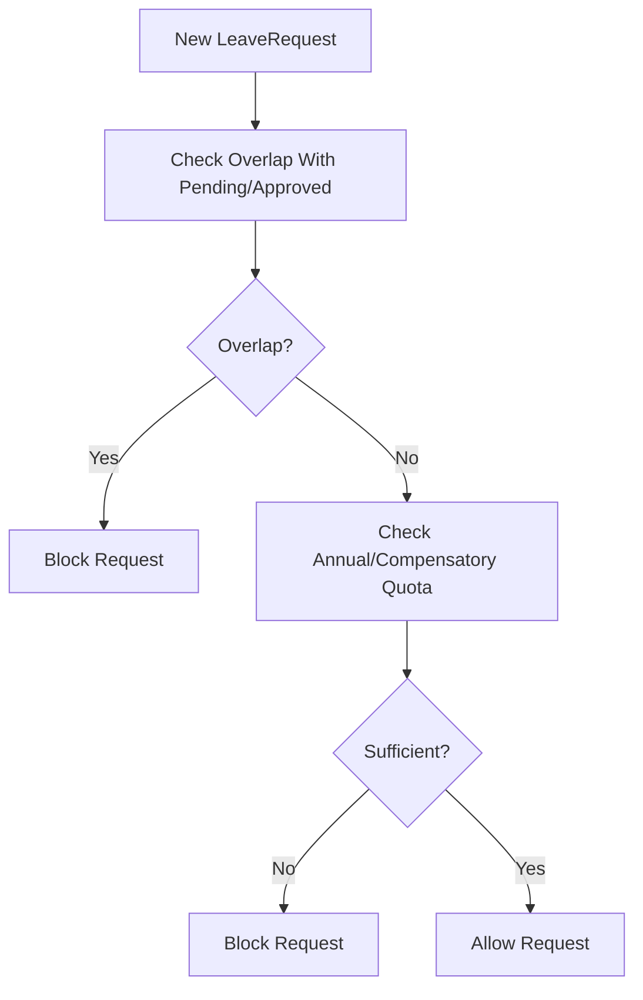

**Diagram sources**
- [models.py:108-171](file://src/apps/leave/models.py#L108-L171)

**Section sources**
- [models.py:108-171](file://src/apps/leave/models.py#L108-L171)
- [tests.py:261-304](file://src/apps/leave/tests.py#L261-L304)

### Notification Systems
- The leave module does not implement direct email notifications in the referenced files.
- Approval visibility is provided through the dashboard queue and approval list pages.
- External notification integrations can be added around admin approval actions or portal views.

[No sources needed since this section provides general guidance]

### Leave Data Flow Into Monthly Attendance Summaries and Reports
- Planning reports aggregate approved annual leave days per employee per year using leave request data.
- Monthly attendance summaries include fields for various leave types; only approved summaries are authoritative for payroll and reporting.

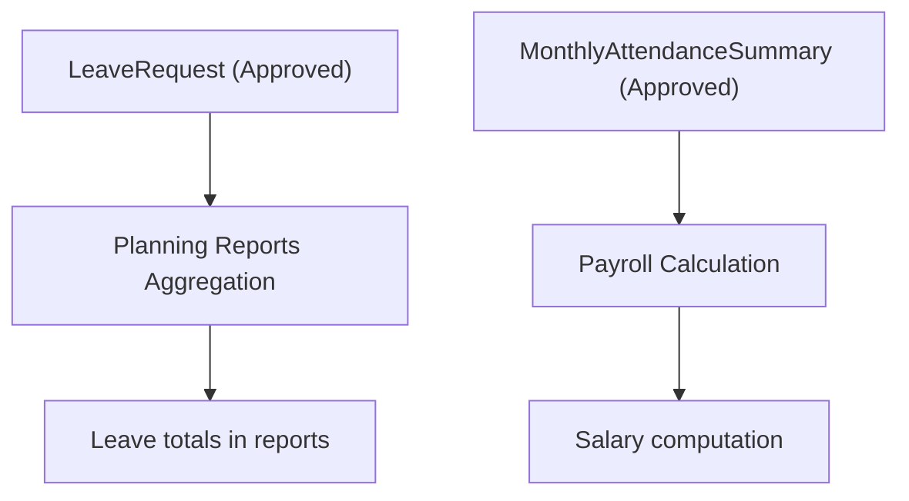

**Diagram sources**
- [reports_planning.py:104-121](file://src/apps/portal/views/reports_planning.py#L104-L121)
- [models.py:405-446](file://src/apps/payroll/models.py#L405-L446)

**Section sources**
- [reports_planning.py:104-121](file://src/apps/portal/views/reports_planning.py#L104-L121)
- [models.py:172-275](file://src/apps/attendance/models.py#L172-L275)
- [models.py:405-446](file://src/apps/payroll/models.py#L405-L446)

## Dependency Analysis
- Leave models depend on attendance services for calendar math and on HRM employees for relationships.
- Admin actions depend on security scoping to limit visibility to authorized users.
- Portal selectors and dashboard data depend on leave request queries filtered by user scope.
- Payroll depends on approved monthly attendance summaries and attendance services for standard working days.

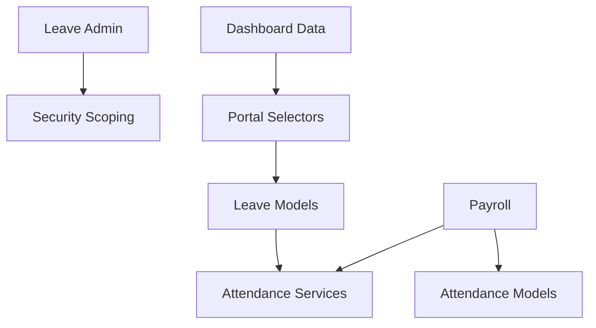

**Diagram sources**
- [models.py:85-176](file://src/apps/leave/models.py#L85-L176)
- [admin.py:17-30](file://src/apps/leave/admin.py#L17-L30)
- [selectors.py:7-7](file://src/apps/portal/selectors.py#L7-L7)
- [dashboard_data.py:142-153](file://src/apps/portal/dashboard_data.py#L142-L153)
- [models.py:405-446](file://src/apps/payroll/models.py#L405-L446)

**Section sources**
- [models.py:85-176](file://src/apps/leave/models.py#L85-L176)
- [admin.py:17-30](file://src/apps/leave/admin.py#L17-L30)
- [selectors.py:7-7](file://src/apps/portal/selectors.py#L7-L7)
- [dashboard_data.py:142-153](file://src/apps/portal/dashboard_data.py#L142-L153)
- [models.py:405-446](file://src/apps/payroll/models.py#L405-L446)

## Performance Considerations
- Avoid excessive database queries by leveraging related names and selective filtering in balance computations.
- Use approved-only filters for compensatory leave calculations to reduce unnecessary processing.
- Batch approval actions in admin to minimize repeated validations and writes.

[No sources needed since this section provides general guidance]

## Troubleshooting Guide
- Overlap errors: Ensure no overlapping Pending or Approved requests exist for the same employee and date range.
- Missing annual leave balance: HR must allocate annual leave balance per year before employees can submit annual leave requests.
- Insufficient compensatory leave: Verify approved monthly attendance summaries include weekend/holiday worked hours to accrue compensatory leave.
- Approval permissions: Confirm the approver role has approval rights and is not attempting to self-approve.

**Section sources**
- [models.py:108-171](file://src/apps/leave/models.py#L108-L171)
- [admin.py:49-83](file://src/apps/leave/admin.py#L49-L83)
- [tests.py:261-304](file://src/apps/leave/tests.py#L261-L304)

## Conclusion
The leave management system enforces robust validation and policy rules for leave requests, maintains accurate annual and compensatory leave balances, and integrates seamlessly with attendance and payroll processes. Managers can approve requests through a scoped dashboard, and only approved attendance summaries influence payroll calculations. The design ensures consistency between leave data, attendance summaries, and final salary computations.

[No sources needed since this section summarizes without analyzing specific files]