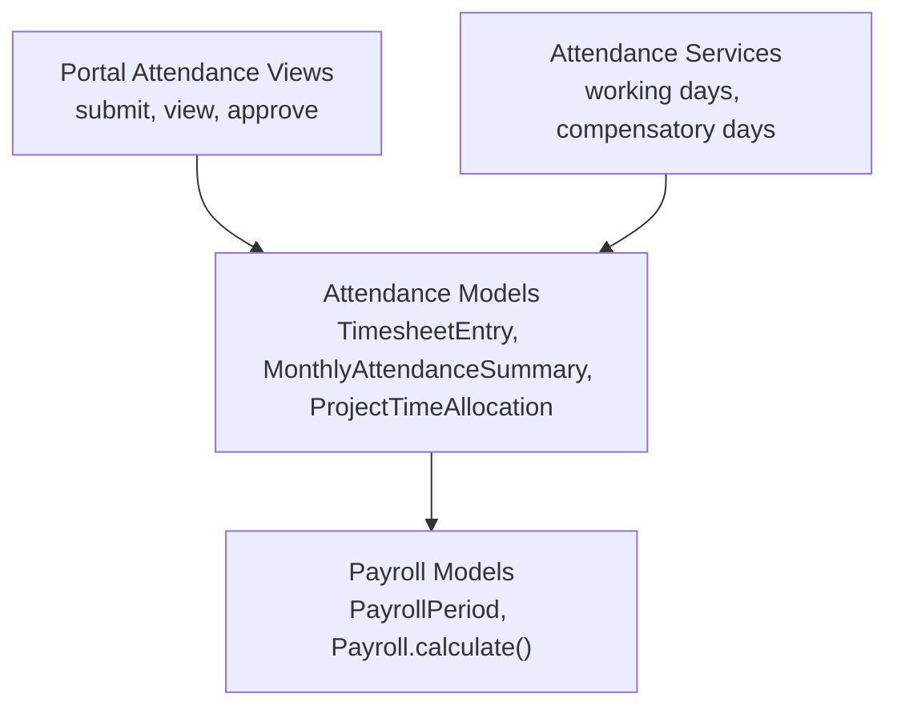
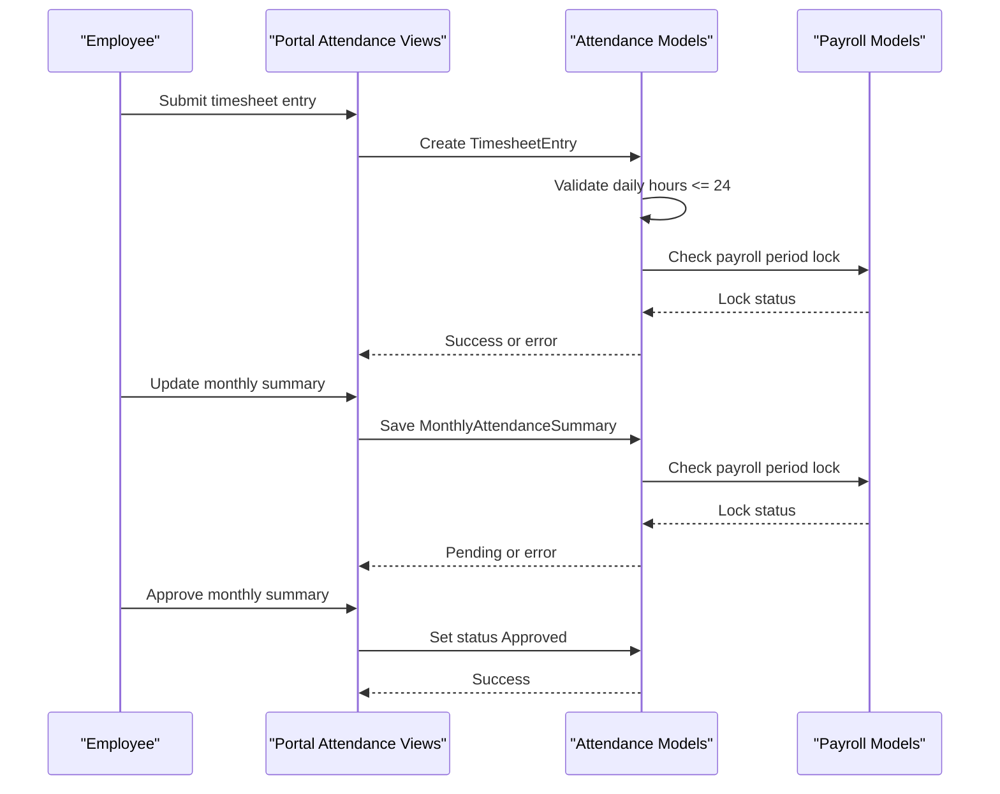
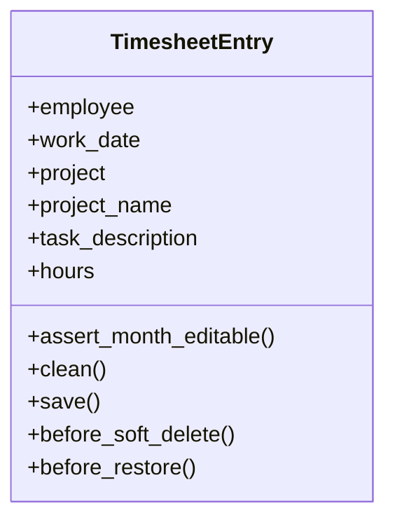
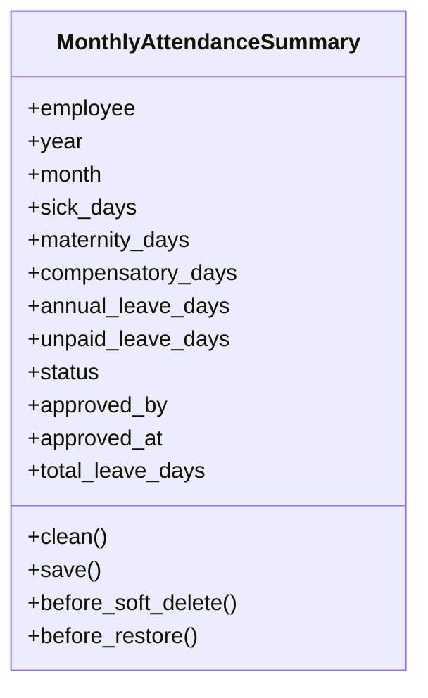
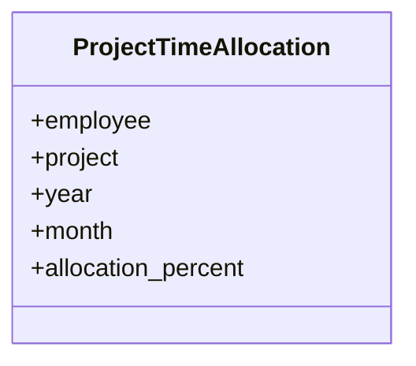
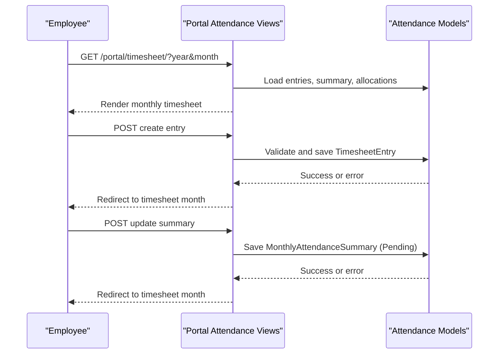
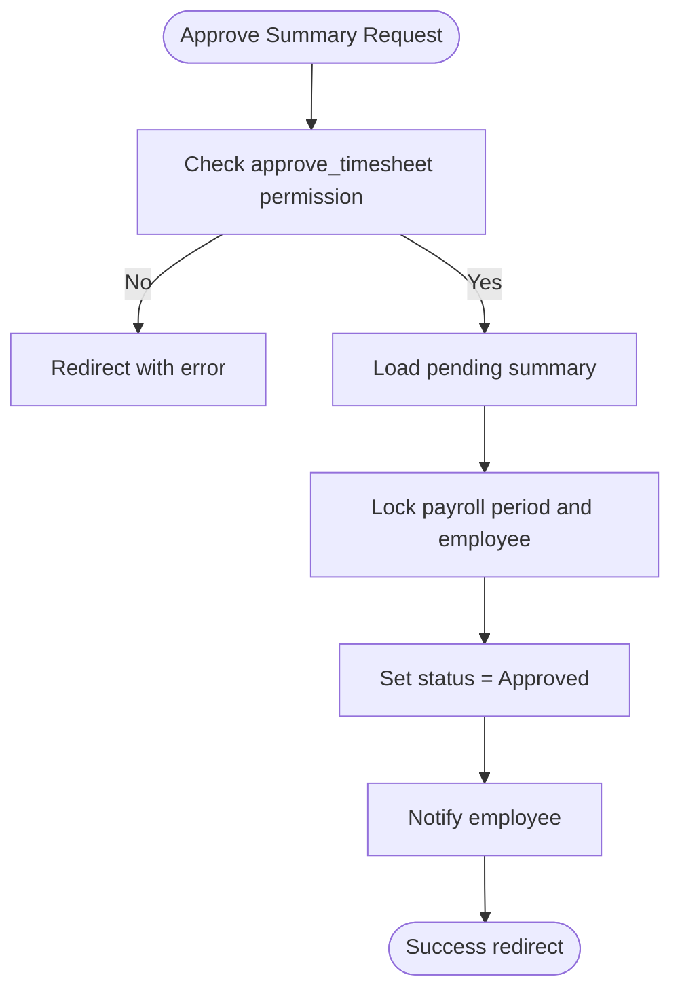
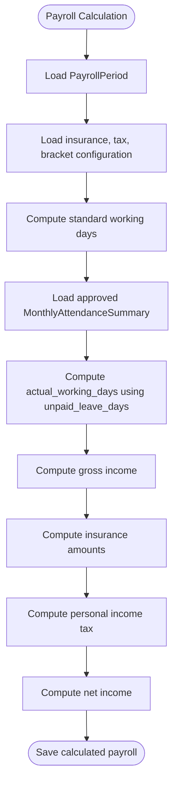
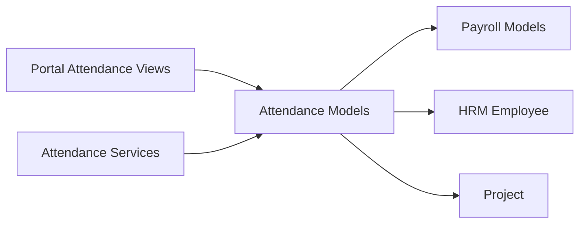

# Timesheet Management

<cite>
**Referenced Files in This Document**   
- [models.py](file://src/apps/attendance/models.py)
- [services.py](file://src/apps/attendance/services.py)
- [views.py](file://src/apps/portal/views/attendance.py)
- [models.py](file://src/apps/payroll/models.py)
</cite>

## Table of Contents
1. [Introduction](#introduction)
2. [Project Structure](#project-structure)
3. [Core Components](#core-components)
4. [Architecture Overview](#architecture-overview)
5. [Detailed Component Analysis](#detailed-component-analysis)
6. [Dependency Analysis](#dependency-analysis)
7. [Performance Considerations](#performance-considerations)
8. [Troubleshooting Guide](#troubleshooting-guide)
9. [Conclusion](#conclusion)

## Introduction
This document explains the timesheet management system used for project-based time tracking and monthly attendance summaries. It covers:
- Recording employee work hours by project through `TimesheetEntry`.
- Managing leave days and approval workflows through `MonthlyAttendanceSummary`.
- Defining employee-to-project allocation percentages through `ProjectTimeAllocation`.
- Validating daily hours, month/year constraints, and locking behavior when periods are approved or payroll is locked.
- Integrating with payroll so that only approved leave data affects salary calculations.

The goal is to make these concepts accessible while preserving precise implementation details from the codebase.

## Project Structure
The relevant functionality spans two Django applications:
- `apps.attendance`: Core models for timesheets, monthly summaries, allocations, holidays, working calendars, and shared services.
- `apps.portal.views.attendance`: Web endpoints for submitting timesheet entries, managing monthly summaries, and approving them.
- `apps.payroll.models`: Payroll period locking and calculation logic that consumes approved attendance data.

**Diagram sources**
- [views.py:237-462](file://src/apps/portal/views/attendance.py#L237-L462)
- [models.py:89-301](file://src/apps/attendance/models.py#L89-L301)
- [services.py:14-85](file://src/apps/attendance/services.py#L14-L85)
- [models.py:248-514](file://src/apps/payroll/models.py#L248-L514)

**Section sources**
- [views.py:237-462](file://src/apps/portal/views/attendance.py#L237-L462)
- [models.py:89-301](file://src/apps/attendance/models.py#L89-L301)
- [services.py:14-85](file://src/apps/attendance/services.py#L14-L85)
- [models.py:248-514](file://src/apps/payroll/models.py#L248-L514)

## Core Components
This section summarizes the three primary models and their responsibilities.

### TimesheetEntry
`TimesheetEntry` records how many hours an employee worked on a specific date, optionally linked to a project. It enforces:
- One entry per employee per day per project.
- Daily total hours across all entries not exceeding 24.
- Editability restrictions when the month’s summary is approved or the payroll period is locked.

Key behaviors:
- Fields include employee, work date, optional project, manual project name, task description, and hours.
- Validation prevents adding or modifying entries if the corresponding monthly summary is approved or the payroll period is locked.
- The model locks related payroll periods and employees during save/delete/restore operations to avoid race conditions.

**Section sources**
- [models.py:89-170](file://src/apps/attendance/models.py#L89-L170)

### MonthlyAttendanceSummary
`MonthlyAttendanceSummary` tracks different types of leave days for an employee in a given month:
- Sick days
- Maternity days
- Compensatory days
- Annual leave days
- Unpaid leave days

It also includes an approval workflow:
- Status can be Pending or Approved.
- Only Pending summaries can be edited; Approved summaries require reopening before changes.
- Locked payroll periods prevent modifications.
- Total leave days is computed as the sum of all leave fields.

**Section sources**
- [models.py:172-275](file://src/apps/attendance/models.py#L172-L275)

### ProjectTimeAllocation
`ProjectTimeAllocation` defines how much of an employee’s time is allocated to a project within a year and month:
- Unique constraint per employee, project, year, and month.
- Allocation percentage defaults to 100% when only one project is used in timesheet entries and no explicit allocation exists.

**Section sources**
- [models.py:277-301](file://src/apps/attendance/models.py#L277-L301)

## Architecture Overview
The system connects user-facing portal actions with attendance models and payroll logic.

**Diagram sources**
- [views.py:317-462](file://src/apps/portal/views/attendance.py#L317-L462)
- [models.py:113-167](file://src/apps/attendance/models.py#L113-L167)
- [models.py:214-268](file://src/apps/attendance/models.py#L214-L268)
- [models.py:248-266](file://src/apps/payroll/models.py#L248-L266)

## Detailed Component Analysis

### TimesheetEntry Model
`TimesheetEntry` is the central record for project-based time tracking.

#### Data Model
- Employee reference.
- Work date.
- Optional project link.
- Manual project name field for non-project entries.
- Task description.
- Hours with validators ensuring values between 0 and 24.

#### Constraints and Validation
- Unique constraint prevents duplicate entries for the same employee, date, and project.
- Daily total validation ensures the sum of hours across all entries for a single day does not exceed 24.
- Month editability checks block changes when:
  - The monthly attendance summary is Approved.
  - The payroll period is Locked.

#### Concurrency Protection
- Save, delete, and restore operations lock:
  - Related payroll periods.
  - Related employees.
- This avoids concurrent modifications that could bypass validations.

**Diagram sources**
- [models.py:89-170](file://src/apps/attendance/models.py#L89-L170)

**Section sources**
- [models.py:89-170](file://src/apps/attendance/models.py#L89-L170)

### MonthlyAttendanceSummary Model
`MonthlyAttendanceSummary` aggregates leave days and controls approval state.

#### Data Model
- Employee reference.
- Year and month.
- Leave day fields: sick, maternity, compensatory, annual leave, unpaid.
- Status: Pending or Approved.
- Approval metadata: approver and approval timestamp.

#### Validation Rules
- Month must be between 1 and 12.
- Locked payroll periods prevent updates.
- Leave day fields must be finite and non-negative.
- Approved summaries cannot be directly modified; they must be reopened to Pending first.

#### Computed Values
- Total leave days equals the sum of all leave fields.

**Diagram sources**
- [models.py:172-275](file://src/apps/attendance/models.py#L172-L275)

**Section sources**
- [models.py:172-275](file://src/apps/attendance/models.py#L172-L275)

### ProjectTimeAllocation Model
`ProjectTimeAllocation` manages how an employee’s time is distributed across projects for a given month and year.

#### Data Model
- Employee reference.
- Project reference.
- Year and month.
- Allocation percentage.

#### Constraints
- Unique constraint per employee, project, year, and month.

**Diagram sources**
- [models.py:277-301](file://src/apps/attendance/models.py#L277-L301)

**Section sources**
- [models.py:277-301](file://src/apps/attendance/models.py#L277-L301)

### Portal Workflow for Timesheet Submission
The portal provides endpoints to:
- View the monthly timesheet page.
- Create timesheet entries.
- Delete timesheet entries.
- Update monthly summaries.
- Approve monthly summaries.

**Diagram sources**
- [views.py:237-402](file://src/apps/portal/views/attendance.py#L237-L402)
- [models.py:113-167](file://src/apps/attendance/models.py#L113-L167)
- [models.py:214-268](file://src/apps/attendance/models.py#L214-L268)

**Section sources**
- [views.py:237-402](file://src/apps/portal/views/attendance.py#L237-L402)

### Approval Workflow for Monthly Summaries
Approval is role-gated and uses permission checks:
- Only users with appropriate permissions can view and approve pending summaries.
- Department managers can approve summaries for their departments.
- Global approvers can approve across departments.

**Diagram sources**
- [views.py:405-462](file://src/apps/portal/views/attendance.py#L405-L462)
- [models.py:246-268](file://src/apps/attendance/models.py#L246-L268)

**Section sources**
- [views.py:405-462](file://src/apps/portal/views/attendance.py#L405-L462)

### Integration with Payroll
Payroll integration ensures that only approved attendance data influences salary calculations:
- `PayrollPeriod` has Open and Locked statuses.
- Locked periods block creation/modification of payroll rows.
- `Payroll.calculate()` reads approved `MonthlyAttendanceSummary.unpaid_leave_days` to compute actual working days.
- Attendance services compute standard working days and compensatory days based on holidays and working calendars.

**Diagram sources**
- [models.py:405-514](file://src/apps/payroll/models.py#L405-L514)
- [models.py:248-266](file://src/apps/payroll/models.py#L248-L266)
- [services.py:35-47](file://src/apps/attendance/services.py#L35-L47)

**Section sources**
- [models.py:405-514](file://src/apps/payroll/models.py#L405-L514)
- [models.py:248-266](file://src/apps/payroll/models.py#L248-L266)
- [services.py:35-47](file://src/apps/attendance/services.py#L35-L47)

## Dependency Analysis
The following diagram shows key dependencies among components:

**Diagram sources**
- [views.py:1-27](file://src/apps/portal/views/attendance.py#L1-L27)
- [models.py:89-301](file://src/apps/attendance/models.py#L89-L301)
- [services.py:1-11](file://src/apps/attendance/services.py#L1-L11)
- [models.py:248-514](file://src/apps/payroll/models.py#L248-L514)

**Section sources**
- [views.py:1-27](file://src/apps/portal/views/attendance.py#L1-L27)
- [models.py:89-301](file://src/apps/attendance/models.py#L89-L301)
- [services.py:1-11](file://src/apps/attendance/services.py#L1-L11)
- [models.py:248-514](file://src/apps/payroll/models.py#L248-L514)

## Performance Considerations
- Use selective queries for timesheet entries and allocations to reduce payload size.
- Avoid unnecessary recalculations by relying on approved summaries rather than recomputing leave totals repeatedly.
- Leverage database constraints and validators to push validation close to storage.
- Be mindful of transaction boundaries around approvals and payroll locking to minimize contention.

[No sources needed since this section provides general guidance]

## Troubleshooting Guide
Common issues and their causes:

- Cannot submit timesheet entry:
  - Cause: Monthly summary is Approved or payroll period is Locked.
  - Resolution: Wait for period to open or reopen summary if allowed.

- Cannot update monthly summary:
  - Cause: Summary is already Approved or payroll period is Locked.
  - Resolution: Reopen summary or wait for payroll period to open.

- Daily hours exceed limit:
  - Cause: Total hours for a single day exceed 24.
  - Resolution: Reduce hours across entries for that day.

- Invalid month value:
  - Cause: Month outside 1–12 range.
  - Resolution: Correct month input.

- Negative or invalid leave days:
  - Cause: Non-finite or negative leave day values.
  - Resolution: Enter valid non-negative numbers.

**Section sources**
- [models.py:113-167](file://src/apps/attendance/models.py#L113-L167)
- [models.py:214-268](file://src/apps/attendance/models.py#L214-L268)
- [views.py:317-402](file://src/apps/portal/views/attendance.py#L317-L402)

## Conclusion
The timesheet management system provides robust project-based time tracking and controlled monthly attendance summaries. `TimesheetEntry` validates daily hours and protects against changes when periods are locked or summaries are approved. `MonthlyAttendanceSummary` centralizes leave tracking with clear approval states and integrates with payroll so only approved data affects salary calculations. `ProjectTimeAllocation` supports flexible project assignments and percentage allocations. Together, these components ensure accurate, auditable, and secure timesheet and payroll processes.

[No sources needed since this section summarizes without analyzing specific files]