# Core Modules Documentation

<cite>
**Referenced Files in This Document**
- [README.md](file://README.md)
- [00_Project_Charter.md](file://docs/00_Project_Charter.md)
- [10_RBAC_Permission_Matrix.md](file://docs/10_RBAC_Permission_Matrix.md)
- [security/models.py](file://src/apps/security/models.py)
- [security/permissions.py](file://src/apps/security/permissions.py)
- [common/models.py](file://src/apps/common/models.py)
- [common/middleware.py](file://src/apps/common/middleware.py)
- [common/number_format.py](file://src/apps/common/number_format.py)
- [common/params.py](file://src/apps/common/params.py)
- [common/ui_choices.py](file://src/apps/common/ui_choices.py)
- [common/ui_status.py](file://src/apps/common/ui_status.py)
- [common/uploads.py](file://src/apps/common/uploads.py)
- [common/email_draft.py](file://src/apps/common/email_draft.py)
- [common/export_names.py](file://src/apps/common/export_names.py)
- [common/asset_version.py](file://src/apps/common/asset_version.py)
</cite>

## Table of Contents
1. [Introduction](#introduction)
2. [Project Structure](#project-structure)
3. [Core Components](#core-components)
4. [Architecture Overview](#architecture-overview)
5. [Detailed Component Analysis](#detailed-component-analysis)
6. [Dependency Analysis](#dependency-analysis)
7. [Performance Considerations](#performance-considerations)
8. [Troubleshooting Guide](#troubleshooting-guide)
9. [Conclusion](#conclusion)

## Introduction
IHRMS is a modular monolith Django application for internal administration and human resource management. It provides an employee portal, administrative interface, and multiple business modules including organization management, HR administration, recruitment, attendance and leave, payroll and finance, contracts, documents, tasks, KPI tracking, assets, procurement, activity and lifecycle management, reporting, and Microsoft 365 integration. The system emphasizes centralized master data, auditability, soft deletes, role-based access control, and consistent module structure.

The project charter defines the vision, scope, success criteria, technical architecture, and operational standards. The RBAC document defines roles, actions, permission matrices, menu visibility, and API authorization rules. The codebase follows a consistent pattern: each Django app owns its models, views, services, forms, permissions, tests, migrations, templates, and optional management commands.

**Section sources**
- [README.md:1-90](file://README.md#L1-L90)
- [00_Project_Charter.md:1-166](file://docs/00_Project_Charter.md#L1-L166)
- [00_Project_Charter.md:289-358](file://docs/00_Project_Charter.md#L289-L358)
- [00_Project_Charter.md:400-464](file://docs/00_Project_Charter.md#L400-L464)

## Project Structure
The repository separates documentation, operations, design-system references, and the Django source tree under `src`. Business capabilities are implemented as separate Django applications under `src/apps`, with shared utilities under `apps/common`. The portal orchestrates navigation, dashboard aggregation, and cross-module presentation. Security, organization, HR, recruitment, attendance, leave, payroll, contract, document, task, KPI, asset, procurement, planning, office, activity, lifecycle, notification, m365, assistant, and reporting are distinct apps.

```mermaid
graph TB
Portal["Portal Orchestration<br/>Navigation, Dashboard, Templates"]
Security["Security & Authentication<br/>Role, User, Permissions"]
Common["Shared Utilities<br/>Models, Middleware, UI, Uploads"]
Org["Organization Management"]
Hrm["HR Administration"]
Recruitment["Recruitment"]
Attendance["Attendance"]
Leave["Leave"]
Payroll["Payroll & Finance"]
Contract["Contract"]
Document["Document"]
Task["Task & Assignment"]
Kpi["KPI Tracking"]
Asset["Asset Management"]
Procurement["Procurement"]
Office["Office Services"]
Activity["Activity Management"]
Lifecycle["Lifecycle Management"]
Reporting["Reporting"]
M365["Microsoft 365 Integration"]
Portal --> Security
Portal --> Common
Portal --> Org
Portal --> Hrm
Portal --> Recruitment
Portal --> Attendance
Portal --> Leave
Portal --> Payroll
Portal --> Contract
Portal --> Document
Portal --> Task
Portal --> Kpi
Portal --> Asset
Portal --> Procurement
Portal --> Office
Portal --> Activity
Portal --> Lifecycle
Portal --> Reporting
Portal --> M365
```

**Diagram sources**
- [README.md:36-47](file://README.md#L36-L47)
- [00_Project_Charter.md:106-166](file://docs/00_Project_Charter.md#L106-L166)

**Section sources**
- [README.md:1-90](file://README.md#L1-L90)
- [00_Project_Charter.md:106-166](file://docs/00_Project_Charter.md#L106-L166)

## Core Components
This section explains the shared foundation that every business module builds on.

### Shared Data Model and Audit Base
Every business model should inherit from `BaseAuditModel`, which adds creation, modification, deletion metadata, and soft-delete behavior. The default manager excludes deleted records; `all_objects` exposes all records. Soft delete triggers optional hooks such as `before_soft_delete`, `after_soft_delete`, `before_restore`, and `after_restore`. Hard delete bypasses soft-delete logic.

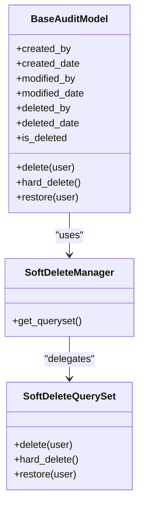

**Diagram sources**
- [common/models.py:6-88](file://src/apps/common/models.py#L6-L88)

**Section sources**
- [common/models.py:6-88](file://src/apps/common/models.py#L6-L88)

### Safe Parameter Handling
Parameter parsing utilities prevent unhandled exceptions from user input. `parse_int` accepts a value, default, minimum, and maximum, returning the default when conversion fails or bounds are violated. This replaces unsafe direct integer conversions from query strings or POST bodies.

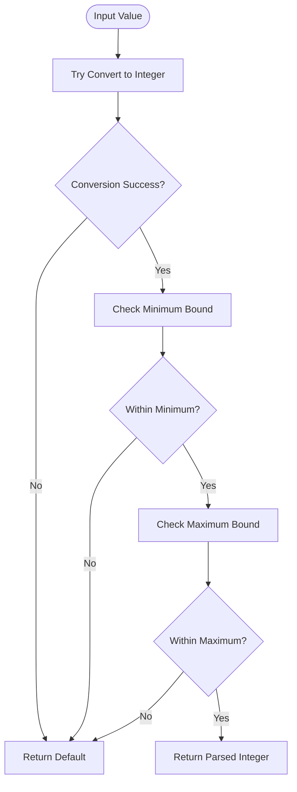

**Diagram sources**
- [common/params.py:14-28](file://src/apps/common/params.py#L14-L28)

**Section sources**
- [common/params.py:1-28](file://src/apps/common/params.py#L1-L28)

### Vietnamese Number Formatting
Number formatting is display-only. Canonical stored values remain unchanged. The formatter converts numeric inputs to `Decimal`, rejects non-finite values, formats with locale-aware separators, strips trailing zeros, and swaps comma and dot characters for Vietnamese presentation.

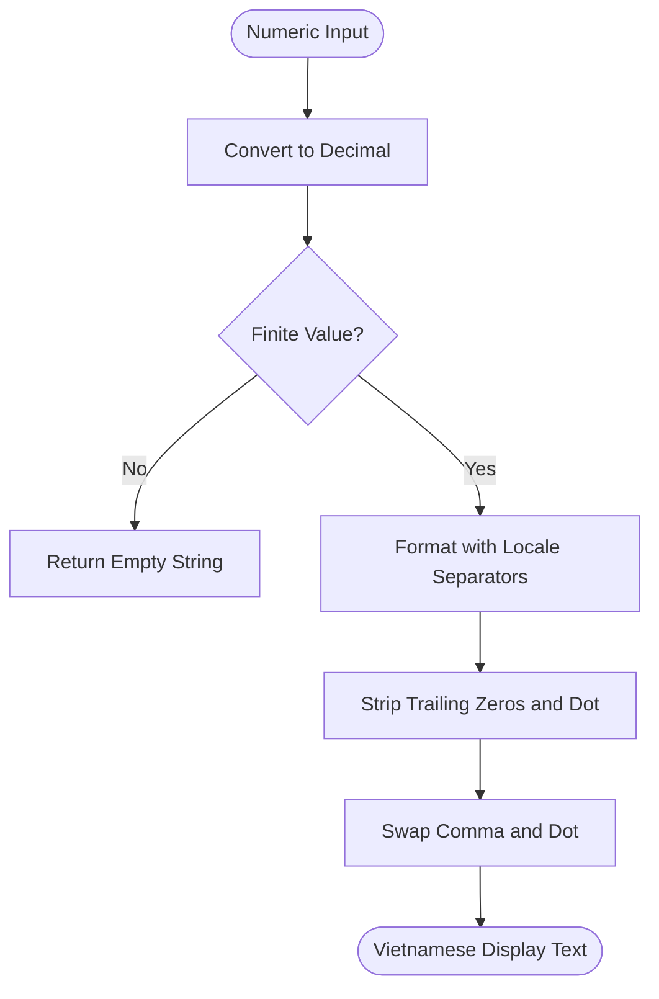

**Diagram sources**
- [common/number_format.py:4-11](file://src/apps/common/number_format.py#L4-L11)

**Section sources**
- [common/number_format.py:1-12](file://src/apps/common/number_format.py#L1-L12)

### UI Choices and Form State Helpers
UI helpers avoid global database queries inside choice builders. `text_choices` builds sorted, deduplicated text suggestions from already authorized rows. `remember_form` stores allow-listed form fields in the session after validation failure, and `recalled_form` retrieves them once.

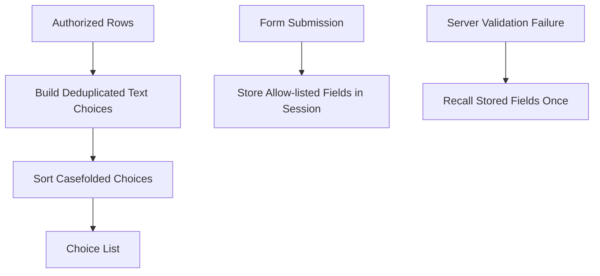

**Diagram sources**
- [common/ui_choices.py:7-26](file://src/apps/common/ui_choices.py#L7-L26)

**Section sources**
- [common/ui_choices.py:1-27](file://src/apps/common/ui_choices.py#L1-L27)

### Status Registry
Status registry maps model families and status codes to display labels, tones, and icons. It keeps display logic separate from workflow state and permissions. A helper function returns known badge information or a fallback label.

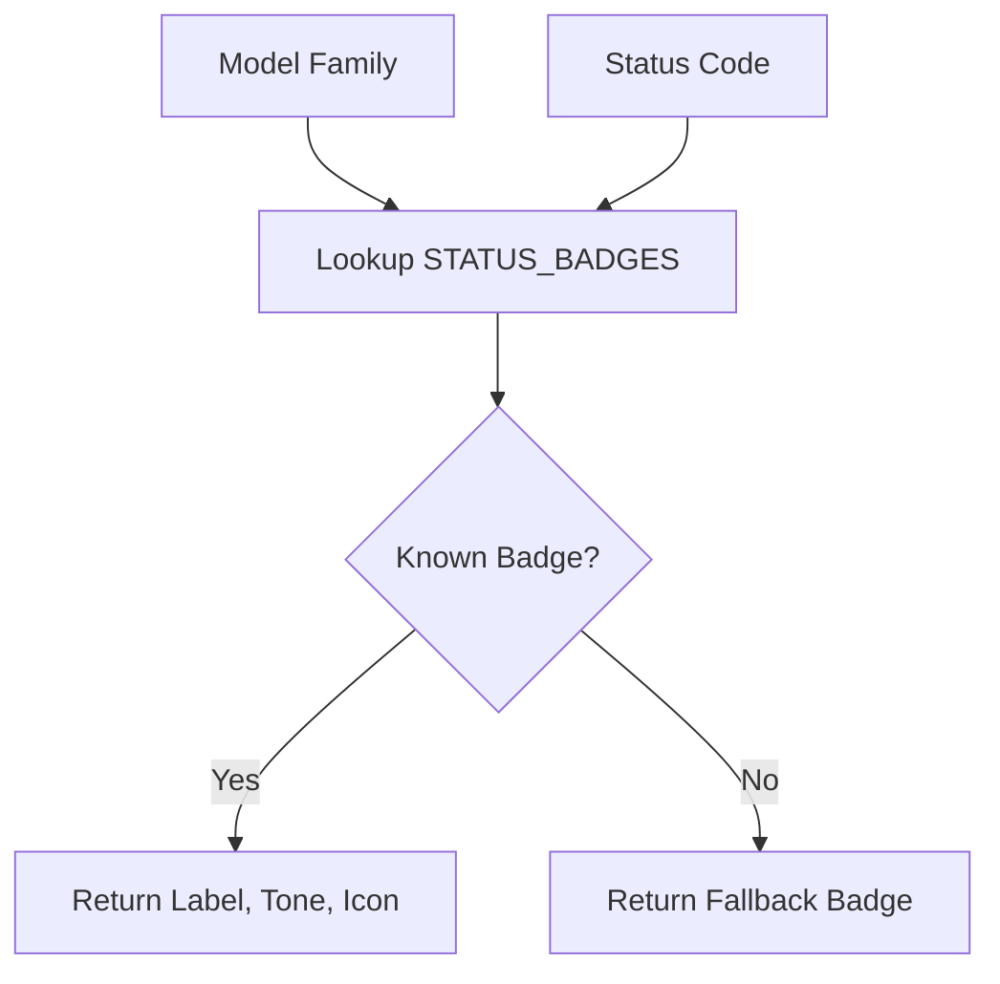

**Diagram sources**
- [common/ui_status.py:1-216](file://src/apps/common/ui_status.py#L1-L216)

**Section sources**
- [common/ui_status.py:1-216](file://src/apps/common/ui_status.py#L1-L216)

### File Upload Handling
Upload utilities normalize filenames, validate allowed extensions, enforce size limits, generate deterministic upload paths by folder and date, and provide validators for general files, signed PDF decisions, and media uploads.

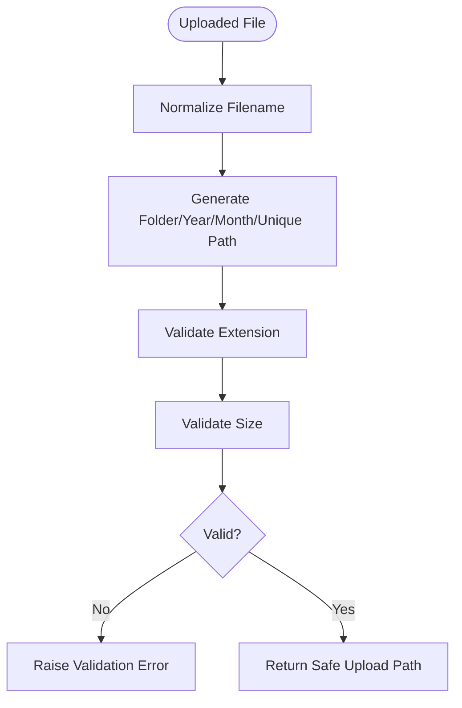

**Diagram sources**
- [common/uploads.py:38-161](file://src/apps/common/uploads.py#L38-L161)

**Section sources**
- [common/uploads.py:1-161](file://src/apps/common/uploads.py#L1-L161)

### Email Workflow Integration
Email draft helpers build properly encoded `mailto:` URLs for opening reviewed drafts in the recipient’s desktop client. They do not send mail directly from the server.

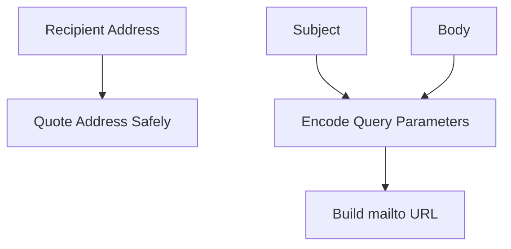

**Diagram sources**
- [common/email_draft.py:5-9](file://src/apps/common/email_draft.py#L5-L9)

**Section sources**
- [common/email_draft.py:1-10](file://src/apps/common/email_draft.py#L1-L10)

### Export Naming and Static Asset Versioning
Export naming produces Windows-safe, deterministic filenames by normalizing tokens and appending dates. Static asset versioning computes content hashes for core CSS/JS bundles and derives a service worker cache version to avoid stale caches.

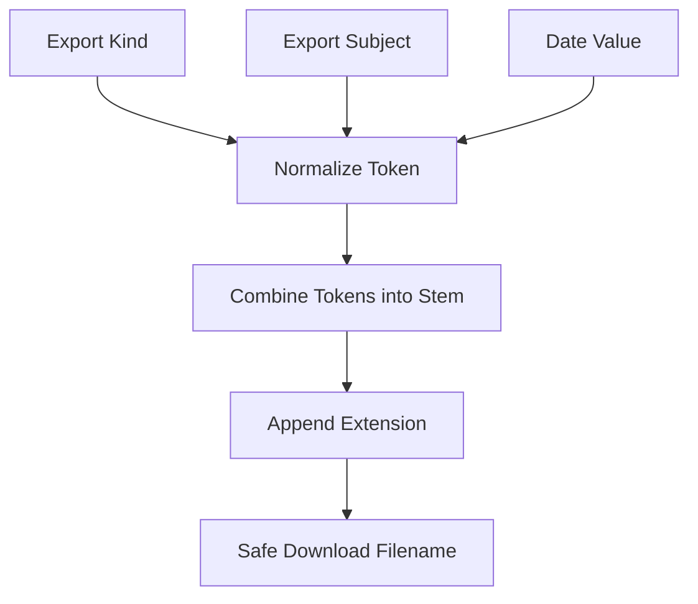

**Diagram sources**
- [common/export_names.py:6-16](file://src/apps/common/export_names.py#L6-L16)
- [common/asset_version.py:14-52](file://src/apps/common/asset_version.py#L14-L52)

**Section sources**
- [common/export_names.py:1-17](file://src/apps/common/export_names.py#L1-L17)
- [common/asset_version.py:1-59](file://src/apps/common/asset_version.py#L1-L59)

## Architecture Overview
IHRMS uses a modular Django architecture where each domain is a separate application. The portal layer aggregates dashboards, navigation, and cross-module context. Security provides roles, users, and permission checks. Shared utilities provide reusable patterns for auditing, parameters, UI choices, status badges, uploads, email drafts, export names, and static asset caching.

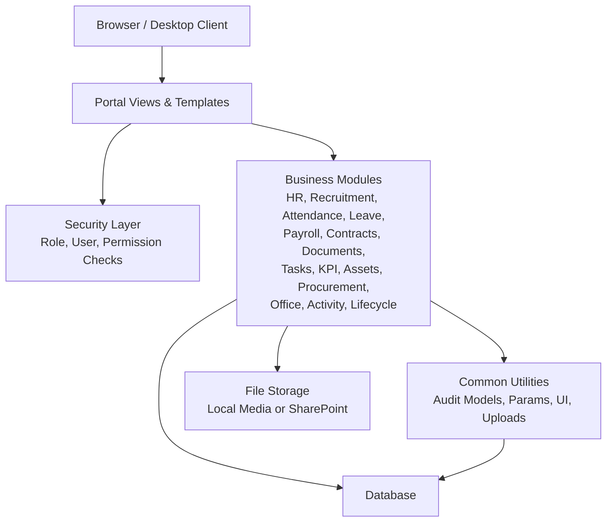

**Diagram sources**
- [README.md:1-90](file://README.md#L1-L90)
- [00_Project_Charter.md:289-358](file://docs/00_Project_Charter.md#L289-L358)

**Section sources**
- [README.md:1-90](file://README.md#L1-L90)
- [00_Project_Charter.md:289-358](file://docs/00_Project_Charter.md#L289-L358)

## Detailed Component Analysis

### Security and Authentication
Security defines the role model, extended user model, and security event logging. Roles are stored in `tblRole`; users are stored in `tblUser` and linked to roles and HR employees. Security events record action, resource, and record identifiers without storing sensitive values.

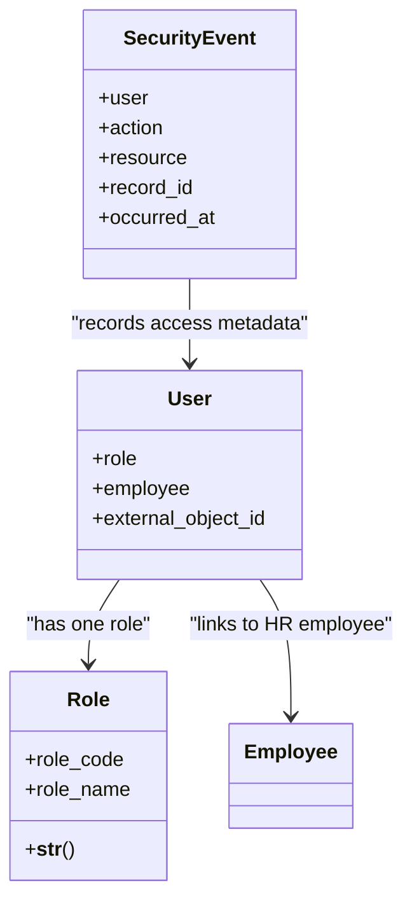

**Diagram sources**
- [security/models.py:5-46](file://src/apps/security/models.py#L5-L46)

Permission enforcement is centralized in `PERMISSION_MATRIX`. It declares 11 role codes and maps permissions such as leave approval, timesheet approval, task assignment, activity view and management, KPI scoring, document and personnel decision approval, recruitment request and candidate viewing, profile change submission and approval, lifecycle case management, finance management, salary scale usage, office management, outgoing document access, procurement request and approval, asset view and management, disposal approval, report center access, and admin menu visibility. Superusers always have permissions; staff-only permissions include admin menu access.

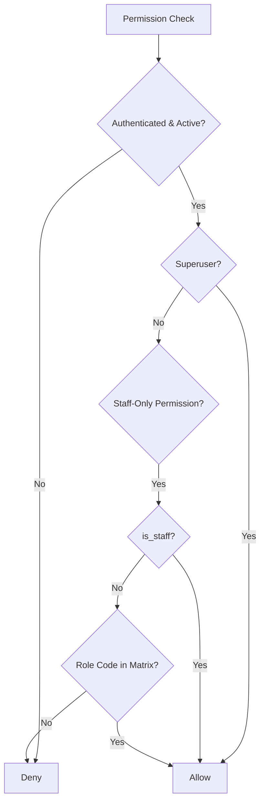

**Diagram sources**
- [security/permissions.py:13-109](file://src/apps/security/permissions.py#L13-L109)
- [security/permissions.py:121-151](file://src/apps/security/permissions.py#L121-L151)

**Section sources**
- [security/models.py:1-46](file://src/apps/security/models.py#L1-L46)
- [security/permissions.py:1-152](file://src/apps/security/permissions.py#L1-L152)

### Organization Management
Organization management is represented as a dedicated Django app. In this modular architecture, it owns organizational entities such as departments, positions, job titles, and reporting relationships. Views handle HTTP requests, services encapsulate business logic, and models define data structures. Tests verify list, detail, create, update, and export behaviors.

Typical implementation pattern:
- `models.py`: Organizational entities with foreign keys to department, position, and employee.
- `views.py`: List/detail/create/update endpoints using safe parameter parsing and permission checks.
- `services.py`: Business rules for hierarchy traversal, promotion, transfer, and headcount calculations.
- `tests.py`: Assertions for visibility, ordering, export names, and audit fields.

**Section sources**
- [00_Project_Charter.md:106-113](file://docs/00_Project_Charter.md#L106-L113)

### HR Administration
HR administration manages employee profiles, employment status, profile change requests, and HR workflows. Models capture employee attributes, history, attachments, and status transitions. Views expose employee lists, profile pages, and change request flows. Services implement due-date processing, manager-scoped visibility, and attachment handling.

Key patterns:
- Employee inherits audit fields and soft-delete behavior.
- Employment status uses the shared status registry for display.
- Profile change requests follow pending/approved/rejected/needs-more-info states.
- Attachments use normalized upload paths and validated file types.

**Section sources**
- [common/models.py:56-88](file://src/apps/common/models.py#L56-L88)
- [common/ui_status.py:3-18](file://src/apps/common/ui_status.py#L3-L18)
- [common/uploads.py:38-124](file://src/apps/common/uploads.py#L38-L124)

### Recruitment
Recruitment manages recruitment requests, vacancies, candidates, interviews, offers, and hiring outcomes. Permissions restrict candidate viewing to HR roles, directors, and project coordinators/managers. Views support request creation, vacancy listing, candidate pipelines, interview results, and offer approvals.

Implementation highlights:
- Candidate status mapped through the status registry.
- Interview result choices defined centrally.
- Offer status tracked with sent/accepted/declined states.
- Export and reporting restricted by permission matrix.

**Section sources**
- [security/permissions.py:53-57](file://src/apps/security/permissions.py#L53-L57)
- [common/ui_status.py:95-120](file://src/apps/common/ui_status.py#L95-L120)

### Attendance and Leave
Attendance tracks daily work, late arrivals, absences, half-days, monthly summaries, adjustments, and locking. Leave manages request creation, multi-level approval, cancellation, and reporting. Both modules integrate with the permission matrix for department-scoped and HR/director approvals.

Patterns:
- Attendance status uses shared badges.
- Monthly summary status supports pending/approved workflows.
- Leave request status supports pending/approved/rejected/cancelled flows.
- Manager and HR scopes enforced via permission flags.

**Section sources**
- [common/ui_status.py:19-32](file://src/apps/common/ui_status.py#L19-L32)
- [security/permissions.py:29-36](file://src/apps/security/permissions.py#L29-L36)

### Payroll and Finance
Payroll manages employee salary records, payroll periods, calculation, approval, locking, and payslip generation. Finance controls budget-related workflows and procurement approvals. Salary scale form usage is restricted to finance officers and directors.

Patterns:
- Employee salary status tracks active/ended records.
- Payroll period status tracks open/locked periods.
- Approval and lock actions require explicit permissions.
- Export and reporting limited by role matrix.

**Section sources**
- [common/ui_status.py:39-42](file://src/apps/common/ui_status.py#L39-L42)
- [security/permissions.py:83-86](file://src/apps/security/permissions.py#L83-L86)

### Contracts
Contracts manage labor contracts, addendums, renewals, and expiration alerts. Views support creation, updates, approvals, and exports. Status includes draft, active, expired, and terminated.

Patterns:
- Contract status mapped through status registry.
- Approval requires director or HR manager permissions.
- Expiration alerts integrated into dashboard and reporting.

**Section sources**
- [common/ui_status.py:33-38](file://src/apps/common/ui_status.py#L33-L38)
- [security/permissions.py:51-52](file://src/apps/security/permissions.py#L51-L52)

### Documents and Official Dispatch
Documents manage official incoming/outgoing dispatches, personnel decisions, versions, and publication workflows. Access rules distinguish between read/download policies and write/approve policies. Personnel decisions have additional signing and issuance requirements.

Patterns:
- Official dispatch status includes new, processing, completed, archived, overdue.
- Personnel decision status includes draft, pending approval, approved, issued, cancelled.
- Signed PDF validation enforces document integrity.
- Upload paths separate incoming, outgoing, and personnel-decision folders.

**Section sources**
- [common/ui_status.py:47-73](file://src/apps/common/ui_status.py#L47-L73)
- [common/uploads.py:64-85](file://src/apps/common/uploads.py#L64-L85)
- [common/uploads.py:127-137](file://src/apps/common/uploads.py#L127-L137)

### Task and KPI Tracking
Task management supports creation, assignment, progress updates, completion, approvals, comments, checklists, and attachments. KPI management supports goal setting, assignment, actual updates, evaluation, and reporting.

Patterns:
- Task status includes todo, in progress, done, cancelled.
- KPI scoring requires HR manager or department manager permissions.
- Task assignment permissions restricted to HR managers and department managers.
- Export and view-all permissions vary by role.

**Section sources**
- [common/ui_status.py:43-46](file://src/apps/common/ui_status.py#L43-L46)
- [security/permissions.py:37-49](file://src/apps/security/permissions.py#L37-L49)

### Activity and Lifecycle Management
Activity management covers planned activities, dispatch issuance, implementation, completion, and cancellation. Lifecycle management handles employee lifecycle cases and checklist items. These modules have dedicated permissions and status registries.

Patterns:
- Activity status includes planned, dispatch issued, in progress, completed, cancelled.
- Activity proposal status includes draft, submitted, approved, changes requested.
- Lifecycle case status includes open, completed, cancelled.
- Checklist item status includes pending, done, skipped.

**Section sources**
- [common/ui_status.py:169-201](file://src/apps/common/ui_status.py#L169-L201)
- [security/permissions.py:39-47](file://src/apps/security/permissions.py#L39-L47)

### Office Services
Office services manage room bookings, vehicle bookings, supply requests, and related approvals. Statuses reflect pending, approved, rejected, cancelled, and issued states.

Patterns:
- Room booking and vehicle booking statuses share common workflow states.
- Supply request status includes pending, approved, issued, rejected.
- Approval permissions align with office management permissions.

**Section sources**
- [common/ui_status.py:146-157](file://src/apps/common/ui_status.py#L146-L157)
- [security/permissions.py:87-95](file://src/apps/security/permissions.py#L87-L95)

### Asset Management
Asset management tracks assets, inventory sessions, and disposal requests. View and manage permissions are separated. Disposal approval is restricted to directors and super admins. Ordinary employees and many other roles do not get direct asset navigation.

Patterns:
- Asset condition includes normal, damaged, lost.
- Asset status includes available, in use, maintenance, disposed.
- Inventory session status includes draft, completed.
- Disposal request status includes pending, approved, rejected, completed.

**Section sources**
- [common/ui_status.py:74-94](file://src/apps/common/ui_status.py#L74-L94)
- [security/permissions.py:99-104](file://src/apps/security/permissions.py#L99-L104)

### Procurement
Procurement manages purchase requests, budget approval, final approval, closure, and reporting. Permissions separate request creation, budget approval, final approval, and export.

Patterns:
- Procurement request status includes pending, approved, rejected, purchased.
- Budget approval restricted to finance and super admin.
- Final approval restricted to directors.

**Section sources**
- [common/ui_status.py:121-132](file://src/apps/common/ui_status.py#L121-L132)
- [security/permissions.py:96-98](file://src/apps/security/permissions.py#L96-L98)

### Portal Orchestration
The portal provides unified navigation, dashboard aggregation, and cross-module presentation. It composes data from multiple modules, applies permission flags, renders templates, and integrates shared UI components. The portal also coordinates reporting slides, dashboard phases, selectors, and home presentation.

Patterns:
- Navigation menus derived from permission matrix.
- Dashboards aggregate metrics from HR, payroll, attendance, leave, recruitment, assets, procurement, tasks, KPI, and activity modules.
- Template rendering uses shared status badges, number formatting, and export naming.
- Context processors inject permission flags and role information.

**Section sources**
- [security/permissions.py:149-151](file://src/apps/security/permissions.py#L149-L151)
- [common/ui_status.py:211-215](file://src/apps/common/ui_status.py#L211-L215)
- [common/number_format.py:4-11](file://src/apps/common/number_format.py#L4-L11)
- [common/export_names.py:13-16](file://src/apps/common/export_names.py#L13-L16)

## Dependency Analysis
The following diagram shows how core dependencies connect across security, common utilities, and business modules.

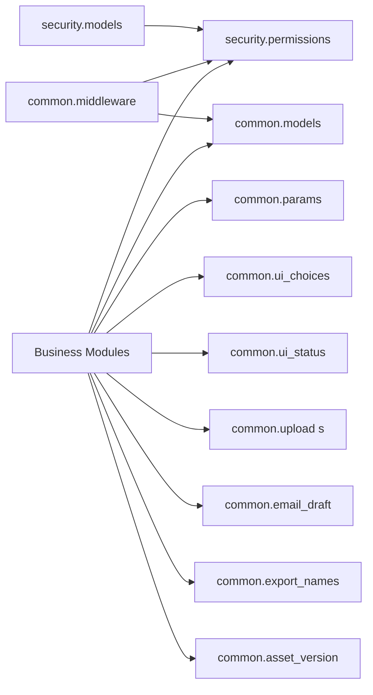

**Diagram sources**
- [security/permissions.py:1-152](file://src/apps/security/permissions.py#L1-L152)
- [security/models.py:1-46](file://src/apps/security/models.py#L1-L46)
- [common/models.py:6-88](file://src/apps/common/models.py#L6-L88)
- [common/middleware.py:7-28](file://src/apps/common/middleware.py#L7-L28)

**Section sources**
- [security/permissions.py:1-152](file://src/apps/security/permissions.py#L1-L152)
- [common/middleware.py:7-28](file://src/apps/common/middleware.py#L7-L28)

## Performance Considerations
- Use safe parameter parsing to avoid unhandled exceptions and unnecessary error responses.
- Prefer service-layer queries with filtered scopes instead of repeated per-row lookups.
- Cache expensive dashboard aggregations where appropriate, but invalidate on relevant state changes.
- Avoid heavy file operations in request threads; prefer background tasks for large exports or PDF generation.
- Keep status and choice rendering lightweight; rely on preloaded authorized rows.
- Use soft-delete managers consistently to avoid accidental full-table scans on deleted records.

[No sources needed since this section provides general guidance]

## Troubleshooting Guide
Common issues and resolutions:

- **Uncaught ValueError or OverflowError from query parameters:** Replace direct `int()` calls with `parse_int`, providing defaults and bounds.
- **Unexpected 500 errors on portal pages due to scheduled HR changes:** The middleware catches transient database errors so unrelated pages remain available. Investigate database connectivity and the scheduled change service separately.
- **File upload failures due to unsupported extensions or oversized files:** Ensure uploaded files match allowed extensions and size limits. For media libraries, use the media-specific validator.
- **Incorrect Vietnamese number display:** Confirm that numbers are formatted through `vi_number` only for display; stored values must remain canonical.
- **Stale static assets in browsers:** Use asset hashing and service worker cache versioning to force refresh when core CSS/JS changes.
- **Export filenames containing broken Unicode characters:** Use deterministic tokenization and export naming utilities.

**Section sources**
- [common/params.py:1-11](file://src/apps/common/params.py#L1-L11)
- [common/middleware.py:15-28](file://src/apps/common/middleware.py#L15-L28)
- [common/uploads.py:106-161](file://src/apps/common/uploads.py#L106-L161)
- [common/number_format.py:1-12](file://src/apps/common/number_format.py#L1-L12)
- [common/asset_version.py:1-59](file://src/apps/common/asset_version.py#L1-L59)
- [common/export_names.py:1-17](file://src/apps/common/export_names.py#L1-L17)

## Conclusion
IHRMS implements a clear modular architecture where each business domain is a self-contained Django application. Shared utilities standardize audit fields, soft deletes, parameter parsing, UI choices, status badges, file uploads, email draft URLs, export naming, and static asset versioning. Security centralizes roles, users, and permissions, while the portal orchestrates navigation and dashboard aggregation across modules. The permission matrix defines 11 role codes and enforces consistent access control for leave, timesheets, tasks, activities, KPIs, documents, recruitment, finance, office services, assets, procurement, reports, and admin menus. Following these patterns ensures maintainable, auditable, and secure development across all major functional areas.

[No sources needed since this section summarizes without analyzing specific files]