# Dashboard UI Redesign

> Generated reference snapshot (October 2026). Consult AGENTS.md and docs/PROJECT_WORK_LOG.md for current decisions and validation. The PWA shell described here is existing web behavior; the separately approved React Native mobile application has not been implemented by this document.

<cite>
**Referenced Files in This Document**
- [README.md](file://README.md)
- [DASHBOARD_ATOMS_TECH_SPEC.md](file://docs/DASHBOARD_ATOMS_TECH_SPEC.md)
- [UI_DESIGN_SYSTEM.md](file://docs/UI_DESIGN_SYSTEM.md)
- [09_UI_UX_Specification.md](file://docs/09_UI_UX_Specification.md)
- [dashboard.html](file://src/apps/portal/templates/portal/dashboard.html)
- [_secondary_metrics.html](file://src/apps/portal/templates/portal/dashboard/_secondary_metrics.html)
- [_group_hr.html](file://src/apps/portal/templates/portal/dashboard/_group_hr.html)
- [home_dashboard.css](file://src/static/css/home_dashboard.css)
- [home_dashboard.js](file://src/static/js/home_dashboard.js)
- [dashboard_data.py](file://src/apps/portal/dashboard_data.py)
- [dashboard_phase2.py](file://src/apps/portal/dashboard_phase2.py)
</cite>

## Table of Contents
1. [Introduction](#introduction)
2. [Project Structure](#project-structure)
3. [Core Components](#core-components)
4. [Architecture Overview](#architecture-overview)
5. [Detailed Component Analysis](#detailed-component-analysis)
6. [Dependency Analysis](#dependency-analysis)
7. [Performance Considerations](#performance-considerations)
8. [Troubleshooting Guide](#troubleshooting-guide)
9. [Conclusion](#conclusion)

## Introduction
This document explains the current Dashboard UI redesign for IHRMS and how its server-side data, templates, styles, and client behavior work together. The dashboard is a read-only operational overview that shows KPIs, HR summaries, contracts, headcount plans, approval queues, agenda, running projects, and Phase 2 blocks such as recent leave, recruitment postings, candidates, personnel decision history, and recruitment requests. It follows the project’s design system, uses scoped permissions before querying business data, and keeps sensitive payroll information hidden until policy approval.

The goal of this documentation is to help developers, reviewers, and testers understand:
- How dashboard sections are gated by role and permission.
- How data flows from Django models into structured DTOs.
- How templates render cards, charts, lists, and the right rail.
- How CSS provides responsive layout, tokens, and accessibility.
- How JavaScript handles disclosure overlays and jump links.
- What performance, privacy, and testing constraints apply.

**Section sources**
- [README.md:1-91](file://README.md#L1-L91)
- [DASHBOARD_ATOMS_TECH_SPEC.md:1-531](file://docs/DASHBOARD_ATOMS_TECH_SPEC.md#L1-L531)

## Project Structure
The dashboard implementation spans four layers:

| Layer | Responsibility | Key files |
|---|---|---|
| Documentation | Design rules, phase gates, role matrix, query budget, and acceptance criteria | `docs/DASHBOARD_ATOMS_TECH_SPEC.md`, `docs/UI_DESIGN_SYSTEM.md`, `docs/09_UI_UX_Specification.md` |
| Server data | Permission-gated queries, DTO construction, error states | `src/apps/portal/dashboard_data.py`, `src/apps/portal/dashboard_phase2.py` |
| Templates | Page header, groups, secondary metrics, drill-down links | `src/apps/portal/templates/portal/dashboard.html`, `_secondary_metrics.html`, `_group_hr.html` |
| Presentation | Responsive grid, chart tokens, rail layout, disclosure UX | `src/static/css/home_dashboard.css`, `src/static/js/home_dashboard.js` |

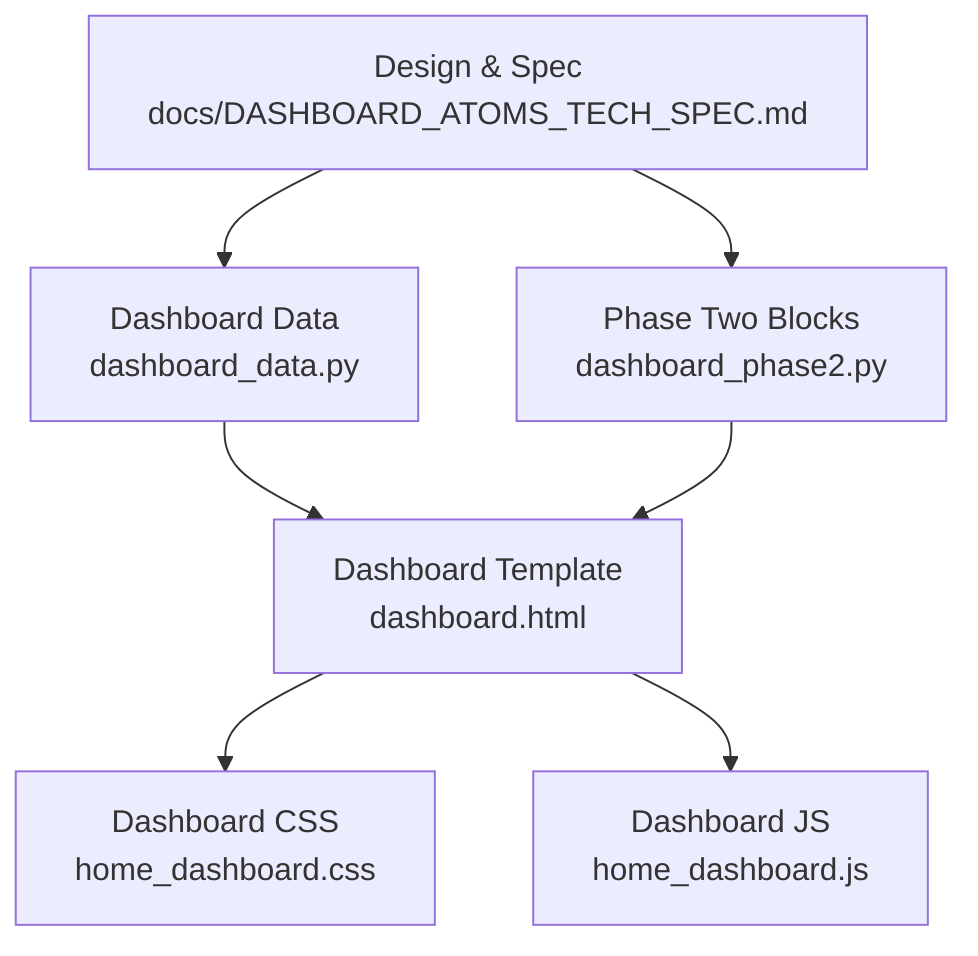

**Diagram sources**
- [DASHBOARD_ATOMS_TECH_SPEC.md:1-531](file://docs/DASHBOARD_ATOMS_TECH_SPEC.md#L1-L531)
- [dashboard_data.py:1-258](file://src/apps/portal/dashboard_data.py#L1-L258)
- [dashboard_phase2.py:1-145](file://src/apps/portal/dashboard_phase2.py#L1-L145)
- [dashboard.html:1-14](file://src/apps/portal/templates/portal/dashboard.html#L1-L14)
- [home_dashboard.css:1-293](file://src/static/css/home_dashboard.css#L1-L293)
- [home_dashboard.js:1-23](file://src/static/js/home_dashboard.js#L1-L23)

**Section sources**
- [README.md:1-91](file://README.md#L1-L91)
- [DASHBOARD_ATOMS_TECH_SPEC.md:1-531](file://docs/DASHBOARD_ATOMS_TECH_SPEC.md#L1-L531)
- [UI_DESIGN_SYSTEM.md:1-82](file://docs/UI_DESIGN_SYSTEM.md#L1-L82)
- [09_UI_UX_Specification.md:1-800](file://docs/09_UI_UX_Specification.md#L1-L800)

## Core Components
The dashboard is composed of reusable components rather than one monolithic screen:

| Component | Purpose | Source |
|---|---|---|
| Dashboard page shell | Loads assets, sets density, renders header, profile warning, and content grid | `src/apps/portal/templates/portal/dashboard.html` |
| Secondary metrics band | Renders five summary items inside the KPI block or mobile-friendly row | `src/apps/portal/templates/portal/dashboard/_secondary_metrics.html` |
| HR group layout | Arranges headcount chart, contract distribution, expiring contracts, and decision history | `src/apps/portal/templates/portal/dashboard/_group_hr.html` |
| Dashboard CSS | Defines grid, KPI block, rail, donut chart tokens, responsive breakpoints, and reduced motion | `src/static/css/home_dashboard.css` |
| Dashboard JS | Closes open disclosures on Escape, blur, or outside click; toggles jump links | `src/static/js/home_dashboard.js` |
| Phase-one data builder | Builds employee status, approved leave, contracts, headcount, queue, agenda, and running projects | `src/apps/portal/dashboard_data.py` |
| Phase-two data builder | Builds recent leave, postings, candidates, decisions, and recruitment requests | `src/apps/portal/dashboard_phase2.py` |

Key responsibilities:
- **Permission gating**: Business data is only queried when the user has the required permission or linked employee scope.
- **Read-only DTOs**: Each section returns a stable dictionary with state, rows, labels, notes, and optional drill-down URLs.
- **Graceful degradation**: Database errors become a readable “data unavailable” state instead of crashing the page.
- **Accessible interactions**: Disclosures use native `
` semantics, keyboard focus, and Escape-to-close behavior.
- **Responsive layout**: Desktop uses an 8/4 main/rail grid; smaller screens collapse panels and adjust KPI columns.

**Section sources**
- [dashboard.html:1-14](file://src/apps/portal/templates/portal/dashboard.html#L1-L14)
- [_secondary_metrics.html:1-6](file://src/apps/portal/templates/portal/dashboard/_secondary_metrics.html#L1-L6)
- [_group_hr.html:12-19](file://src/apps/portal/templates/portal/dashboard/_group_hr.html#L12-L19)
- [home_dashboard.css:1-293](file://src/static/css/home_dashboard.css#L1-L293)
- [home_dashboard.js:1-23](file://src/static/js/home_dashboard.js#L1-L23)
- [dashboard_data.py:1-258](file://src/apps/portal/dashboard_data.py#L1-L258)
- [dashboard_phase2.py:1-145](file://src/apps/portal/dashboard_phase2.py#L1-L145)

## Architecture Overview
The dashboard follows a server-rendered flow: authentication and permissions determine which sections are built, each section builds a bounded DTO, and templates render only what the user is allowed to see.

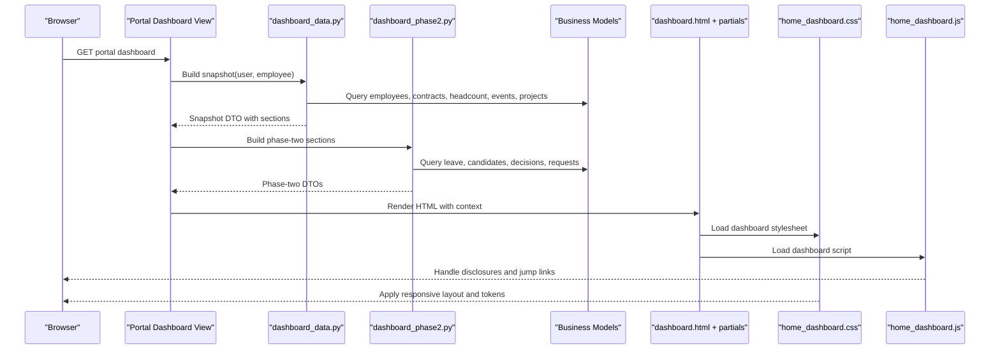

**Diagram sources**
- [dashboard_data.py:192-257](file://src/apps/portal/dashboard_data.py#L192-L257)
- [dashboard_phase2.py:119-144](file://src/apps/portal/dashboard_phase2.py#L119-L144)
- [dashboard.html:1-14](file://src/apps/portal/templates/portal/dashboard.html#L1-L14)
- [home_dashboard.css:1-293](file://src/static/css/home_dashboard.css#L1-L293)
- [home_dashboard.js:1-23](file://src/static/js/home_dashboard.js#L1-L23)

## Detailed Component Analysis

### Dashboard Page Shell
The dashboard template loads the dashboard-specific stylesheet and JavaScript, sets a density attribute, and renders the page header with title, operational date, scope label, generated time, report action link, and info popover. It also warns users whose account is not linked to an employee record.

Important behaviors:
- Uses shared base template and asset loading pattern.
- Displays scope and timestamp metadata from the snapshot.
- Keeps navigation jumps accessible but hidden until needed.
- Shows a profile warning when no linked employee exists.

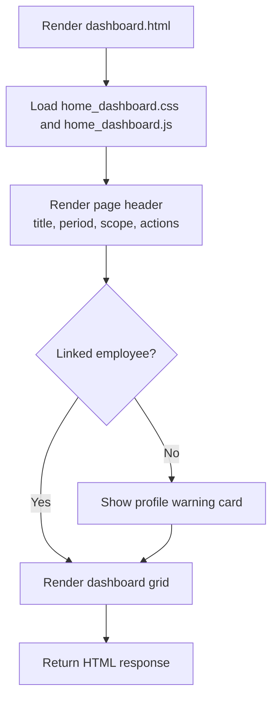

**Diagram sources**
- [dashboard.html:1-14](file://src/apps/portal/templates/portal/dashboard.html#L1-L14)

**Section sources**
- [dashboard.html:1-14](file://src/apps/portal/templates/portal/dashboard.html#L1-L14)

### Secondary Metrics Band
The secondary metrics partial renders a horizontal band of summary items inside the KPI block. Each item can be a link or static value, includes an icon, label, and formatted number. The band is only rendered when there are secondary items and avoids duplicate labels.

Key points:
- Uses shared UI component tags and number formatting.
- Supports both clickable and non-clickable metric items.
- Is styled as part of the unified KPI block rather than a separate floating banner.

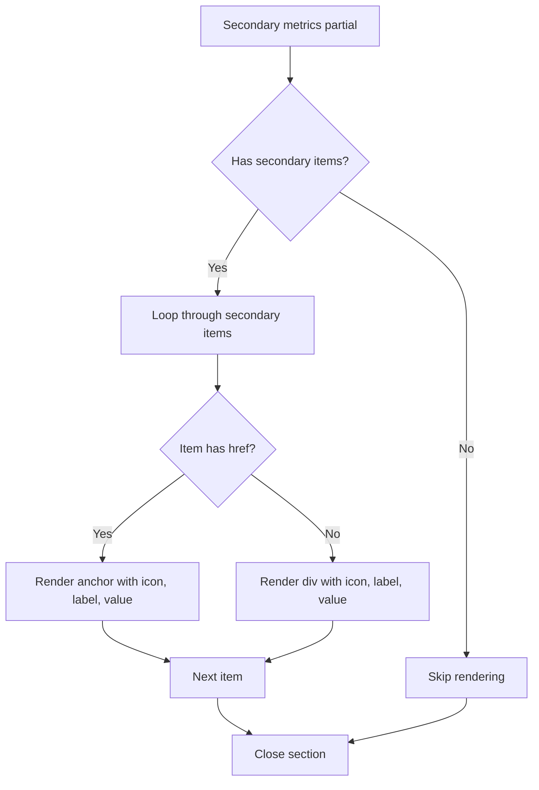

**Diagram sources**
- [_secondary_metrics.html:1-6](file://src/apps/portal/templates/portal/dashboard/_secondary_metrics.html#L1-L6)

**Section sources**
- [_secondary_metrics.html:1-6](file://src/apps/portal/templates/portal/dashboard/_secondary_metrics.html#L1-L6)

### HR Group Layout
The HR group partial arranges HR-related dashboard cards into two-row layouts:
- Row A: headcount plan vs actual and contract type distribution.
- Row B: expiring contracts and decision history.

It adapts to available sections by using single-column fallback classes when only one card is present.

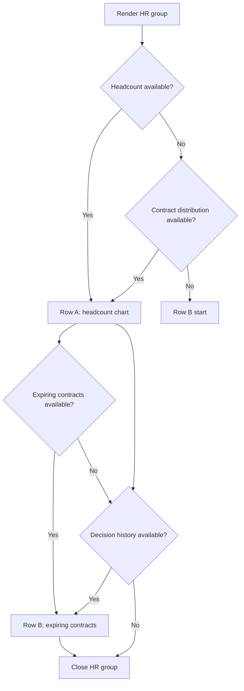

**Diagram sources**
- [_group_hr.html:12-19](file://src/apps/portal/templates/portal/dashboard/_group_hr.html#L12-L19)

**Section sources**
- [_group_hr.html:12-19](file://src/apps/portal/templates/portal/dashboard/_group_hr.html#L12-L19)

### Dashboard CSS
The dashboard stylesheet defines:
- A constrained content width and consistent spacing.
- A four-column KPI grid that collapses to fewer columns on smaller screens.
- An 8/4 main-content and right-rail grid.
- A unified KPI block with a secondary row of summary metrics.
- Donut chart tokens, capacity bars, tables, badges, and disclosure overlays.
- Reduced-motion support and mobile breakpoints.

Layout highlights:
- `.home-dashboard` is the root grid container.
- `.home-main-kpis` controls KPI column count based on data count.
- `.home-dashboard-body` switches between two-column and single-column layouts.
- `.home-secondary` places summary metrics inside the KPI block.
- `.home-rail` holds sticky agenda and running projects.

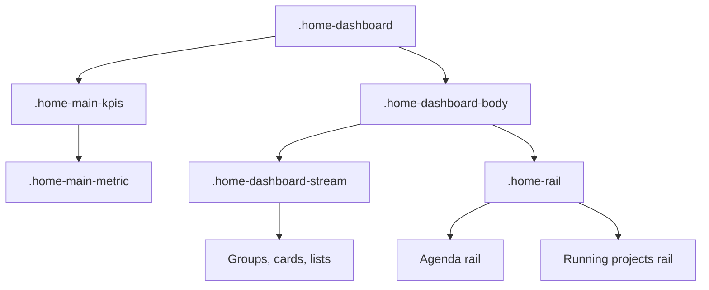

**Diagram sources**
- [home_dashboard.css:1-293](file://src/static/css/home_dashboard.css#L1-L293)

**Section sources**
- [home_dashboard.css:1-293](file://src/static/css/home_dashboard.css#L1-L293)

### Dashboard JavaScript
The dashboard script manages lightweight client interactions without changing dashboard card positions:
- Pressing Escape closes any open disclosure overlay inside the dashboard.
- Losing focus outside a disclosure closes it.
- Clicking outside a disclosure closes it.
- Jump links are shown only when the dashboard height exceeds roughly 2.2 viewport heights.

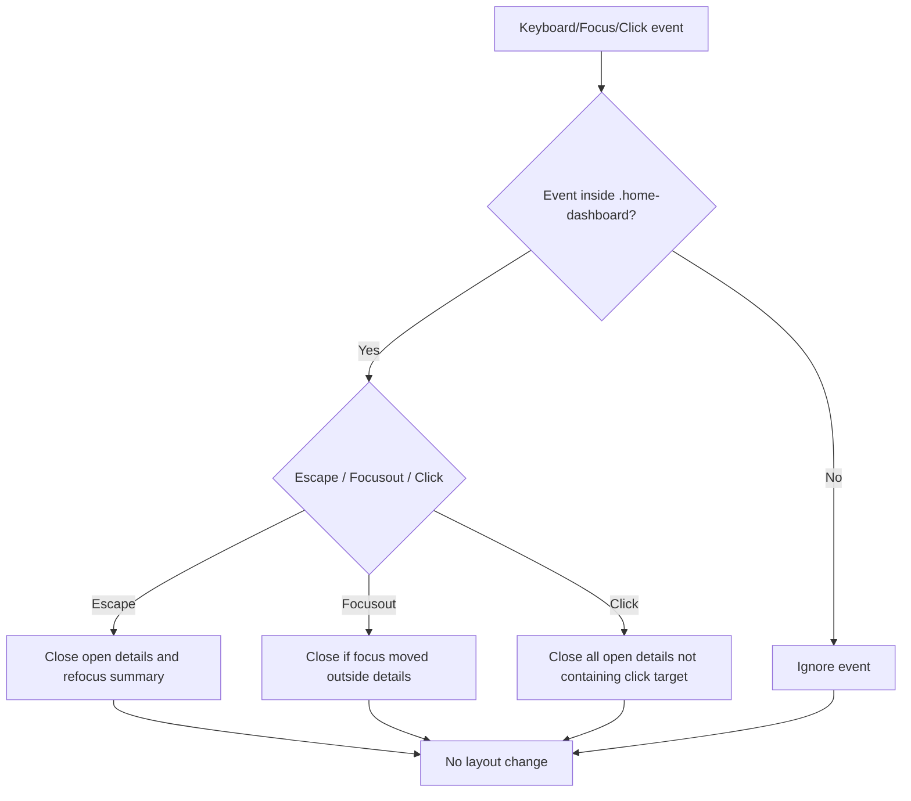

**Diagram sources**
- [home_dashboard.js:1-23](file://src/static/js/home_dashboard.js#L1-L23)

**Section sources**
- [home_dashboard.js:1-23](file://src/static/js/home_dashboard.js#L1-L23)

### Phase-One Data Builder
The phase-one data builder constructs the core dashboard snapshot:
- Employee scope based on `view_all_employees`, department manager role, and linked employee.
- Status counts for Active, Probation, OnLeave, joined this month, and approved leave today.
- Contract distribution, upcoming/expiring contracts, and overdue contracts.
- Headcount plan versus actual per department.
- Approval queue for leave requests.
- Today’s agenda and running projects.
- Error handling that converts database errors into a safe “data unavailable” state.

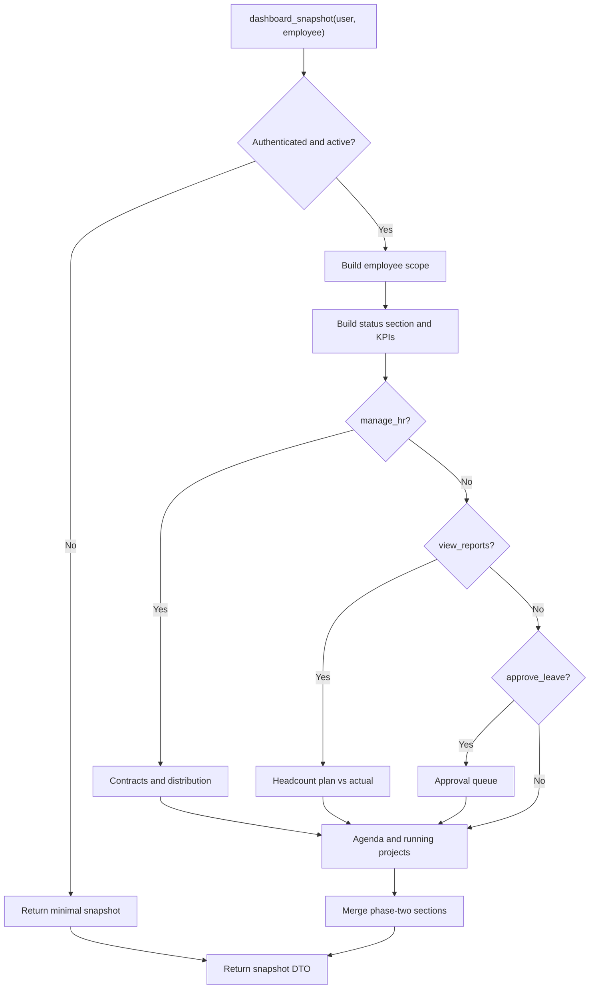

**Diagram sources**
- [dashboard_data.py:33-58](file://src/apps/portal/dashboard_data.py#L33-L58)
- [dashboard_data.py:192-257](file://src/apps/portal/dashboard_data.py#L192-L257)

**Section sources**
- [dashboard_data.py:1-258](file://src/apps/portal/dashboard_data.py#L1-L258)

### Phase-Two Data Builder
The phase-two data builder adds bounded, read-only blocks:
- Recent leave for the current user or global scope.
- Open job postings aggregate.
- Candidate status aggregate.
- Personnel decision history within a 30-day window.
- Recruitment request aggregates scoped to managed departments.

It uses window functions to combine global and own leave lists efficiently and applies visibility helpers for leave requests and personnel decisions.

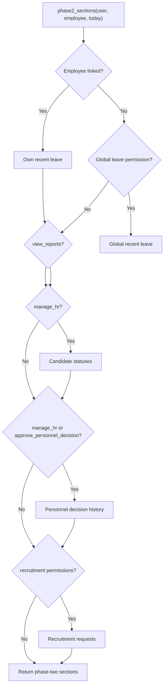

**Diagram sources**
- [dashboard_phase2.py:16-77](file://src/apps/portal/dashboard_phase2.py#L16-L77)
- [dashboard_phase2.py:80-144](file://src/apps/portal/dashboard_phase2.py#L80-L144)

**Section sources**
- [dashboard_phase2.py:1-145](file://src/apps/portal/dashboard_phase2.py#L1-L145)

### Conceptual Overview
Conceptually, the dashboard is a composition of:
- A permission gate.
- A data builder producing a flat snapshot with sections.
- A template rendering cards, charts, lists, and rails.
- CSS providing responsive layout and semantic tokens.
- Minimal JavaScript improving disclosure and navigation UX.

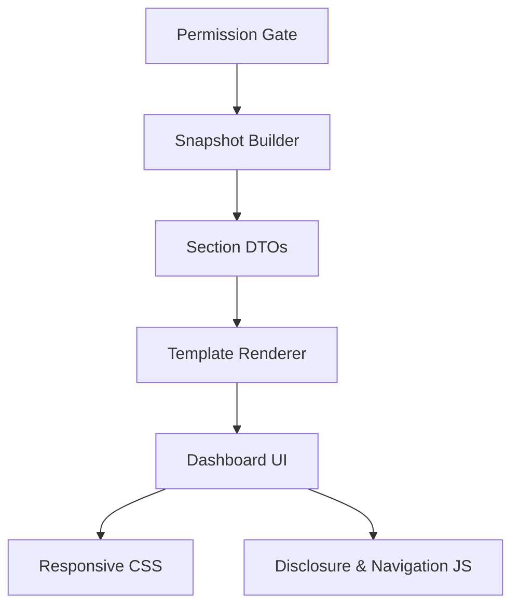

[No sources needed since this diagram shows conceptual workflow, not actual code structure]

## Dependency Analysis
The dashboard depends on several application modules for business data and security:

| Dependency | Used By | Purpose |
|---|---|---|
| `apps.contract.models.Contract` | `dashboard_data.py` | Active contracts, expiration, and distribution |
| `apps.hrm.models.Employee` | `dashboard_data.py` | Employee scope, status counts, joined this month |
| `apps.organization.models.Department` | `dashboard_data.py` | Department list and headcount actuals |
| `apps.planning.models.Event, HeadcountPlan, with_headcounts` | `dashboard_data.py` | Today’s agenda and planned headcount |
| `apps.project.models.Project` | `dashboard_data.py` | Running projects rail |
| `apps.security.data_access` | `dashboard_data.py`, `dashboard_phase2.py` | Managed departments and visibility helpers |
| `apps.security.permissions` | `dashboard_data.py`, `dashboard_phase2.py` | Role checks and permission gates |
| `apps.leave.models.LeaveRequest` | `dashboard_phase2.py` | Recent leave lists |
| `apps.recruitment.models.Candidate, JobPosting, RecruitmentRequest` | `dashboard_phase2.py` | Recruitment aggregates |
| `apps.document.models.PersonnelDecision, PersonnelDecisionHistory` | `dashboard_phase2.py` | Decision history |

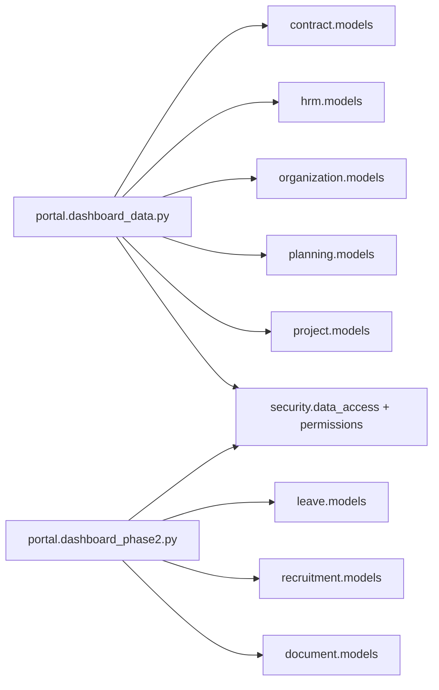

**Diagram sources**
- [dashboard_data.py:12-22](file://src/apps/portal/dashboard_data.py#L12-L22)
- [dashboard_phase2.py:9-13](file://src/apps/portal/dashboard_phase2.py#L9-L13)

**Section sources**
- [dashboard_data.py:12-22](file://src/apps/portal/dashboard_data.py#L12-L22)
- [dashboard_phase2.py:9-13](file://src/apps/portal/dashboard_phase2.py#L9-L13)

## Performance Considerations
The dashboard specification targets bounded queries and predictable rendering:
- Phase-one and phase-two builders use permission gates before constructing queries.
- Read-only blocks wrap potentially failing queries so database errors do not break the whole page.
- Lists are limited: agenda and running projects use a small limit; recent leave and decision history use fixed maximums.
- The spec recommends keeping SELECT counts low and avoiding N+1 patterns.
- CSS avoids heavy animations and supports reduced motion.
- JavaScript does not trigger network requests and only manipulates DOM state.

Recommended practices:
- Keep new dashboard sections read-only and permission-gated.
- Prefer aggregated queries over Python loops.
- Limit list sizes and provide drill-down links where appropriate.
- Preserve graceful error states for missing or unreadable data.
- Avoid adding heavy client-side libraries unless necessary.

[No sources needed since this section provides general guidance]

## Troubleshooting Guide
Common issues and their likely causes:

| Symptom | Likely Cause | Resolution |
|---|---|---|
| Dashboard shows “data unavailable” | Database error in a dashboard block | Check logs and the affected model/query; verify database connectivity and fixtures |
| Secondary metrics band is missing | Fewer than two secondary items or disabled section | Verify `dashboard_layout.secondary` and related permission flags |
| Right rail does not appear | No agenda or running projects data, or user lacks permission | Confirm linked employee and permissions for activity dashboard |
| Disclosure overlay stays open | Keyboard or focus event did not close it | Test Escape, blur, and click-outside behavior |
| KPI grid looks broken on narrow screens | Missing responsive class or custom override | Review `.home-main-kpis` and breakpoint rules in dashboard CSS |
| Drill-down link leads to wrong scope | URL or filter parameter mismatch | Validate route name, parameters, and permission gate |

**Section sources**
- [dashboard_data.py:67-72](file://src/apps/portal/dashboard_data.py#L67-L72)
- [home_dashboard.js:1-23](file://src/static/js/home_dashboard.js#L1-L23)
- [home_dashboard.css:166-212](file://src/static/css/home_dashboard.css#L166-L212)

## Conclusion
The IHRMS dashboard redesign separates concerns clearly:
- Permissions and scope control what data is built.
- Data builders return stable, bounded DTOs with clear states.
- Templates render only permitted sections using shared UI conventions.
- CSS provides a responsive, token-driven layout with accessible interactions.
- JavaScript improves usability without introducing unnecessary complexity.

Future changes should preserve these boundaries: keep data reads read-only, gate queries by permission, avoid exposing sensitive fields, and validate drill-down routes against the same selector used by the dashboard numbers.

[No sources needed since this section summarizes without analyzing specific files]
