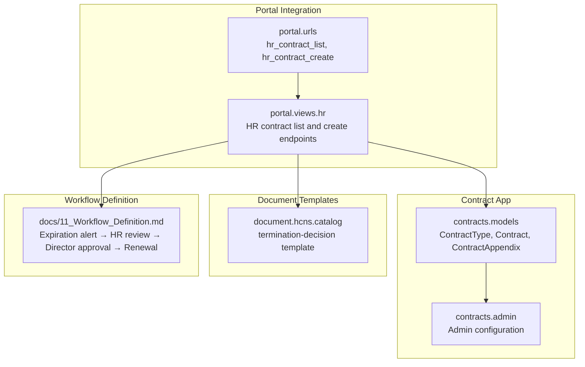
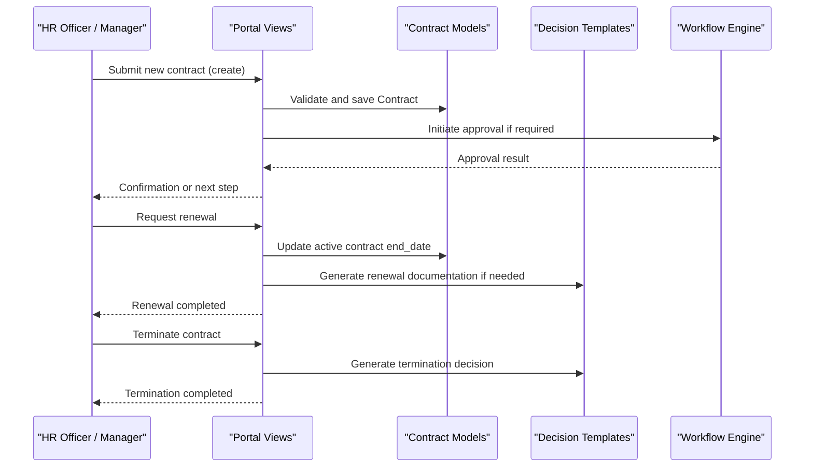
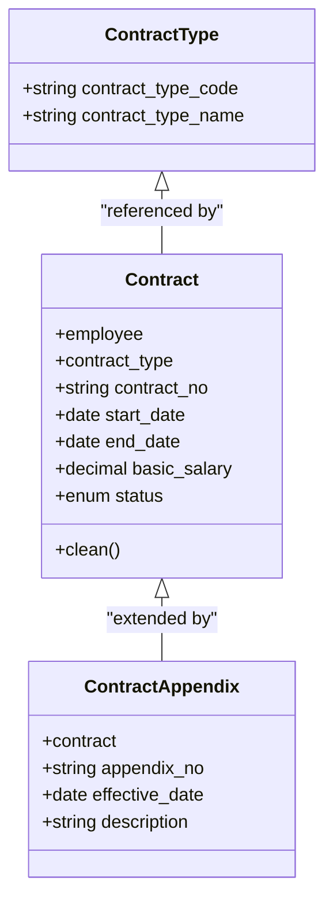
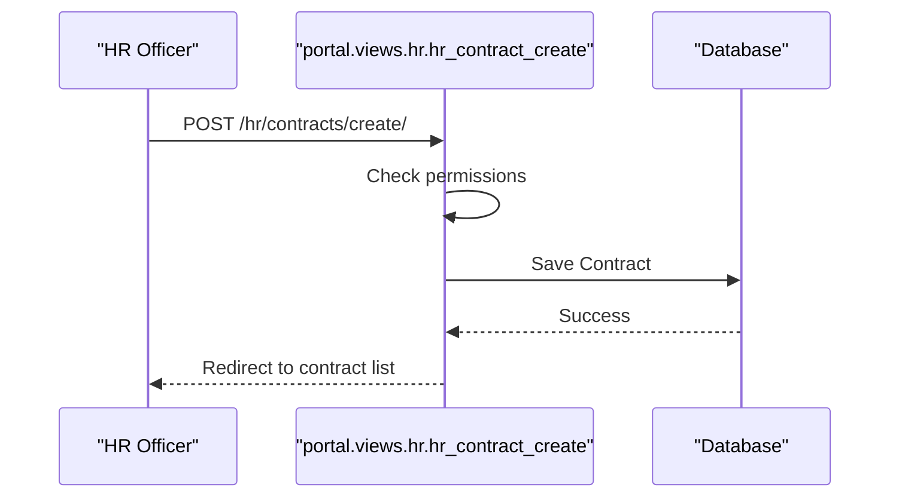
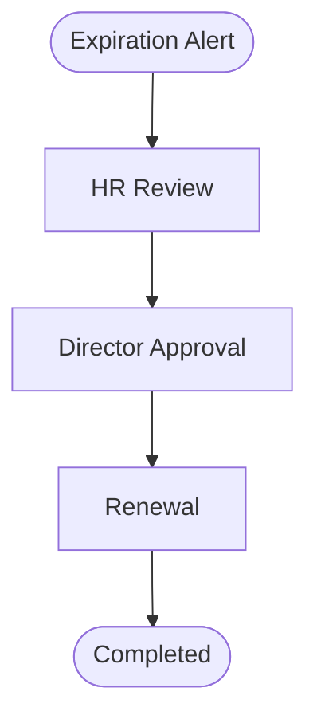
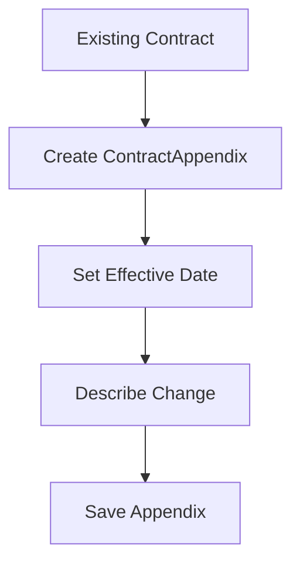
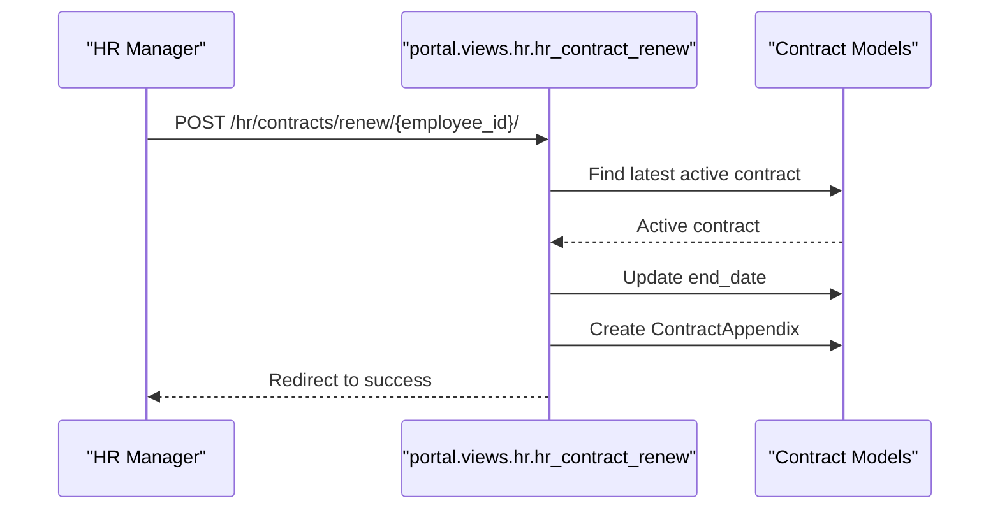
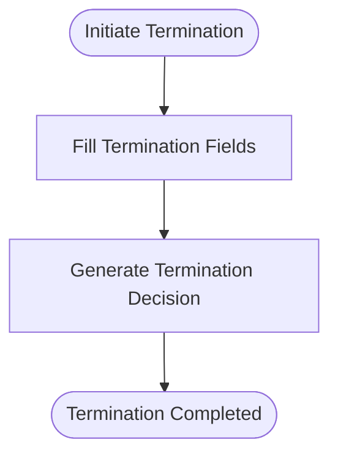
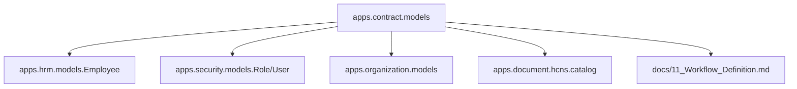

# Contract Administration

<cite>
**Referenced Files in This Document**
- [models.py](file://src/apps/contract/models.py)
- [admin.py](file://src/apps/contract/admin.py)
- [tests.py](file://src/apps/contract/tests.py)
- [urls.py](file://src/apps/portal/urls.py)
- [hr.py](file://src/apps/portal/views/hr.py)
- [catalog.py](file://src/apps/document/hcns/catalog.py)
- [11_Workflow_Definition.md](file://docs/11_Workflow_Definition.md)
- [tests_review_20261008.py](file://src/apps/portal/tests_review_20261008.py)
</cite>

## Table of Contents
1. [Introduction](#introduction)
2. [Project Structure](#project-structure)
3. [Core Components](#core-components)
4. [Architecture Overview](#architecture-overview)
5. [Detailed Component Analysis](#detailed-component-analysis)
6. [Dependency Analysis](#dependency-analysis)
7. [Performance Considerations](#performance-considerations)
8. [Troubleshooting Guide](#troubleshooting-guide)
9. [Conclusion](#conclusion)

## Introduction
This document explains contract administration for the Human Resources Management System, focusing on contract types, creation workflows, approval processes, modifications, renewals, and terminations. It covers the data model, administrative controls, portal integration, and the decision workflow used for official approvals. The goal is to help HR staff, system administrators, and developers understand how contracts are modeled, created, modified, renewed, and terminated while maintaining auditability and authorization controls.

## Project Structure
Contract administration is implemented as a dedicated Django application under `apps/contract`, with supporting portal routes and views under `apps/portal`, and official document templates under `apps/document`.

**Diagram sources**
- [models.py:6-76](file://src/apps/contract/models.py#L6-L76)
- [admin.py:1-31](file://src/apps/contract/admin.py#L1-L31)
- [urls.py:115-116](file://src/apps/portal/urls.py#L115-L116)
- [hr.py:272-272](file://src/apps/portal/views/hr.py#L272-L272)
- [catalog.py:148-154](file://src/apps/document/hcns/catalog.py#L148-L154)
- [11_Workflow_Definition.md:706-726](file://docs/11_Workflow_Definition.md#L706-L726)

**Section sources**
- [models.py:6-76](file://src/apps/contract/models.py#L6-L76)
- [admin.py:1-31](file://src/apps/contract/admin.py#L1-L31)
- [urls.py:115-116](file://src/apps/portal/urls.py#L115-L116)
- [hr.py:272-272](file://src/apps/portal/views/hr.py#L272-L272)
- [catalog.py:148-154](file://src/apps/document/hcns/catalog.py#L148-L154)
- [11_Workflow_Definition.md:706-726](file://docs/11_Workflow_Definition.md#L706-L726)

## Core Components
The contract domain includes three primary models:

- ContractType: Defines supported contract categories such as permanent, fixed-term, and internship through code and name fields.
- Contract: Represents an employment contract linked to an employee and a contract type, including number, start/end dates, basic salary, and status.
- ContractAppendix: Records amendments or extensions to a contract, including appendix number, effective date, and description.

Key behaviors:
- Status lifecycle: Draft, Active, Expired, Terminated.
- Date validation: End date must be after start date when provided.
- Auditability: All models inherit from BaseAuditModel, capturing creation, modification, deletion metadata.

**Section sources**
- [models.py:6-16](file://src/apps/contract/models.py#L6-L16)
- [models.py:19-56](file://src/apps/contract/models.py#L19-L56)
- [models.py:59-76](file://src/apps/contract/models.py#L59-L76)

## Architecture Overview
Contract administration integrates across several layers:

- Data layer: ContractType, Contract, and ContractAppendix models define the core entities.
- Administrative layer: Admin configuration restricts view/edit roles and provides inline management of appendices.
- Portal layer: URL routes expose HR contract list and create endpoints; views enforce permissions and orchestrate business logic.
- Document layer: Official termination decisions are generated using standardized templates.
- Workflow layer: Expiration alerts trigger HR review and director approval before renewal.

**Diagram sources**
- [urls.py:115-116](file://src/apps/portal/urls.py#L115-L116)
- [hr.py:272-272](file://src/apps/portal/views/hr.py#L272-L272)
- [models.py:19-56](file://src/apps/contract/models.py#L19-L56)
- [catalog.py:148-154](file://src/apps/document/hcns/catalog.py#L148-L154)
- [11_Workflow_Definition.md:706-726](file://docs/11_Workflow_Definition.md#L706-L726)

## Detailed Component Analysis

### Contract Model and Types
The Contract model captures essential employment details:
- Employee reference: Links to the HR employee record.
- Contract type: References ContractType for classification.
- Contract number: Unique identifier for each contract.
- Start and end dates: Supports open-ended contracts by allowing null end dates.
- Basic salary: Monetary value stored with decimal precision.
- Status: Enumerated states controlling lifecycle.

ContractType defines reusable categories:
- Code and name fields allow consistent classification across contracts.

ContractAppendix supports modifications:
- Appendix number and effective date track changes.
- Optional description field records change rationale.

**Diagram sources**
- [models.py:6-16](file://src/apps/contract/models.py#L6-L16)
- [models.py:19-56](file://src/apps/contract/models.py#L19-L56)
- [models.py:59-76](file://src/apps/contract/models.py#L59-L76)

**Section sources**
- [models.py:6-16](file://src/apps/contract/models.py#L6-L16)
- [models.py:19-56](file://src/apps/contract/models.py#L19-L56)
- [models.py:59-76](file://src/apps/contract/models.py#L59-L76)

### Creation Workflow
Contract creation flows through the portal:
- URL routes expose HR contract list and create endpoints.
- Views enforce role-based access control and validate inputs.
- Tests verify that regular employees cannot create contracts directly and that HR roles can access the list.

**Diagram sources**
- [urls.py:115-116](file://src/apps/portal/urls.py#L115-L116)
- [hr.py:272-272](file://src/apps/portal/views/hr.py#L272-L272)
- [tests.py:94-110](file://src/apps/contract/tests.py#L94-L110)

**Section sources**
- [urls.py:115-116](file://src/apps/portal/urls.py#L115-L116)
- [hr.py:272-272](file://src/apps/portal/views/hr.py#L272-L272)
- [tests.py:66-110](file://src/apps/contract/tests.py#L66-L110)

### Approval Process and Decision Workflow
Official contract approvals integrate with the decision workflow:
- Expiration alerts trigger HR review and director approval before renewal.
- Personnel decisions follow a structured flow: draft, submit, approve/reject, issue signed PDF.
- Only approved decisions are issued, with history tracking for each state transition.

**Diagram sources**
- [11_Workflow_Definition.md:706-726](file://docs/11_Workflow_Definition.md#L706-L726)

**Section sources**
- [11_Workflow_Definition.md:706-726](file://docs/11_Workflow_Definition.md#L706-L726)

### Modification and Extension Processes
Contract modifications are recorded via ContractAppendix:
- Each appendix links to a specific contract and includes an effective date.
- Descriptions capture the nature of changes.
- Admin interface allows inline management of appendices alongside contracts.

Authorization controls:
- View roles include SUPER_ADMIN, HR_MANAGER, HR_OFFICER, DIRECTOR.
- Edit roles are restricted to SUPER_ADMIN and HR_MANAGER.

**Diagram sources**
- [models.py:59-76](file://src/apps/contract/models.py#L59-L76)
- [admin.py:17-20](file://src/apps/contract/admin.py#L17-L20)

**Section sources**
- [models.py:59-76](file://src/apps/contract/models.py#L59-L76)
- [admin.py:1-31](file://src/apps/contract/admin.py#L1-L31)

### Renewal Processing
Renewal updates the active contract’s end date and creates an appendix:
- The latest active contract is selected for renewal.
- Terminated contracts are not modified during renewal.
- Tests confirm that only the active contract is updated and an appendix is created.

**Diagram sources**
- [tests_review_20261008.py:315-352](file://src/apps/portal/tests_review_20261008.py#L315-L352)
- [models.py:59-76](file://src/apps/contract/models.py#L59-L76)

**Section sources**
- [tests_review_20261008.py:315-352](file://src/apps/portal/tests_review_20261008.py#L315-L352)
- [models.py:59-76](file://src/apps/contract/models.py#L59-L76)

### Termination Handling
Terminations are formalized through official documents:
- The termination-decision template captures contract details, reason, and effective date.
- HR generates the decision document following the workflow.

**Diagram sources**
- [catalog.py:148-154](file://src/apps/document/hcns/catalog.py#L148-L154)

**Section sources**
- [catalog.py:148-154](file://src/apps/document/hcns/catalog.py#L148-L154)

### Examples

- Creating different contract types:
  - Use ContractType to define permanent, fixed-term, or internship categories.
  - Create a Contract linked to an employee and chosen ContractType.
  - Set start_date and optional end_date; set basic_salary and initial status Draft.

- Processing renewals:
  - Identify the latest active contract for the employee.
  - Update end_date and create a ContractAppendix with effective_date and description.

- Handling terminations:
  - Generate a termination-decision document using the catalog template.
  - Record termination status on the contract.

[No sources needed since this section provides general guidance]

## Dependency Analysis
Contract administration depends on:
- HR module for employee references.
- Organization and security modules for roles and permissions.
- Document module for official templates.
- Workflow definition for approval flows.

**Diagram sources**
- [models.py:27-34](file://src/apps/contract/models.py#L27-L34)
- [catalog.py:148-154](file://src/apps/document/hcns/catalog.py#L148-L154)
- [11_Workflow_Definition.md:706-726](file://docs/11_Workflow_Definition.md#L706-L726)

**Section sources**
- [models.py:27-34](file://src/apps/contract/models.py#L27-L34)
- [catalog.py:148-154](file://src/apps/document/hcns/catalog.py#L148-L154)
- [11_Workflow_Definition.md:706-726](file://docs/11_Workflow_Definition.md#L706-L726)

## Performance Considerations
- Use indexed foreign keys for employee and contract type lookups.
- Avoid unnecessary queries when listing contracts; prefer selective filtering by status and type.
- Batch operations for bulk renewals should update contracts and create appendices within transactions to maintain consistency.
- Limit admin list filters to commonly used fields to reduce query complexity.

[No sources needed since this section provides general guidance]

## Troubleshooting Guide
Common issues and resolutions:
- Validation errors for dates: Ensure end_date is after start_date; open-ended contracts leave end_date null.
- Permission denied on contract list: Verify user has HR roles (HR_OFFICER, HR_MANAGER, etc.).
- Unauthorized contract creation: Regular employees cannot post to the create endpoint; use authorized HR roles.
- Renewal affecting wrong contract: Confirm the renewal targets the latest active contract; terminated contracts remain unchanged.

**Section sources**
- [tests.py:53-64](file://src/apps/contract/tests.py#L53-L64)
- [tests.py:66-110](file://src/apps/contract/tests.py#L66-L110)
- [tests_review_20261008.py:315-352](file://src/apps/portal/tests_review_20261008.py#L315-L352)

## Conclusion
Contract administration in this system provides a robust foundation for managing employment contracts across their lifecycle. The data model supports multiple contract types, clear status transitions, and detailed amendment tracking. Portal integration enforces authorization and guides users through creation, renewal, and termination workflows. Official decisions and workflow definitions ensure compliance and traceability. Proper use of ContractType, Contract, and ContractAppendix, combined with the decision workflow, enables reliable contract management aligned with organizational policies.

[No sources needed since this section summarizes without analyzing specific files]