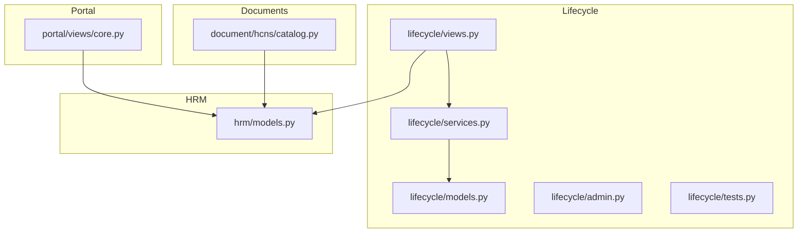
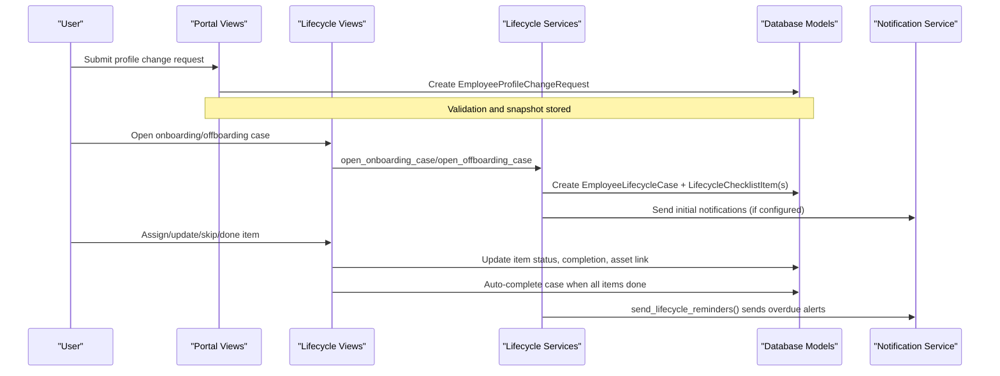
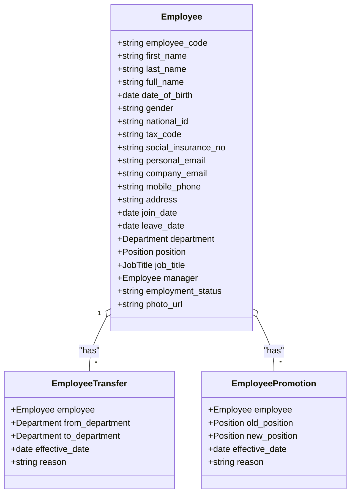
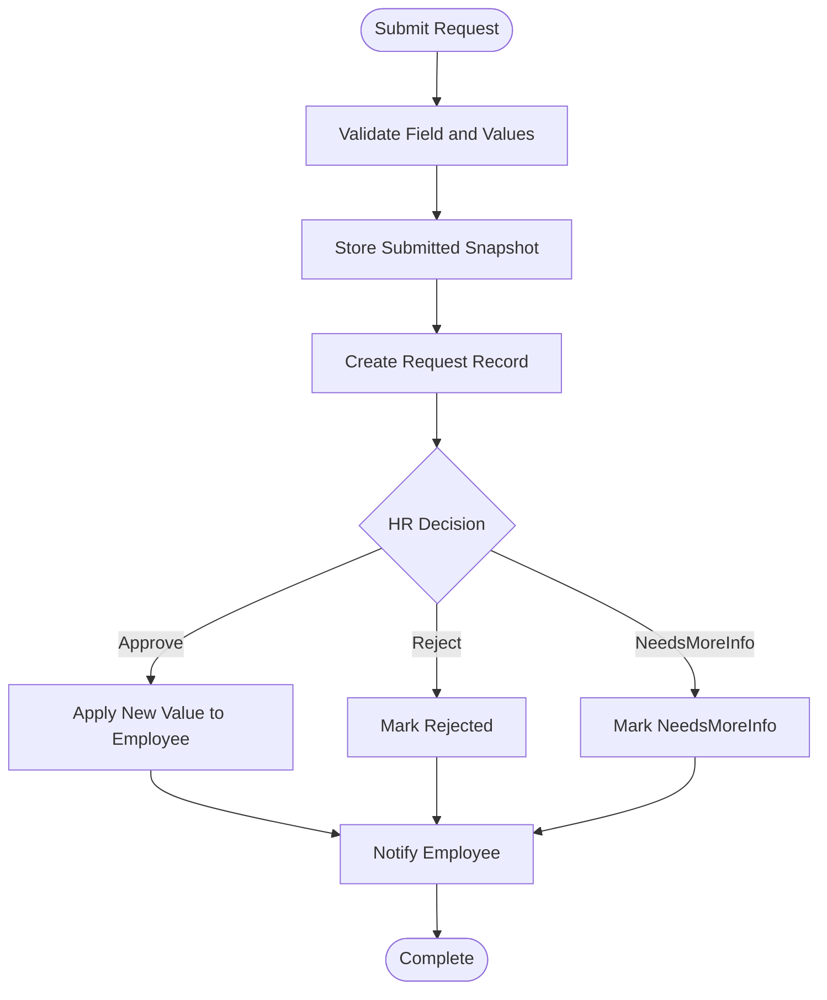
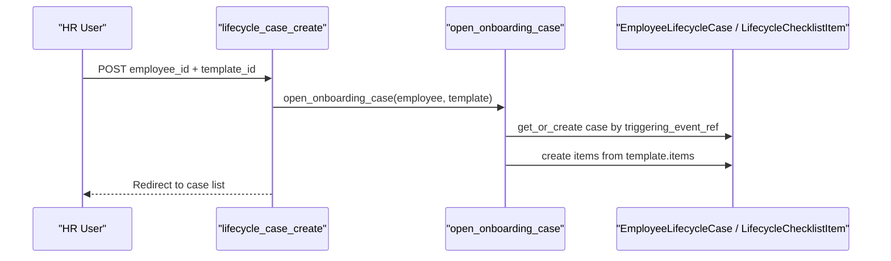
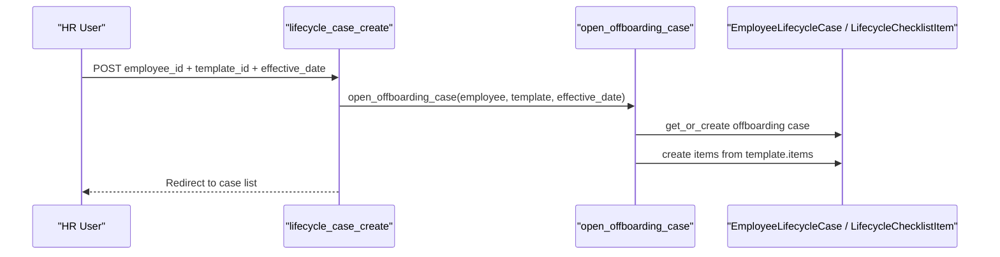
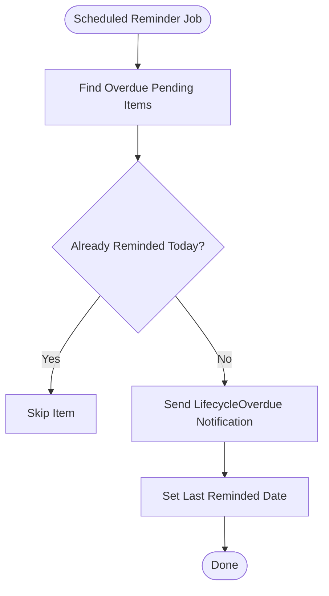
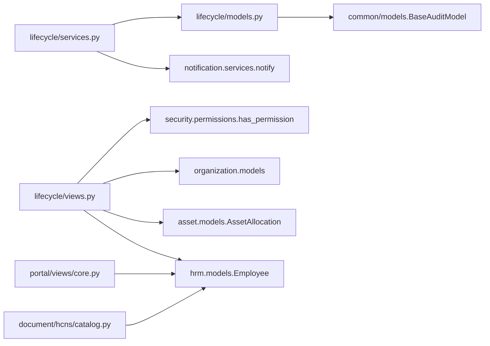

# Employee Lifecycle Management

<cite>
**Referenced Files in This Document**
- [models.py](file://src/apps/lifecycle/models.py)
- [services.py](file://src/apps/lifecycle/services.py)
- [views.py](file://src/apps/lifecycle/views.py)
- [admin.py](file://src/apps/lifecycle/admin.py)
- [tests.py](file://src/apps/lifecycle/tests.py)
- [models.py](file://src/apps/hrm/models.py)
- [core.py](file://src/apps/portal/views/core.py)
- [catalog.py](file://src/apps/document/hcns/catalog.py)
- [HRMS_Next_Features_Plan.md](file://docs/HRMS_Next_Features_Plan.md)
</cite>

## Table of Contents
1. [Introduction](#introduction)
2. [Project Structure](#project-structure)
3. [Core Components](#core-components)
4. [Architecture Overview](#architecture-overview)
5. [Detailed Component Analysis](#detailed-component-analysis)
6. [Dependency Analysis](#dependency-analysis)
7. [Performance Considerations](#performance-considerations)
8. [Troubleshooting Guide](#troubleshooting-guide)
9. [Conclusion](#conclusion)

## Introduction
This document explains the employee lifecycle management system that covers the complete journey from onboarding to offboarding. It documents:
- The Employee model and its personal information fields, employment history tracking, and profile change request workflow.
- The onboarding and offboarding workflows, including automated task creation, document preparation, and notifications.
- Offboarding procedures for asset return, access revocation, and final settlement integration points.
- Examples of creating employees, updating profiles, and processing status changes through the portal.
- The employee profile change request system with approval workflows and audit trails.
- Integration with department and position management systems.

The implementation is built as a Django application with dedicated lifecycle, HRM, portal, and document modules.

## Project Structure
The relevant code is organized into feature-based Django apps:
- `apps/lifecycle`: Lifecycle checklist templates, cases, items, services, views, admin configuration, and tests.
- `apps/hrm`: Employee master data, profile change requests, transfers, promotions, rewards, and disciplines.
- `apps/portal`: Portal views for submitting and approving profile change requests.
- `apps/document/hcns`: Onboarding/offboarding document checklists and export layouts.
- Supporting apps referenced by lifecycle: `apps.asset`, `apps.notification`, `apps.security`, `apps.organization`.

**Diagram sources**
- [models.py](file://src/apps/lifecycle/models.py)
- [services.py](file://src/apps/lifecycle/services.py)
- [views.py](file://src/apps/lifecycle/views.py)
- [admin.py](file://src/apps/lifecycle/admin.py)
- [tests.py](file://src/apps/lifecycle/tests.py)
- [models.py](file://src/apps/hrm/models.py)
- [core.py](file://src/apps/portal/views/core.py)
- [catalog.py](file://src/apps/document/hcns/catalog.py)

**Section sources**
- [models.py](file://src/apps/lifecycle/models.py)
- [services.py](file://src/apps/lifecycle/services.py)
- [views.py](file://src/apps/lifecycle/views.py)
- [admin.py](file://src/apps/lifecycle/admin.py)
- [tests.py](file://src/apps/lifecycle/tests.py)
- [models.py](file://src/apps/hrm/models.py)
- [core.py](file://src/apps/portal/views/core.py)
- [catalog.py](file://src/apps/document/hcns/catalog.py)

## Core Components
This section summarizes the core domain objects and their responsibilities.

- ChecklistTemplate: Defines reusable onboarding or offboarding checklists with an active flag and template type.
- ChecklistTemplateItem: Defines ordered steps within a template, responsible role codes, due date offsets, and whether asset return is required.
- EmployeeLifecycleCase: Represents a lifecycle instance for an employee, linking to a template, effective date, case type, status, and a unique triggering event reference.
- LifecycleChecklistItem: Represents a snapshot of a template item for a specific case, including assignment, due date, status, completion metadata, skip reason, last reminder date, and optional link to an existing asset allocation.
- Employee: Master employee record with personal details, contact information, employment dates, organizational assignments, manager, and employment status.
- EmployeeProfileChangeRequest: Approval workflow for changing selected personal fields, capturing old/new values, submission snapshots, attachments, decisions, and audit fields.

Key behaviors:
- Opening an onboarding or offboarding case creates a case and snapshots template items into concrete checklist items with computed due dates.
- Duplicate triggers are idempotent; re-opening the same event does not duplicate cases or items.
- Overdue reminders are sent once per day per assignee using a deduplication field.
- Profile change requests enforce allowed fields, snapshot validation, and secure attachment access.

**Section sources**
- [models.py](file://src/apps/lifecycle/models.py)
- [services.py](file://src/apps/lifecycle/services.py)
- [models.py](file://src/apps/hrm/models.py)
- [core.py](file://src/apps/portal/views/core.py)

## Architecture Overview
The lifecycle system coordinates user interactions, business logic, and data persistence across multiple modules.

**Diagram sources**
- [views.py](file://src/apps/lifecycle/views.py)
- [services.py](file://src/apps/lifecycle/services.py)
- [models.py](file://src/apps/lifecycle/models.py)
- [core.py](file://src/apps/portal/views/core.py)

## Detailed Component Analysis

### Employee Model and Employment History
The Employee model captures comprehensive personal and employment data:
- Personal identifiers: employee code, national ID, tax code, social insurance number.
- Personal details: first name, last name, full name, date of birth, gender.
- Contact information: personal email, company email, mobile phone, address.
- Employment timeline: join date, leave date, employment status.
- Organizational context: department, position, job title, direct manager.
- Optional profile photo URL.

Employment history tracking includes:
- EmployeeTransfer: records department moves with effective date and reason.
- EmployeePromotion: records position changes with effective date and reason.
- EmployeeReward and EmployeeDiscipline: records events affecting employment history.

Integration with department and position management:
- Department and Position are external master entities referenced by Employee and history models.
- Effective-date processing ensures historical accuracy for organizational changes.

**Diagram sources**
- [models.py](file://src/apps/hrm/models.py)

**Section sources**
- [models.py](file://src/apps/hrm/models.py)

### Employee Profile Change Request System
The profile change request system allows employees to propose updates to selected personal fields and provides an approval workflow for HR.

Key capabilities:
- Allowed fields: personal email, mobile phone, address.
- Submission captures current value, proposed new value, submitted snapshot, reason, and optional attachment.
- Approval states: Pending, Approved, Rejected, NeedsMoreInfo.
- Decision flow validates that the original snapshot has not changed before applying approvals.
- Secure attachment access restricted by permissions and ownership.
- Notifications inform employees about decision outcomes.

**Diagram sources**
- [core.py](file://src/apps/portal/views/core.py)
- [models.py](file://src/apps/hrm/models.py)

**Section sources**
- [core.py](file://src/apps/portal/views/core.py)
- [models.py](file://src/apps/hrm/models.py)

### Onboarding Workflow
Onboarding is initiated via the lifecycle portal view, which opens an onboarding case based on an active checklist template.

Process highlights:
- HR selects an employee and an active onboarding template.
- The service creates an EmployeeLifecycleCase with effective date equal to the employee’s join date.
- Template items are snapped into LifecycleChecklistItem records with due dates calculated from effective date plus offset.
- Items can be assigned to users, marked Done or Skipped, and linked to existing asset allocations.
- When all items are completed, the case status transitions to Completed.

**Diagram sources**
- [views.py](file://src/apps/lifecycle/views.py)
- [services.py](file://src/apps/lifecycle/services.py)
- [models.py](file://src/apps/lifecycle/models.py)

**Section sources**
- [views.py](file://src/apps/lifecycle/views.py)
- [services.py](file://src/apps/lifecycle/services.py)
- [models.py](file://src/apps/lifecycle/models.py)

### Offboarding Workflow
Offboarding follows a similar pattern but uses an explicit effective leave date provided by HR.

Process highlights:
- HR selects an employee and an active offboarding template, providing the effective leave date.
- The service creates an offboarding case with the provided effective date.
- Template items are snapped into checklist items with due dates derived from the effective leave date.
- Asset return linkage is enforced: if an item requires asset return, it must be linked to an existing asset allocation with a return date before marking Done.
- Overdue reminders are sent for pending items past their due date.

**Diagram sources**
- [views.py](file://src/apps/lifecycle/views.py)
- [services.py](file://src/apps/lifecycle/services.py)
- [models.py](file://src/apps/lifecycle/models.py)

**Section sources**
- [views.py](file://src/apps/lifecycle/views.py)
- [services.py](file://src/apps/lifecycle/services.py)
- [models.py](file://src/apps/lifecycle/models.py)

### Automated Task Creation and Notifications
Task creation is driven by template snapshots:
- Each template item becomes a LifecycleChecklistItem with a computed due date.
- Assignment is performed via the lifecycle item assignment view, restricting assignment to active HR roles matching the responsible role code.
- Reminders are generated by a scheduled function that finds overdue pending items and sends notifications to assignees’ associated employees.

**Diagram sources**
- [services.py](file://src/apps/lifecycle/services.py)

**Section sources**
- [services.py](file://src/apps/lifecycle/services.py)

### Document Preparation and Checklists
Document preparation for onboarding and offboarding is supported by HCNS document catalogs:
- Onboarding documents checklist and offboarding documents checklist are defined as HCNS forms.
- Offboarding handover exports include structured sections and formatting tailored for offboarding scenarios.

These documents complement the lifecycle checklist by ensuring required paperwork is prepared and signed.

**Section sources**
- [catalog.py](file://src/apps/document/hcns/catalog.py)

### Examples of Creating Employees, Updating Profiles, and Processing Status Changes
- Creating new employees:
  - Use the Employee model to set personal details, organizational assignments, and employment dates.
  - After hiring confirmation, HR opens an onboarding case to generate tasks and document preparation steps.
- Updating profiles:
  - Employees submit profile change requests for allowed fields.
  - HR reviews and approves/rejects/requests more information; approved changes update the Employee record securely.
- Processing status changes:
  - Employment status transitions trigger lifecycle actions such as opening offboarding cases when a leave decision is approved.
  - Case completion indicates all required tasks have been executed.

Operational references:
- Plan guidance emphasizes that lifecycle checklists should not auto-trigger merely from draft records and should integrate with existing asset processes without altering asset history.

**Section sources**
- [models.py](file://src/apps/hrm/models.py)
- [core.py](file://src/apps/portal/views/core.py)
- [HRMS_Next_Features_Plan.md](file://docs/HRMS_Next_Features_Plan.md)

## Dependency Analysis
Lifecycle components depend on several supporting modules:
- Lifecycle models depend on BaseAuditModel for consistent audit fields.
- Lifecycle services depend on notification services for reminders and may integrate with asset models for allocation links.
- Lifecycle views depend on security permissions and organization models for filtering and authorization.
- HRM models provide the Employee entity used by lifecycle cases and profile change requests.
- Document catalog defines HCNS forms related to onboarding/offboarding documentation.

**Diagram sources**
- [models.py](file://src/apps/lifecycle/models.py)
- [services.py](file://src/apps/lifecycle/services.py)
- [views.py](file://src/apps/lifecycle/views.py)
- [core.py](file://src/apps/portal/views/core.py)
- [catalog.py](file://src/apps/document/hcns/catalog.py)

**Section sources**
- [models.py](file://src/apps/lifecycle/models.py)
- [services.py](file://src/apps/lifecycle/services.py)
- [views.py](file://src/apps/lifecycle/views.py)
- [core.py](file://src/apps/portal/views/core.py)
- [catalog.py](file://src/apps/document/hcns/catalog.py)

## Performance Considerations
- Idempotency: Triggering event references prevent duplicate case creation, reducing redundant work and database writes.
- Efficient queries: Views use select_related to minimize N+1 queries when rendering cases and items.
- Overdue reminders: Scheduled reminders use selective_for_update and targeted filters to limit locking scope and avoid repeated notifications per day.
- Indexing: Lifecycle checklist items include indexes on status and due date to optimize overdue queries.

[No sources needed since this section provides general guidance]

## Troubleshooting Guide
Common issues and resolutions:
- Duplicate lifecycle cases:
  - Ensure triggering event references are unique per employee and event type.
  - Verify template type matches case type before opening cases.
- Missing asset linkage for offboarding:
  - If an item requires asset return, ensure an existing asset allocation with a return date is linked before marking Done.
- Unauthorized access:
  - Only HR roles can assign checklist steps; non-HR users attempting assignment will receive errors.
  - Users can only view cases they own or are assigned to; unauthorized access returns forbidden responses.
- Profile change request conflicts:
  - If the employee’s field value changes after submission, approval is blocked until a new request is submitted.
  - Attachments are protected; ensure proper permissions to view them.

**Section sources**
- [views.py](file://src/apps/lifecycle/views.py)
- [services.py](file://src/apps/lifecycle/services.py)
- [core.py](file://src/apps/portal/views/core.py)
- [tests.py](file://src/apps/lifecycle/tests.py)

## Conclusion
The employee lifecycle management system provides a robust framework for managing the end-to-end employee journey. It combines structured checklists, secure profile change approvals, and integrated document preparation to support both onboarding and offboarding. The design emphasizes idempotency, auditability, and clear separation of concerns across lifecycle, HRM, portal, and document modules. Operational safeguards ensure data integrity, appropriate access control, and reliable notifications, while integration points with asset and organizational systems maintain consistency across the enterprise.

[No sources needed since this section summarizes without analyzing specific files]