# HR Administration

<cite>
**Referenced Files in This Document**
- [README.md](file://README.md)
- [01_BRD_MASTER.md](file://docs/01_BRD_MASTER.md)
- [02_Solution_Architecture.md](file://docs/02_Solution_Architecture.md)
- [03_Database_Design.md](file://docs/03_Database_Design.md)
- [11_Workflow_Definition.md](file://docs/11_Workflow_Definition.md)
- [HUONG_DAN_SU_DUNG_IHRMS.md](file://docs/HUONG_DAN_SU_DUNG_IHRMS.md)
- [models.py](file://src/apps/hrm/models.py)
- [models.py](file://src/apps/contract/models.py)
- [models.py](file://src/apps/document/models.py)
- [models.py](file://src/apps/lifecycle/models.py)
- [views.py](file://src/apps/document/hcns/views.py)
- [personnel_decision_detail.html](file://src/apps/portal/templates/portal/personnel_decision_detail.html)
- [profile_change_request_list.html](file://src/apps/portal/templates/portal/profile_change_request_list.html)
- [layouts.py](file://src/apps/document/hcns/layouts.py)
- [services.py](file://src/apps/lifecycle/services.py)
- [send_lifecycle_reminders.py](file://src/apps/lifecycle/management/commands/send_lifecycle_reminders.py)
</cite>

## Table of Contents
1. [Introduction](#introduction)
2. [Project Structure](#project-structure)
3. [Core Components](#core-components)
4. [Architecture Overview](#architecture-overview)
5. [Detailed Component Analysis](#detailed-component-analysis)
6. [Dependency Analysis](#dependency-analysis)
7. [Performance Considerations](#performance-considerations)
8. [Troubleshooting Guide](#troubleshooting-guide)
9. [Conclusion](#conclusion)

## Introduction
This document explains the HR administration capabilities implemented in IHRMS, focusing on employee lifecycle management, contract administration, decision workflows, and official document generation. It maps business requirements to Django models, workflow definitions, portal interfaces, and automation helpers used for onboarding and offboarding.

IHRMS is a modular monolith built with Django 5.2, targeting internal administration, human resources, recruitment, attendance, payroll, contracts, documents, tasks, KPIs, assets, procurement, dashboards, and Microsoft 365 integration. The system aims to replace manual Excel, email, Word, paper forms, and fragmented file sharing with a single authoritative platform.

**Section sources**
- [README.md:1-90](file://README.md#L1-L90)
- [01_BRD_MASTER.md:1-148](file://docs/01_BRD_MASTER.md#L1-L148)

## Project Structure
The HR-related functionality spans several Django applications:

| Area | Application | Responsibility |
|---|---|---|
| Employee data and personnel changes | `apps/hrm` | Employee profile, change requests, transfers, promotions, rewards, discipline |
| Contracts | `apps/contract` | Contract types, contracts, appendices |
| Documents and decisions | `apps/document` | General documents, approvals, personnel decisions, dispatch books, official dispatches |
| Lifecycle checklists | `apps/lifecycle` | Onboarding/offboarding templates, cases, checklist items, reminders |
| Portal UI | `apps/portal` | Decision detail page, profile change request list, navigation and actions |
| Layouts and rendering | `apps/document/hcns` | Decision layouts, Word export, template selection |

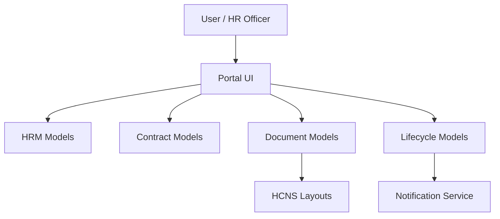

**Diagram sources**
- [models.py:11-124](file://src/apps/hrm/models.py#L11-L124)
- [models.py:19-76](file://src/apps/contract/models.py#L19-L76)
- [models.py:100-163](file://src/apps/document/models.py#L100-L163)
- [models.py:6-94](file://src/apps/lifecycle/models.py#L6-L94)
- [layouts.py:17-35](file://src/apps/document/hcns/layouts.py#L17-L35)

**Section sources**
- [02_Solution_Architecture.md:277-388](file://docs/02_Solution_Architecture.md#L277-L388)
- [01_BRD_MASTER.md:128-148](file://docs/01_BRD_MASTER.md#L128-L148)

## Core Components
This section summarizes the main HR administration entities and their responsibilities.

### Employee Model
The employee model stores personal identity, contact information, organizational assignment, employment status, and photo reference. It also exposes related history through foreign keys such as transfers, promotions, rewards, disciplines, contracts, and personnel decisions.

| Field group | Fields | Purpose |
|---|---|---|
| Identity | Employee code, first name, last name, full name, date of birth, gender | Unique identification and basic demographics |
| Legal identifiers | National ID, tax code, social insurance number | Compliance and payroll/benefits linkage |
| Contact | Personal email, company email, mobile phone, address | Communication and correspondence |
| Employment dates | Join date, leave date | Lifecycle boundaries |
| Organization | Department, position, job title, direct manager | Reporting structure and role context |
| Status and media | Employment status, photo URL | Current state and profile image reference |

The database design also defines common audit fields across business tables, including created/modified/deleted metadata and soft delete flags.

**Section sources**
- [models.py:11-71](file://src/apps/hrm/models.py#L11-L71)
- [03_Database_Design.md:103-118](file://docs/03_Database_Design.md#L103-L118)
- [03_Database_Design.md:194-240](file://docs/03_Database_Design.md#L194-L240)

### Profile Change Requests
Employees can request updates to a controlled whitelist of personal fields. Each request captures the target field, current value, proposed value, reason, optional attachment, approval status, decision metadata, and a submitted snapshot to prevent race conditions when HR modifies the same field while a request is pending.

| Aspect | Behavior |
|---|---|
| Allowed fields | Personal email, mobile phone, address |
| States | Pending, Approved, Rejected, NeedsMoreInfo |
| Validation | Rejects fields outside the allowed whitelist |
| Security | Attachment uses validated upload path; sensitive fields are not exposed broadly |
| UI | Employees create requests; HR reviews and decides |

**Section sources**
- [models.py:74-124](file://src/apps/hrm/models.py#L74-L124)
- [profile_change_request_list.html:1-10](file://src/apps/portal/templates/portal/profile_change_request_list.html#L1-L10)
- [HUONG_DAN_SU_DUNG_IHRMS.md:34-42](file://docs/HUONG_DAN_SU_DUNG_IHRMS.md#L34-L42)
- [HUONG_DAN_SU_DUNG_IHRMS.md:113-114](file://docs/HUONG_DAN_SU_DUNG_IHRMS.md#L113-L114)

### Employee History and Personnel Actions
The HR module tracks personnel movements and events:

| Entity | Meaning |
|---|---|
| Transfer | Movement between departments with effective date and reason |
| Promotion | Position change with old and new positions, effective date, and reason |
| Reward | Recognition event with type, date, amount, and description |
| Discipline | Disciplinary action with type, date, and description |

Both transfer and promotion trigger due-change processing so that organizational assignments reflect approved effective dates.

**Section sources**
- [models.py:125-186](file://src/apps/hrm/models.py#L125-L186)
- [03_Database_Design.md:334-434](file://docs/03_Database_Design.md#L334-L434)

## Architecture Overview
The HR administration flow integrates user interface, Django models, workflow rules, and document generation.

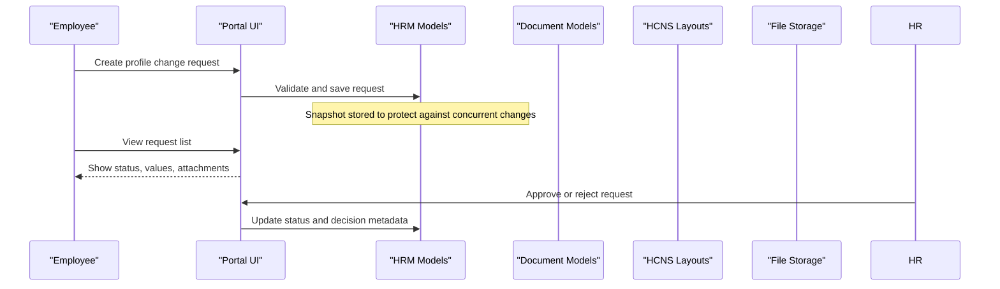

**Diagram sources**
- [models.py:74-124](file://src/apps/hrm/models.py#L74-L124)
- [profile_change_request_list.html:1-10](file://src/apps/portal/templates/portal/profile_change_request_list.html#L1-L10)

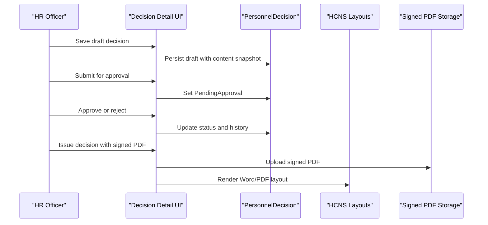

**Diagram sources**
- [views.py:157-188](file://src/apps/document/hcns/views.py#L157-L188)
- [views.py:430-476](file://src/apps/document/hcns/views.py#L430-L476)
- [personnel_decision_detail.html:1-14](file://src/apps/portal/templates/portal/personnel_decision_detail.html#L1-L14)
- [layouts.py:17-35](file://src/apps/document/hcns/layouts.py#L17-L35)

**Section sources**
- [02_Solution_Architecture.md:438-524](file://docs/02_Solution_Architecture.md#L438-L524)
- [02_Solution_Architecture.md:592-633](file://docs/02_Solution_Architecture.md#L592-L633)

## Detailed Component Analysis

### Employee Lifecycle Management
The lifecycle module provides structured checklists for onboarding and offboarding. A checklist template defines steps, responsible roles, due offsets, and whether asset return is required. An employee lifecycle case represents one onboarding or offboarding instance, and each checklist item tracks assignment, due date, completion, skip reasons, reminders, and optional asset allocation linkage.

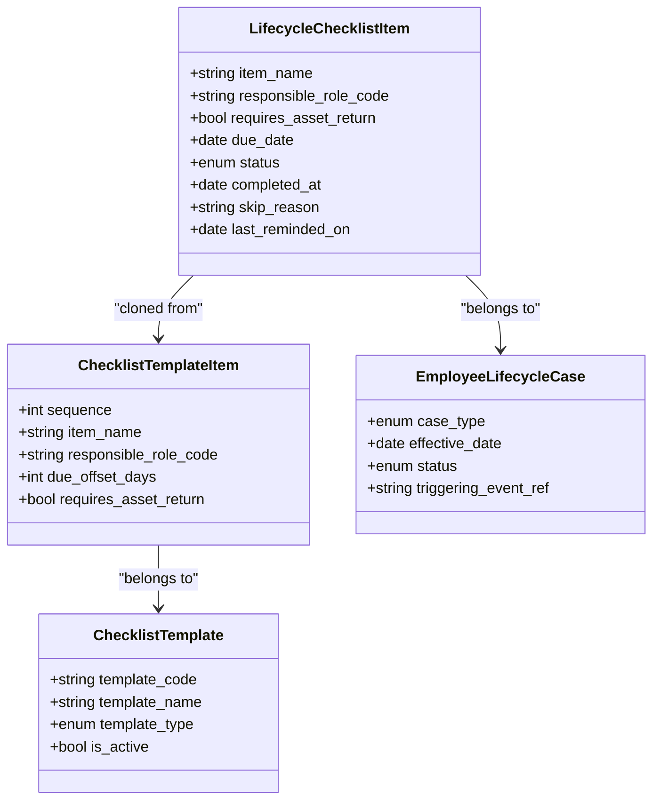

**Diagram sources**
- [models.py:6-94](file://src/apps/lifecycle/models.py#L6-L94)

Onboarding and offboarding cases are opened by service functions that validate the template, create or reuse a case, and clone template items into checklist items. Reminders are generated by a management command that calls the reminder service.

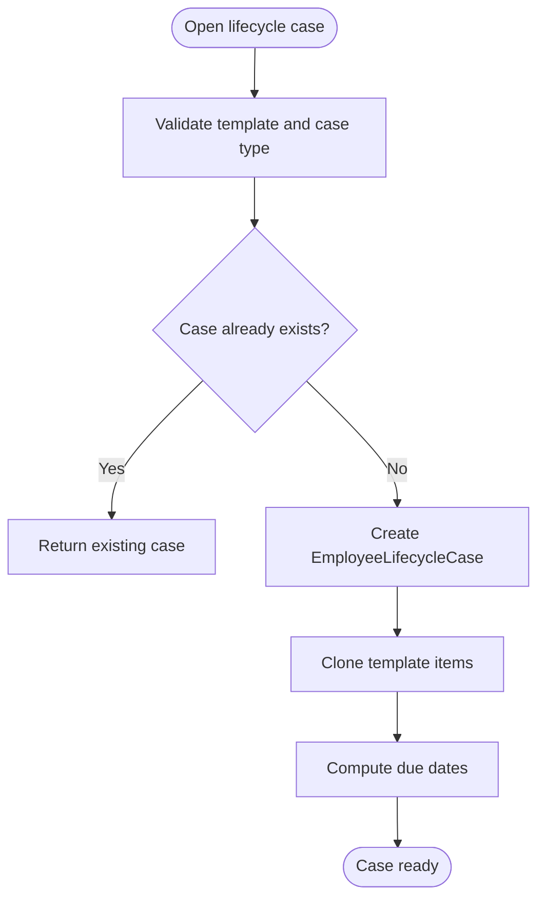

**Diagram sources**
- [services.py:10-33](file://src/apps/lifecycle/services.py#L10-L33)

**Section sources**
- [models.py:6-94](file://src/apps/lifecycle/models.py#L6-L94)
- [services.py:10-33](file://src/apps/lifecycle/services.py#L10-L33)
- [send_lifecycle_reminders.py:1-11](file://src/apps/lifecycle/management/commands/send_lifecycle_reminders.py#L1-L11)
- [HUONG_DAN_SU_DUNG_IHRMS.md:165-173](file://docs/HUONG_DAN_SU_DUNG_IHRMS.md#L165-L173)

### Contract Administration
Contracts are modeled with a contract type, unique contract number, start and optional end date, basic salary, and status. Appendices allow amendments linked to a base contract.

| Concept | Implementation |
|---|---|
| Contract types | Code and name lookup table |
| Contract states | Draft, Active, Expired, Terminated |
| Date validation | End date must be after start date when present |
| Appendices | Amendment number, effective date, description |

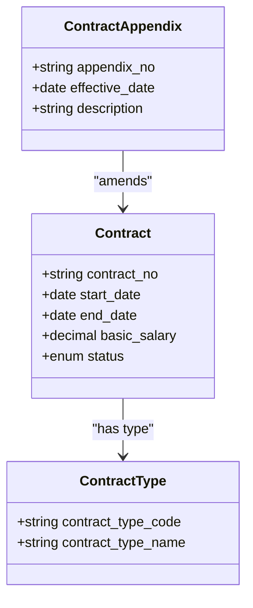

**Diagram sources**
- [models.py:6-16](file://src/apps/contract/models.py#L6-L16)
- [models.py:19-56](file://src/apps/contract/models.py#L19-L56)
- [models.py:59-76](file://src/apps/contract/models.py#L59-L76)

Example usage patterns:
- Creating a contract: select an employee, choose contract type, assign a unique contract number, set start date, optionally set end date, enter basic salary, and save as draft before moving to active status.
- Managing appendices: link an amendment to an existing contract, set effective date, and describe the change.
- Monitoring validity: use contract status and dates to track expiring or terminated agreements.

**Section sources**
- [models.py:19-76](file://src/apps/contract/models.py#L19-L76)
- [01_BRD_MASTER.md:476-508](file://docs/01_BRD_MASTER.md#L476-L508)
- [11_Workflow_Definition.md:640-728](file://docs/11_Workflow_Definition.md#L640-L728)

### Decision Workflow System
Personnel decisions cover appointments, salary adjustments, terminations, maternity benefits, and asset disposal. The system separates the business record from the generated official document and maintains a strict workflow.

Key behaviors:
- Draft creation preserves a content snapshot tied to a template slug.
- Submission requires a decision number and decision date.
- Approval and rejection require appropriate permissions and valid state transitions.
- Issuance requires a signed PDF and moves the decision to issued status.
- History records every state transition, actor, previous state, next state, and comment.
- Decisions do not automatically update the employee profile; they are snapshots for official documentation.

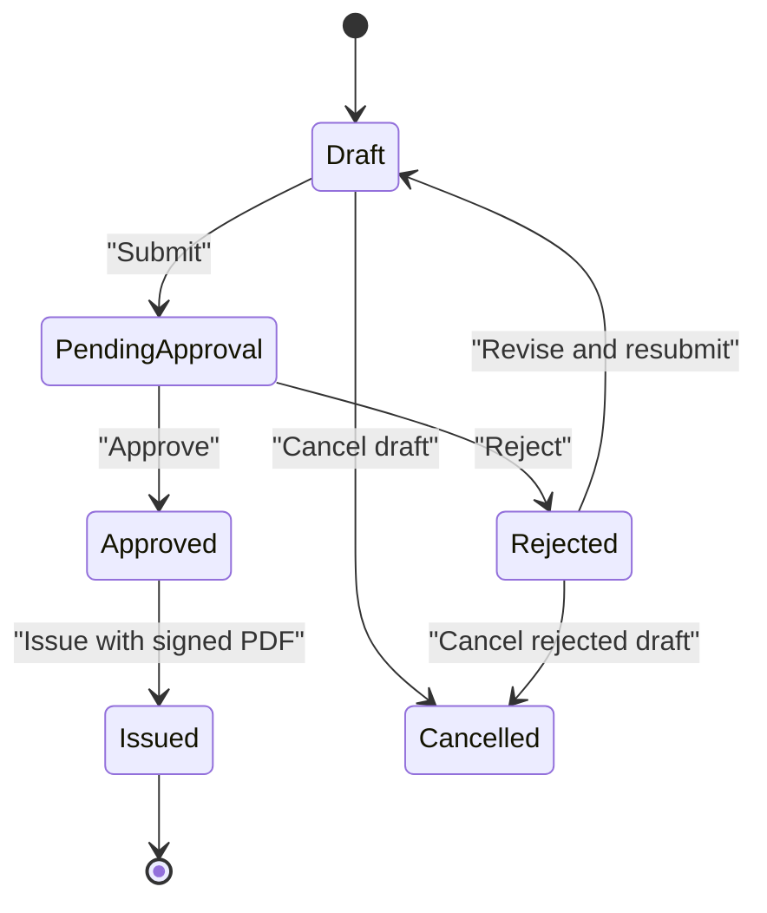

**Diagram sources**
- [models.py:100-163](file://src/apps/document/models.py#L100-L163)
- [views.py:454-476](file://src/apps/document/hcns/views.py#L454-L476)
- [11_Workflow_Definition.md:770-787](file://docs/11_Workflow_Definition.md#L770-L787)

#### Decision Creation Flow
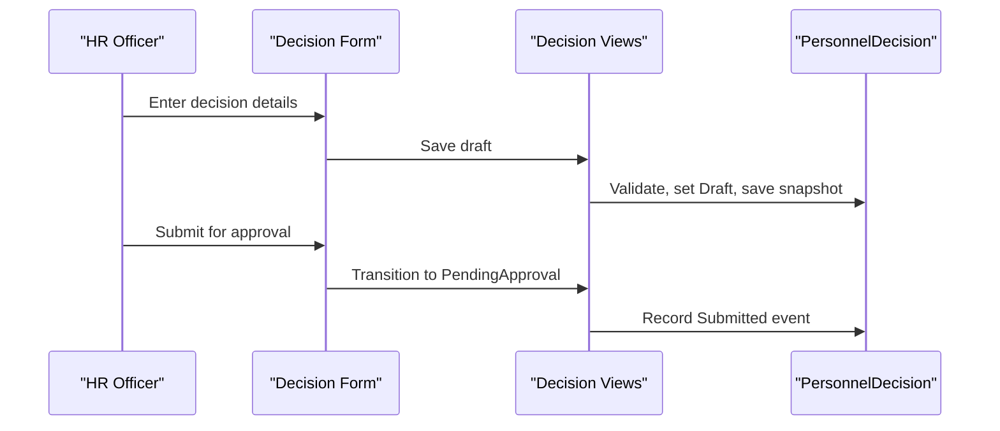

**Diagram sources**
- [views.py:157-188](file://src/apps/document/hcns/views.py#L157-L188)

#### Decision Approval and Issuance Flow
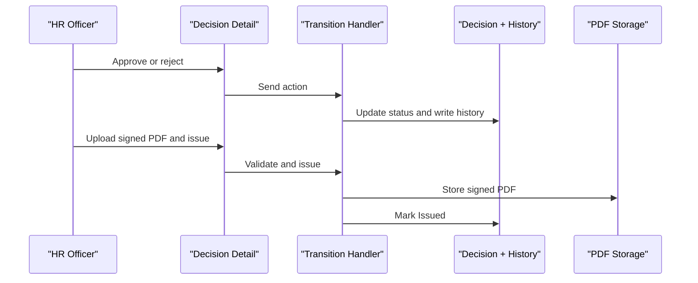

**Diagram sources**
- [views.py:430-476](file://src/apps/document/hcns/views.py#L430-L476)
- [personnel_decision_detail.html:25-50](file://src/apps/portal/templates/portal/personnel_decision_detail.html#L25-L50)

**Section sources**
- [models.py:100-163](file://src/apps/document/models.py#L100-L163)
- [views.py:157-188](file://src/apps/document/hcns/views.py#L157-L188)
- [views.py:430-476](file://src/apps/document/hcns/views.py#L430-L476)
- [personnel_decision_detail.html:1-14](file://src/apps/portal/templates/portal/personnel_decision_detail.html#L1-L14)
- [11_Workflow_Definition.md:770-787](file://docs/11_Workflow_Definition.md#L770-L787)

### Document Generation Integration
Official decisions are rendered using HCNS layouts. The layout layer selects subject lines, bases, articles, recipients, and signer based on the template slug and provided values. The decision detail UI supports downloading Word output and printing or saving PDFs when a layout is available.

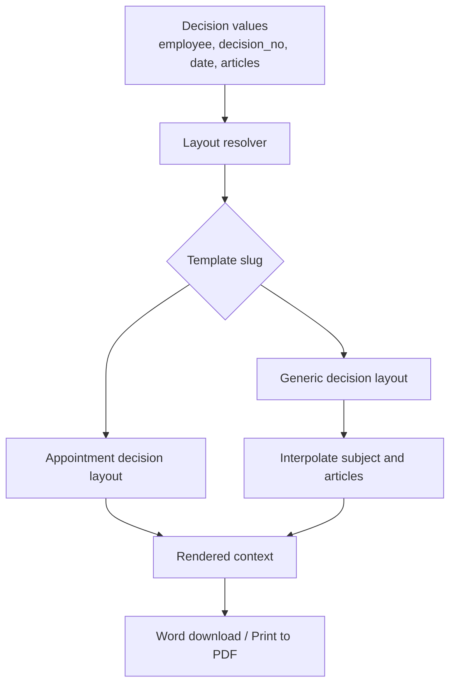

**Diagram sources**
- [layouts.py:17-35](file://src/apps/document/hcns/layouts.py#L17-L35)
- [personnel_decision_detail.html:1-14](file://src/apps/portal/templates/portal/personnel_decision_detail.html#L1-L14)
- [views.py:430-442](file://src/apps/document/hcns/views.py#L430-L442)

**Section sources**
- [layouts.py:17-35](file://src/apps/document/hcns/layouts.py#L17-L35)
- [personnel_decision_detail.html:1-14](file://src/apps/portal/templates/portal/personnel_decision_detail.html#L1-L14)
- [views.py:430-442](file://src/apps/document/hcns/views.py#L430-L442)

### Onboarding and Offboarding Workflows
Onboarding begins when an offer is accepted and continues through employee profile creation, account setup, department assignment, asset assignment, training, and completion. Offboarding covers resignation approval, HR validation, asset return, account disablement, final settlement, and completion.

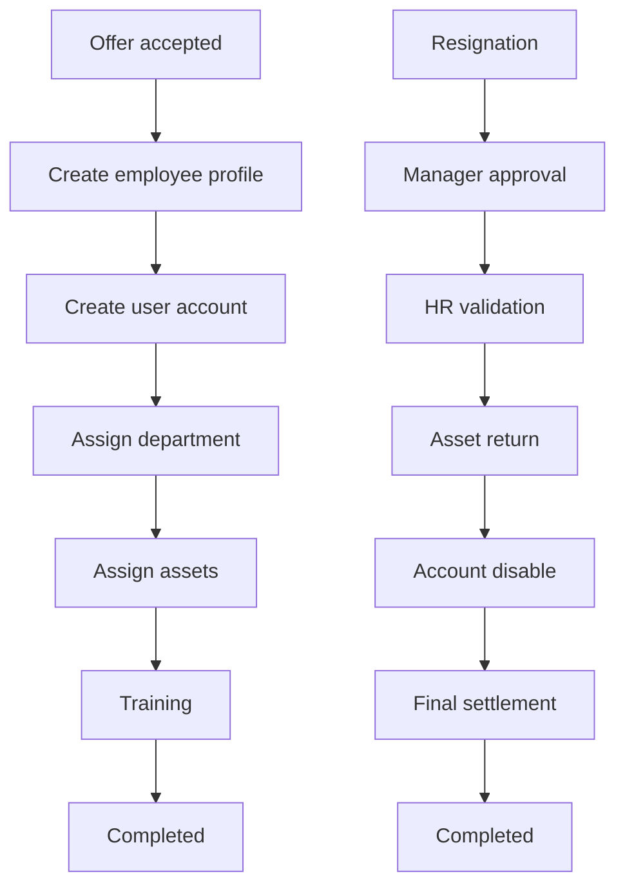

**Diagram sources**
- [11_Workflow_Definition.md:450-494](file://docs/11_Workflow_Definition.md#L450-L494)
- [11_Workflow_Definition.md:538-583](file://docs/11_Workflow_Definition.md#L538-L583)

Operational guidance:
- HR opens an onboarding or offboarding checklist for the correct employee and active template.
- Checklist items are assigned to responsible roles and marked complete or skipped with reasons.
- Items requiring asset return should link to existing asset allocation records rather than creating history manually.
- Reminder commands generate notifications for overdue checklist items; automatic scheduling depends on IT configuration.

**Section sources**
- [11_Workflow_Definition.md:450-583](file://docs/11_Workflow_Definition.md#L450-L583)
- [HUONG_DAN_SU_DUNG_IHRMS.md:165-173](file://docs/HUONG_DAN_SU_DUNG_IHRMS.md#L165-L173)
- [services.py:10-33](file://src/apps/lifecycle/services.py#L10-L33)
- [send_lifecycle_reminders.py:1-11](file://src/apps/lifecycle/management/commands/send_lifecycle_reminders.py#L1-L11)

## Dependency Analysis
The HR administration components have clear dependencies:

- `hrm.models` depends on organization models for department, position, and job title.
- `document.models` depends on storage services and upload validators for official documents and decisions.
- `lifecycle.models` depends on notification services for reminders and may link to asset allocation records.
- Portal templates depend on view-provided permissions and URLs for decision workflows and profile change requests.
- HCNS layouts depend on template slugs and interpolated values to render official documents.

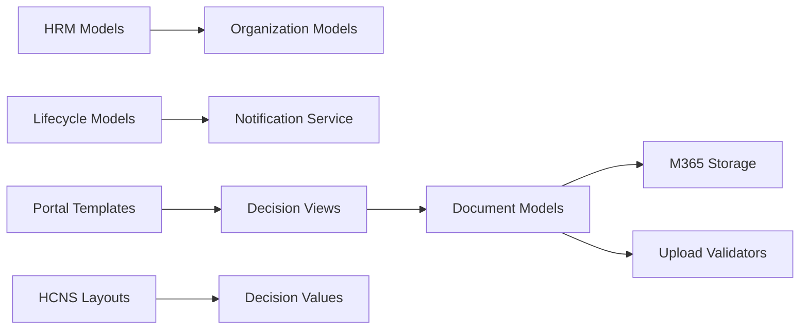

**Diagram sources**
- [models.py:43-63](file://src/apps/hrm/models.py#L43-L63)
- [models.py:100-124](file://src/apps/document/models.py#L100-L124)
- [models.py:6-94](file://src/apps/lifecycle/models.py#L6-L94)
- [layouts.py:17-35](file://src/apps/document/hcns/layouts.py#L17-L35)

**Section sources**
- [models.py:11-124](file://src/apps/hrm/models.py#L11-L124)
- [models.py:100-163](file://src/apps/document/models.py#L100-L163)
- [models.py:6-94](file://src/apps/lifecycle/models.py#L6-L94)
- [layouts.py:17-35](file://src/apps/document/hcns/layouts.py#L17-L35)

## Performance Considerations
- Keep decision drafts small and avoid large inline content; store supporting files in SharePoint or OneDrive and reference them via URLs.
- Use pagination and filtering for employee lists, contract histories, and decision histories.
- Avoid heavy template rendering on every page load; cache layout configuration where safe.
- Schedule lifecycle reminders through Windows Task Scheduler only after confirming runtime stability.
- Monitor storage capacity for SharePoint-backed uploads and ensure backup procedures cover both SQL Server and file storage.

[No sources needed since this section provides general guidance]

## Troubleshooting Guide
Common issues and resolutions:

| Issue | Likely cause | Resolution |
|---|---|---|
| Profile change request rejected during approval | Field value changed after submission snapshot | HR cannot apply stale request; employee creates a new request with updated values |
| Decision cannot be submitted | Missing decision number or decision date | Fill required fields before submitting |
| Decision cannot be approved | Wrong permission or invalid state | Ensure user has approval permission and decision is PendingApproval |
| Decision cannot be issued | No signed PDF or wrong state | Upload a valid signed PDF and ensure decision is Approved |
| Word download fails | Missing filename stem or unavailable layout | Check template slug and rendered context |
| Lifecycle reminder not received | Scheduler not configured | Run reminder command manually and configure Windows Task Scheduler |
| File upload or open error | SharePoint permissions or storage misconfiguration | Report IT with IHRMS record, time, and error; do not delete files directly in SharePoint |

**Section sources**
- [views.py:454-476](file://src/apps/document/hcns/views.py#L454-L476)
- [HUONG_DAN_SU_DUNG_IHRMS.md:66-75](file://docs/HUONG_DAN_SU_DUNG_IHRMS.md#L66-L75)
- [HUONG_DAN_SU_DUNG_IHRMS.md:216-228](file://docs/HUONG_DAN_SU_DUNG_IHRMS.md#L216-L228)
- [send_lifecycle_reminders.py:1-11](file://src/apps/lifecycle/management/commands/send_lifecycle_reminders.py#L1-L11)

## Conclusion
IHRMS implements HR administration through well-defined models, controlled workflows, and integrated document generation. Employee profiles support personal data and change requests with approval safeguards. Contracts capture types, terms, and appendices. Personnel decisions provide auditable workflows, snapshots, and official document rendering. Lifecycle checklists standardize onboarding and offboarding, while reminders and notifications keep processes visible. For reliable operations, HR should follow the documented workflows, IT should maintain storage and scheduler configuration, and users should treat decisions and attachments as official records requiring proper access control.

[No sources needed since this section summarizes without analyzing specific files]