# Official Document Generation

<cite>
**Referenced Files in This Document**
- [views.py](file://src/apps/document/hcns/views.py)
- [catalog.py](file://src/apps/document/hcns/catalog.py)
- [forms.py](file://src/apps/document/hcns/forms.py)
- [prefill.py](file://src/apps/document/hcns/prefill.py)
- [rendering.py](file://src/apps/document/hcns/rendering.py)
- [layouts.py](file://src/apps/document/hcns/layouts.py)
- [exports.py](file://src/apps/document/hcns/exports.py)
- [layout_profiles.json](file://src/apps/document/hcns/layout_profiles.json)
- [draft.html](file://src/apps/document/templates/document/hcns/draft.html)
- [document.html](file://src/apps/document/templates/document/hcns/document.html)
- [Huong_Dan_Bieu_Mau_HCNS.md](file://docs/Huong_Dan_Bieu_Mau_HCNS.md)
</cite>

## Table of Contents
1. [Introduction](#introduction)
2. [Project Structure](#project-structure)
3. [Core Components](#core-components)
4. [Architecture Overview](#architecture-overview)
5. [Detailed Component Analysis](#detailed-component-analysis)
6. [Dependency Analysis](#dependency-analysis)
7. [Performance Considerations](#performance-considerations)
8. [Troubleshooting Guide](#troubleshooting-guide)
9. [Conclusion](#conclusion)
10. [Appendices](#appendices)

## Introduction
This document explains the official HCNS (Hành chính Nhân sự) document generation system. It covers how predefined administrative templates are modeled, validated, rendered into a browser layout, and exported to Word and Excel. It also documents the layout engine, PDF output behavior through the browser, file naming conventions, version control for personnel decisions, and integration points with HR, payroll, leave, recruitment, asset, and lifecycle modules.

The system does not directly process arbitrary Microsoft Office files as executable templates. Instead, it transcribes reference Word/Excel layouts into explicit Python form specifications, then renders validated data into consistent print layouts. Generated Word and Excel exports carry a “BẢN SOẠN THẢO” mark and do not automatically create business records or approvals.

## Project Structure
The HCNS subsystem lives under `src/apps/document/hcns`. Its responsibilities are split across:

| Area | Responsibility | Key Files |
|---|---|---|
| Template catalog | Declares 26 supported forms, sections, fields, tables, signatures, and default content | [catalog.py](file://src/apps/document/hcns/catalog.py), [reference_content.json](file://src/apps/document/hcns/reference_content.json) |
| User input | Builds Django forms, table formsets, validation, and choice wiring | [forms.py](file://src/apps/document/hcns/forms.py), [choices.py](file://src/apps/document/hcns/choices.py) |
| Prefill | Reads source records safely based on allow-listed selectors and permissions | [prefill.py](file://src/apps/document/hcns/prefill.py) |
| Rendering | Converts fields and tables into a neutral context used by HTML and exports | [rendering.py](file://src/apps/document/hcns/rendering.py) |
| Layouts | Produces ordered block streams and decision-specific structures | [layouts.py](file://src/apps/document/hcns/layouts.py) |
| Export | Generates macro-free DOCX and XLSX files | [exports.py](file://src/apps/document/hcns/exports.py) |
| Page profiles | Stores paper size, margins, font size, and column widths per template | [layout_profiles.json](file://src/apps/document/hcns/layout_profiles.json) |
| Views | Handles catalog, draft editor, export, and personnel decision workflow | [views.py](file://src/apps/document/hcns/views.py) |
| Templates | Renders the draft editor, preview, and appointment-decision layout | [draft.html](file://src/apps/document/templates/document/hcns/draft.html), [document.html](file://src/apps/document/templates/document/hcns/document.html) |
| User guide | Explains usage, groups, naming rules, and limitations | [Huong_Dan_Bieu_Mau_HCNS.md](file://docs/Huong_Dan_Bieu_Mau_HCNS.md) |

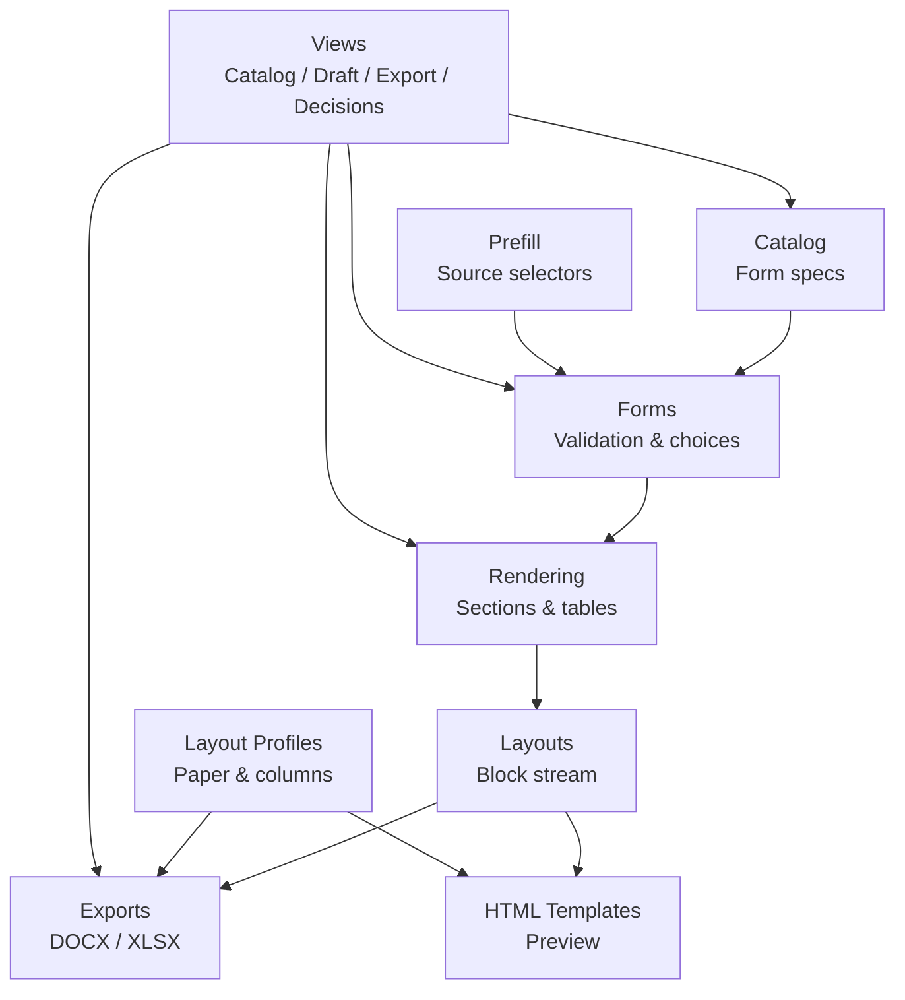

**Diagram sources**
- [catalog.py:12-58](file://src/apps/document/hcns/catalog.py#L12-L58)
- [forms.py:32-99](file://src/apps/document/hcns/forms.py#L32-L99)
- [prefill.py:101-220](file://src/apps/document/hcns/prefill.py#L101-L220)
- [rendering.py:59-109](file://src/apps/document/hcns/rendering.py#L59-L109)
- [layouts.py:44-301](file://src/apps/document/hcns/layouts.py#L44-L301)
- [exports.py:120-180](file://src/apps/document/hcns/exports.py#L120-L180)
- [layout_profiles.json:1-407](file://src/apps/document/hcns/layout_profiles.json#L1-L407)
- [views.py:191-354](file://src/apps/document/hcns/views.py#L191-L354)

**Section sources**
- [catalog.py:1-276](file://src/apps/document/hcns/catalog.py#L1-L276)
- [views.py:191-354](file://src/apps/document/hcns/views.py#L191-L354)
- [Huong_Dan_Bieu_Mau_HCNS.md:1-118](file://docs/Huong_Dan_Bieu_Mau_HCNS.md#L1-L118)

## Core Components
- **Template catalog**: Defines each HCNS form’s slug, title, group, source reference, sections, fields, tables, signature labels, export kind, orientation, header text, and notes. It includes personnel checklists, leave requests, salary scale, interview sheets, TORs, and asset workflows.
- **Form layer**: Converts catalog field specs into Django fields, applies defaults, validates dates/times/decimals, enforces maximum scores, and wires dropdown choices from HR, payroll, recruitment, and asset modules.
- **Prefill layer**: Allow-lists source selectors such as employee, leave, candidate, inventory, disposal, lifecycle, salary, promotion, and transfer identifiers. It reads only permitted data and maps matching slots without inferring new business actions.
- **Rendering layer**: Formats values, interpolates short strings, computes derived interview totals and averages, builds sections, and attaches profile and layout information.
- **Layout layer**: Produces a stable block stream for HTML and Office exports, including special flows for decisions, leave, TOR, interviews, handover, evaluation, and asset documents.
- **Export layer**: Writes macro-free DOCX using OpenXML elements and XLSX using openpyxl, applying page setup, footers, borders, fonts, and column widths.
- **View layer**: Provides the catalog, draft editor, Word/Excel download, and personnel decision list/detail/workflow endpoints.

**Section sources**
- [catalog.py:53-267](file://src/apps/document/hcns/catalog.py#L53-L267)
- [forms.py:12-178](file://src/apps/document/hcns/forms.py#L12-L178)
- [prefill.py:12-220](file://src/apps/document/hcns/prefill.py#L12-L220)
- [rendering.py:18-109](file://src/apps/document/hcns/rendering.py#L18-L109)
- [layouts.py:11-321](file://src/apps/document/hcns/layouts.py#L11-L321)
- [exports.py:120-504](file://src/apps/document/hcns/exports.py#L120-L504)
- [views.py:191-519](file://src/apps/document/hcns/views.py#L191-L519)

## Architecture Overview
The request flow starts at the view, loads the form specification, prefill data, and user input, validates everything, builds a rendering context, and then either returns an HTML preview or generates a downloadable file. Personnel decisions can be saved, submitted, approved, rejected, or issued with a signed PDF.

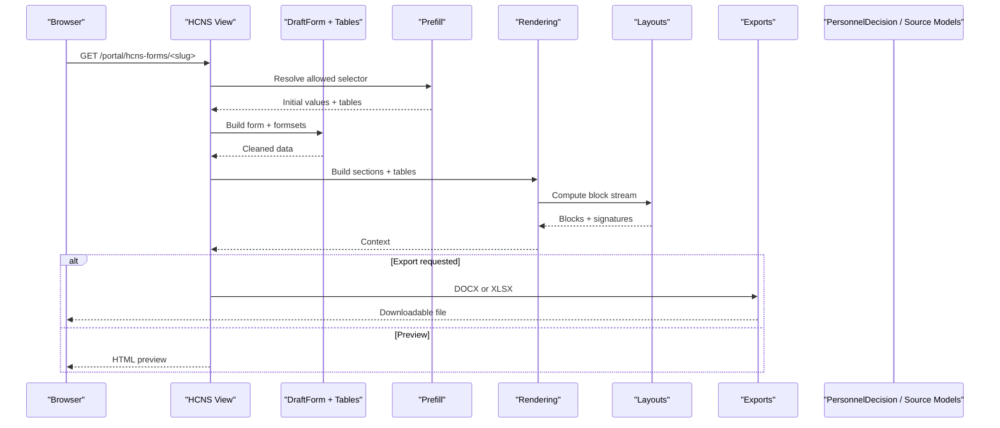

**Diagram sources**
- [views.py:231-354](file://src/apps/document/hcns/views.py#L231-L354)
- [prefill.py:101-220](file://src/apps/document/hcns/prefill.py#L101-L220)
- [forms.py:32-178](file://src/apps/document/hcns/forms.py#L32-L178)
- [rendering.py:59-109](file://src/apps/document/hcns/rendering.py#L59-L109)
- [layouts.py:44-301](file://src/apps/document/hcns/layouts.py#L44-L301)
- [exports.py:120-180](file://src/apps/document/hcns/exports.py#L120-L180)

## Detailed Component Analysis

### HCNS Template Catalog
The catalog is the single source of truth for supported forms. Each entry declares:
- A unique slug and human-readable title.
- Group classification: personnel, decision, leave, salary, recruitment, or asset.
- Reference filename for audit traceability.
- Sections containing fields, paragraphs, and optional tables.
- Signature labels and optional header text.
- Export kind (`docx` or `xlsx`) and orientation.
- Notes warning users about review requirements.

Examples include employee information, onboarding/offboarding checklists, resignation, work handover, exit interview, four types of personnel decisions, three leave forms, salary scale, interview score sheet, interview summary, four TOR templates, asset inventory, disposal proposal, disposal decision, and destruction minutes.

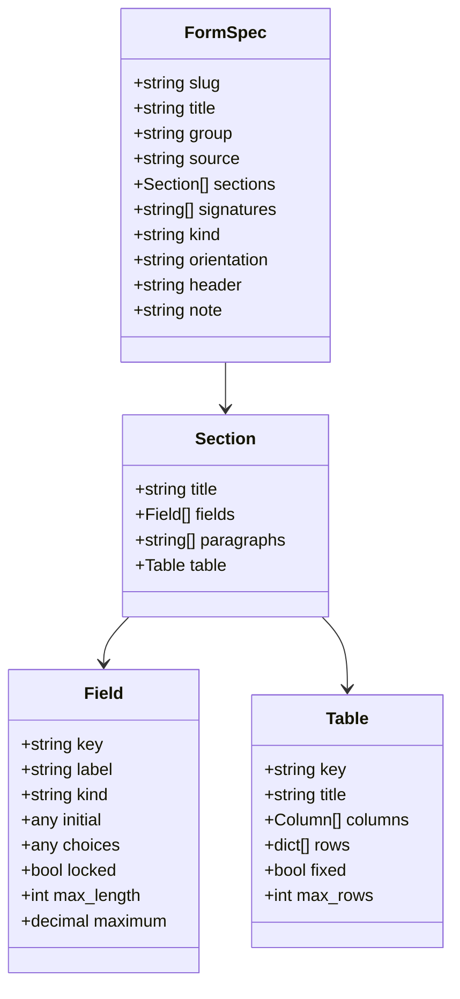

**Diagram sources**
- [catalog.py:23-33](file://src/apps/document/hcns/catalog.py#L23-L33)
- [catalog.py:53-58](file://src/apps/document/hcns/catalog.py#L53-L58)
- [catalog.py:61-267](file://src/apps/document/hcns/catalog.py#L61-L267)

**Section sources**
- [catalog.py:1-276](file://src/apps/document/hcns/catalog.py#L1-L276)

### Form Validation and Choice Wiring
The form layer converts catalog field definitions into Django fields. It supports text, textarea, date, time, decimal, integer, email, and choice fields. It also:
- Defaults `document_date` to the current local date when present.
- Wires dropdown choices from HR, payroll, recruitment, and asset modules.
- Computes `salary_words` from numeric salary input.
- Validates leave date ranges and interview score limits.
- Enforces required fields for interview summaries and name-code consistency.

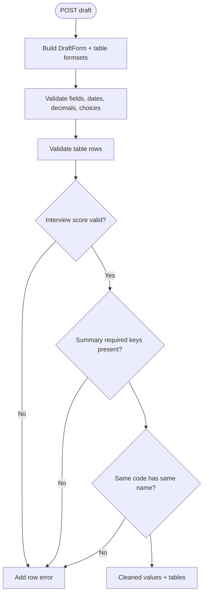

**Diagram sources**
- [forms.py:32-69](file://src/apps/document/hcns/forms.py#L32-L69)
- [forms.py:72-139](file://src/apps/document/hcns/forms.py#L72-L139)

**Section sources**
- [forms.py:12-178](file://src/apps/document/hcns/forms.py#L12-L178)

### Prefill and Source Data Integration
Prefill uses an allow-list of selectors so that personal data is never read from arbitrary URL parameters. Supported sources include:
- Employee profile
- Leave request
- Candidate
- Asset inventory session
- Asset disposal request
- Lifecycle case
- Salary, promotion, or transfer record

It maps only fields present in the target template and avoids leaking private data into unrelated editors. For example, selecting an employee does not turn them into a recruitment candidate unless the template explicitly expects candidate data.

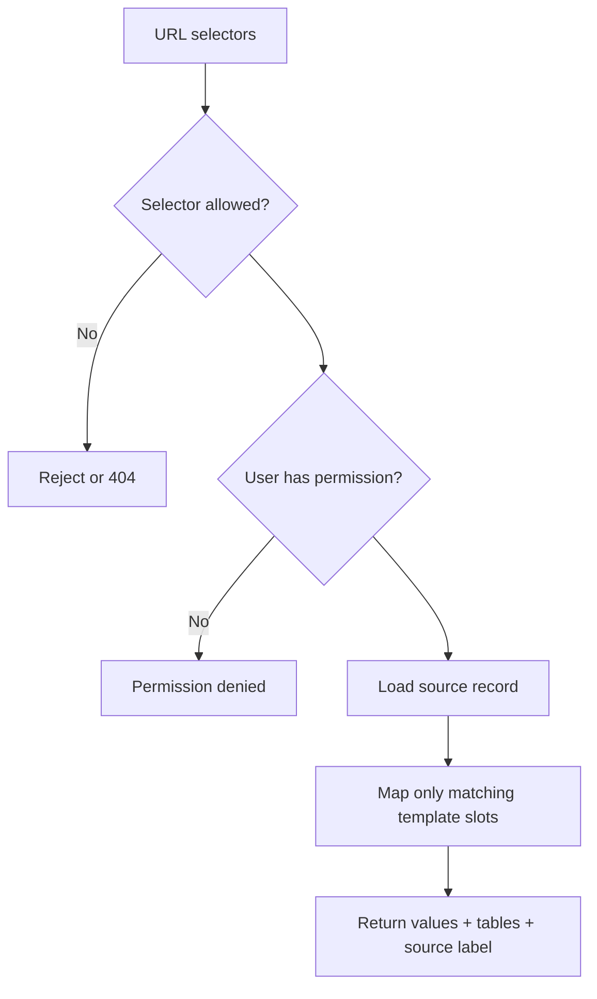

**Diagram sources**
- [prefill.py:12-28](file://src/apps/document/hcns/prefill.py#L12-L28)
- [prefill.py:30-78](file://src/apps/document/hcns/prefill.py#L30-L78)
- [prefill.py:101-220](file://src/apps/document/hcns/prefill.py#L101-L220)

**Section sources**
- [prefill.py:1-221](file://src/apps/document/hcns/prefill.py#L1-L221)

### Rendering Engine
The rendering engine transforms validated data into a neutral structure consumed by both HTML and Office exports. It:
- Normalizes dates, times, decimals, and strings.
- Sanitizes XML-invalid characters.
- Interpolates short paragraph-like fields.
- Adds derived columns for interview results.
- Builds sections with titles, paragraphs, fields, and tables.
- Attaches profile metadata and layout blocks.
- Prepares appointment-decision layout data when needed.

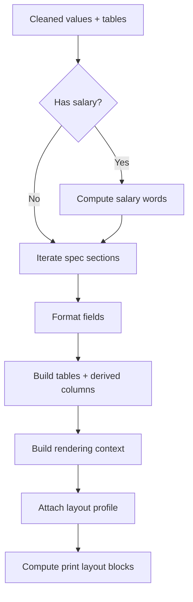

**Diagram sources**
- [rendering.py:18-56](file://src/apps/document/hcns/rendering.py#L18-L56)
- [rendering.py:59-109](file://src/apps/document/hcns/rendering.py#L59-L109)

**Section sources**
- [rendering.py:1-110](file://src/apps/document/hcns/rendering.py#L1-L110)

### Layout System
The layout system separates editor UI from print output. It produces:
- Ordered blocks: paragraphs, headings, centered/right-aligned lines, and tables.
- Signature regions with configurable column counts.
- Specialized flows for decisions, leave, TOR, interviews, handover, evaluation, and asset documents.
- Stable column widths for browser print and Word tables.
- Decision-specific structures with number, date line, subject, bases, articles, recipients, and signer.

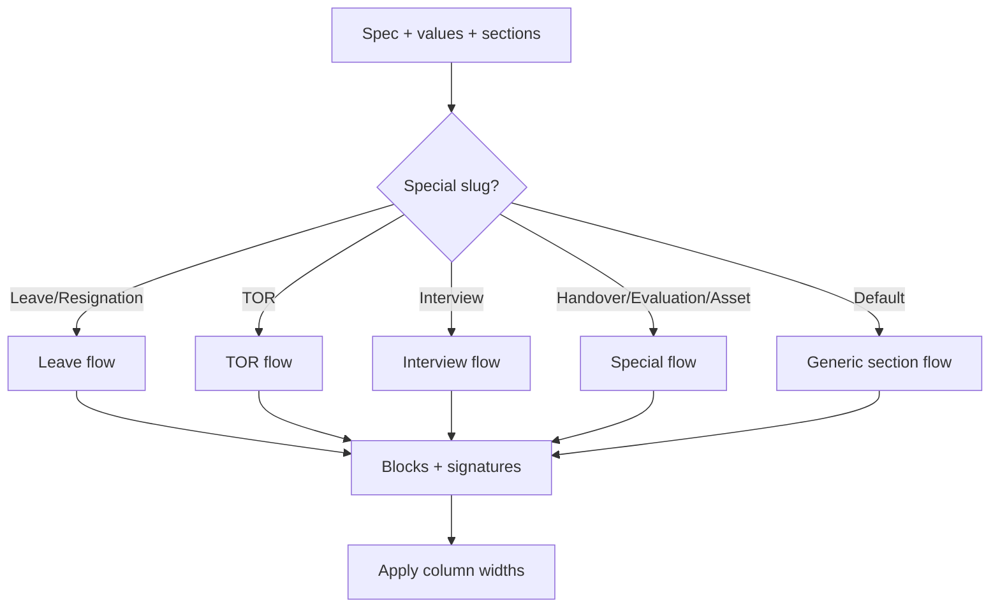

**Diagram sources**
- [layouts.py:11-41](file://src/apps/document/hcns/layouts.py#L11-L41)
- [layouts.py:44-301](file://src/apps/document/hcns/layouts.py#L44-L301)
- [layouts.py:304-321](file://src/apps/document/hcns/layouts.py#L304-L321)

**Section sources**
- [layouts.py:1-322](file://src/apps/document/hcns/layouts.py#L1-L322)

### Word and Excel Export
The export layer writes portable Office files without macros or external dependencies:
- DOCX is built by creating OpenXML elements, paragraphs, tables, and section properties.
- XLSX is built with openpyxl, including formulas for interview totals and averages, frozen panes, print titles, borders, and page setup.
- Both formats apply profile-based paper size, margins, and footer text.
- The interview summary sheet adds conditional formulas and grouped calculations.
- Asset inventory exports additional label sheets and a reading guide.

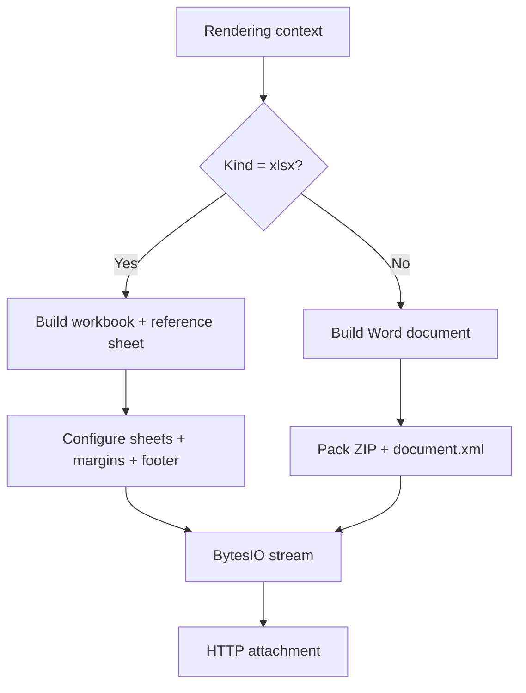

**Diagram sources**
- [exports.py:120-180](file://src/apps/document/hcns/exports.py#L120-L180)
- [exports.py:256-344](file://src/apps/document/hcns/exports.py#L256-L344)
- [exports.py:347-504](file://src/apps/document/hcns/exports.py#L347-L504)

**Section sources**
- [exports.py:1-505](file://src/apps/document/hcns/exports.py#L1-L505)

### PDF Output and Browser Printing
PDF output is generated by the browser’s print dialog rather than a server-side PDF renderer. The draft template injects page CSS from the active profile and displays a draft watermark. Users should update the preview before printing and use 100% zoom while disabling browser-added headers/footers.

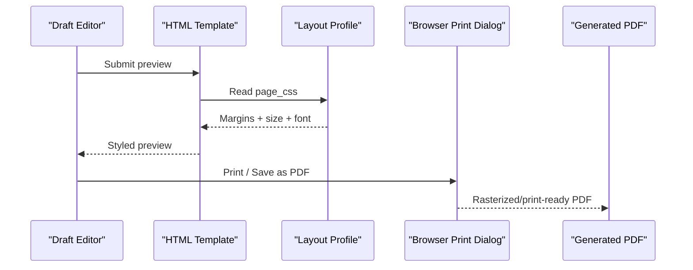

**Diagram sources**
- [draft.html:1-12](file://src/apps/document/templates/document/hcns/draft.html#L1-L12)
- [layout_profiles.json:1-407](file://src/apps/document/hcns/layout_profiles.json#L1-L407)

**Section sources**
- [draft.html:1-12](file://src/apps/document/templates/document/hcns/draft.html#L1-L12)
- [Huong_Dan_Bieu_Mau_HCNS.md:107-118](file://docs/Huong_Dan_Bieu_Mau_HCNS.md#L107-L118)

### Personnel Decision Workflow and Version Control
Personnel decisions have a dedicated workflow:
- Draft creation with full content snapshot.
- Submission to approvers.
- Approval or rejection with comments.
- Issuance by uploading a signed PDF.
- Internal notification to approvers, submitters, and affected employees.
- History tracking with status transitions.

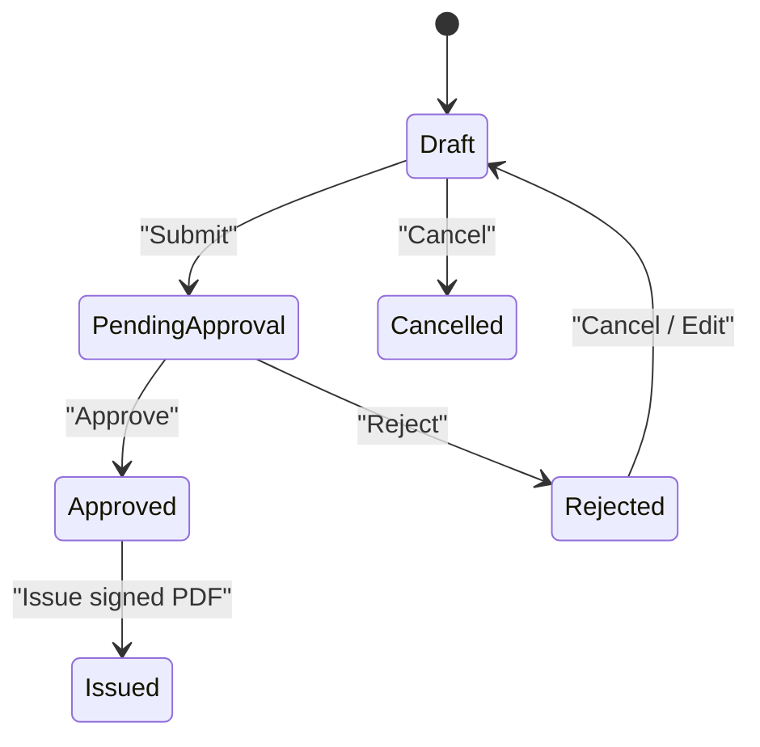

**Diagram sources**
- [views.py:457-519](file://src/apps/document/hcns/views.py#L457-L519)
- [views.py:132-188](file://src/apps/document/hcns/views.py#L132-L188)

**Section sources**
- [views.py:47-129](file://src/apps/document/hcns/views.py#L47-L129)
- [views.py:132-188](file://src/apps/document/hcns/views.py#L132-L188)
- [views.py:357-519](file://src/apps/document/hcns/views.py#L357-L519)

### File Naming and Storage
File names follow a standardized pattern: `DocumentType_SourceCode_YYYYMMDD.ext`. Names are computed from the template, selected employee or candidate, decision number/date, and other contextual fields. Downloads are logged as security events but do not store sensitive query strings or raw input in audit entries.

For issued personnel decisions, the signed PDF is attached to the decision record and protected by visibility rules. Word drafts remain marked as drafts even after issuance; only the uploaded signed PDF represents the issued version.

**Section sources**
- [views.py:216-225](file://src/apps/document/hcns/views.py#L216-L225)
- [views.py:430-442](file://src/apps/document/hcns/views.py#L430-L442)
- [Huong_Dan_Bieu_Mau_HCNS.md:95-105](file://docs/Huong_Dan_Bieu_Mau_HCNS.md#L95-L105)

## Dependency Analysis
The HCNS subsystem depends on several application modules:

| Dependency | Purpose |
|---|---|
| `apps.hrm.models.Employee` | Employee profile data |
| `apps.payroll.models.EmployeeSalary` | Current salary lookup |
| `apps.contract.models.Contract` | Active contract number |
| `apps.leave.models.LeaveRequest` | Leave request prefill |
| `apps.recruitment.models.Candidate` | Recruitment candidate prefill |
| `apps.asset.models.InventorySession` | Inventory session and assets |
| `apps.asset.models.AssetDisposalRequest` | Disposal request prefill |
| `apps.lifecycle.models.EmployeeLifecycleCase` | Lifecycle case prefill |
| `apps.notification.services` | Internal bell notifications |
| `apps.security.permissions` | Permission checks |
| `apps.security.data_access` | File access and visibility helpers |
| `apps.document.models.PersonnelDecision` | Decision draft and history |

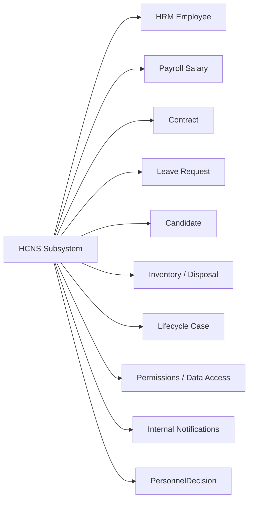

**Diagram sources**
- [prefill.py:56-78](file://src/apps/document/hcns/prefill.py#L56-L78)
- [prefill.py:119-219](file://src/apps/document/hcns/prefill.py#L119-L219)
- [views.py:18-23](file://src/apps/document/hcns/views.py#L18-L23)

**Section sources**
- [prefill.py:56-219](file://src/apps/document/hcns/prefill.py#L56-L219)
- [views.py:18-23](file://src/apps/document/hcns/views.py#L18-L23)

## Performance Considerations
- Large source tables are read-only in the editor to avoid heavy POST payloads. Users can still view and export full data.
- Interview result tables compute totals and averages per candidate group during rendering and again in Excel via formulas.
- DOCX generation builds XML trees in memory; large tables increase payload size.
- XLSX generation computes merged cell widths and row heights to improve print layout stability.
- PDF generation relies on the browser; long documents may paginate differently across browsers.

[No sources needed since this section provides general guidance]

## Troubleshooting Guide
Common issues and resolutions:

| Symptom | Likely Cause | Resolution |
|---|---|---|
| Preview differs from downloaded Word | Browser cache or stale CSS | Refresh preview, hard refresh, restart app if needed |
| PDF shows extra headers/footers | Browser print settings | Use 100% zoom and disable browser headers/footers |
| Interview averages missing | Missing scores or inconsistent candidate codes | Ensure all required criteria are filled and codes match names |
| Salary words blank | No numeric salary provided | Enter numeric salary; words are computed automatically |
| Cannot prefill from employee | Missing permissions | Require both view-all-employees and export-employee-data |
| Decision cannot be submitted | Missing decision number or date | Fill decision number and decision date before submitting |
| Decision cannot be issued | No signed PDF uploaded | Upload signed PDF to mark the decision as issued |
| Export forbidden for large source | Too many editable rows | Use read-only view/export or edit source module |

**Section sources**
- [views.py:261-263](file://src/apps/document/hcns/views.py#L261-L263)
- [views.py:467-490](file://src/apps/document/hcns/views.py#L467-L490)
- [Huong_Dan_Bieu_Mau_HCNS.md:107-118](file://docs/Huong_Dan_Bieu_Mau_HCNS.md#L107-L118)

## Conclusion
The HCNS document generation system replaces fragile manual Word/Excel editing with a controlled, permission-aware pipeline. Templates are defined explicitly, validated rigorously, and rendered consistently for both screen preview and printable Office exports. Personnel decisions add workflow, versioning, and secure issuance. While the system integrates deeply with HR, payroll, leave, recruitment, asset, and lifecycle modules, it deliberately avoids auto-executing business changes from document drafts. Final review remains essential before signing.

[No sources needed since this section summarizes without analyzing specific files]

## Appendices

### Creating a Custom Template
To add a new HCNS template:
1. Add a catalog entry with slug, title, group, source reference, sections, fields, tables, signatures, kind, orientation, header, and note.
2. If the template needs a custom print layout, extend `print_layout` in the layout module.
3. If the template needs a custom Word layout, extend the DOCX export logic.
4. If the template needs a custom Excel layout, extend the XLSX reference sheet logic.
5. Add page profile values in the layout profiles JSON.
6. Update the user guide with usage instructions and constraints.

**Section sources**
- [catalog.py:53-58](file://src/apps/document/hcns/catalog.py#L53-L58)
- [layouts.py:44-301](file://src/apps/document/hcns/layouts.py#L44-L301)
- [exports.py:120-180](file://src/apps/document/hcns/exports.py#L120-L180)
- [exports.py:359-440](file://src/apps/document/hcns/exports.py#L359-L440)
- [layout_profiles.json:1-407](file://src/apps/document/hcns/layout_profiles.json#L1-L407)

### Generating Official Documents
Recommended workflow:
1. Open the HCNS forms catalog.
2. Select the appropriate template.
3. Choose a source record when available.
4. Complete missing fields and validate tables.
5. Update the preview.
6. Print or save PDF from the browser.
7. Download Word or Excel for offline editing.
8. Review layout and content before signing.

**Section sources**
- [Huong_Dan_Bieu_Mau_HCNS.md:5-16](file://docs/Huong_Dan_Bieu_Mau_HCNS.md#L5-L16)

### Customizing Layouts
Layout customization should focus on:
- Paper size and margins in the layout profiles JSON.
- Column widths for stable print output.
- Block ordering in the layout module.
- Signature region configuration.
- Avoid copying private images or signatures from reference documents.

**Section sources**
- [layout_profiles.json:1-407](file://src/apps/document/hcns/layout_profiles.json#L1-L407)
- [layouts.py:304-321](file://src/apps/document/hcns/layouts.py#L304-L321)
- [Huong_Dan_Bieu_Mau_HCNS.md:107-118](file://docs/Huong_Dan_Bieu_Mau_HCNS.md#L107-L118)

### Integration with Microsoft Office and SharePoint
- Word and Excel exports are macro-free and safe for offline editing.
- After editing in Office, recheck layout and content before signing.
- The system does not directly execute Office templates or connect to SharePoint in the analyzed code paths.
- Collaboration should use the IHRMS workflow for decisions and attach signed PDFs where required.

**Section sources**
- [exports.py:1-17](file://src/apps/document/hcns/exports.py#L1-L17)
- [Huong_Dan_Bieu_Mau_HCNS.md:10-16](file://docs/Huong_Dan_Bieu_Mau_HCNS.md#L10-L16)