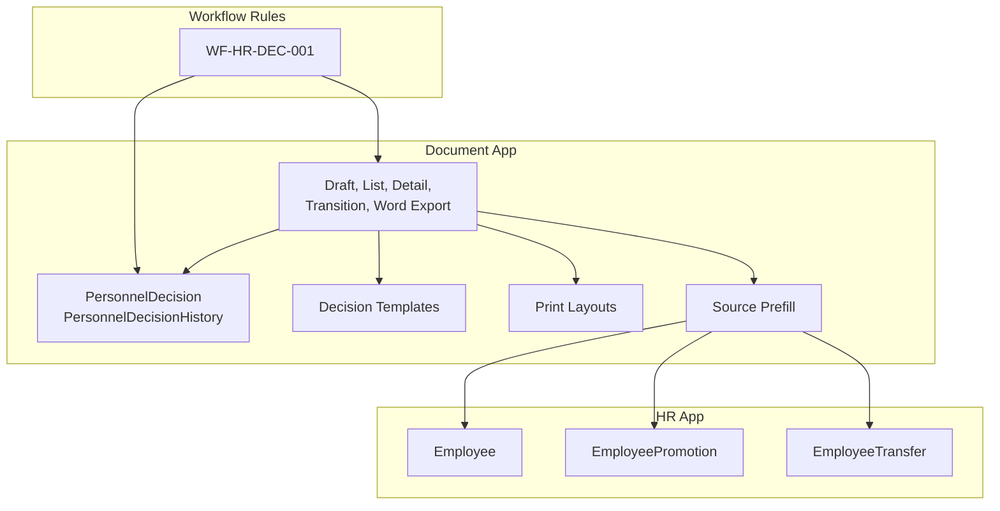
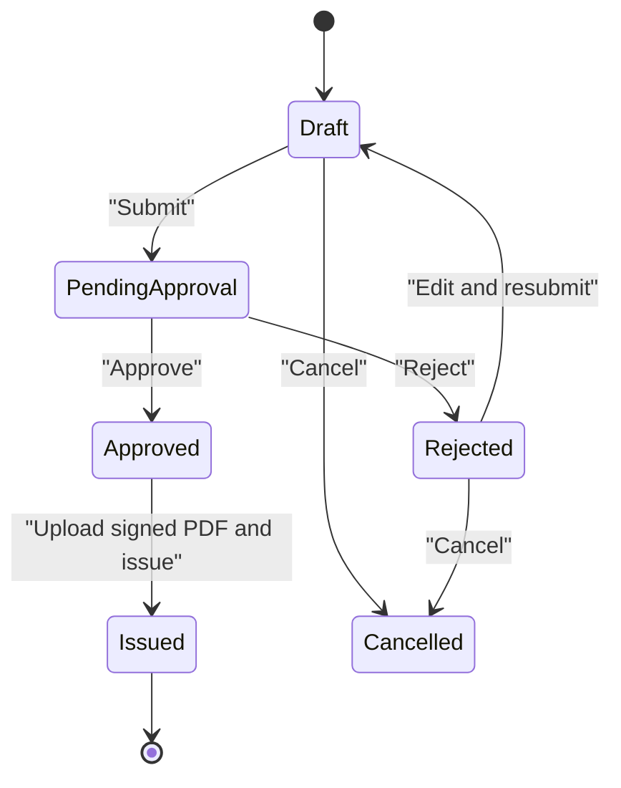
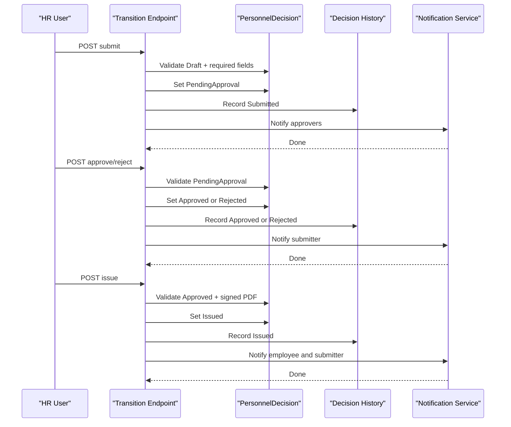
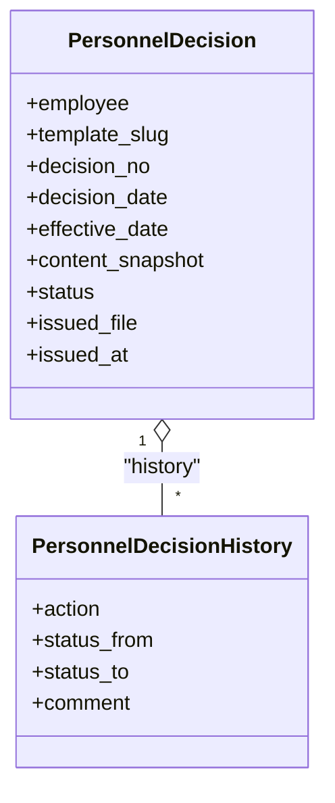
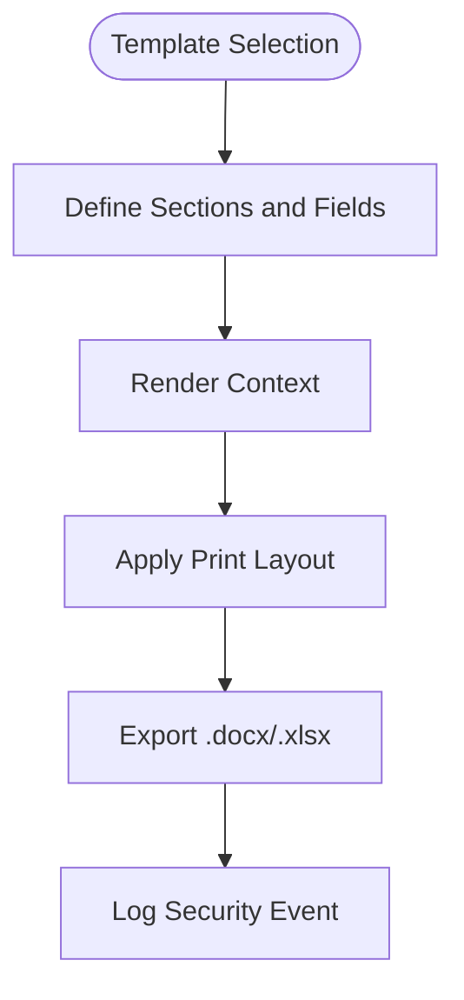
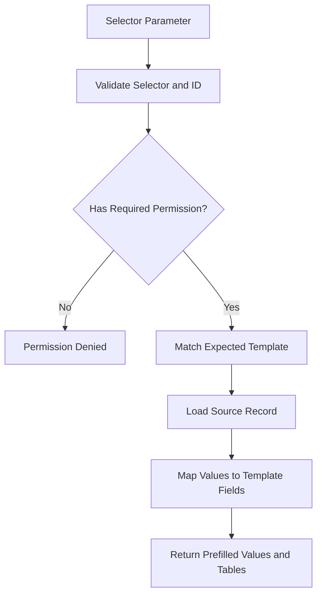
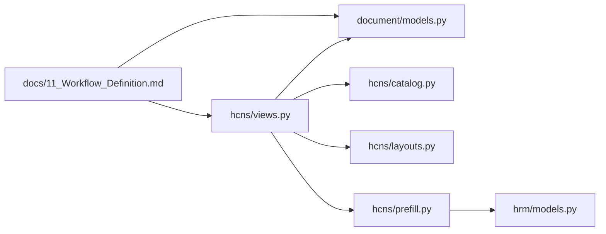

# Personnel Decision Workflows

<cite>
**Referenced Files in This Document**
- [11_Workflow_Definition.md](file://docs/11_Workflow_Definition.md)
- [models.py](file://src/apps/document/models.py)
- [views.py](file://src/apps/document/hcns/views.py)
- [catalog.py](file://src/apps/document/hcns/catalog.py)
- [layouts.py](file://src/apps/document/hcns/layouts.py)
- [prefill.py](file://src/apps/document/hcns/prefill.py)
- [tests_hr_workflow.py](file://src/apps/document/tests_hr_workflow.py)
- [migrations/0005_personnel_decision_workflow.py](file://src/apps/document/migrations/0005_personnel_decision_workflow.py)
- [models.py (HRM)](file://src/apps/hrm/models.py)
</cite>

## Table of Contents
1. [Introduction](#introduction)
2. [Project Structure](#project-structure)
3. [Core Components](#core-components)
4. [Architecture Overview](#architecture-overview)
5. [Detailed Component Analysis](#detailed-component-analysis)
6. [Dependency Analysis](#dependency-analysis)
7. [Performance Considerations](#performance-considerations)
8. [Troubleshooting Guide](#troubleshooting-guide)
9. [Conclusion](#conclusion)
10. [Appendices](#appendices)

## Introduction
This document explains the personnel decision workflow system that supports HR decisions such as promotions, transfers, warnings, and terminations. It covers:
- Decision types and their approval boundaries
- The state-driven workflow engine for drafts, approvals, rejections, issuance, and cancellation
- Integration with the document generation system for official letters and certificates
- Audit trail and compliance recording
- Template configuration and standardized layouts
- Practical examples for initiating decisions, managing approval chains, and generating official documents

The implementation is centered on a personnel decision model with explicit states, an approval transition endpoint, content snapshots, and a history log. Templates define form fields, rendering context, and print layouts for official outputs.

## Project Structure
The personnel decision feature lives primarily under the document application, with supporting HR models and workflow definitions:
- `src/apps/document/models.py` defines the personnel decision entity, its status choices, issued PDF storage, and audit history.
- `src/apps/document/hcns/views.py` implements draft creation, saving, listing, detail views, Word export, and the workflow transition endpoint.
- `src/apps/document/hcns/catalog.py` registers decision templates such as appointment, salary adjustment, termination, maternity leave, and asset disposal.
- `src/apps/document/hcns/layouts.py` formats decision subjects, bases, articles, recipients, and signer information for printing/export.
- `src/apps/document/hcns/prefill.py` safely pre-fills forms from business records like promotions, transfers, salaries, leaves, candidates, inventory, and lifecycle cases.
- `src/apps/hrm/models.py` provides employee, promotion, transfer, reward, and discipline entities used by decision workflows.
- `docs/11_Workflow_Definition.md` documents the HR decision workflow rules and flow.

**Diagram sources**
- [models.py:100-159](file://src/apps/document/models.py#L100-L159)
- [views.py:132-519](file://src/apps/document/hcns/views.py#L132-L519)
- [catalog.py:126-167](file://src/apps/document/hcns/catalog.py#L126-L167)
- [layouts.py:17-41](file://src/apps/document/hcns/layouts.py#L17-L41)
- [prefill.py:101-220](file://src/apps/document/hcns/prefill.py#L101-L220)
- [models.py (HRM):125-182](file://src/apps/hrm/models.py#L125-L182)
- [11_Workflow_Definition.md:770-786](file://docs/11_Workflow_Definition.md#L770-L786)

**Section sources**
- [models.py:100-159](file://src/apps/document/models.py#L100-L159)
- [views.py:132-519](file://src/apps/document/hcns/views.py#L132-L519)
- [catalog.py:126-167](file://src/apps/document/hcns/catalog.py#L126-L167)
- [layouts.py:17-41](file://src/apps/document/hcns/layouts.py#L17-L41)
- [prefill.py:101-220](file://src/apps/document/hcns/prefill.py#L101-L220)
- [models.py (HRM):125-182](file://src/apps/hrm/models.py#L125-L182)
- [11_Workflow_Definition.md:770-786](file://docs/11_Workflow_Definition.md#L770-L786)

## Core Components
- PersonnelDecision: Represents a personnel decision with status, template slug, decision number/date, effective date, content snapshot, signed PDF, and issuance timestamp.
- PersonnelDecisionHistory: Records every action, previous/current status, comment, and actor for auditability.
- Draft and Transition Endpoints: Provide safe editing, submission, approval/rejection, issuance with signed PDF, and cancellation.
- Template Catalog: Defines decision types including appointment, salary adjustment, termination, maternity leave, and asset disposal.
- Print Layouts: Generate standardized subjects, bases, articles, recipients, and signers for official documents.
- Prefill Engine: Pre-populates forms from source records while enforcing permissions and matching expected templates.

Key responsibilities:
- State transitions are enforced per role and current status.
- Content snapshots preserve the exact values, tables, references, and rendered context at save time.
- Notifications inform approvers, submitters, and employees when decisions change state or are issued.
- Access control limits visibility to authorized users and prevents unauthorized exports.

**Section sources**
- [models.py:100-159](file://src/apps/document/models.py#L100-L159)
- [views.py:132-519](file://src/apps/document/hcns/views.py#L132-L519)
- [catalog.py:126-167](file://src/apps/document/hcns/catalog.py#L126-L167)
- [layouts.py:17-41](file://src/apps/document/hcns/layouts.py#L17-L41)
- [prefill.py:101-220](file://src/apps/document/hcns/prefill.py#L101-L220)

## Architecture Overview
The personnel decision workflow follows a clear state machine:
- Draft → PendingApproval → Approved → Issued
- Draft → PendingApproval → Rejected → Draft (resubmission)
- Draft or Rejected → Cancelled

**Diagram sources**
- [models.py:100-108](file://src/apps/document/models.py#L100-L108)
- [views.py:457-519](file://src/apps/document/hcns/views.py#L457-L519)
- [11_Workflow_Definition.md:770-786](file://docs/11_Workflow_Definition.md#L770-L786)

## Detailed Component Analysis

### Decision Types and Approval Boundaries
Supported decision templates include:
- Appointment decision: hiring, appointment, reappointment, or removal.
- Salary adjustment decision: position and salary changes.
- Termination decision: contract termination.
- Maternity leave decision: leave period and handover.
- Asset disposal decision: disposal or destruction of assets.

Approval boundaries:
- HR staff can create and edit drafts.
- Approvers must not approve their own submissions.
- Rejection requires a reason.
- Only approved decisions can be issued with a signed PDF.
- Cancellation is allowed only for drafts or rejected decisions.

These rules are implemented in the transition endpoint and documented in the workflow specification.

**Section sources**
- [catalog.py:138-167](file://src/apps/document/hcns/catalog.py#L138-L167)
- [views.py:457-519](file://src/apps/document/hcns/views.py#L457-L519)
- [11_Workflow_Definition.md:770-786](file://docs/11_Workflow_Definition.md#L770-L786)

### Workflow Engine: States, Approver Assignments, Escalation
State management:
- Submitting a draft sets status to PendingApproval and records Submitted.
- Approving sets status to Approved and records Approved.
- Rejecting sets status to Rejected and records Rejected; requires a comment.
- Issuing attaches a signed PDF, sets status to Issued, and records Issued.
- Cancelling sets status to Cancelled and records Cancelled.

Approver assignment:
- Notification targets active users with the approver permission, excluding the submitter.
- The latest submitter is tracked via history to avoid self-approval.

Escalation:
- The current implementation does not implement automatic escalation timers or multi-level chains.
- Escalation can be achieved operationally through notifications and manual follow-up.

**Diagram sources**
- [views.py:457-519](file://src/apps/document/hcns/views.py#L457-L519)
- [views.py:70-129](file://src/apps/document/hcns/views.py#L70-L129)
- [models.py:136-159](file://src/apps/document/models.py#L136-L159)

**Section sources**
- [views.py:457-519](file://src/apps/document/hcns/views.py#L457-L519)
- [views.py:70-129](file://src/apps/document/hcns/views.py#L70-L129)
- [models.py:136-159](file://src/apps/document/models.py#L136-L159)

### Data Model and Audit Trail
The data model captures:
- Decision metadata: employee, template slug, decision number/date, effective date.
- Content snapshot: JSON containing values, reference IDs, tables, source label/query, and rendered context.
- Status and issuance: status choice, signed PDF file, issuance timestamp.
- History: action, previous/current status, comment, and actor.

Audit trail guarantees:
- Every save or state change records who did what, when, and why.
- History ordering ensures chronological review.
- Signed PDF validation enforces compliance before issuance.

**Diagram sources**
- [models.py:100-159](file://src/apps/document/models.py#L100-L159)

**Section sources**
- [models.py:100-159](file://src/apps/document/models.py#L100-L159)
- [migrations/0005_personnel_decision_workflow.py:36-71](file://src/apps/document/migrations/0005_personnel_decision_workflow.py#L36-L71)

### Template System and Official Documents
Templates define:
- Form sections and fields
- Signature lines
- Header and orientation
- Notes and constraints

Layouts generate:
- Subject line based on template slug and values
- Bases, articles, recipients, and signer
- Specialized layouts for asset disposal and appointment decisions

Export capabilities:
- Word (.docx) and Excel (.xlsx) export from rendered context
- Secure filename stem generation
- Security event logging for exports

**Diagram sources**
- [catalog.py:126-167](file://src/apps/document/hcns/catalog.py#L126-L167)
- [layouts.py:17-41](file://src/apps/document/hcns/layouts.py#L17-L41)
- [views.py:216-225](file://src/apps/document/hcns/views.py#L216-L225)

**Section sources**
- [catalog.py:126-167](file://src/apps/document/hcns/catalog.py#L126-L167)
- [layouts.py:17-41](file://src/apps/document/hcns/layouts.py#L17-L41)
- [views.py:216-225](file://src/apps/document/hcns/views.py#L216-L225)

### Source Integration and Prefill Logic
Prefill supports:
- Employee profiles
- Salary adjustments
- Promotions
- Transfers
- Leave requests
- Candidates
- Inventory sessions
- Asset disposal requests
- Lifecycle cases

Constraints:
- Only one selector per request
- Permission checks for sensitive data
- Expected template matching for business records
- Private fields filtered per template needs

**Diagram sources**
- [prefill.py:101-220](file://src/apps/document/hcns/prefill.py#L101-L220)

**Section sources**
- [prefill.py:101-220](file://src/apps/document/hcns/prefill.py#L101-L220)
- [models.py (HRM):125-182](file://src/apps/hrm/models.py#L125-L182)

### Examples

#### Initiating a Promotion Decision
- Select promotion record to prefill appointment-decision template.
- Review pre-filled old/new positions, effective date, and subject.
- Save as draft, then submit for approval.

Implementation notes:
- Prefill maps promotion to appointment-decision and sets decision_action to appointment.
- Draft save creates a content snapshot and records DraftCreated.

**Section sources**
- [prefill.py:119-145](file://src/apps/document/hcns/prefill.py#L119-L145)
- [views.py:132-188](file://src/apps/document/hcns/views.py#L132-L188)

#### Managing an Approval Chain
- HR submits draft; approvers receive notifications.
- Approver approves or rejects with comments.
- If rejected, HR edits and resubmits.

Validation rules:
- Only PendingApproval can be approved or rejected.
- Submitter cannot approve their own submission.
- Rejection requires a comment.

**Section sources**
- [views.py:457-519](file://src/apps/document/hcns/views.py#L457-L519)
- [tests_hr_workflow.py:381-405](file://src/apps/document/tests_hr_workflow.py#L381-L405)

#### Generating Official Documents
- After approval, upload a signed PDF to issue the decision.
- Download Word draft or exported official document.
- Export logs security events for traceability.

**Section sources**
- [views.py:430-442](file://src/apps/document/hcns/views.py#L430-L442)
- [views.py:483-519](file://src/apps/document/hcns/views.py#L483-L519)
- [views.py:216-225](file://src/apps/document/hcns/views.py#L216-L225)

## Dependency Analysis
Key dependencies:
- Views depend on models for persistence and history.
- Views depend on catalog for template definitions.
- Views depend on layouts for print formatting.
- Prefill depends on HR models for business records.
- Workflow rules in documentation constrain implementation behavior.

**Diagram sources**
- [views.py:1-30](file://src/apps/document/hcns/views.py#L1-L30)
- [models.py:100-159](file://src/apps/document/models.py#L100-L159)
- [catalog.py:126-167](file://src/apps/document/hcns/catalog.py#L126-L167)
- [layouts.py:17-41](file://src/apps/document/hcns/layouts.py#L17-L41)
- [prefill.py:101-220](file://src/apps/document/hcns/prefill.py#L101-L220)
- [models.py (HRM):125-182](file://src/apps/hrm/models.py#L125-L182)
- [11_Workflow_Definition.md:770-786](file://docs/11_Workflow_Definition.md#L770-L786)

**Section sources**
- [views.py:1-30](file://src/apps/document/hcns/views.py#L1-L30)
- [models.py:100-159](file://src/apps/document/models.py#L100-L159)
- [catalog.py:126-167](file://src/apps/document/hcns/catalog.py#L126-L167)
- [layouts.py:17-41](file://src/apps/document/hcns/layouts.py#L17-L41)
- [prefill.py:101-220](file://src/apps/document/hcns/prefill.py#L101-L220)
- [models.py (HRM):125-182](file://src/apps/hrm/models.py#L125-L182)
- [11_Workflow_Definition.md:770-786](file://docs/11_Workflow_Definition.md#L770-L786)

## Performance Considerations
- Use select_related and prefetch_related for list/detail views to reduce N+1 queries.
- Avoid large table edits when source data exceeds configured max rows; prefer read-only export.
- Keep content snapshots concise; store only necessary values, reference IDs, tables, and rendered context.
- Limit notification payloads to essential links and messages.
- Validate and reject invalid selectors early to prevent unnecessary database access.

[No sources needed since this section provides general guidance]

## Troubleshooting Guide
Common issues and resolutions:
- Cannot submit draft: Ensure decision number and decision date are present; only Draft status can be submitted.
- Cannot approve/reject: Ensure status is PendingApproval and you are not the submitter; rejection requires a comment.
- Cannot issue decision: Ensure status is Approved and a valid signed PDF is uploaded.
- Cannot cancel decision: Only Draft or Rejected decisions can be cancelled.
- Prefill mismatch: Verify selector matches expected template; only one selector per request is allowed.
- Permission denied: Confirm user has required permissions for the template group and data access.

Operational checks:
- Inspect PersonnelDecisionHistory for action sequence and comments.
- Review session error payload for workflow errors preserved during redirects.
- Validate signed PDF attachment exists before issuing.

**Section sources**
- [views.py:457-519](file://src/apps/document/hcns/views.py#L457-L519)
- [tests_hr_workflow.py:381-405](file://src/apps/document/tests_hr_workflow.py#L381-L405)
- [prefill.py:101-127](file://src/apps/document/hcns/prefill.py#L101-L127)

## Conclusion
The personnel decision workflow provides a secure, auditable process for creating, approving, rejecting, issuing, and cancelling HR decisions. It integrates tightly with templates and layouts to produce standardized official documents, while preserving content snapshots and detailed history for compliance. Current design focuses on single-step approval with robust validation and notifications; future enhancements may add multi-level approval chains and automated escalation policies.

[No sources needed since this section summarizes without analyzing specific files]

## Appendices

### Decision Types Reference
- Appointment decision: hiring, appointment, reappointment, removal.
- Salary adjustment decision: position and salary changes.
- Termination decision: contract termination.
- Maternity leave decision: leave period and handover.
- Asset disposal decision: disposal or destruction of assets.

**Section sources**
- [catalog.py:138-167](file://src/apps/document/hcns/catalog.py#L138-L167)

### Workflow Rules Summary
- Draft creation and editing by HR.
- Submission requires required fields.
- Approval excludes self-approval.
- Rejection requires reason.
- Issuance requires signed PDF.
- Cancellation limited to Draft or Rejected.
- All actions recorded in history.

**Section sources**
- [11_Workflow_Definition.md:770-786](file://docs/11_Workflow_Definition.md#L770-L786)
- [views.py:457-519](file://src/apps/document/hcns/views.py#L457-L519)