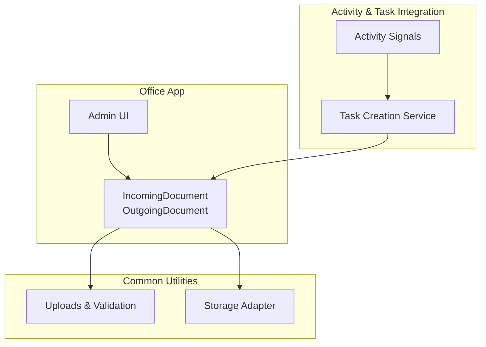
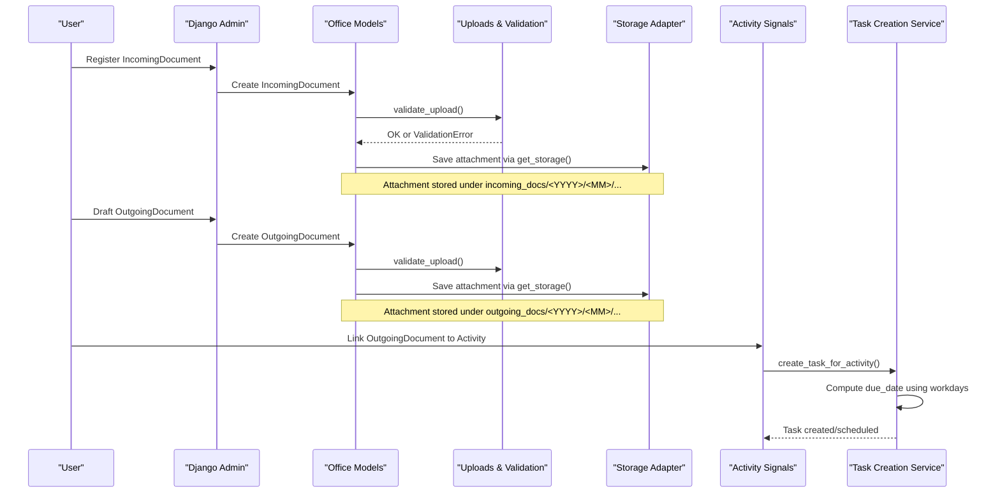
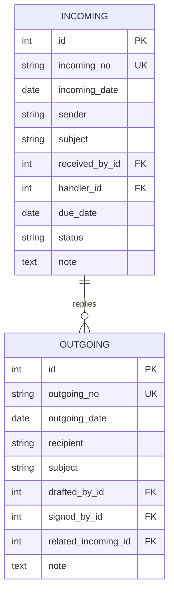
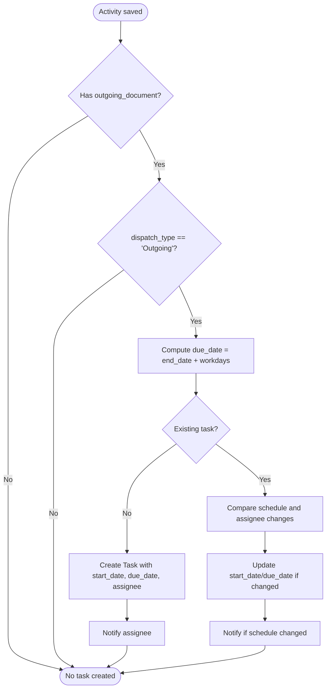
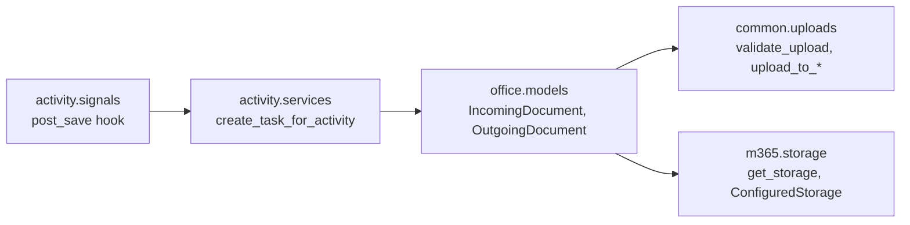

# Document Workflow Management

<cite>
**Referenced Files in This Document**
- [models.py](file://src/apps/office/models.py)
- [admin.py](file://src/apps/office/admin.py)
- [uploads.py](file://src/apps/common/uploads.py)
- [storage.py](file://src/apps/m365/storage.py)
- [signals.py](file://src/apps/activity/signals.py)
- [services.py](file://src/apps/activity/services.py)
- [tests_db_search.py](file://src/apps/assistant/tests_db_search.py)
</cite>

## Table of Contents
1. [Introduction](#introduction)
2. [Project Structure](#project-structure)
3. [Core Components](#core-components)
4. [Architecture Overview](#architecture-overview)
5. [Detailed Component Analysis](#detailed-component-analysis)
6. [Dependency Analysis](#dependency-analysis)
7. [Performance Considerations](#performance-considerations)
8. [Troubleshooting Guide](#troubleshooting-guide)
9. [Conclusion](#conclusion)

## Introduction
This document explains the document workflow management for IncomingDocument and OutgoingDocument, covering the full lifecycle from receipt to completion, outgoing creation and signing, reply tracking, routing, handler assignment, due date tracking, attachments, and compliance reporting. It also provides practical examples for registering incoming documents, drafting outgoing correspondence, and managing attachments.

## Project Structure
The document workflow is implemented primarily in the office application with supporting utilities for uploads and storage, and integration points with activity/task scheduling.

**Diagram sources**
- [models.py:13-77](file://src/apps/office/models.py#L13-L77)
- [admin.py:13-27](file://src/apps/office/admin.py#L13-L27)
- [uploads.py:72-85](file://src/apps/common/uploads.py#L72-L85)
- [storage.py:79-98](file://src/apps/m365/storage.py#L79-L98)
- [signals.py:8-20](file://src/apps/activity/signals.py#L8-L20)
- [services.py:101-195](file://src/apps/activity/services.py#L101-L195)

**Section sources**
- [models.py:13-77](file://src/apps/office/models.py#L13-L77)
- [admin.py:13-27](file://src/apps/office/admin.py#L13-L27)

## Core Components
- IncomingDocument: Represents an incoming official document with fields for unique number, received date, sender, subject, receiver, assigned handler, due date, attachment, status, and notes. Status progresses through New, Processing, Done.
- OutgoingDocument: Represents an outgoing official document with fields for unique number, issued date, recipient, subject, drafter, signer, related incoming document (for reply tracking), attachment, and notes.
- Uploads and Storage: Centralized validation and path generation for attachments; storage adapter supports local or SharePoint-based storage.
- Activity and Task Integration: Linking an outgoing document to an activity triggers task creation and due-date calculation based on company workdays.

Key responsibilities:
- IncomingDocument tracks intake, assignment, deadlines, and completion.
- OutgoingDocument captures authorship, authorization, and reply linkage.
- Attachments are validated and stored securely with normalized names and size limits.
- Activity signals ensure downstream tasks are created and scheduled when activities reference outgoing documents.

**Section sources**
- [models.py:13-77](file://src/apps/office/models.py#L13-L77)
- [uploads.py:106-124](file://src/apps/common/uploads.py#L106-L124)
- [storage.py:79-98](file://src/apps/m365/storage.py#L79-L98)
- [signals.py:8-20](file://src/apps/activity/signals.py#L8-L20)
- [services.py:101-195](file://src/apps/activity/services.py#L101-L195)

## Architecture Overview
The document workflow integrates data models, admin interfaces, file handling, and activity-driven task scheduling.

**Diagram sources**
- [admin.py:13-27](file://src/apps/office/admin.py#L13-L27)
- [models.py:13-77](file://src/apps/office/models.py#L13-L77)
- [uploads.py:106-124](file://src/apps/common/uploads.py#L106-L124)
- [storage.py:79-98](file://src/apps/m365/storage.py#L79-L98)
- [signals.py:8-20](file://src/apps/activity/signals.py#L8-L20)
- [services.py:101-195](file://src/apps/activity/services.py#L101-L195)

## Detailed Component Analysis

### IncomingDocument Lifecycle
Lifecycle stages:
- Receipt: Record incoming_no, incoming_date, sender, subject, received_by.
- Assignment: Assign handler and due_date for processing.
- Processing: Update status to Processing while working on the document.
- Completion: Mark status as Done after resolution; optionally add notes.

Routing and handler assignment:
- Handler field allows assigning a responsible employee.
- Due date enables deadline tracking and follow-up.

Status progression:
- New → Processing → Done.

Attachments:
- Optional FileField with upload_to_incoming_docs and validate_upload.
- Stored under incoming_docs/<YYYY>/<MM>/ with normalized filenames and random suffixes.

Compliance and audit:
- Inherits BaseAuditModel for created_by, modified_by, deleted_by, timestamps.
- Admin interface restricts view/edit roles to office roles and director where configured.

Example usage patterns:
- Register an incoming document: set incoming_no, incoming_date, sender, subject, received_by; optionally attach a file and set handler/due_date/status/note.
- Track processing: update handler and due_date; change status to Processing; later mark Done.

**Section sources**
- [models.py:13-44](file://src/apps/office/models.py#L13-L44)
- [admin.py:13-19](file://src/apps/office/admin.py#L13-L19)
- [uploads.py:80-85](file://src/apps/common/uploads.py#L80-L85)
- [uploads.py:106-124](file://src/apps/common/uploads.py#L106-L124)
- [storage.py:79-98](file://src/apps/m365/storage.py#L79-L98)

### OutgoingDocument Creation, Signing, and Distribution
Creation:
- Set outgoing_no, outgoing_date, recipient, subject, drafted_by, signed_by.
- Optionally link related_incoming to track replies to an incoming document.
- Attach supporting files via OutgoingDocument.attachment.

Signing workflow:
- signed_by is required and protected; ensures accountability for issuance.

Distribution process:
- After signing, the outgoing document can be linked to an activity to trigger downstream reporting tasks.
- The system computes report due dates based on company workdays relative to the activity’s end date.

Reply tracking:
- related_incoming connects an outgoing document back to its source incoming document.
- IncomingDocument.outgoing_replies provides reverse lookup to all replies.

Example usage patterns:
- Draft an outgoing document: fill core fields, select drafter and signer, attach any supporting file.
- Reply to an incoming document: set related_incoming to the original IncomingDocument.
- Integrate with activity: link the outgoing document to an activity so that a reporting task is automatically created and scheduled.

**Section sources**
- [models.py:46-77](file://src/apps/office/models.py#L46-L77)
- [services.py:101-195](file://src/apps/activity/services.py#L101-L195)
- [signals.py:8-20](file://src/apps/activity/signals.py#L8-L20)

### Relationship Between Incoming and Outgoing Documents
- One-to-many relationship: IncomingDocument has multiple OutgoingDocument replies via related_incoming.
- Reverse relation: IncomingDocument.outgoing_replies lists all outgoing replies.
- Use cases:
  - Trace response history for a given incoming document.
  - Ensure every important incoming document has at least one outgoing reply if required by policy.

**Diagram sources**
- [models.py:13-77](file://src/apps/office/models.py#L13-L77)

**Section sources**
- [models.py:59-62](file://src/apps/office/models.py#L59-L62)

### Document Routing, Handler Assignments, and Due Date Tracking
- IncomingDocument.handler assigns responsibility for processing.
- IncomingDocument.due_date sets the deadline for completion.
- Admin filters and search support quick identification of pending items and overdue tasks.
- Status field indicates current stage; combine with due_date for SLA monitoring.

Reporting and compliance:
- Audit fields capture who created, modified, or deleted records.
- Admin role restrictions ensure only authorized users can view or edit sensitive documents.

**Section sources**
- [models.py:13-44](file://src/apps/office/models.py#L13-L44)
- [admin.py:13-19](file://src/apps/office/admin.py#L13-L19)

### Managing Document Attachments
Validation:
- Allowed extensions include common document and image formats; size limit enforced.
- Custom PDF validation exists elsewhere for specific workflows.

Storage:
- Incoming documents use upload_to_incoming_docs; outgoing documents use upload_to_outgoing_docs.
- Storage adapter abstracts local vs SharePoint storage; URLs are resolved through private_file_url.

Path normalization:
- Filenames are slugified, lowercased, and appended with a short UUID to avoid collisions.
- Organized by year/month folders for easy retrieval and archival.

Security:
- Access to stored files is controlled via private URL generation.

**Section sources**
- [uploads.py:20-35](file://src/apps/common/uploads.py#L20-L35)
- [uploads.py:38-59](file://src/apps/common/uploads.py#L38-L59)
- [uploads.py:80-85](file://src/apps/common/uploads.py#L80-L85)
- [uploads.py:106-124](file://src/apps/common/uploads.py#L106-L124)
- [storage.py:62-98](file://src/apps/m365/storage.py#L62-L98)

### Activity and Task Integration for Outgoing Documents
When an activity references an outgoing document:
- A signal listener creates or updates a reporting task.
- Due date is calculated as activity.end_date plus a configured number of company workdays.
- If the activity schedule changes, the task is rescheduled accordingly.
- Notifications are sent to assignees when tasks are created or rescheduled.

**Diagram sources**
- [signals.py:8-20](file://src/apps/activity/signals.py#L8-L20)
- [services.py:101-195](file://src/apps/activity/services.py#L101-L195)

**Section sources**
- [signals.py:8-20](file://src/apps/activity/signals.py#L8-L20)
- [services.py:101-195](file://src/apps/activity/services.py#L101-L195)

## Dependency Analysis

**Diagram sources**
- [models.py:13-77](file://src/apps/office/models.py#L13-L77)
- [uploads.py:80-85](file://src/apps/common/uploads.py#L80-L85)
- [storage.py:79-98](file://src/apps/m365/storage.py#L79-L98)
- [signals.py:8-20](file://src/apps/activity/signals.py#L8-L20)
- [services.py:101-195](file://src/apps/activity/services.py#L101-L195)

**Section sources**
- [models.py:13-77](file://src/apps/office/models.py#L13-L77)
- [uploads.py:80-85](file://src/apps/common/uploads.py#L80-L85)
- [storage.py:79-98](file://src/apps/m365/storage.py#L79-L98)
- [signals.py:8-20](file://src/apps/activity/signals.py#L8-L20)
- [services.py:101-195](file://src/apps/activity/services.py#L101-L195)

## Performance Considerations
- Attachment validation occurs early to reject invalid or oversized files before storage writes.
- Storage abstraction avoids tight coupling to backend implementation, enabling efficient switching between local and remote storage without model changes.
- Task creation uses get_or_create semantics to minimize redundant database operations and notifications.
- Workday-based due date calculation centralizes scheduling logic, reducing repeated computations across services.

[No sources needed since this section provides general guidance]

## Troubleshooting Guide
Common issues and resolutions:
- Invalid attachment format or size:
  - Cause: Uploaded file extension not allowed or exceeds maximum size.
  - Resolution: Use allowed extensions and keep files under the configured limit.
- Missing signer on outgoing document:
  - Cause: signed_by is required.
  - Resolution: Assign a valid signer before saving.
- No task created for activity:
  - Cause: Activity does not have an outgoing document or dispatch type is not Outgoing.
  - Resolution: Link a valid OutgoingDocument to the activity.
- Reply not visible under incoming document:
  - Cause: related_incoming not set on the outgoing document.
  - Resolution: Set related_incoming to the correct IncomingDocument.

Operational checks:
- Verify admin permissions for viewing/editing documents.
- Confirm storage configuration for incoming/outgoing directories.
- Review audit fields to trace who made changes.

**Section sources**
- [uploads.py:106-124](file://src/apps/common/uploads.py#L106-L124)
- [models.py:46-77](file://src/apps/office/models.py#L46-L77)
- [admin.py:13-27](file://src/apps/office/admin.py#L13-L27)

## Conclusion
IncomingDocument and OutgoingDocument provide a robust foundation for official document management. The models enforce clear lifecycles, secure attachment handling, and accountable signing. Reply tracking links outgoing responses to their originating incoming documents. Integration with activity and task systems automates reporting schedules and notifications, improving operational efficiency and compliance. Admin controls and audit trails support governance and oversight.

[No sources needed since this section summarizes without analyzing specific files]