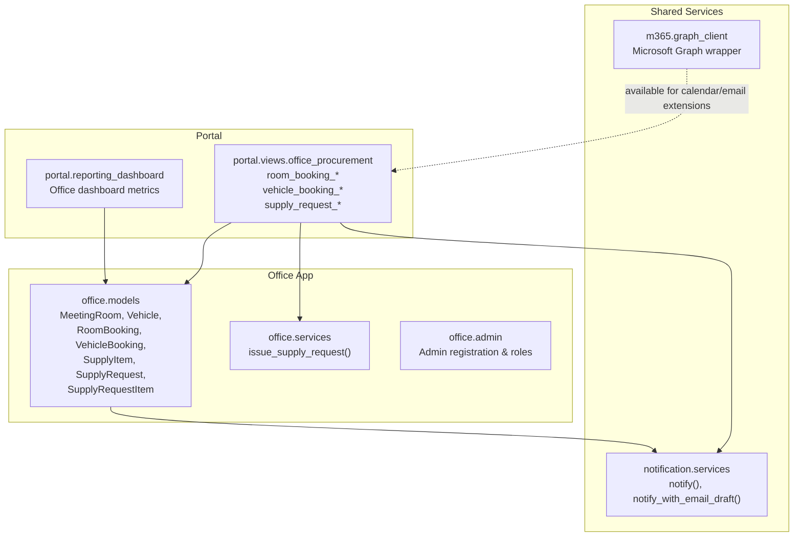
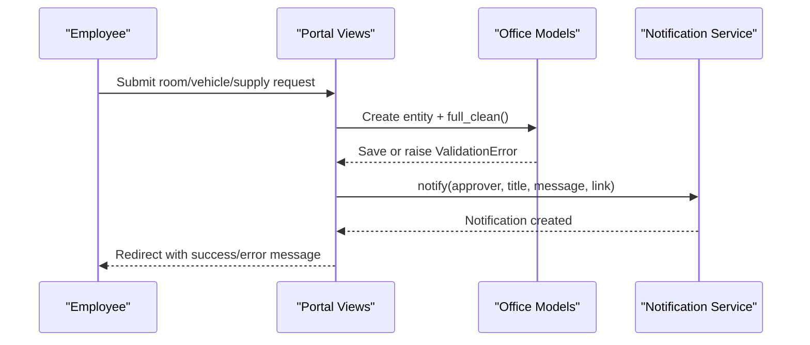
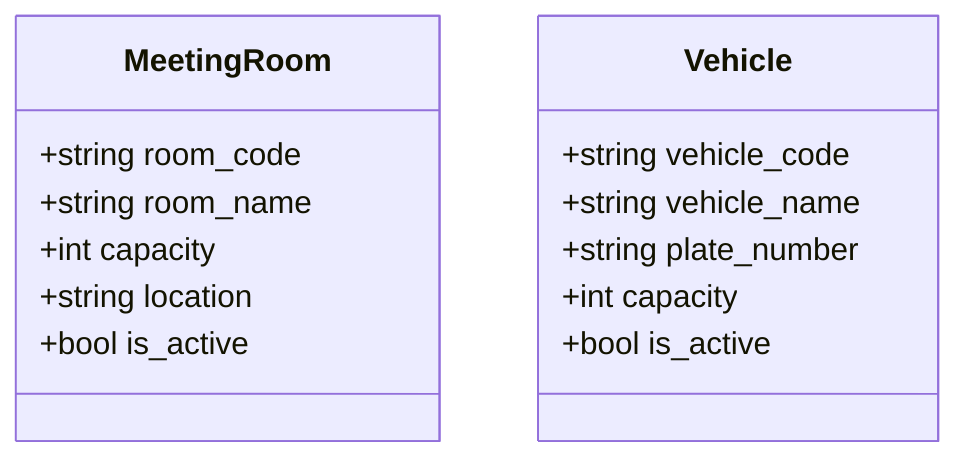
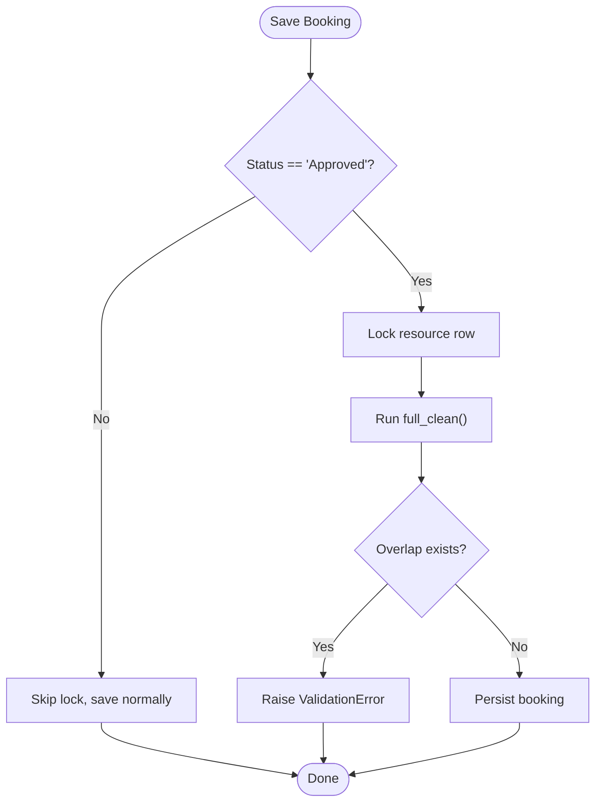
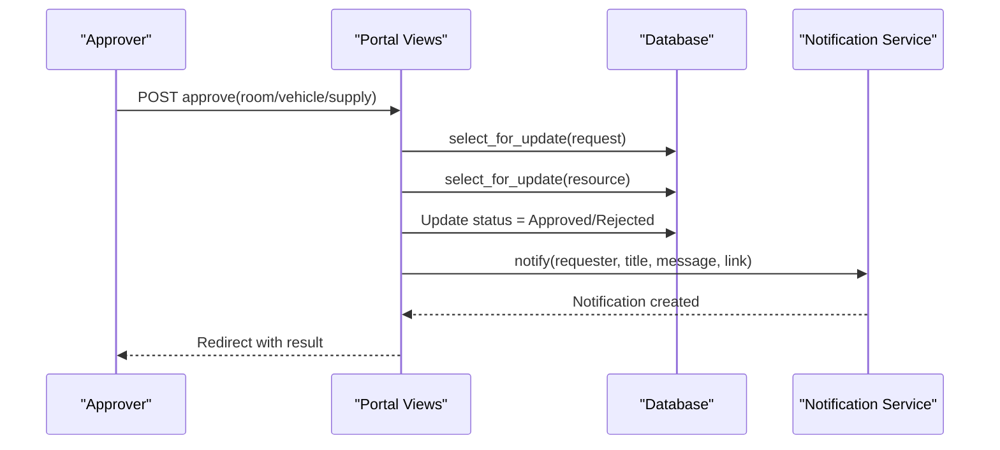
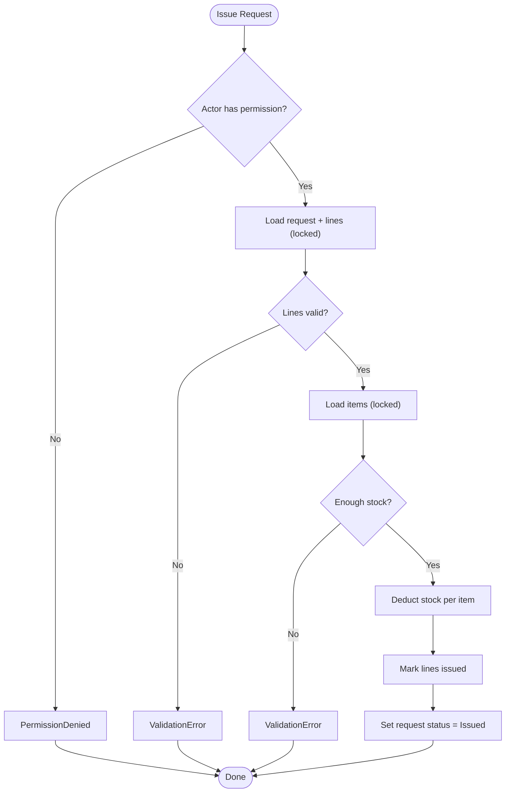
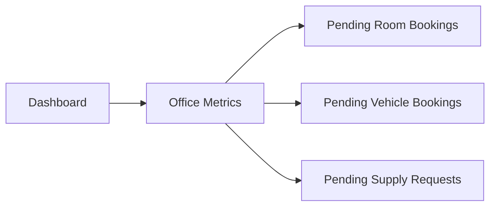
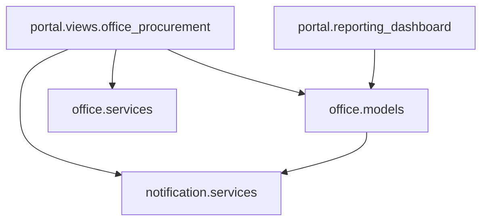
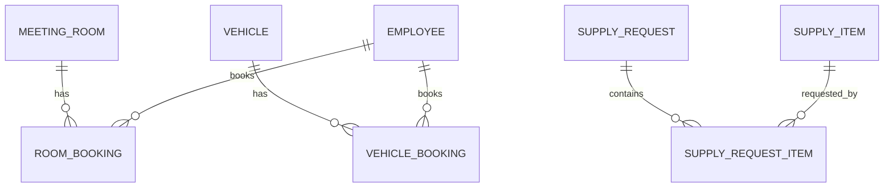

# Office Services

<cite>
**Referenced Files in This Document**   
- [models.py](file://src/apps/office/models.py)
- [services.py](file://src/apps/office/services.py)
- [views.py](file://src/apps/portal/views/office_procurement.py)
- [admin.py](file://src/apps/office/admin.py)
- [tests.py](file://src/apps/office/tests.py)
- [reporting_dashboard.py](file://src/apps/portal/reporting_dashboard.py)
- [notification_services.py](file://src/apps/notification/services.py)
- [graph_client.py](file://src/apps/m365/graph_client.py)
</cite>

## Table of Contents
1. [Introduction](#introduction)
2. [Project Structure](#project-structure)
3. [Core Components](#core-components)
4. [Architecture Overview](#architecture-overview)
5. [Detailed Component Analysis](#detailed-component-analysis)
6. [Dependency Analysis](#dependency-analysis)
7. [Performance Considerations](#performance-considerations)
8. [Troubleshooting Guide](#troubleshooting-guide)
9. [Conclusion](#conclusion)
10. [Appendices](#appendices)

## Introduction
This document explains the office services that manage shared resources and administrative workflows: meeting room bookings, vehicle bookings, and supply requests. It covers the data models, approval flows, conflict resolution, capacity checks, notification behavior, reporting hooks, and integration points with Microsoft 365. The goal is to help both technical and non-technical users understand how resources are reserved, approved, issued, and reported.

## Project Structure
The office domain lives under the `office` Django app, while user-facing booking and request flows are implemented in the portal views. Notifications are handled by a shared notification service, and Microsoft Graph capabilities are available through the M365 client.

**Diagram sources**
- [models.py:84-269](file://src/apps/office/models.py#L84-L269)
- [services.py:10-45](file://src/apps/office/services.py#L10-L45)
- [views.py:36-366](file://src/apps/portal/views/office_procurement.py#L36-L366)
- [reporting_dashboard.py:104-111](file://src/apps/portal/reporting_dashboard.py#L104-L111)
- [notification_services.py:18-77](file://src/apps/notification/services.py#L18-L77)
- [graph_client.py:57-96](file://src/apps/m365/graph_client.py#L57-L96)

**Section sources**
- [models.py:84-269](file://src/apps/office/models.py#L84-L269)
- [views.py:36-366](file://src/apps/portal/views/office_procurement.py#L36-L366)
- [notification_services.py:18-77](file://src/apps/notification/services.py#L18-L77)
- [graph_client.py:57-96](file://src/apps/m365/graph_client.py#L57-L96)

## Core Components
The office module defines three main resource domains:

- Meeting rooms and vehicles as shared resources.
- Room and vehicle reservations with approval workflows.
- Office supplies inventory with request, approval, and issuance.

Key responsibilities:
- Models enforce validation, status choices, and conflict detection.
- Portal views implement creation, cancellation, approval, and issuance.
- A shared service atomically issues supplies against stock levels.
- Dashboard queries expose pending counts for operational visibility.

**Section sources**
- [models.py:84-269](file://src/apps/office/models.py#L84-L269)
- [views.py:36-366](file://src/apps/portal/views/office_procurement.py#L36-L366)
- [services.py:10-45](file://src/apps/office/services.py#L10-L45)
- [reporting_dashboard.py:104-111](file://src/apps/portal/reporting_dashboard.py#L104-L111)

## Architecture Overview
The system follows a layered pattern:

- Presentation layer: Portal views render lists, forms, and approval pages.
- Business layer: Model validation and service functions encapsulate rules.
- Data layer: Django ORM persists entities and constraints.
- Cross-cutting: Notification service records in-app notices and optional email drafts; M365 Graph client is available for future calendar/email integrations.

**Diagram sources**
- [views.py:50-75](file://src/apps/portal/views/office_procurement.py#L50-L75)
- [views.py:155-180](file://src/apps/portal/views/office_procurement.py#L155-L180)
- [views.py:252-298](file://src/apps/portal/views/office_procurement.py#L252-L298)
- [notification_services.py:18-29](file://src/apps/notification/services.py#L18-L29)

## Detailed Component Analysis

### Resource Models: MeetingRoom and Vehicle
These are the base resources that can be booked. They include identifiers, names, capacity, and active flags.

- MeetingRoom: room code, name, capacity, location, active flag.
- Vehicle: vehicle code, name, plate number, seating capacity, active flag.

Capacity management:
- Capacity fields exist on resources but are not enforced during booking validation in the current implementation.
- Future enhancements could add capacity checks based on attendee lists.

**Diagram sources**
- [models.py:84-113](file://src/apps/office/models.py#L84-L113)

**Section sources**
- [models.py:84-113](file://src/apps/office/models.py#L84-L113)

### Booking Models: RoomBooking and VehicleBooking
Both models represent time-bound reservations for shared resources. They share a common save mixin that serializes approvals and enforces overlap checks when a booking becomes approved.

Common behaviors:
- Statuses include Pending, Approved, Rejected, Cancelled.
- Overlap validation prevents two approved bookings from overlapping on the same resource.
- Save mixin locks the resource row before saving an approved booking to prevent race conditions.

Conflict resolution:
- Validation rejects overlapping time ranges for the same resource if another booking is already Approved.
- Approvals use database-level locking (`select_for_update`) around the resource and booking rows to avoid concurrent double-approval.

**Diagram sources**
- [models.py:116-144](file://src/apps/office/models.py#L116-L144)
- [models.py:147-211](file://src/apps/office/models.py#L147-L211)
- [views.py:100-137](file://src/apps/portal/views/office_procurement.py#L100-L137)
- [views.py:205-238](file://src/apps/portal/views/office_procurement.py#L205-L238)

#### RoomBooking
- Fields: room, employee, purpose, start_time, end_time, status.
- Validation ensures end_time > start_time and no overlap with existing approved bookings on the same room.

#### VehicleBooking
- Fields: vehicle, employee, destination, purpose, start_time, end_time, status.
- Validation ensures end_time > start_time and no overlap with existing approved bookings on the same vehicle.

**Section sources**
- [models.py:147-211](file://src/apps/office/models.py#L147-L211)
- [views.py:100-137](file://src/apps/portal/views/office_procurement.py#L100-L137)
- [views.py:205-238](file://src/apps/portal/views/office_procurement.py#L205-L238)
- [tests.py:84-112](file://src/apps/office/tests.py#L84-L112)

### Approval Workflows
Approval is required for all three domains. Approvers are employees with the `approve_office_request` permission.

- Room booking approval:
  - View loads pending bookings, locks the related room, then updates status to Approved or Rejected.
  - After decision, notifies the requester via the notification service.

- Vehicle booking approval:
  - Same pattern as room booking, with vehicle locking and requester notification.

- Supply request approval:
  - View updates request status to Approved or Rejected.
  - Notifies the requester after decision.

**Diagram sources**
- [views.py:100-137](file://src/apps/portal/views/office_procurement.py#L100-L137)
- [views.py:205-238](file://src/apps/portal/views/office_procurement.py#L205-L238)
- [views.py:315-340](file://src/apps/portal/views/office_procurement.py#L315-L340)
- [notification_services.py:18-29](file://src/apps/notification/services.py#L18-L29)

**Section sources**
- [views.py:90-137](file://src/apps/portal/views/office_procurement.py#L90-L137)
- [views.py:195-238](file://src/apps/portal/views/office_procurement.py#L195-L238)
- [views.py:302-340](file://src/apps/portal/views/office_procurement.py#L302-L340)

### Supply Management: SupplyItem, SupplyRequest, SupplyRequestItem
Supply items track inventory quantities and minimum alert thresholds. Requests contain one or more line items with requested and issued quantities.

- SupplyItem: item code, name, unit, quantity_in_stock, min_stock_alert.
- SupplyRequest: request number, employee, request date, status (Pending, Approved, Issued, Rejected).
- SupplyRequestItem: links to a request and item, tracks requested and issued quantities.

Issuance process:
- Only actors with `approve_office_request` can issue.
- The service locks the request and its lines, validates quantities, calculates total outstanding per item, locks corresponding inventory items, subtracts stock, marks lines fully issued, and sets request status to Issued.

**Diagram sources**
- [services.py:10-45](file://src/apps/office/services.py#L10-L45)
- [views.py:345-366](file://src/apps/portal/views/office_procurement.py#L345-L366)

**Section sources**
- [models.py:218-269](file://src/apps/office/models.py#L218-L269)
- [services.py:10-45](file://src/apps/office/services.py#L10-L45)
- [views.py:242-366](file://src/apps/portal/views/office_procurement.py#L242-L366)

### Examples of Booking Resources and Processing Requests
- Room booking example:
  - Employee submits a room, purpose, and time range.
  - System creates a Pending booking and notifies approvers.
  - Approver approves or rejects; requester receives a notification.

- Vehicle booking example:
  - Employee selects a vehicle, destination, purpose, and time range.
  - System creates a Pending booking and notifies approvers.
  - Approver approves or rejects; requester receives a notification.

- Supply request example:
  - Employee selects one or more items with positive quantities.
  - System creates a Pending request with line items and notifies approvers.
  - Approver approves; admin issues stock, reducing inventory and marking request Issued.

**Section sources**
- [views.py:50-75](file://src/apps/portal/views/office_procurement.py#L50-L75)
- [views.py:155-180](file://src/apps/portal/views/office_procurement.py#L155-L180)
- [views.py:252-298](file://src/apps/portal/views/office_procurement.py#L252-L298)
- [views.py:315-366](file://src/apps/portal/views/office_procurement.py#L315-L366)

### Integration with Calendar Systems and Email Notifications
Current implementation:
- In-app notifications are created using the notification service for approvals and issuances.
- There is no direct calendar event creation in the office booking views.
- Microsoft Graph client is available in the project for file operations and search; it can be extended to create calendar events or send emails if needed.

Email draft capability:
- The notification service supports creating email drafts alongside in-app notices, with idempotency keys to prevent duplicates.

Recommendations:
- Extend booking approval flows to call a calendar integration function that creates events for Approved bookings.
- Use `notify_with_email_draft` to generate Outlook drafts for confirmation and reminders.

**Section sources**
- [notification_services.py:18-77](file://src/apps/notification/services.py#L18-L77)
- [graph_client.py:57-96](file://src/apps/m365/graph_client.py#L57-L96)

### Capacity Management, Recurring Bookings, and Maintenance Scheduling
- Capacity management:
  - Resources have capacity fields, but booking validation does not enforce attendee limits.
  - To support capacity management, add attendee lists to bookings and validate against resource capacity during `clean()` or approval.

- Recurring bookings:
  - Current models do not include recurrence patterns.
  - To support recurring bookings, add fields such as recurrence rule, end date, and generated instances, plus conflict checks across all instances.

- Maintenance scheduling:
  - No maintenance schedule model exists in the office app.
  - Consider adding a maintenance window model linked to resources, blocking bookings during maintenance periods.

[No sources needed since this section provides general guidance]

### Reporting Capabilities
The portal dashboard includes office metrics:
- Pending room bookings.
- Pending vehicle bookings.
- Pending supply requests.

These counts provide quick operational visibility into backlog and workload.

**Diagram sources**
- [reporting_dashboard.py:104-111](file://src/apps/portal/reporting_dashboard.py#L104-L111)

**Section sources**
- [reporting_dashboard.py:104-111](file://src/apps/portal/reporting_dashboard.py#L104-L111)

## Dependency Analysis
The following diagram shows key dependencies between components:

**Diagram sources**
- [views.py:1-23](file://src/apps/portal/views/office_procurement.py#L1-L23)
- [services.py:1-7](file://src/apps/office/services.py#L1-L7)
- [reporting_dashboard.py:104-111](file://src/apps/portal/reporting_dashboard.py#L104-L111)
- [notification_services.py:1-5](file://src/apps/notification/services.py#L1-L5)

**Section sources**
- [views.py:1-23](file://src/apps/portal/views/office_procurement.py#L1-L23)
- [services.py:1-7](file://src/apps/office/services.py#L1-L7)
- [reporting_dashboard.py:104-111](file://src/apps/portal/reporting_dashboard.py#L104-L111)
- [notification_services.py:1-5](file://src/apps/notification/services.py#L1-L5)

## Performance Considerations
- Database locking:
  - Approvals use `transaction.atomic()` and `select_for_update()` to serialize concurrent decisions and prevent race conditions.
  - Supply issuance locks both the request and inventory items to ensure consistent stock deductions.

- Validation overhead:
  - Model `clean()` methods perform overlap checks; these are efficient for typical office workloads but should be monitored if high concurrency is expected.

- Notification batching:
  - The notification service supports bulk creation for multiple recipients, reducing database writes.

- Calendar/email integration:
  - If extending to Microsoft Graph, consider caching tokens and batching operations to minimize API calls.

[No sources needed since this section provides general guidance]

## Troubleshooting Guide
Common issues and resolutions:

- Overlap errors when saving bookings:
  - Cause: Attempting to approve or save a booking that overlaps with another approved booking on the same resource.
  - Resolution: Adjust time slots or reject conflicting bookings.

- Resource deletion during approval:
  - Cause: The underlying resource was deleted while a booking was being approved.
  - Resolution: Reload the page and re-select the resource; the save mixin raises a validation error if the resource no longer exists.

- Permission denied when issuing supplies:
  - Cause: Actor lacks `approve_office_request` permission.
  - Resolution: Assign appropriate permissions to the actor.

- Insufficient stock when issuing supplies:
  - Cause: Inventory levels are lower than the outstanding requested quantities.
  - Resolution: Increase stock or reduce requested quantities; review request lines.

- Duplicate notifications:
  - Cause: Multiple handlers attempt to send the same notification.
  - Resolution: Use idempotency keys in `notify_with_email_draft` to prevent duplicates.

**Section sources**
- [models.py:116-144](file://src/apps/office/models.py#L116-L144)
- [models.py:167-174](file://src/apps/office/models.py#L167-L174)
- [models.py:201-208](file://src/apps/office/models.py#L201-L208)
- [services.py:10-45](file://src/apps/office/services.py#L10-L45)
- [notification_services.py:32-77](file://src/apps/notification/services.py#L32-L77)

## Conclusion
The office services provide robust models and workflows for managing meeting rooms, vehicles, and office supplies. Validation and database locking protect against conflicts and race conditions. Notifications keep stakeholders informed, and the dashboard exposes pending workloads. While calendar integration and advanced capacity features are not yet implemented, the architecture supports extension through the notification service and Microsoft Graph client.

[No sources needed since this section summarizes without analyzing specific files]

## Appendices

### Appendix A: Model Relationships

**Diagram sources**
- [models.py:147-269](file://src/apps/office/models.py#L147-L269)

### Appendix B: Admin Access Control
Admin interfaces restrict editing and viewing to specific roles.

**Section sources**
- [admin.py:1-40](file://src/apps/office/admin.py#L1-L40)