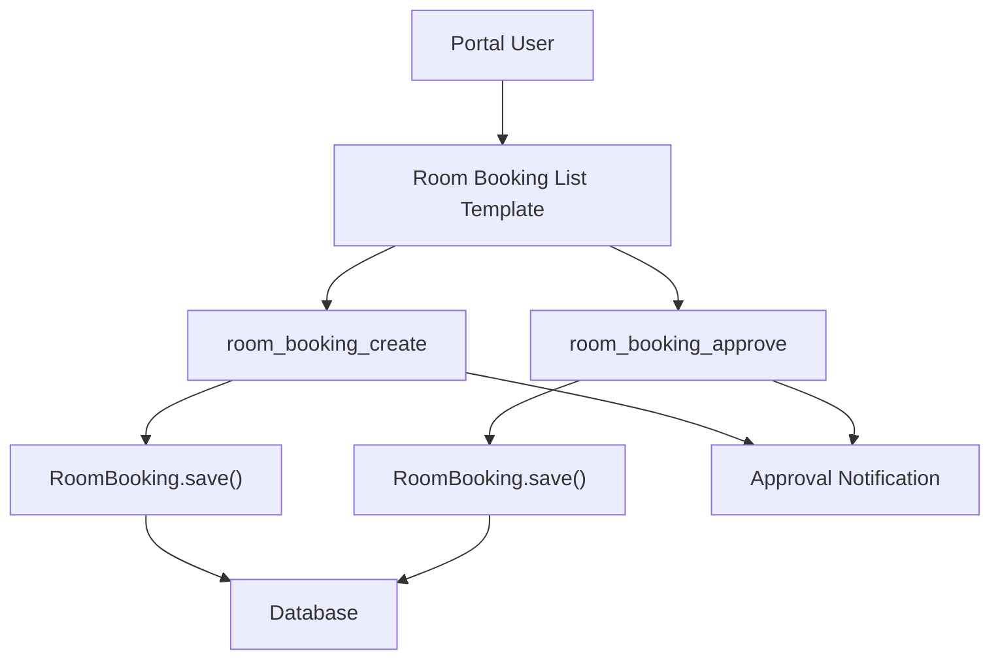
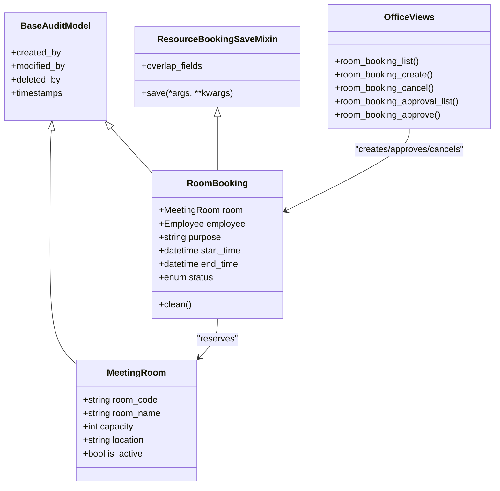
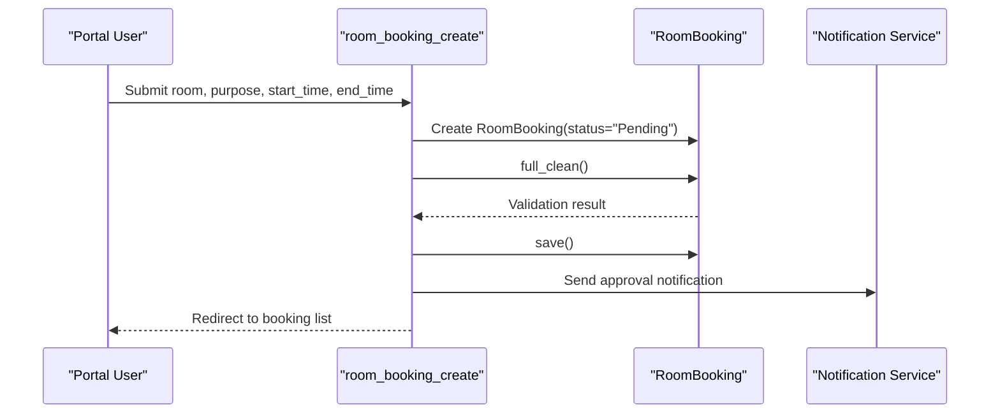
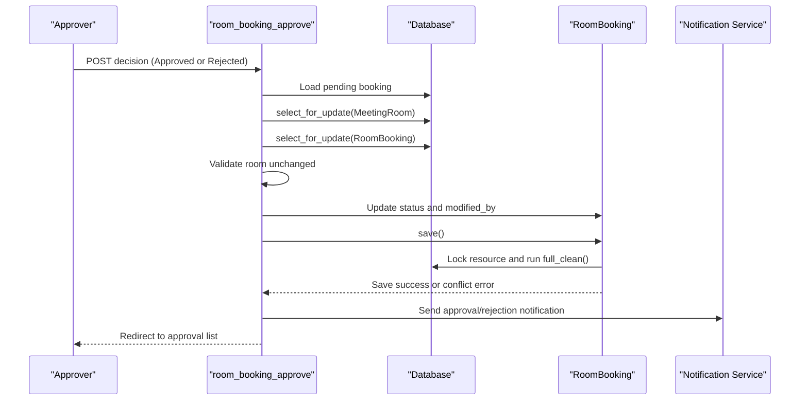
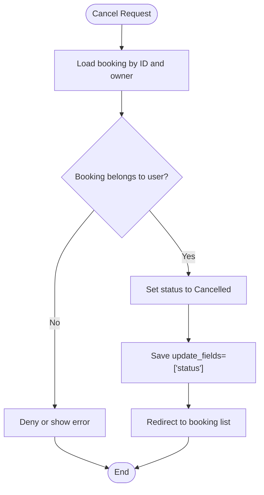
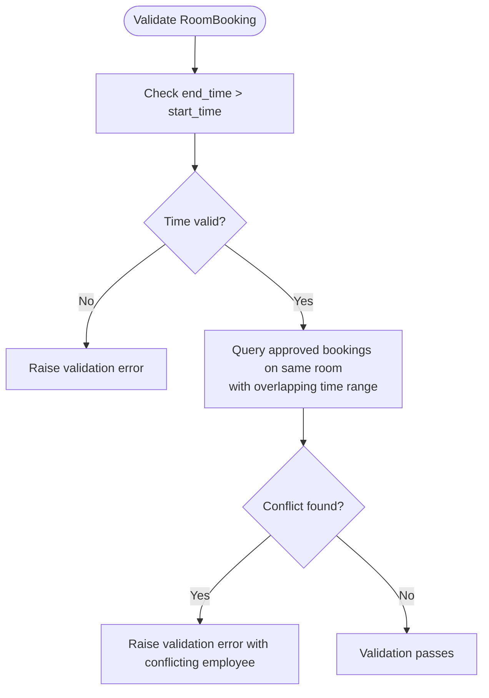
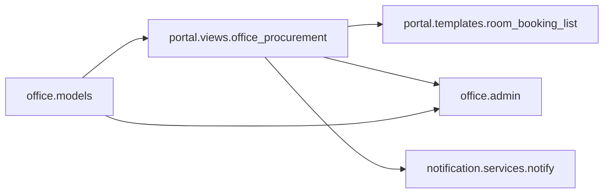

# Room Booking System

<cite>
**Referenced Files in This Document**
- [models.py](file://src/apps/office/models.py)
- [office_procurement.py](file://src/apps/portal/views/office_procurement.py)
- [admin.py](file://src/apps/office/admin.py)
- [room_booking_list.html](file://src/apps/portal/templates/portal/room_booking_list.html)
- [tests.py](file://src/apps/office/tests.py)
</cite>

## Table of Contents
1. [Introduction](#introduction)
2. [Project Structure](#project-structure)
3. [Core Components](#core-components)
4. [Architecture Overview](#architecture-overview)
5. [Detailed Component Analysis](#detailed-component-analysis)
6. [Dependency Analysis](#dependency-analysis)
7. [Performance Considerations](#performance-considerations)
8. [Troubleshooting Guide](#troubleshooting-guide)
9. [Conclusion](#conclusion)
10. [Appendices](#appendices)

## Introduction
This document explains the room booking system implemented for the office resource module. It focuses on two core domain models:

- `MeetingRoom`: represents a physical meeting room with capacity, location, and active status.
- `RoomBooking`: represents an employee’s request to reserve a meeting room during a specific time window.

The system supports:

- Room resource management with capacity and location metadata.
- A booking workflow from submission through approval to confirmation or cancellation.
- Conflict resolution that prevents double bookings within overlapping time slots.
- Concurrent access protection using database-level locking around shared resources.
- A reusable serialization and validation pattern via `ResourceBookingSaveMixin`.
- Portal-based user interfaces for creating, listing, cancelling, and approving bookings.

Recurring meetings and calendar integrations are not currently implemented by these models; this is noted in the appendices as future scope.

## Project Structure
The room booking feature lives under the `office` application and is exposed through the portal layer:

**Diagram sources**
- [office_procurement.py:36-75](file://src/apps/portal/views/office_procurement.py#L36-L75)
- [office_procurement.py:98-137](file://src/apps/portal/views/office_procurement.py#L98-L137)
- [models.py:116-177](file://src/apps/office/models.py#L116-L177)

**Section sources**
- [office_procurement.py:36-75](file://src/apps/portal/views/office_procurement.py#L36-L75)
- [office_procurement.py:98-137](file://src/apps/portal/views/office_procurement.py#L98-L137)
- [models.py:84-177](file://src/apps/office/models.py#L84-L177)

## Core Components
The room booking system is built around three main pieces:

| Component | Responsibility | Key Fields / Behavior |
|---|---|---|
| `MeetingRoom` | Defines a bookable meeting room resource | Unique code, name, capacity, optional location, active flag |
| `RoomBooking` | Represents a scheduled reservation request | Room link, employee, purpose, start/end times, status |
| `ResourceBookingSaveMixin` | Protects concurrent approvals and enforces conflict checks when a booking becomes approved | Locks the related resource row, runs full validation, blocks overlapping approved bookings |

### MeetingRoom
`MeetingRoom` is the base resource model for meeting rooms. Its important attributes include:

- `room_code`: unique identifier for the room.
- `room_name`: human-readable room name.
- `capacity`: maximum number of attendees.
- `location`: optional textual location description.
- `is_active`: whether the room is available for booking.

The model inherits audit fields from `BaseAuditModel`, so creation, modification, deletion, and timestamps are tracked.

**Section sources**
- [models.py:84-98](file://src/apps/office/models.py#L84-L98)

### RoomBooking
`RoomBooking` captures a request to use a meeting room. Important aspects:

- Links to a `MeetingRoom` and an `hrm.Employee`.
- Stores the meeting purpose and exact start/end datetimes.
- Tracks lifecycle status: `Pending`, `Approved`, `Rejected`, `Cancelled`.
- Validates that end time is after start time.
- Prevents overlapping approved bookings on the same room.
- Inherits audit fields and ordering by start time.

**Section sources**
- [models.py:147-177](file://src/apps/office/models.py#L147-L177)

### ResourceBookingSaveMixin
`ResourceBookingSaveMixin` centralizes safe saving behavior for resource reservations such as rooms and vehicles. Its key behaviors:

- Only applies extra protection when the booking status is `Approved`.
- Skips expensive revalidation for partial saves that cannot change the booking window.
- Uses a transactional block.
- Locks the related resource row with `select_for_update()` before validating and saving.
- Raises a validation error if the referenced resource no longer exists.
- Runs `full_clean()` so model-level conflict checks run at save time, not only at create time.

This pattern ensures that even administrative writes or direct model updates remain safe against race conditions.

**Section sources**
- [models.py:116-144](file://src/apps/office/models.py#L116-L144)

## Architecture Overview
The room booking architecture separates concerns across models, views, templates, and admin configuration:

**Diagram sources**
- [models.py:84-177](file://src/apps/office/models.py#L84-L177)
- [office_procurement.py:36-137](file://src/apps/portal/views/office_procurement.py#L36-L137)

## Detailed Component Analysis

### Room Resource Management
`MeetingRoom` provides the foundational data needed to manage meeting rooms:

- Capacity constraints are stored as an integer field. The current implementation does not enforce attendee count at booking time; capacity is metadata rather than a hard constraint.
- Location tracking is supported through an optional text field.
- Availability is controlled by the `is_active` flag. The portal lists only active rooms when presenting booking options.

These properties make it possible to display room details, filter out inactive rooms, and later extend validation to compare expected attendee counts against capacity.

**Section sources**
- [models.py:84-98](file://src/apps/office/models.py#L84-L98)
- [office_procurement.py:36-45](file://src/apps/portal/views/office_procurement.py#L36-L45)

### Booking Workflow
The booking workflow has four major phases:

1. **Submission**: An authenticated user submits a booking request with room, purpose, start time, and end time.
2. **Validation**: The model validates timing and conflicts.
3. **Approval**: Authorized approvers review pending requests and approve or reject them.
4. **Confirmation or Cancellation**: Approved bookings become confirmed; users can cancel eligible bookings.

#### Submission Flow
When a user creates a booking:

- The view constructs a `RoomBooking` instance with status `Pending`.
- `full_clean()` is called to validate business rules.
- The booking is saved.
- Notifications are sent to employees with permission to approve office requests.

**Diagram sources**
- [office_procurement.py:48-75](file://src/apps/portal/views/office_procurement.py#L48-L75)
- [models.py:167-174](file://src/apps/office/models.py#L167-L174)

#### Approval Flow
When an authorized approver approves or rejects a pending booking:

- The view loads the pending booking inside a transaction.
- It locks both the booking row and the related meeting room row.
- It verifies that the room did not change between reads.
- It updates the status and calls `save()`.
- Because the status becomes `Approved`, `ResourceBookingSaveMixin` performs final conflict validation.
- A notification is sent to the requester.

**Diagram sources**
- [office_procurement.py:98-137](file://src/apps/portal/views/office_procurement.py#L98-L137)
- [models.py:116-144](file://src/apps/office/models.py#L116-L144)

#### Cancellation Flow
A user can cancel their own booking while it is still pending or approved:

- The view loads the booking owned by the current employee.
- It sets the status to `Cancelled`.
- It performs a partial save limited to the status field.

**Diagram sources**
- [office_procurement.py:78-86](file://src/apps/portal/views/office_procurement.py#L78-L86)

### Conflict Resolution Mechanisms
Conflict resolution prevents double bookings for the same room during overlapping time windows.

#### Overlap Check Logic
The overlap check is implemented in `RoomBooking.clean()`:

- It requires end time to be after start time.
- It searches for existing approved bookings on the same room.
- It considers two intervals overlapping if one starts before the other ends and ends after the other starts.
- If a conflict exists, it raises a validation error including the conflicting booking’s employee.

**Diagram sources**
- [models.py:167-174](file://src/apps/office/models.py#L167-L174)

#### Concurrency Protection
To prevent race conditions where two approvers approve overlapping bookings simultaneously:

- The approval view wraps the operation in `transaction.atomic()`.
- It uses `select_for_update()` on both the target `RoomBooking` and the related `MeetingRoom`.
- It verifies that the room reference did not change between reads.
- When the booking is saved with status `Approved`, `ResourceBookingSaveMixin` again locks the resource and runs `full_clean()`.

This layered approach protects both the web-layer approval path and any direct model writes.

**Section sources**
- [office_procurement.py:108-127](file://src/apps/portal/views/office_procurement.py#L108-L127)
- [models.py:116-144](file://src/apps/office/models.py#L116-L144)
- [models.py:167-174](file://src/apps/office/models.py#L167-L174)

### Examples

#### Creating a Room Booking
To create a room booking:

1. Authenticate as an employee linked to an HR profile.
2. Submit a form containing:
   - Selected room.
   - Purpose.
   - Start time.
   - End time.
3. The system validates the request and creates a `Pending` booking.
4. Approvers receive notifications.

Example inputs:

| Field | Example Value |
|---|---|
| Room | Conference Room A |
| Purpose | Weekly team sync |
| Start time | 2026-10-20 09:00 |
| End time | 2026-10-20 10:00 |

**Section sources**
- [office_procurement.py:48-75](file://src/apps/portal/views/office_procurement.py#L48-L75)
- [models.py:147-177](file://src/apps/office/models.py#L147-L177)

#### Checking Room Availability
Availability is represented by:

- Active rooms listed in the portal.
- Upcoming bookings filtered by status and end time.
- Overlap validation that blocks new approved bookings conflicting with existing approved bookings.

The portal displays upcoming bookings ordered by start time and includes both pending and approved statuses.

**Section sources**
- [office_procurement.py:36-45](file://src/apps/portal/views/office_procurement.py#L36-L45)
- [models.py:167-174](file://src/apps/office/models.py#L167-L174)

#### Handling Booking Approvals
An approver with the required permission can:

- View pending bookings.
- Approve a booking, which triggers conflict validation and sends a confirmation notification.
- Reject a booking, which leaves it rejected without reserving the room.

**Section sources**
- [office_procurement.py:89-137](file://src/apps/portal/views/office_procurement.py#L89-L137)
- [models.py:116-144](file://src/apps/office/models.py#L116-L144)

### ResourceBookingSaveMixin Pattern
`ResourceBookingSaveMixin` is designed to serialize concurrent access to shared resources and protect serialization boundaries:

| Aspect | Behavior |
|---|---|
| Trigger condition | Extra protection runs only when `status == "Approved"` |
| Partial save optimization | Skips revalidation if `update_fields` excludes overlap-affecting fields |
| Transaction boundary | Wraps resource lock, validation, and save in a transaction |
| Resource lock | Uses `select_for_update()` on the related resource row |
| Validation | Calls `full_clean()` to enforce model-level rules |
| Missing resource handling | Raises a validation error if the resource no longer exists |

This mixin is reused by both `RoomBooking` and `VehicleBooking`, making it a shared concurrency and serialization guard.

**Section sources**
- [models.py:116-144](file://src/apps/office/models.py#L116-L144)

### Room Scheduling and Recurring Meetings
Current scheduling capabilities:

- Bookings are point-in-time intervals defined by `start_time` and `end_time`.
- There is no recurring meeting pattern in the models.
- There is no automatic expansion of a single recurring definition into multiple instances.

Future extensions could add:

- A recurring rule field describing frequency, interval, and end condition.
- A service that expands recurring definitions into concrete `RoomBooking` instances.
- Backfill logic to avoid conflicts when expanding recurring patterns.

[No sources needed since this section describes conceptual future scope]

### Calendar Integration
There is no explicit calendar integration in the analyzed files. The system stores booking times but does not directly synchronize with external calendar systems. Potential future integration points include:

- Exporting approved bookings to an external calendar API.
- Importing calendar events into internal bookings.
- Syncing room availability with third-party scheduling tools.

[No sources needed since this section describes conceptual integration scope]

## Dependency Analysis
The room booking system has clear dependencies between models, views, templates, and admin configuration:

**Diagram sources**
- [models.py:84-177](file://src/apps/office/models.py#L84-L177)
- [office_procurement.py:1-24](file://src/apps/portal/views/office_procurement.py#L1-L24)
- [office_procurement.py:36-137](file://src/apps/portal/views/office_procurement.py#L36-L137)
- [admin.py:1-10](file://src/apps/office/admin.py#L1-L10)

**Section sources**
- [models.py:84-177](file://src/apps/office/models.py#L84-L177)
- [office_procurement.py:1-24](file://src/apps/portal/views/office_procurement.py#L1-L24)
- [admin.py:1-10](file://src/apps/office/admin.py#L1-L10)

## Performance Considerations
Key performance characteristics:

- Queries use `select_related("room", "employee")` to reduce N+1 queries when rendering upcoming bookings.
- Ordering by `start_time` keeps the most relevant bookings first.
- Database-level locking (`select_for_update`) serializes concurrent approvals for the same resource, preventing race conditions at the cost of short-term contention.
- Partial saves with `update_fields=["status"]` avoid unnecessary revalidation for simple status updates.

Recommendations:

- Add indexes on frequently queried fields such as `room_id`, `status`, `start_time`, and `end_time` if not already present.
- Monitor lock contention under high approval concurrency.
- Consider pagination for large booking lists.
- Cache active room lists if room metadata changes infrequently.

[No sources needed since this section provides general guidance]

## Troubleshooting Guide

### Common Errors and Causes

| Symptom | Likely Cause | Resolution |
|---|---|---|
| Validation error about end time being before start time | Invalid time range in booking form | Ensure end time is after start time |
| Validation error about room already booked | Overlapping approved booking exists | Choose another time or another room |
| Validation error about missing resource | Related room was deleted or changed during approval | Reload the page and resubmit the approval |
| Approval fails due to changed room | Room reference changed between reads | Refresh the approval page and retry |
| Booking remains pending after approval attempt | Conflict detected during final save | Resolve overlap or choose different slot |

### Debugging Steps

1. Check the booking status in the portal list.
2. Verify that the selected room is active.
3. Inspect overlapping approved bookings for the same room and time window.
4. Review approval logs and notifications.
5. For concurrency issues, reproduce with multiple simultaneous approval attempts and inspect database locks.

**Section sources**
- [office_procurement.py:108-137](file://src/apps/portal/views/office_procurement.py#L108-L137)
- [models.py:116-144](file://src/apps/office/models.py#L116-L144)
- [models.py:167-174](file://src/apps/office/models.py#L167-L174)

## Conclusion
The room booking system provides a solid foundation for managing meeting room reservations. It combines:

- Clear domain models for rooms and bookings.
- A portal-driven workflow for submission, approval, and cancellation.
- Robust conflict detection for overlapping time slots.
- Concurrency-safe approval handling using database locks.
- A reusable mixin pattern for protecting shared resource serialization.

While capacity and location metadata are present, capacity enforcement is not enforced at booking time. Recurring meetings and calendar integrations are not implemented in the current models and should be treated as future enhancements.

[No sources needed since this section summarizes without analyzing specific files]

## Appendices

### Data Model Summary

| Entity | Primary Purpose | Important Attributes |
|---|---|---|
| `MeetingRoom` | Define a bookable meeting room | `room_code`, `room_name`, `capacity`, `location`, `is_active` |
| `RoomBooking` | Reserve a meeting room for an employee | `room`, `employee`, `purpose`, `start_time`, `end_time`, `status` |
| `ResourceBookingSaveMixin` | Serialize approvals and validate overlaps | `overlap_fields`, `save()` |

**Section sources**
- [models.py:84-177](file://src/apps/office/models.py#L84-L177)

### Test Coverage Highlights
Tests verify:

- Saving an approved booking rechecks conflicts.
- A second overlapping approved booking raises a validation error.
- Pending and rejected states pass validation.
- Missing resources raise appropriate validation errors.

**Section sources**
- [tests.py:58-82](file://src/apps/office/tests.py#L58-L82)