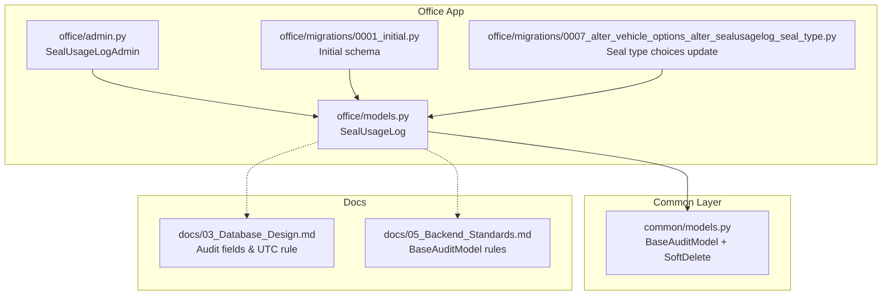
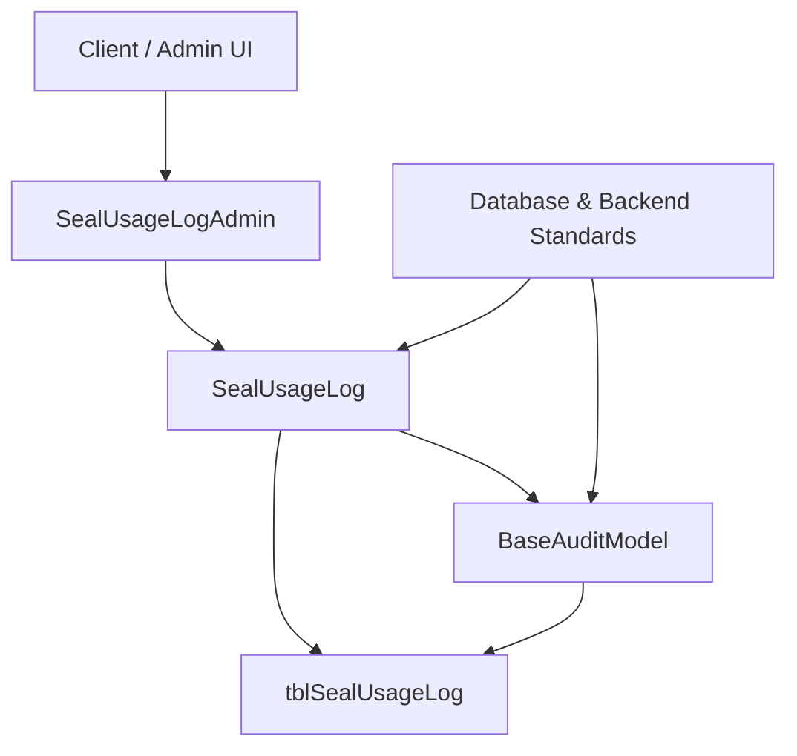
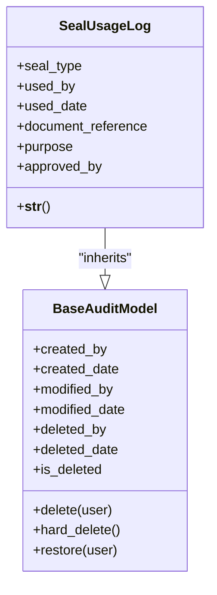
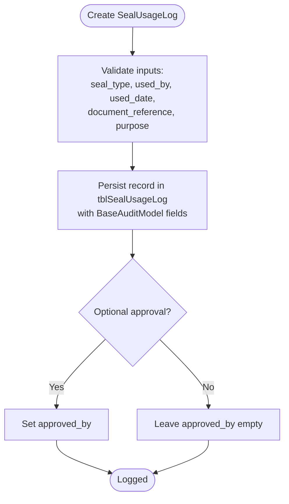
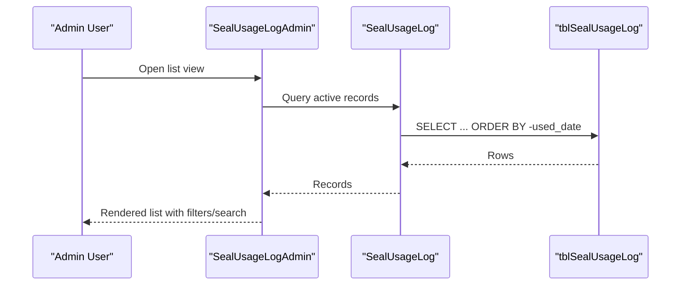
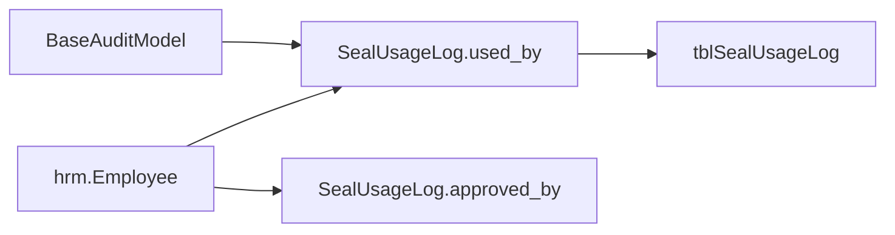

# Seal Usage & Digital Signature Tracking

<cite>
**Referenced Files in This Document**
- [models.py](file://src/apps/office/models.py)
- [admin.py](file://src/apps/office/admin.py)
- [0001_initial.py](file://src/apps/office/migrations/0001_initial.py)
- [0007_alter_vehicle_options_alter_sealusagelog_seal_type.py](file://src/apps/office/migrations/0007_alter_vehicle_options_alter_sealusagelog_seal_type.py)
- [models.py](file://src/apps/common/models.py)
- [03_Database_Design.md](file://docs/03_Database_Design.md)
- [05_Backend_Standards.md](file://docs/05_Backend_Standards.md)
</cite>

## Table of Contents
1. [Introduction](#introduction)
2. [Project Structure](#project-structure)
3. [Core Components](#core-components)
4. [Architecture Overview](#architecture-overview)
5. [Detailed Component Analysis](#detailed-component-analysis)
6. [Dependency Analysis](#dependency-analysis)
7. [Performance Considerations](#performance-considerations)
8. [Troubleshooting Guide](#troubleshooting-guide)
9. [Conclusion](#conclusion)

## Introduction
This document explains the seal usage and digital signature tracking system centered on the SealUsageLog model. It covers:
- Types of seals: round center seals, title seals, and digital signatures
- Usage logging with authorization tracking, purpose documentation, and approval workflows
- Audit trail capabilities for compliance and accountability
- Examples of logging seal usage, tracking digital signature applications, and generating usage reports
- Security considerations, unauthorized usage prevention, and integration points with document management systems

## Project Structure
The seal usage feature is implemented in the office application as a Django app. The key artifacts are:
- Model definition for SealUsageLog
- Admin configuration for viewing and filtering logs
- Migrations defining the database table and fields
- Shared audit base model providing soft delete and audit fields
- Database design standards that govern audit fields and time handling

**Diagram sources**
- [models.py:276-296](file://src/apps/office/models.py#L276-L296)
- [admin.py:97-103](file://src/apps/office/admin.py#L97-L103)
- [0001_initial.py:125-146](file://src/apps/office/migrations/0001_initial.py#L125-L146)
- [0007_alter_vehicle_options_alter_sealusagelog_seal_type.py:17-21](file://src/apps/office/migrations/0007_alter_vehicle_options_alter_sealusagelog_seal_type.py#L17-L21)
- [models.py:56-89](file://src/apps/common/models.py#L56-L89)
- [03_Database_Design.md:1694-1706](file://docs/03_Database_Design.md#L1694-L1706)
- [05_Backend_Standards.md:1195-1235](file://docs/05_Backend_Standards.md#L1195-L1235)

**Section sources**
- [models.py:276-296](file://src/apps/office/models.py#L276-L296)
- [admin.py:97-103](file://src/apps/office/admin.py#L97-L103)
- [0001_initial.py:125-146](file://src/apps/office/migrations/0001_initial.py#L125-L146)
- [0007_alter_vehicle_options_alter_sealusagelog_seal_type.py:17-21](file://src/apps/office/migrations/0007_alter_vehicle_options_alter_sealusagelog_seal_type.py#L17-L21)
- [models.py:56-89](file://src/apps/common/models.py#L56-L89)
- [03_Database_Design.md:1694-1706](file://docs/03_Database_Design.md#L1694-L1706)
- [05_Backend_Standards.md:1195-1235](file://docs/05_Backend_Standards.md#L1195-L1235)

## Core Components
- SealUsageLog: Represents each instance of seal or digital signature usage, including who used it, when, why, and what document it relates to.
- BaseAuditModel: Provides standard audit fields (created_by, created_date, modified_by, modified_date, deleted_by, deleted_date, is_deleted) and soft-delete behavior.
- SealUsageLogAdmin: Django admin interface for browsing, filtering, and searching seal usage records.

Key responsibilities:
- Enforce consistent auditability across all business models
- Provide structured data for reporting and compliance
- Support optional approval workflow via approved_by

**Section sources**
- [models.py:276-296](file://src/apps/office/models.py#L276-L296)
- [models.py:56-89](file://src/apps/common/models.py#L56-L89)
- [admin.py:97-103](file://src/apps/office/admin.py#L97-L103)

## Architecture Overview
The seal usage tracking integrates three layers:
- Data layer: SealUsageLog stored in tblSealUsageLog with standard audit columns from BaseAuditModel
- Application layer: Office app logic (model and admin)
- Standards layer: Database design and backend standards ensuring consistency and compliance

**Diagram sources**
- [admin.py:97-103](file://src/apps/office/admin.py#L97-L103)
- [models.py:276-296](file://src/apps/office/models.py#L276-L296)
- [models.py:56-89](file://src/apps/common/models.py#L56-L89)
- [03_Database_Design.md:1694-1706](file://docs/03_Database_Design.md#L1694-L1706)
- [05_Backend_Standards.md:1195-1235](file://docs/05_Backend_Standards.md#L1195-L1235)

## Detailed Component Analysis

### SealUsageLog Model
Purpose:
- Record every use of a round center seal, title seal, or digital signature
- Capture actor, timestamp, purpose, related document reference, and optional approver

Fields and semantics:
- seal_type: Enumerated choice among RoundSeal, TitleSeal, DigitalSignature
- used_by: Employee who applied the seal/signature
- used_date: Timestamp of usage
- document_reference: Identifier or name of the related document
- purpose: Business reason for using the seal/signature
- approved_by: Optional approver for compliance workflows

Inheritance and audit:
- Inherits BaseAuditModel for full lifecycle audit and soft delete support

Table and ordering:
- Stored in tblSealUsageLog
- Ordered by most recent usage first

**Diagram sources**
- [models.py:276-296](file://src/apps/office/models.py#L276-L296)
- [models.py:56-89](file://src/apps/common/models.py#L56-L89)

**Section sources**
- [models.py:276-296](file://src/apps/office/models.py#L276-L296)
- [0001_initial.py:125-146](file://src/apps/office/migrations/0001_initial.py#L125-L146)
- [0007_alter_vehicle_options_alter_sealusagelog_seal_type.py:17-21](file://src/apps/office/migrations/0007_alter_vehicle_options_alter_sealusagelog_seal_type.py#L17-L21)

### Seal Type Choices
Supported types:
- RoundSeal: Round center seal
- TitleSeal: Title seal
- DigitalSignature: Digital signature

These choices are enforced at the model level and reflected in migrations.

**Section sources**
- [models.py:277-279](file://src/apps/office/models.py#L277-L279)
- [0001_initial.py:131](file://src/apps/office/migrations/0001_initial.py#L131)
- [0007_alter_vehicle_options_alter_sealusagelog_seal_type.py:17-21](file://src/apps/office/migrations/0007_alter_vehicle_options_alter_sealusagelog_seal_type.py#L17-L21)

### Audit Trail and Soft Delete
All business models inherit BaseAuditModel, which provides:
- Standard audit fields for creation, modification, deletion
- Soft delete via is_deleted and timestamps
- Safe deletion methods that prevent accidental hard deletes

Database design standards require:
- All DATETIME2 fields stored in UTC
- Consistent audit field names and constraints

**Diagram sources**
- [models.py:276-296](file://src/apps/office/models.py#L276-L296)
- [models.py:56-89](file://src/apps/common/models.py#L56-L89)
- [03_Database_Design.md:1694-1706](file://docs/03_Database_Design.md#L1694-L1706)

**Section sources**
- [models.py:56-89](file://src/apps/common/models.py#L56-L89)
- [03_Database_Design.md:1694-1706](file://docs/03_Database_Design.md#L1694-L1706)
- [05_Backend_Standards.md:1195-1235](file://docs/05_Backend_Standards.md#L1195-L1235)

### Admin Interface for Usage Logs
SealUsageLogAdmin exposes:
- List view showing seal type, user, date, and document reference
- Filtering by seal type
- Searching by document reference and user full name
- Role-based access for viewing and editing

**Diagram sources**
- [admin.py:97-103](file://src/apps/office/admin.py#L97-L103)
- [models.py:276-296](file://src/apps/office/models.py#L276-L296)

**Section sources**
- [admin.py:97-103](file://src/apps/office/admin.py#L97-L103)

### Approval Workflow Integration
- Use approved_by to capture the employee who authorized the seal/signature usage
- This supports compliance workflows where certain uses require explicit approval before or after application
- The field is optional to allow immediate-use scenarios while still enabling traceability

Best practices:
- Require approved_by for high-risk operations (e.g., legal contracts)
- Log both used_by and approved_by for full accountability

**Section sources**
- [models.py:284-287](file://src/apps/office/models.py#L284-L287)

### Examples

#### Logging Seal Usage
Steps:
1. Determine seal_type (RoundSeal, TitleSeal, DigitalSignature)
2. Identify used_by (employee)
3. Record used_date (UTC timestamp)
4. Provide document_reference and purpose
5. Optionally set approved_by if required by policy

Output:
- A new row in tblSealUsageLog with full audit trail

#### Tracking Digital Signature Applications
- Use seal_type = DigitalSignature
- Include document_reference pointing to the signed document
- Add purpose describing the signing context
- If policy requires, set approved_by to the authorizing manager

#### Generating Usage Reports
- Filter by seal_type to analyze usage patterns per seal category
- Filter by used_by to attribute usage to individuals
- Filter by date range to produce periodic reports
- Export or visualize counts and trends for compliance reviews

[No sources needed since this section provides general guidance]

## Dependency Analysis
SealUsageLog depends on:
- hrm.Employee for used_by and approved_by
- BaseAuditModel for audit fields and soft delete
- Django ORM and database for persistence

**Diagram sources**
- [models.py:276-296](file://src/apps/office/models.py#L276-L296)
- [models.py:56-89](file://src/apps/common/models.py#L56-L89)

**Section sources**
- [models.py:276-296](file://src/apps/office/models.py#L276-L296)
- [models.py:56-89](file://src/apps/common/models.py#L56-L89)

## Performance Considerations
- Indexing: Consider adding indexes on frequently filtered columns such as used_date, seal_type, and used_by to improve query performance for reports and admin lists.
- Pagination: Ensure list views paginate results to avoid large result sets.
- Timezone handling: Store timestamps in UTC and convert at display time to avoid server timezone drift and multi-region issues.

[No sources needed since this section provides general guidance]

## Troubleshooting Guide
Common issues and resolutions:
- Missing approval: If a seal usage requires approval but approved_by is empty, enforce validation at the service layer to require approval for specific seal types or purposes.
- Incorrect seal type: Validate seal_type against allowed choices to prevent invalid entries.
- Audit gaps: Ensure all writes go through the service layer so BaseAuditModel fields are populated consistently.
- Soft delete misuse: Avoid direct QuerySet.delete(); use provided soft delete methods to preserve history.

Operational checks:
- Verify tblSealUsageLog exists and matches migration definitions
- Confirm BaseAuditModel fields are present and correctly named
- Review admin permissions to ensure only authorized roles can view/edit logs

**Section sources**
- [05_Backend_Standards.md:1195-1235](file://docs/05_Backend_Standards.md#L1195-L1235)
- [03_Database_Design.md:1694-1706](file://docs/03_Database_Design.md#L1694-L1706)

## Conclusion
The SealUsageLog model provides a robust foundation for tracking seal and digital signature usage with strong auditability and optional approval workflows. By adhering to shared audit standards and leveraging the admin interface, organizations can maintain compliance, enable accountability, and generate actionable reports. Integrating validation and role-based controls further strengthens security and prevents unauthorized usage.