# Supply Request & Inventory Management

<cite>
**Referenced Files in This Document**
- [models.py](file://src/apps/office/models.py)
- [services.py](file://src/apps/office/services.py)
- [admin.py](file://src/apps/office/admin.py)
- [office_procurement.py](file://src/apps/portal/views/office_procurement.py)
- [supply_request_list.html](file://src/apps/portal/templates/portal/supply_request_list.html)
- [supply_request_approval_list.html](file://src/apps/portal/templates/portal/supply_request_approval_list.html)
- [0001_initial.py](file://src/apps/office/migrations/0001_initial.py)
- [0005_alter_supplyitem_quantity_in_stock_and_more.py](file://src/apps/office/migrations/0005_alter_supplyitem_quantity_in_stock_and_more.py)
- [audit_review_integrity.py](file://src/apps/common/management/commands/audit_review_integrity.py)
</cite>

## Table of Contents
1. [Introduction](#introduction)
2. [Project Structure](#project-structure)
3. [Core Components](#core-components)
4. [Architecture Overview](#architecture-overview)
5. [Detailed Component Analysis](#detailed-component-analysis)
6. [Dependency Analysis](#dependency-analysis)
7. [Performance Considerations](#performance-considerations)
8. [Troubleshooting Guide](#troubleshooting-guide)
9. [Conclusion](#conclusion)
10. [Appendices](#appendices)

## Introduction
This document explains the supply request and inventory management system centered on three core models: SupplyItem, SupplyRequest, and SupplyRequestItem. It covers office supply catalog management (item codes, stock levels, minimum alert thresholds, units), the end-to-end workflow from employee requests through approval to issuance, inventory tracking with automatic stock updates and audit trails, and guidance for reconciliation, consumption tracking, and reporting.

## Project Structure
The supply functionality spans:
- Domain models and constraints in the Office app
- Business logic for issuing supplies
- Portal views and templates for creating, approving, and issuing requests
- Admin interface for catalog and request management
- Database migrations defining tables and constraints
- Integrity checks for negative stock and invalid lines

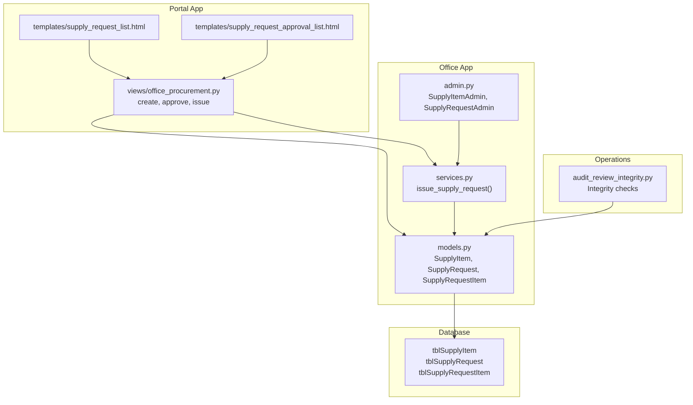

**Diagram sources**
- [models.py:218-269](file://src/apps/office/models.py#L218-L269)
- [services.py:10-45](file://src/apps/office/services.py#L10-L45)
- [admin.py:53-94](file://src/apps/office/admin.py#L53-L94)
- [office_procurement.py:250-328](file://src/apps/portal/views/office_procurement.py#L250-L328)
- [supply_request_list.html:1-29](file://src/apps/portal/templates/portal/supply_request_list.html#L1-L29)
- [supply_request_approval_list.html:9-16](file://src/apps/portal/templates/portal/supply_request_approval_list.html#L9-L16)
- [audit_review_integrity.py:1-20](file://src/apps/common/management/commands/audit_review_integrity.py#L1-L20)

**Section sources**
- [models.py:218-269](file://src/apps/office/models.py#L218-L269)
- [services.py:10-45](file://src/apps/office/services.py#L10-L45)
- [admin.py:53-94](file://src/apps/office/admin.py#L53-L94)
- [office_procurement.py:250-328](file://src/apps/portal/views/office_procurement.py#L250-L328)
- [supply_request_list.html:1-29](file://src/apps/portal/templates/portal/supply_request_list.html#L1-L29)
- [supply_request_approval_list.html:9-16](file://src/apps/portal/templates/portal/supply_request_approval_list.html#L9-L16)
- [0001_initial.py:149-205](file://src/apps/office/migrations/0001_initial.py#L149-L205)
- [0005_alter_supplyitem_quantity_in_stock_and_more.py:30-43](file://src/apps/office/migrations/0005_alter_supplyitem_quantity_in_stock_and_more.py#L30-L43)
- [audit_review_integrity.py:1-20](file://src/apps/common/management/commands/audit_review_integrity.py#L1-L20)

## Core Components
- SupplyItem: Represents an office supply catalog entry with a unique item code, name, unit of measure, current stock quantity, and minimum stock alert threshold. Stock is constrained to be non-negative.
- SupplyRequest: Represents an employee’s request for supplies with a unique request number, requesting employee, request date, and status lifecycle (Pending, Approved, Issued, Rejected).
- SupplyRequestItem: Line items within a request linking to a specific SupplyItem, capturing requested quantity and issued quantity. Constraints enforce positive requested quantities and issued quantities within the range [0, requested].

Key behaviors:
- Catalog management via admin interface allows viewing and editing item codes, names, units, stock levels, and alert thresholds.
- Requests are created by employees through the portal, approved or rejected by authorized users, and then issued by authorized staff which decrements inventory.
- All changes are tracked by the shared BaseAuditModel fields (created_by, modified_by, deleted_by, timestamps).

**Section sources**
- [models.py:218-269](file://src/apps/office/models.py#L218-L269)
- [admin.py:53-94](file://src/apps/office/admin.py#L53-L94)

## Architecture Overview
The system follows a layered approach:
- Presentation layer: Portal templates provide forms for submitting requests and managing approvals/issuance.
- Controller layer: Portal views handle validation, transactional creation/approval/issuance, and notifications.
- Service layer: Atomic business logic enforces permissions, state transitions, stock availability, and inventory updates.
- Data layer: Django models define schema, constraints, and relationships; migrations ensure database integrity.

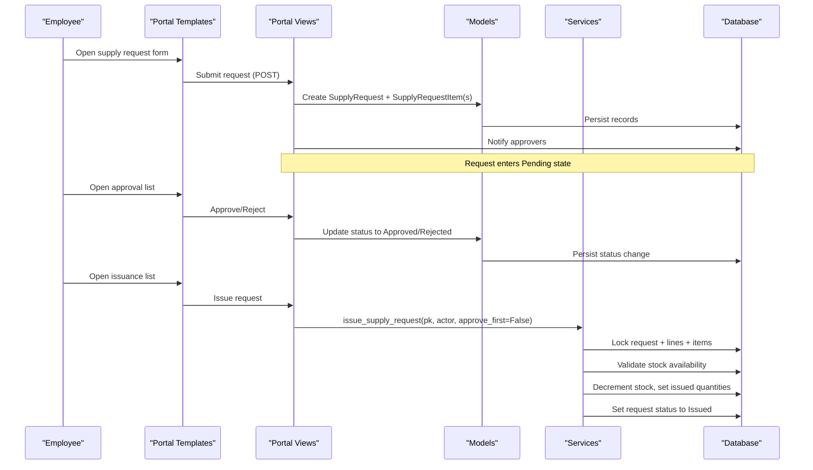

**Diagram sources**
- [supply_request_list.html:1-29](file://src/apps/portal/templates/portal/supply_request_list.html#L1-L29)
- [supply_request_approval_list.html:9-16](file://src/apps/portal/templates/portal/supply_request_approval_list.html#L9-L16)
- [office_procurement.py:250-328](file://src/apps/portal/views/office_procurement.py#L250-L328)
- [services.py:10-45](file://src/apps/office/services.py#L10-L45)
- [models.py:218-269](file://src/apps/office/models.py#L218-L269)

## Detailed Component Analysis

### SupplyItem Model
Responsibilities:
- Define catalog entries with item_code (unique), item_name, unit, quantity_in_stock, and min_stock_alert.
- Enforce non-negative stock via a database check constraint.

Operational notes:
- Admin interface exposes all key fields for catalog maintenance.
- Stock is updated atomically during issuance.

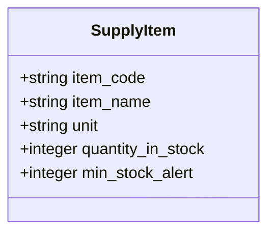

**Diagram sources**
- [models.py:218-232](file://src/apps/office/models.py#L218-L232)
- [0005_alter_supplyitem_quantity_in_stock_and_more.py:30-34](file://src/apps/office/migrations/0005_alter_supplyitem_quantity_in_stock_and_more.py#L30-L34)

**Section sources**
- [models.py:218-232](file://src/apps/office/models.py#L218-L232)
- [admin.py:53-57](file://src/apps/office/admin.py#L53-L57)
- [0005_alter_supplyitem_quantity_in_stock_and_more.py:30-34](file://src/apps/office/migrations/0005_alter_supplyitem_quantity_in_stock_and_more.py#L30-L34)

### SupplyRequest Model
Responsibilities:
- Represent a request with request_no (unique), employee, request_date, and status.
- Status values: Pending, Approved, Issued, Rejected.

Workflow integration:
- Created by employees via portal; transitions to Approved after authorization; moves to Issued upon successful stock deduction.

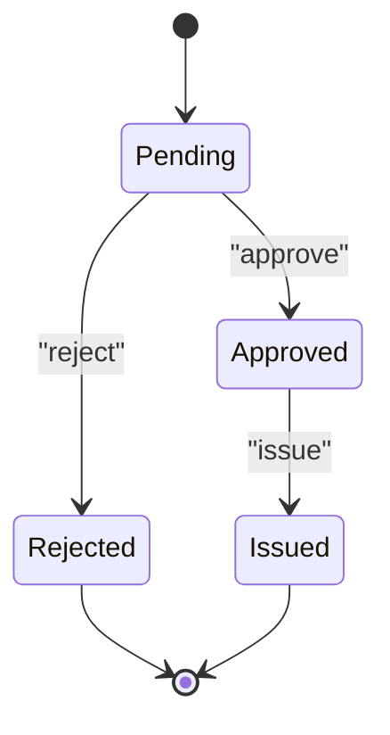

**Diagram sources**
- [models.py:235-250](file://src/apps/office/models.py#L235-L250)
- [office_procurement.py:313-328](file://src/apps/portal/views/office_procurement.py#L313-L328)
- [services.py:10-45](file://src/apps/office/services.py#L10-L45)

**Section sources**
- [models.py:235-250](file://src/apps/office/models.py#L235-L250)
- [office_procurement.py:301-328](file://src/apps/portal/views/office_procurement.py#L301-L328)

### SupplyRequestItem Model
Responsibilities:
- Link a SupplyRequest to a SupplyItem with quantity_requested and quantity_issued.
- Enforce that requested quantity is positive and issued quantity is between 0 and requested.

Constraints:
- Positive requested quantity.
- Issued quantity must not exceed requested quantity.

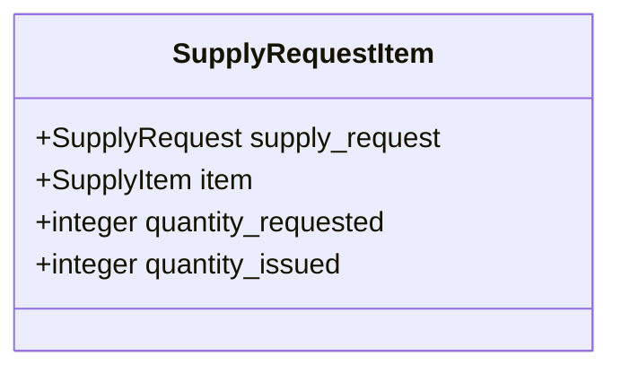

**Diagram sources**
- [models.py:253-269](file://src/apps/office/models.py#L253-L269)
- [0005_alter_supplyitem_quantity_in_stock_and_more.py:35-43](file://src/apps/office/migrations/0005_alter_supplyitem_quantity_in_stock_and_more.py#L35-L43)

**Section sources**
- [models.py:253-269](file://src/apps/office/models.py#L253-L269)
- [0005_alter_supplyitem_quantity_in_stock_and_more.py:35-43](file://src/apps/office/migrations/0005_alter_supplyitem_quantity_in_stock_and_more.py#L35-L43)

### Issuance Service
Purpose:
- Provide a single atomic operation to approve and issue a request when needed, or to issue an already approved request.

Key behaviors:
- Permission check for the actor.
- State validation based on whether approval is required first.
- Aggregation of net quantities to deduct per item.
- Row-level locking for concurrency safety.
- Validation of stock availability before any writes.
- Batch update of stock levels, line issued quantities, and request status.

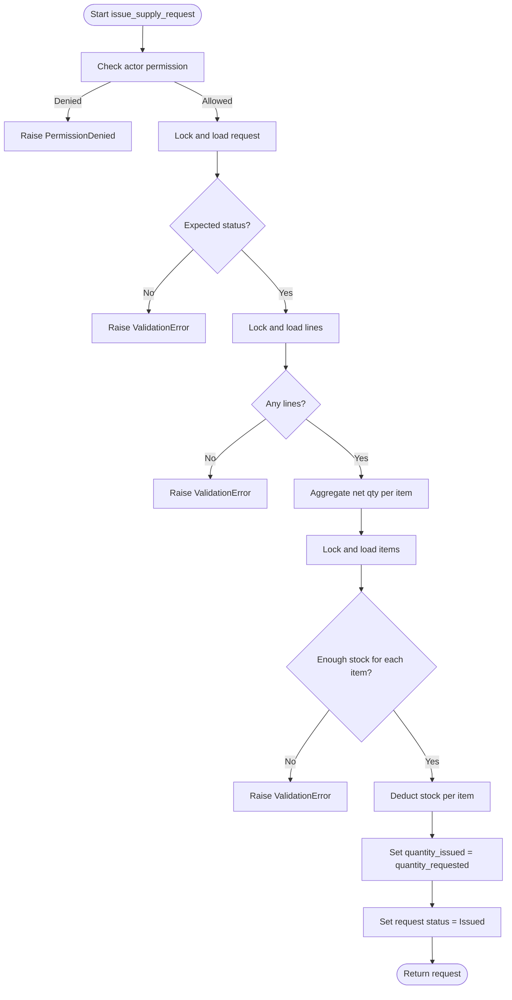

**Diagram sources**
- [services.py:10-45](file://src/apps/office/services.py#L10-L45)

**Section sources**
- [services.py:10-45](file://src/apps/office/services.py#L10-L45)

### Portal Workflows

#### Creating a Supply Request
- Employee opens the supply request list page and adds one or more items with quantities.
- The view validates inputs, creates a SupplyRequest and related SupplyRequestItem rows inside a transaction, and notifies approvers.

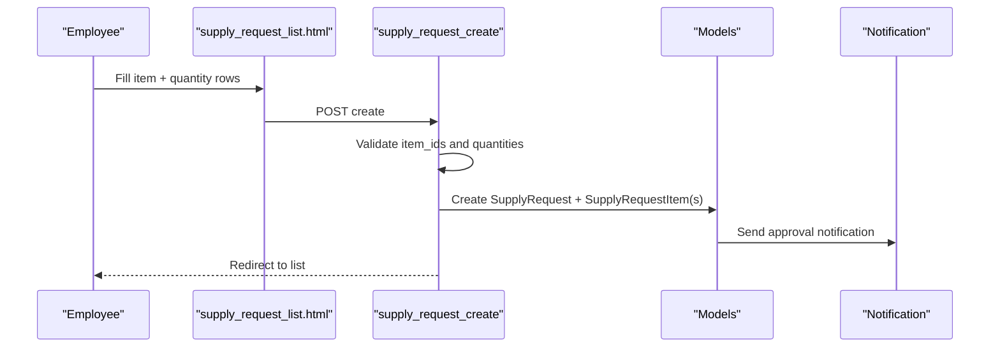

**Diagram sources**
- [supply_request_list.html:1-29](file://src/apps/portal/templates/portal/supply_request_list.html#L1-L29)
- [office_procurement.py:250-298](file://src/apps/portal/views/office_procurement.py#L250-L298)

**Section sources**
- [supply_request_list.html:1-29](file://src/apps/portal/templates/portal/supply_request_list.html#L1-L29)
- [office_procurement.py:250-298](file://src/apps/portal/views/office_procurement.py#L250-L298)

#### Approving or Rejecting a Request
- Authorized users open the approval list and choose to approve or reject.
- The view locks the pending request and updates its status accordingly.

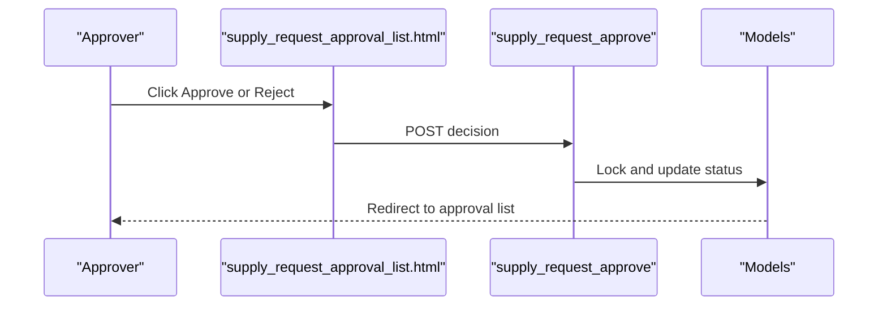

**Diagram sources**
- [supply_request_approval_list.html:9-16](file://src/apps/portal/templates/portal/supply_request_approval_list.html#L9-L16)
- [office_procurement.py:313-328](file://src/apps/portal/views/office_procurement.py#L313-L328)

**Section sources**
- [supply_request_approval_list.html:9-16](file://src/apps/portal/templates/portal/supply_request_approval_list.html#L9-L16)
- [office_procurement.py:313-328](file://src/apps/portal/views/office_procurement.py#L313-L328)

#### Issuing Materials
- Authorized users open the “awaiting issuance” list and click Issue.
- The view calls the service to validate stock and perform atomic issuance.

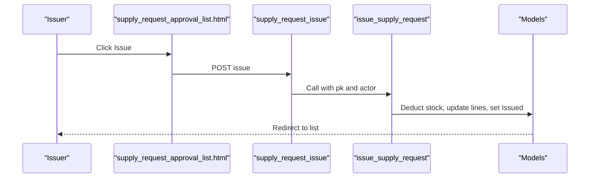

**Diagram sources**
- [supply_request_approval_list.html:9-16](file://src/apps/portal/templates/portal/supply_request_approval_list.html#L9-L16)
- [services.py:10-45](file://src/apps/office/services.py#L10-L45)

**Section sources**
- [supply_request_approval_list.html:9-16](file://src/apps/portal/templates/portal/supply_request_approval_list.html#L9-L16)
- [services.py:10-45](file://src/apps/office/services.py#L10-L45)

### Admin Interface
- SupplyItemAdmin displays and edits catalog fields including stock and alert thresholds.
- SupplyRequestAdmin shows requests with inline SupplyRequestItem rows and provides a bulk action to approve and issue pending requests.

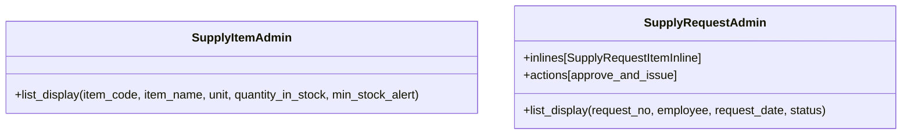

**Diagram sources**
- [admin.py:53-94](file://src/apps/office/admin.py#L53-L94)

**Section sources**
- [admin.py:53-94](file://src/apps/office/admin.py#L53-L94)

## Dependency Analysis
- Portal views depend on models for persistence and services for atomic issuance.
- Admin actions delegate to the same service used by the portal to ensure consistent behavior.
- Migrations define table structures and constraints that underpin model validations.
- Integrity commands scan models to detect anomalies such as negative stock or invalid line ranges.

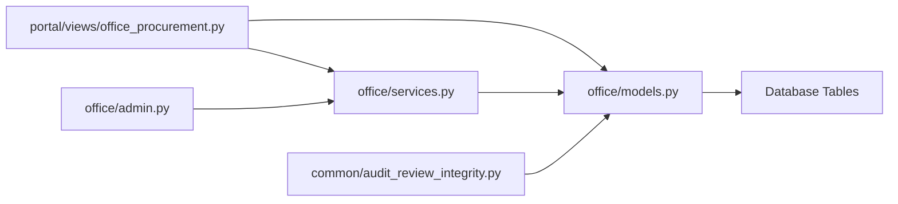

**Diagram sources**
- [office_procurement.py:250-328](file://src/apps/portal/views/office_procurement.py#L250-L328)
- [services.py:10-45](file://src/apps/office/services.py#L10-L45)
- [admin.py:53-94](file://src/apps/office/admin.py#L53-L94)
- [models.py:218-269](file://src/apps/office/models.py#L218-L269)
- [audit_review_integrity.py:1-20](file://src/apps/common/management/commands/audit_review_integrity.py#L1-L20)

**Section sources**
- [office_procurement.py:250-328](file://src/apps/portal/views/office_procurement.py#L250-L328)
- [services.py:10-45](file://src/apps/office/services.py#L10-L45)
- [admin.py:53-94](file://src/apps/office/admin.py#L53-L94)
- [models.py:218-269](file://src/apps/office/models.py#L218-L269)
- [audit_review_integrity.py:1-20](file://src/apps/common/management/commands/audit_review_integrity.py#L1-L20)

## Performance Considerations
- Use select_for_update and select_related/prefetch_related to reduce lock contention and N+1 queries during approval and issuance.
- Batch updates for stock and line items minimize round trips.
- Keep transactions short and focused to avoid long-held locks.
- Index frequently filtered fields such as status and request_date for faster listing and approval workflows.

## Troubleshooting Guide
Common issues and resolutions:
- Insufficient permissions to approve or issue: Ensure the actor has the required permission; otherwise a permission error is raised.
- Invalid request state for issuance: Only Pending (when approve_first=True) or Approved requests can be issued.
- Missing or invalid line items: Requests without items or with invalid quantities cannot be issued.
- Insufficient stock: Issuance fails if available stock is less than the total net quantity to deduct.
- Negative stock detected: Run integrity checks to identify and correct data inconsistencies.

Operational checks:
- Use the integrity command to count negative stock and invalid supply lines across soft-deleted records.

**Section sources**
- [services.py:10-45](file://src/apps/office/services.py#L10-L45)
- [audit_review_integrity.py:1-20](file://src/apps/common/management/commands/audit_review_integrity.py#L1-L20)

## Conclusion
The supply request and inventory management system provides a robust, auditable workflow for office supply catalog management, employee requests, approvals, and issuance. Strong database constraints and atomic service operations ensure data integrity and safe concurrent access. Admin and portal interfaces support both administrative control and user-driven processes, while integrity checks help maintain long-term data quality.

## Appendices

### Examples

- Adding supplies (catalog):
  - Use the SupplyItem admin to add or edit item_code, item_name, unit, quantity_in_stock, and min_stock_alert.

- Submitting a request:
  - Employees use the supply request list template to select items and quantities, then submit. The portal creates a request and notifies approvers.

- Approving a request:
  - Authorized users approve or reject pending requests via the approval list.

- Issuing materials:
  - Authorized users issue approved requests; the service deducts stock and sets the request status to Issued.

- Inventory reconciliation:
  - Run integrity checks to detect negative stock or invalid line ranges and correct them.

- Consumption tracking and reporting:
  - Track consumption by analyzing issued quantities per item and request dates.
  - Report usage patterns by aggregating issued quantities per item over time.
  - Monitor low stock alerts using min_stock_alert thresholds against current stock levels.

**Section sources**
- [admin.py:53-94](file://src/apps/office/admin.py#L53-L94)
- [supply_request_list.html:1-29](file://src/apps/portal/templates/portal/supply_request_list.html#L1-L29)
- [office_procurement.py:250-328](file://src/apps/portal/views/office_procurement.py#L250-L328)
- [services.py:10-45](file://src/apps/office/services.py#L10-L45)
- [audit_review_integrity.py:1-20](file://src/apps/common/management/commands/audit_review_integrity.py#L1-L20)