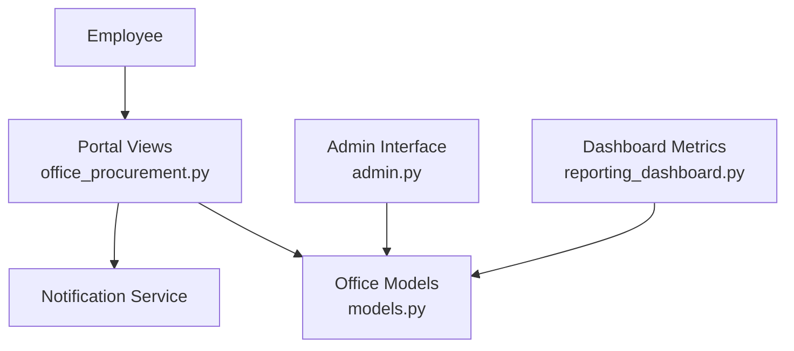
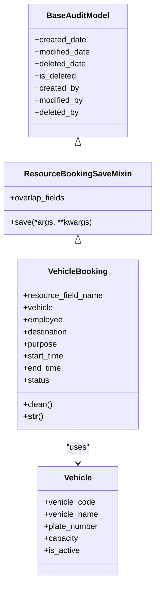
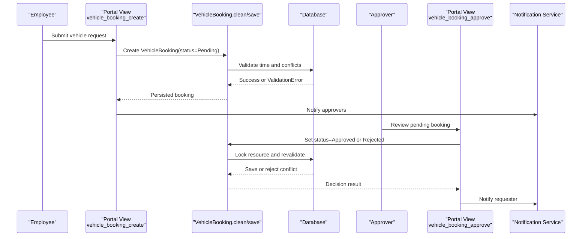
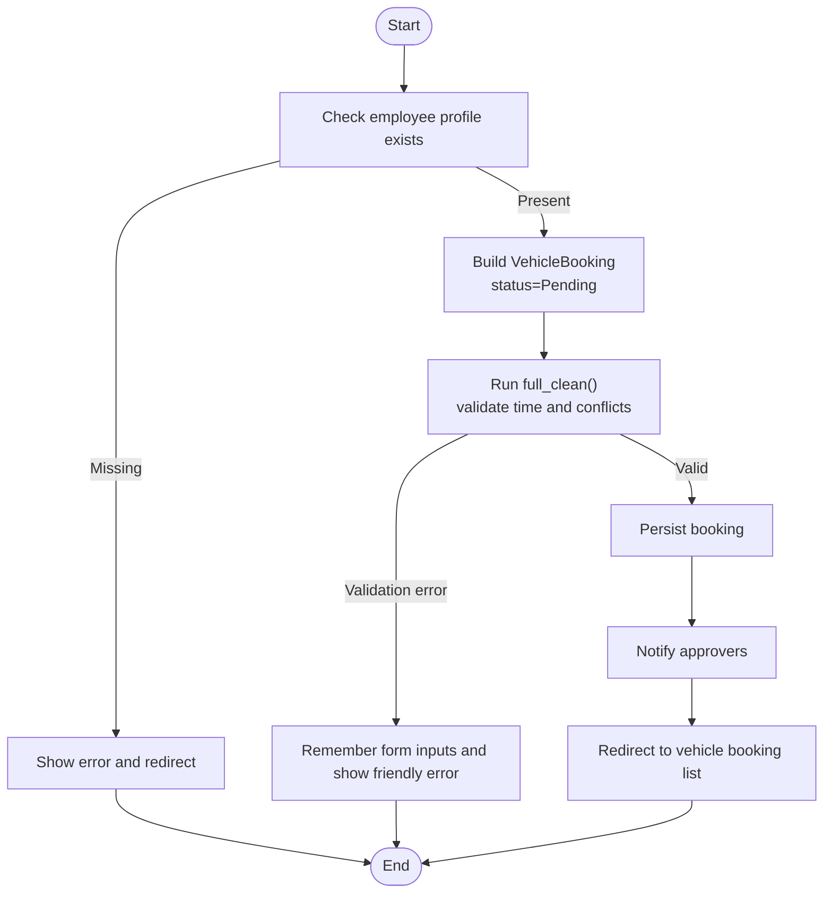
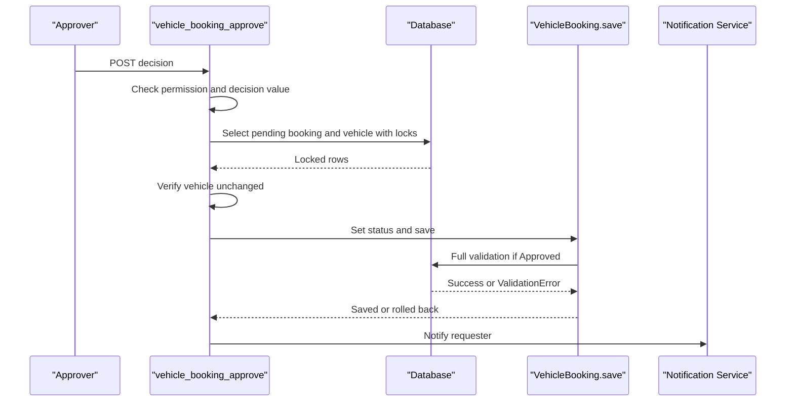
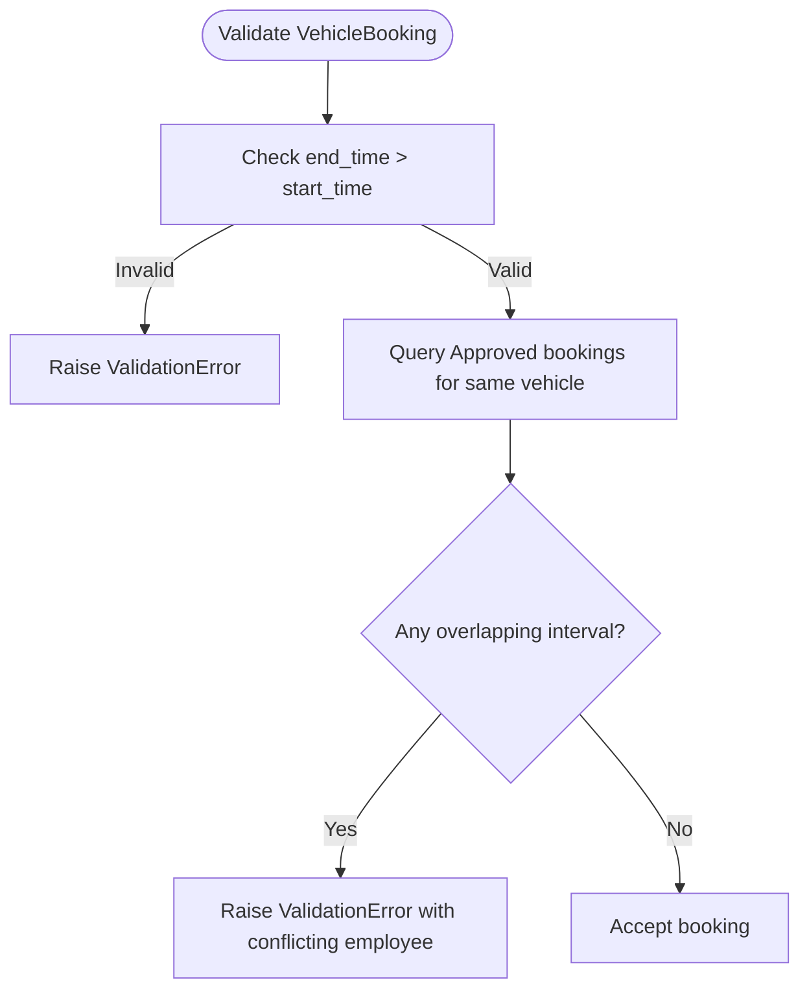
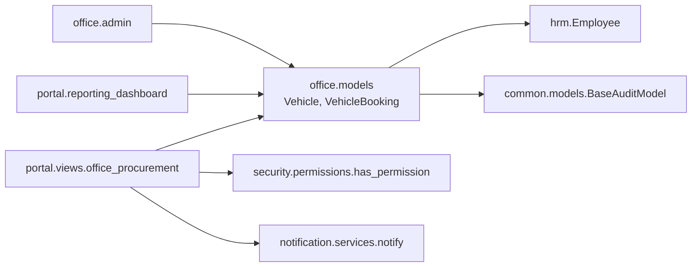

# Vehicle Management & Booking

<cite>
**Referenced Files in This Document**   
- [models.py](file://src/apps/office/models.py)
- [office_procurement.py](file://src/apps/portal/views/office_procurement.py)
- [admin.py](file://src/apps/office/admin.py)
- [tests.py](file://src/apps/office/tests.py)
- [reporting_dashboard.py](file://src/apps/portal/reporting_dashboard.py)
</cite>

## Table of Contents
1. [Introduction](#introduction)
2. [Project Structure](#project-structure)
3. [Core Components](#core-components)
4. [Architecture Overview](#architecture-overview)
5. [Detailed Component Analysis](#detailed-component-analysis)
6. [Dependency Analysis](#dependency-analysis)
7. [Performance Considerations](#performance-considerations)
8. [Troubleshooting Guide](#troubleshooting-guide)
9. [Conclusion](#conclusion)

## Introduction
This document explains the vehicle management and booking system implemented in the office module. It focuses on two core domain models:

- **Vehicle**: represents a fleet asset with identification, capacity, and operational status.
- **VehicleBooking**: represents an employee’s request to use a vehicle for a specific destination and time window, including purpose documentation and approval workflow.

The system provides:
- Fleet tracking through vehicle records and active/inactive status.
- Destination and purpose documentation per booking.
- A stateful approval process from pending to approved or rejected.
- Conflict detection that prevents overlapping reservations for the same vehicle.
- Portal-based workflows for requesting vehicles and approving bookings.
- Dashboard metrics showing pending vehicle requests.

Where maintenance scheduling, usage tracking, and detailed utilization reporting are not yet modeled, this document clearly separates existing behavior from recommended future enhancements.

## Project Structure
The vehicle and booking features live under the `office` application and are consumed by the portal application:

- Data model and validation logic: `src/apps/office/models.py`
- Portal request creation, cancellation, and approval views: `src/apps/portal/views/office_procurement.py`
- Admin interface for resources and bookings: `src/apps/office/admin.py`
- Validation and concurrency tests: `src/apps/office/tests.py`
- Dashboard metrics including pending vehicle bookings: `src/apps/portal/reporting_dashboard.py`

**Diagram sources**
- [office_procurement.py:141-238](file://src/apps/portal/views/office_procurement.py#L141-L238)
- [models.py:100-211](file://src/apps/office/models.py#L100-L211)
- [admin.py:30-50](file://src/apps/office/admin.py#L30-L50)
- [reporting_dashboard.py:104-106](file://src/apps/portal/reporting_dashboard.py#L104-L106)

**Section sources**
- [models.py:100-211](file://src/apps/office/models.py#L100-L211)
- [office_procurement.py:141-238](file://src/apps/portal/views/office_procurement.py#L141-L238)
- [admin.py:30-50](file://src/apps/office/admin.py#L30-L50)
- [reporting_dashboard.py:104-106](file://src/apps/portal/reporting_dashboard.py#L104-L106)

## Core Components
### Vehicle Model
The `Vehicle` model captures fleet inventory:

| Field | Purpose | Notes |
|---|---|---|
| `vehicle_code` | Unique identifier for the vehicle | Used for stable reference |
| `vehicle_name` | Human-readable name | Improves readability in lists |
| `plate_number` | License plate number | Supports fleet identification and compliance |
| `capacity` | Seating capacity | Defaults to 4; useful for matching group size |
| `is_active` | Operational status | Controls whether the vehicle is available for booking |

The model stores data in table `tblVehicle`, includes audit fields inherited from `BaseAuditModel`, and displays as “vehicle name (plate number)”.

**Section sources**
- [models.py:100-113](file://src/apps/office/models.py#L100-L113)

### VehicleBooking Model
The `VehicleBooking` model captures a reservation request:

| Field | Purpose | Notes |
|---|---|---|
| `vehicle` | Foreign key to `Vehicle` | Links booking to a specific fleet asset |
| `employee` | Foreign key to `hrm.Employee` | Records who requested the vehicle |
| `destination` | Trip destination | Required business context for the trip |
| `purpose` | Optional purpose description | Allows additional justification |
| `start_time` | Reservation start | Must be before `end_time` |
| `end_time` | Reservation end | Must be after `start_time` |
| `status` | Workflow state | Pending, Approved, Rejected, Cancelled |

The model stores data in table `tblVehicleBooking`, inherits audit fields, orders by `start_time`, and validates both time ordering and conflict rules.

**Section sources**
- [models.py:180-211](file://src/apps/office/models.py#L180-L211)

### Shared Resource Booking Behavior
Both room and vehicle bookings share a mixin called `ResourceBookingSaveMixin`. Its responsibilities include:

- Serializing concurrent approvals using database row locking.
- Re-running full validation when a booking becomes `Approved`.
- Detecting missing resources before saving.
- Avoiding unnecessary overlap checks for partial saves that do not affect the reservation window.

**Diagram sources**
- [models.py:100-113](file://src/apps/office/models.py#L100-L113)
- [models.py:116-144](file://src/apps/office/models.py#L116-L144)
- [models.py:180-211](file://src/apps/office/models.py#L180-L211)

## Architecture Overview
The vehicle booking workflow integrates portal views, model validation, admin interfaces, and dashboard metrics.

**Diagram sources**
- [office_procurement.py:153-180](file://src/apps/portal/views/office_procurement.py#L153-L180)
- [office_procurement.py:203-238](file://src/apps/portal/views/office_procurement.py#L203-L238)
- [models.py:116-144](file://src/apps/office/models.py#L116-L144)
- [models.py:180-211](file://src/apps/office/models.py#L180-L211)

## Detailed Component Analysis

### Vehicle Resource Management
Fleet management centers on the `Vehicle` model and its administrative exposure:

- Fleet inventory includes unique code, display name, license plate, seating capacity, and active status.
- The admin interface registers `Vehicle` under a shared resource admin with restricted view/edit roles.
- Active vehicles are shown in the portal booking list, while inactive vehicles are excluded from new requests.

Operational status is represented by `is_active`. This field controls availability but does not implement maintenance states such as “Under Maintenance” or “Out of Service.”

**Section sources**
- [models.py:100-113](file://src/apps/office/models.py#L100-L113)
- [admin.py:30-36](file://src/apps/office/admin.py#L30-L36)
- [office_procurement.py:141-150](file://src/apps/portal/views/office_procurement.py#L141-L150)

### Vehicle Booking Workflow
The portal exposes three main flows:

1. **Request a vehicle**
   - Validates that the user has an associated employee record.
   - Creates a `VehicleBooking` with `status="Pending"`.
   - Runs `full_clean()` to enforce time and conflict rules.
   - Notifies eligible approvers.

2. **Cancel a booking**
   - Requires ownership of the booking.
   - Sets `status="Cancelled"` without revalidating overlaps.

3. **Approve or reject a booking**
   - Requires permission to approve office requests.
   - Uses atomic transactions and row-level locks.
   - Verifies the resource did not change between reads.
   - Delegates final validation to `ResourceBookingSaveMixin.save()`.

**Diagram sources**
- [office_procurement.py:153-180](file://src/apps/portal/views/office_procurement.py#L153-L180)

**Section sources**
- [office_procurement.py:141-180](file://src/apps/portal/views/office_procurement.py#L141-L180)

### Approval Process
The approval endpoint enforces security, concurrency safety, and consistent validation:

- Only users with `approve_office_request` permission can approve.
- The request must be in `Pending` state.
- The endpoint locks both the vehicle resource and the booking row.
- If the vehicle changes between reads, the operation fails safely.
- After setting the decision, it delegates to `save()`, which performs overlap checks only for `Approved` bookings.
- The requester receives a notification indicating approval or rejection.

**Diagram sources**
- [office_procurement.py:203-238](file://src/apps/portal/views/office_procurement.py#L203-L238)
- [models.py:116-144](file://src/apps/office/models.py#L116-L144)

**Section sources**
- [office_procurement.py:194-238](file://src/apps/portal/views/office_procurement.py#L194-L238)
- [models.py:116-144](file://src/apps/office/models.py#L116-L144)

### Conflict Detection System
Conflict detection prevents overlapping reservations for the same vehicle:

- `VehicleBooking.clean()` rejects requests where `end_time <= start_time`.
- It queries existing `Approved` bookings for the same vehicle where time intervals overlap.
- Overlap is detected using standard interval logic: one interval starts before the other ends and ends after the other starts.
- When a booking transitions to `Approved`, `ResourceBookingSaveMixin.save()` re-runs full validation under a transaction with row locking.
- Tests verify that concurrent approvals cannot create two overlapping approved bookings.

**Diagram sources**
- [models.py:201-208](file://src/apps/office/models.py#L201-L208)
- [tests.py:104-122](file://src/apps/office/tests.py#L104-L122)

**Section sources**
- [models.py:201-208](file://src/apps/office/models.py#L201-L208)
- [tests.py:61-73](file://src/apps/office/tests.py#L61-L73)
- [tests.py:104-122](file://src/apps/office/tests.py#L104-L122)
- [tests.py:132-168](file://src/apps/office/tests.py#L132-L168)

### Examples

#### Requesting a Vehicle
An employee submits a vehicle request through the portal:

- Inputs: vehicle, destination, optional purpose, start time, end time.
- System creates a pending booking.
- Approvers receive notifications.
- The request appears in the upcoming vehicle booking list.

Reference paths:
- [office_procurement.py:153-180](file://src/apps/portal/views/office_procurement.py#L153-L180)
- [office_procurement.py:141-150](file://src/apps/portal/views/office_procurement.py#L141-L150)

#### Managing Fleet Inventory
Administrators manage vehicles through Django admin:

- Register vehicles with code, name, license plate, capacity, and active status.
- Restrict access to designated roles.
- Use the resource admin pattern shared with meeting rooms.

Reference paths:
- [admin.py:30-36](file://src/apps/office/admin.py#L30-L36)
- [models.py:100-113](file://src/apps/office/models.py#L100-L113)

#### Processing a Vehicle Booking
An approver reviews and processes a pending booking:

- Opens the approval list.
- Chooses approve or reject.
- System locks the resource, validates, updates status, and notifies the requester.

Reference paths:
- [office_procurement.py:194-238](file://src/apps/portal/views/office_procurement.py#L194-L238)
- [models.py:116-144](file://src/apps/office/models.py#L116-L144)

## Dependency Analysis
The following diagram shows how the vehicle booking feature depends on related modules:

**Diagram sources**
- [models.py:1-6](file://src/apps/office/models.py#L1-L6)
- [models.py:100-211](file://src/apps/office/models.py#L100-L211)
- [office_procurement.py:1-23](file://src/apps/portal/views/office_procurement.py#L1-L23)
- [admin.py:1-8](file://src/apps/office/admin.py#L1-L8)
- [reporting_dashboard.py:104-106](file://src/apps/portal/reporting_dashboard.py#L104-L106)

**Section sources**
- [models.py:1-6](file://src/apps/office/models.py#L1-L6)
- [office_procurement.py:1-23](file://src/apps/portal/views/office_procurement.py#L1-L23)
- [admin.py:1-8](file://src/apps/office/admin.py#L1-L8)
- [reporting_dashboard.py:104-106](file://src/apps/portal/reporting_dashboard.py#L104-L106)

## Performance Considerations
- **Row locking**: Both portal approval endpoints and the save mixin use `select_for_update()` to serialize concurrent approvals and prevent race conditions.
- **Transaction boundaries**: Approval operations wrap decisions in `transaction.atomic()` to ensure consistency.
- **Selective validation**: Partial saves that do not affect overlap fields bypass expensive overlap checks.
- **Query efficiency**: Upcoming booking lists use `select_related` to reduce N+1 queries for vehicle and employee data.
- **Indexing considerations**: Frequent filters on `vehicle`, `status`, `start_time`, and `end_time` suggest that database indexes should be reviewed during deployment tuning.

[No sources needed since this section provides general guidance]

## Troubleshooting Guide

### Common Validation Errors
- **End time before start time**: The booking validator requires `end_time` to be strictly after `start_time`.
- **Overlapping approved booking**: A new or approved booking conflicts with an existing approved booking for the same vehicle.
- **Missing resource**: Saving an approved booking against a non-existent vehicle raises a validation error.

Reference paths:
- [models.py:201-208](file://src/apps/office/models.py#L201-L208)
- [models.py:134-144](file://src/apps/office/models.py#L134-L144)
- [tests.py:52-73](file://src/apps/office/tests.py#L52-L73)

### Concurrency Issues
- **Two approvers clicking at the same time**: The test suite simulates concurrent approvals and expects exactly one approved booking.
- **Vehicle changed during approval**: The approval view detects if the vehicle foreign key changed between reads and rejects the operation.

Reference paths:
- [tests.py:132-168](file://src/apps/office/tests.py#L132-L168)
- [office_procurement.py:214-223](file://src/apps/portal/views/office_procurement.py#L214-L223)

### Permission Problems
- **Employee cannot approve**: Only users with `approve_office_request` permission can approve office requests.
- **Direct approval post blocked**: Unauthorized attempts redirect to the dashboard and leave the booking pending.

Reference paths:
- [office_procurement.py:28-33](file://src/apps/portal/views/office_procurement.py#L28-L33)
- [tests.py:186-200](file://src/apps/office/tests.py#L186-L200)

**Section sources**
- [models.py:134-144](file://src/apps/office/models.py#L134-L144)
- [models.py:201-208](file://src/apps/office/models.py#L201-L208)
- [office_procurement.py:214-223](file://src/apps/portal/views/office_procurement.py#L214-L223)
- [tests.py:52-73](file://src/apps/office/tests.py#L52-L73)
- [tests.py:132-168](file://src/apps/office/tests.py#L132-L168)
- [tests.py:186-200](file://src/apps/office/tests.py#L186-L200)

## Conclusion
The vehicle management and booking system provides a solid foundation for fleet tracking and reservation control:

- Vehicles are modeled with clear identity, capacity, and operational status.
- Vehicle bookings capture destination, purpose, timing, and approval state.
- Conflict detection prevents overlapping reservations and is hardened by row locking and transactional boundaries.
- Portal workflows support request submission, cancellation, and approval with notifications.
- Dashboard metrics expose pending vehicle requests for operational visibility.

Areas not yet implemented include:
- Vehicle maintenance scheduling.
- Usage tracking beyond booking records.
- Detailed fleet utilization reports.

Recommended next steps:
- Add maintenance-related fields or a separate maintenance model for vehicles.
- Track actual usage events linked to approved bookings.
- Extend dashboard and reporting to calculate utilization rates, peak hours, and department-wise consumption.
- Introduce additional vehicle statuses such as “Under Maintenance” or “Reserved for Maintenance.”

[No sources needed since this section summarizes without analyzing specific files]