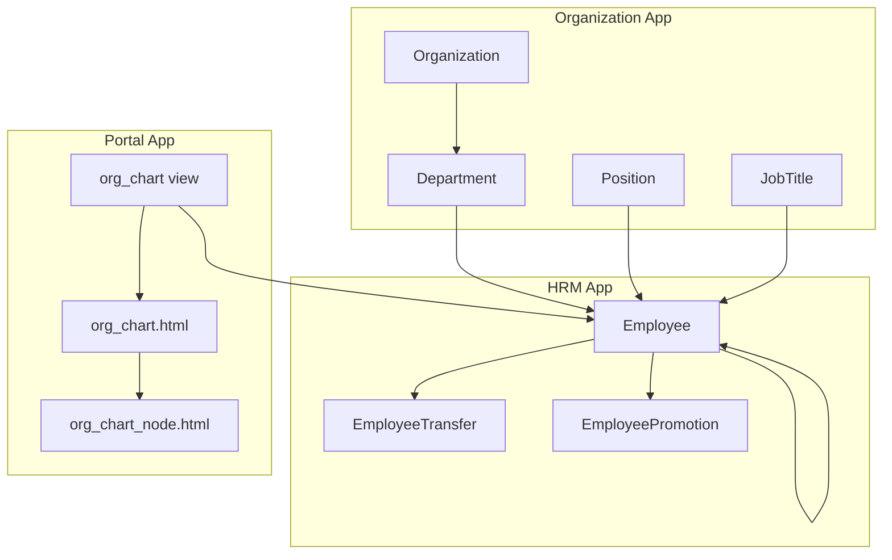
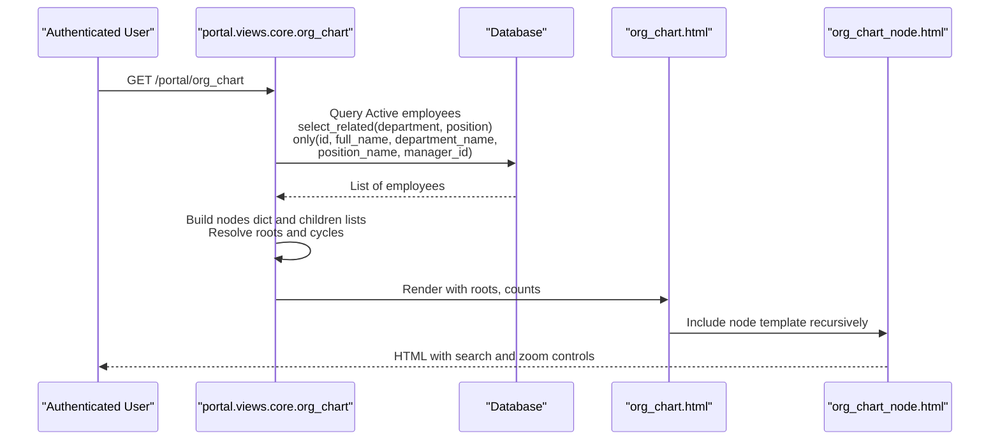
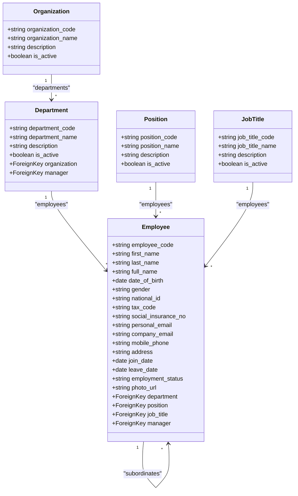
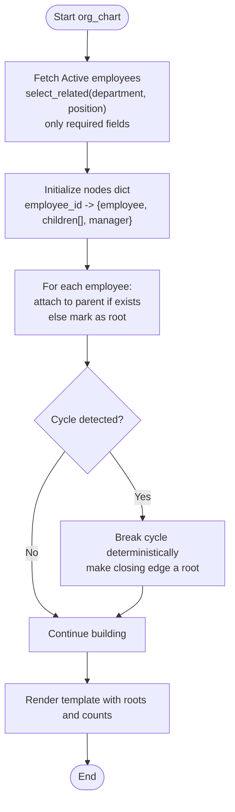
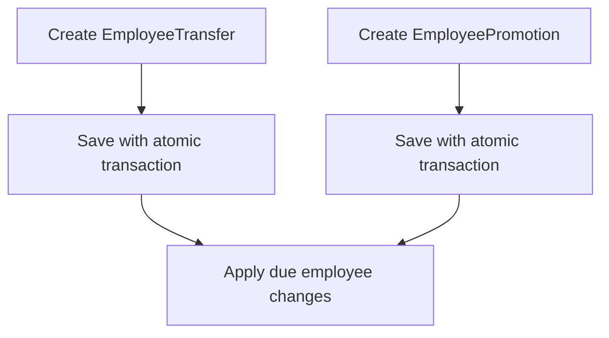
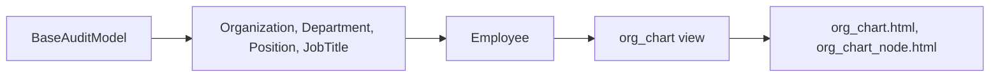

# Organization Management

<cite>
**Referenced Files in This Document**
- [models.py](file://src/apps/organization/models.py)
- [admin.py](file://src/apps/organization/admin.py)
- [views.py](file://src/apps/organization/views.py)
- [hrm_models.py](file://src/apps/hrm/models.py)
- [portal_views_core.py](file://src/apps/portal/views/core.py)
- [org_chart_template.html](file://src/apps/portal/templates/portal/org_chart.html)
- [org_chart_node_template.html](file://src/apps/portal/templates/portal/org_chart_node.html)
- [05_Backend_Standards.md](file://docs/05_Backend_Standards.md)
</cite>

## Table of Contents
1. [Introduction](#introduction)
2. [Project Structure](#project-structure)
3. [Core Components](#core-components)
4. [Architecture Overview](#architecture-overview)
5. [Detailed Component Analysis](#detailed-component-analysis)
6. [Dependency Analysis](#dependency-analysis)
7. [Performance Considerations](#performance-considerations)
8. [Troubleshooting Guide](#troubleshooting-guide)
9. [Conclusion](#conclusion)
10. [Appendices](#appendices)

## Introduction
This document explains the organization management module that models organizational structure, department hierarchy, position management, and employee directory functionality. It focuses on the core data models, their relationships, hierarchical reporting chains, organizational chart generation, employee lifecycle support, admin interface behavior, and performance considerations for large organizations.

The module is implemented across:
- The organization app for structural master data (Organization, Department, Position, JobTitle).
- The hrm app for Employee and related lifecycle records.
- The portal app for rendering an interactive organizational chart.

## Project Structure
The relevant code is organized by Django apps:
- `apps/organization`: Master data models and admin configuration for organizational entities.
- `apps/hrm`: Employee model and lifecycle-related records such as transfers and promotions.
- `apps/portal`: Views and templates that render the organizational chart and search/filter UI.

**Diagram sources**
- [models.py:5-71](file://src/apps/organization/models.py#L5-L71)
- [hrm_models.py:11-186](file://src/apps/hrm/models.py#L11-L186)
- [portal_views_core.py:187-218](file://src/apps/portal/views/core.py#L187-L218)
- [org_chart_template.html:1-59](file://src/apps/portal/templates/portal/org_chart.html#L1-L59)
- [org_chart_node_template.html:1-21](file://src/apps/portal/templates/portal/org_chart_node.html#L1-L21)

**Section sources**
- [models.py:5-71](file://src/apps/organization/models.py#L5-L71)
- [hrm_models.py:11-186](file://src/apps/hrm/models.py#L11-L186)
- [portal_views_core.py:187-218](file://src/apps/portal/views/core.py#L187-L218)

## Core Components
This section documents the primary domain models and their responsibilities.

- Organization: Represents a top-level legal or business entity. It has a unique code, name, optional description, and active flag.
- Department: Belongs to an Organization and may have a manager from the Employee model. It includes a unique code, name, description, and active flag.
- Position: A reusable job role definition with a unique code, name, description, and active flag.
- JobTitle: A higher-level classification of roles with a unique code, name, description, and active flag.
- Employee: The person record linked to a Department, Position, and optional JobTitle. It also supports a self-referencing Manager relationship to represent reporting lines. Employment status controls visibility in org charts.

Key relationships:
- Organization has many Departments.
- Department has many Employees.
- Position has many Employees.
- JobTitle has many Employees.
- Employee reports to another Employee via Manager.

Lifecycle and change tracking:
- EmployeeTransfer records planned moves between departments with effective dates.
- EmployeePromotion records changes in position with effective dates.
- Both transfer and promotion save hooks trigger application of due changes.

Admin interface:
- All organization models are registered with a shared admin class that enforces role-based view/edit permissions.

**Section sources**
- [models.py:5-71](file://src/apps/organization/models.py#L5-L71)
- [hrm_models.py:11-186](file://src/apps/hrm/models.py#L11-L186)
- [admin.py:1-17](file://src/apps/organization/admin.py#L1-L17)

## Architecture Overview
The organizational chart feature reads active employees and builds a tree based on direct manager relationships. The view uses efficient queries and constructs the hierarchy in memory. Templates render nodes with name, position, department, and direct report count. Client-side JavaScript provides search and zoom controls.

**Diagram sources**
- [portal_views_core.py:187-218](file://src/apps/portal/views/core.py#L187-L218)
- [org_chart_template.html:1-59](file://src/apps/portal/templates/portal/org_chart.html#L1-L59)
- [org_chart_node_template.html:1-21](file://src/apps/portal/templates/portal/org_chart_node.html#L1-L21)

## Detailed Component Analysis

### Data Model Relationships
The following diagram maps actual model fields and foreign keys used by the organization and HR modules.

**Diagram sources**
- [models.py:5-71](file://src/apps/organization/models.py#L5-L71)
- [hrm_models.py:11-71](file://src/apps/hrm/models.py#L11-L71)

**Section sources**
- [models.py:5-71](file://src/apps/organization/models.py#L5-L71)
- [hrm_models.py:11-71](file://src/apps/hrm/models.py#L11-L71)

### Organizational Chart Generation
The portal view generates the org chart by:
- Filtering only active employees.
- Using select_related to avoid N+1 queries for department and position.
- Selecting only necessary fields to reduce payload size.
- Building a dictionary of nodes keyed by employee ID.
- Attaching children to parent nodes using manager_id.
- Detecting and breaking cycles deterministically so bad data does not crash the view.
- Returning root nodes and summary counts to the template.

**Diagram sources**
- [portal_views_core.py:187-218](file://src/apps/portal/views/core.py#L187-L218)

**Section sources**
- [portal_views_core.py:187-218](file://src/apps/portal/views/core.py#L187-L218)

### Employee Lifecycle Management
Employee lifecycle events are modeled explicitly:
- Transfers: Record planned department moves with effective dates. Saving triggers application of due changes.
- Promotions: Record position changes with effective dates. Saving triggers application of due changes.

These records provide an audit trail and enable batch processing of organizational updates.

**Diagram sources**
- [hrm_models.py:125-186](file://src/apps/hrm/models.py#L125-L186)

**Section sources**
- [hrm_models.py:125-186](file://src/apps/hrm/models.py#L125-L186)

### Admin Interface for Organizational Setup
The organization app registers its models with a shared admin base class that enforces:
- Role-based viewing permissions for multiple roles.
- Restricted editing permissions for specific roles.

This ensures consistent access control across Organization, Department, Position, and JobTitle.

**Section sources**
- [admin.py:1-17](file://src/apps/organization/admin.py#L1-L17)

### Employee Directory and Queries
The portal dashboard exposes people metrics and allows filtering by name or code. For general employee listing, it uses pagination and optimized queries with select_related for department and position.

Example query patterns:
- Filter by managed scope or active status.
- Search by full_name or employee_code.
- Paginate results and include department and position details efficiently.

**Section sources**
- [portal_views_core.py:30-52](file://src/apps/portal/views/core.py#L30-L52)

## Dependency Analysis
The organization module depends on:
- Common base model for audit fields.
- HRM Employee model for manager relationships and department/position assignments.
- Portal views and templates for rendering the org chart.

**Diagram sources**
- [models.py:1-71](file://src/apps/organization/models.py#L1-L71)
- [hrm_models.py:11-71](file://src/apps/hrm/models.py#L11-L71)
- [portal_views_core.py:187-218](file://src/apps/portal/views/core.py#L187-L218)
- [org_chart_template.html:1-59](file://src/apps/portal/templates/portal/org_chart.html#L1-L59)
- [org_chart_node_template.html:1-21](file://src/apps/portal/templates/portal/org_chart_node.html#L1-L21)

**Section sources**
- [models.py:1-71](file://src/apps/organization/models.py#L1-L71)
- [hrm_models.py:11-71](file://src/apps/hrm/models.py#L11-L71)
- [portal_views_core.py:187-218](file://src/apps/portal/views/core.py#L187-L218)

## Performance Considerations
To support large organizations:
- Use select_related for department and position when building org charts to avoid N+1 queries.
- Use only to limit returned fields to what the UI needs.
- Build the hierarchy in Python using dictionaries rather than recursive database calls.
- Handle cycles deterministically to prevent infinite loops and ensure stable roots.
- Cache frequently accessed static structures (e.g., department and position lookup tables) at the application layer if needed.
- Consider caching the computed org tree per request or per user scope if the dataset is very large and read-heavy.
- Index commonly filtered fields such as company_email and employment_status where appropriate.

[No sources needed since this section provides general guidance]

## Troubleshooting Guide
Common issues and resolutions:
- Orphaned or cyclic manager references: The org chart view detects cycles and breaks them deterministically, making the offending node a root. Verify manager assignments if unexpected roots appear.
- Missing department or position: The template shows fallback labels when these are not set. Ensure employees are assigned to both department and position for accurate org charts.
- Inactive employees not visible: Only active employees are included in the org chart. Update employment status to Active if an employee should be visible.
- Admin edit restrictions: If you cannot edit organization entities, verify your role matches the allowed edit roles.

**Section sources**
- [portal_views_core.py:187-218](file://src/apps/portal/views/core.py#L187-L218)
- [org_chart_node_template.html:1-21](file://src/apps/portal/templates/portal/org_chart_node.html#L1-L21)
- [admin.py:1-17](file://src/apps/organization/admin.py#L1-L17)

## Conclusion
The organization management module provides a clear separation between structural master data and employee records. The Employee model connects to Department, Position, and JobTitle, while supporting a self-referencing Manager chain for reporting hierarchies. The portal’s org chart view efficiently builds and renders the hierarchy, handling cycles and inactive employees. The admin interface enforces consistent role-based permissions. With careful use of select_related, field selection, and in-memory tree construction, the system scales well for large organizations.

[No sources needed since this section summarizes without analyzing specific files]

## Appendices

### Example Query Patterns
- Retrieve all active employees with minimal fields for org chart:
  - Filter by employment_status = Active.
  - select_related("department", "position").
  - only("id", "full_name", "department__department_name", "position__position_name", "manager_id").

- Build the org tree:
  - Initialize nodes dict keyed by employee id.
  - Attach children to parent nodes using manager_id.
  - Identify roots and break cycles deterministically.

- Render the org chart:
  - Pass roots and counts to the template.
  - Use client-side search and zoom controls.

**Section sources**
- [portal_views_core.py:187-218](file://src/apps/portal/views/core.py#L187-L218)
- [org_chart_template.html:1-59](file://src/apps/portal/templates/portal/org_chart.html#L1-L59)
- [org_chart_node_template.html:1-21](file://src/apps/portal/templates/portal/org_chart_node.html#L1-L21)

### Backend Standards Reference
The backend standards document includes a canonical example of the Employee model and recommended indexes, which aligns with the implementation in the HRM app.

**Section sources**
- [05_Backend_Standards.md:1254-1323](file://docs/05_Backend_Standards.md#L1254-L1323)