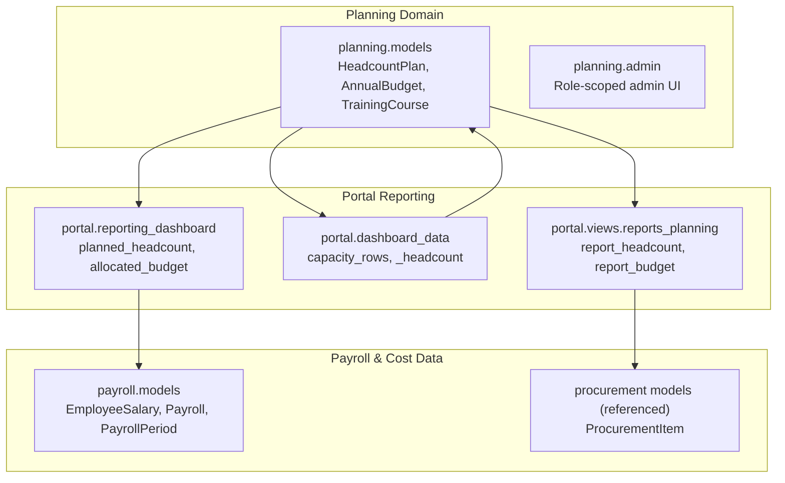
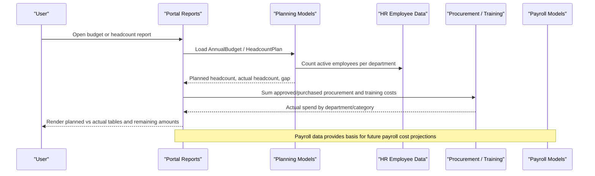
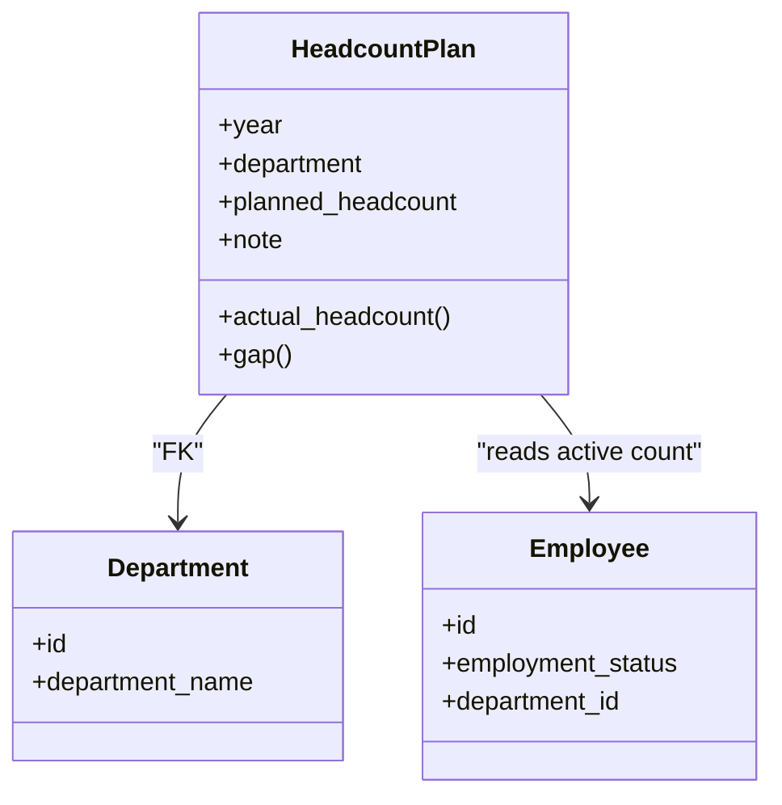
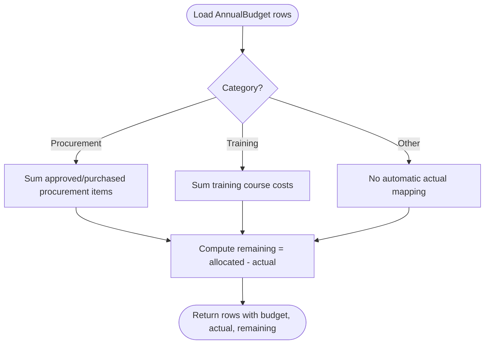
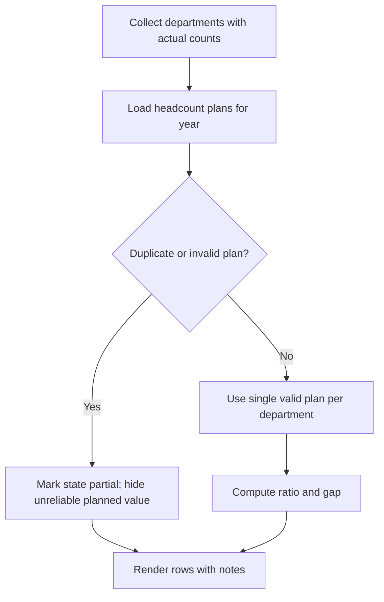
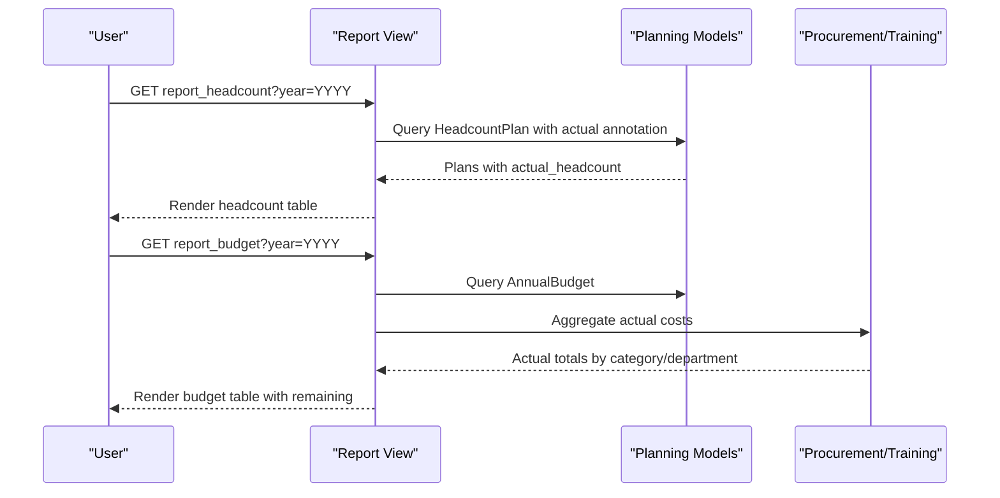
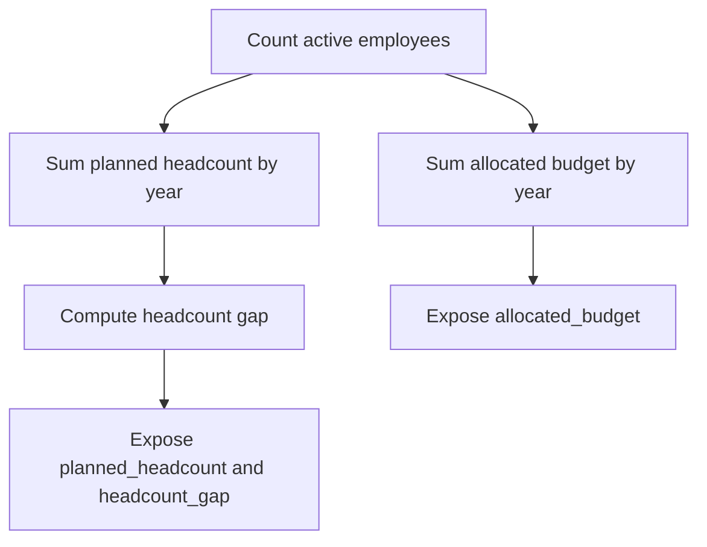
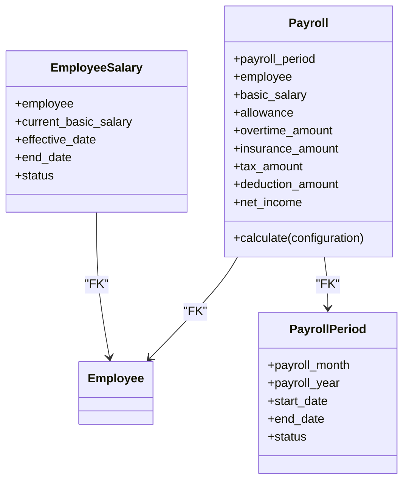
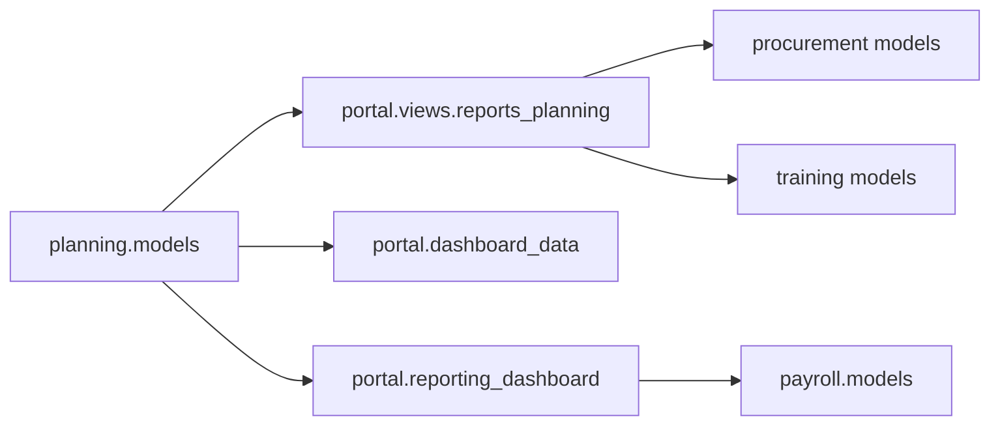

# Budget Planning & Headcount Management

<cite>
**Referenced Files in This Document**   
- [models.py](file://src/apps/planning/models.py)
- [admin.py](file://src/apps/planning/admin.py)
- [reports_planning.py](file://src/apps/portal/views/reports_planning.py)
- [dashboard_data.py](file://src/apps/portal/dashboard_data.py)
- [reporting_dashboard.py](file://src/apps/portal/reporting_dashboard.py)
- [payroll_models.py](file://src/apps/payroll/models.py)
- [planning_tests.py](file://src/apps/planning/tests.py)
- [test_home_dashboard.py](file://src/apps/portal/test_home_dashboard.py)
- [tests_review_hardening.py](file://src/apps/portal/tests_review_hardening.py)
</cite>

## Table of Contents
1. [Introduction](#introduction)
2. [Project Structure](#project-structure)
3. [Core Components](#core-components)
4. [Architecture Overview](#architecture-overview)
5. [Detailed Component Analysis](#detailed-component-analysis)
6. [Dependency Analysis](#dependency-analysis)
7. [Performance Considerations](#performance-considerations)
8. [Troubleshooting Guide](#troubleshooting-guide)
9. [Conclusion](#conclusion)

## Introduction
This document explains how the system supports budget planning and headcount management across departments, positions, and financial periods. It covers:
- Departmental budget allocation by category and year
- Headcount planning per department and year
- Actual vs planned expenditure tracking through procurement and training data
- Integration between HR planning models and payroll cost projections
- Workflows for creating annual budgets, allocating resources, monitoring utilization, revising plans, and generating reports

The implementation is centered on a dedicated planning app with supporting portal reporting views, dashboard data builders, and payroll models that provide the actual cost foundation for forecasting and analysis.

## Project Structure
The relevant code lives primarily under:
- `src/apps/planning`: planning domain models, admin configuration, and tests
- `src/apps/portal/views/reports_planning.py`: planning-related report endpoints
- `src/apps/portal/dashboard_data.py`: homepage capacity/headcount snapshot logic
- `src/apps/portal/reporting_dashboard.py`: cross-domain operational summary including planned headcount and allocated budget
- `src/apps/payroll/models.py`: payroll master data and calculation models used for cost projection and actual payroll totals

**Diagram sources**
- [models.py:12-122](file://src/apps/planning/models.py#L12-L122)
- [admin.py:8-46](file://src/apps/planning/admin.py#L8-L46)
- [reports_planning.py:254-290](file://src/apps/portal/views/reports_planning.py#L254-L290)
- [dashboard_data.py:74-110](file://src/apps/portal/dashboard_data.py#L74-L110)
- [reporting_dashboard.py:149-151](file://src/apps/portal/reporting_dashboard.py#L149-L151)
- [payroll_models.py:33-329](file://src/apps/payroll/models.py#L33-L329)

**Section sources**
- [models.py:12-122](file://src/apps/planning/models.py#L12-L122)
- [reports_planning.py:254-290](file://src/apps/portal/views/reports_planning.py#L254-L290)
- [dashboard_data.py:74-110](file://src/apps/portal/dashboard_data.py#L74-L110)
- [reporting_dashboard.py:149-151](file://src/apps/portal/reporting_dashboard.py#L149-L151)
- [payroll_models.py:33-329](file://src/apps/payroll/models.py#L33-L329)

## Core Components
- Headcount plan per department and year
  - Stores planned headcount and computes actual active employees and gap
  - Enforces one plan per department per year
- Annual budget per department and category
  - Supports categories such as Procurement, Training, Recruitment, Other
  - Enforces one budget row per department/year/category
- Training course and enrollment
  - Tracks planned training costs and participation
- Event scheduling
  - Supports department-level or company-wide events; not directly financial but useful for planning context

Key relationships:
- HeadcountPlan links to Department and reads actuals from Employee
- AnnualBudget links to Department and aggregates actuals from Procurement and Training
- Dashboard and reports consume these models to show planned vs actual metrics

**Section sources**
- [models.py:12-48](file://src/apps/planning/models.py#L12-L48)
- [models.py:103-122](file://src/apps/planning/models.py#L103-L122)
- [models.py:55-97](file://src/apps/planning/models.py#L55-L97)
- [admin.py:8-46](file://src/apps/planning/admin.py#L8-L46)

## Architecture Overview
The planning architecture connects HR planning data to financial reporting and payroll projections:

**Diagram sources**
- [reports_planning.py:254-290](file://src/apps/portal/views/reports_planning.py#L254-L290)
- [dashboard_data.py:74-110](file://src/apps/portal/dashboard_data.py#L74-L110)
- [models.py:12-48](file://src/apps/planning/models.py#L12-L48)
- [models.py:103-122](file://src/apps/planning/models.py#L103-L122)

## Detailed Component Analysis

### Headcount Planning Model
Headcount planning captures the target number of active employees per department for a given year. The model:
- Links to Department and stores planned headcount
- Computes actual headcount from active employees
- Exposes a gap field indicating shortage or surplus relative to plan
- Uses a unique constraint to prevent duplicate plans per department/year

**Diagram sources**
- [models.py:12-48](file://src/apps/planning/models.py#L12-L48)

Operational behavior:
- Admin UI shows planned vs actual and gap, scoped by role
- Dashboard uses a helper to annotate plans with actual counts and compute ratios and notes for missing or invalid plans

**Section sources**
- [models.py:12-48](file://src/apps/planning/models.py#L12-L48)
- [admin.py:8-25](file://src/apps/planning/admin.py#L8-L25)
- [dashboard_data.py:74-110](file://src/apps/portal/dashboard_data.py#L74-L110)

### Annual Budget Model
Annual budget records approved allocations per department and category for a given year. Categories include Procurement, Training, Recruitment, and Other. The model:
- Links to Department (nullable for company-wide budgets)
- Stores allocated amount and note
- Enforces uniqueness per year/department/category

Actual expenditure mapping:
- Procurement category: sums approved or purchased procurement items by department or company-wide
- Training category: sums training course costs by year
- Remaining = allocated amount minus actual

**Diagram sources**
- [reports_planning.py:267-290](file://src/apps/portal/views/reports_planning.py#L267-L290)
- [models.py:103-122](file://src/apps/planning/models.py#L103-L122)

**Section sources**
- [models.py:103-122](file://src/apps/planning/models.py#L103-L122)
- [reports_planning.py:267-290](file://src/apps/portal/views/reports_planning.py#L267-L290)

### Dashboard Capacity and Headcount Snapshot
The dashboard builds a capacity view that:
- Lists all live departments with actual active employee counts
- Loads headcount plans for the current year
- Detects duplicate or invalid plans and marks state as partial
- Computes ratio of actual to planned and displays helpful notes

**Diagram sources**
- [dashboard_data.py:74-110](file://src/apps/portal/dashboard_data.py#L74-L110)

**Section sources**
- [dashboard_data.py:74-110](file://src/apps/portal/dashboard_data.py#L74-L110)
- [test_home_dashboard.py:232-250](file://src/apps/portal/test_home_dashboard.py#L232-L250)

### Planning Report Endpoints
Two primary planning reports are exposed:
- Headcount report: lists plans with actual headcount and gap for a selected year
- Budget report: lists annual budgets with actual spend and remaining balance

Both require the user to have permission to view reports.

**Diagram sources**
- [reports_planning.py:254-290](file://src/apps/portal/views/reports_planning.py#L254-L290)

**Section sources**
- [reports_planning.py:254-290](file://src/apps/portal/views/reports_planning.py#L254-L290)

### Cross-Domain Operational Summary
The reporting dashboard aggregates operational metrics including:
- Total active employees
- Planned headcount across departments for the year
- Gap between planned and actual headcount
- Allocated budget total for the year

**Diagram sources**
- [reporting_dashboard.py:149-151](file://src/apps/portal/reporting_dashboard.py#L149-L151)

**Section sources**
- [reporting_dashboard.py:149-151](file://src/apps/portal/reporting_dashboard.py#L149-L151)

### Payroll Integration and Cost Projections
While the planning module does not directly calculate payroll, it integrates conceptually with payroll models:
- EmployeeSalary tracks effective basic salary history per employee
- PayrollPeriod defines monthly payroll windows
- Payroll calculates gross income, insurance, tax, and net income based on attendance and statutory rates

For budgeting and forecasting:
- Headcount plans inform expected headcount growth or reduction
- EmployeeSalary and Payroll data provide baseline cost per employee
- Combined, they enable projected payroll cost scenarios aligned with planned headcount changes

**Diagram sources**
- [payroll_models.py:33-329](file://src/apps/payroll/models.py#L33-L329)

**Section sources**
- [payroll_models.py:33-329](file://src/apps/payroll/models.py#L33-L329)

## Dependency Analysis
Key dependencies and coupling:
- Planning models depend on organization.Department and hrm.Employee for actuals
- Portal reports depend on planning models and finance-related models (procurement/training)
- Dashboard depends on planning models and security permissions
- Reporting dashboard aggregates planning and payroll metrics

Potential circular dependencies:
- None observed among planning, portal reporting, and payroll modules
- Read-only aggregation patterns avoid tight coupling

External integration points:
- Procurement and training data sources for actual spending
- Security and permissions for access control
- Export utilities for report outputs

**Diagram sources**
- [models.py:12-122](file://src/apps/planning/models.py#L12-L122)
- [reports_planning.py:254-290](file://src/apps/portal/views/reports_planning.py#L254-L290)
- [dashboard_data.py:74-110](file://src/apps/portal/dashboard_data.py#L74-L110)
- [reporting_dashboard.py:149-151](file://src/apps/portal/reporting_dashboard.py#L149-L151)
- [payroll_models.py:33-329](file://src/apps/payroll/models.py#L33-L329)

**Section sources**
- [models.py:12-122](file://src/apps/planning/models.py#L12-L122)
- [reports_planning.py:254-290](file://src/apps/portal/views/reports_planning.py#L254-L290)
- [dashboard_data.py:74-110](file://src/apps/portal/dashboard_data.py#L74-L110)
- [reporting_dashboard.py:149-151](file://src/apps/portal/reporting_dashboard.py#L149-L151)
- [payroll_models.py:33-329](file://src/apps/payroll/models.py#L33-L329)

## Performance Considerations
- Use annotated queries to minimize N+1 issues when computing actual headcount and gaps
- Prefer aggregations at the database level for procurement and training costs
- Cache dashboard snapshots where appropriate to reduce repeated heavy queries
- Validate date ranges and constraints to avoid excessive filtering overhead

[No sources needed since this section provides general guidance]

## Troubleshooting Guide
Common issues and resolutions:
- Duplicate headcount plan per department/year
  - Symptom: Integrity error when saving
  - Resolution: Update existing plan instead of creating a new one
- Invalid or missing plan data
  - Symptom: Dashboard shows partial state or missing ratios
  - Resolution: Ensure exactly one valid plan per department/year; avoid negative or null planned values
- Budget report discrepancies
  - Symptom: Actual spend does not match expectations
  - Resolution: Verify procurement item statuses and deletion flags; ensure only approved/purchased items are counted
- Permission errors
  - Symptom: Redirected from report pages
  - Resolution: Grant view_reports permission to the user role

**Section sources**
- [planning_tests.py:41-57](file://src/apps/planning/tests.py#L41-L57)
- [test_home_dashboard.py:232-250](file://src/apps/portal/test_home_dashboard.py#L232-L250)
- [tests_review_hardening.py:273-283](file://src/apps/portal/tests_review_hardening.py#L273-L283)

## Conclusion
The system provides a robust foundation for budget planning and headcount management:
- Clear planning models for headcount and annual budgets
- Integrated reporting for planned vs actual expenditures
- Dashboard visibility into capacity and budget status
- Conceptual linkage to payroll models for cost projections and forecasting

To extend capabilities:
- Add direct payroll cost aggregation into budget reports
- Implement scenario modeling for headcount-driven payroll projections
- Enhance audit trails for budget revisions and approvals

[No sources needed since this section summarizes without analyzing specific files]