# Payroll & Finance

<cite>
**Referenced Files in This Document**
- [models.py](file://src/apps/payroll/models.py)
- [payslip_pdf.py](file://src/apps/payroll/payslip_pdf.py)
- [finance.py](file://src/apps/portal/views/finance.py)
- [models.py](file://src/apps/planning/models.py)
- [reports_planning.py](file://src/apps/portal/views/reports_planning.py)
- [03_Database_Design.md](file://docs/03_Database_Design.md)
- [run_finance_followup_uat.py](file://ops/run_finance_followup_uat.py)
</cite>

## Table of Contents
1. [Introduction](#introduction)
2. [Project Structure](#project-structure)
3. [Core Components](#core-components)
4. [Architecture Overview](#architecture-overview)
5. [Detailed Component Analysis](#detailed-component-analysis)
6. [Dependency Analysis](#dependency-analysis)
7. [Performance Considerations](#performance-considerations)
8. [Troubleshooting Guide](#troubleshooting-guide)
9. [Conclusion](#conclusion)
10. [Appendices](#appendices)

## Introduction
This document explains the payroll and finance modules that support salary calculation, Vietnamese statutory tax and social insurance computation, budget planning, payslip generation, financial reporting, period locking, and audit trail maintenance. It focuses on how payroll periods drive processing cycles, how salary components are calculated, how attendance data integrates into salary computation, and how the system produces locked, auditable financial outputs.

The implementation is Django-based:
- `apps.payroll` contains the domain models for salary structure, payroll periods, payroll lines, tax configuration, and payslips.
- `apps.portal.views.finance` provides the finance user interface workflows for creating periods, generating payroll rows, calculating salaries, locking periods, issuing payslips, and managing statutory configurations.
- `apps.planning` provides headcount planning, annual budgets, training, and events.
- `apps.portal.views.reports_planning` provides budget utilization reporting against planned budgets and actual procurement/training costs.

## Project Structure
The payroll and finance features span several modules:

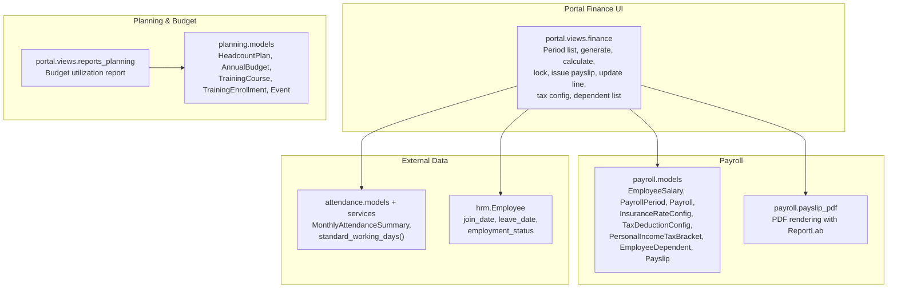

**Diagram sources**
- [models.py:17-532](file://src/apps/payroll/models.py#L17-L532)
- [payslip_pdf.py:21-154](file://src/apps/payroll/payslip_pdf.py#L21-L154)
- [finance.py:41-515](file://src/apps/portal/views/finance.py#L41-L515)
- [models.py:12-166](file://src/apps/planning/models.py#L12-L166)
- [reports_planning.py:274-287](file://src/apps/portal/views/reports_planning.py#L274-L287)

**Section sources**
- [models.py:17-532](file://src/apps/payroll/models.py#L17-L532)
- [payslip_pdf.py:21-154](file://src/apps/payroll/payslip_pdf.py#L21-L154)
- [finance.py:41-515](file://src/apps/portal/views/finance.py#L41-L515)
- [models.py:12-166](file://src/apps/planning/models.py#L12-L166)
- [reports_planning.py:274-287](file://src/apps/portal/views/reports_planning.py#L274-L287)

## Core Components
This section summarizes the main domain objects and their responsibilities.

### Payroll Periods and Processing Cycles
- `PayrollPeriod` represents a monthly processing cycle identified by month and year, with start/end dates and an `Open` or `Locked` status.
- The unique constraint prevents duplicate months per year.
- Locked periods prevent further payroll edits and trigger payslip issuance.

**Section sources**
- [models.py:248-266](file://src/apps/payroll/models.py#L248-L266)
- [finance.py:85-121](file://src/apps/portal/views/finance.py#L85-L121)

### Salary Structure and Master Data
- `EmployeeSalary` stores effective basic salary history per employee with overlap validation.
- `InsuranceRateConfig` stores time-effective social insurance rates, base salary reference, regional minimum wage, and caps.
- `TaxDeductionConfig` stores self and dependent deductions effective from a date.
- `PersonalIncomeTaxBracket` stores progressive personal income tax brackets effective from a date.
- `EmployeeDependent` tracks dependents registered for tax deduction with overlap protection.

**Section sources**
- [models.py:33-81](file://src/apps/payroll/models.py#L33-L81)
- [models.py:88-147](file://src/apps/payroll/models.py#L88-L147)
- [models.py:150-190](file://src/apps/payroll/models.py#L150-L190)
- [models.py:193-241](file://src/apps/payroll/models.py#L193-L241)

### Payroll Line and Calculation Engine
- `Payroll` links an employee to a payroll period and holds input fields (basic salary, allowance, overtime, exempt overtime, insurance salary, other deductions) and computed fields (standard working days, actual working days, gross income, insurance amount, tax amount, net income).
- `calculate()` computes prorated salary based on attendance, social insurance, personal income tax, and net pay using configuration effective at the period start date.
- `validate_calculated()` ensures all payroll lines are freshly calculated before locking.

**Section sources**
- [models.py:269-370](file://src/apps/payroll/models.py#L269-L370)
- [models.py:371-515](file://src/apps/payroll/models.py#L371-L515)

### Payslip Generation
- `Payslip` is a one-to-one record created when a payroll period is locked or when backfilling issued payslips.
- `render_payslip_pdf()` generates a Vietnamese PDF payslip using ReportLab, including employee info, work days, income items, deductions, and net pay.

**Section sources**
- [models.py:517-532](file://src/apps/payroll/models.py#L517-L532)
- [payslip_pdf.py:21-154](file://src/apps/payroll/payslip_pdf.py#L21-L154)
- [finance.py:41-78](file://src/apps/portal/views/finance.py#L41-L78)

### Planning and Budget Models
- `HeadcountPlan` plans headcount per department per year and exposes actual active headcount and gap.
- `AnnualBudget` defines approved budget allocations per year, department, and category.
- `TrainingCourse`, `TrainingEnrollment`, and `Event` support planning-related master data and scheduling.

**Section sources**
- [models.py:12-48](file://src/apps/planning/models.py#L12-L48)
- [models.py:103-123](file://src/apps/planning/models.py#L103-L123)
- [models.py:55-97](file://src/apps/planning/models.py#L55-L97)
- [models.py:129-166](file://src/apps/planning/models.py#L129-L166)

## Architecture Overview
The payroll workflow is driven by finance users through portal views, which interact with payroll models, attendance data, and notification services.

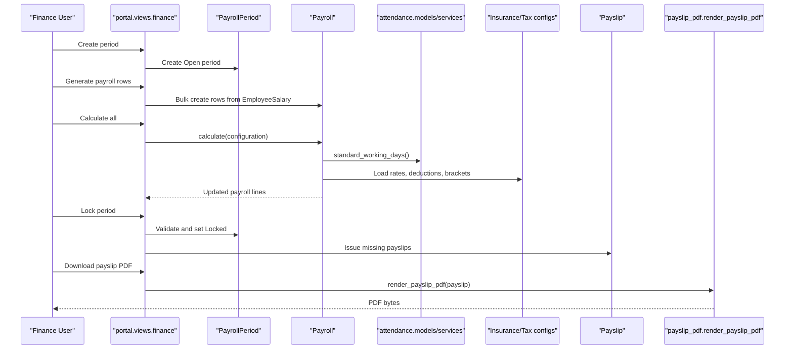

**Diagram sources**
- [finance.py:98-121](file://src/apps/portal/views/finance.py#L98-L121)
- [finance.py:173-227](file://src/apps/portal/views/finance.py#L173-L227)
- [finance.py:230-272](file://src/apps/portal/views/finance.py#L230-L272)
- [finance.py:275-346](file://src/apps/portal/views/finance.py#L275-L346)
- [finance.py:349-375](file://src/apps/portal/views/finance.py#L349-L375)
- [finance.py:54-78](file://src/apps/portal/views/finance.py#L54-L78)
- [models.py:405-515](file://src/apps/payroll/models.py#L405-L515)
- [payslip_pdf.py:56-154](file://src/apps/payroll/payslip_pdf.py#L56-L154)

## Detailed Component Analysis

### PayrollPeriod Model and Cycle Control
`PayrollPeriod` enforces monthly uniqueness and lifecycle control:
- Creation sets first and last day of the month.
- Status transitions from `Open` to `Locked`.
- Locked periods block new payroll row creation and recalculation.

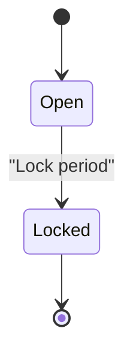

**Diagram sources**
- [models.py:248-266](file://src/apps/payroll/models.py#L248-L266)
- [finance.py:275-346](file://src/apps/portal/views/finance.py#L275-L346)

**Section sources**
- [models.py:248-266](file://src/apps/payroll/models.py#L248-L266)
- [finance.py:85-121](file://src/apps/portal/views/finance.py#L85-L121)
- [finance.py:275-346](file://src/apps/portal/views/finance.py#L275-L346)

### Salary Components and Calculation Logic
The payroll engine computes:
- Standard working days for the period.
- Actual working days based on employee presence and approved unpaid leave.
- Prorated basic salary and allowance.
- Gross income including overtime.
- Social insurance contributions with caps.
- Personal income tax using progressive brackets.
- Net income after insurance, tax, and other deductions.

```mermaid
flowchart TD
Start(["Start calculate()"]) --> LoadCfg["Load InsuranceRateConfig, TaxDeductionConfig, PersonalIncomeTaxBracket<br/>effective at period start"]
LoadCfg --> WorkDays["Compute standard_working_days(period)"]
WorkDays --> Presence["Compute present_from/present_to from join/leave dates"]
Presence --> Unpaid["Read approved unpaid_leave_days from MonthlyAttendanceSummary"]
Unpaid --> ActualDays["actual_working_days = max(present_standard_days - unpaid_days, 0)"]
ActualDays --> Ratio["work_ratio = min(actual / standard, 1)"]
Ratio --> Prorate["prorated_basic_salary, prorated_allowance"]
Prorate --> Gross["gross_income = prorated_basic + prorated_allowance + overtime_amount"]
Gross --> InsBase["insurance_base = insurance_salary or basic_salary"]
InsBase --> Caps["Apply social_health_cap and unemployment_cap"]
Caps --> InsAmount["insurance_amount = sum(employee rates)"]
InsAmount --> Dependents["Count active dependents effective at period start"]
Dependents --> Exempt["overtime_tax_exempt_amount capped by overtime_amount"]
Exempt --> Taxable["taxable_income = max(gross - exempt - insurance - self_deduction - dependents_deduction, 0)"]
Taxable --> Brackets["Progressive tax across PersonalIncomeTaxBracket"]
Brackets --> Net["net_income = gross - insurance - tax - deduction_amount"]
Net --> End(["Save calculated_at and signature"])
```

**Diagram sources**
- [models.py:405-515](file://src/apps/payroll/models.py#L405-L515)

**Section sources**
- [models.py:371-515](file://src/apps/payroll/models.py#L371-L515)

### Vietnamese Statutory Rules Implementation
Key rules implemented:
- Social insurance contribution base uses contract salary, not gross income.
- Caps: social health cap equals 20 times base salary reference; unemployment cap equals 20 times regional minimum wage.
- Personal income tax is progressive by bracket effective at the period start date.
- Deductions include self deduction and dependent deduction effective at the period start date.
- Overtime premium above normal hourly rate can be tax-exempt up to declared exempt amount.

These rules are enforced by:
- `InsuranceRateConfig` properties for caps and total employee rate.
- `TaxDeductionConfig` for self and dependent deductions.
- `PersonalIncomeTaxBracket` progressive iteration.
- `Payroll.calculate()` applying caps, exemptions, and progressive tax.

**Section sources**
- [models.py:88-147](file://src/apps/payroll/models.py#L88-L147)
- [models.py:150-190](file://src/apps/payroll/models.py#L150-L190)
- [models.py:458-512](file://src/apps/payroll/models.py#L458-L512)
- [03_Database_Design.md:2151-2174](file://docs/03_Database_Design.md#L2151-L2174)

### Payslip Generation System
Payslips are generated as immutable PDF documents:
- Only employees can download their own payslip for a locked period.
- PDF includes employee details, work days, income breakdown, insurance, tax, deductions, and net pay.
- Font registration supports Vietnamese characters via configured TTF fonts.

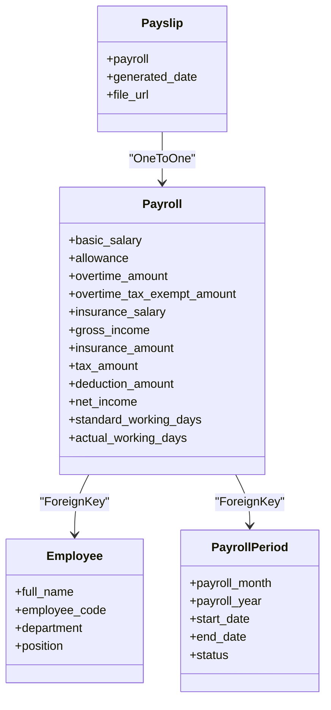

**Diagram sources**
- [models.py:269-370](file://src/apps/payroll/models.py#L269-L370)
- [models.py:517-532](file://src/apps/payroll/models.py#L517-L532)
- [payslip_pdf.py:56-154](file://src/apps/payroll/payslip_pdf.py#L56-L154)

**Section sources**
- [payslip_pdf.py:21-154](file://src/apps/payroll/payslip_pdf.py#L21-L154)
- [finance.py:54-78](file://src/apps/portal/views/finance.py#L54-L78)

### Budget Planning System
Budget planning covers:
- Headcount planning per department per year with actual headcount and gap.
- Annual budgets per department/category with allocated amounts.
- Training courses and enrollments for development planning.
- Events for scheduling and coordination.

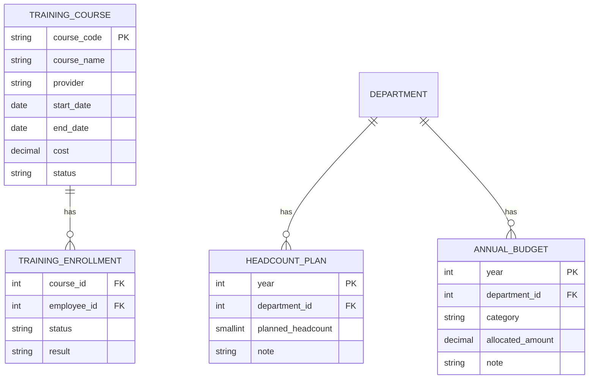

**Diagram sources**
- [models.py:12-48](file://src/apps/planning/models.py#L12-L48)
- [models.py:103-123](file://src/apps/planning/models.py#L103-L123)
- [models.py:55-97](file://src/apps/planning/models.py#L55-L97)

**Section sources**
- [models.py:12-48](file://src/apps/planning/models.py#L12-L48)
- [models.py:103-123](file://src/apps/planning/models.py#L103-L123)

### Financial Reporting and Budget Utilization
Budget utilization compares allocated budgets with actual costs:
- Procurement costs aggregated by department and company-wide.
- Training costs aggregated by year.
- Remaining budget computed per row.

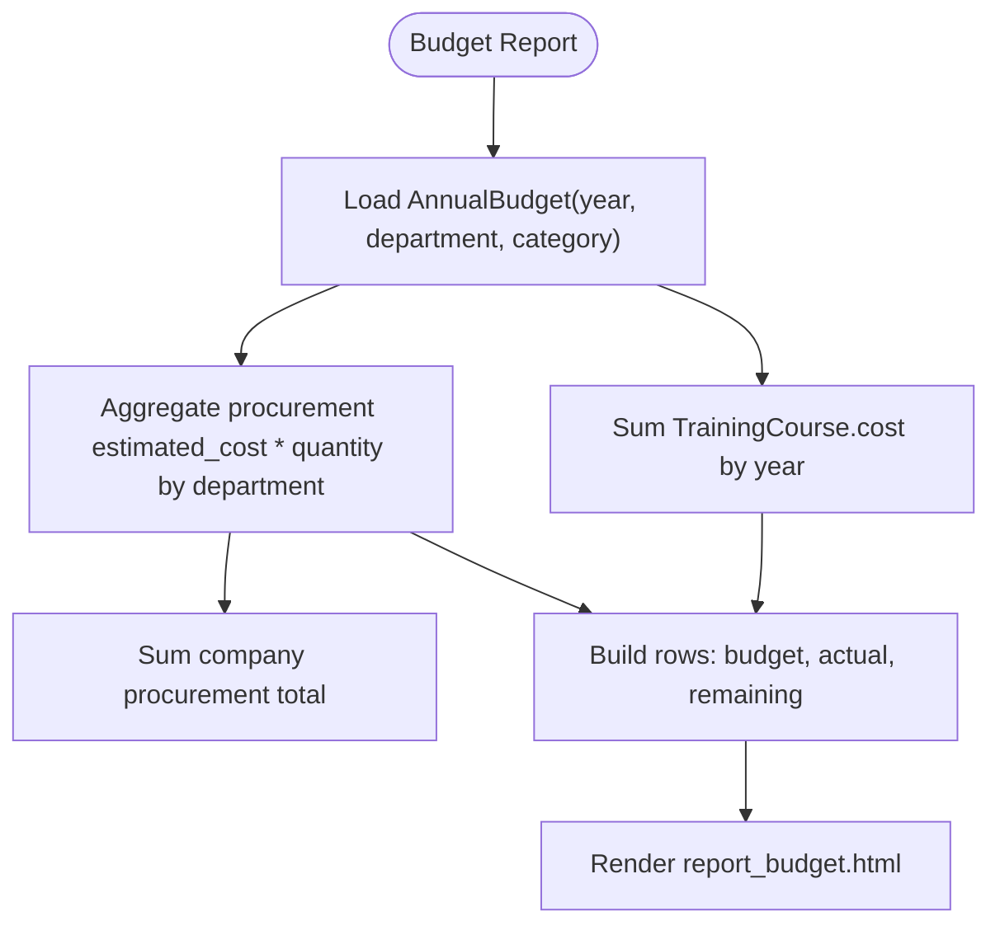

**Diagram sources**
- [reports_planning.py:274-287](file://src/apps/portal/views/reports_planning.py#L274-L287)

**Section sources**
- [reports_planning.py:274-287](file://src/apps/portal/views/reports_planning.py#L274-L287)

### Integration with Attendance Data
Payroll calculation integrates attendance data:
- Uses `MonthlyAttendanceSummary` with approved status to determine unpaid leave days.
- Uses `standard_working_days()` service to compute standard working days for period ranges.
- Adjusts actual working days based on employee join/leave dates and approved unpaid leave.

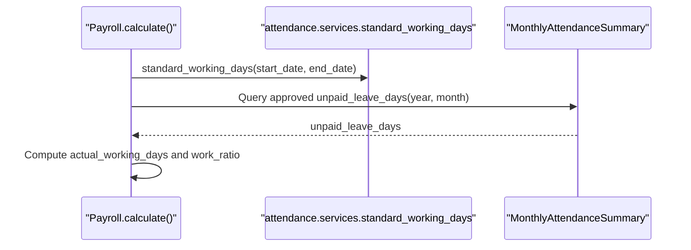

**Diagram sources**
- [models.py:405-456](file://src/apps/payroll/models.py#L405-L456)

**Section sources**
- [models.py:405-456](file://src/apps/payroll/models.py#L405-L456)

### Running Payroll Periods
Typical operations:
- Create a payroll period for a given month/year.
- Generate payroll rows for eligible employees using effective salary.
- Update optional inputs like allowance, overtime, exempt overtime, insurance salary, and other deductions.
- Recalculate all payroll lines for the period.
- Lock the period after validation and issue payslips.
- Employees download their own payslip PDF.

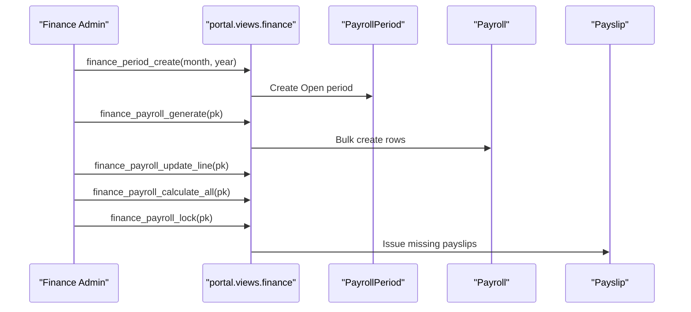

**Diagram sources**
- [finance.py:98-121](file://src/apps/portal/views/finance.py#L98-L121)
- [finance.py:173-227](file://src/apps/portal/views/finance.py#L173-L227)
- [finance.py:378-406](file://src/apps/portal/views/finance.py#L378-L406)
- [finance.py:230-272](file://src/apps/portal/views/finance.py#L230-L272)
- [finance.py:275-346](file://src/apps/portal/views/finance.py#L275-L346)

**Section sources**
- [finance.py:98-121](file://src/apps/portal/views/finance.py#L98-L121)
- [finance.py:173-227](file://src/apps/portal/views/finance.py#L173-L227)
- [finance.py:230-272](file://src/apps/portal/views/finance.py#L230-L272)
- [finance.py:275-346](file://src/apps/portal/views/finance.py#L275-L346)

### Calculating Taxes According to Vietnamese Regulations
Taxes are calculated using:
- Effective insurance rates and caps from `InsuranceRateConfig`.
- Effective self and dependent deductions from `TaxDeductionConfig`.
- Progressive personal income tax brackets from `PersonalIncomeTaxBracket`.
- Exempt overtime amount capped by overtime amount.
- Approved unpaid leave affecting actual working days and proration.

**Section sources**
- [models.py:371-515](file://src/apps/payroll/models.py#L371-L515)
- [03_Database_Design.md:2151-2174](file://docs/03_Database_Design.md#L2151-L2174)

### Generating Financial Reports
Financial reports include:
- Budget utilization by department and category.
- Comparison of allocated budget vs actual procurement and training costs.
- Remaining budget per row.

**Section sources**
- [reports_planning.py:274-287](file://src/apps/portal/views/reports_planning.py#L274-L287)

### Financial Year Closing Procedures
Yearly closing is supported by:
- Payroll period locking to finalize monthly calculations.
- Payslip issuance for locked periods.
- Audit fields (`created_by`, `modified_by`, timestamps) on all business models.
- Validation preventing modification of locked periods.

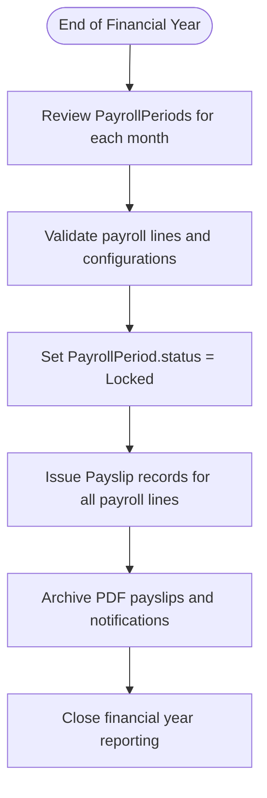

**Diagram sources**
- [finance.py:275-346](file://src/apps/portal/views/finance.py#L275-L346)
- [models.py:248-266](file://src/apps/payroll/models.py#L248-L266)
- [models.py:517-532](file://src/apps/payroll/models.py#L517-L532)

**Section sources**
- [finance.py:275-346](file://src/apps/portal/views/finance.py#L275-L346)
- [models.py:248-266](file://src/apps/payroll/models.py#L248-L266)
- [models.py:517-532](file://src/apps/payroll/models.py#L517-L532)

### Audit Trail Maintenance
Audit trails are maintained through:
- Base audit model fields on payroll, planning, and related entities.
- `calculated_at` and `calculation_signature` on `Payroll` to detect stale calculations.
- `validate_calculated()` ensuring consistency before locking.
- Notification logs for period locking and payslip issuance.

**Section sources**
- [models.py:322-342](file://src/apps/payroll/models.py#L322-L342)
- [finance.py:319-344](file://src/apps/portal/views/finance.py#L319-L344)

## Dependency Analysis
Key dependencies:
- `Payroll.calculate()` depends on attendance summary and standard working days.
- Portal finance views depend on payroll models, HR employee data, and notification services.
- PDF generation depends on ReportLab and font availability.
- Budget reporting depends on procurement and training data.

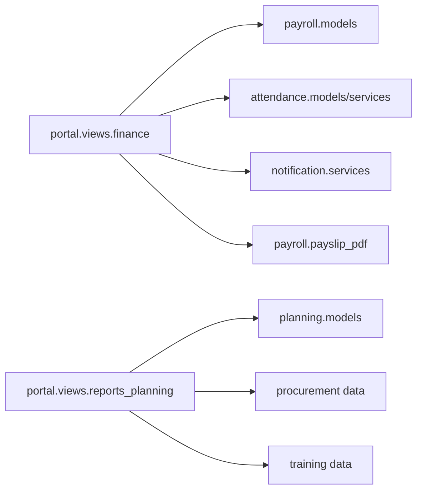

**Diagram sources**
- [finance.py:1-27](file://src/apps/portal/views/finance.py#L1-L27)
- [finance.py:148-272](file://src/apps/portal/views/finance.py#L148-L272)
- [reports_planning.py:274-287](file://src/apps/portal/views/reports_planning.py#L274-L287)

**Section sources**
- [finance.py:1-27](file://src/apps/portal/views/finance.py#L1-L27)
- [finance.py:148-272](file://src/apps/portal/views/finance.py#L148-L272)
- [reports_planning.py:274-287](file://src/apps/portal/views/reports_planning.py#L274-L287)

## Performance Considerations
- Bulk creation of payroll rows reduces database round-trips during generation.
- Per-employee savepoints isolate calculation errors without rolling out entire batch runs.
- Select-for-update locks prevent concurrent modifications during critical operations.
- Efficient queries use `select_related` and filtered status checks.

[No sources needed since this section provides general guidance]

## Troubleshooting Guide
Common issues and resolutions:
- Missing statutory configuration: Ensure `InsuranceRateConfig`, `TaxDeductionConfig`, and `PersonalIncomeTaxBracket` are defined effective at the period start date.
- Zero basic salary: Locking fails if any payroll line has zero or null basic salary.
- Overlapping salary or dependent registrations: Validation prevents overlapping effective dates.
- Locked period edits: Cannot modify payroll lines or recalculate after locking.
- PDF font issues: Configure `PAYSLIP_FONT_PATH` to a valid TTF file supporting Vietnamese characters.

**Section sources**
- [models.py:55-81](file://src/apps/payroll/models.py#L55-L81)
- [models.py:212-241](file://src/apps/payroll/models.py#L212-L241)
- [models.py:351-367](file://src/apps/payroll/models.py#L351-L367)
- [finance.py:275-346](file://src/apps/portal/views/finance.py#L275-L346)
- [payslip_pdf.py:21-49](file://src/apps/payroll/payslip_pdf.py#L21-L49)

## Conclusion
The payroll and finance modules provide a robust, auditable system for salary calculation, statutory tax and insurance compliance, budget planning, and financial reporting. Payroll periods enforce lifecycle control, while the calculation engine integrates attendance data and Vietnamese regulatory rules. Payslip generation produces immutable PDF documents, and budget reporting enables tracking of planned versus actual expenditures. The design emphasizes data integrity, historical accuracy, and operational safety through validations, locks, and audit trails.

[No sources needed since this section summarizes without analyzing specific files]

## Appendices

### Example: Running Payroll Periods
A typical UAT setup creates a payroll period, payroll rows, statutory configurations, and then exercises finance routes.

**Section sources**
- [run_finance_followup_uat.py:40-47](file://ops/run_finance_followup_uat.py#L40-L47)

### Database Schema References
The database design document outlines payroll tables and formulas.

**Section sources**
- [03_Database_Design.md:770-858](file://docs/03_Database_Design.md#L770-L858)
- [03_Database_Design.md:2151-2174](file://docs/03_Database_Design.md#L2151-L2174)