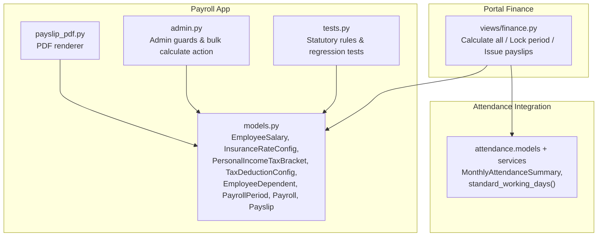
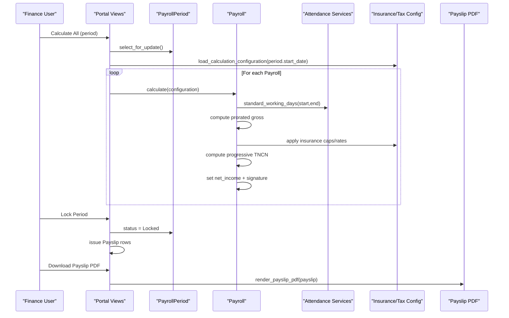
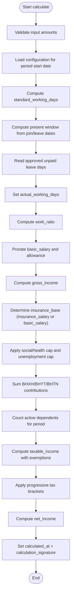
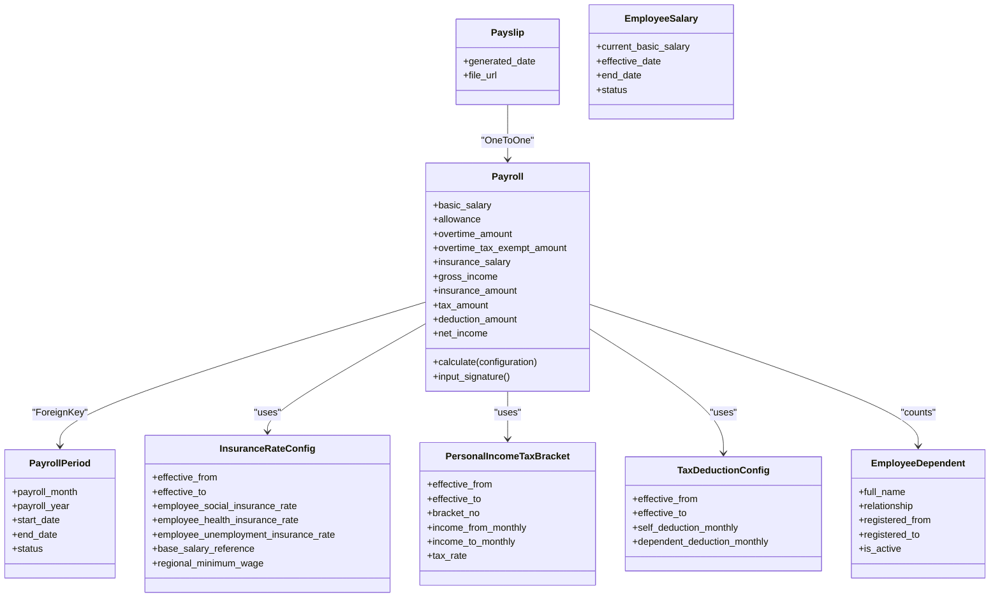
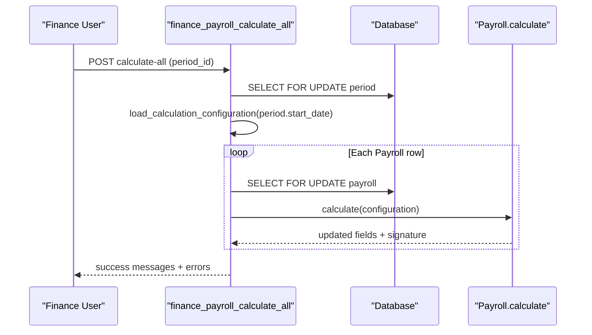
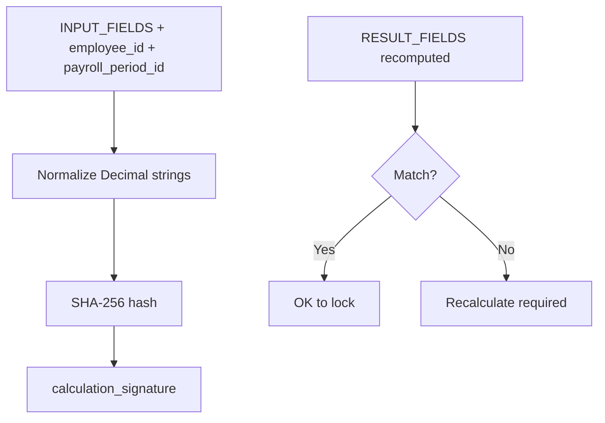
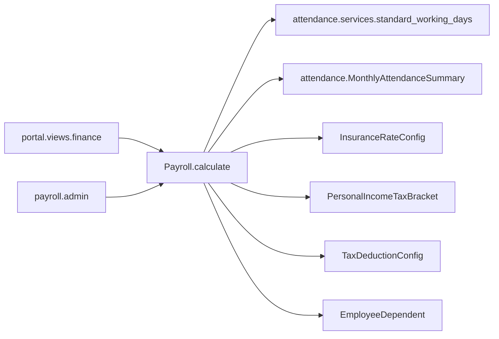

# Payroll Processing Engine

<cite>
**Referenced Files in This Document**
- [models.py](file://src/apps/payroll/models.py)
- [payslip_pdf.py](file://src/apps/payroll/payslip_pdf.py)
- [admin.py](file://src/apps/payroll/admin.py)
- [tests.py](file://src/apps/payroll/tests.py)
- [finance.py](file://src/apps/portal/views/finance.py)
</cite>

## Table of Contents
1. [Introduction](#introduction)
2. [Project Structure](#project-structure)
3. [Core Components](#core-components)
4. [Architecture Overview](#architecture-overview)
5. [Detailed Component Analysis](#detailed-component-analysis)
6. [Dependency Analysis](#dependency-analysis)
7. [Performance Considerations](#performance-considerations)
8. [Troubleshooting Guide](#troubleshooting-guide)
9. [Conclusion](#conclusion)

## Introduction
This document explains the payroll processing engine implemented for Vietnamese labor regulations. It covers salary calculation workflows, pay period management, and payslip generation. The core logic is centered around:
- Gross income computation with proration by actual working days
- Statutory deductions (BHXH, BHYT, BHTN) with statutory caps
- Personal income tax (TNCN) using progressive brackets
- Net income determination
- Payroll period open/locked lifecycle
- Employee base salary history with effective date ranges and overlap validation
- PDF payslip rendering

The engine also provides an audit trail through a calculation signature system to ensure data integrity and reproducibility.

## Project Structure
The payroll feature lives under `apps.payroll` and integrates with HR, attendance, and portal finance flows.

**Diagram sources**
- [models.py:17-532](file://src/apps/payroll/models.py#L17-L532)
- [payslip_pdf.py:21-154](file://src/apps/payroll/payslip_pdf.py#L21-L154)
- [admin.py:10-137](file://src/apps/payroll/admin.py#L10-L137)
- [tests.py:1-421](file://src/apps/payroll/tests.py#L1-L421)
- [finance.py:235-409](file://src/apps/portal/views/finance.py#L235-L409)

**Section sources**
- [models.py:17-532](file://src/apps/payroll/models.py#L17-L532)
- [payslip_pdf.py:21-154](file://src/apps/payroll/payslip_pdf.py#L21-L154)
- [admin.py:10-137](file://src/apps/payroll/admin.py#L10-L137)
- [tests.py:1-421](file://src/apps/payroll/tests.py#L1-L421)
- [finance.py:235-409](file://src/apps/portal/views/finance.py#L235-L409)

## Core Components
- EmployeeSalary: Tracks employee base salaries with effective date ranges and overlap validation.
- InsuranceRateConfig: Time-effective statutory insurance rates and caps.
- PersonalIncomeTaxBracket: Progressive tax bracket definitions per generation.
- TaxDeductionConfig: Self and dependent deduction amounts per generation.
- EmployeeDependent: Dependent registrations with effective date ranges and overlap validation.
- PayrollPeriod: Monthly payroll cycle with Open/Locked states.
- Payroll: Per-employee monthly calculation record with input fields, computed results, and audit signature.
- Payslip: One-to-one record linking to a Payroll for PDF issuance.

Key responsibilities:
- Payroll.calculate computes gross, insurance, tax, and net values based on configuration effective at the period start date.
- PayrollPeriod enforces one row per month/year and protects locked periods from modification.
- EmployeeSalary and EmployeeDependent prevent overlapping effective date ranges.
- Payslip stores generated PDF metadata; PDF content is rendered by payslip_pdf.py.

**Section sources**
- [models.py:33-81](file://src/apps/payroll/models.py#L33-L81)
- [models.py:88-148](file://src/apps/payroll/models.py#L88-L148)
- [models.py:150-191](file://src/apps/payroll/models.py#L150-L191)
- [models.py:173-242](file://src/apps/payroll/models.py#L173-L242)
- [models.py:248-267](file://src/apps/payroll/models.py#L248-L267)
- [models.py:269-515](file://src/apps/payroll/models.py#L269-L515)
- [models.py:517-532](file://src/apps/payroll/models.py#L517-L532)

## Architecture Overview
The payroll engine follows a layered approach:
- Data layer: Django models define master data, period state, and calculation records.
- Calculation layer: Payroll.calculate orchestrates inputs, attendance-derived workdays, statutory deductions, and tax computation.
- Portal integration: Finance views orchestrate bulk calculations, locking, and payslip issuance.
- Output layer: PDF renderer produces immutable payslips after period lock.

**Diagram sources**
- [finance.py:235-349](file://src/apps/portal/views/finance.py#L235-L349)
- [models.py:372-515](file://src/apps/payroll/models.py#L372-L515)
- [payslip_pdf.py:56-154](file://src/apps/payroll/payslip_pdf.py#L56-L154)

## Detailed Component Analysis

### Payroll Calculation Workflow
Payroll.calculate performs:
- Input validation
- Configuration loading for the period’s start date
- Standard working days from attendance services
- Prorating basic salary and allowance by actual working days
- Gross income including overtime
- Statutory insurance deductions with caps
- Progressive personal income tax with exemptions and dependents
- Net income and audit signature

**Diagram sources**
- [models.py:405-515](file://src/apps/payroll/models.py#L405-L515)

**Section sources**
- [models.py:405-515](file://src/apps/payroll/models.py#L405-L515)

### Gross Income Computation and Proration
- Basic salary and allowance are prorated by work_ratio = min(actual_working_days / standard_working_days, 1).
- Overtime amount is added directly to gross.
- If standard_working_days is zero, work_ratio defaults to 1.

Examples validated by tests:
- Full-month salary yields expected gross.
- Mid-month hire or departure yields prorated gross.

**Section sources**
- [models.py:426-456](file://src/apps/payroll/models.py#L426-L456)
- [tests.py:384-421](file://src/apps/payroll/tests.py#L384-L421)

### Insurance Deductions (BHXH, BHYT, BHTN)
- Insurance base is contract salary (insurance_salary), defaulting to basic_salary if not provided.
- Social and health insurance caps: max 20 × base_salary_reference.
- Unemployment insurance cap: max 20 × regional_minimum_wage.
- Contributions: employee_social_insurance_rate, employee_health_insurance_rate, employee_unemployment_insurance_rate applied to respective bases.
- Overtime is NOT included in insurance base.

Validated scenarios:
- Normal salary contribution
- Overtime excluded from insurance base
- Allowance included in gross but not insurance base
- Separate insurance_salary override
- Cap enforcement for high salaries

**Section sources**
- [models.py:458-478](file://src/apps/payroll/models.py#L458-L478)
- [tests.py:138-184](file://src/apps/payroll/tests.py#L138-L184)

### Personal Income Tax (TNCN)
- Taxable income = gross - exempt_overtime - insurance_amount - self_deduction - (dependent_count × dependent_deduction).
- Exempt overtime is capped by actual overtime_amount.
- Progressive brackets are loaded from the latest effective_from generation only.
- Tax is computed by summing portion × rate across applicable brackets.
- Dependent count considers active registrations effective during the period.

Validated scenarios:
- Low income no tax
- Progressive bracket calculation
- Highest bracket usage
- Dependent deductions
- Expired dependents ignored
- Overtime exemption behavior

**Section sources**
- [models.py:480-511](file://src/apps/payroll/models.py#L480-L511)
- [tests.py:189-257](file://src/apps/payroll/tests.py#L189-L257)
- [tests.py:351-382](file://src/apps/payroll/tests.py#L351-L382)

### Net Income Determination
- Net income = gross_income - insurance_amount - tax_amount - deduction_amount.
- Additional deductions can be entered via deduction_amount.

**Section sources**
- [models.py:512-515](file://src/apps/payroll/models.py#L512-L515)
- [tests.py:262-280](file://src/apps/payroll/tests.py#L262-L280)

### PayrollPeriod Model
- Enforces unique constraint per payroll_month and payroll_year.
- Status transitions: Open → Locked.
- Locked periods block creation/modification/deletion of payroll lines except superuser overrides in admin.

**Section sources**
- [models.py:248-267](file://src/apps/payroll/models.py#L248-L267)
- [admin.py:26-50](file://src/apps/payroll/admin.py#L26-L50)

### EmployeeSalary Model
- Stores current_basic_salary with effective_date and optional end_date.
- Validates non-negative salary and date ordering.
- Prevents overlapping effective ranges per employee.

**Section sources**
- [models.py:33-81](file://src/apps/payroll/models.py#L33-L81)
- [tests.py:287-292](file://src/apps/payroll/tests.py#L287-L292)

### EmployeeDependent Model
- Tracks full_name, relationship, registered_from/registered_to, and isActive.
- Validates date ordering and prevents duplicate registrations for the same person within overlapping periods.

**Section sources**
- [models.py:193-242](file://src/apps/payroll/models.py#L193-L242)

### Payslip Model and PDF Generation
- Payslip links one-to-one to Payroll and stores generated_date and file_url.
- PDF renderer uses ReportLab with Vietnamese font support and renders:
  - Employee info table
  - Income and deductions table
  - Totals including gross, insurance, tax, other deductions, and net
  - Overtime exemption note when applicable

**Diagram sources**
- [models.py:33-532](file://src/apps/payroll/models.py#L33-L532)
- [payslip_pdf.py:56-154](file://src/apps/payroll/payslip_pdf.py#L56-L154)

**Section sources**
- [models.py:517-532](file://src/apps/payroll/models.py#L517-L532)
- [payslip_pdf.py:21-154](file://src/apps/payroll/payslip_pdf.py#L21-L154)

### Running Payroll Calculations
Two primary entry points:
- Portal finance view: finance_payroll_calculate_all iterates over Payroll rows for a period, loads configuration once, and calls Payroll.calculate inside per-row atomic savepoints.
- Admin action: calculate_selected allows bulk calculation with similar safeguards, skipping locked-period rows unless superuser.

**Diagram sources**
- [finance.py:235-275](file://src/apps/portal/views/finance.py#L235-L275)
- [admin.py:100-136](file://src/apps/payroll/admin.py#L100-L136)
- [models.py:405-515](file://src/apps/payroll/models.py#L405-L515)

**Section sources**
- [finance.py:235-275](file://src/apps/portal/views/finance.py#L235-L275)
- [admin.py:100-136](file://src/apps/payroll/admin.py#L100-L136)

### Handling Proration for Partial Months
- The engine calculates standard_working_days for the period and for the employee’s present window (clamped by join_date and leave_date).
- unpaid_leave_days from approved attendance summaries reduce actual_working_days.
- Proration applies to both basic_salary and allowance.

**Section sources**
- [models.py:426-456](file://src/apps/payroll/models.py#L426-L456)
- [tests.py:384-421](file://src/apps/payroll/tests.py#L384-L421)

### Managing Overtime Payments
- overtime_amount contributes to gross income.
- overtime_tax_exempt_amount represents the portion above normal hourly rate that is tax-exempt; it reduces taxable income but cannot exceed overtime_amount.
- Overtime is not part of the insurance contribution base.

**Section sources**
- [models.py:292-301](file://src/apps/payroll/models.py#L292-L301)
- [models.py:487-496](file://src/apps/payroll/models.py#L487-L496)
- [tests.py:235-257](file://src/apps/payroll/tests.py#L235-L257)

### Processing Statutory Deductions According to Vietnamese Regulations
- Insurance rates and caps are time-effective via InsuranceRateConfig.
- Tax brackets and deductions are time-effective via PersonalIncomeTaxBracket and TaxDeductionConfig.
- Dependent counts are filtered by registration validity at the calculation date.

**Section sources**
- [models.py:88-148](file://src/apps/payroll/models.py#L88-L148)
- [models.py:150-191](file://src/apps/payroll/models.py#L150-L191)
- [models.py:480-511](file://src/apps/payroll/models.py#L480-L511)

### Calculation Signature System for Audit Trails
- input_signature hashes normalized input fields plus employee_id and payroll_period_id.
- calculate sets calculated_at and calculation_signature upon completion.
- validate_calculated ensures that recalculating with the same configuration reproduces identical result fields, guarding against stale data before locking.

**Diagram sources**
- [models.py:325-342](file://src/apps/payroll/models.py#L325-L342)
- [models.py:512-515](file://src/apps/payroll/models.py#L512-L515)

**Section sources**
- [models.py:325-342](file://src/apps/payroll/models.py#L325-L342)
- [models.py:512-515](file://src/apps/payroll/models.py#L512-L515)

## Dependency Analysis
- Payroll.calculate depends on:
  - Attendance services for standard_working_days
  - Attendance model for approved unpaid leave days
  - Master data models for insurance rates, tax brackets, and deductions
  - EmployeeDependent for dependent counts
- Portal finance views coordinate transactional operations and user feedback.
- Admin guards enforce business rules for locked periods and recalculation.

**Diagram sources**
- [models.py:405-515](file://src/apps/payroll/models.py#L405-L515)
- [finance.py:235-349](file://src/apps/portal/views/finance.py#L235-L349)
- [admin.py:10-137](file://src/apps/payroll/admin.py#L10-L137)

**Section sources**
- [models.py:405-515](file://src/apps/payroll/models.py#L405-L515)
- [finance.py:235-349](file://src/apps/portal/views/finance.py#L235-L349)
- [admin.py:10-137](file://src/apps/payroll/admin.py#L10-L137)

## Performance Considerations
- Configuration reuse: Passing a preloaded PayrollConfiguration avoids repeated database queries for insurance/tax config and brackets.
- Bulk operations: Portal finance view loads configuration once per period and reuses it across employees.
- Database access: Use select_related for employee and payroll_period to minimize N+1 queries.
- Transaction isolation: Per-row atomic savepoints isolate failures without rolling back entire batch.

[No sources needed since this section provides general guidance]

## Troubleshooting Guide
Common issues and resolutions:
- Missing configuration for a period: Ensure InsuranceRateConfig, TaxDeductionConfig, and PersonalIncomeTaxBracket have effective ranges covering the period start date.
- Locked period modifications: PayrollPeriod.status == "Locked" blocks changes; unlock via appropriate workflow or use superuser overrides where allowed.
- Negative inputs: All INPUT_FIELDS must be non-negative; validation raises ValidationError.
- Duplicate payroll rows: Unique constraint prevents multiple payroll entries per employee per period.
- Stale calculation signature: Recalculate payroll before locking; validate_calculated will detect mismatches.
- Overlapping salary or dependent registrations: Clean methods prevent overlaps; adjust effective dates accordingly.

**Section sources**
- [models.py:351-367](file://src/apps/payroll/models.py#L351-L367)
- [models.py:325-342](file://src/apps/payroll/models.py#L325-L342)
- [tests.py:287-346](file://src/apps/payroll/tests.py#L287-L346)

## Conclusion
The payroll processing engine implements robust, auditable salary calculations aligned with Vietnamese statutory requirements. It supports partial-month proration, overtime handling, progressive taxation, and clear lifecycle controls for payroll periods. The design emphasizes data integrity through signatures, strict validations, and transaction-safe workflows, while providing clear administrative interfaces for finance users.

[No sources needed since this section summarizes without analyzing specific files]