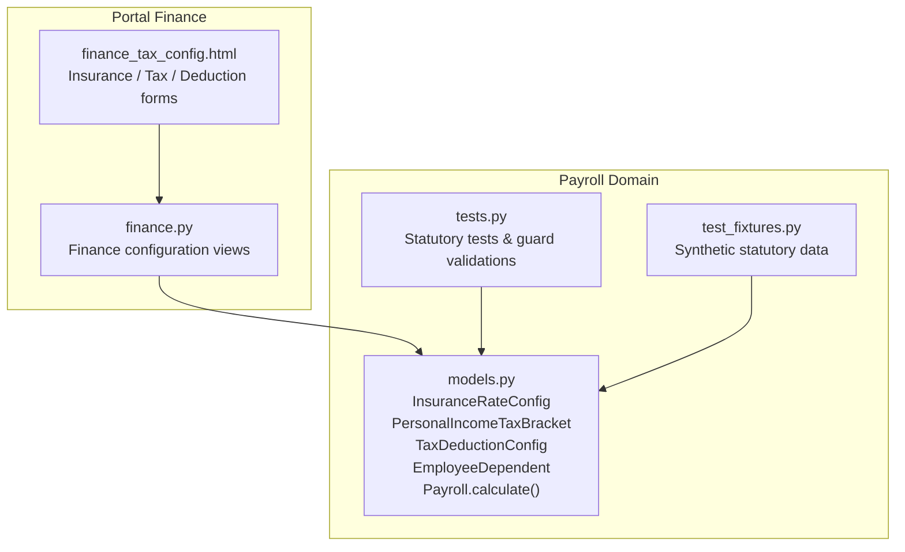
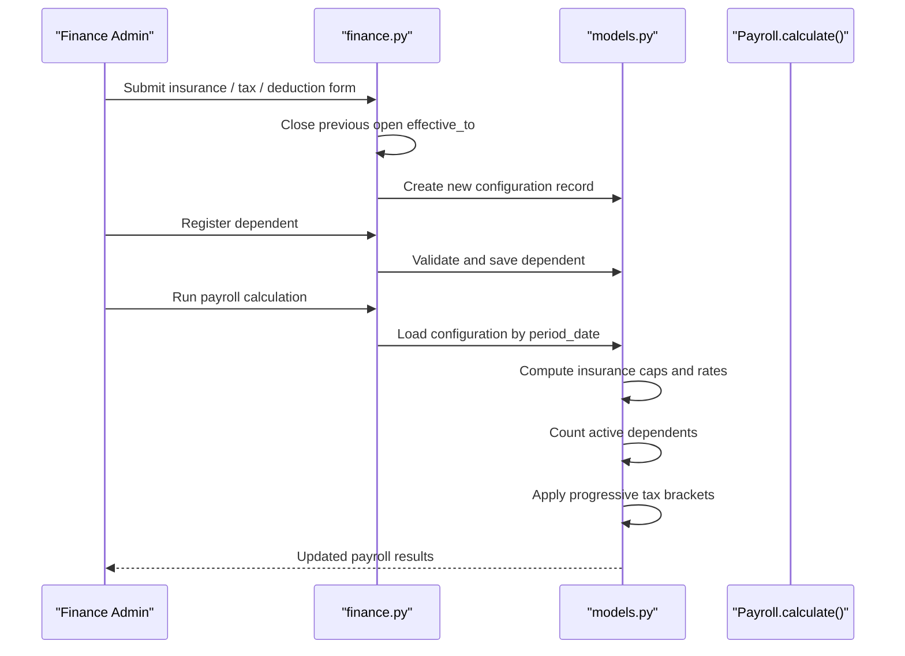
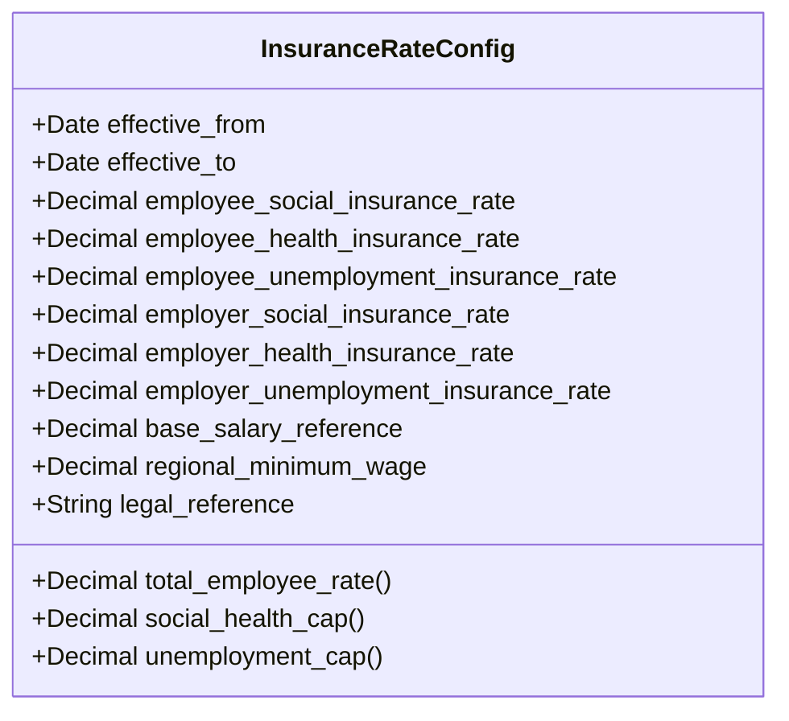
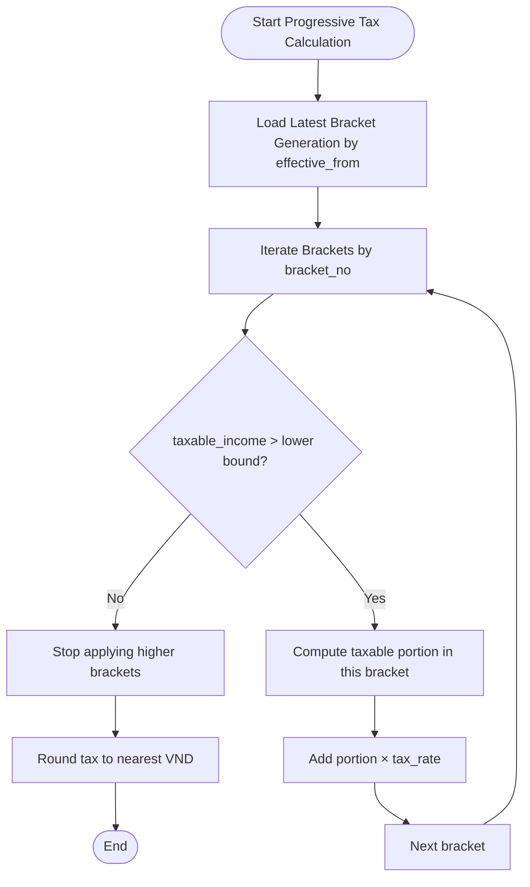
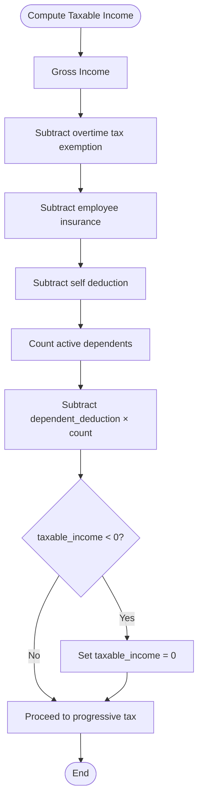
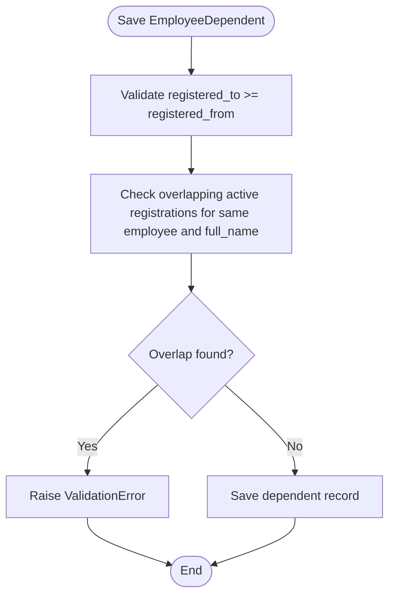
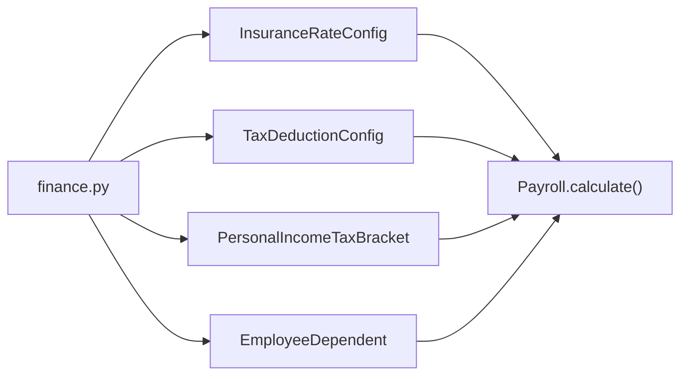

# Tax & Insurance Configuration

<cite>
**Referenced Files in This Document**
- [models.py](file://src/apps/payroll/models.py)
- [finance.py](file://src/apps/portal/views/finance.py)
- [tests.py](file://src/apps/payroll/tests.py)
- [test_fixtures.py](file://src/apps/payroll/test_fixtures.py)
- [finance_tax_config.html](file://src/apps/portal/templates/portal/finance_tax_config.html)
</cite>

## Table of Contents
1. [Introduction](#introduction)
2. [Project Structure](#project-structure)
3. [Core Components](#core-components)
4. [Architecture Overview](#architecture-overview)
5. [Detailed Component Analysis](#detailed-component-analysis)
6. [Dependency Analysis](#dependency-analysis)
7. [Performance Considerations](#performance-considerations)
8. [Troubleshooting Guide](#troubleshooting-guide)
9. [Conclusion](#conclusion)

## Introduction
This document explains the tax and insurance configuration system used by the payroll module. It focuses on four core data models:

- **InsuranceRateConfig**: time-based statutory rate master data for social insurance, health insurance, unemployment insurance, and statutory caps based on base salary reference and regional minimum wage.
- **PersonalIncomeTaxBracket**: progressive personal income tax brackets with effective date ranges and tax rate percentages.
- **TaxDeductionConfig**: personal income tax deduction amounts for self and dependents.
- **EmployeeDependent**: employee-dependent registrations with relationship types and validity periods.

The system is designed to support historical rate changes, prevent overlapping configurations, and align with Vietnamese payroll rules such as capped contribution bases and progressive tax brackets.

## Project Structure
The relevant implementation lives under the payroll application and portal finance views:

- Payroll domain models and calculation logic are defined in `src/apps/payroll/models.py`.
- Finance portal endpoints for managing insurance rates, tax brackets, deductions, and dependents are in `src/apps/portal/views/finance.py`.
- Tests validate statutory calculations, bracket generation behavior, and business guards in `src/apps/payroll/tests.py`.
- Synthetic fixtures for quick setup are in `src/apps/payroll/test_fixtures.py`.
- The finance configuration UI template is in `src/apps/portal/templates/portal/finance_tax_config.html`.

**Diagram sources**
- [finance.py:421-492](file://src/apps/portal/views/finance.py#L421-L492)
- [models.py:88-241](file://src/apps/payroll/models.py#L88-L241)
- [tests.py:1-14](file://src/apps/payroll/tests.py#L1-L14)
- [test_fixtures.py:1-15](file://src/apps/payroll/test_fixtures.py#L1-L15)
- [finance_tax_config.html:1-30](file://src/apps/portal/templates/portal/finance_tax_config.html#L1-L30)

**Section sources**
- [models.py:88-241](file://src/apps/payroll/models.py#L88-L241)
- [finance.py:421-492](file://src/apps/portal/views/finance.py#L421-L492)
- [tests.py:1-14](file://src/apps/payroll/tests.py#L1-L14)
- [test_fixtures.py:1-15](file://src/apps/payroll/test_fixtures.py#L1-L15)
- [finance_tax_config.html:1-30](file://src/apps/portal/templates/portal/finance_tax_config.html#L1-L30)

## Core Components
This section summarizes the four main configuration models and their roles in payroll processing.

### InsuranceRateConfig
Manages statutory insurance rates and caps:

- Employee contributions: social insurance, health insurance, unemployment insurance.
- Employer contributions: social insurance, health insurance, unemployment insurance.
- Base salary reference: used to compute the social and health insurance cap (20 times base salary reference).
- Regional minimum wage: used to compute the unemployment insurance cap (20 times regional minimum wage).
- Legal reference: optional policy citation.
- Effective period: `effective_from` and optional `effective_to`.

Key behaviors:
- Total employee rate is the sum of employee social, health, and unemployment rates.
- Social and health contribution base is capped at 20 × base salary reference.
- Unemployment contribution base is capped at 20 × regional minimum wage.
- During payroll calculation, the system selects the configuration whose effective period contains the payroll period start date.

**Section sources**
- [models.py:88-147](file://src/apps/payroll/models.py#L88-L147)
- [models.py:372-403](file://src/apps/payroll/models.py#L372-L403)
- [models.py:458-478](file://src/apps/payroll/models.py#L458-L478)

### PersonalIncomeTaxBracket
Defines progressive personal income tax brackets:

- Bracket number.
- Monthly income range: `income_from_monthly` and optional `income_to_monthly`.
- Tax rate percentage.
- Effective period: `effective_from` and optional `effective_to`.
- Ordered by effective date and bracket number.

Important design rule:
- A new bracket generation must close all open-ended older generations before adding new brackets.
- Payroll calculation selects the latest bracket generation by `effective_from`, then loads all brackets from that generation.

**Section sources**
- [models.py:150-166](file://src/apps/payroll/models.py#L150-L166)
- [models.py:386-401](file://src/apps/payroll/models.py#L386-L401)
- [finance.py:464-483](file://src/apps/portal/views/finance.py#L464-L483)

### TaxDeductionConfig
Defines monthly personal income tax deductions:

- Self deduction amount per month.
- Dependent deduction amount per dependent per month.
- Effective period: `effective_from` and optional `effective_to`.

During payroll calculation:
- The active deduction configuration is selected by effective date.
- Taxable income subtracts overtime exemption, employee insurance, self deduction, and dependent deductions.

**Section sources**
- [models.py:173-190](file://src/apps/payroll/models.py#L173-L190)
- [models.py:480-497](file://src/apps/payroll/models.py#L480-L497)
- [finance.py:451-463](file://src/apps/portal/views/finance.py#L451-L463)

### EmployeeDependent
Registers tax dependents for an employee:

- Employee link.
- Full name of dependent.
- Relationship type.
- Registration validity period: `registered_from` and optional `registered_to`.
- Active flag.

Validation rules:
- End date cannot be earlier than registration start date.
- Duplicate dependent names for the same employee cannot overlap in time, even if relationships differ.
- Payroll calculation counts only active dependents whose registration period includes the payroll period start date.

**Section sources**
- [models.py:193-241](file://src/apps/payroll/models.py#L193-L241)
- [models.py:480-485](file://src/apps/payroll/models.py#L480-L485)
- [finance.py:495-518](file://src/apps/portal/views/finance.py#L495-L518)

## Architecture Overview
The configuration system integrates three layers:

1. **Configuration entry layer**: Portal finance views accept POST requests to add or update insurance rates, tax brackets, deductions, and dependents.
2. **Model validation layer**: Django model `clean()` methods enforce business rules such as non-negative values, valid date ranges, and no overlapping registrations.
3. **Payroll calculation layer**: `Payroll.calculate()` loads the correct configuration version for the payroll period and computes gross income, insurance, taxable income, progressive tax, and net income.

**Diagram sources**
- [finance.py:421-492](file://src/apps/portal/views/finance.py#L421-L492)
- [finance.py:495-518](file://src/apps/portal/views/finance.py#L495-L518)
- [models.py:372-403](file://src/apps/payroll/models.py#L372-L403)
- [models.py:405-514](file://src/apps/payroll/models.py#L405-L514)

## Detailed Component Analysis

### InsuranceRateConfig Analysis
InsuranceRateConfig stores statutory rates and caps. It does not hardcode Vietnamese law; instead, it provides configurable base salary reference and regional minimum wage so administrators can update statutory references over time.

Key properties:
- `total_employee_rate`: sum of employee social, health, and unemployment rates.
- `social_health_cap`: 20 × base salary reference.
- `unemployment_cap`: 20 × regional minimum wage.

Payroll usage:
- Contribution base for social and health insurance is capped at `social_health_cap`.
- Contribution base for unemployment insurance is capped at `unemployment_cap`.
- Employee insurance amount is the sum of social, health, and unemployment contributions.

**Diagram sources**
- [models.py:88-147](file://src/apps/payroll/models.py#L88-L147)

**Section sources**
- [models.py:88-147](file://src/apps/payroll/models.py#L88-L147)
- [models.py:458-478](file://src/apps/payroll/models.py#L458-L478)
- [tests.py:138-183](file://src/apps/payroll/tests.py#L138-L183)

### PersonalIncomeTaxBracket Analysis
PersonalIncomeTaxBracket defines progressive tax brackets. Each generation has multiple rows, one per bracket, sharing the same `effective_from`.

Calculation flow:
- Select the latest bracket generation by `effective_from`.
- Load all brackets from that generation.
- Iterate brackets in order and apply tax to the portion of taxable income within each bracket.

**Diagram sources**
- [models.py:386-401](file://src/apps/payroll/models.py#L386-L401)
- [models.py:499-511](file://src/apps/payroll/models.py#L499-L511)

**Section sources**
- [models.py:150-166](file://src/apps/payroll/models.py#L150-L166)
- [models.py:386-401](file://src/apps/payroll/models.py#L386-L401)
- [models.py:499-511](file://src/apps/payroll/models.py#L499-L511)
- [tests.py:351-381](file://src/apps/payroll/tests.py#L351-L381)

### TaxDeductionConfig Analysis
TaxDeductionConfig holds monthly deduction amounts:

- Self deduction.
- Per-dependent deduction.

Payroll integration:
- Deductions are applied after insurance and overtime exemption.
- Dependent count comes from active EmployeeDependent records valid at the payroll period start date.

**Diagram sources**
- [models.py:480-497](file://src/apps/payroll/models.py#L480-L497)

**Section sources**
- [models.py:173-190](file://src/apps/payroll/models.py#L173-L190)
- [models.py:480-497](file://src/apps/payroll/models.py#L480-L497)

### EmployeeDependent Analysis
EmployeeDependent manages dependent registrations with strict overlap prevention.

Validation rules:
- `registered_to` must be greater than or equal to `registered_from`.
- Duplicate full names for the same employee cannot have overlapping active registration periods.
- Case-insensitive matching prevents accidental duplicates due to casing differences.

Payroll integration:
- Only active dependents with registration periods covering the payroll period start date are counted.

**Diagram sources**
- [models.py:212-241](file://src/apps/payroll/models.py#L212-L241)

**Section sources**
- [models.py:193-241](file://src/apps/payroll/models.py#L193-L241)
- [finance.py:495-518](file://src/apps/portal/views/finance.py#L495-L518)

## Dependency Analysis
The configuration models are consumed by payroll calculation and portal finance operations.

**Diagram sources**
- [models.py:372-514](file://src/apps/payroll/models.py#L372-L514)
- [finance.py:421-518](file://src/apps/portal/views/finance.py#L421-L518)

**Section sources**
- [models.py:372-514](file://src/apps/payroll/models.py#L372-L514)
- [finance.py:421-518](file://src/apps/portal/views/finance.py#L421-L518)

## Performance Considerations
- Configuration loading is optimized by selecting the latest effective generation once per payroll run.
- Reusing a preloaded configuration avoids repeated database queries when calculating multiple payrolls.
- Bracket generation selection ensures only one generation is loaded, preventing accidental double taxation across generations.
- Dependent counting uses a single filtered query scoped to the payroll period start date.

Recommendations:
- Always close `effective_to` for old generations when introducing new statutory tables.
- Prefer bulk operations when creating many configuration records.
- Keep statutory defaults aligned with current Vietnamese regulations to reduce manual correction during payroll runs.

[No sources needed since this section provides general guidance]

## Troubleshooting Guide

### Common Validation Errors
- Negative salary or input amounts are rejected.
- Locked payroll periods cannot be modified or recalculated.
- Missing configuration for a payroll period raises a clear error.
- Duplicate dependent registrations with overlapping dates raise a validation error.

### Historical Rate Changes
When updating statutory rates:

1. Add a new `InsuranceRateConfig` with the new `effective_from`.
2. The view automatically closes open-ended older configurations by setting their `effective_to` to the day before the new effective date.
3. For tax brackets, add all brackets for the new generation; the view closes all open-ended older bracket generations.
4. For deductions, add a new `TaxDeductionConfig` with the new effective date.
5. Recalculate payroll for affected periods using the updated configuration.

### Compliance Checks
- Ensure base salary reference and regional minimum wage reflect current Vietnamese statutory values.
- Ensure bracket ranges are contiguous and ordered by bracket number.
- Ensure dependent registrations do not overlap for the same employee.
- Ensure payroll calculations use approved attendance data and locked periods only after all lines are calculated.

**Section sources**
- [tests.py:285-345](file://src/apps/payroll/tests.py#L285-L345)
- [tests.py:351-381](file://src/apps/payroll/tests.py#L351-L381)
- [finance.py:430-483](file://src/apps/portal/views/finance.py#L430-L483)

## Conclusion
The tax and insurance configuration system separates statutory master data from payroll calculation logic. It supports historical versions through effective date ranges, enforces business rules through model validation, and implements Vietnamese payroll rules including capped contribution bases and progressive tax brackets. Proper administration requires closing old configuration generations, maintaining accurate statutory references, and ensuring dependent registrations are valid and non-overlapping.

[No sources needed since this section summarizes without analyzing specific files]