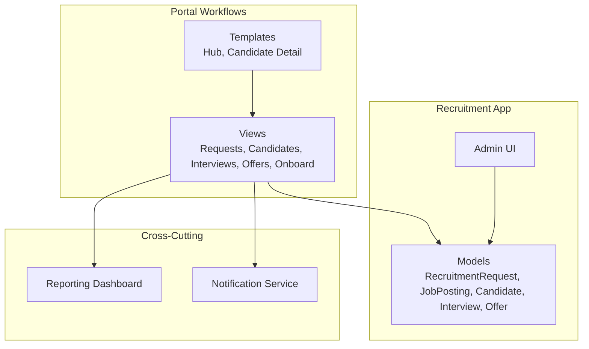
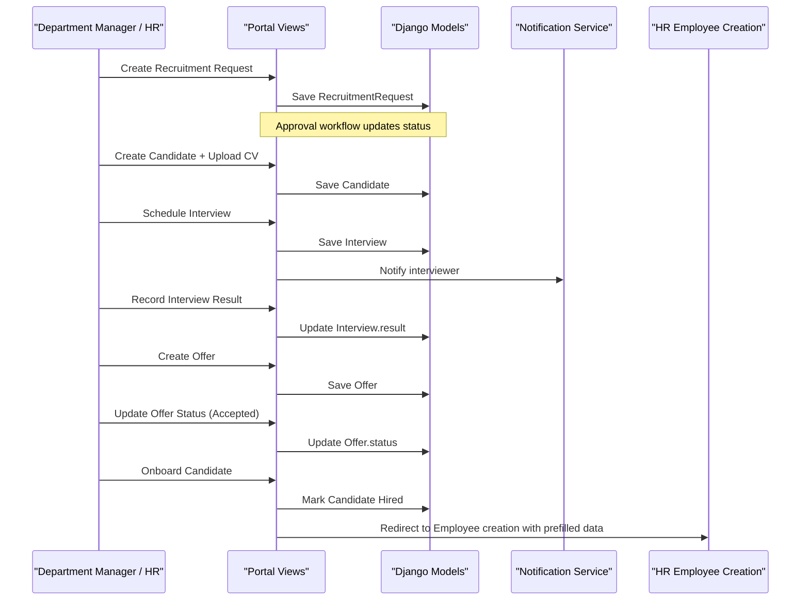
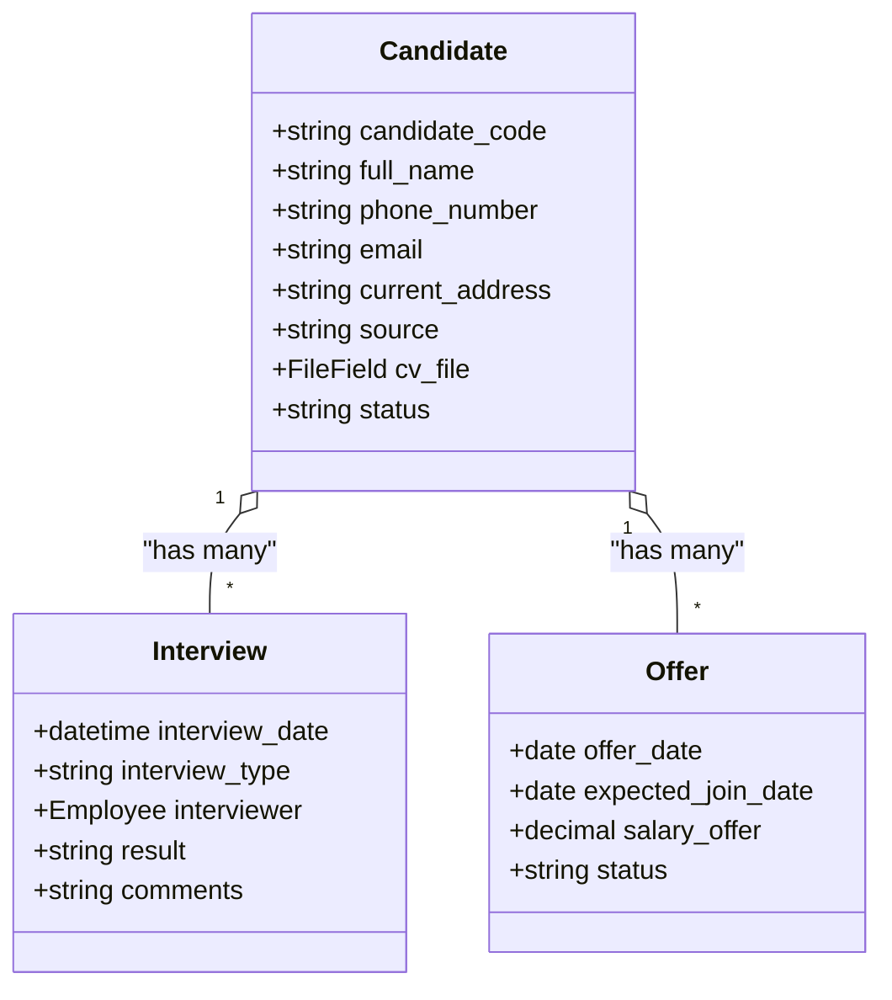
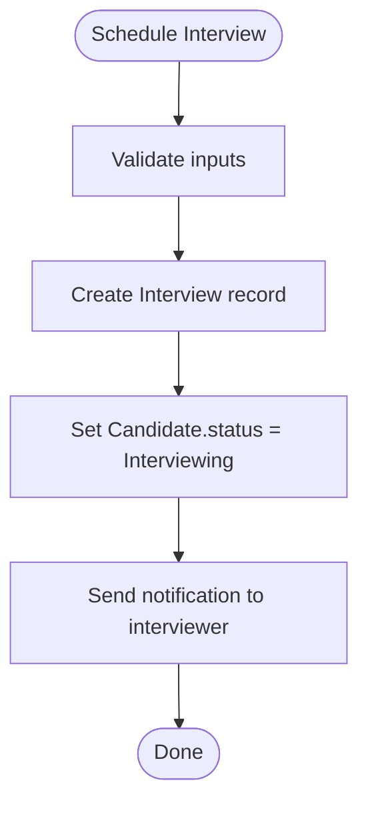
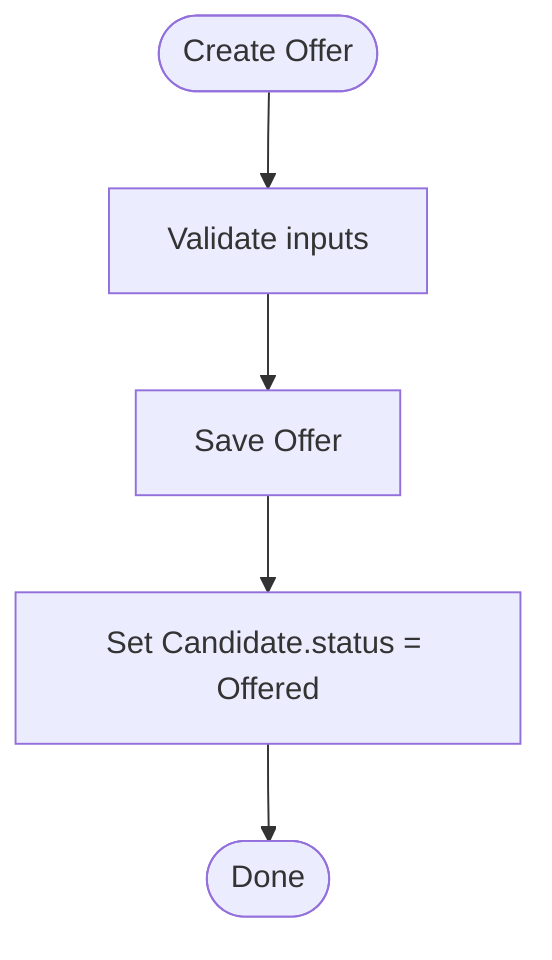
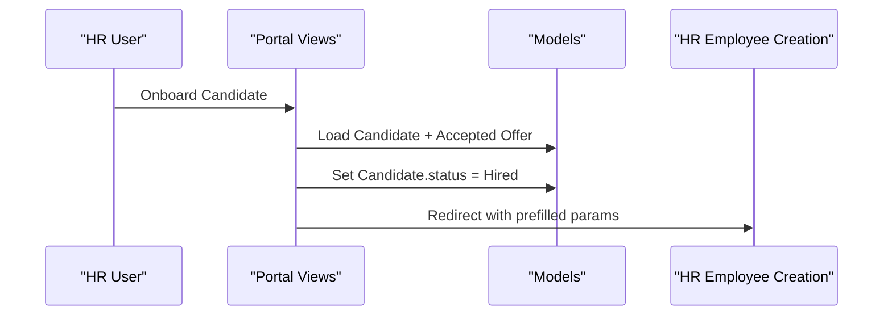
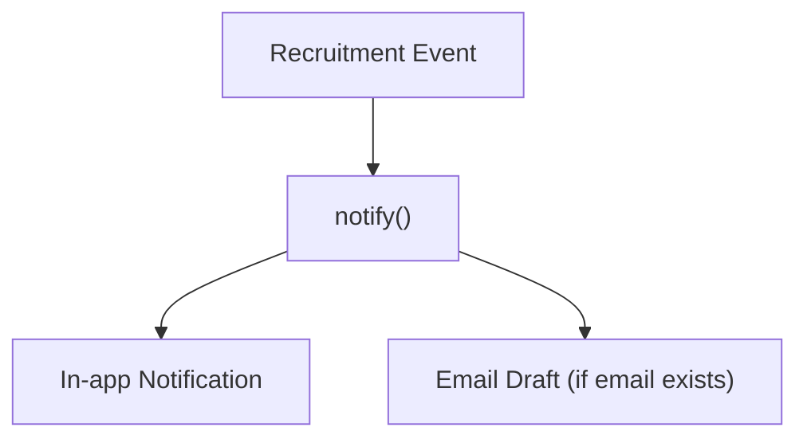
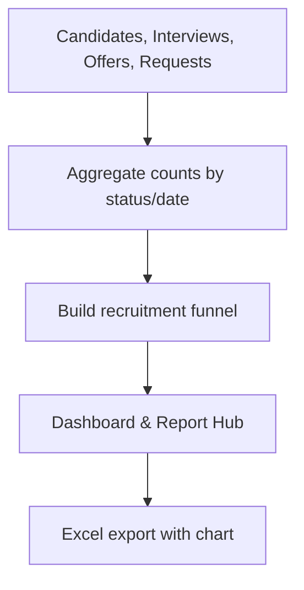
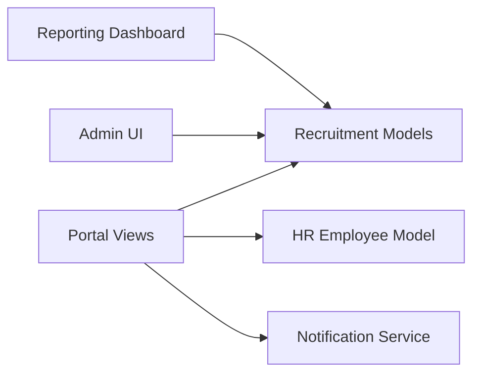

# Recruitment Management

<cite>
**Referenced Files in This Document**
- [models.py](file://src/apps/recruitment/models.py)
- [admin.py](file://src/apps/recruitment/admin.py)
- [views.py](file://src/apps/portal/views/recruitment.py)
- [services.py](file://src/apps/notification/services.py)
- [reporting_dashboard.py](file://src/apps/portal/reporting_dashboard.py)
- [recruitment_hub.html](file://src/apps/portal/templates/portal/recruitment_hub.html)
- [hr_candidate_detail.html](file://src/apps/portal/templates/portal/hr_candidate_detail.html)
- [_group_recruitment.html](file://src/apps/portal/templates/portal/dashboard/_group_recruitment.html)
</cite>

## Table of Contents
1. [Introduction](#introduction)
2. [Project Structure](#project-structure)
3. [Core Components](#core-components)
4. [Architecture Overview](#architecture-overview)
5. [Detailed Component Analysis](#detailed-component-analysis)
6. [Dependency Analysis](#dependency-analysis)
7. [Performance Considerations](#performance-considerations)
8. [Troubleshooting Guide](#troubleshooting-guide)
9. [Conclusion](#conclusion)

## Introduction
This document explains the recruitment management module that covers candidate pipeline, interview scheduling, offer management, and onboarding integration. It documents the Candidate model with application tracking and resume management, the end-to-end workflow from job posting to offer acceptance, automated notifications, HR system integration for onboarding, communication templates, and analytics/reporting for hiring metrics and pipeline analysis.

## Project Structure
The recruitment domain is implemented as a Django app under src/apps/recruitment with supporting portal views, notification services, and reporting dashboards:
- Data models: RecruitmentRequest, JobPosting, Candidate, Interview, Offer
- Portal workflows: request creation/approval, candidate management, interview scheduling, offer lifecycle, and onboarding handoff
- Notifications: in-app notices and email drafts
- Reporting: recruitment funnel and dashboard metrics

**Diagram sources**
- [models.py:7-138](file://src/apps/recruitment/models.py#L7-L138)
- [views.py:33-287](file://src/apps/portal/views/recruitment.py#L33-L287)
- [services.py:8-77](file://src/apps/notification/services.py#L8-L77)
- [reporting_dashboard.py:59-227](file://src/apps/portal/reporting_dashboard.py#L59-L227)

**Section sources**
- [models.py:7-138](file://src/apps/recruitment/models.py#L7-L138)
- [views.py:33-287](file://src/apps/portal/views/recruitment.py#L33-L287)
- [services.py:8-77](file://src/apps/notification/services.py#L8-L77)
- [reporting_dashboard.py:59-227](file://src/apps/portal/reporting_dashboard.py#L59-L227)

## Core Components
- RecruitmentRequest: Tracks departmental hiring needs, approval state, required date, and quantity.
- JobPosting: Public or internal postings tied to an approved request.
- Candidate: Application record with personal details, source, CV file, and pipeline status (New → Screening → Interviewing → Offered → Hired/Rejected).
- Interview: Scheduled interviews with interviewer assignment, result, and comments.
- Offer: Formal offer with dates, salary, and status (Sent/Accepted/Declined).

Key responsibilities:
- Pipeline tracking via Candidate.status
- Resume storage via FileField with validation and storage backend
- Interview scheduling and result capture
- Offer lifecycle and status updates
- Onboarding handoff to HR employee records upon accepted offer

**Section sources**
- [models.py:7-138](file://src/apps/recruitment/models.py#L7-L138)

## Architecture Overview
End-to-end flow from request to onboarding:

**Diagram sources**
- [views.py:56-119](file://src/apps/portal/views/recruitment.py#L56-L119)
- [views.py:133-196](file://src/apps/portal/views/recruitment.py#L133-L196)
- [views.py:220-287](file://src/apps/portal/views/recruitment.py#L220-L287)
- [services.py:18-29](file://src/apps/notification/services.py#L18-L29)

## Detailed Component Analysis

### Candidate Model and Pipeline
- Fields include unique code, full name, phone, email, address, source, CV file, and status.
- CV upload uses a dedicated storage backend and validators.
- Status choices drive the pipeline stages.

**Diagram sources**
- [models.py:59-138](file://src/apps/recruitment/models.py#L59-L138)

**Section sources**
- [models.py:59-89](file://src/apps/recruitment/models.py#L59-L89)

### Interview Scheduling and Results
- Scheduling creates an Interview linked to a Candidate and sets Candidate.status to Interviewing.
- Interviewer receives an in-app notification when scheduled.
- Results can be recorded with comments; results are validated against allowed choices.

**Diagram sources**
- [views.py:171-196](file://src/apps/portal/views/recruitment.py#L171-L196)
- [services.py:18-29](file://src/apps/notification/services.py#L18-L29)

**Section sources**
- [views.py:171-215](file://src/apps/portal/views/recruitment.py#L171-L215)

### Offer Management
- Offers are created with offer date, expected join date, and salary.
- Candidate.status transitions to Offered when an offer is created.
- Offer status can be updated to Accepted or Declined.

**Diagram sources**
- [views.py:218-237](file://src/apps/portal/views/recruitment.py#L218-L237)
- [models.py:116-138](file://src/apps/recruitment/models.py#L116-L138)

**Section sources**
- [views.py:218-255](file://src/apps/portal/views/recruitment.py#L218-L255)
- [models.py:116-138](file://src/apps/recruitment/models.py#L116-L138)

### Onboarding Integration
- When an Offer is Accepted, HR can onboard the candidate.
- The system marks the Candidate as Hired and redirects to the HR employee creation page with prefilled fields (name parts, email, phone, address, join date).
- Admin also supports creating an employee from a candidate with an accepted offer.

**Diagram sources**
- [views.py:258-287](file://src/apps/portal/views/recruitment.py#L258-L287)
- [admin.py:66-101](file://src/apps/recruitment/admin.py#L66-L101)

**Section sources**
- [views.py:258-287](file://src/apps/portal/views/recruitment.py#L258-L287)
- [admin.py:66-101](file://src/apps/recruitment/admin.py#L66-L101)

### Communication Templates and Automated Follow-ups
- In-app notifications are created for key events (e.g., interview assignment).
- The notification service supports creating both in-app notices and Outlook email drafts with idempotency to avoid duplicates.
- Templates for recruitment-related forms and documents are accessible through the portal’s form catalog and candidate detail actions.

**Diagram sources**
- [services.py:18-77](file://src/apps/notification/services.py#L18-L77)
- [views.py:187-192](file://src/apps/portal/views/recruitment.py#L187-L192)

**Section sources**
- [services.py:8-77](file://src/apps/notification/services.py#L8-L77)
- [views.py:187-192](file://src/apps/portal/views/recruitment.py#L187-L192)
- [hr_candidate_detail.html:1-11](file://src/apps/portal/templates/portal/hr_candidate_detail.html#L1-L11)

### Recruitment Analytics and Reporting
- The reporting dashboard aggregates recruitment metrics and builds a funnel visualization:
  - Approved requests
  - Open postings
  - Candidates in processing
  - Pending interview results
  - Accepted offers within period
  - Hired candidates
- Metrics are rendered in the dashboard group and report hub, and exported to Excel with charts.

**Diagram sources**
- [reporting_dashboard.py:84-97](file://src/apps/portal/reporting_dashboard.py#L84-L97)
- [reporting_dashboard.py:160-171](file://src/apps/portal/reporting_dashboard.py#L160-L171)
- [reporting_dashboard.py:291-306](file://src/apps/portal/reporting_dashboard.py#L291-L306)
- [_group_recruitment.html:1-7](file://src/apps/portal/templates/portal/dashboard/_group_recruitment.html#L1-L7)

**Section sources**
- [reporting_dashboard.py:59-227](file://src/apps/portal/reporting_dashboard.py#L59-L227)
- [_group_recruitment.html:1-7](file://src/apps/portal/templates/portal/dashboard/_group_recruitment.html#L1-L7)

## Dependency Analysis
- Portal views depend on recruitment models and HR employee model for onboarding.
- Notification service is used to create in-app notices and email drafts.
- Reporting dashboard queries recruitment models to compute metrics and funnel.
- Admin UI provides CRUD and actions for recruitment entities.

**Diagram sources**
- [views.py:1-16](file://src/apps/portal/views/recruitment.py#L1-L16)
- [reporting_dashboard.py:28-29](file://src/apps/portal/reporting_dashboard.py#L28-L29)
- [admin.py:1-6](file://src/apps/recruitment/admin.py#L1-L6)

**Section sources**
- [views.py:1-16](file://src/apps/portal/views/recruitment.py#L1-L16)
- [reporting_dashboard.py:28-29](file://src/apps/portal/reporting_dashboard.py#L28-L29)
- [admin.py:1-6](file://src/apps/recruitment/admin.py#L1-L6)

## Performance Considerations
- Use select_related and count aggregations efficiently in views and reporting to minimize database hits.
- Bulk operations for notifications reduce overhead when notifying multiple recipients.
- CV uploads should leverage configured storage backends and validators to prevent large or invalid files.

[No sources needed since this section provides general guidance]

## Troubleshooting Guide
- Permission errors: Ensure users have appropriate permissions (request_recruitment, approve_recruitment, view_candidate, manage_hr).
- Invalid states: Offer and interview status updates validate against allowed choices; check input values.
- Missing accepted offer: Onboarding requires an Offer with status Accepted; update offer status before onboarding.
- Notification delivery: Verify employee has an email address if expecting email drafts; otherwise only in-app notice is created.

**Section sources**
- [views.py:21-30](file://src/apps/portal/views/recruitment.py#L21-L30)
- [views.py:200-215](file://src/apps/portal/views/recruitment.py#L200-L215)
- [views.py:258-287](file://src/apps/portal/views/recruitment.py#L258-L287)
- [services.py:18-77](file://src/apps/notification/services.py#L18-L77)

## Conclusion
The recruitment module provides a complete pipeline from request to onboarding, with robust candidate tracking, interview scheduling, offer management, and integrated notifications. Reporting delivers actionable insights into hiring performance and pipeline health, while onboarding seamlessly transitions accepted candidates into the HR system.