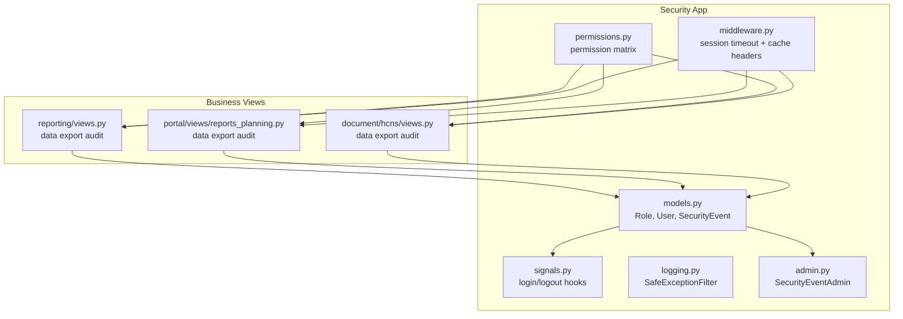
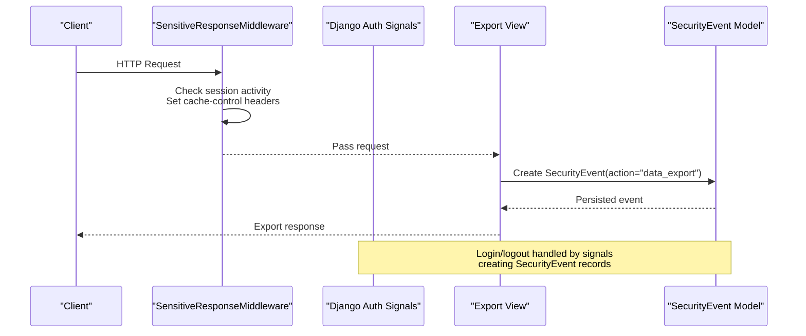
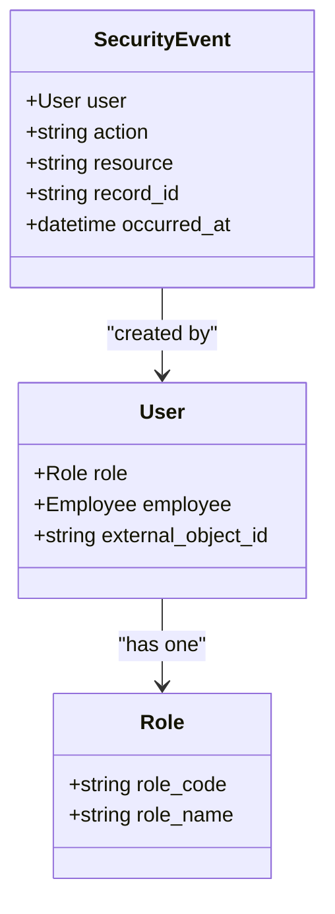
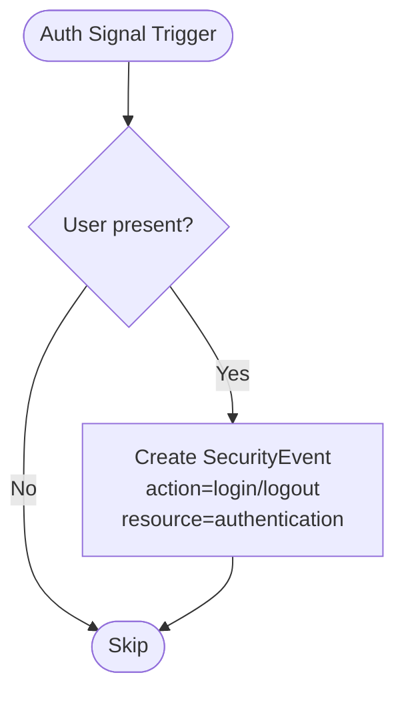
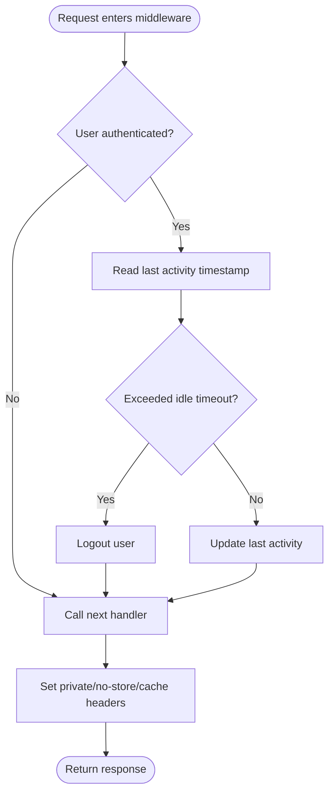
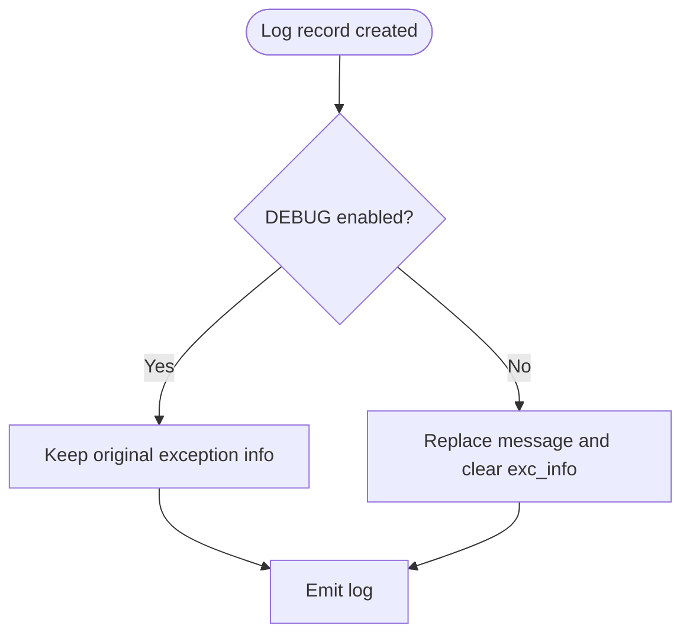
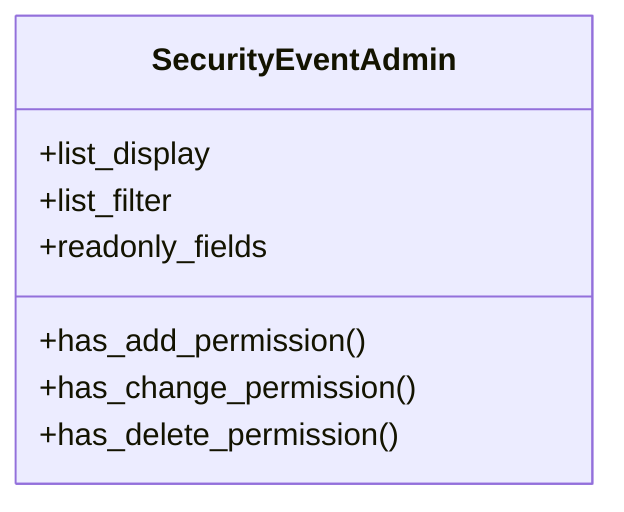
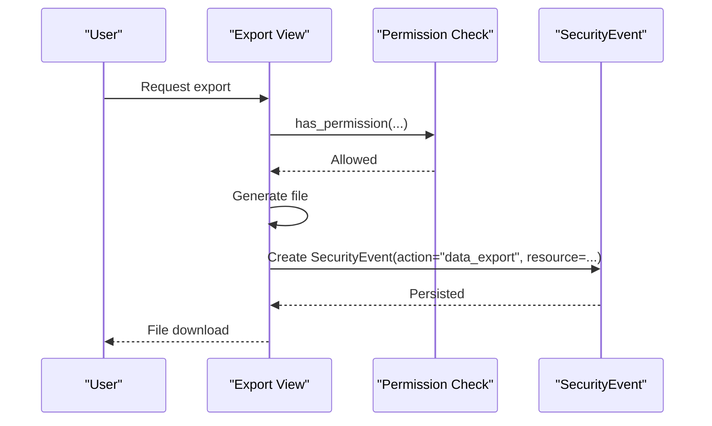
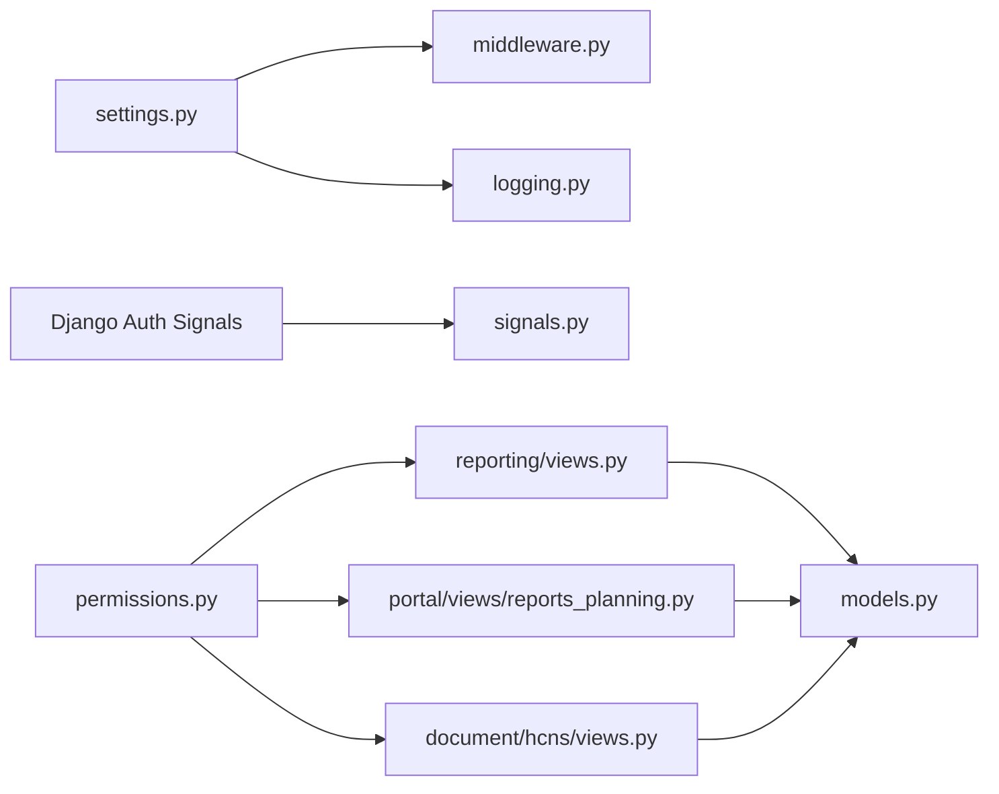

# Audit & Security Logging

<cite>
**Referenced Files in This Document**
- [models.py](file://src/apps/security/models.py)
- [signals.py](file://src/apps/security/signals.py)
- [middleware.py](file://src/apps/security/middleware.py)
- [logging.py](file://src/apps/security/logging.py)
- [admin.py](file://src/apps/security/admin.py)
- [permissions.py](file://src/apps/security/permissions.py)
- [views.py](file://src/apps/reporting/views.py)
- [reports_planning.py](file://src/apps/portal/views/reports_planning.py)
- [hcns_views.py](file://src/apps/document/hcns/views.py)
- [03_Database_Design.md](file://docs/03_Database_Design.md)
- [05_Backend_Standards.md](file://docs/05_Backend_Standards.md)
- [01_BRD_MASTER.md](file://docs/01_BRD_MASTER.md)
</cite>

## Table of Contents
1. [Introduction](#introduction)
2. [Project Structure](#project-structure)
3. [Core Components](#core-components)
4. [Architecture Overview](#architecture-overview)
5. [Detailed Component Analysis](#detailed-component-analysis)
6. [Dependency Analysis](#dependency-analysis)
7. [Performance Considerations](#performance-considerations)
8. [Troubleshooting Guide](#troubleshooting-guide)
9. [Conclusion](#conclusion)
10. [Appendices](#appendices)

## Introduction
This document explains the IHRMS audit logging and security event tracking system. It focuses on how user actions, resource access, timestamps, and metadata are captured through a dedicated `SecurityEvent` model, Django authentication signals, request middleware, and explicit audit calls in business views. It also covers privacy constraints, retention guidance, compliance expectations, extension points for custom events, integration with external monitoring, and performance strategies for high-volume security logs.

## Project Structure
The audit and security features live primarily under the `security` application, with additional audit logging scattered across reporting and document export endpoints. The key files are:

- `apps/security/models.py`: Defines `Role`, `User`, and `SecurityEvent`.
- `apps/security/signals.py`: Logs login/logout via Django auth signals.
- `apps/security/middleware.py`: Enforces idle session timeout and secure cache headers.
- `apps/security/logging.py`: Filters exception payloads from logs to avoid leaking secrets.
- `apps/security/admin.py`: Read-only admin interface for `SecurityEvent`.
- `apps/security/permissions.py`: Centralized permission matrix used by views.
- Business views in `apps/reporting/views.py`, `apps/portal/views/reports_planning.py`, and `apps/document/hcns/views.py` explicitly log data exports.

**Diagram sources**
- [models.py:5-46](file://src/apps/security/models.py#L5-L46)
- [signals.py:1-16](file://src/apps/security/signals.py#L1-L16)
- [middleware.py:1-29](file://src/apps/security/middleware.py#L1-L29)
- [logging.py:1-14](file://src/apps/security/logging.py#L1-L14)
- [admin.py:1-68](file://src/apps/security/admin.py#L1-L68)
- [permissions.py:1-152](file://src/apps/security/permissions.py#L1-L152)
- [views.py:70-122](file://src/apps/reporting/views.py#L70-L122)
- [reports_planning.py:70-87](file://src/apps/portal/views/reports_planning.py#L70-L87)
- [hcns_views.py:216-225](file://src/apps/document/hcns/views.py#L216-L225)

**Section sources**
- [models.py:5-46](file://src/apps/security/models.py#L5-L46)
- [signals.py:1-16](file://src/apps/security/signals.py#L1-L16)
- [middleware.py:1-29](file://src/apps/security/middleware.py#L1-L29)
- [logging.py:1-14](file://src/apps/security/logging.py#L1-L14)
- [admin.py:1-68](file://src/apps/security/admin.py#L1-L68)
- [permissions.py:1-152](file://src/apps/security/permissions.py#L1-L152)
- [views.py:70-122](file://src/apps/reporting/views.py#L70-L122)
- [reports_planning.py:70-87](file://src/apps/portal/views/reports_planning.py#L70-L87)
- [hcns_views.py:216-225](file://src/apps/document/hcns/views.py#L216-L225)

## Core Components
- SecurityEvent model: Stores minimal access metadata including user, action, resource, optional record identifier, and timestamp. It intentionally avoids storing sensitive values or query strings.
- Authentication signals: Automatically create security events for login and logout.
- Middleware: Protects authenticated responses from caching and enforces idle session expiration.
- Safe exception filter: Prevents exception payloads from being persisted in production logs.
- Admin interface: Provides read-only inspection of security events for privileged roles.
- Permission matrix: Centralizes role-based permissions used throughout the application.

Key responsibilities:
- Capture who did what, when, and on which resource without capturing secret content.
- Ensure sessions are short-lived and responses are not cached for authenticated users.
- Provide safe, auditable administrative access to security events.

**Section sources**
- [models.py:35-46](file://src/apps/security/models.py#L35-L46)
- [signals.py:7-15](file://src/apps/security/signals.py#L7-L15)
- [middleware.py:7-28](file://src/apps/security/middleware.py#L7-L28)
- [logging.py:6-13](file://src/apps/security/logging.py#L6-L13)
- [admin.py:52-68](file://src/apps/security/admin.py#L52-L68)
- [permissions.py:28-152](file://src/apps/security/permissions.py#L28-L152)

## Architecture Overview
The audit architecture combines three mechanisms:

1. Signal-driven authentication events: Login and logout are captured automatically.
2. Explicit business-event logging: Export endpoints call `SecurityEvent.objects.create(...)` to record data exports.
3. Request-level protections: Middleware ensures authenticated responses are private and sessions expire after idle time.

**Diagram sources**
- [middleware.py:12-28](file://src/apps/security/middleware.py#L12-L28)
- [views.py:70-122](file://src/apps/reporting/views.py#L70-L122)
- [reports_planning.py:70-87](file://src/apps/portal/views/reports_planning.py#L70-L87)
- [hcns_views.py:216-225](file://src/apps/document/hcns/views.py#L216-L225)
- [signals.py:7-15](file://src/apps/security/signals.py#L7-L15)

## Detailed Component Analysis

### SecurityEvent Model
The `SecurityEvent` model captures only access metadata:

- Fields:
  - `user`: Optional foreign key to the system `User`.
  - `action`: Short string describing the action (e.g., `login`, `logout`, `data_export`).
  - `resource`: Resource identifier (e.g., `authentication`, `hcns:<slug>`, report URL name).
  - `record_id`: Optional reference to a specific business record.
  - `occurred_at`: Timestamp with automatic indexing for efficient queries.

- Design principles:
  - No sensitive field values, filenames, query strings, or secrets are stored.
  - Ordered by newest first for quick review.
  - Database table is `tblSecurityEvent`.

**Diagram sources**
- [models.py:5-46](file://src/apps/security/models.py#L5-L46)

**Section sources**
- [models.py:35-46](file://src/apps/security/models.py#L35-L46)

### Authentication Event Signals
Login and logout events are captured automatically:

- `user_logged_in`: Creates a `SecurityEvent` with action `login` and resource `authentication`.
- `user_logged_out`: Creates a `SecurityEvent` with action `logout` and resource `authentication` when a user is present.

**Diagram sources**
- [signals.py:7-15](file://src/apps/security/signals.py#L7-L15)

**Section sources**
- [signals.py:1-16](file://src/apps/security/signals.py#L1-L16)

### Request Middleware
`SensitiveResponseMiddleware` provides two important behaviors:

- Idle session timeout: If the last recorded activity exceeds `SESSION_IDLE_TIMEOUT`, the user is logged out.
- Secure response headers: For authenticated requests or login pages, it sets cache-control directives to prevent shared caching and adds security-related headers.

**Diagram sources**
- [middleware.py:12-28](file://src/apps/security/middleware.py#L12-L28)

**Section sources**
- [middleware.py:1-29](file://src/apps/security/middleware.py#L1-L29)

### Safe Exception Logging
`SafeExceptionFilter` prevents exception payloads from being persisted in production logs:

- In non-debug mode, if an exception exists, it replaces the message with a safe summary and clears exception details.
- This reduces risk of leaking SQL statements, Graph API secrets, or other sensitive error context.

**Diagram sources**
- [logging.py:6-13](file://src/apps/security/logging.py#L6-L13)

**Section sources**
- [logging.py:1-14](file://src/apps/security/logging.py#L1-L14)

### Admin Interface for Security Events
The `SecurityEventAdmin` exposes a read-only view of security events:

- Restricted to privileged roles (`SUPER_ADMIN`, `SYS_ADMIN`).
- Displays key fields: timestamp, user, action, resource, record ID.
- Disables add, change, and delete operations to preserve audit integrity.

**Diagram sources**
- [admin.py:52-68](file://src/apps/security/admin.py#L52-L68)

**Section sources**
- [admin.py:52-68](file://src/apps/security/admin.py#L52-L68)

### Data Export Audit Logging
Several export endpoints explicitly log data exports:

- Reporting exports: Employee list, expiring contracts, dispatch book.
- Planning reports: Snapshot exports for Excel, Word, PowerPoint.
- HCNS forms: XLSX/DOCX exports for HR documents.

Each endpoint creates a `SecurityEvent` with action `data_export` and a meaningful resource label.

**Diagram sources**
- [views.py:70-122](file://src/apps/reporting/views.py#L70-L122)
- [reports_planning.py:70-87](file://src/apps/portal/views/reports_planning.py#L70-L87)
- [hcns_views.py:216-225](file://src/apps/document/hcns/views.py#L216-L225)

**Section sources**
- [views.py:70-122](file://src/apps/reporting/views.py#L70-L122)
- [reports_planning.py:70-87](file://src/apps/portal/views/reports_planning.py#L70-L87)
- [hcns_views.py:216-225](file://src/apps/document/hcns/views.py#L216-L225)

## Dependency Analysis
The audit system depends on:

- Django authentication signals for login/logout events.
- Django settings for session timeout and debug behavior.
- Permission matrix for controlling access to export endpoints and admin interfaces.
- Database tables for persistent audit records.

**Diagram sources**
- [middleware.py:1-29](file://src/apps/security/middleware.py#L1-L29)
- [logging.py:1-14](file://src/apps/security/logging.py#L1-L14)
- [signals.py:1-16](file://src/apps/security/signals.py#L1-L16)
- [permissions.py:1-152](file://src/apps/security/permissions.py#L1-L152)
- [views.py:70-122](file://src/apps/reporting/views.py#L70-L122)
- [reports_planning.py:70-87](file://src/apps/portal/views/reports_planning.py#L70-L87)
- [hcns_views.py:216-225](file://src/apps/document/hcns/views.py#L216-L225)
- [models.py:35-46](file://src/apps/security/models.py#L35-L46)

**Section sources**
- [permissions.py:121-152](file://src/apps/security/permissions.py#L121-L152)
- [models.py:35-46](file://src/apps/security/models.py#L35-L46)

## Performance Considerations
- Indexing: `occurred_at` is indexed to optimize recent-event queries and time-range filtering.
- Minimal payload: Only metadata is stored; no large blobs or secrets reduce write amplification.
- Asynchronous considerations: If volume grows significantly, consider offloading `SecurityEvent` creation to a background task queue to avoid blocking request paths.
- Partitioning/archiving: Follow database design guidance that recommends partitioning or periodic archiving for rapidly growing audit tables.
- Cache control: Middleware marks authenticated responses as private and non-cacheable, preventing accidental duplication of sensitive content but increasing backend load; ensure appropriate CDN policies exclude authenticated routes.

[No sources needed since this section provides general guidance]

## Troubleshooting Guide
Common issues and resolutions:

- Missing login/logout events:
  - Verify Django authentication signals are connected and the `security.signals` module is imported during app initialization.
  - Confirm the user object is not None for logout events.

- Excessive session timeouts:
  - Review `SESSION_IDLE_TIMEOUT` setting and ensure `security_last_activity` is updated on each request.
  - Check that middleware is active and not bypassed by custom handlers.

- Secret leakage in logs:
  - Ensure `SafeExceptionFilter` is configured and `DEBUG=False` in production so exception payloads are sanitized.

- Admin cannot edit security events:
  - This is intentional; `SecurityEventAdmin` disables add/change/delete to preserve audit integrity.

- Export audit not recorded:
  - Confirm the export endpoint calls `SecurityEvent.objects.create(...)` and that the user has required permissions before export.

**Section sources**
- [signals.py:7-15](file://src/apps/security/signals.py#L7-L15)
- [middleware.py:12-28](file://src/apps/security/middleware.py#L12-L28)
- [logging.py:6-13](file://src/apps/security/logging.py#L6-L13)
- [admin.py:52-68](file://src/apps/security/admin.py#L52-L68)
- [views.py:70-122](file://src/apps/reporting/views.py#L70-L122)

## Conclusion
IHRMS implements a focused, privacy-preserving audit and security logging system. It captures essential access metadata through a dedicated model, leverages Django signals for authentication events, protects authenticated responses via middleware, and explicitly logs critical business actions such as data exports. The design emphasizes minimal, non-sensitive audit payloads, strict admin controls, and alignment with broader database and backend standards. For high-volume environments, consider asynchronous logging, partitioning, and archival strategies while maintaining compliance and privacy requirements.

[No sources needed since this section summarizes without analyzing specific files]

## Appendices

### Querying Security Logs
- Recent events: Filter by `occurred_at` descending.
- User-specific events: Filter by `user`.
- Action-based events: Filter by `action` (e.g., `login`, `logout`, `data_export`).
- Resource-based events: Filter by `resource` (e.g., `authentication`, report URL names, HCNS slugs).
- Time-range queries: Use `occurred_at__range` for auditing windows.

[No sources needed since this section provides general guidance]

### Generating Audit Reports
- Export counts by action/resource for compliance dashboards.
- Identify repeated failed or suspicious actions.
- Correlate export events with permission checks to validate least-privilege usage.

[No sources needed since this section provides general guidance]

### Extending the System for Custom Business Events
- Add explicit `SecurityEvent.objects.create(...)` calls at key business boundaries (approvals, status changes, sensitive reads).
- Use consistent action names and descriptive resource labels.
- Avoid storing sensitive values; use identifiers or masked references where necessary.

[No sources needed since this section provides general guidance]

### Integrating with External Monitoring Tools
- Stream `SecurityEvent` records to SIEM or log aggregation platforms using structured formats.
- Map actions/resources to standardized security taxonomies.
- Alert on anomalies such as unusual export patterns or repeated failed actions.

[No sources needed since this section provides general guidance]

### Privacy, Retention, and Compliance
- Privacy: Do not store sensitive field values, filenames, query strings, or secrets in audit records.
- Retention: Follow organizational policy; database design guidance suggests partitioning and periodic archiving for fast-growing audit tables.
- Compliance: Maintain mandatory audit trails, soft deletes, approval history, version control, daily backups, and restore drills per business requirements.

**Section sources**
- [03_Database_Design.md:1956-1964](file://docs/03_Database_Design.md#L1956-L1964)
- [01_BRD_MASTER.md:830-871](file://docs/01_BRD_MASTER.md#L830-L871)
- [05_Backend_Standards.md:1195-1233](file://docs/05_Backend_Standards.md#L1195-L1233)