# Authentication System

<cite>
**Referenced Files in This Document**
- [settings.py](file://src/config/settings.py)
- [urls.py](file://src/config/urls.py)
- [portal urls.py](file://src/apps/portal/urls.py)
- [security middleware.py](file://src/apps/security/middleware.py)
- [login_handler.py](file://src/apps/security/login_handler.py)
- [models.py](file://src/apps/security/models.py)
- [signals.py](file://src/apps/security/signals.py)
- [files.py](file://src/apps/security/files.py)
- [storage.py](file://src/apps/security/storage.py)
- [test_login_csrf.py](file://src/apps/security/test_login_csrf.py)
</cite>

## Table of Contents
1. [Introduction](#introduction)
2. [Project Structure](#project-structure)
3. [Core Components](#core-components)
4. [Architecture Overview](#architecture-overview)
5. [Detailed Component Analysis](#detailed-component-analysis)
6. [Dependency Analysis](#dependency-analysis)
7. [Performance Considerations](#performance-considerations)
8. [Troubleshooting Guide](#troubleshooting-guide)
9. [Conclusion](#conclusion)

## Introduction
This document explains the IHRMS authentication system with a focus on user login and logout flows, session management, CSRF protection, django-axes integration for brute-force protection, password policies, account security features, and request validation through the middleware stack. It also provides guidance for extending the system to support social login, API token authentication, and automated service accounts, along with error handling and security best practices.

## Project Structure
Authentication-related functionality is primarily implemented in:
- Django settings for global security configuration, middleware ordering, axes lockout policy, and session behavior.
- URL routing that wires the portal login/logout views.
- Security app components for custom Axes handler, sensitive response handling, file access control, and audit signals.

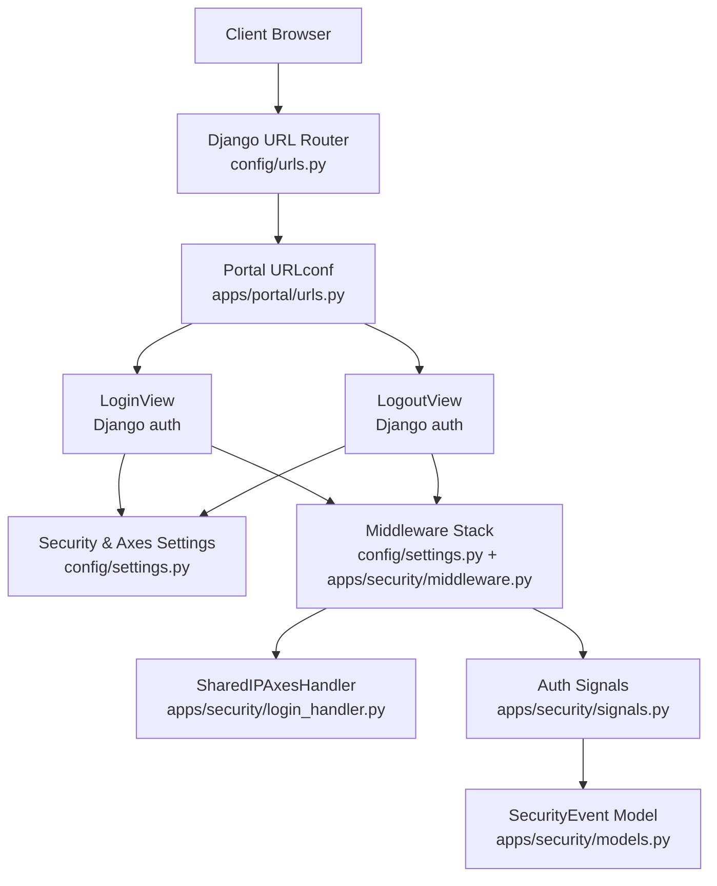

**Diagram sources**
- [urls.py:12-20](file://src/config/urls.py#L12-L20)
- [portal urls.py:24-25](file://src/apps/portal/urls.py#L24-L25)
- [settings.py:145-168](file://src/config/settings.py#L145-L168)
- [middleware.py:7-28](file://src/apps/security/middleware.py#L7-L28)
- [login_handler.py:9-24](file://src/apps/security/login_handler.py#L9-L24)
- [signals.py:7-15](file://src/apps/security/signals.py#L7-L15)
- [models.py:35-46](file://src/apps/security/models.py#L35-L46)

**Section sources**
- [urls.py:12-20](file://src/config/urls.py#L12-L20)
- [portal urls.py:24-25](file://src/apps/portal/urls.py#L24-L25)
- [settings.py:145-168](file://src/config/settings.py#L145-L168)

## Core Components
- Authentication backends: django-axes standalone backend plus Django’s default model backend.
- Axes lockout: per-username and shared-IP thresholds with a custom database-backed handler.
- Session management: secure cookies, idle timeout enforcement, browser-close expiration.
- CSRF protection: standard Django CSRF with rotation and strict token validation.
- Sensitive response hardening: cache-control headers, referrer policy, permissions policy.
- File access control: private download endpoint enforcing authorization and safe path checks.
- Audit logging: login/logout events recorded without sensitive data.

**Section sources**
- [settings.py:158-168](file://src/config/settings.py#L158-L168)
- [settings.py:87-100](file://src/config/settings.py#L87-L100)
- [settings.py:228-244](file://src/config/settings.py#L228-L244)
- [middleware.py:7-28](file://src/apps/security/middleware.py#L7-L28)
- [files.py:54-73](file://src/apps/security/files.py#L54-L73)
- [signals.py:7-15](file://src/apps/security/signals.py#L7-L15)

## Architecture Overview
The authentication flow integrates Django’s built-in views with security middleware and django-axes. On login, axes tracks failures and can lock out based on username or IP. Successful logins trigger audit signals. The sensitive response middleware enforces session idle timeouts and prevents caching of authenticated responses.

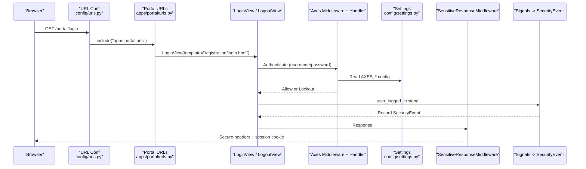

**Diagram sources**
- [urls.py:12-20](file://src/config/urls.py#L12-L20)
- [portal urls.py:24-25](file://src/apps/portal/urls.py#L24-L25)
- [settings.py:158-168](file://src/config/settings.py#L158-L168)
- [login_handler.py:9-24](file://src/apps/security/login_handler.py#L9-L24)
- [signals.py:7-15](file://src/apps/security/signals.py#L7-L15)
- [middleware.py:7-28](file://src/apps/security/middleware.py#L7-L28)

## Detailed Component Analysis

### User Login Flow
- Entry points:
  - `/portal/login` uses Django’s `LoginView` with a custom template.
  - Redirects after successful login are configured via `LOGIN_REDIRECT_URL`.
- Axes integration:
  - Failure limit and IP failure limit are enforced by axes.
  - Custom `SharedIPAxesHandler` computes combined score from username and IP attempts.
- Audit:
  - `user_logged_in` signal records a non-sensitive event.

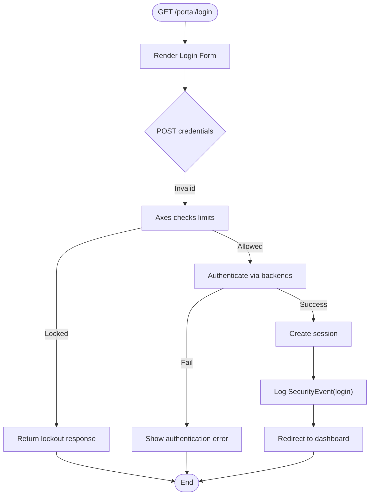

**Diagram sources**
- [portal urls.py:24-25](file://src/apps/portal/urls.py#L24-L25)
- [settings.py:271-272](file://src/config/settings.py#L271-L272)
- [settings.py:158-168](file://src/config/settings.py#L158-L168)
- [login_handler.py:9-24](file://src/apps/security/login_handler.py#L9-L24)
- [signals.py:7-15](file://src/apps/security/signals.py#L7-L15)

**Section sources**
- [portal urls.py:24-25](file://src/apps/portal/urls.py#L24-L25)
- [settings.py:271-272](file://src/config/settings.py#L271-L272)
- [settings.py:158-168](file://src/config/settings.py#L158-L168)
- [login_handler.py:9-24](file://src/apps/security/login_handler.py#L9-L24)
- [signals.py:7-15](file://src/apps/security/signals.py#L7-L15)

### User Logout Flow
- Entry point: `/portal/logout` uses Django’s `LogoutView` with redirect to login.
- Audit:
  - `user_logged_out` signal records a non-sensitive event when a user exists.

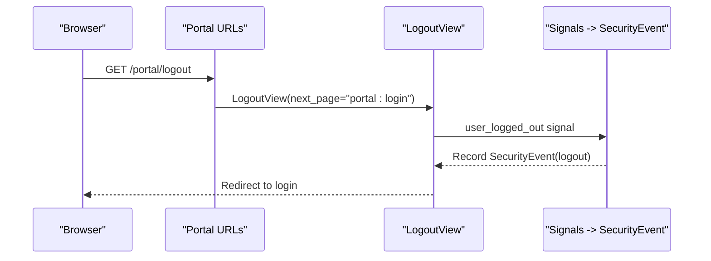

**Diagram sources**
- [portal urls.py:24-25](file://src/apps/portal/urls.py#L24-L25)
- [signals.py:12-15](file://src/apps/security/signals.py#L12-L15)

**Section sources**
- [portal urls.py:24-25](file://src/apps/portal/urls.py#L24-L25)
- [signals.py:12-15](file://src/apps/security/signals.py#L12-L15)

### Session Management
- Cookie security:
  - HTTP-only session cookies.
  - SameSite Lax for session and CSRF cookies.
  - Optional HTTPS enforcement flags for production/UAT.
- Expiration:
  - Fixed session age and browser-close expiration enabled.
  - Idle timeout enforced by middleware; unauthenticated requests do not update last activity.
- Caching:
  - Authenticated responses marked private and no-store to prevent shared caches.

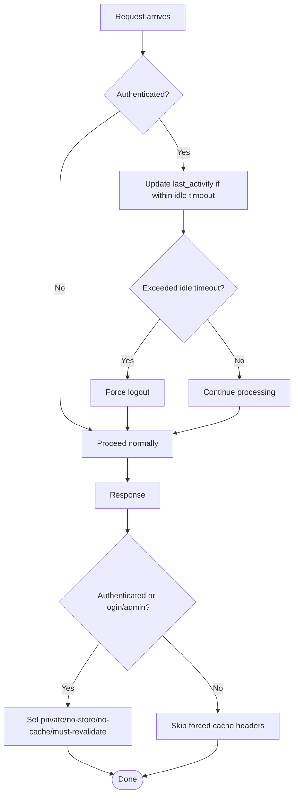

**Diagram sources**
- [settings.py:87-100](file://src/config/settings.py#L87-L100)
- [settings.py:58-73](file://src/config/settings.py#L58-L73)
- [middleware.py:7-28](file://src/apps/security/middleware.py#L7-L28)

**Section sources**
- [settings.py:87-100](file://src/config/settings.py#L87-L100)
- [settings.py:58-73](file://src/config/settings.py#L58-L73)
- [middleware.py:7-28](file://src/apps/security/middleware.py#L7-L28)

### CSRF Protection Mechanisms
- Standard Django CSRF middleware validates tokens on unsafe methods.
- Test coverage confirms:
  - Old form tokens are rejected after rotation.
  - Missing or forged tokens remain rejected.
- Production recommendations:
  - Use HTTPS with secure cookies and trusted origins.

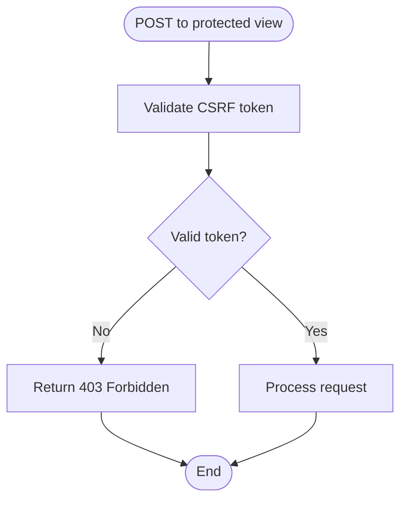

**Diagram sources**
- [settings.py:145-156](file://src/config/settings.py#L145-L156)
- [test_login_csrf.py:30-43](file://src/apps/security/test_login_csrf.py#L30-L43)

**Section sources**
- [settings.py:145-156](file://src/config/settings.py#L145-L156)
- [test_login_csrf.py:30-43](file://src/apps/security/test_login_csrf.py#L30-L43)

### Django-Axes Integration and Lockout Protection
- Backends:
  - `AxesStandaloneBackend` first, then `ModelBackend`.
- Limits:
  - Username failure limit and separate IP failure limit.
- Custom handler:
  - `SharedIPAxesHandler` aggregates username and IP attempts and scales IP score so its threshold aligns with `AXES_IP_FAILURE_LIMIT`.
- Behavior:
  - Cool-off time configured.
  - Reset on success applies only to the successful username attempt.

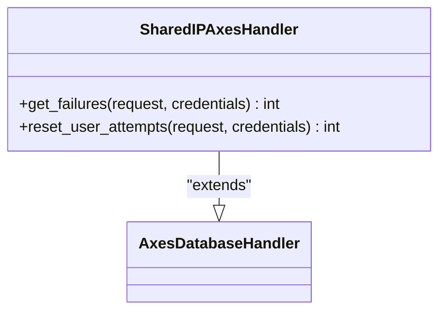

**Diagram sources**
- [login_handler.py:9-24](file://src/apps/security/login_handler.py#L9-L24)
- [settings.py:158-168](file://src/config/settings.py#L158-L168)

**Section sources**
- [settings.py:158-168](file://src/config/settings.py#L158-L168)
- [login_handler.py:9-24](file://src/apps/security/login_handler.py#L9-L24)

### Password Policies and Account Security
- Validators:
  - Similarity to user attributes, minimum length, common passwords, numeric-only passwords.
- Account model:
  - Custom user model with role and employee linkage.
  - External identifier field for integrations.

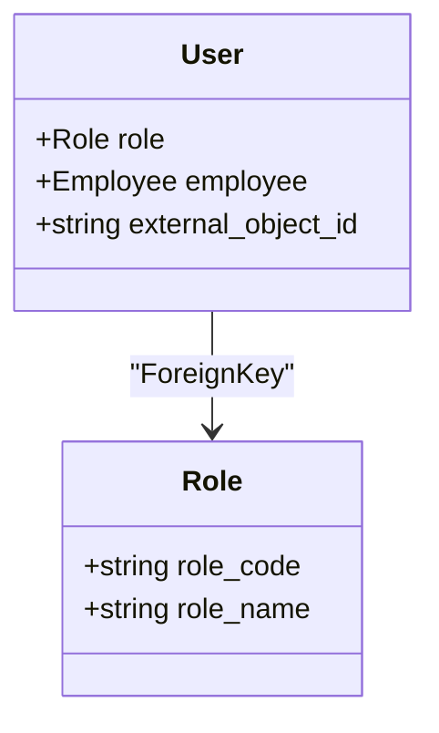

**Diagram sources**
- [models.py:5-14](file://src/apps/security/models.py#L5-L14)
- [models.py:17-33](file://src/apps/security/models.py#L17-L33)
- [settings.py:228-244](file://src/config/settings.py#L228-L244)

**Section sources**
- [settings.py:228-244](file://src/config/settings.py#L228-L244)
- [models.py:5-14](file://src/apps/security/models.py#L5-L14)
- [models.py:17-33](file://src/apps/security/models.py#L17-L33)

### Multi-Factor Authentication (MFA)
- No MFA implementation is present in the analyzed files.
- Recommendation:
  - Integrate an MFA backend (e.g., django-two-factor-auth) and add it to `AUTHENTICATION_BACKENDS`, then extend login views to enforce second factor.

[No sources needed since this section provides general guidance]

### Middleware Stack for Authentication Checks and Request Validation
- Order and responsibilities:
  - Security headers and redirects.
  - Session handling.
  - Common middleware.
  - CSRF validation.
  - Authentication context population.
  - Sensitive response middleware (idle timeout + cache control).
  - Business middleware.
  - Messages.
  - Clickjacking protection.
  - Axes middleware for lockout tracking.

```mermaid
graph LR
A["SecurityMiddleware"] --> B["SessionMiddleware"]
B --> C["CommonMiddleware"]
C --> D["CsrfViewMiddleware"]
D --> E["AuthenticationMiddleware"]
E --> F["SensitiveResponseMiddleware"]
F --> G["ApplyDueEmployeeChangesMiddleware"]
G --> H["MessageMiddleware"]
H --> I["XFrameOptionsMiddleware"]
I --> J["AxesMiddleware"]
```

**Diagram sources**
- [settings.py:145-156](file://src/config/settings.py#L145-L156)
- [middleware.py:7-28](file://src/apps/security/middleware.py#L7-L28)

**Section sources**
- [settings.py:145-156](file://src/config/settings.py#L145-L156)
- [middleware.py:7-28](file://src/apps/security/middleware.py#L7-L28)

### Private File Access Control
- All local media URLs are routed through a private endpoint that enforces login and authorization.
- Path validation prevents traversal and ambiguous references.
- Responses include security headers and record download events.

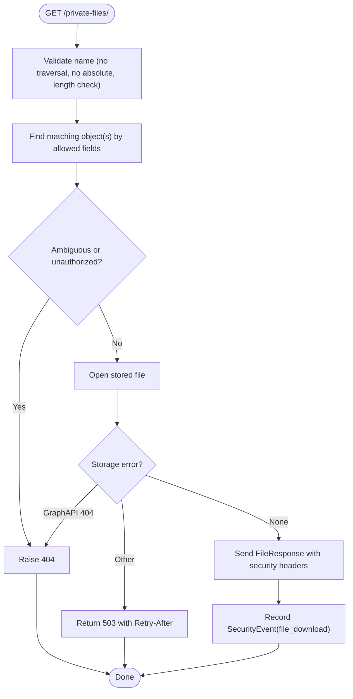

**Diagram sources**
- [files.py:54-73](file://src/apps/security/files.py#L54-L73)
- [files.py:27-51](file://src/apps/security/files.py#L27-L51)
- [storage.py:6-12](file://src/apps/security/storage.py#L6-L12)

**Section sources**
- [files.py:54-73](file://src/apps/security/files.py#L54-L73)
- [files.py:27-51](file://src/apps/security/files.py#L27-L51)
- [storage.py:6-12](file://src/apps/security/storage.py#L6-L12)

### Custom Authentication Backends and Login View Customization
- Backends:
  - Axes standalone backend followed by Django model backend.
- Login view:
  - Uses Django’s `LoginView` with a custom template.
- Extensibility:
  - Add additional backends (e.g., social providers) to `AUTHENTICATION_BACKENDS`.
  - Override `LoginView` to inject extra authentication logic or MFA challenges.

**Section sources**
- [settings.py:158-159](file://src/config/settings.py#L158-L159)
- [portal urls.py:24-25](file://src/apps/portal/urls.py#L24-L25)

### Social Login Integration
- Not implemented in the analyzed files.
- Recommended approach:
  - Install a social authentication package (e.g., django-allauth).
  - Configure provider credentials and map external accounts to `external_object_id`.
  - Ensure CSRF and session settings remain secure.

[No sources needed since this section provides general guidance]

### API Token Authentication
- Not implemented in the analyzed files.
- Recommended approach:
  - Use Django REST Framework SimpleJWT or DRF TokenAuthentication.
  - Protect API endpoints with permission classes and rate limiting.
  - Keep tokens short-lived and rotate them securely.

[No sources needed since this section provides general guidance]

### Automated Service Accounts
- Not implemented in the analyzed files.
- Recommended approach:
  - Create dedicated service users with minimal roles.
  - Use long-lived tokens or client credentials where appropriate.
  - Restrict access via hostnames, scopes, and IP allowlists at the reverse proxy layer.

[No sources needed since this section provides general guidance]

## Dependency Analysis
The authentication subsystem depends on:
- Django core middleware and auth framework.
- django-axes for brute-force protection.
- Security app components for sensitive response handling, file access control, and audit signals.

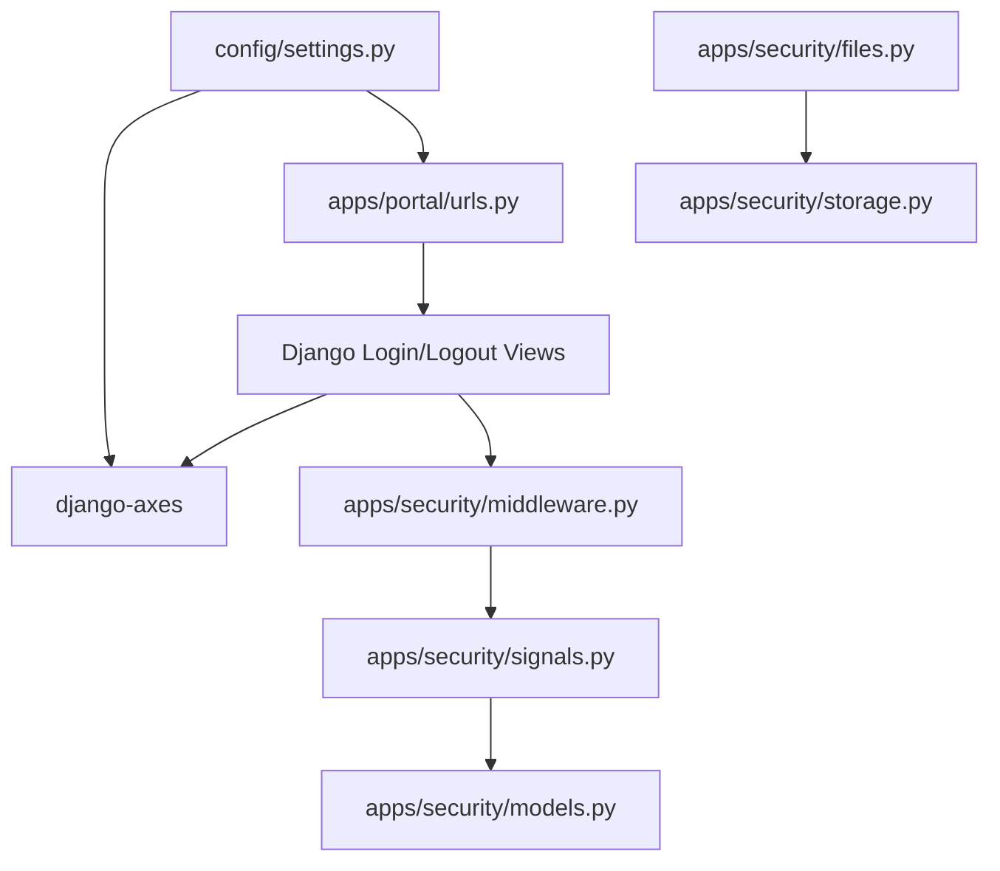

**Diagram sources**
- [settings.py:145-168](file://src/config/settings.py#L145-L168)
- [portal urls.py:24-25](file://src/apps/portal/urls.py#L24-L25)
- [middleware.py:7-28](file://src/apps/security/middleware.py#L7-L28)
- [signals.py:7-15](file://src/apps/security/signals.py#L7-L15)
- [models.py:35-46](file://src/apps/security/models.py#L35-L46)
- [files.py:54-73](file://src/apps/security/files.py#L54-L73)
- [storage.py:6-12](file://src/apps/security/storage.py#L6-L12)

**Section sources**
- [settings.py:145-168](file://src/config/settings.py#L145-L168)
- [portal urls.py:24-25](file://src/apps/portal/urls.py#L24-L25)
- [middleware.py:7-28](file://src/apps/security/middleware.py#L7-L28)
- [signals.py:7-15](file://src/apps/security/signals.py#L7-L15)
- [models.py:35-46](file://src/apps/security/models.py#L35-L46)
- [files.py:54-73](file://src/apps/security/files.py#L54-L73)
- [storage.py:6-12](file://src/apps/security/storage.py#L6-L12)

## Performance Considerations
- Axes database queries aggregate failure counts; ensure proper indexing on attempt tables to avoid slow lookups under load.
- Sensitive response middleware updates session activity on every authenticated request; consider batching or reducing frequency if high traffic.
- Private file downloads open storage handles; ensure efficient storage backends and avoid unnecessary retries.

[No sources needed since this section provides general guidance]

## Troubleshooting Guide
- Login locked out:
  - Check axes failure limits and cool-off time.
  - Verify whether IP-based lockout is triggered due to shared networks.
- CSRF errors:
  - Confirm CSRF token presence and freshness; tests cover rotation behavior.
- Session expires unexpectedly:
  - Review `SESSION_IDLE_TIMEOUT` and ensure clients keep tabs active.
- Unable to access files:
  - Ensure user has permission to the target object and that the file path is valid and authorized.

**Section sources**
- [settings.py:158-168](file://src/config/settings.py#L158-L168)
- [settings.py:91-100](file://src/config/settings.py#L91-L100)
- [test_login_csrf.py:30-43](file://src/apps/security/test_login_csrf.py#L30-L43)
- [files.py:54-73](file://src/apps/security/files.py#L54-L73)

## Conclusion
IHRMS implements a robust authentication foundation using Django’s auth framework, hardened by django-axes for brute-force protection, secure session and CSRF configurations, and a sensitive response middleware that enforces idle timeouts and prevents caching of authenticated content. Audit signals provide non-sensitive login/logout tracking, while private file access ensures authorization before serving attachments. For advanced scenarios like social login, API tokens, and service accounts, integrate appropriate packages and follow the recommended patterns outlined above.