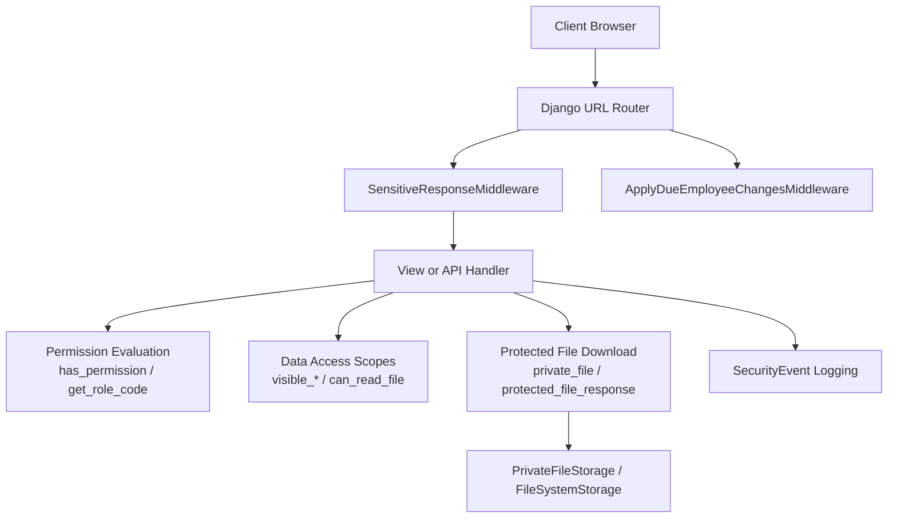
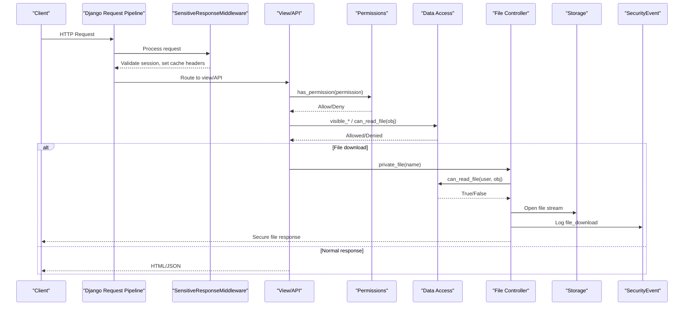
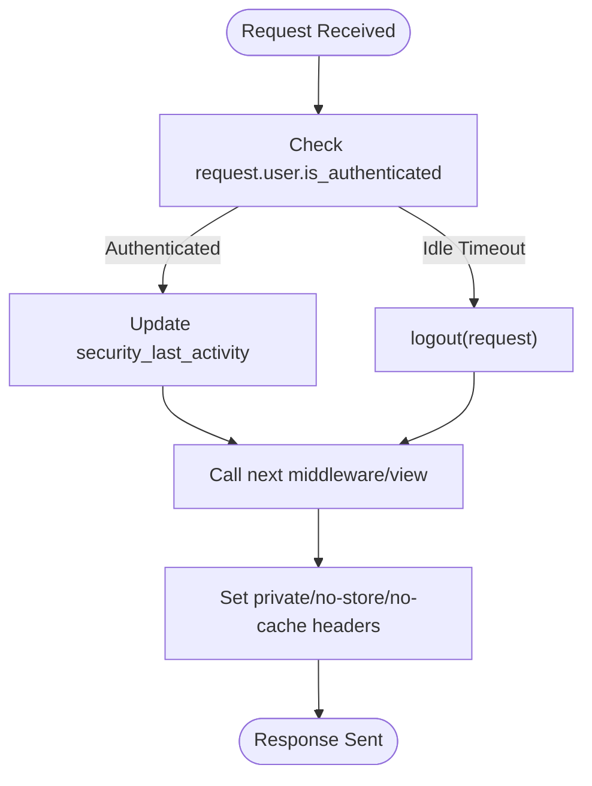
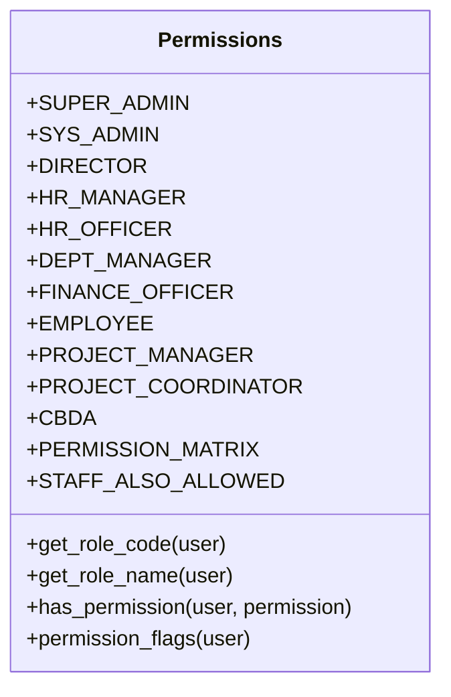
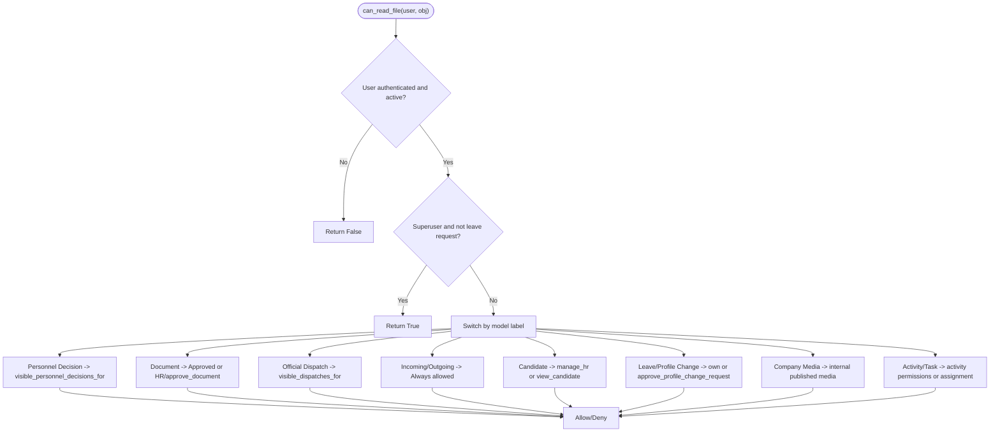
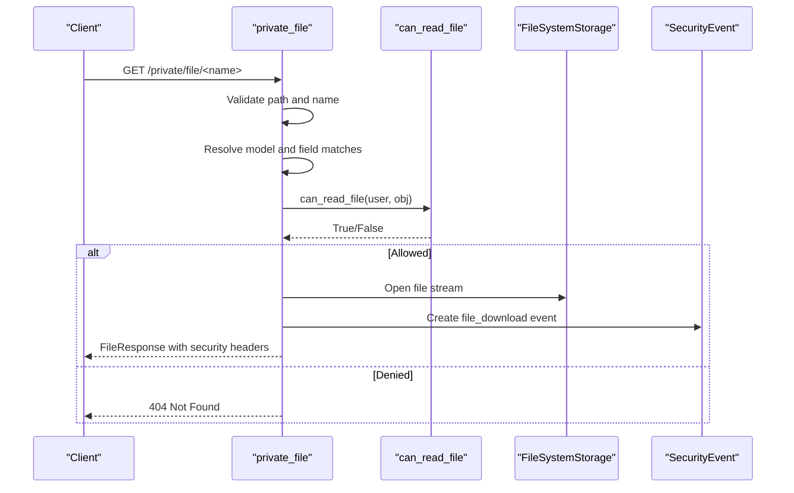
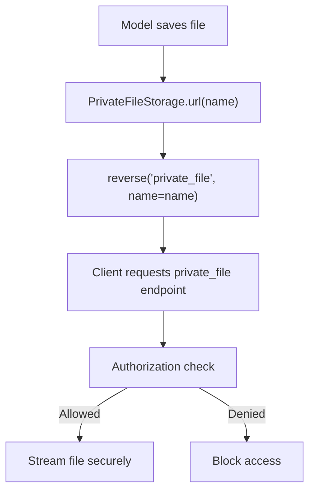
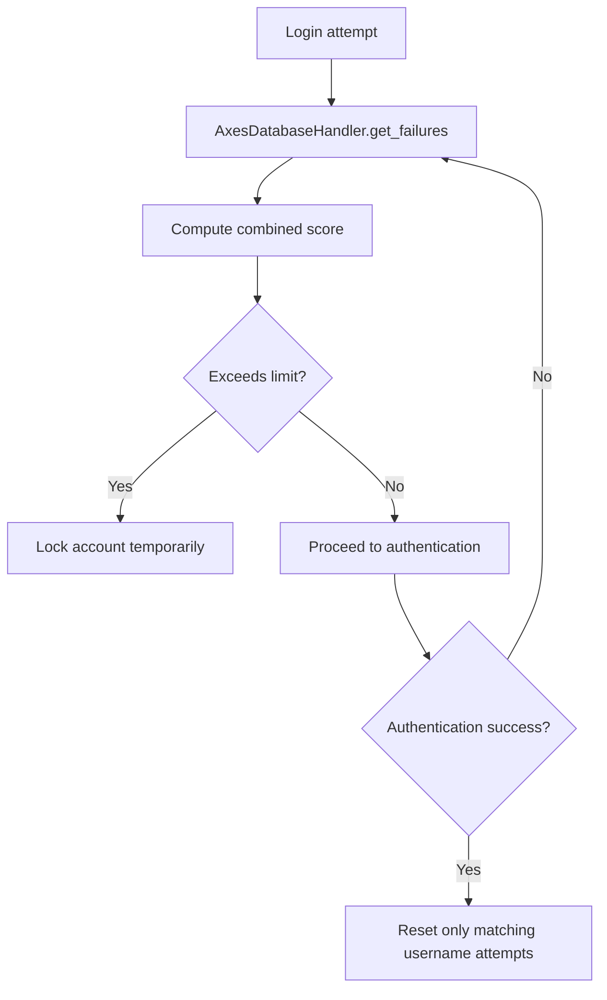
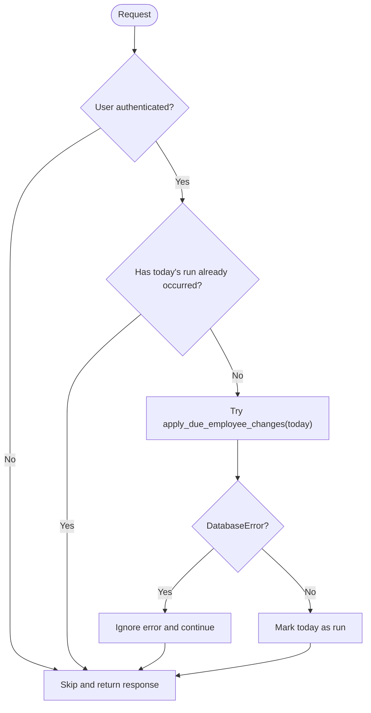
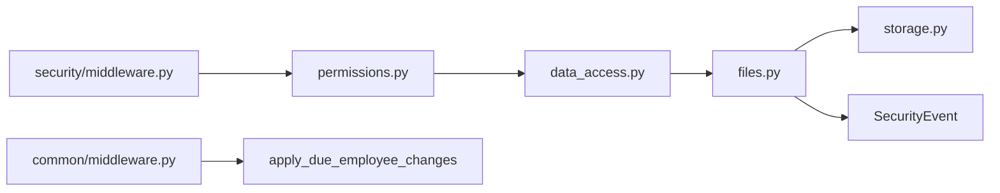

# Authorization & Middleware

<cite>
**Referenced Files in This Document**
- [middleware.py](file://src/apps/security/middleware.py)
- [middleware.py](file://src/apps/common/middleware.py)
- [permissions.py](file://src/apps/security/permissions.py)
- [data_access.py](file://src/apps/security/data_access.py)
- [files.py](file://src/apps/security/files.py)
- [storage.py](file://src/apps/security/storage.py)
- [login_handler.py](file://src/apps/security/login_handler.py)
- [10_RBAC_Permission_Matrix.md](file://docs/10_RBAC_Permission_Matrix.md)
- [04_Security_Design.md](file://docs/04_Security_Design.md)
</cite>

## Table of Contents
1. [Introduction](#introduction)
2. [Project Structure](#project-structure)
3. [Core Components](#core-components)
4. [Architecture Overview](#architecture-overview)
5. [Detailed Component Analysis](#detailed-component-analysis)
6. [Dependency Analysis](#dependency-analysis)
7. [Performance Considerations](#performance-considerations)
8. [Troubleshooting Guide](#troubleshooting-guide)
9. [Conclusion](#conclusion)

## Introduction
This document explains how IHRMS enforces authorization and protects sensitive resources through middleware, role-based permissions, data-scoped access checks, and controlled file downloads. It covers:
- How request middleware validates sessions and secures responses.
- How RBAC roles and permissions are declared and evaluated.
- How object-level data isolation prevents users from accessing unauthorized records.
- How the file access control system restricts document downloads by role and department membership.
- How storage layer security routes private files through an authorized endpoint.
- Examples for creating custom authorization middleware, permission decorators, and securing API endpoints.
- Data isolation patterns for personal and department-scoped data.
- Performance considerations and caching strategies for authorization checks.

## Project Structure
The authorization and file protection logic is primarily implemented under `apps/security`, with supporting middleware in `apps/common`. Security design and RBAC policy are documented alongside the code.

**Diagram sources**
- [middleware.py:7-28](file://src/apps/security/middleware.py#L7-L28)
- [middleware.py:7-28](file://src/apps/common/middleware.py#L7-L28)
- [permissions.py:121-151](file://src/apps/security/permissions.py#L121-L151)
- [data_access.py:121-163](file://src/apps/security/data_access.py#L121-L163)
- [files.py:27-73](file://src/apps/security/files.py#L27-L73)
- [storage.py:6-12](file://src/apps/security/storage.py#L6-L12)

**Section sources**
- [04_Security_Design.md:122-223](file://docs/04_Security_Design.md#L122-L223)
- [10_RBAC_Permission_Matrix.md:32-51](file://docs/10_RBAC_Permission_Matrix.md#L32-L51)

## Core Components
- Sensitive response middleware enforces session idle timeout and marks authenticated responses as private to prevent shared caching.
- Permission matrix defines all business permissions and role mappings.
- Data access module provides explicit scopes for employees, departments, leave requests, personnel decisions, official dispatches, and file read permissions.
- File access controller allows only authorized downloads via a single private endpoint.
- Private file storage redirects direct file URLs to the authorized download endpoint.
- Login handler integrates lockout logic with username and IP thresholds.

**Section sources**
- [middleware.py:7-28](file://src/apps/security/middleware.py#L7-L28)
- [permissions.py:10-151](file://src/apps/security/permissions.py#L10-L151)
- [data_access.py:23-163](file://src/apps/security/data_access.py#L23-L163)
- [files.py:12-73](file://src/apps/security/files.py#L12-L73)
- [storage.py:6-12](file://src/apps/security/storage.py#L6-L12)
- [login_handler.py:9-24](file://src/apps/security/login_handler.py#L9-L24)

## Architecture Overview
IHRMS uses layered security:
- Authentication establishes identity (local or Microsoft Entra ID).
- Middleware ensures sessions are active and responses are not cached publicly.
- Authorization evaluates RBAC permissions and data scope before allowing access.
- File access is centralized through a secure endpoint that validates ownership and permissions.
- Audit events record sensitive actions such as file downloads.

**Diagram sources**
- [middleware.py:7-28](file://src/apps/security/middleware.py#L7-L28)
- [permissions.py:138-151](file://src/apps/security/permissions.py#L138-L151)
- [data_access.py:121-163](file://src/apps/security/data_access.py#L121-L163)
- [files.py:54-73](file://src/apps/security/files.py#L54-L73)

## Detailed Component Analysis

### Session and Response Security Middleware
`SensitiveResponseMiddleware` performs two key responsibilities:
- Session idle timeout enforcement: if the last activity timestamp exceeds the configured timeout, the user is logged out.
- Cache hardening: authenticated responses are marked private, no-store, no-cache, must-revalidate, and include security headers like Referrer-Policy and Permissions-Policy.

**Diagram sources**
- [middleware.py:7-28](file://src/apps/security/middleware.py#L7-L28)

**Section sources**
- [middleware.py:7-28](file://src/apps/security/middleware.py#L7-L28)
- [04_Security_Design.md:671-685](file://docs/04_Security_Design.md#L671-L685)

### Role-Based Permission Matrix
The permission matrix is the single source of truth for what each role can do. It includes:
- Role constants.
- Permission-to-role mapping.
- Staff-only allowances for administrative menu visibility.
- Helper functions to evaluate permissions and generate template flags.

**Diagram sources**
- [permissions.py:10-151](file://src/apps/security/permissions.py#L10-L151)

**Section sources**
- [permissions.py:10-151](file://src/apps/security/permissions.py#L10-L151)
- [10_RBAC_Permission_Matrix.md:32-51](file://docs/10_RBAC_Permission_Matrix.md#L32-L51)

### Data Access Scopes and Object-Level Isolation
Data access functions enforce strict scoping:
- Department management scope for write workflows.
- Employee visibility based on reporting lines.
- Leave request visibility limited to self and subordinates.
- Personnel decision visibility based on role and employee relationship.
- Official dispatch visibility with special handling for project roles and security levels.
- File read permission rules per model type.

**Diagram sources**
- [data_access.py:23-163](file://src/apps/security/data_access.py#L23-L163)

**Section sources**
- [data_access.py:23-163](file://src/apps/security/data_access.py#L23-L163)

### Protected File Downloads
The file access controller centralizes downloads:
- Only safe methods are allowed.
- Path validation prevents traversal and ambiguous references.
- The endpoint resolves the owning object and field from a whitelist.
- Ownership and permission checks use `can_read_file`.
- Responses include security headers and log a `file_download` event.

**Diagram sources**
- [files.py:27-73](file://src/apps/security/files.py#L27-L73)

**Section sources**
- [files.py:12-73](file://src/apps/security/files.py#L12-L73)

### Private File Storage Integration
`PrivateFileStorage.url` returns a URL pointing to the authorized download endpoint instead of exposing raw file paths. This ensures every file access goes through authorization checks.

**Diagram sources**
- [storage.py:6-12](file://src/apps/security/storage.py#L6-L12)
- [files.py:54-73](file://src/apps/security/files.py#L54-L73)

**Section sources**
- [storage.py:6-12](file://src/apps/security/storage.py#L6-L12)

### Login Lockout and Authentication Flow
The login handler integrates with Axes to track failed attempts by both username and IP address, applying separate thresholds and resetting only the successful username’s counter.

**Diagram sources**
- [login_handler.py:9-24](file://src/apps/security/login_handler.py#L9-L24)

**Section sources**
- [login_handler.py:9-24](file://src/apps/security/login_handler.py#L9-L24)
- [04_Security_Design.md:147-179](file://docs/04_Security_Design.md#L147-L179)

### Background HR Changes Middleware
`ApplyDueEmployeeChangesMiddleware` applies scheduled HR changes once per process per local day when authenticated traffic is present. Database errors are swallowed to avoid disrupting unrelated portal pages.

**Diagram sources**
- [middleware.py:7-28](file://src/apps/common/middleware.py#L7-L28)

**Section sources**
- [middleware.py:7-28](file://src/apps/common/middleware.py#L7-L28)

## Dependency Analysis
The authorization subsystem depends on:
- Django authentication and session framework.
- Permission evaluation helpers.
- Data access scopes tied to organization and HR models.
- File storage abstraction and optional Microsoft Graph integration.
- Audit logging via SecurityEvent.

**Diagram sources**
- [permissions.py:121-151](file://src/apps/security/permissions.py#L121-L151)
- [data_access.py:1-163](file://src/apps/security/data_access.py#L1-L163)
- [files.py:1-73](file://src/apps/security/files.py#L1-L73)
- [storage.py:1-12](file://src/apps/security/storage.py#L1-L12)
- [middleware.py:7-28](file://src/apps/security/middleware.py#L7-L28)
- [middleware.py:7-28](file://src/apps/common/middleware.py#L7-L28)

**Section sources**
- [permissions.py:10-151](file://src/apps/security/permissions.py#L10-L151)
- [data_access.py:1-163](file://src/apps/security/data_access.py#L1-L163)
- [files.py:1-73](file://src/apps/security/files.py#L1-L73)
- [storage.py:1-12](file://src/apps/security/storage.py#L1-L12)
- [middleware.py:7-28](file://src/apps/security/middleware.py#L7-L28)
- [middleware.py:7-28](file://src/apps/common/middleware.py#L7-L28)

## Performance Considerations
- Authorization checks should be fast and idempotent. Prefer role and permission lookups over repeated database queries where possible.
- Cache permission flags at the session level for authenticated users to reduce repeated evaluations across multiple views in a request.
- Use querysets with selective filtering (`visible_leave_requests_for`, `visible_personnel_decisions_for`) to minimize data returned.
- Avoid heavy operations in middleware; keep session validation and header setting lightweight.
- For file downloads, resolve object ownership once and reuse the result within the same request context.
- Consider caching computed scopes (e.g., managed departments, subordinate IDs) per request using thread-local storage or request attributes.
- Ensure cache-control headers prevent shared caches from storing authenticated content, reducing server load from re-authentication loops.

[No sources needed since this section provides general guidance]

## Troubleshooting Guide
Common issues and resolutions:
- **Unexpected logout**: Verify `SESSION_IDLE_TIMEOUT` configuration and ensure `security_last_activity` is updated on authenticated requests.
- **404 on file download**: Confirm the file name is whitelisted, the owning object exists, and `can_read_file` returns true for the current user.
- **Ambiguous file reference**: If multiple objects reference the same filename, the endpoint blocks access to prevent privilege escalation.
- **SharePoint temporary unavailability**: A 503 response with `Retry-After` indicates a transient Graph API error; retry after the suggested interval.
- **Cache-related leaks**: Ensure private responses have `private`, `no-store`, `no-cache`, and `must-revalidate` headers.
- **Lockout behavior**: Check Axes configuration and the custom `SharedIPAxesHandler` to confirm username and IP thresholds are applied correctly.

**Section sources**
- [middleware.py:7-28](file://src/apps/security/middleware.py#L7-L28)
- [files.py:27-73](file://src/apps/security/files.py#L27-L73)
- [login_handler.py:9-24](file://src/apps/security/login_handler.py#L9-L24)

## Conclusion
IHRMS implements robust authorization and file protection through:
- Middleware that enforces session validity and response privacy.
- A centralized permission matrix defining role-based capabilities.
- Explicit data access scopes ensuring users see only permitted records.
- A secure file download endpoint that validates ownership and permissions before streaming content.
- Storage abstraction that routes private files through the authorized endpoint.
These mechanisms together provide defense-in-depth, least privilege, and accountability across the application.

[No sources needed since this section summarizes without analyzing specific files]