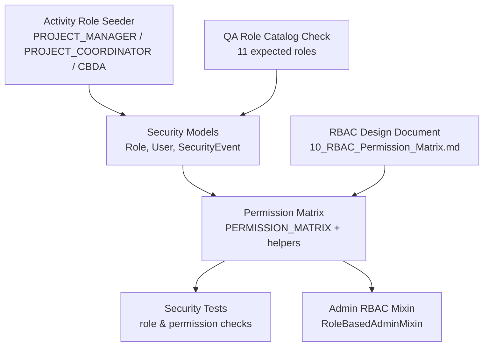
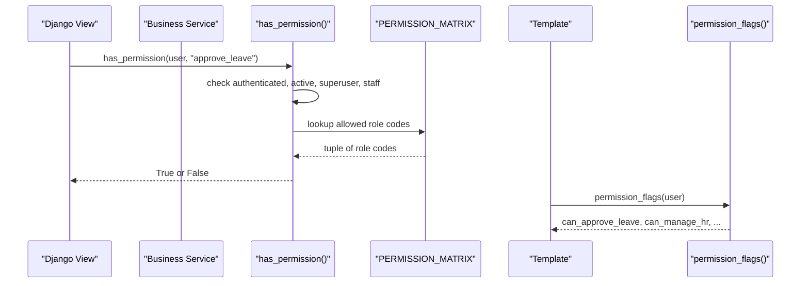
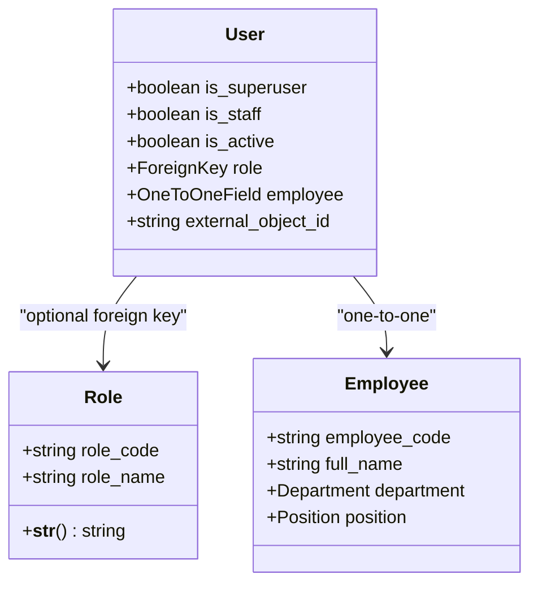
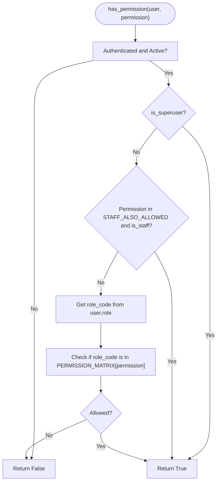
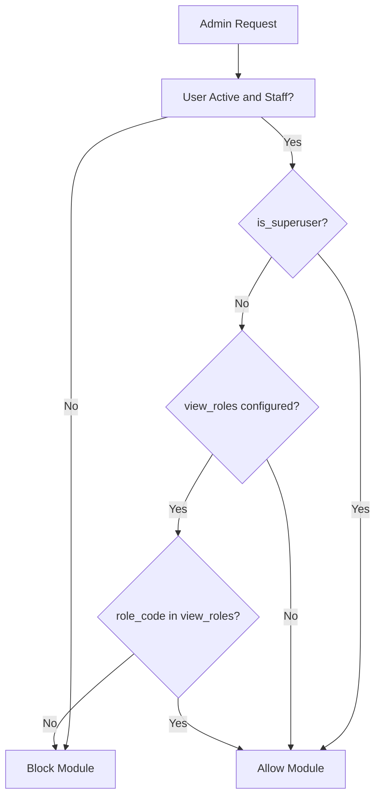
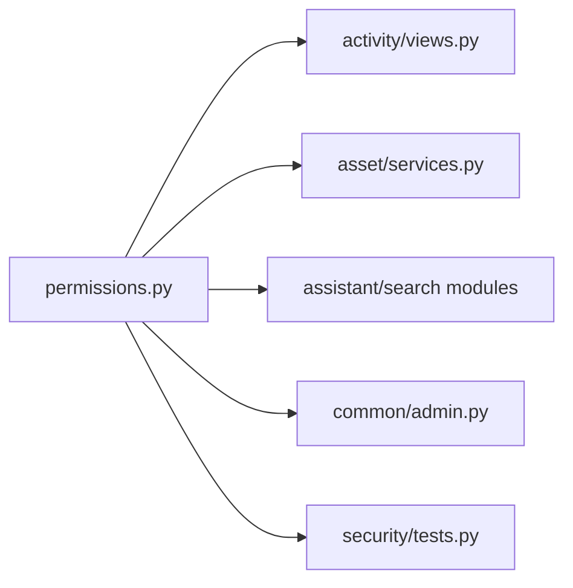

# Role-Based Access Control (RBAC)

<cite>
**Referenced Files in This Document**
- [models.py](file://src/apps/security/models.py)
- [permissions.py](file://src/apps/security/permissions.py)
- [0001_initial.py](file://src/apps/security/migrations/0001_initial.py)
- [10_RBAC_Permission_Matrix.md](file://docs/10_RBAC_Permission_Matrix.md)
- [tests.py](file://src/apps/security/tests.py)
- [admin.py](file://src/apps/common/admin.py)
- [security_admin.py](file://src/apps/security/admin.py)
- [seed_project_roles.py](file://src/apps/activity/migrations/0003_seed_project_roles.py)
- [reset_qa_data.py](file://ops/reset_qa_data.py)
</cite>

## Table of Contents
1. [Introduction](#introduction)
2. [Project Structure](#project-structure)
3. [Core Components](#core-components)
4. [Architecture Overview](#architecture-overview)
5. [Detailed Component Analysis](#detailed-component-analysis)
6. [Dependency Analysis](#dependency-analysis)
7. [Performance Considerations](#performance-considerations)
8. [Troubleshooting Guide](#troubleshooting-guide)
9. [Conclusion](#conclusion)
10. [Appendices](#appendices)

## Introduction
This document explains the IHRMS Role-Based Access Control system, focusing on how roles are modeled, how permissions are defined and enforced, and how the application uses a centralized permission matrix to control access across views, templates, services, and admin interfaces. It also clarifies the relationship between the `User` and `Role` models, the database constraints, and the operational role catalog used by the project.

The documentation is based on the Django security app, the central permission module, the RBAC design document, and the tests that validate behavior.

## Project Structure
The RBAC implementation lives primarily in the `apps/security` package, with supporting policy definitions in `apps/security/permissions.py` and business-level role descriptions in `docs/10_RBAC_Permission_Matrix.md`. Additional seed scripts and QA utilities reference the expected role catalog.



**Diagram sources**
- [models.py:5-32](file://src/apps/security/models.py#L5-L32)
- [permissions.py:10-151](file://src/apps/security/permissions.py#L10-L151)
- [10_RBAC_Permission_Matrix.md:54-195](file://docs/10_RBAC_Permission_Matrix.md#L54-L195)
- [tests.py:41-152](file://src/apps/security/tests.py#L41-L152)
- [admin.py:7-35](file://src/apps/common/admin.py#L7-L35)
- [seed_project_roles.py:4-15](file://src/apps/activity/migrations/0003_seed_project_roles.py#L4-L15)
- [reset_qa_data.py:65-71](file://ops/reset_qa_data.py#L65-L71)

**Section sources**
- [models.py:5-32](file://src/apps/security/models.py#L5-L32)
- [permissions.py:10-151](file://src/apps/security/permissions.py#L10-L151)
- [10_RBAC_Permission_Matrix.md:54-195](file://docs/10_RBAC_Permission_Matrix.md#L54-L195)

## Core Components
The RBAC system has three core parts:

1. **Data model**: `Role` stores canonical role codes and display names; `User` extends Django’s `AbstractUser` and links to one optional role.
2. **Permission matrix**: A single Python dictionary maps permission names to allowed role codes, plus helper functions for checking permissions and generating template flags.
3. **Enforcement points**: Views, services, admin mixins, and tests use the helper functions rather than hard-coding role checks.

### Role Model
The `Role` model defines:
- `role_code`: a unique identifier such as `SUPER_ADMIN`, `SYS_ADMIN`, `DIRECTOR`, `HR_MANAGER`, `FINANCE_OFFICER`, `DEPT_MANAGER`, `EMPLOYEE`, `PROJECT_MANAGER`, `PROJECT_COORDINATOR`, or `CBDA`.
- `role_name`: the human-readable name stored in the database column `RoleName`.
- Database table: `tblRole`.

The `User` model adds:
- `role`: a foreign key to `Role` using database column `RoleID`, nullable, with `on_delete=PROTECT`.
- `employee`: a one-to-one link to the HR employee record.
- `external_object_id`: an optional external identity field.

The migration creates both tables and enforces the foreign key constraint at the schema level.

**Section sources**
- [models.py:5-32](file://src/apps/security/models.py#L5-L32)
- [0001_initial.py:18-50](file://src/apps/security/migrations/0001_initial.py#L18-L50)

### Permission Matrix and Helpers
The permission matrix is declared once in `permissions.py`:
- Role constants define the role codes used throughout the codebase.
- `PERMISSION_MATRIX` maps permission names like `approve_leave`, `manage_hr`, `view_asset`, `use_salary_scale_form`, and `view_admin_menu` to tuples of allowed role codes.
- `STAFF_ALSO_ALLOWED` allows staff users to access specific menu-related permissions without assigning a business role.
- Helper functions:
  - `get_role_code(user)` returns the role code or `None`.
  - `get_role_name(user)` returns a display name, falling back to superuser/staff/default labels when no role exists.
  - `has_permission(user, permission)` checks authentication, active status, superuser bypass, staff allowance, and finally whether the user’s role code is listed for the requested permission.
  - `permission_flags(user)` generates `can_<permission>` booleans for templates.

This design makes the permission matrix the single source of truth for authorization decisions.

**Section sources**
- [permissions.py:10-151](file://src/apps/security/permissions.py#L10-L151)

### Operational Role Catalog
The project expects exactly 11 role codes in its operational catalog:
- `SUPER_ADMIN`
- `SYS_ADMIN`
- `DIRECTOR`
- `HR_MANAGER`
- `HR_OFFICER`
- `DEPT_MANAGER`
- `FINANCE_OFFICER`
- `EMPLOYEE`
- `PROJECT_MANAGER`
- `PROJECT_COORDINATOR`
- `CBDA`

The QA reset script validates that the existing role catalog matches these 11 codes. The activity app migration seeds three project-related roles: `PROJECT_MANAGER`, `PROJECT_COORDINATOR`, and `CBDA`.

**Section sources**
- [reset_qa_data.py:65-71](file://ops/reset_qa_data.py#L65-L71)
- [seed_project_roles.py:4-15](file://src/apps/activity/migrations/0003_seed_project_roles.py#L4-L15)

## Architecture Overview
At runtime, authorization flows through a small set of well-defined entry points:



**Diagram sources**
- [permissions.py:121-151](file://src/apps/security/permissions.py#L121-L151)

The enforcement pattern is consistent:
- Views call `has_permission` before allowing actions.
- Services wrap business operations with permission checks.
- Templates render UI conditionally using `can_<permission>` flags.
- Admin interfaces use `RoleBasedAdminMixin` to restrict module visibility and object editing by role.

**Section sources**
- [permissions.py:121-151](file://src/apps/security/permissions.py#L121-L151)
- [admin.py:7-35](file://src/apps/common/admin.py#L7-L35)

## Detailed Component Analysis

### Role and User Data Model
The data model separates identity from business role:
- `User` inherits Django’s authentication fields.
- `role` is optional so accounts can exist before a role is assigned.
- `on_delete=PROTECT` prevents accidental deletion of roles that are still referenced by users.
- `related_name="users"` allows reverse queries from role to users.



**Diagram sources**
- [models.py:5-32](file://src/apps/security/models.py#L5-L32)

**Section sources**
- [models.py:5-32](file://src/apps/security/models.py#L5-L32)
- [0001_initial.py:18-50](file://src/apps/security/migrations/0001_initial.py#L18-L50)

### Permission Evaluation Logic
The permission evaluation follows a clear decision path:



**Diagram sources**
- [permissions.py:138-146](file://src/apps/security/permissions.py#L138-L146)

Key behaviors:
- Unauthenticated or inactive users are denied.
- Superusers bypass all matrix checks.
- Staff-only menu permissions are explicitly whitelisted.
- Business permissions require an explicit role match.

**Section sources**
- [permissions.py:111-146](file://src/apps/security/permissions.py#L111-L146)

### Permission Matrix and Role Semantics
The permission matrix defines what each role can do. Examples include:
- Leave approvals: `HR_MANAGER`, `DEPT_MANAGER`, and `DIRECTOR`; cross-department approval is limited to `HR_MANAGER` and `DIRECTOR`.
- HR management: `HR_MANAGER` and `HR_OFFICER`.
- Finance and payroll: `FINANCE_OFFICER` and `DIRECTOR` for salary scale usage.
- Asset management: read access for senior roles and finance; write access restricted to HR and system administrators.
- Administration menu: `SUPER_ADMIN`, `SYS_ADMIN`, `HR_MANAGER`, and `DIRECTOR`.

The design document describes role scopes and module-level permissions, while the code implements them through permission names.

**Section sources**
- [permissions.py:28-109](file://src/apps/security/permissions.py#L28-L109)
- [10_RBAC_Permission_Matrix.md:54-195](file://docs/10_RBAC_Permission_Matrix.md#L54-L195)

### Admin Interface Enforcement
The `RoleBasedAdminMixin` provides reusable RBAC behavior for Django admin:
- `view_roles` controls which roles can see a module.
- `edit_roles` controls which roles can edit objects.
- `has_module_permission` and `has_view_permission` enforce role checks before rendering admin pages.
- The security event admin restricts viewing to `SUPER_ADMIN` and `SYS_ADMIN`.



**Diagram sources**
- [admin.py:7-35](file://src/apps/common/admin.py#L7-L35)
- [security_admin.py:52-58](file://src/apps/security/admin.py#L52-L58)

**Section sources**
- [admin.py:7-35](file://src/apps/common/admin.py#L7-L35)
- [security_admin.py:36-67](file://src/apps/security/admin.py#L36-L67)

### Tests and Validation
The security tests verify:
- Ordinary employees only get self-service permissions.
- Department managers can approve leave within their scope but not across all departments.
- Lifecycle checklist permissions are limited to HR roles.
- Superusers always pass permission checks.
- `permission_flags` returns the correct set of `can_<permission>` keys and values.

These tests serve as executable specifications for the permission matrix.

**Section sources**
- [tests.py:41-152](file://src/apps/security/tests.py#L41-L152)

## Dependency Analysis
The RBAC system has low coupling and high cohesion:
- `permissions.py` is the central dependency for authorization logic.
- Other apps import `has_permission`, `get_role_code`, and `permission_flags` instead of duplicating role checks.
- The data model depends only on Django’s auth framework and the HR employee model.
- The design document is a policy artifact; the code implements it through permission names.



**Diagram sources**
- [permissions.py:121-151](file://src/apps/security/permissions.py#L121-L151)
- [admin.py:7-35](file://src/apps/common/admin.py#L7-L35)
- [tests.py:41-152](file://src/apps/security/tests.py#L41-L152)

**Section sources**
- [permissions.py:121-151](file://src/apps/security/permissions.py#L121-L151)
- [admin.py:7-35](file://src/apps/common/admin.py#L7-L35)

## Performance Considerations
- Permission checks are constant-time lookups against a small dictionary and role tuple.
- `permission_flags` computes flags for every permission in the matrix; this is acceptable for request-scoped context generation but should be used intentionally in heavy loops.
- Avoid repeated role resolution by caching `get_role_code(user)` where appropriate in hot paths.
- Keep the permission matrix concise; adding many fine-grained permissions increases flag computation and maintenance cost.

[No sources needed since this section provides general guidance]

## Troubleshooting Guide

### Symptom: A user cannot access a feature even though they are logged in
Check the following:
1. Is the user authenticated and active?
2. Does the user have a role assigned?
3. Is the permission name used in the view/template present in `PERMISSION_MATRIX`?
4. Is the user’s role code included in the allowed tuple for that permission?
5. If the permission is menu-related, is it in `STAFF_ALSO_ALLOWED` and does the user have `is_staff`?

Relevant implementation:
- Authentication and active checks are performed before role lookup.
- Superusers bypass matrix checks.
- Staff-only permissions are explicitly whitelisted.

**Section sources**
- [permissions.py:138-146](file://src/apps/security/permissions.py#L138-L146)

### Symptom: Deleting a role fails
Because `User.role` uses `on_delete=PROTECT`, deleting a role that is still assigned to any user will fail at the database level. Remove or reassign the role from affected users first.

**Section sources**
- [models.py:17-21](file://src/apps/security/models.py#L17-L21)
- [0001_initial.py:47](file://src/apps/security/migrations/0001_initial.py#L47)

### Symptom: Admin module is hidden
If a module uses `RoleBasedAdminMixin`, ensure:
- The user is active and staff.
- The role code is listed in `view_roles` for that admin class.
- The role is present in the operational catalog.

**Section sources**
- [admin.py:20-32](file://src/apps/common/admin.py#L20-L32)
- [reset_qa_data.py:65-71](file://ops/reset_qa_data.py#L65-L71)

### Symptom: Template buttons do not appear
Ensure the template uses the `can_<permission>` flag generated by `permission_flags`, and that the permission name matches the key in `PERMISSION_MATRIX`.

**Section sources**
- [permissions.py:149-151](file://src/apps/security/permissions.py#L149-L151)
- [tests.py:148-152](file://src/apps/security/tests.py#L148-L152)

## Conclusion
IHRMS RBAC is implemented around a simple, auditable design:
- Roles are stored as canonical codes and names.
- Permissions are declared centrally in a single matrix.
- Authorization helpers provide consistent checks across views, services, templates, and admin interfaces.
- The database schema protects referential integrity between users and roles.
- Tests validate the intended behavior and help prevent accidental permission drift.

For new features, add permission names to `PERMISSION_MATRIX`, assign them to the appropriate roles, and enforce them through `has_permission` or `permission_flags`. Do not duplicate role checks in multiple places.

[No sources needed since this section summarizes without analyzing specific files]

## Appendices

### Appendix A: Predefined Roles and Their Intended Scope
The operational catalog includes 11 role codes. Their intended scopes are described in the RBAC design document and reflected in the permission matrix:

- `SUPER_ADMIN`: Full system administration and unrestricted access.
- `SYS_ADMIN`: Infrastructure and technical administration; limited from payroll modification/approval.
- `DIRECTOR`: Company-wide oversight, final approvals, executive dashboards, and reports.
- `HR_MANAGER`: Human resources management, recruitment, leave, timesheet, contracts, and KPI oversight.
- `HR_OFFICER`: HR execution tasks without final approval authority.
- `DEPT_MANAGER`: Department-scoped approvals, task assignment, and KPI evaluation.
- `FINANCE_OFFICER`: Payroll, procurement, budget, and financial reporting.
- `EMPLOYEE`: Self-service profile, attendance, leave, tasks, and personal payslip access.
- `PROJECT_MANAGER`: Project activity management and coordination.
- `PROJECT_COORDINATOR`: Project activity coordination and candidate/project-related views.
- `CBDA`: Project coordinator-level access with specific activity restrictions.

**Section sources**
- [10_RBAC_Permission_Matrix.md:54-195](file://docs/10_RBAC_Permission_Matrix.md#L54-L195)
- [reset_qa_data.py:65-71](file://ops/reset_qa_data.py#L65-L71)
- [seed_project_roles.py:4-15](file://src/apps/activity/migrations/0003_seed_project_roles.py#L4-L15)

### Appendix B: How to Assign Roles to Users
In practice:
- Create or update a `User` instance.
- Set the `role` field to a `Role` object whose `role_code` matches one of the 11 expected codes.
- Ensure the role exists in the database before assignment.

Seed and QA utilities demonstrate creating roles via `get_or_create(role_code=..., defaults={"role_name": ...})` and linking them to users.

**Section sources**
- [models.py:17-21](file://src/apps/security/models.py#L17-L21)
- [seed_project_roles.py:4-15](file://src/apps/activity/migrations/0003_seed_project_roles.py#L4-L15)
- [reset_qa_data.py:65-71](file://ops/reset_qa_data.py#L65-L71)

### Appendix C: Checking Permissions in Views and Templates
- In views and services, call `has_permission(user, "permission_name")`.
- In templates, use flags like `{{ perms.can_approve_leave }}` generated by `permission_flags`.
- For admin interfaces, configure `view_roles` and `edit_roles` on admin classes using `RoleBasedAdminMixin`.

**Section sources**
- [permissions.py:138-151](file://src/apps/security/permissions.py#L138-L151)
- [admin.py:7-35](file://src/apps/common/admin.py#L7-L35)

### Appendix D: Custom Role-Based Decorators
While the repository does not include a dedicated decorator module, custom decorators can be built on top of the existing helpers:
- Use `has_permission` for function-level authorization.
- Use `get_role_code` for role-specific branching.
- Combine with Django’s `login_required` and `staff_member_required` where appropriate.

Example pattern (conceptual):
```python
from functools import wraps
from apps.security.permissions import has_permission

def role_required(permission):
    def decorator(view_func):
        @wraps(view_func)
        def wrapper(request, *args, **kwargs):
            if not has_permission(request.user, permission):
                return HttpResponseForbidden()
            return view_func(request, *args, **kwargs)
        return wrapper
    return decorator
```

This approach keeps authorization logic centralized in `permissions.py` while providing convenient decorators for views.

[No sources needed since this section provides conceptual guidance]

### Appendix E: Role Hierarchy and Inheritance
The current implementation does not define explicit role hierarchy or inheritance in the data model. Instead, hierarchy is expressed implicitly through the permission matrix:
- More powerful roles are added to broader permission tuples.
- Cross-department or company-wide permissions are explicitly granted to senior roles.
- Superuser bypass provides administrative override.

If future requirements need explicit hierarchy, consider adding a parent role field or a separate policy layer, while keeping `PERMISSION_MATRIX` as the authoritative authorization source.

**Section sources**
- [permissions.py:28-109](file://src/apps/security/permissions.py#L28-L109)
- [permissions.py:138-146](file://src/apps/security/permissions.py#L138-L146)