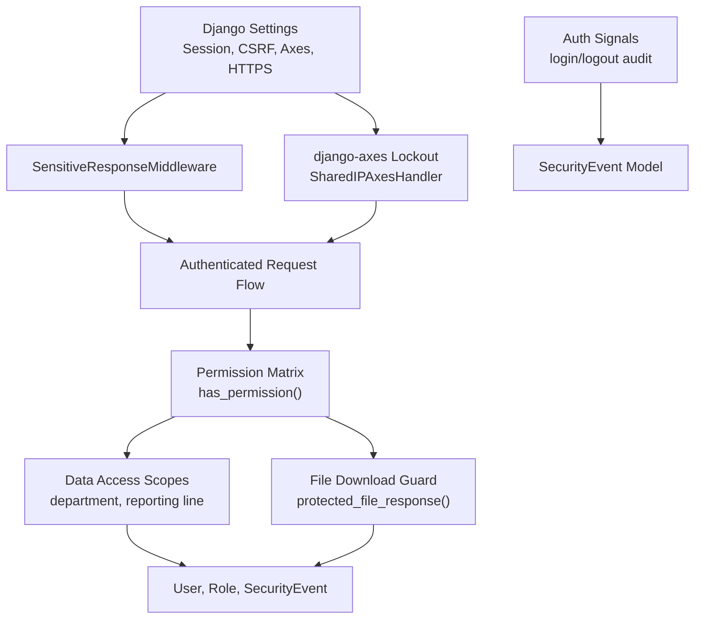
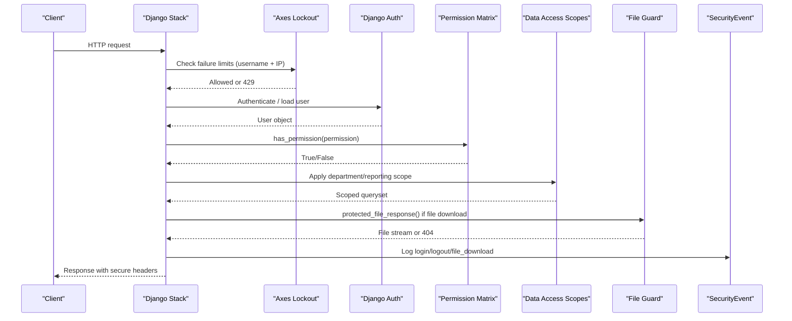
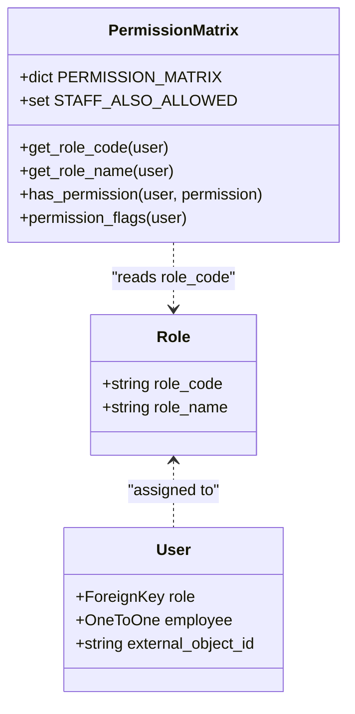
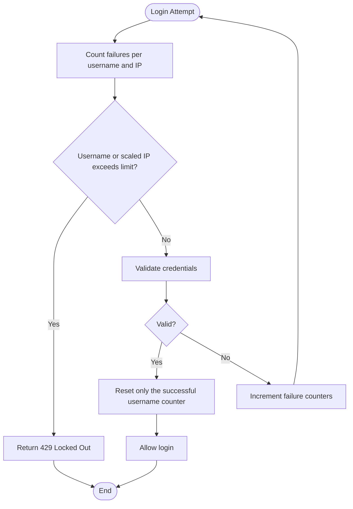
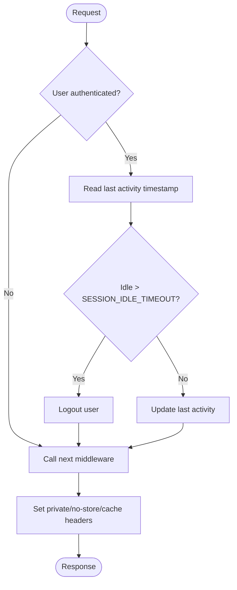
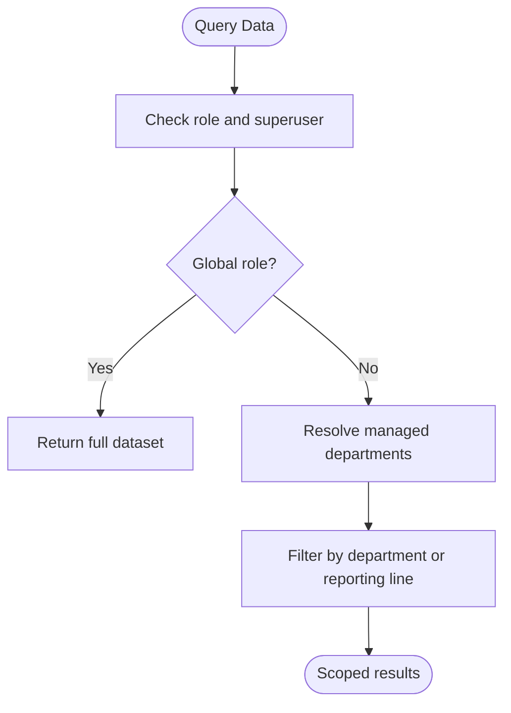
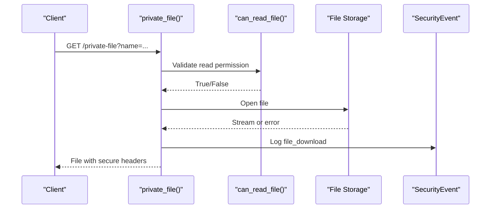
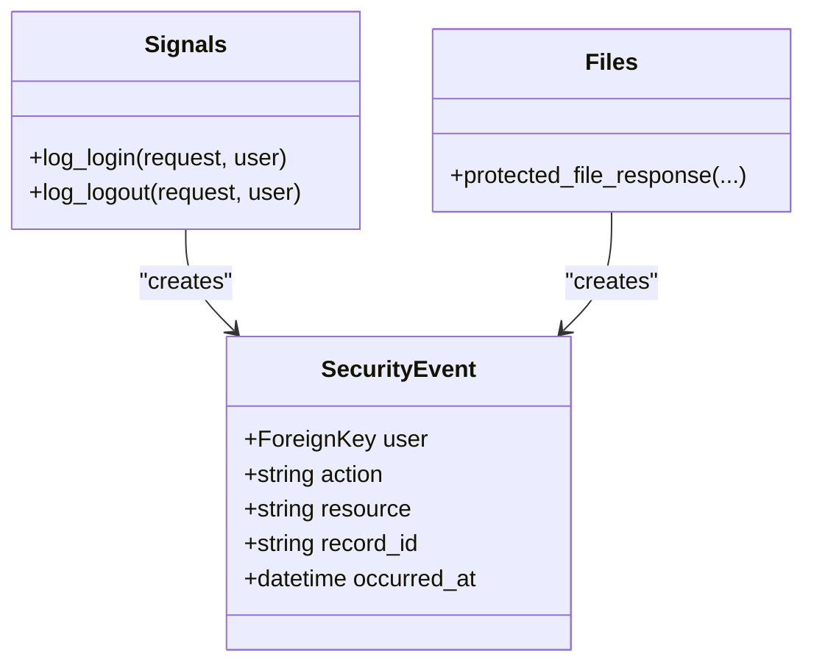
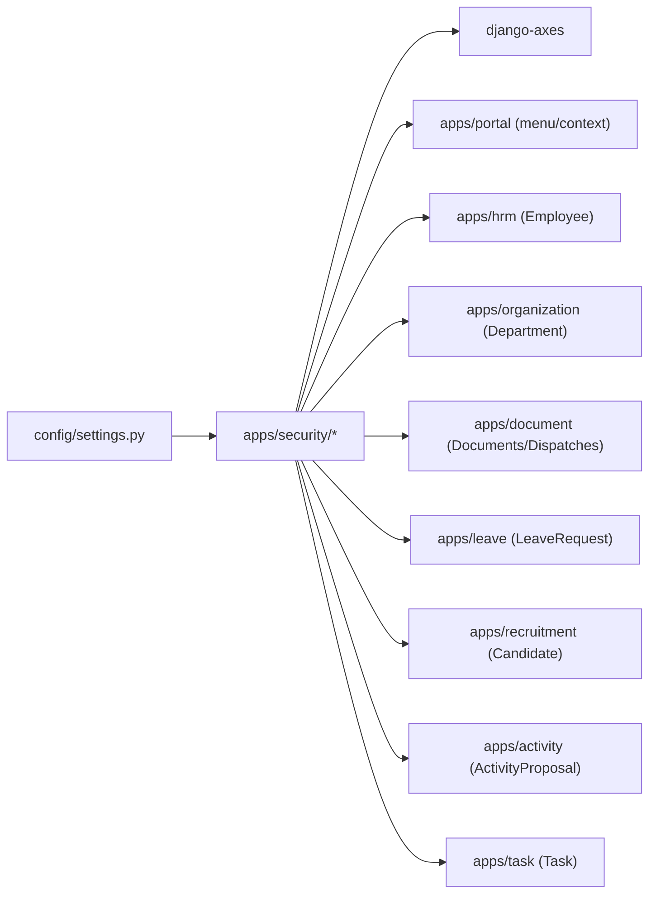

# Security & Authentication

<cite>
**Referenced Files in This Document**
- [permissions.py](file://src/apps/security/permissions.py)
- [middleware.py](file://src/apps/security/middleware.py)
- [login_handler.py](file://src/apps/security/login_handler.py)
- [models.py](file://src/apps/security/models.py)
- [signals.py](file://src/apps/security/signals.py)
- [data_access.py](file://src/apps/security/data_access.py)
- [files.py](file://src/apps/security/files.py)
- [logging.py](file://src/apps/security/logging.py)
- [settings.py](file://src/config/settings.py)
- [10_RBAC_Permission_Matrix.md](file://docs/10_RBAC_Permission_Matrix.md)
- [04_Security_Design.md](file://docs/04_Security_Design.md)
</cite>

## Table of Contents
1. [Introduction](#introduction)
2. [Project Structure](#project-structure)
3. [Core Components](#core-components)
4. [Architecture Overview](#architecture-overview)
5. [Detailed Component Analysis](#detailed-component-analysis)
6. [Dependency Analysis](#dependency-analysis)
7. [Performance Considerations](#performance-considerations)
8. [Troubleshooting Guide](#troubleshooting-guide)
9. [Conclusion](#conclusion)
10. [Appendices](#appendices)

## Introduction
This document explains the IHRMS security and authentication system with a focus on:
- Role-based access control using 11 predefined role codes.
- Permission matrix enforcement across views, menus, data scopes, and file downloads.
- Login lockout protection through django-axes with shared IP handling.
- Sensitive response filtering and session idle timeout.
- CSRF protection, password policies, and secure deployment settings.
- Audit logging for authentication events and sensitive data access.
- Practical guidance for custom permissions, view decorators, extending roles, and common security patterns such as department isolation and API authentication.

The implementation is centered in the `security` Django app and coordinated by project-wide settings.

## Project Structure
Security-related functionality is organized under `src/apps/security`, with configuration in `src/config/settings.py`. Business-facing documentation defines the RBAC policy and security objectives.

**Diagram sources**
- [settings.py:145-168](file://src/config/settings.py#L145-L168)
- [middleware.py:7-28](file://src/apps/security/middleware.py#L7-L28)
- [login_handler.py:9-24](file://src/apps/security/login_handler.py#L9-L24)
- [permissions.py:13-151](file://src/apps/security/permissions.py#L13-L151)
- [data_access.py:23-163](file://src/apps/security/data_access.py#L23-L163)
- [files.py:27-73](file://src/apps/security/files.py#L27-L73)
- [signals.py:7-15](file://src/apps/security/signals.py#L7-L15)
- [models.py:5-45](file://src/apps/security/models.py#L5-L45)

**Section sources**
- [settings.py:145-168](file://src/config/settings.py#L145-L168)
- [04_Security_Design.md:122-180](file://docs/04_Security_Design.md#L122-L180)

## Core Components
- **Role and User models**: Centralize user identity, assigned role, and employee linkage.
- **Permission matrix**: Single source of truth for 11 role codes and permission checks.
- **Data access scopes**: Enforce departmental and reporting-line boundaries.
- **File access controls**: Allowlisted model fields with authorization and safe headers.
- **Login lockout**: django-axes with username and IP thresholds.
- **Sensitive response middleware**: Idle session logout and cache-control hardening.
- **Audit signals**: Record login/logout metadata without secrets.
- **Safe exception logging**: Avoid leaking payloads in production logs.

**Section sources**
- [models.py:5-45](file://src/apps/security/models.py#L5-L45)
- [permissions.py:13-151](file://src/apps/security/permissions.py#L13-L151)
- [data_access.py:23-163](file://src/apps/security/data_access.py#L23-L163)
- [files.py:27-73](file://src/apps/security/files.py#L27-L73)
- [login_handler.py:9-24](file://src/apps/security/login_handler.py#L9-L24)
- [middleware.py:7-28](file://src/apps/security/middleware.py#L7-L28)
- [signals.py:7-15](file://src/apps/security/signals.py#L7-L15)
- [logging.py:6-13](file://src/apps/security/logging.py#L6-L13)

## Architecture Overview
IHRMS applies defense-in-depth:
- Authentication via Django’s auth backend plus django-axes.
- Authorization via the centralized permission matrix and explicit data scoping.
- Transport and cookie security enforced by settings and middleware.
- Audit trails for authentication and sensitive resource access.

**Diagram sources**
- [settings.py:145-168](file://src/config/settings.py#L145-L168)
- [login_handler.py:9-24](file://src/apps/security/login_handler.py#L9-L24)
- [permissions.py:138-151](file://src/apps/security/permissions.py#L138-L151)
- [data_access.py:23-163](file://src/apps/security/data_access.py#L23-L163)
- [files.py:27-73](file://src/apps/security/files.py#L27-L73)
- [signals.py:7-15](file://src/apps/security/signals.py#L7-L15)

## Detailed Component Analysis

### Role-Based Access Control and Permission Matrix
The system defines 11 role codes and enforces permissions through a single matrix. Superusers bypass normal checks; staff-only menu permissions are explicitly allowed.

Key elements:
- Role codes include SUPER_ADMIN, SYS_ADMIN, DIRECTOR, HR_MANAGER, HR_OFFICER, DEPT_MANAGER, FINANCE_OFFICER, EMPLOYEE, PROJECT_MANAGER, PROJECT_COORDINATOR, CBDA.
- PERMISSION_MATRIX maps business permissions to allowed roles.
- STAFF_ALSO_ALLOWED grants specific administrative UI visibility to staff accounts.
- has_permission() centralizes checks used throughout templates and services.

**Diagram sources**
- [models.py:5-32](file://src/apps/security/models.py#L5-L32)
- [permissions.py:13-151](file://src/apps/security/permissions.py#L13-L151)

Implementation notes:
- Use has_permission() for all business decisions rather than checking role strings directly.
- For template visibility, use permission_flags() to generate can_<permission> flags.
- Extend roles by adding new constants and updating PERMISSION_MATRIX; avoid scattering role checks.

**Section sources**
- [permissions.py:13-151](file://src/apps/security/permissions.py#L13-L151)
- [10_RBAC_Permission_Matrix.md:54-195](file://docs/10_RBAC_Permission_Matrix.md#L54-L195)

### Login Lockout Protection via django-axes
Lockout protects both portal and admin logins using persistent database counters. A custom handler combines username-level and IP-level failures so that a shared office IP cannot be trivially locked out while still blocking password spraying.

Configuration highlights:
- AXES_FAILURE_LIMIT = 5
- AXES_IP_FAILURE_LIMIT defaults to at least the same value but can be higher.
- AXES_LOCKOUT_PARAMETERS includes both username and ip_address.
- AXES_COOLOFF_TIME = 30 minutes.
- SharedIPAxesHandler scales IP failures against the configured IP limit.

**Diagram sources**
- [settings.py:158-168](file://src/config/settings.py#L158-L168)
- [login_handler.py:9-24](file://src/apps/security/login_handler.py#L9-L24)

Operational guidance:
- Keep AXES_SENSITIVE_PARAMETERS to mask credentials in logs.
- Monitor AccessAttempt records for suspicious IPs.
- Ensure AXES_HANDLER points to SharedIPAxesHandler.

**Section sources**
- [settings.py:158-168](file://src/config/settings.py#L158-L168)
- [login_handler.py:9-24](file://src/apps/security/login_handler.py#L9-L24)

### Sensitive Response Filtering and Session Handling
SensitiveResponseMiddleware ensures authenticated responses are not cached and enforces idle session logout.

Behavior:
- On each request, if the user is authenticated and idle beyond SESSION_IDLE_TIMEOUT, the session is logged out.
- Responses for authenticated users and login endpoints receive private/no-store cache headers.
- Referrer-Policy and Permissions-Policy headers restrict browser capabilities.

**Diagram sources**
- [middleware.py:7-28](file://src/apps/security/middleware.py#L7-L28)
- [settings.py:91-100](file://src/config/settings.py#L91-L100)

**Section sources**
- [middleware.py:7-28](file://src/apps/security/middleware.py#L7-L28)
- [settings.py:91-100](file://src/config/settings.py#L91-L100)

### CSRF Protection and Secure Deployment
CSRF protection is enabled via Django’s CsrfViewMiddleware. Additional protections include:
- X_FRAME_OPTIONS set to DENY.
- SECURE_CONTENT_TYPE_NOSNIFF enabled.
- Optional HTTPS enforcement controlled by ENABLE_HTTPS_ENFORCEMENT.
- Strict SECRET_KEY validation for UAT/production.

Recommended deployment checklist:
- Set ENABLE_HTTPS_ENFORCEMENT=True behind a reverse proxy with valid SSL.
- Configure ALLOWED_HOSTS explicitly.
- Provide a strong, random SECRET_KEY.
- Set CSRF_TRUSTED_ORIGINS for frontend domains.

**Section sources**
- [settings.py:42-46](file://src/config/settings.py#L42-L46)
- [settings.py:56-89](file://src/config/settings.py#L56-L89)
- [settings.py:87-100](file://src/config/settings.py#L87-L100)

### Password Policies
Password validation uses Django’s built-in validators:
- Minimum length.
- Common password check.
- Numeric password check.
- Similarity to user attributes.

Policy alignment:
- The security design specifies minimum length, character complexity, expiry, history, and account lockout.
- Account lockout is implemented via axes; password expiry/history should be enforced by application logic or additional validators when required.

**Section sources**
- [settings.py:228-244](file://src/config/settings.py#L228-L244)
- [04_Security_Design.md:227-284](file://docs/04_Security_Design.md#L227-L284)

### Data Isolation by Department and Reporting Line
Explicit data access helpers enforce:
- Managed departments for scoped write workflows.
- Employee selection within managed departments.
- Visibility through the full reporting tree.
- Leave requests visible to self and subordinates.
- Personnel decisions visible to authorized roles or reporting chain.
- Official dispatch visibility based on role and security level.

**Diagram sources**
- [data_access.py:23-71](file://src/apps/security/data_access.py#L23-L71)

**Section sources**
- [data_access.py:23-118](file://src/apps/security/data_access.py#L23-L118)

### File Access Controls
Protected file downloads validate:
- Authentication and authorization via can_read_file().
- Safe path construction and allowlisted model fields.
- SharePoint Graph errors mapped to controlled responses.
- Secure headers and audit logging for every download.

**Diagram sources**
- [files.py:27-73](file://src/apps/security/files.py#L27-L73)
- [data_access.py:121-163](file://src/apps/security/data_access.py#L121-L163)

**Section sources**
- [files.py:12-73](file://src/apps/security/files.py#L12-L73)
- [data_access.py:121-163](file://src/apps/security/data_access.py#L121-L163)

### Audit Logging for Security Events
Authentication events are recorded without storing secrets:
- Login and logout create SecurityEvent entries.
- File downloads also create audit entries.
- Exception logging avoids exposing payloads in production.

**Diagram sources**
- [signals.py:7-15](file://src/apps/security/signals.py#L7-L15)
- [files.py:27-50](file://src/apps/security/files.py#L27-L50)
- [models.py:35-45](file://src/apps/security/models.py#L35-L45)

**Section sources**
- [signals.py:7-15](file://src/apps/security/signals.py#L7-L15)
- [files.py:27-50](file://src/apps/security/files.py#L27-L50)
- [logging.py:6-13](file://src/apps/security/logging.py#L6-L13)

### API Authentication Methods
Design requirements specify JWT-based API authentication with permission validation and HTTPS-only transport. While this document focuses on the security app, APIs should:
- Require a valid JWT on every endpoint.
- Extract user context from token claims.
- Enforce has_permission() before returning data.
- Apply the same data scoping rules as web flows.
- Log relevant actions without sensitive payloads.

[No sources needed since this section provides general guidance]

## Dependency Analysis
The security subsystem depends on Django core, django-axes, and domain apps for data scoping.

**Diagram sources**
- [settings.py:111-143](file://src/config/settings.py#L111-L143)
- [data_access.py:23-163](file://src/apps/security/data_access.py#L23-L163)

**Section sources**
- [settings.py:111-143](file://src/config/settings.py#L111-L143)
- [data_access.py:23-163](file://src/apps/security/data_access.py#L23-L163)

## Performance Considerations
- Permission checks are dictionary lookups and simple role comparisons; keep PERMISSION_MATRIX concise.
- Data scoping queries traverse the reporting hierarchy once per request; consider caching manager-to-subordinate mappings if datasets grow large.
- File downloads open storage streams; ensure efficient streaming and avoid unnecessary copies.
- Axes counters are persisted; monitor table growth and purge old attempts according to retention policy.
- SensitiveResponseMiddleware updates session timestamps; prefer minimal session data to reduce overhead.

[No sources needed since this section provides general guidance]

## Troubleshooting Guide
Common issues and resolutions:
- Users locked out unexpectedly:
  - Verify AXES_LOCKOUT_PARAMETERS includes both username and ip_address.
  - Confirm AXES_IP_FAILURE_LIMIT is appropriate for shared environments.
  - Check AccessAttempt records for high IP failure counts.
- Authenticated pages cached by proxies:
  - Ensure SensitiveResponseMiddleware is active and sets private/no-store headers.
  - Confirm reverse proxy does not override Cache-Control.
- File download returns 404 despite correct URL:
  - Verify can_read_file() allows the requesting user.
  - Check that the stored file field exists and matches the allowlist.
  - Inspect GraphAPIError handling for temporary service unavailability.
- Excessive exception details in logs:
  - Confirm SafeExceptionFilter is applied to handlers in production.
  - Review LOGGING configuration to ensure filters are attached.

**Section sources**
- [settings.py:158-168](file://src/config/settings.py#L158-L168)
- [middleware.py:7-28](file://src/apps/security/middleware.py#L7-L28)
- [files.py:27-73](file://src/apps/security/files.py#L27-L73)
- [logging.py:6-13](file://src/apps/security/logging.py#L6-L13)

## Conclusion
IHRMS implements a layered security model anchored by a centralized permission matrix, explicit data scoping, robust login lockout, secure response handling, and comprehensive audit trails. By extending PERMISSION_MATRIX, using has_permission(), and applying data access helpers, teams can safely add features while maintaining least privilege and clear accountability.

[No sources needed since this section summarizes without analyzing specific files]

## Appendices

### How to Implement Custom Permissions
- Add a new permission key to PERMISSION_MATRIX with the allowed roles.
- Use has_permission() in views, services, and selectors.
- Generate template flags via permission_flags() for UI visibility.
- If the permission is administrative UI-only, add it to STAFF_ALSO_ALLOWED when appropriate.

**Section sources**
- [permissions.py:28-115](file://src/apps/security/permissions.py#L28-L115)
- [permissions.py:138-151](file://src/apps/security/permissions.py#L138-L151)

### How to Protect Views with Decorators
- Use Django’s @login_required for authentication.
- Combine with permission checks inside the view or via a custom decorator that calls has_permission().
- For file downloads, use protected_file_response() instead of direct file serving.

**Section sources**
- [files.py:54-73](file://src/apps/security/files.py#L54-L73)
- [permissions.py:138-151](file://src/apps/security/permissions.py#L138-L151)

### How to Extend the Role System
- Define new role code constants in permissions.py.
- Seed the corresponding Role record in the database.
- Assign the role to users during provisioning or via admin tools.
- Update PERMISSION_MATRIX to reflect the new role’s capabilities.

**Section sources**
- [permissions.py:13-23](file://src/apps/security/permissions.py#L13-L23)
- [models.py:5-15](file://src/apps/security/models.py#L5-L15)

### Data Isolation Patterns
- Use employees_for_department_scope() for selecting employees within managed departments.
- Use employee_and_subordinate_ids() to build reporting-line scopes.
- Apply visible_leave_requests_for() and visible_personnel_decisions_for() to filter lists.

**Section sources**
- [data_access.py:23-90](file://src/apps/security/data_access.py#L23-L90)

### API Authentication Checklist
- Require JWT on all endpoints.
- Decode token to obtain user context.
- Enforce has_permission() before processing.
- Apply the same data scoping rules as web routes.
- Log actions without sensitive payloads.

[No sources needed since this section provides general guidance]