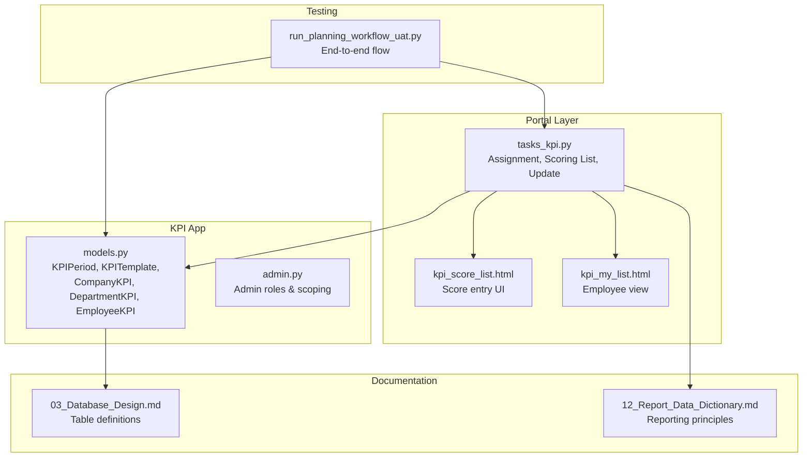
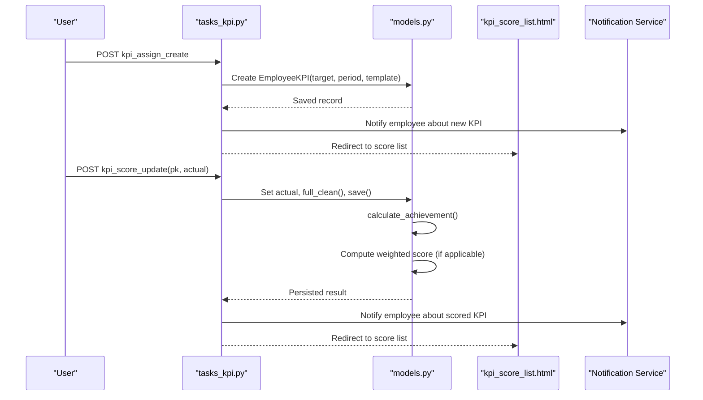
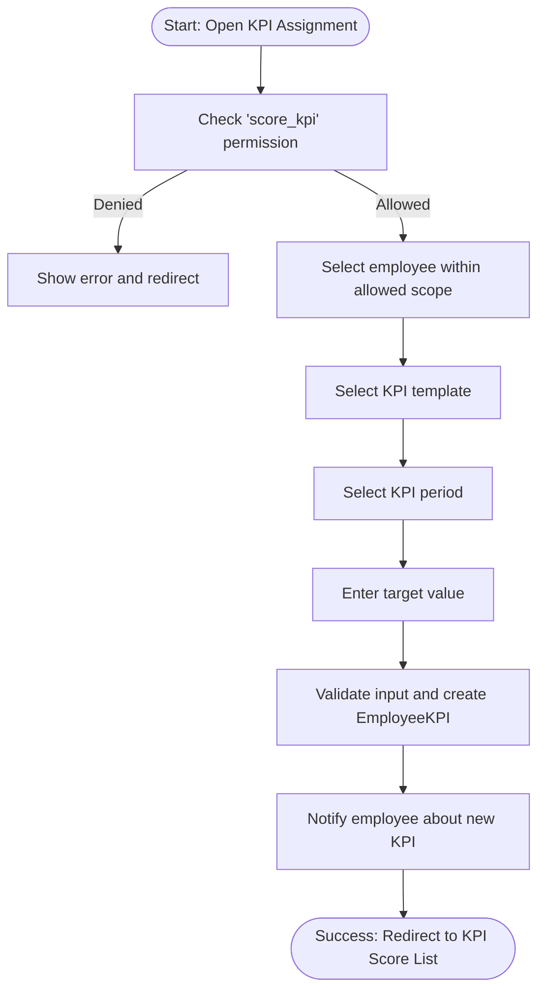
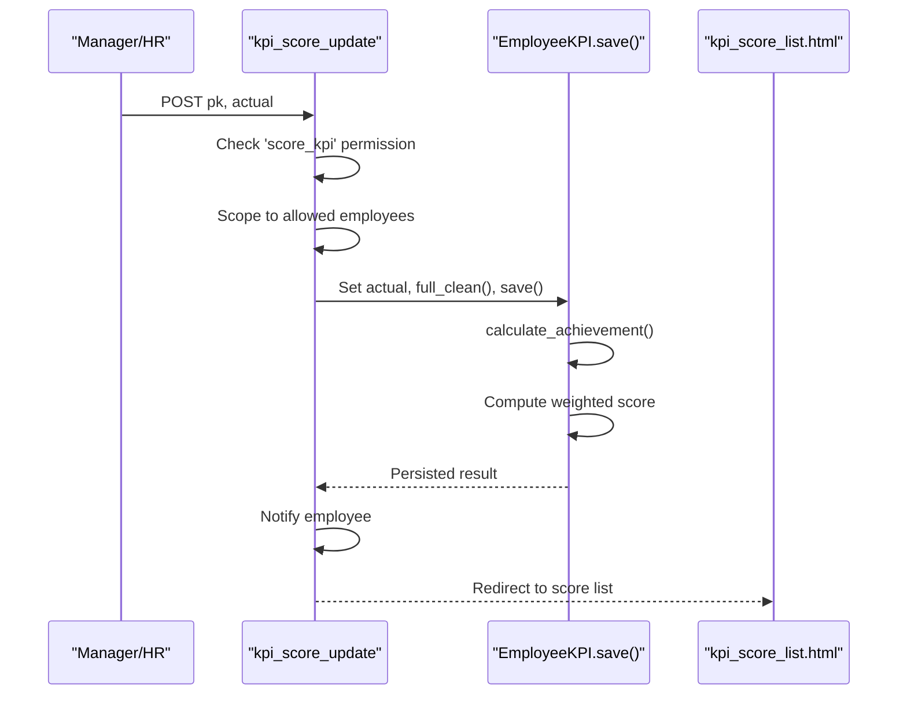
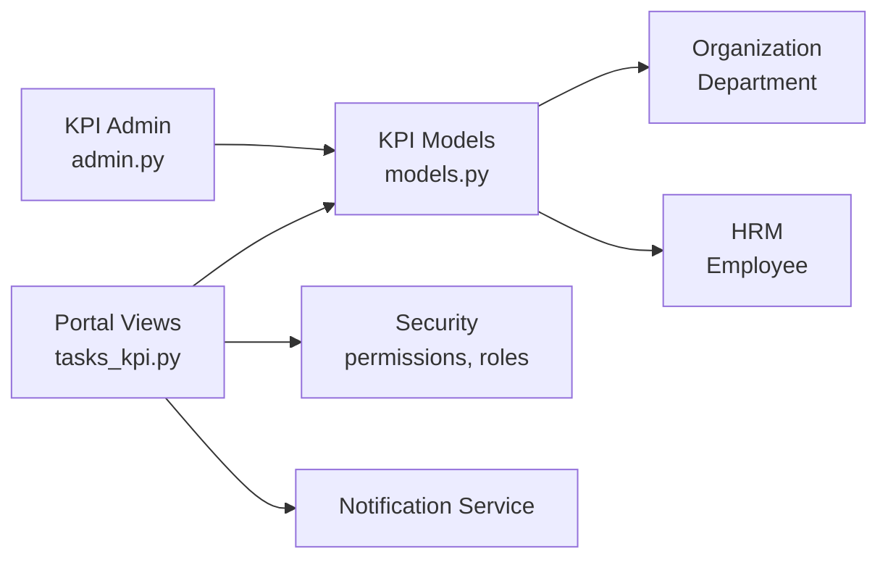

# KPI & Performance Tracking

<cite>
**Referenced Files in This Document**   
- [models.py](file://src/apps/kpi/models.py)
- [admin.py](file://src/apps/kpi/admin.py)
- [tasks_kpi.py](file://src/apps/portal/views/tasks_kpi.py)
- [kpi_score_list.html](file://src/apps/portal/templates/portal/kpi_score_list.html)
- [kpi_my_list.html](file://src/apps/portal/templates/portal/kpi_my_list.html)
- [03_Database_Design.md](file://docs/03_Database_Design.md)
- [12_Report_Data_Dictionary.md](file://docs/12_Report_Data_Dictionary.md)
- [run_planning_workflow_uat.py](file://ops/run_planning_workflow_uat.py)
</cite>

## Table of Contents
1. [Introduction](#introduction)
2. [Project Structure](#project-structure)
3. [Core Components](#core-components)
4. [Architecture Overview](#architecture-overview)
5. [Detailed Component Analysis](#detailed-component-analysis)
6. [Dependency Analysis](#dependency-analysis)
7. [Performance Considerations](#performance-considerations)
8. [Troubleshooting Guide](#troubleshooting-guide)
9. [Conclusion](#conclusion)
10. [Appendices](#appendices)

## Introduction
This document explains the KPI and Performance Tracking system implemented in the repository. It covers the key performance indicators, scoring mechanisms, evaluation cycles, assignment workflow, reporting integration, role-based access control, and relationships with HR performance management workflows. The focus is on how KPI templates, periods, targets, actual results, achievement rates, and weighted scores are modeled and processed, especially for company-level, department-level, and employee-level KPIs.

## Project Structure
The KPI feature spans a dedicated Django app and portal-facing views:
- `src/apps/kpi`: data models, admin configuration, and core KPI domain logic.
- `src/apps/portal/views/tasks_kpi.py`: user-facing KPI assignment, scoring list, and update endpoints.
- `src/apps/portal/templates/portal/*_kpi*.html`: UI for viewing and updating KPI records.
- `docs/03_Database_Design.md` and `docs/12_Report_Data_Dictionary.md`: database schema and reporting/KPI principles.
- `ops/run_planning_workflow_uat.py`: end-to-end workflow tests that validate assignment and scoring behavior.

**Diagram sources**
- [models.py:6-120](file://src/apps/kpi/models.py#L6-L120)
- [admin.py:1-59](file://src/apps/kpi/admin.py#L1-L59)
- [tasks_kpi.py:207-309](file://src/apps/portal/views/tasks_kpi.py#L207-L309)
- [kpi_score_list.html:1-45](file://src/apps/portal/templates/portal/kpi_score_list.html#L1-L45)
- [kpi_my_list.html:7-10](file://src/apps/portal/templates/portal/kpi_my_list.html#L7-L10)
- [03_Database_Design.md:1084-1142](file://docs/03_Database_Design.md#L1084-L1142)
- [12_Report_Data_Dictionary.md:1-68](file://docs/12_Report_Data_Dictionary.md#L1-L68)
- [run_planning_workflow_uat.py:33-37](file://ops/run_planning_workflow_uat.py#L33-L37)

**Section sources**
- [models.py:6-120](file://src/apps/kpi/models.py#L6-L120)
- [tasks_kpi.py:207-309](file://src/apps/portal/views/tasks_kpi.py#L207-L309)
- [03_Database_Design.md:1084-1142](file://docs/03_Database_Design.md#L1084-L1142)

## Core Components
The KPI domain centers around five main entities:
- `KPIPeriod`: defines evaluation time windows (year, quarter, month).
- `KPITemplate`: defines reusable KPI metrics, including name, description, default target, and weight.
- `BaseKPIResult`: shared base for result records with target, actual, and calculated achievement.
- `CompanyKPI`: company-level KPI result with automatic weighted score calculation.
- `DepartmentKPI`: department-level KPI result linked to an organization department.
- `EmployeeKPI`: employee-level KPI result with automatic weighted score calculation.

Key behaviors:
- Achievement is computed as `(actual / target) * 100`, rounded to two decimals.
- Company and employee KPIs compute a weighted score using the template’s weight.
- Department KPIs store achievement but do not automatically compute a weighted score in the model save.

**Section sources**
- [models.py:6-120](file://src/apps/kpi/models.py#L6-L120)

## Architecture Overview
The KPI system follows a layered approach:
- Data layer: Django models define tables and business rules for KPI periods, templates, and results.
- Portal layer: Views enforce permissions, scope data by department or HR role, and provide assignment and scoring interfaces.
- UI layer: Templates render lists, forms, badges, and inline updates for KPI scoring.
- Reporting layer: Reporting principles require clear formulas, data sources, filters, and traceability; KPI engine and dashboards should consume these tables.

**Diagram sources**
- [tasks_kpi.py:274-309](file://src/apps/portal/views/tasks_kpi.py#L274-L309)
- [tasks_kpi.py:247-271](file://src/apps/portal/views/tasks_kpi.py#L247-L271)
- [models.py:53-75](file://src/apps/kpi/models.py#L53-L75)
- [models.py:112-117](file://src/apps/kpi/models.py#L112-L117)

## Detailed Component Analysis

### KPI Period and Template
- `KPIPeriod` supports year-only, quarterly, or monthly evaluation windows.
- `KPITemplate` stores the KPI definition, including weight and optional default target value. These are reused across company, department, and employee KPIs.

Operational implications:
- Weight drives the weighted score calculation for company and employee KPIs.
- Default target can be overridden per assignment.

**Section sources**
- [models.py:6-38](file://src/apps/kpi/models.py#L6-L38)

### BaseKPIResult and Achievement Calculation
- Shared fields: `kpi_template`, `kpi_period`, `target`, `actual`, `achievement`.
- `calculate_achievement()` computes percentage achievement when both target and actual are present; otherwise sets achievement to zero.

Complexity:
- O(1) arithmetic per record save.
- Decimal precision ensures consistent rounding.

**Section sources**
- [models.py:41-60](file://src/apps/kpi/models.py#L41-L60)

### CompanyKPI
- Extends `BaseKPIResult` and adds `score`.
- On save: calculates achievement and computes weighted score using template weight.

Use cases:
- Track organizational-level metrics such as revenue, headcount growth, or operational efficiency.
- Provide leadership dashboards with aggregated weighted scores.

**Section sources**
- [models.py:62-78](file://src/apps/kpi/models.py#L62-L78)

### DepartmentKPI
- Extends `BaseKPIResult` and links to an organization department.
- On save: calculates achievement but does not compute a weighted score field.

Use cases:
- Measure departmental goals aligned with company KPIs.
- Enable department managers to track progress against targets.

**Section sources**
- [models.py:81-97](file://src/apps/kpi/models.py#L81-L97)

### EmployeeKPI
- Extends `BaseKPIResult` and links to an employee.
- On save: calculates achievement and computes weighted score using template weight.

Use cases:
- Assign individual performance targets.
- Integrate with performance reviews and compensation decisions.

**Section sources**
- [models.py:100-120](file://src/apps/kpi/models.py#L100-L120)

### Admin Access Control and Scoping
- Setup roles (`SUPER_ADMIN`, `HR_MANAGER`, `DIRECTOR`) manage periods and templates.
- Company KPI admin allows editing by setup roles and directors.
- Department and employee KPI admins support DEPT_MANAGER scoping via managed departments.

Access matrix highlights:
- Viewing: SUPER_ADMIN, HR_MANAGER, DEPT_MANAGER, DIRECTOR for department/employee KPIs.
- Editing: SUPER_ADMIN, HR_MANAGER, DEPT_MANAGER for department/employee KPIs.

**Section sources**
- [admin.py:1-59](file://src/apps/kpi/admin.py#L1-L59)

### KPI Assignment Workflow
- `kpi_assign_create` creates an `EmployeeKPI` for a selected employee, template, period, and target.
- Only users with the `score_kpi` permission can assign KPIs.
- Target employees are scoped using department-scoped employee selection, preventing cross-department assignments outside allowed scopes.
- After creation, the employee receives a notification about the new KPI.

**Diagram sources**
- [tasks_kpi.py:274-309](file://src/apps/portal/views/tasks_kpi.py#L274-L309)

**Section sources**
- [tasks_kpi.py:274-309](file://src/apps/portal/views/tasks_kpi.py#L274-L309)

### KPI Scoring Workflow
- `kpi_score_list` displays scorable KPIs filtered by department scope and optionally by period.
- `kpi_score_update` accepts an `actual` value, validates it, updates the record, recalculates achievement and score, and notifies the employee.
- Permission check uses `score_kpi`; unauthorized requests are redirected with an error message.

**Diagram sources**
- [tasks_kpi.py:229-271](file://src/apps/portal/views/tasks_kpi.py#L229-L271)
- [models.py:112-117](file://src/apps/kpi/models.py#L112-L117)

**Section sources**
- [tasks_kpi.py:229-271](file://src/apps/portal/views/tasks_kpi.py#L229-L271)

### Employee Self-Service View
- `kpi_my_list` shows the logged-in employee’s KPI records, including weight, target, actual, achievement badge, and score.
- Badges reflect thresholds: success at or above 100%, warning between 70% and 99%, danger below 70%.

**Section sources**
- [tasks_kpi.py:211-219](file://src/apps/portal/views/tasks_kpi.py#L211-L219)
- [kpi_my_list.html:7-10](file://src/apps/portal/templates/portal/kpi_my_list.html#L7-L10)

### Database Schema Alignment
- Tables `tblCompanyKPI`, `tblDepartmentKPI`, and `tblEmployeeKPI` align with the Django models.
- Fields include primary keys, foreign keys to templates and periods, target, actual, achievement, and score where applicable.

**Section sources**
- [03_Database_Design.md:1084-1142](file://docs/03_Database_Design.md#L1084-L1142)

### Reporting Integration
- Reporting principles require each KPI to have a clear formula, defined data source, filters, refresh cadence, and traceability.
- Dashboards and BI layers should consume KPI tables rather than manual inputs.

**Section sources**
- [12_Report_Data_Dictionary.md:1-68](file://docs/12_Report_Data_Dictionary.md#L1-L68)

### End-to-End Workflow Validation
- UAT script demonstrates creating a KPI assignment and then scoring it, asserting that actual, achievement, and weighted score are persisted correctly.

**Section sources**
- [run_planning_workflow_uat.py:33-37](file://ops/run_planning_workflow_uat.py#L33-L37)

## Dependency Analysis
The KPI module depends on several other components:
- Security and permissions: `has_permission`, `HR_MANAGER`, and department scoping utilities.
- Notification service: sends notifications to employees upon assignment and scoring.
- Organization and HR modules: link KPIs to departments and employees.
- Activity/task modules: share common patterns for task assignment and visibility.

**Diagram sources**
- [models.py:6-120](file://src/apps/kpi/models.py#L6-L120)
- [tasks_kpi.py:1-21](file://src/apps/portal/views/tasks_kpi.py#L1-L21)
- [admin.py:1-59](file://src/apps/kpi/admin.py#L1-L59)

**Section sources**
- [tasks_kpi.py:1-21](file://src/apps/portal/views/tasks_kpi.py#L1-L21)
- [admin.py:1-59](file://src/apps/kpi/admin.py#L1-L59)

## Performance Considerations
- Achievement and score calculations are lightweight decimal operations executed during model saves.
- Queries use `select_related` to reduce N+1 issues when rendering lists.
- For large datasets, consider:
  - Indexing frequently filtered columns like `KPIPeriodID`, `EmployeeID`, and `DepartmentID`.
  - Precomputing aggregate scores for dashboards if real-time computation becomes a bottleneck.
  - Caching periodic summaries for director and HR dashboards.

[No sources needed since this section provides general guidance]

## Troubleshooting Guide
Common issues and resolutions:
- Invalid actual values: The scoring endpoint catches invalid numeric inputs and returns a friendly error.
- Unauthorized access: Users without `score_kpi` are redirected with an error message.
- Department scoping: Ensure managers only see and edit KPIs for employees within their managed departments.
- Missing notifications: Verify the notification service is configured and that the employee has a valid profile.

Operational checks:
- Confirm that `full_clean()` passes validation before saving.
- Validate that `employees_for_department_scope` returns expected candidates.
- Review audit logs to trace who updated KPI records.

**Section sources**
- [tasks_kpi.py:247-271](file://src/apps/portal/views/tasks_kpi.py#L247-L271)

## Conclusion
The KPI and Performance Tracking system provides a robust foundation for defining metrics, assigning targets, calculating achievements, and computing weighted scores across company, department, and employee levels. Role-based access control and department scoping ensure secure and appropriate usage. Integration with notifications and reporting principles supports transparent performance management workflows. Future enhancements may include advanced scoring algorithms, automated data ingestion for actuals, and richer dashboard aggregations.

[No sources needed since this section summarizes without analyzing specific files]

## Appendices

### Example: Defining KPIs and Assigning Targets
- Define a KPI template with a descriptive name, optional default target, and weight.
- Create a KPI period representing the evaluation window.
- Assign the template and period to an employee with a specific target.
- The system notifies the employee about the new KPI.

**Section sources**
- [tasks_kpi.py:274-309](file://src/apps/portal/views/tasks_kpi.py#L274-L309)
- [models.py:24-38](file://src/apps/kpi/models.py#L24-L38)

### Example: Calculating Scores Based on Actual Performance
- Enter the actual performance value for the assigned KPI.
- The system calculates achievement as a percentage and computes the weighted score for employee/company KPIs.
- The employee receives a notification about the scored KPI.

**Section sources**
- [tasks_kpi.py:247-271](file://src/apps/portal/views/tasks_kpi.py#L247-L271)
- [models.py:53-75](file://src/apps/kpi/models.py#L53-L75)
- [models.py:112-117](file://src/apps/kpi/models.py#L112-L117)

### Example: Generating Performance Reports
- Use the reporting principles to define dashboards and reports based on KPI tables.
- Ensure formulas, data sources, filters, and refresh cadences are documented.
- Consume KPI data from `tblCompanyKPI`, `tblDepartmentKPI`, and `tblEmployeeKPI`.

**Section sources**
- [12_Report_Data_Dictionary.md:1-68](file://docs/12_Report_Data_Dictionary.md#L1-L68)
- [03_Database_Design.md:1084-1142](file://docs/03_Database_Design.md#L1084-L1142)