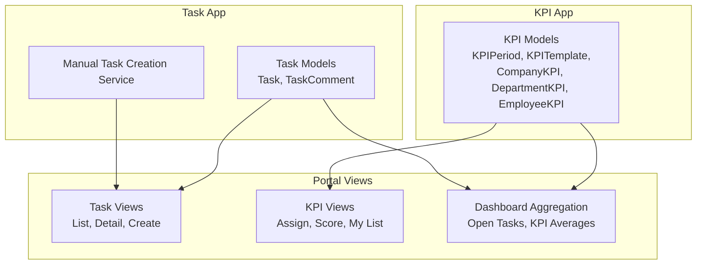
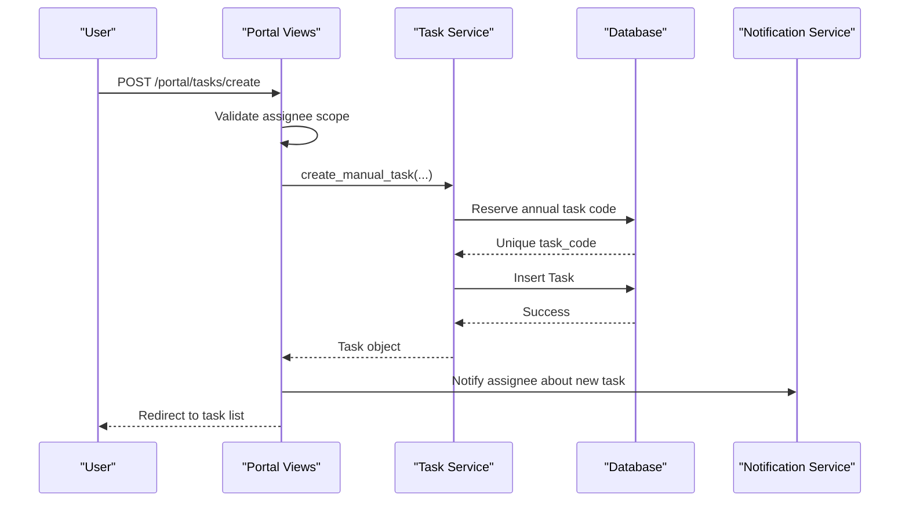
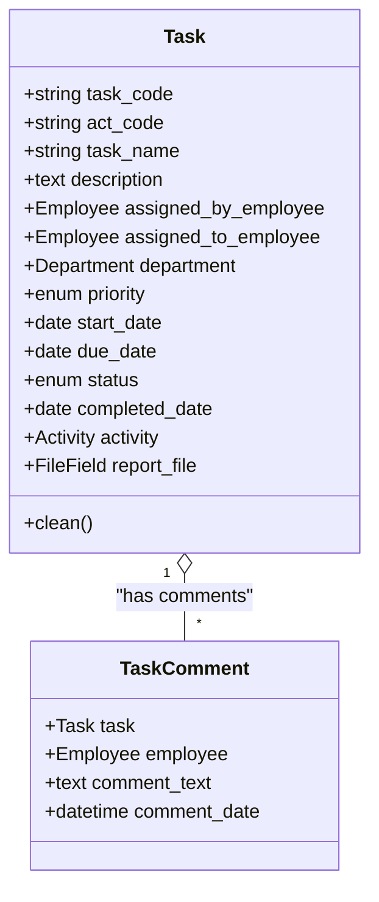
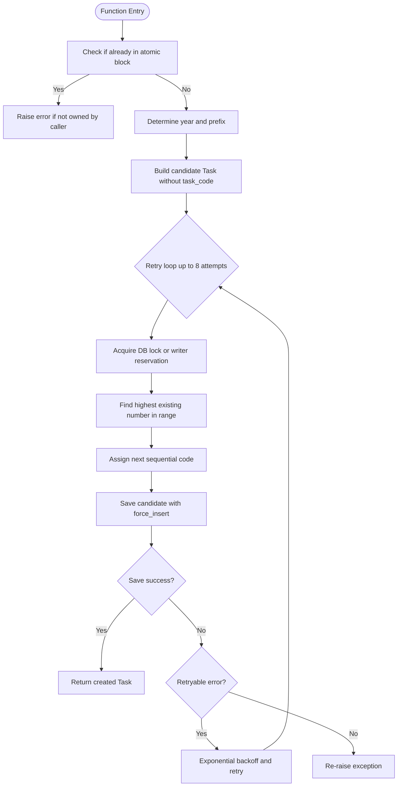
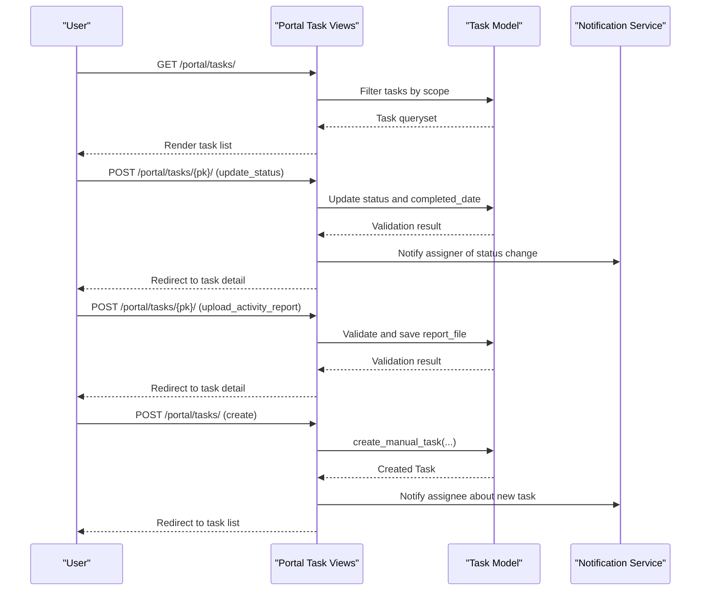
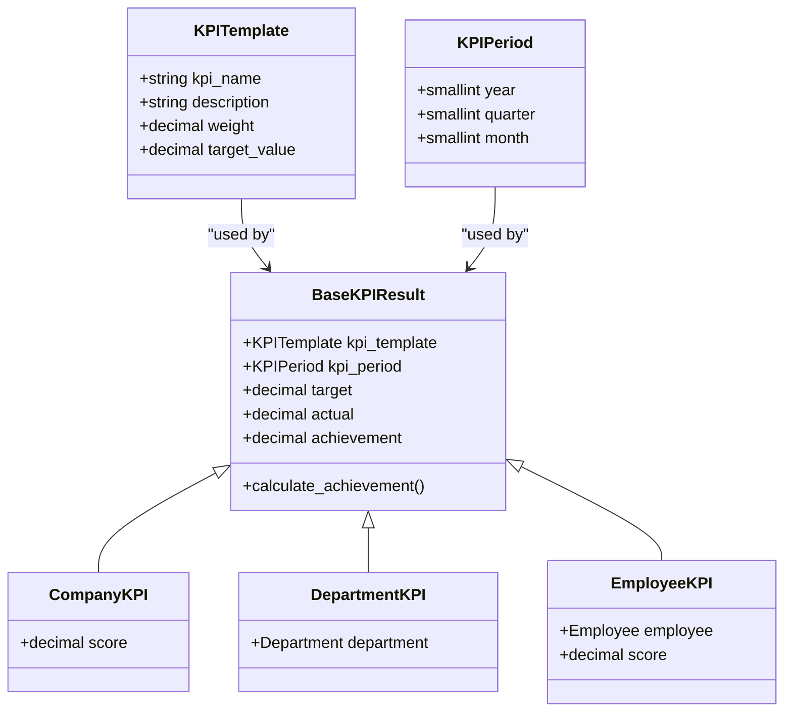
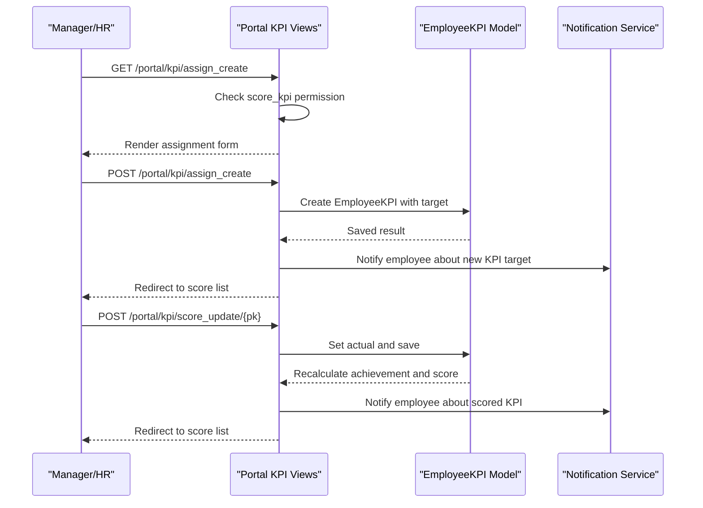
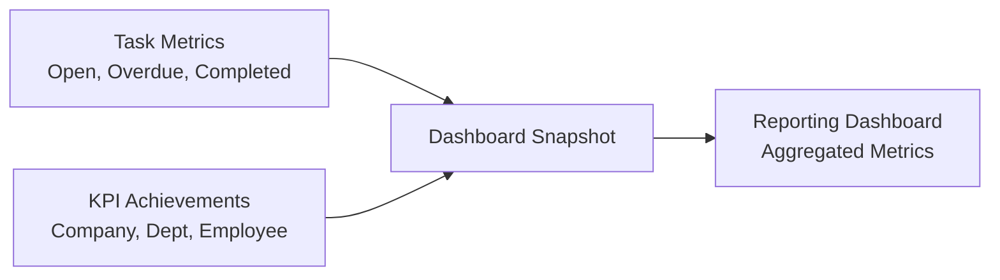
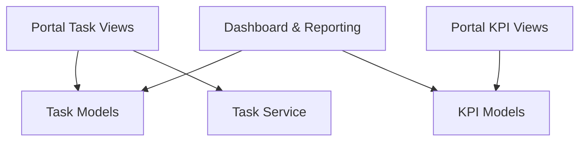

# Task & KPI Management

<cite>
**Referenced Files in This Document**
- [models.py](file://src/apps/task/models.py)
- [services.py](file://src/apps/task/services.py)
- [tasks_kpi.py](file://src/apps/portal/views/tasks_kpi.py)
- [models.py](file://src/apps/kpi/models.py)
- [core.py](file://src/apps/portal/views/core.py)
- [reporting_dashboard.py](file://src/apps/portal/reporting_dashboard.py)
</cite>

## Table of Contents
1. [Introduction](#introduction)
2. [Project Structure](#project-structure)
3. [Core Components](#core-components)
4. [Architecture Overview](#architecture-overview)
5. [Detailed Component Analysis](#detailed-component-analysis)
6. [Dependency Analysis](#dependency-analysis)
7. [Performance Considerations](#performance-considerations)
8. [Troubleshooting Guide](#troubleshooting-guide)
9. [Conclusion](#conclusion)

## Introduction
This document explains how the system manages tasks and Key Performance Indicators (KPIs), including task assignment, progress tracking, goal setting, evaluation, automated scoring, and dashboard reporting. It focuses on:
- The Task model for assignment tracking, priority management, due-date control, and completion validation.
- The KPI scoring system with templates, periods, targets, actual values, achievement calculation, and weighted scores.
- The integration between tasks and KPIs through portal views that create tasks, score KPIs, notify users, and surface performance data.
- Goal-setting workflows, periodic reviews, and report generation across company, department, and employee levels.
- Dashboard views for individual and team performance tracking.

## Project Structure
The relevant implementation is split across two Django apps and shared portal views:
- `apps/task`: Task domain models, manual task creation service, and task-related tests.
- `apps/kpi`: KPI period, template, and result models with automatic achievement and score calculations.
- `apps/portal.views.tasks_kpi`: Portal UI logic for listing, creating, updating tasks, assigning KPIs, and scoring KPIs.
- `apps/portal.views.core` and `apps/portal.reporting_dashboard`: Dashboard and reporting aggregation that include open tasks and KPI averages.

**Diagram sources**
- [models.py:9-105](file://src/apps/task/models.py#L9-L105)
- [services.py:11-53](file://src/apps/task/services.py#L11-L53)
- [models.py:6-120](file://src/apps/kpi/models.py#L6-L120)
- [tasks_kpi.py:30-201](file://src/apps/portal/views/tasks_kpi.py#L30-L201)
- [tasks_kpi.py:208-306](file://src/apps/portal/views/tasks_kpi.py#L208-L306)
- [core.py:142-157](file://src/apps/portal/views/core.py#L142-L157)
- [reporting_dashboard.py:122-132](file://src/apps/portal/reporting_dashboard.py#L122-L132)

**Section sources**
- [models.py:9-105](file://src/apps/task/models.py#L9-L105)
- [services.py:11-53](file://src/apps/task/services.py#L11-L53)
- [models.py:6-120](file://src/apps/kpi/models.py#L6-L120)
- [tasks_kpi.py:30-201](file://src/apps/portal/views/tasks_kpi.py#L30-L201)
- [tasks_kpi.py:208-306](file://src/apps/portal/views/tasks_kpi.py#L208-L306)
- [core.py:142-157](file://src/apps/portal/views/core.py#L142-L157)
- [reporting_dashboard.py:122-132](file://src/apps/portal/reporting_dashboard.py#L122-L132)

## Core Components
- Task model: Represents work items with assignment, priority, status, dates, optional project activity linkage, and activity report upload. Includes validation to ensure reports are uploaded before marking as completed when linked to an activity.
- TaskComment model: Tracks comments on tasks with timestamps and authorship.
- Manual task creation service: Generates unique annual task codes safely under concurrent writes, with retry logic for database locks.
- KPI models: Define evaluation periods, KPI templates with weights and default targets, and results for company, department, and employee levels. Achievement and weighted scores are calculated automatically on save.
- Portal task views: Provide task list, detail, creation, status updates, comment posting, and activity report uploads with permission checks and notifications.
- Portal KPI views: Provide personal KPI lists, KPI assignment creation, and KPI scoring with permission checks, validation, and notifications.
- Dashboard and reporting: Aggregate open tasks and average KPI achievements for reporting dashboards.

**Section sources**
- [models.py:9-105](file://src/apps/task/models.py#L9-L105)
- [services.py:11-53](file://src/apps/task/services.py#L11-L53)
- [models.py:6-120](file://src/apps/kpi/models.py#L6-L120)
- [tasks_kpi.py:30-201](file://src/apps/portal/views/tasks_kpi.py#L30-L201)
- [tasks_kpi.py:208-306](file://src/apps/portal/views/tasks_kpi.py#L208-L306)
- [core.py:142-157](file://src/apps/portal/views/core.py#L142-L157)
- [reporting_dashboard.py:122-132](file://src/apps/portal/reporting_dashboard.py#L122-L132)

## Architecture Overview
The system follows a layered approach:
- Data layer: Django models define entities and business rules.
- Service layer: Task code allocation encapsulates concurrency-safe creation.
- Presentation layer: Portal views handle user interactions, permissions, validations, and notifications.
- Reporting layer: Dashboard and reporting modules aggregate metrics from tasks and KPIs.

**Diagram sources**
- [tasks_kpi.py:143-201](file://src/apps/portal/views/tasks_kpi.py#L143-L201)
- [services.py:11-53](file://src/apps/task/services.py#L11-L53)

## Detailed Component Analysis

### Task Model and Assignment Tracking
The Task model supports:
- Assignment tracking via assigned_by_employee and assigned_to_employee.
- Priority management using Low, Normal, High, Urgent choices.
- Status lifecycle: Todo, InProgress, Done, Cancelled.
- Date fields: start_date, due_date, completed_date.
- Optional linkage to project activities and mandatory activity report upload for completion.
- Validation ensures:
  - Activity-linked tasks cannot be marked Done without uploading a report file.
  - Activity-linked tasks can only be marked Done after the activity’s end date.

**Diagram sources**
- [models.py:9-105](file://src/apps/task/models.py#L9-L105)

**Section sources**
- [models.py:9-87](file://src/apps/task/models.py#L9-L87)
- [models.py:89-105](file://src/apps/task/models.py#L89-L105)

### Manual Task Creation Service
The service provides safe, concurrent-safe creation of tasks with annual code reservation:
- Reserves a unique task_code per year using database-specific locking or writer reservations.
- Retries on lock/deadlock errors with exponential backoff.
- Cleans and saves the candidate task within an atomic transaction.

**Diagram sources**
- [services.py:11-53](file://src/apps/task/services.py#L11-L53)

**Section sources**
- [services.py:11-53](file://src/apps/task/services.py#L11-L53)

### Task Portal Workflow
The portal workflow covers:
- Listing tasks scoped by role and visibility.
- Viewing task details with permission checks.
- Updating task status and completing tasks with validation.
- Uploading activity reports for activity-linked tasks.
- Adding comments and notifying relevant parties.
- Creating tasks with assignee scoping and notifications.

**Diagram sources**
- [tasks_kpi.py:30-140](file://src/apps/portal/views/tasks_kpi.py#L30-L140)
- [tasks_kpi.py:143-201](file://src/apps/portal/views/tasks_kpi.py#L143-L201)

**Section sources**
- [tasks_kpi.py:30-140](file://src/apps/portal/views/tasks_kpi.py#L30-L140)
- [tasks_kpi.py:143-201](file://src/apps/portal/views/tasks_kpi.py#L143-L201)

### KPI Scoring System
The KPI system includes:
- KPIPeriod: Yearly, quarterly, or monthly evaluation periods.
- KPITemplate: Defines KPI name, description, weight (%), and default target value.
- BaseKPIResult: Common fields for target, actual, and achievement; calculates achievement percentage.
- CompanyKPI, DepartmentKPI, EmployeeKPI: Specific result types with weighted score calculation on save.

**Diagram sources**
- [models.py:6-120](file://src/apps/kpi/models.py#L6-L120)

**Section sources**
- [models.py:6-120](file://src/apps/kpi/models.py#L6-L120)

### KPI Assignment and Scoring Workflow
The portal provides:
- Personal KPI list view for employees.
- KPI assignment creation for HR/managers to set targets per employee and period.
- KPI scoring update to record actual values, triggering achievement and score recalculation.
- Permission checks and notifications for both assignment and scoring.

**Diagram sources**
- [tasks_kpi.py:208-306](file://src/apps/portal/views/tasks_kpi.py#L208-L306)

**Section sources**
- [tasks_kpi.py:208-306](file://src/apps/portal/views/tasks_kpi.py#L208-L306)

### Integration Between Tasks and KPIs
Integration points:
- Tasks contribute to operational metrics in dashboards (open tasks, overdue tasks).
- KPIs provide performance measurement at company, department, and employee levels.
- Reporting aggregates open tasks and average KPI achievements for yearly reporting.

**Diagram sources**
- [core.py:142-157](file://src/apps/portal/views/core.py#L142-L157)
- [reporting_dashboard.py:122-132](file://src/apps/portal/reporting_dashboard.py#L122-L132)

**Section sources**
- [core.py:142-157](file://src/apps/portal/views/core.py#L142-L157)
- [reporting_dashboard.py:122-132](file://src/apps/portal/reporting_dashboard.py#L122-L132)

## Dependency Analysis
Key dependencies:
- Task views depend on Task models and the manual task creation service.
- KPI views depend on KPI models and notification services.
- Dashboard and reporting depend on Task and KPI models for aggregation.
- Permissions and data access scopes constrain who can assign tasks and score KPIs.

**Diagram sources**
- [tasks_kpi.py:30-201](file://src/apps/portal/views/tasks_kpi.py#L30-L201)
- [tasks_kpi.py:208-306](file://src/apps/portal/views/tasks_kpi.py#L208-L306)
- [models.py:9-105](file://src/apps/task/models.py#L9-L105)
- [services.py:11-53](file://src/apps/task/services.py#L11-L53)
- [models.py:6-120](file://src/apps/kpi/models.py#L6-L120)

**Section sources**
- [tasks_kpi.py:30-201](file://src/apps/portal/views/tasks_kpi.py#L30-L201)
- [tasks_kpi.py:208-306](file://src/apps/portal/views/tasks_kpi.py#L208-L306)
- [models.py:9-105](file://src/apps/task/models.py#L9-L105)
- [services.py:11-53](file://src/apps/task/services.py#L11-L53)
- [models.py:6-120](file://src/apps/kpi/models.py#L6-L120)

## Performance Considerations
- Task code allocation uses retries and exponential backoff to handle concurrent inserts and database locks, reducing contention during peak assignment times.
- Query optimization uses select_related and prefetch_related to minimize N+1 queries in task lists, detail views, and KPI lists.
- KPI achievement and score calculations occur on save, ensuring consistent derived fields without additional computation overhead in views.
- Dashboard aggregations use simple counts and averages, suitable for typical organizational sizes; consider indexing frequently filtered fields like status, due_date, and KPI period year.

[No sources needed since this section provides general guidance]

## Troubleshooting Guide
Common issues and resolutions:
- Cannot mark activity-linked task as Done: Ensure the activity report file is uploaded and the activity has ended before marking complete.
- Invalid KPI actual value: Verify numeric input format; non-numeric values will trigger validation errors.
- Permission denied for task assignment or KPI scoring: Confirm the user has the required permissions (`assign_task`, `score_kpi`) and belongs to the allowed department scope.
- Task code conflicts: The service retries on lock/deadlock errors; if persistent, check database backend configuration and concurrent writers.

**Section sources**
- [models.py:64-87](file://src/apps/task/models.py#L64-L87)
- [tasks_kpi.py:92-136](file://src/apps/portal/views/tasks_kpi.py#L92-L136)
- [tasks_kpi.py:244-268](file://src/apps/portal/views/tasks_kpi.py#L244-L268)
- [services.py:11-53](file://src/apps/task/services.py#L11-L53)

## Conclusion
The Task and KPI management system provides robust tools for assigning work, tracking progress, setting goals, and evaluating performance. Tasks enforce business rules around completion and reporting, while KPIs automate scoring based on targets and weights. Portal views integrate these components with secure, permission-aware workflows and notifications. Dashboards and reporting aggregate metrics to support managerial oversight and continuous improvement.

[No sources needed since this section summarizes without analyzing specific files]