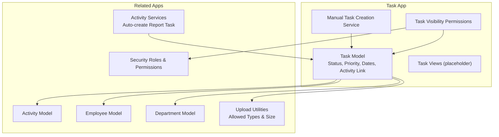
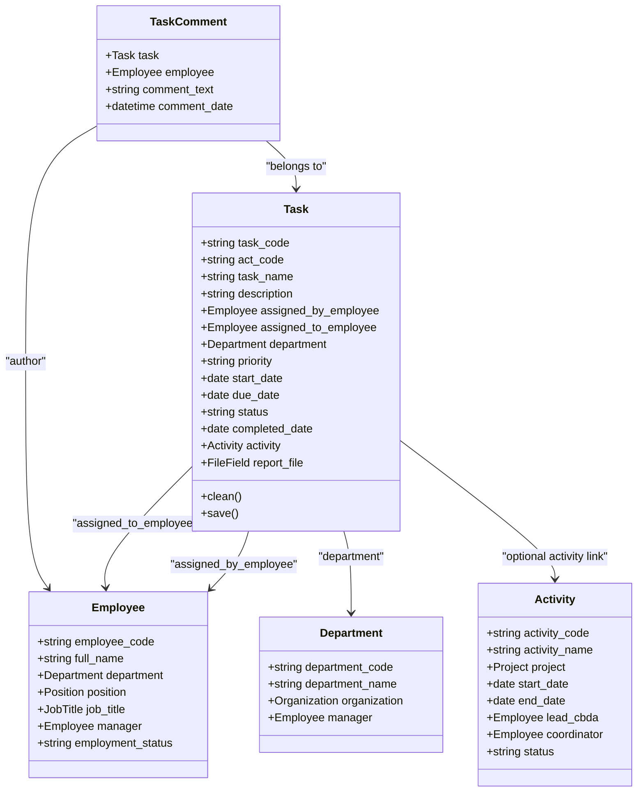
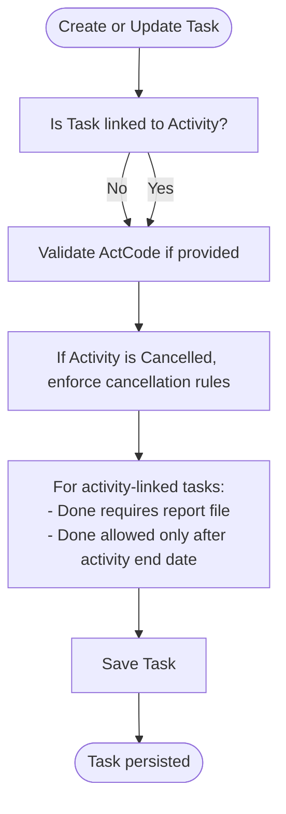
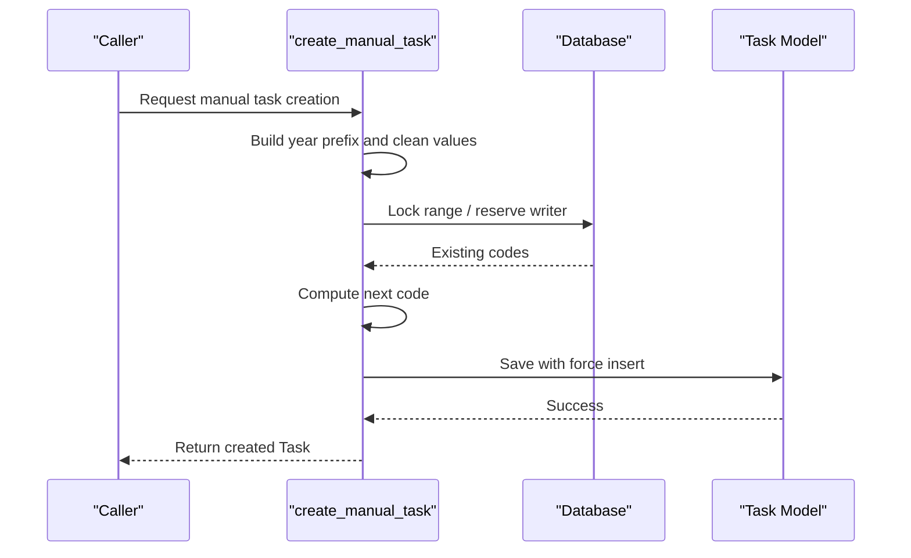
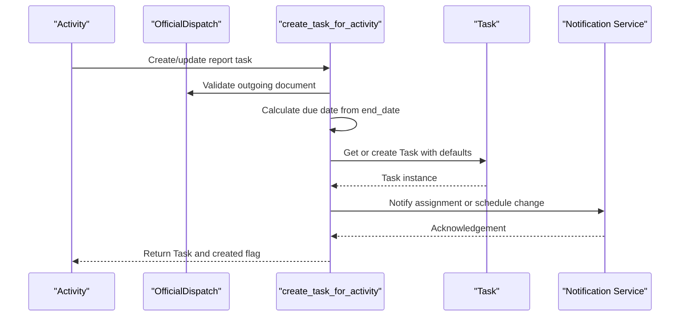
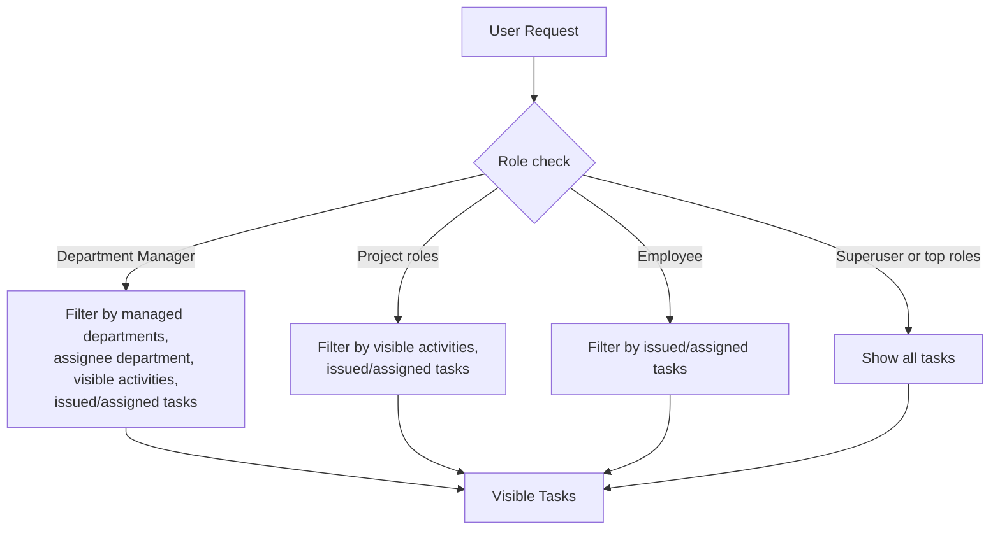
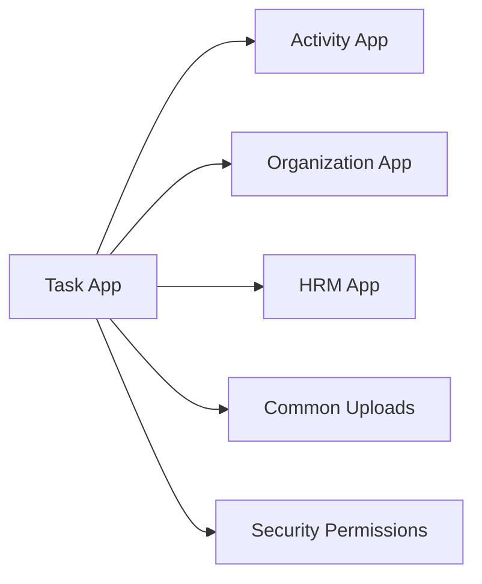

# Task Management System

<cite>
**Referenced Files in This Document**
- [models.py](file://src/apps/task/models.py)
- [services.py](file://src/apps/task/services.py)
- [permissions.py](file://src/apps/task/permissions.py)
- [views.py](file://src/apps/task/views.py)
- [activity_models.py](file://src/apps/activity/models.py)
- [activity_services.py](file://src/apps/activity/services.py)
- [activity_activity_codes.py](file://src/apps/activity/activity_codes.py)
- [organization_models.py](file://src/apps/organization/models.py)
- [hrm_models.py](file://src/apps/hrm/models.py)
- [common_uploads.py](file://src/apps/common/uploads.py)
- [security_permissions.py](file://src/apps/security/permissions.py)
- [actcode_documentation.md](file://docs/ActCode.md)
- [task_migration_plan.md](file://docs/MIGRATION_PLAN_task_actcode.md)
</cite>

## Table of Contents
1. [Introduction](#introduction)
2. [Project Structure](#project-structure)
3. [Core Components](#core-components)
4. [Architecture Overview](#architecture-overview)
5. [Detailed Component Analysis](#detailed-component-analysis)
6. [Dependency Analysis](#dependency-analysis)
7. [Performance Considerations](#performance-considerations)
8. [Troubleshooting Guide](#troubleshooting-guide)
9. [Conclusion](#conclusion)

## Introduction
This document explains the Task Management System implemented in the repository. It covers how tasks are created, assigned to employees or departments, tracked through their lifecycle, and completed with validation rules. It also documents the integration with the Activity module for project-based reporting tasks, the permission system that controls who can see or manage tasks, and the relationship between tasks, employees, and organizational structure.

The Task model supports:
- Status management: Todo, InProgress, Done, Cancelled.
- Priority levels: Low, Normal, High, Urgent.
- Assignment tracking between employees and departments.
- Optional linkage to an Activity for project-based report tasks.
- Validation rules including ActCode selection, activity report file requirements, and completion constraints.

## Project Structure
The Task feature is implemented as a Django application under `src/apps/task`. Its main responsibilities are:
- Data model and validation logic for tasks and task comments.
- Manual task creation with safe code allocation.
- Permission scoping for task visibility.
- Integration points with Activity, Employee, Department, and upload utilities.

**Diagram sources**
- [models.py:9-54](file://src/apps/task/models.py#L9-L54)
- [services.py:11-53](file://src/apps/task/services.py#L11-L53)
- [permissions.py:15-54](file://src/apps/task/permissions.py#L15-L54)
- [activity_models.py:9-61](file://src/apps/activity/models.py#L9-L61)
- [activity_services.py:101-195](file://src/apps/activity/services.py#L101-L195)
- [hrm_models.py:11-71](file://src/apps/hrm/models.py#L11-L71)
- [organization_models.py:20-41](file://src/apps/organization/models.py#L20-L41)
- [common_uploads.py:106-124](file://src/apps/common/uploads.py#L106-L124)
- [security_permissions.py:28-47](file://src/apps/security/permissions.py#L28-L47)

**Section sources**
- [models.py:9-122](file://src/apps/task/models.py#L9-L122)
- [services.py:1-53](file://src/apps/task/services.py#L1-L53)
- [permissions.py:1-55](file://src/apps/task/permissions.py#L1-L55)
- [views.py:1-4](file://src/apps/task/views.py#L1-L4)

## Core Components
This section summarizes the core components and their roles.

- Task model: Defines task fields, status and priority choices, assignment relationships, optional Activity link, report file field, and business validation.
- TaskComment model: Stores comments on tasks with author and timestamp.
- Manual task creation service: Generates unique task codes and safely persists tasks under concurrent access.
- Task permissions: Filters visible tasks based on user role, department scope, and project activity scope.
- Activity integration: Automatically creates report tasks for activities when conditions are met.
- Upload utilities: Validate allowed file types and sizes for activity report files.

Key responsibilities:
- Enforce data integrity and business rules during task creation and updates.
- Provide safe manual task creation with retry logic for database locks.
- Restrict task visibility according to organizational and project scopes.
- Ensure project-based tasks require valid ActCode and uploaded reports before completion.

**Section sources**
- [models.py:9-122](file://src/apps/task/models.py#L9-L122)
- [services.py:11-53](file://src/apps/task/services.py#L11-L53)
- [permissions.py:15-54](file://src/apps/task/permissions.py#L15-L54)
- [activity_services.py:101-195](file://src/apps/activity/services.py#L101-L195)
- [common_uploads.py:106-124](file://src/apps/common/uploads.py#L106-L124)

## Architecture Overview
The Task Management System integrates with several modules:

- Task model depends on Employee and Department for assignment and departmental context.
- Optional Activity link connects administrative tasks to project activities requiring reports.
- Activity services automatically create and update report tasks based on activity changes.
- Task permissions use security roles and activity visibility to filter accessible tasks.
- Upload utilities validate report files attached to activity-linked tasks.

**Diagram sources**
- [models.py:9-122](file://src/apps/task/models.py#L9-L122)
- [activity_models.py:9-61](file://src/apps/activity/models.py#L9-L61)
- [hrm_models.py:11-71](file://src/apps/hrm/models.py#L11-L71)
- [organization_models.py:20-41](file://src/apps/organization/models.py#L20-L41)

## Detailed Component Analysis

### Task Model and Lifecycle
The Task model defines the core entity for work items. It includes:
- Unique task code for identification.
- Optional ActCode for categorization against approved activity codes.
- Name and description fields.
- Assignment to an issuing employee and a responsible employee.
- Optional department association.
- Priority and scheduling fields.
- Status lifecycle: Todo → InProgress → Done or Cancelled.
- Completed date for actual completion.
- Optional link to an Activity for project-based reporting tasks.
- Report file field for activity-linked tasks.

Validation rules:
- ActCode must be present only if it exists in the approved list; changing to an invalid value raises a validation error.
- For activity-linked tasks, marking status as Done requires uploading a report file.
- For activity-linked tasks, marking status as Done is only allowed after the activity’s end date has passed.
- If the linked Activity is Cancelled, the Task cannot be reopened unless it was already Done.

**Diagram sources**
- [models.py:64-103](file://src/apps/task/models.py#L64-L103)

**Section sources**
- [models.py:9-103](file://src/apps/task/models.py#L9-L103)

### Task Comment Model
TaskComment stores discussion threads around tasks:
- Each comment belongs to a Task.
- Each comment is authored by an Employee.
- Comments include text content and timestamps.
- Ordering is by comment date.

Use cases:
- Track progress discussions.
- Record decisions and follow-ups.
- Provide audit trail for task-related communication.

**Section sources**
- [models.py:106-122](file://src/apps/task/models.py#L106-L122)

### Manual Task Creation Service
The service provides robust manual task creation:
- Reserves a unique task code per year using a prefix pattern.
- Serializes access to prevent duplicate codes under concurrency.
- Retries on lock or deadlock errors with exponential backoff.
- Ensures the caller owns its transaction boundary.

Workflow:
1. Determine current year and build prefix.
2. Clean candidate values except task_code.
3. Acquire database-level locking appropriate to backend.
4. Find highest existing number and assign next sequential code.
5. Persist the new Task atomically.

**Diagram sources**
- [services.py:11-53](file://src/apps/task/services.py#L11-L53)

**Section sources**
- [services.py:1-53](file://src/apps/task/services.py#L1-L53)

### Activity Integration for Project-Based Tasks
When an Activity is configured with an outgoing official dispatch and has a coordinator or signer, the system can automatically create a report Task:
- The Task is named after the Activity.
- Description includes Activity details such as code, project name, and location.
- Assigned-by is the Activity coordinator or dispatch signer.
- Assigned-to is the Activity lead CBDA.
- Department is the Activity’s project department.
- Priority is set to High.
- Start date matches Activity start date.
- Due date is calculated as Activity end date plus working days.
- Status starts as Todo.
- Activity link is established.
- Notifications are sent when schedule changes occur.

**Diagram sources**
- [activity_services.py:101-195](file://src/apps/activity/services.py#L101-L195)
- [activity_models.py:56-61](file://src/apps/activity/models.py#L56-L61)

**Section sources**
- [activity_services.py:101-195](file://src/apps/activity/services.py#L101-L195)
- [activity_models.py:9-61](file://src/apps/activity/models.py#L9-L61)

### Validation Rules
Validation rules ensure data quality and business compliance:

- ActCode validation:
  - If provided, ActCode must exist in the approved list defined by the Activity module.
  - Changing to an invalid ActCode triggers a validation error.
  - The approved list is maintained in the Activity module and documented separately.

- Report file requirements:
  - For activity-linked tasks, marking status as Done requires uploading a report file.
  - File uploads are validated for allowed extensions and size limits.

- Completion constraints:
  - For activity-linked tasks, marking status as Done is only allowed after the Activity’s end date.
  - If the Activity is Cancelled, reopening a non-Done Task is not permitted.

- File upload validation:
  - Allowed extensions include common document, image, archive, and text formats.
  - Maximum file size is enforced.
  - Invalid or oversized files raise validation errors.

**Section sources**
- [models.py:64-103](file://src/apps/task/models.py#L64-L103)
- [activity_activity_codes.py:1-22](file://src/apps/activity/activity_codes.py#L1-L22)
- [common_uploads.py:106-124](file://src/apps/common/uploads.py#L106-L124)
- [actcode_documentation.md:1-20](file://docs/ActCode.md#L1-L20)
- [task_migration_plan.md:1-6](file://docs/MIGRATION_PLAN_task_actcode.md#L1-L6)

### Permission System and Access Control
Task visibility is controlled by role-based scoping:

- Superuser and high-level roles (SUPER_ADMIN, DIRECTOR, HR_MANAGER) can view all tasks.
- Department managers can view:
  - Tasks within managed departments.
  - Tasks assigned to employees in managed departments.
  - Tasks linked to Activities visible to them.
  - Tasks they issued or were assigned to.
- Project managers, project coordinators, and CBDA can view:
  - Tasks linked to Activities within their visible scope.
  - Tasks they issued or were assigned to.
  - They cannot view administrative or HR-only tasks without an Activity link.
- Regular employees can view:
  - Tasks they issued or were assigned to.

The permission selector uses role codes and activity visibility functions to construct query filters.

**Diagram sources**
- [permissions.py:15-54](file://src/apps/task/permissions.py#L15-L54)
- [security_permissions.py:28-47](file://src/apps/security/permissions.py#L28-L47)

**Section sources**
- [permissions.py:15-54](file://src/apps/task/permissions.py#L15-L54)
- [security_permissions.py:28-47](file://src/apps/security/permissions.py#L28-L47)

### Relationship with Employee Records and Organizational Structure
Tasks connect to:
- Employee records for both issuer and assignee.
- Department records for organizational context.
- Activity records for project-based reporting tasks.

Employee records include:
- Identification fields and contact information.
- Department, position, job title, and direct manager.
- Employment status.

Department records include:
- Code, name, organization, manager, and active status.

These relationships enable:
- Assigning tasks to specific individuals.
- Grouping tasks by department.
- Scoping visibility based on department management and project roles.

**Section sources**
- [hrm_models.py:11-71](file://src/apps/hrm/models.py#L11-L71)
- [organization_models.py:20-41](file://src/apps/organization/models.py#L20-L41)
- [models.py:23-34](file://src/apps/task/models.py#L23-L34)

## Dependency Analysis
The Task module depends on several other modules:

- Activity module:
  - Provides Activity model and automatic task creation for report tasks.
  - Supplies approved activity codes used for ActCode validation.
- Organization module:
  - Provides Department model referenced by Task.
- HRM module:
  - Provides Employee model referenced by Task and TaskComment.
- Common uploads:
  - Validates file types and sizes for activity report files.
- Security permissions:
  - Defines role codes and central permission matrix.

**Diagram sources**
- [models.py:4-6](file://src/apps/task/models.py#L4-L6)
- [activity_services.py:101-195](file://src/apps/activity/services.py#L101-L195)
- [activity_activity_codes.py:1-22](file://src/apps/activity/activity_codes.py#L1-L22)
- [organization_models.py:20-41](file://src/apps/organization/models.py#L20-L41)
- [hrm_models.py:11-71](file://src/apps/hrm/models.py#L11-L71)
- [common_uploads.py:106-124](file://src/apps/common/uploads.py#L106-L124)
- [security_permissions.py:28-47](file://src/apps/security/permissions.py#L28-L47)

**Section sources**
- [models.py:4-6](file://src/apps/task/models.py#L4-L6)
- [activity_services.py:101-195](file://src/apps/activity/services.py#L101-L195)
- [activity_activity_codes.py:1-22](file://src/apps/activity/activity_codes.py#L1-L22)
- [organization_models.py:20-41](file://src/apps/organization/models.py#L20-L41)
- [hrm_models.py:11-71](file://src/apps/hrm/models.py#L11-L71)
- [common_uploads.py:106-124](file://src/apps/common/uploads.py#L106-L124)
- [security_permissions.py:28-47](file://src/apps/security/permissions.py#L28-L47)

## Performance Considerations
- Manual task creation uses database-level locking and retries to avoid race conditions when generating unique task codes.
- Exponential backoff reduces contention under concurrent writes.
- Query filtering for task visibility leverages Django ORM Q objects and distinct results to minimize redundant rows.
- Activity-linked task creation avoids unnecessary updates by comparing start dates, due dates, and assignees before persisting changes.

Recommendations:
- Keep task code generation outside long-running transactions where possible to reduce lock duration.
- Use indexes on frequently filtered fields such as status, assigned_to_employee, and activity_id.
- Monitor database lock contention during peak task creation periods.

[No sources needed since this section provides general guidance]

## Troubleshooting Guide
Common issues and resolutions:

- Cannot mark activity-linked task as Done without report file:
  - Upload a valid report file before setting status to Done.
  - Ensure the file extension and size comply with upload validation rules.

- Cannot mark activity-linked task as Done before activity ends:
  - Wait until the Activity’s end date has passed.
  - Verify the Activity’s end date configuration.

- ActCode validation error:
  - Select an ActCode from the approved list maintained in the Activity module.
  - Do not manually enter unsupported codes.

- Task visibility restrictions:
  - Confirm your role and department scope.
  - Project roles can only see tasks linked to visible Activities.
  - Administrative or HR-only tasks without Activity links are hidden from most roles.

- Manual task creation failures under concurrency:
  - Retry after brief delay; the service handles retries internally.
  - Ensure the caller does not wrap the call in an atomic block unintentionally.

**Section sources**
- [models.py:64-103](file://src/apps/task/models.py#L64-L103)
- [common_uploads.py:106-124](file://src/apps/common/uploads.py#L106-L124)
- [permissions.py:15-54](file://src/apps/task/permissions.py#L15-L54)
- [services.py:11-53](file://src/apps/task/services.py#L11-L53)

## Conclusion
The Task Management System provides a robust foundation for managing work items across employees and departments, with strong validation and permission controls. It integrates seamlessly with the Activity module to automate project-based reporting tasks and enforces business rules around ActCode selection, report file requirements, and completion timing. The permission system ensures appropriate access control based on organizational structure and project scope. Together, these components support clear workflows for creating, assigning, tracking, and completing tasks while maintaining data integrity and security.

[No sources needed since this section summarizes without analyzing specific files]