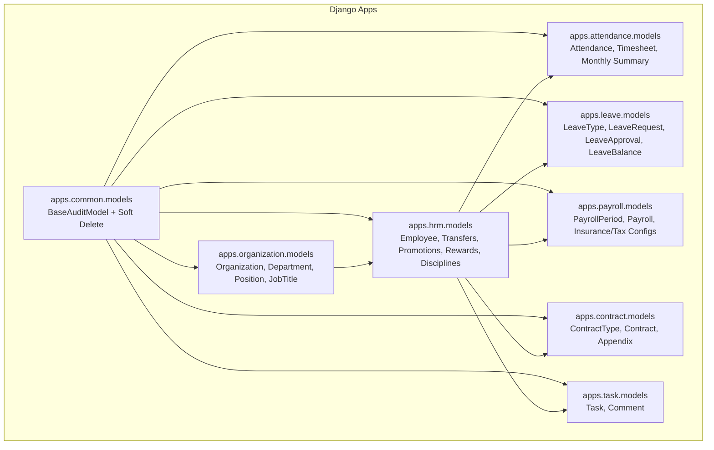
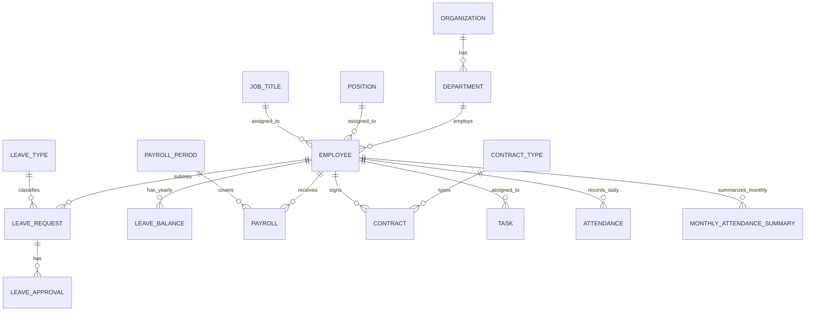
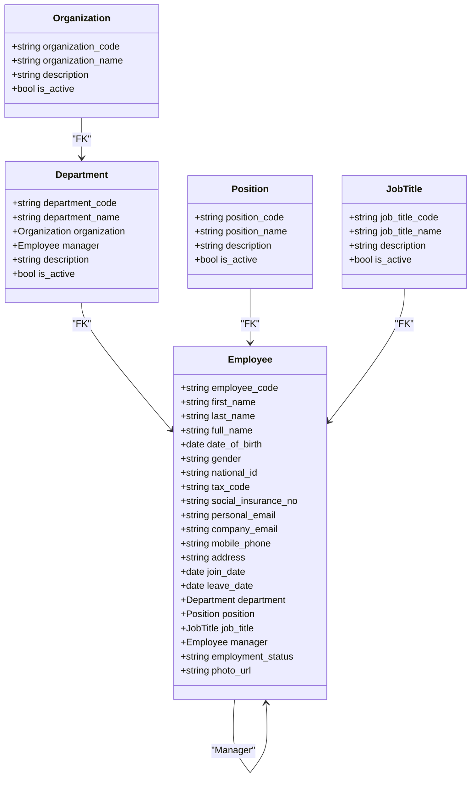
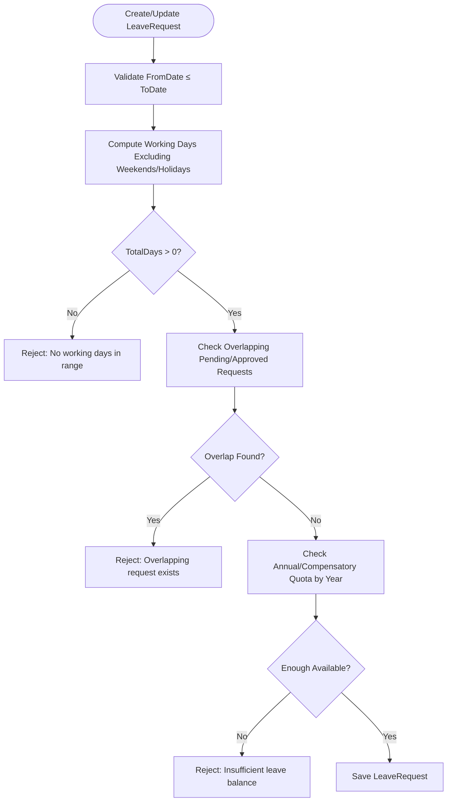
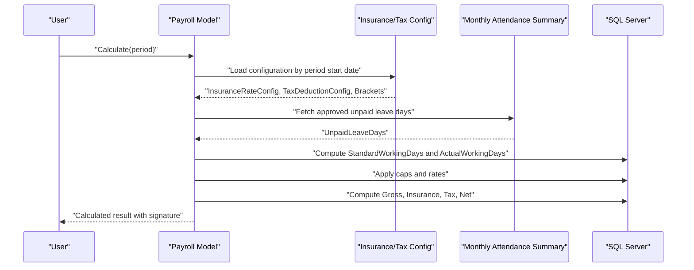
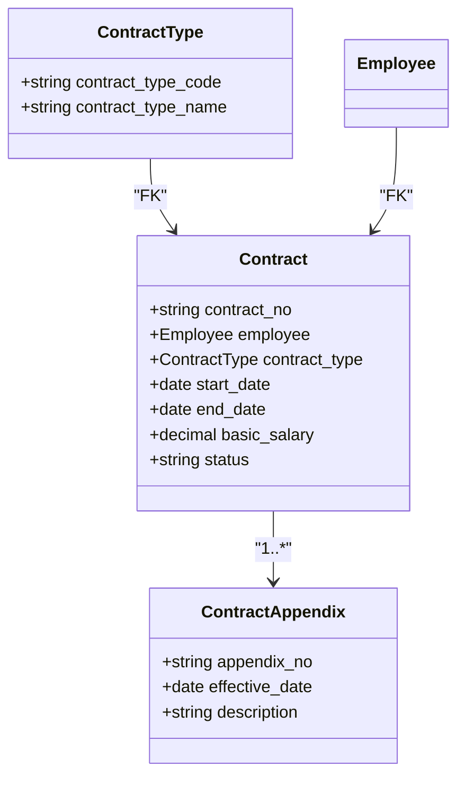
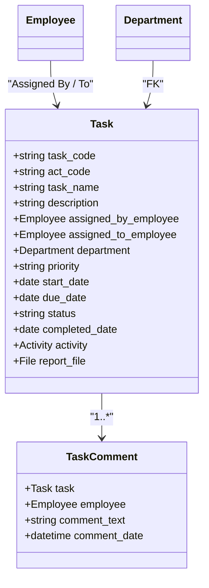
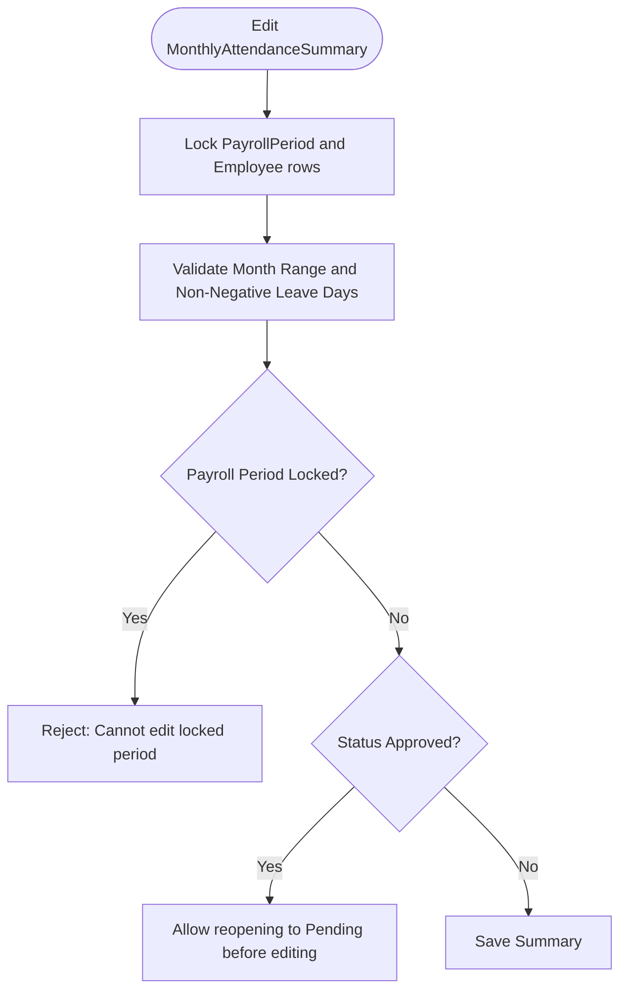
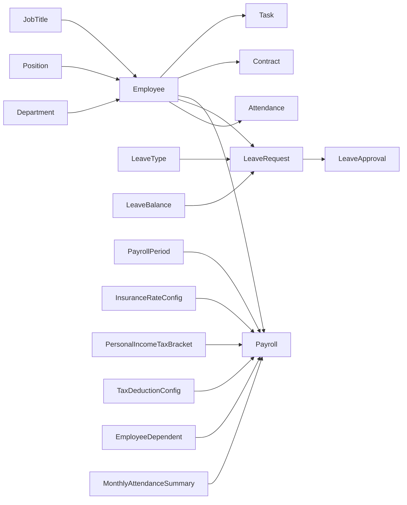

# Database Design

<cite>
**Referenced Files in This Document**
- [03_Database_Design.md](file://docs/03_Database_Design.md)
- [04_Security_Design.md](file://docs/04_Security_Design.md)
- [05_Backend_Standards.md](file://docs/05_Backup_Standards.md)
- [models.py (common)](file://src/apps/common/models.py)
- [models.py (organization)](file://src/apps/organization/models.py)
- [models.py (hrm)](file://src/apps/hrm/models.py)
- [models.py (attendance)](file://src/apps/attendance/models.py)
- [models.py (leave)](file://src/apps/leave/models.py)
- [models.py (payroll)](file://src/apps/payroll/models.py)
- [models.py (contract)](file://src/apps/contract/models.py)
- [models.py (task)](file://src/apps/task/models.py)
- [Backup-FullDatabase.ps1](file://ops/backup/Backup-FullDatabase.ps1)
- [Backup-TransactionLog.ps1](file://ops/backup/Backup-TransactionLog.ps1)
- [Setup-RecoveryModel.sql](file://ops/backup/Setup-RecoveryModel.sql)
</cite>

## Table of Contents
1. [Introduction](#introduction)
2. [Project Structure](#project-structure)
3. [Core Components](#core-components)
4. [Architecture Overview](#architecture-overview)
5. [Detailed Component Analysis](#detailed-component-analysis)
6. [Dependency Analysis](#dependency-analysis)
7. [Performance Considerations](#performance-considerations)
8. [Troubleshooting Guide](#troubleshooting-guide)
9. [Conclusion](#conclusion)
10. [Appendices](#appendices)

## Introduction
This document describes the IHRMS SQL Server data model and its application-layer enforcement. It covers core entities, relationships, constraints, validation rules, performance indexes, security requirements, lifecycle management, migration strategy, and backup/recovery procedures. The design targets an organization with current headcount around 30 employees and planned growth to approximately 200 employees.

The database follows normalization, single source of truth, explicit foreign keys, auditability, soft delete, external file storage for documents, and metadata persistence in SQL Server.

**Section sources**
- [03_Database_Design.md:19-44](file://docs/03_Database_Design.md#L19-L44)
- [03_Database_Design.md:48-100](file://docs/03_Database_Design.md#L48-L100)

## Project Structure
IHRMS is a Django application where each business module lives under `src/apps/<module>/models.py`. All models inherit from a common base that provides audit fields and soft delete behavior. Tables are explicitly named using the approved `tblPascalCase` convention so that generated SQL Server objects match the documented schema.

**Diagram sources**
- [models.py (common):56-93](file://src/apps/common/models.py#L56-L93)
- [models.py (organization):5-71](file://src/apps/organization/models.py#L5-L71)
- [models.py (hrm):11-224](file://src/apps/hrm/models.py#L11-L224)
- [models.py (attendance):10-302](file://src/apps/attendance/models.py#L10-L302)
- [models.py (leave):38-280](file://src/apps/leave/models.py#L38-L280)
- [models.py (payroll):33-532](file://src/apps/payroll/models.py#L33-L532)
- [models.py (contract):6-76](file://src/apps/contract/models.py#L6-L76)
- [models.py (task):9-105](file://src/apps/task/models.py#L9-L105)

**Section sources**
- [05_Backend_Standards.md:1149-1169](file://docs/05_Backend_Standards.md#L1149-L1169)
- [models.py (common):56-93](file://src/apps/common/models.py#L56-L93)

## Core Components
This section summarizes the primary entities and their responsibilities.

| Entity | Responsibility | Key Relationships | Important Constraints |
|---|---|---|---|
| Organization | Top-level legal or administrative unit | Parent of Department | Unique code; active flag |
| Department | Organizational unit within an organization | Belongs to Organization; managed by Employee | Unique code; active flag |
| Position | Structural role definition | Referenced by Employee | Unique code; active flag |
| JobTitle | Functional title definition | Referenced by Employee | Unique code; active flag |
| Employee | Person working in the organization | Department, Position, JobTitle, Manager | Unique employee code, national ID, company email; employment status choices |
| LeaveType | Type of leave (e.g., annual, compensatory) | Referenced by LeaveRequest | Unique code; paid flag |
| LeaveRequest | Employee leave application | Employee, LeaveType | Date range validity; no overlapping pending/approved requests; quota checks |
| LeaveApproval | Approval decision per request | LeaveRequest, Approver Employee | Decision choice; approval level |
| LeaveBalance | Annual leave and compensatory balance per year | Employee | Unique per employee-year; computed used/pending/remaining values |
| PayrollPeriod | Payroll month/year window | Referenced by Payroll | Unique month+year; open/locked status |
| Payroll | Calculated payroll line per employee per period | PayrollPeriod, Employee | Unique per period+employee; input/output signature; locked-period protection |
| ContractType | Master list of contract types | Referenced by Contract | Unique code |
| Contract | Employment contract record | Employee, ContractType | Unique contract number; date ordering; status workflow |
| Task | Work assignment and tracking | AssignedBy Employee, AssignedTo Employee, Department, optional Activity | Unique task code; ActCode validation; completion rules |
| Attendance | Daily attendance record | Employee | Unique per employee+date; status choices |
| MonthlyAttendanceSummary | Approved monthly leave/work summary | Employee | Unique per employee+year+month; approval workflow; locked-period protection |

**Section sources**
- [03_Database_Design.md:122-800](file://docs/03_Database_Design.md#L122-L800)
- [models.py (organization):5-71](file://src/apps/organization/models.py#L5-L71)
- [models.py (hrm):11-224](file://src/apps/hrm/models.py#L11-L224)
- [models.py (leave):38-280](file://src/apps/leave/models.py#L38-L280)
- [models.py (payroll):248-532](file://src/apps/payroll/models.py#L248-L532)
- [models.py (contract):6-76](file://src/apps/contract/models.py#L6-L76)
- [models.py (task):9-105](file://src/apps/task/models.py#L9-L105)
- [models.py (attendance):25-302](file://src/apps/attendance/models.py#L25-L302)

## Architecture Overview
The data architecture separates master data, transactional records, approvals, balances, and calculations. Business logic enforces integrity at both the Django model layer and the SQL Server layer through unique constraints, foreign keys, and calculated signatures.

**Diagram sources**
- [models.py (organization):5-71](file://src/apps/organization/models.py#L5-L71)
- [models.py (hrm):11-224](file://src/apps/hrm/models.py#L11-L224)
- [models.py (leave):38-280](file://src/apps/leave/models.py#L38-L280)
- [models.py (payroll):248-532](file://src/apps/payroll/models.py#L248-L532)
- [models.py (contract):6-76](file://src/apps/contract/models.py#L6-L76)
- [models.py (task):9-105](file://src/apps/task/models.py#L9-L105)
- [models.py (attendance):25-302](file://src/apps/attendance/models.py#L25-L302)

## Detailed Component Analysis

### Organization and Human Resources
- Organization, Department, Position, and JobTitle are master reference tables with unique codes and active flags.
- Employee links to Department, Position, JobTitle, and optionally to another Employee as direct manager. Employment status is constrained to a fixed set.
- Employee history events include transfers, promotions, rewards, and disciplines. Transfers and promotions trigger due changes through service logic after atomic save.

**Diagram sources**
- [models.py (organization):5-71](file://src/apps/organization/models.py#L5-L71)
- [models.py (hrm):11-71](file://src/apps/hrm/models.py#L11-L71)

**Section sources**
- [models.py (organization):5-71](file://src/apps/organization/models.py#L5-L71)
- [models.py (hrm):11-224](file://src/apps/hrm/models.py#L11-L224)

### Leave Management
- LeaveType defines whether leave is paid.
- LeaveRequest validates date ranges, computes total working days excluding weekends and holidays, prevents overlapping pending/approved requests, and enforces annual and compensatory leave quotas.
- LeaveApproval records approver decisions and levels.
- LeaveBalance tracks allocated, carried-over, used, pending, and remaining days per employee per year. Compensatory leave is earned based on attendance services.

**Diagram sources**
- [models.py (leave):52-176](file://src/apps/leave/models.py#L52-L176)

**Section sources**
- [models.py (leave):38-280](file://src/apps/leave/models.py#L38-L280)

### Payroll Periods and Payroll Calculation
- PayrollPeriod represents a payroll month/year with open/locked status. Only one period per month/year is allowed.
- Payroll stores inputs and results. Locked periods prevent creation or modification. Input amounts must be non-negative. A calculation signature ensures recomputation when inputs change.
- Payroll calculation uses configuration effective at the period start date: insurance rates, tax brackets, and deductions. It prorates salary by standard vs actual working days, applies statutory caps, computes insurance, then progressive income tax, and finally net income.

**Diagram sources**
- [models.py (payroll):248-515](file://src/apps/payroll/models.py#L248-L515)

**Section sources**
- [models.py (payroll):33-532](file://src/apps/payroll/models.py#L33-L532)

### Contracts
- ContractType is a controlled list of contract categories.
- Contract ties an employee to a contract type, number, dates, basic salary, and status. End date must not precede start date.
- ContractAppendix records amendments with effective dates.

**Diagram sources**
- [models.py (contract):6-76](file://src/apps/contract/models.py#L6-L76)

**Section sources**
- [models.py (contract):6-76](file://src/apps/contract/models.py#L6-L76)

### Tasks
- Task has a unique code, optional ActCode validated against activity codes, assignment to employees and department, priority, dates, status, and optional project activity linkage.
- Completion requires an uploaded report file when linked to an activity, and completion is only allowed after the activity ends.
- TaskComment records discussion history.

**Diagram sources**
- [models.py (task):9-105](file://src/apps/task/models.py#L9-L105)

**Section sources**
- [models.py (task):9-105](file://src/apps/task/models.py#L9-L105)

### Attendance and Monthly Summaries
- Attendance records daily check-in/out, working hours, and status with uniqueness per employee+date.
- MonthlyAttendanceSummary aggregates sick, maternity, compensatory, annual leave, and unpaid leave days per employee per month. It has a Pending/Approved workflow and protects edits once approved or when the payroll period is locked.

**Diagram sources**
- [models.py (attendance):172-269](file://src/apps/attendance/models.py#L172-L269)

**Section sources**
- [models.py (attendance):25-302](file://src/apps/attendance/models.py#L25-L302)

## Dependency Analysis
Key dependency chains:
- Employee is central: referenced by Department manager, Position/JobTitle assignments, Attendance, LeaveRequest, Payroll, Contract, Task assignments, and summaries.
- LeaveRequest depends on LeaveType and uses attendance services to compute working days and quotas via LeaveBalance.
- Payroll depends on PayrollPeriod, EmployeeSalary, InsuranceRateConfig, PersonalIncomeTaxBracket, TaxDeductionConfig, EmployeeDependent, and approved MonthlyAttendanceSummary.
- Task may depend on Activity when it represents automated reporting tasks.

**Diagram sources**
- [models.py (hrm):11-224](file://src/apps/hrm/models.py#L11-L224)
- [models.py (leave):38-280](file://src/apps/leave/models.py#L38-L280)
- [models.py (payroll):33-532](file://src/apps/payroll/models.py#L33-L532)
- [models.py (attendance):172-269](file://src/apps/attendance/models.py#L172-L269)

**Section sources**
- [models.py (hrm):11-224](file://src/apps/hrm/models.py#L11-L224)
- [models.py (leave):38-280](file://src/apps/leave/models.py#L38-L280)
- [models.py (payroll):33-532](file://src/apps/payroll/models.py#L33-L532)
- [models.py (attendance):172-269](file://src/apps/attendance/models.py#L172-L269)

## Performance Considerations
Recommended index strategy beyond default primary key indexes includes filtered unique indexes for soft-deleted records and composite indexes for frequent queries:

- Unique filtered indexes:
  - `tblEmployee(NationalID)` where `IsDeleted = 0`
  - `tblEmployee(CompanyEmail)` where `IsDeleted = 0`
- Composite indexes:
  - `tblAttendance(EmployeeID, AttendanceDate)`
  - `tblPayroll(PayrollPeriodID, EmployeeID)`
  - `tblTask(AssignedToEmployeeID, Status)`
  - `tblLeaveRequest(EmployeeID, Status)`

These indexes support lookups by employee, date ranges, approval workflows, and payroll joins.

**Section sources**
- [03_Database_Design.md:2002-2016](file://docs/03_Database_Design.md#L2002-L2016)

## Troubleshooting Guide
Common validation errors and their causes:

- LeaveRequest overlap: Two pending/approved requests for the same employee have overlapping date ranges.
- Leave quota exceeded: Requested days exceed available annual or compensatory balance for the affected year(s).
- Payroll locked period: Attempting to create or modify payroll lines when the period is locked.
- Payroll recalculation required: Inputs changed but calculation signature does not match; recompute before locking.
- Monthly summary locked: Editing approved summaries or summaries in locked payroll periods is blocked.
- Task completion without report: Marking a task linked to an activity as Done without uploading a report file.

Resolution steps:
- Resolve overlapping leave requests by adjusting dates or canceling conflicting requests.
- Ensure LeaveBalance records exist and are accurate before approving leave.
- Unlock payroll periods or wait until the correct period opens.
- Recalculate payroll after changing inputs or master data.
- Reopen approved summaries to Pending if corrections are needed.
- Upload required reports before completing activity-linked tasks.

**Section sources**
- [models.py (leave):91-176](file://src/apps/leave/models.py#L91-L176)
- [models.py (payroll):351-358](file://src/apps/payroll/models.py#L351-L358)
- [models.py (payroll):335-341](file://src/apps/payroll/models.py#L335-L341)
- [models.py (attendance):214-245](file://src/apps/attendance/models.py#L214-L245)
- [models.py (task):64-87](file://src/apps/task/models.py#L64-L87)

## Conclusion
IHRMS implements a robust, auditable, and constraint-rich data model aligned with HR, payroll, contracts, attendance, and task workflows. Validation occurs at both Django model and database layers, ensuring data integrity across sensitive personnel and financial data. Indexing strategies and clear lifecycle controls support performance and operational reliability. Security policies classify sensitive fields and restrict access, while backup scripts provide full and transaction log backups for recovery.

[No sources needed since this section summarizes without analyzing specific files]

## Appendices

### Data Types and Naming Conventions
- Primary keys use BIGINT identity; foreign keys use BIGINT matching referenced primary keys.
- Codes use NVARCHAR(50); names and short text use NVARCHAR(200); descriptions and comments use NVARCHAR(1000).
- Dates use DATE; times use TIME(0); timestamps use DATETIME2(0).
- Monetary values use DECIMAL(18,2); quantities and ratios use DECIMAL(9,2).
- URLs and file references use NVARCHAR(500); file size uses BIGINT.
- Boolean flags use BIT.
- Status fields currently use NVARCHAR(30), with recommendations to move to controlled lists or CHECK constraints.

**Section sources**
- [03_Database_Design.md:1661-1690](file://docs/03_Database_Design.md#L1661-L1690)
- [03_Database_Design.md:1994-1999](file://docs/03_Database_Design.md#L1994-L1999)

### Audit Fields and Soft Delete
All business models inherit BaseAuditModel, which adds CreatedBy, CreatedDate, ModifiedBy, ModifiedDate, DeletedBy, DeletedDate, and IsDeleted. Deletion is soft by default, with restore and hard-delete capabilities.

**Section sources**
- [03_Database_Design.md:103-119](file://docs/03_Database_Design.md#L103-L119)
- [models.py (common):6-93](file://src/apps/common/models.py#L6-L93)

### Security and Sensitive Data
Sensitive fields include NationalID, TaxCode, SocialInsuranceNo, BankAccountNumber, Salary, and related payroll data. Access control follows RBAC with least privilege and need-to-know principles. Payroll is highly restricted to Director, HR Manager, and Finance Officer roles; employees can view only their own payslips.

**Section sources**
- [04_Security_Design.md:423-517](file://docs/04_Security_Design.md#L423-L517)
- [04_Security_Design.md:745-776](file://docs/04_Security_Design.md#L745-L776)

### Backup and Recovery Procedures
- Full database backups and transaction log backups are provided by PowerShell scripts.
- Recovery model setup script configures SQL Server for appropriate backup strategies.
- Retention policy recommends daily backups with 30-day retention and monthly backups retained for 12 months.

Operational guidance:
- Schedule regular full backups and frequent transaction log backups.
- Test restore drills periodically.
- Restrict database access to application service accounts only.

**Section sources**
- [04_Security_Design.md:779-797](file://docs/04_Security_Design.md#L779-L797)
- [Backup-FullDatabase.ps1](file://ops/backup/Backup-FullDatabase.ps1)
- [Backup-TransactionLog.ps1](file://ops/backup/Backup-TransactionLog.ps1)
- [Setup-RecoveryModel.sql](file://ops/backup/Setup-RecoveryModel.sql)

### Migration Strategy and Version Management
- Django migrations manage schema evolution. Each app maintains its own migration history.
- Models declare explicit `db_table` names to align with the approved SQL Server table naming convention.
- Rollback procedures should follow Django’s migration rollback commands and ensure dependent modules remain consistent.
- For destructive changes, prefer additive migrations with backward-compatible defaults and data backfills.

**Section sources**
- [05_Backend_Standards.md:1149-1169](file://docs/05_Backend_Standards.md#L1149-L1169)