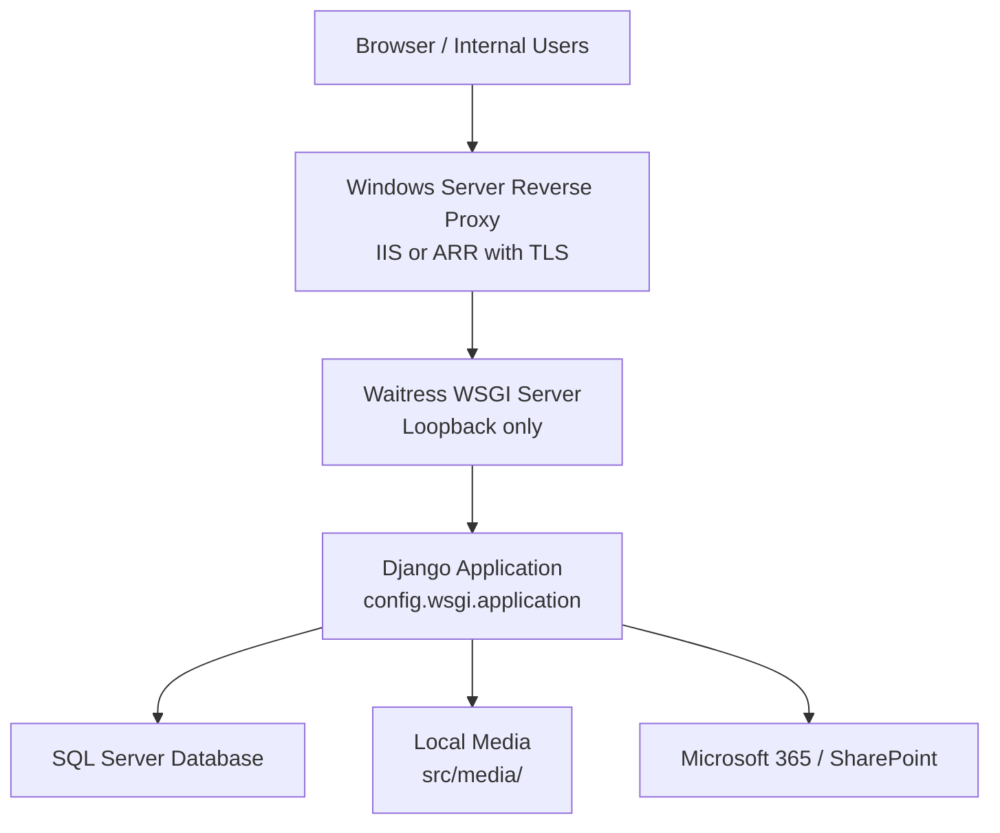
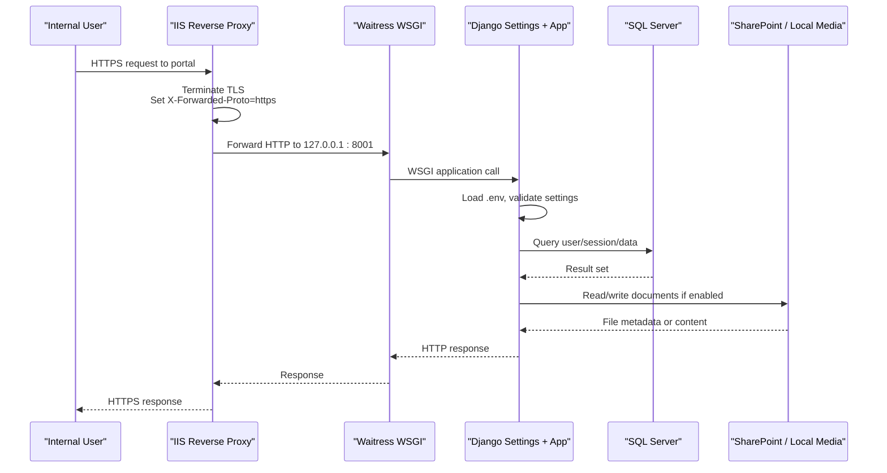
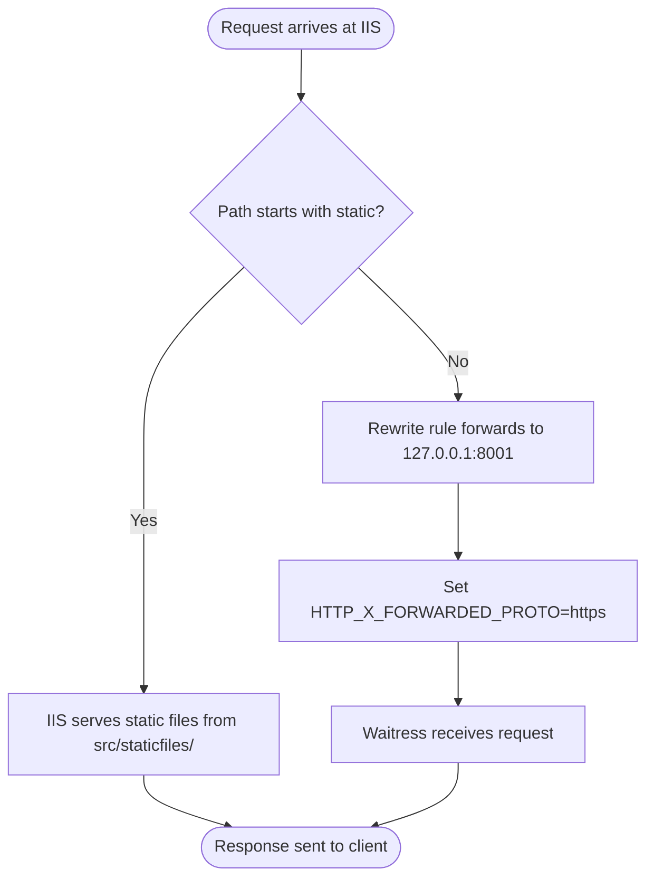
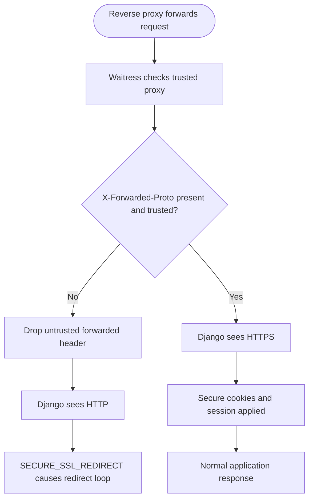
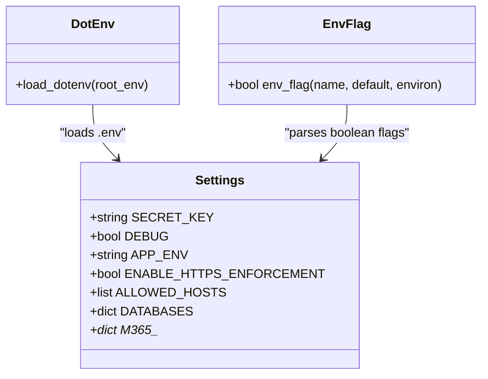
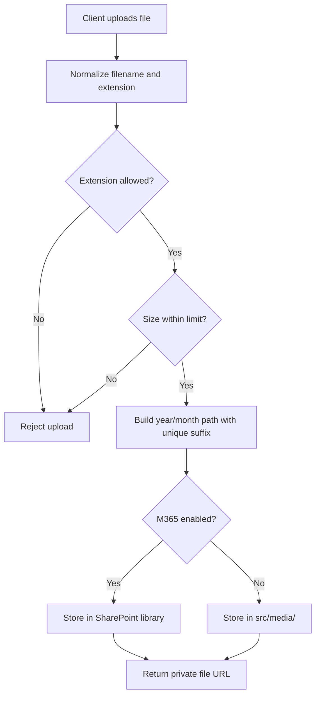
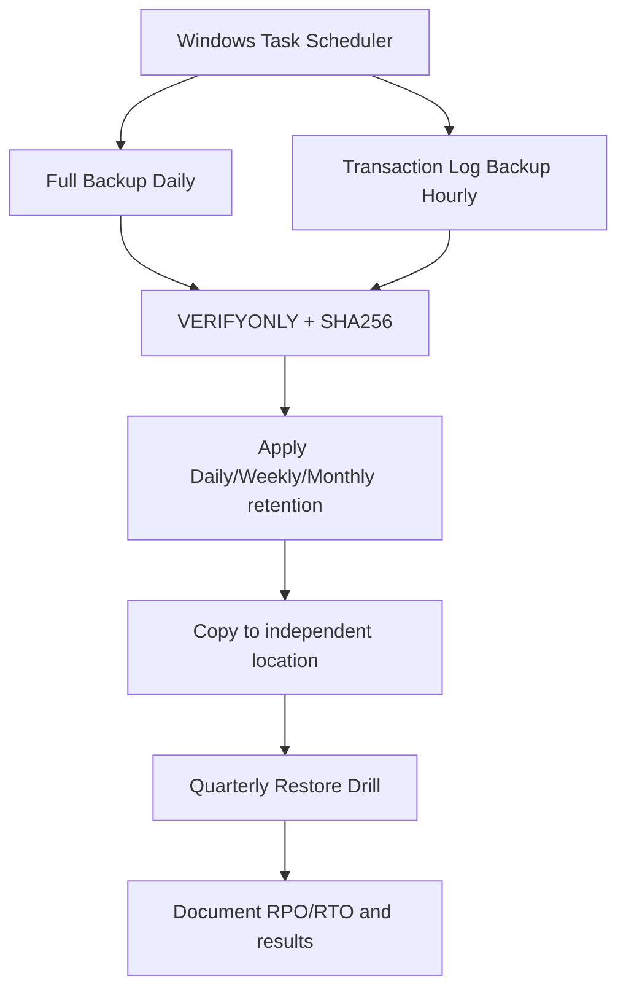
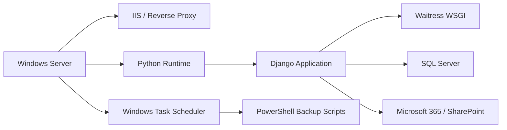

# Deployment & Operations

<cite>
**Referenced Files in This Document**
- [README.md](file://README.md)
- [08_Deployment_Standards.md](file://docs/08_Deployment_Standards.md)
- [Checklist_Go_Live_IHRMS.md](file://docs/Checklist_Go_Live_IHRMS.md)
- [Server_Trial_Readiness_2026-09-27.md](file://docs/Server_Trial_Readiness_2026-09-27.md)
- [Huong_Dan_Setup_TaskScheduler_SIT_UAT.md](file://docs/Huong_Dan_Setup_TaskScheduler_SIT_UAT.md)
- [settings.py](file://src/config/settings.py)
- [wsgi.py](file://src/config/wsgi.py)
- [env.py](file://src/config/env.py)
- [tests.py](file://src/config/tests.py)
- [uploads.py](file://src/apps/common/uploads.py)
- [storage.py](file://src/apps/security/storage.py)
- [README.md](file://ops/backup/README.md)
- [Backup-FullDatabase.ps1](file://ops/backup/Backup-FullDatabase.ps1)
- [Backup-TransactionLog.ps1](file://ops/backup/Backup-TransactionLog.ps1)
- [Setup-RecoveryModel.sql](file://ops/backup/Setup-RecoveryModel.sql)
- [Run-Tests.ps1](file://ops/Run-Tests.ps1)
</cite>

## Table of Contents
1. [Introduction](#introduction)
2. [Project Structure](#project-structure)
3. [Core Components](#core-components)
4. [Architecture Overview](#architecture-overview)
5. [Detailed Component Analysis](#detailed-component-analysis)
6. [Dependency Analysis](#dependency-analysis)
7. [Performance Considerations](#performance-considerations)
8. [Troubleshooting Guide](#troubleshooting-guide)
9. [Conclusion](#conclusion)
10. [Appendices](#appendices)

## Introduction
This document provides production-grade deployment and operations guidance for IHRMS, an internal Django 5.2 administration and human resource management system targeting Windows Server with SQL Server. It covers environment setup, reverse proxy configuration, Waitress WSGI operation, HTTPS enforcement, environment variable management, backup and disaster recovery, monitoring, logging, SIT/UAT readiness, go-live validation, scaling considerations, operational runbooks, compliance controls, and incident response procedures.

The repository targets on-premise Windows Server infrastructure, uses SQL Server as the primary database, supports Microsoft 365 and SharePoint storage, and requires a reverse proxy or IIS to terminate TLS before reaching the Python application.

**Section sources**
- [README.md:1-90](file://README.md#L1-L90)
- [08_Deployment_Standards.md:1-33](file://docs/08_Deployment_Standards.md#L1-L33)

## Project Structure
IHRMS is organized as a Django project under `src/`, with business logic split into feature apps such as HRM, payroll, leave, attendance, security, portal, reporting, and Microsoft 365 integration. Operational scripts live under `ops/`, including test runners, UAT helpers, and SQL Server backup automation. Documentation and standards are maintained under `docs/`.

**Diagram sources**
- [Server_Trial_Readiness_2026-09-27.md:79-90](file://docs/Server_Trial_Readiness_2026-09-27.md#L79-L90)
- [Huong_Dan_Setup_TaskScheduler_SIT_UAT.md:221-259](file://docs/Huong_Dan_Setup_TaskScheduler_SIT_UAT.md#L221-L259)
- [settings.py:274-332](file://src/config/settings.py#L274-L332)

**Section sources**
- [README.md:35-47](file://README.md#L35-L47)
- [08_Deployment_Standards.md:157-184](file://docs/08_Deployment_Standards.md#L157-L184)

## Core Components
- **Application runtime**: Django 5.2 with WSGI entry point `config.wsgi.application`.
- **WSGI server**: Waitress running on loopback behind a reverse proxy that terminates TLS.
- **Database**: SQL Server via ODBC Driver 17; SQLite is supported for development but not recommended for production.
- **File storage**: Local media under `src/media/` through a private file URL mechanism, with optional Microsoft 365/SharePoint integration controlled by environment flags.
- **Security**: HTTPS enforcement, secure cookies, CSRF trusted origins, session timeouts, login failure protection, and role-based access control.
- **Operations**: PowerShell-backed SQL Server backups, log rotation, scheduled reminders, and automated testing wrappers.

Key operational requirements include:
- Production must use `DEBUG=False` and `ENABLE_HTTPS_ENFORCEMENT=True`.
- `SECRET_KEY` must be unique, sufficiently long, and not shared.
- `ALLOWED_HOSTS` must explicitly list hostnames for UAT and production.
- Reverse proxy must set `X-Forwarded-Proto=https` and block direct access to the WSGI port.
- Backups must follow full and transaction log schedules with retention policies.

**Section sources**
- [README.md:35-47](file://README.md#L35-L47)
- [settings.py:28-100](file://src/config/settings.py#L28-L100)
- [settings.py:193-225](file://src/config/settings.py#L193-L225)
- [settings.py:274-332](file://src/config/settings.py#L274-L332)
- [settings.py:483-545](file://src/config/settings.py#L483-L545)
- [wsgi.py:1-17](file://src/config/wsgi.py#L1-L17)

## Architecture Overview
The production architecture places IIS or another reverse proxy at the network edge, terminating TLS and forwarding requests to Waitress on `127.0.0.1:8001`. Django reads configuration from `.env`, enforces HTTPS when enabled, connects to SQL Server, and optionally stores files in SharePoint or local media.

**Diagram sources**
- [Server_Trial_Readiness_2026-09-27.md:79-90](file://docs/Server_Trial_Readiness_2026-09-27.md#L79-L90)
- [Huong_Dan_Setup_TaskScheduler_SIT_UAT.md:221-259](file://docs/Huong_Dan_Setup_TaskScheduler_SIT_UAT.md#L221-L259)
- [settings.py:24-35](file://src/config/settings.py#L24-L35)
- [settings.py:58-86](file://src/config/settings.py#L58-L86)

## Detailed Component Analysis

### Windows Server and IIS Reverse Proxy
The target platform is Windows Server, with IIS specified as the production web layer. Required features include IIS, .NET Hosting Bundle, URL Rewrite, and Application Request Routing. The site should use a dedicated application pool, integrated pipeline mode, and a dedicated service account identity. Static assets can be served directly by IIS from `src/staticfiles/`, while dynamic requests are proxied to Waitress.

Operational rules:
- Bind the public site to HTTPS with a valid certificate.
- Configure reverse proxy rules to forward traffic to `127.0.0.1:8001`.
- Set `HTTP_X_FORWARDED_PROTO=https` so Django recognizes HTTPS.
- Block direct external access to port 8001.
- Serve `/static/` directly from `src/staticfiles/` to reduce WSGI load.

**Diagram sources**
- [08_Deployment_Standards.md:265-320](file://docs/08_Deployment_Standards.md#L265-L320)
- [Huong_Dan_Setup_TaskScheduler_SIT_UAT.md:221-259](file://docs/Huong_Dan_Setup_TaskScheduler_SIT_UAT.md#L221-L259)

**Section sources**
- [08_Deployment_Standards.md:157-184](file://docs/08_Deployment_Standards.md#L157-L184)
- [08_Deployment_Standards.md:265-320](file://docs/08_Deployment_Standards.md#L265-L320)
- [Huong_Dan_Setup_TaskScheduler_SIT_UAT.md:221-259](file://docs/Huong_Dan_Setup_TaskScheduler_SIT_UAT.md#L221-L259)

### Waitress WSGI Server and HTTPS Redirect
Waitress runs the Django WSGI application on loopback. When behind a reverse proxy, it must trust the proxy IP and the forwarded headers used by the proxy. Without this configuration, Django’s HTTPS redirect logic can enter an infinite redirect loop because the application sees the incoming request as HTTP.

Required behavior:
- Run Waitress bound to `127.0.0.1:8001`.
- Pass `--trusted-proxy=127.0.0.1` and `--trusted-proxy-headers` including `x-forwarded-proto`.
- Ensure the proxy sets `X-Forwarded-Proto=https`.
- Keep `ENABLE_HTTPS_ENFORCEMENT=True` in production so Django enforces secure cookies and SSL redirects.

**Diagram sources**
- [Server_Trial_Readiness_2026-09-27.md:79-90](file://docs/Server_Trial_Readiness_2026-09-27.md#L79-L90)
- [settings.py:56-73](file://src/config/settings.py#L56-L73)

**Section sources**
- [Server_Trial_Readiness_2026-09-27.md:79-90](file://docs/Server_Trial_Readiness_2026-09-27.md#L79-L90)
- [settings.py:56-86](file://src/config/settings.py#L56-L86)
- [wsgi.py:1-17](file://src/config/wsgi.py#L1-L17)

### Environment Configuration Management
Environment variables are loaded from `.env` at the repository root. Critical values include:
- `SECRET_KEY`: required and validated in production.
- `DEBUG`: must be disabled in UAT and production.
- `APP_ENV`: distinguishes development, UAT, and production behavior.
- `ENABLE_HTTPS_ENFORCEMENT`: enables HTTPS redirect and secure cookies.
- `ALLOWED_HOSTS` and `CSRF_TRUSTED_ORIGINS`: restrict hostnames and CSRF origins.
- Database connection variables: `DB_ENGINE`, `DB_NAME`, `DB_HOST`, `DB_PORT`, `DB_USER`, `DB_PASSWORD`, `DB_DRIVER`, `DB_TRUSTED_CONNECTION`, `DB_EXTRA_PARAMS`.
- Microsoft 365 settings: tenant ID, client ID, client secret, SharePoint hostname, site path, library name, folder mappings, and upload prefix map.
- Feature flags parsed through `env_flag`, which treats specific string values as boolean true.

Secret rotation and feature flag practices:
- Rotate `SECRET_KEY` per environment; never reuse development keys.
- Use distinct databases per environment: `IHRMS_DEV`, `IHRMS_TEST`, `IHRMS_UAT`, `IHRMS_PROD`.
- Enable features incrementally using `env_flag`-based flags such as `M365_STORAGE_ENABLED`.
- Store `.env` outside version control and protect it with IT secrets management.

**Diagram sources**
- [env.py:1-18](file://src/config/env.py#L1-L18)
- [settings.py:24-35](file://src/config/settings.py#L24-L35)
- [settings.py:193-225](file://src/config/settings.py#L193-L225)
- [settings.py:285-332](file://src/config/settings.py#L285-L332)

**Section sources**
- [settings.py:24-35](file://src/config/settings.py#L24-L35)
- [settings.py:56-100](file://src/config/settings.py#L56-L100)
- [settings.py:193-225](file://src/config/settings.py#L193-L225)
- [settings.py:285-332](file://src/config/settings.py#L285-L332)
- [env.py:1-18](file://src/config/env.py#L1-L18)
- [tests.py:1-19](file://src/config/tests.py#L1-L19)

### Database Connection and Security
The application defaults to SQLite for development but uses SQL Server in production. Connection options support trusted connections and extra parameters such as encryption and server certificate trust. In production, extra parameters enforce encryption unless overridden.

Operational notes:
- Use a dedicated SQL Server instance or database per environment.
- Prefer Windows Integrated Authentication where possible, or configure SQL authentication securely.
- Validate migration state before applying changes.
- Back up both database and logs according to retention policy.

**Section sources**
- [settings.py:193-225](file://src/config/settings.py#L193-L225)
- [08_Deployment_Standards.md:323-351](file://docs/08_Deployment_Standards.md#L323-L351)

### File Storage and Upload Controls
Local uploads are routed through a private storage mechanism that returns a controlled URL rather than exposing raw filesystem paths. Uploaded files are normalized, validated against allowed extensions, and size-limited. When Microsoft 365 storage is enabled, attachments can be stored in SharePoint libraries with folder mapping and upload prefixes.

**Diagram sources**
- [uploads.py:20-35](file://src/apps/common/uploads.py#L20-L35)
- [uploads.py:38-59](file://src/apps/common/uploads.py#L38-L59)
- [uploads.py:106-160](file://src/apps/common/uploads.py#L106-L160)
- [storage.py:1-13](file://src/apps/security/storage.py#L1-L13)
- [settings.py:274-332](file://src/config/settings.py#L274-L332)

**Section sources**
- [uploads.py:1-161](file://src/apps/common/uploads.py#L1-L161)
- [storage.py:1-13](file://src/apps/security/storage.py#L1-L13)
- [settings.py:274-332](file://src/config/settings.py#L274-L332)

### Backup Strategy and Disaster Recovery
Backups are implemented with PowerShell scripts that perform full database backups and transaction log backups. Full backups run daily, transaction logs run hourly, and retention follows the documented policy. Application logs are also copied during full backup windows. Restore drills are mandatory and must be documented.

**Diagram sources**
- [README.md:1-151](file://ops/backup/README.md#L1-L151)
- [Backup-FullDatabase.ps1:1-100](file://ops/backup/Backup-FullDatabase.ps1#L1-L100)
- [Backup-TransactionLog.ps1:1-48](file://ops/backup/Backup-TransactionLog.ps1#L1-L48)
- [Setup-RecoveryModel.sql:1-33](file://ops/backup/Setup-RecoveryModel.sql#L1-L33)

**Section sources**
- [README.md:1-151](file://ops/backup/README.md#L1-L151)
- [Backup-FullDatabase.ps1:1-100](file://ops/backup/Backup-FullDatabase.ps1#L1-L100)
- [Backup-TransactionLog.ps1:1-48](file://ops/backup/Backup-TransactionLog.ps1#L1-L48)
- [Setup-RecoveryModel.sql:1-33](file://ops/backup/Setup-RecoveryModel.sql#L1-L33)
- [08_Deployment_Standards.md:505-619](file://docs/08_Deployment_Standards.md#L505-L619)

### Monitoring, Logging, and Audit
Application logs are written to rotating files under `Logs/`, with separate handlers for general application output and error-level events. Log levels include Info, Warning, Error, and Critical. Monitoring should cover CPU, memory, disk, network, application health, database performance, failed logins, deadlocks, slow queries, backup status, and audit-sensitive actions such as payroll access, permission changes, user creation, role changes, and export activities.

Recommended monitoring areas:
- Application health check endpoint reachable through the reverse proxy.
- Database size growth, backup success/failure, and query performance metrics.
- Login failure counts and lockout events from Axes middleware.
- Session tracking and logout behavior aligned with configured session timeouts.
- Error aggregation from `error.log` and application logs.

**Section sources**
- [settings.py:483-545](file://src/config/settings.py#L483-L545)
- [08_Deployment_Standards.md:623-727](file://docs/08_Deployment_Standards.md#L623-L727)

### SIT Readiness Checklist
SIT preparation includes isolated Windows Server and SQL Server, Python runtime, ODBC Driver 17, reverse proxy with TLS, SharePoint ACLs for SIT, test accounts, and independent backup storage. Before migration, verify configuration, migrations, and tests. Smoke tests should cover login, permissions, workflows, SharePoint upload/download, and mock payroll data.

Key readiness steps:
- Install code and dependencies.
- Generate a new `SECRET_KEY` and populate `.env`.
- Run `manage.py check` and `manage.py check --deploy`.
- Plan and execute migrations only after DBA confirmation.
- Collect static files and start Waitress behind reverse proxy.
- Run backend tests with `-Backend sqlserver`.
- Perform restore drill and document results.

**Section sources**
- [Server_Trial_Readiness_2026-09-27.md:1-124](file://docs/Server_Trial_Readiness_2026-09-27.md#L1-L124)
- [Run-Tests.ps1:1-68](file://ops/Run-Tests.ps1#L1-L68)

### UAT Deployment Procedures
UAT should use sample data, complete workflows, and Microsoft 365 test accounts. Validation includes business scenario execution, mobile browser checks, Outlook draft links, and role-based authorization. Payroll reconciliation should compare system outputs with approved spreadsheets using anonymized or sample data.

Procedures:
- Deploy UAT environment with `APP_ENV=uat`.
- Populate sample data without real payroll figures.
- Execute UAT scenarios and record signed sign-off.
- Confirm SharePoint retention and ACLs for test libraries.
- Close critical defects before go-live approval.

**Section sources**
- [08_Deployment_Standards.md:137-154](file://docs/08_Deployment_Standards.md#L137-L154)
- [Checklist_Go_Live_IHRMS.md:42-51](file://docs/Checklist_Go_Live_IHRMS.md#L42-L51)

### Go-Live Validation Steps
Go-live requires source code approval, passing unit and integration tests, UAT approval, migration approval, completed backups, successful login and workflow smoke tests, and Microsoft 365 validation. Security hardening includes HTTPS enforcement, strong `SECRET_KEY`, explicit `ALLOWED_HOSTS`, removal of test accounts, and least-privilege service accounts.

Validation checklist highlights:
- All mandatory items checked with evidence.
- HTTPS enforced and `check --deploy` clean.
- Backup and restore drill completed within RTO.
- Payroll reconciliation documented.
- Cutover and rollback plan approved.
- First-week support coverage assigned.

**Section sources**
- [Checklist_Go_Live_IHRMS.md:1-80](file://docs/Checklist_Go_Live_IHRMS.md#L1-L80)
- [08_Deployment_Standards.md:463-503](file://docs/08_Deployment_Standards.md#L463-L503)

### Scaling Considerations
For growing NGO organizations:
- Scale Windows Server resources according to CPU, memory, and storage baselines.
- Separate application and database servers if workload increases.
- Partition large tables by date or organization where appropriate.
- Offload static assets to CDN or IIS direct serving.
- Tune database indexes and query plans for payroll and reporting workloads.
- Use cache layers for dashboard and report data where safe.
- Monitor session concurrency and adjust session timeout and idle limits.

[No sources needed since this section provides general guidance]

### Operational Runbooks

#### Database Cleanup
- Remove old test databases created by Django test runner automatically.
- Archive or purge historical audit and activity logs according to retention policy.
- Clean temporary files from `src/media/` only after confirming no active references.
- Review unused SharePoint folders and remove test documents after UAT.

**Section sources**
- [README.md:71-87](file://README.md#L71-L87)
- [settings.py:483-545](file://src/config/settings.py#L483-L545)

#### Log Rotation
- Application logs rotate automatically at 5 MB per file with 30 backups.
- Ensure `Logs/` has sufficient disk space and proper ACLs.
- Archive rotated logs to independent storage if required by compliance.
- Avoid writing sensitive data to logs; use the safe exception filter.

**Section sources**
- [settings.py:483-545](file://src/config/settings.py#L483-L545)

#### Certificate Renewal
- Replace TLS certificate in IIS binding before expiration.
- Verify `ALLOWED_HOSTS` and `CSRF_TRUSTED_ORIGINS` match updated domain names.
- Test HTTPS redirect and cookie behavior after renewal.
- Confirm reverse proxy still forwards `X-Forwarded-Proto=https`.

**Section sources**
- [settings.py:56-86](file://src/config/settings.py#L56-L86)
- [Huong_Dan_Setup_TaskScheduler_SIT_UAT.md:221-259](file://docs/Huong_Dan_Setup_TaskScheduler_SIT_UAT.md#L221-L259)

#### Security Patching
- Apply Windows Server updates and IIS patches regularly.
- Update Python runtime and Django dependencies through controlled release process.
- Re-run dependency audits and `pip check`.
- Validate migrations and tests after patching.

**Section sources**
- [08_Deployment_Standards.md:387-460](file://docs/08_Deployment_Standards.md#L387-L460)
- [README.md:48-69](file://README.md#L48-L69)

### Compliance Requirements
Compliance controls should address:
- Data privacy regulations affecting personnel, payroll, and personal documents.
- Audit trail maintenance for sensitive operations.
- Access review procedures for roles, permissions, and privileged accounts.
- Secure handling of `.env`, backups, and uploaded files.
- SharePoint retention policies and OneDrive governance.

Operational controls:
- Restrict payroll access and monitor exports.
- Track permission changes, user creation, and role changes.
- Enforce least privilege for service accounts.
- Encrypt backups and restrict ACLs.
- Conduct periodic access reviews and revoke unused accounts.

**Section sources**
- [08_Deployment_Standards.md:711-727](file://docs/08_Deployment_Standards.md#L711-L727)
- [README.md:71-87](file://README.md#L71-L87)

### Incident Response Procedures
Incident response should follow:
1. Detect and classify the incident.
2. Assess impact and scope.
3. Contain affected systems.
4. Restore from verified backups.
5. Validate application and data integrity.
6. Resume business operations.
7. Conduct post-mortem analysis.

Escalation paths:
- IT operations for infrastructure failures.
- DBA for database corruption or backup issues.
- HR and finance leads for payroll or personnel data incidents.
- Project owner for major outages or compliance breaches.

Post-mortem requirements:
- Document timeline, root cause, impact, containment actions, and recovery time.
- Record lessons learned and corrective actions.
- Update runbooks and monitoring alerts accordingly.

**Section sources**
- [08_Deployment_Standards.md:755-797](file://docs/08_Deployment_Standards.md#L755-L797)

## Dependency Analysis
The application depends on:
- Windows Server and IIS or equivalent reverse proxy.
- Python runtime and Django framework.
- SQL Server and ODBC Driver 17.
- Waitress WSGI server.
- Microsoft 365 and SharePoint when enabled.
- PowerShell scripts for backups and scheduled tasks.

**Diagram sources**
- [08_Deployment_Standards.md:157-184](file://docs/08_Deployment_Standards.md#L157-L184)
- [README.md:35-47](file://README.md#L35-L47)
- [README.md:1-151](file://ops/backup/README.md#L1-L151)

**Section sources**
- [08_Deployment_Standards.md:157-184](file://docs/08_Deployment_Standards.md#L157-L184)
- [README.md:35-47](file://README.md#L35-L47)

## Performance Considerations
- Use IIS to serve static files directly from `src/staticfiles/`.
- Keep Waitress on loopback and avoid exposing it directly.
- Tune database connection options and enable encryption in production.
- Monitor slow queries, deadlocks, and backup performance.
- Limit upload sizes and allowed extensions to reduce storage and processing overhead.
- Use session timeouts appropriate for sensitive HR data.

[No sources needed since this section provides general guidance]

## Troubleshooting Guide
Common issues and resolutions:
- Infinite HTTPS redirect loop: ensure reverse proxy sets `X-Forwarded-Proto=https`, Waitress trusts the proxy IP and headers, and `ENABLE_HTTPS_ENFORCEMENT=True` is configured correctly.
- Missing static files: collect static files and confirm IIS serves `/static/` from `src/staticfiles/`.
- Database connection errors: verify `DB_ENGINE`, `DB_NAME`, `DB_HOST`, credentials, driver, and trusted connection settings.
- Backup failures: check SQL Server recovery model, script parameters, directory permissions, and Task Scheduler history.
- Test discovery failures: run tests through `ops/Run-Tests.ps1` from the correct working directory and ensure backend selection matches the environment.

**Section sources**
- [Server_Trial_Readiness_2026-09-27.md:79-90](file://docs/Server_Trial_Readiness_2026-09-27.md#L79-L90)
- [settings.py:56-86](file://src/config/settings.py#L56-L86)
- [settings.py:193-225](file://src/config/settings.py#L193-L225)
- [README.md:1-151](file://ops/backup/README.md#L1-L151)
- [Run-Tests.ps1:1-68](file://ops/Run-Tests.ps1#L1-L68)

## Conclusion
IHRMS production operations rely on a clear separation between reverse proxy, WSGI server, application, database, and file storage. Correct HTTPS configuration, environment variable management, backup scheduling, and monitoring are essential for reliability. SIT and UAT readiness must be validated before go-live, and ongoing maintenance should follow documented runbooks, compliance controls, and incident response procedures.

[No sources needed since this section summarizes without analyzing specific files]

## Appendices

### Appendix A: Environment Variables Summary
- `SECRET_KEY`: Unique secret key for cryptographic signing.
- `DEBUG`: Disable in UAT and production.
- `APP_ENV`: Development, UAT, or production label.
- `ENABLE_HTTPS_ENFORCEMENT`: Enable HTTPS redirect and secure cookies.
- `ALLOWED_HOSTS`: Explicit hostnames for UAT and production.
- `CSRF_TRUSTED_ORIGINS`: Trusted origin URLs.
- `DB_ENGINE`, `DB_NAME`, `DB_HOST`, `DB_PORT`, `DB_USER`, `DB_PASSWORD`, `DB_DRIVER`, `DB_TRUSTED_CONNECTION`, `DB_EXTRA_PARAMS`: Database connection configuration.
- `M365_*`: Microsoft 365 and SharePoint integration settings.
- `M365_STORAGE_ENABLED`: Toggle SharePoint/local storage behavior.

**Section sources**
- [settings.py:28-100](file://src/config/settings.py#L28-L100)
- [settings.py:193-225](file://src/config/settings.py#L193-L225)
- [settings.py:285-332](file://src/config/settings.py#L285-L332)

### Appendix B: Backup Retention Policy
- Full backup: daily at 22:00.
- Transaction log backup: every hour.
- Daily retention: 30 days.
- Weekly retention: 12 weeks.
- Monthly retention: 12 months.
- Restore verification: quarterly.
- RPO: 24 hours.
- RTO: 8 hours.

**Section sources**
- [08_Deployment_Standards.md:505-619](file://docs/08_Deployment_Standards.md#L505-L619)
- [README.md:1-151](file://ops/backup/README.md#L1-L151)