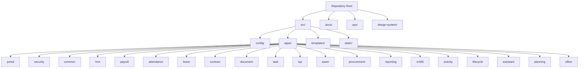
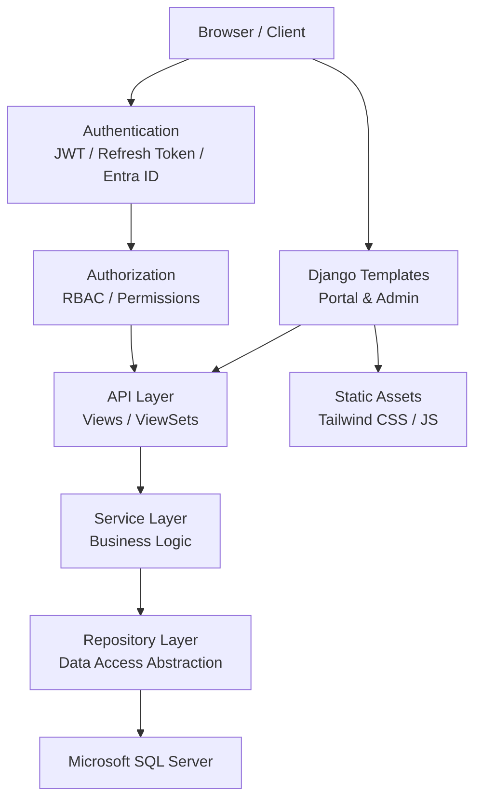
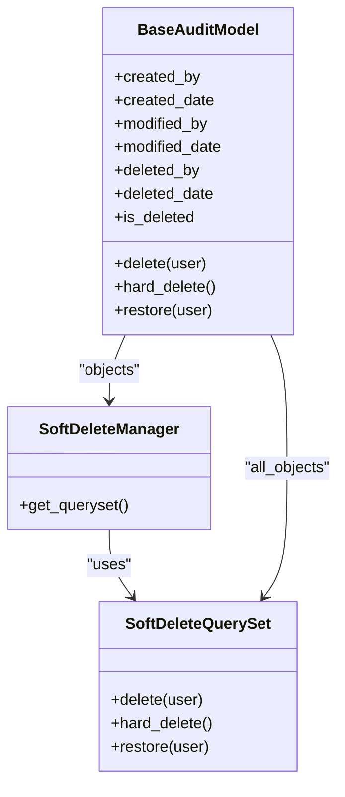
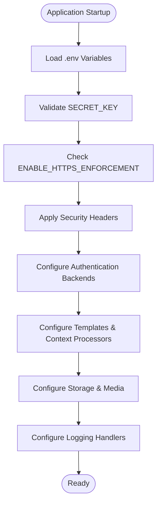
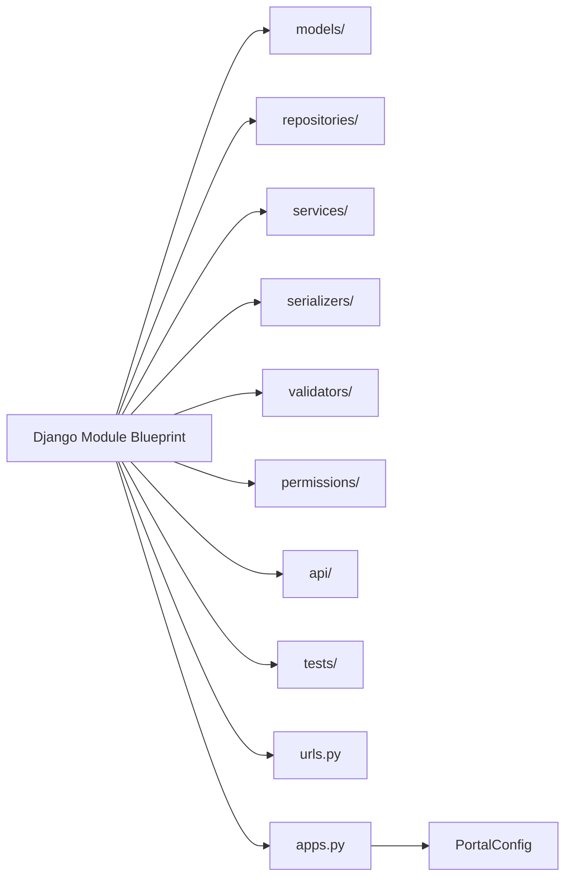
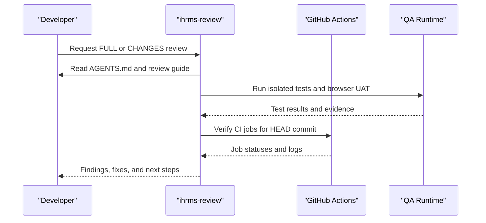
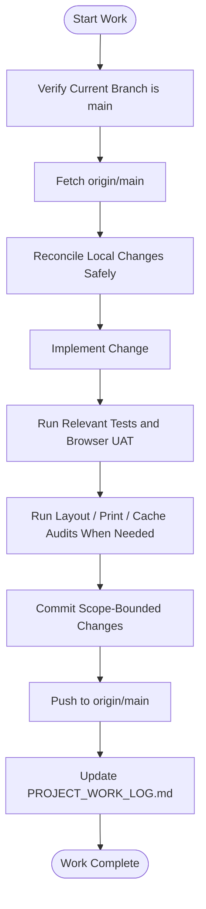

# Development Standards

<cite>
**Referenced Files in This Document**
- [README.md](file://README.md)
- [AGENTS.md](file://AGENTS.md)
- [05_Backend_Standards.md](file://docs/05_Backend_Standards.md)
- [06_Frontend_Standards.md](file://docs/06_Frontend_Standards.md)
- [07_Testing_Standards.md](file://docs/07_Testing_Standards.md)
- [08_Deployment_Standards.md](file://docs/08_Deployment_Standards.md)
- [04_Security_Design.md](file://docs/04_Security_Design.md)
- [16_Django_Module_Blueprint.md](file://docs/16_Django_Module_Blueprint.md)
- [settings.py](file://src/config/settings.py)
- [models.py](file://src/apps/common/models.py)
- [apps.py](file://src/apps/portal/apps.py)
- [package.json](file://package.json)
- [Huong_Dan_Review_Du_An.md](file://docs/Huong_Dan_Review_Du_An.md)
</cite>

## Table of Contents
1. Introduction
2. Project Structure
3. Core Components
4. Architecture Overview
5. Detailed Component Analysis
6. Dependency Analysis
7. Performance Considerations
8. Troubleshooting Guide
9. Conclusion

## Introduction
This document defines the development standards for IHRMS, an internal Django-based Administration and Human Resource Management System. It consolidates backend conventions, frontend architecture, quality gates, security practices, performance guidelines, Git workflow, documentation standards, and contribution procedures. The goal is to make the codebase predictable, secure, testable, and maintainable across development, SIT, UAT, and production environments.

IHRMS uses a modular monolith with Django 5, Microsoft SQL Server as the target database, JWT authentication, and Tailwind CSS for frontend styling. The repository’s single working branch policy, strict review process, and automated checks are central to its quality model.

**Section sources**
- [README.md:1-90](file://README.md#L1-L90)

## Project Structure
The project follows a clear separation between configuration, business apps, templates, static assets, and operational scripts:

- `src/config`: Django project configuration, settings, URLs, WSGI/ASGI entry points.
- `src/apps`: Business modules such as HRM, organization, attendance, leave, payroll, contracts, documents, tasks, KPI, assets, procurement, portal, reporting, security, M365 integration, activity, lifecycle, assistant, planning, office, and common utilities.
- `src/templates` and `src/static`: Shared templates, UI components, CSS, and JavaScript.
- `docs`: Standards, design, testing, deployment, security, and user guides.
- `ops`: Automated tests, browser UAT, layout audits, backup drills, and utility scripts.
- `design-system`: Design system baseline and reference materials.

**Diagram sources**
- [settings.py:111-143](file://src/config/settings.py#L111-L143)
- [apps.py:1-7](file://src/apps/portal/apps.py#L1-L7)

**Section sources**
- [README.md:1-90](file://README.md#L1-L90)
- [settings.py:111-143](file://src/config/settings.py#L111-L143)

## Core Components
This section summarizes the core development standards that apply across the system.

### Backend Standards
- Technology stack: Python 3.12, Django 5, Django REST Framework, Microsoft SQL Server, JWT with refresh tokens, and optional Microsoft Entra ID SSO.
- Architectural style: Modular monolith with layered separation (Presentation → API → Service → Repository → Database).
- Module structure: Each app should contain models, repositories, services, serializers, validators, permissions, API endpoints, tests, urls, and apps configuration.
- Naming conventions: Classes use PascalCase; serializers, repositories, services, viewsets, and permissions follow consistent naming patterns.
- Model standards: One model per table, UUID or identity key primary keys, audit fields, soft delete, and shared base model inheritance.
- Repository standard: All data access goes through repositories; direct ORM calls from service layer are prohibited.
- Service layer: Business logic belongs exclusively in services; views and serializers must not contain business rules.
- Validation levels: API validation, business validation, and database constraints must be enforced at appropriate layers.
- API design: RESTful APIs under `/api/v1`, HTTP method semantics, standardized success/error responses, pagination, filtering, sorting, and search.
- File management: Metadata stored in SQL Server; file content stored in SharePoint or OneDrive; no binary files in SQL Server.
- Audit logging: Mandatory for create, update, delete, approve, reject, export, login, logout, and other sensitive actions.
- Workflow requirements: Leave, recruitment, contract, procurement, document, and payroll approval workflows must persist current step, approver, decision, and timestamp.
- Permission enforcement: Every API must authenticate and authorize; bypassing permissions is forbidden.
- Payroll engine: Salary calculation must be implemented in a dedicated engine/service, not in views.

**Section sources**
- [05_Backend_Standards.md:38-114](file://docs/05_Backend_Standards.md#L38-L114)
- [05_Backend_Standards.md:157-183](file://docs/05_Backend_Standards.md#L157-L183)
- [05_Backend_Standards.md:187-243](file://docs/05_Backend_Standards.md#L187-L243)
- [05_Backend_Standards.md:246-313](file://docs/05_Backend_Standards.md#L246-L313)
- [05_Backend_Standards.md:316-404](file://docs/05_Backend_Standards.md#L316-L404)
- [05_Backend_Standards.md:432-466](file://docs/05_Backend_Standards.md#L432-L466)
- [05_Backend_Standards.md:468-628](file://docs/05_Backend_Standards.md#L468-L628)
- [05_Backend_Standards.md:632-727](file://docs/05_Backend_Standards.md#L632-L727)
- [05_Backend_Standards.md:730-794](file://docs/05_Backend_Standards.md#L730-L794)

### Frontend Standards
- Technology stack: Django templates, Tailwind CSS 4 built via local CLI, and shared project CSS.
- Admin interface: Django Admin with Jazzmin when installed; employee portal uses project templates.
- Language stack: HTML5, CSS3, JavaScript ES6, and Django Template Language.
- UI principles: Simple, consistent, business-first, responsive, and data-focused.
- Layout: Top navigation bar, sidebar, content area, optional right notification panel, and footer.
- Color and typography: Corporate blue primary color, semantic colors, Segoe UI font family, and defined size scale.
- Forms: Two-column desktop layout, one-column mobile layout, required field indicators, and standardized action order.
- Data grids: Columns include code, name, status, created date, modified date, and action.
- Pagination: Default 20 records with options for 20, 50, and 100.
- Search panels: Keyword, date range, status, department, and employee filters where applicable.
- Dashboard: Filter area, KPI area, charts area, and detail area.
- Accessibility and consistency: Use Font Awesome icons, consistent button kinds, and validated contrast.

Tailwind CSS build commands are defined in the frontend package configuration.

**Section sources**
- [06_Frontend_Standards.md:1-66](file://docs/06_Frontend_Standards.md#L1-L66)
- [06_Frontend_Standards.md:70-114](file://docs/06_Frontend_Standards.md#L70-L114)
- [06_Frontend_Standards.md:116-219](file://docs/06_Frontend_Standards.md#L116-L219)
- [06_Frontend_Standards.md:243-355](file://docs/06_Frontend_Standards.md#L243-L355)
- [06_Frontend_Standards.md:365-581](file://docs/06_Frontend_Standards.md#L365-L581)
- [06_Frontend_Standards.md:611-723](file://docs/06_Frontend_Standards.md#L611-L723)
- [06_Frontend_Standards.md:743-800](file://docs/06_Frontend_Standards.md#L743-L800)
- [package.json:1-13](file://package.json#L1-L13)

### Testing Standards
- Objectives: Validate business correctness, data integrity, permissions, workflows, reports, Microsoft 365 integration, performance, and security.
- Environments: Development, SIT, UAT, and post-go-live verification.
- Test types: Unit, integration, system, security, UAT, performance, and regression.
- Test case standard: Each test case includes ID, module, scenario, precondition, steps, expected result, actual result, status, tester, and date.
- Coverage scope: Organization, HRM, recruitment, attendance, leave, payroll, contract, document, task, KPI, asset, procurement, dashboard, and Microsoft 365.
- Browser UAT: Automated browser flows validate dashboard, forms, print layouts, cache behavior, and role-scoped UI.

**Section sources**
- [07_Testing_Standards.md:1-44](file://docs/07_Testing_Standards.md#L1-L44)
- [07_Testing_Standards.md:47-149](file://docs/07_Testing_Standards.md#L47-L149)
- [07_Testing_Standards.md:151-203](file://docs/07_Testing_Standards.md#L151-L203)
- [07_Testing_Standards.md:205-800](file://docs/07_Testing_Standards.md#L205-L800)

### Deployment and Operations Standards
- Deployment model: On-premise physical server hosting a web application on the internal corporate network.
- Environment pipeline: Development → SIT → UAT → Production.
- Server minimums: 8-core CPU, 32 GB RAM, 1 TB SSD, 1 Gbps network.
- Windows Server and IIS: Supported version, required features, dedicated application pool, integrated pipeline, and service account.
- Database: Microsoft SQL Server with environment-specific databases.
- Configuration: Environment-specific `.env` files; secrets must never be committed.
- Branch strategy: `main`, `uat`, `develop`, and `feature/*`.
- Release process: Development → Code Review → Unit Test → SIT → UAT → Production.
- Backup and restore: Daily full backups, transaction log backups, retention policies, quarterly restore drills, and documented reports.
- Monitoring and logging: Application, database, and infrastructure monitoring; structured log levels and rotation.
- Disaster recovery: Incident response, assessment, containment, restore, validation, and business resume.

**Section sources**
- [08_Deployment_Standards.md:1-33](file://docs/08_Deployment_Standards.md#L1-L33)
- [08_Deployment_Standards.md:37-89](file://docs/08_Deployment_Standards.md#L37-L89)
- [08_Deployment_Standards.md:93-183](file://docs/08_Deployment_Standards.md#L93-L183)
- [08_Deployment_Standards.md:187-351](file://docs/08_Deployment_Standards.md#L187-L351)
- [08_Deployment_Standards.md:355-460](file://docs/08_Deployment_Standards.md#L355-L460)
- [08_Deployment_Standards.md:463-620](file://docs/08_Deployment_Standards.md#L463-L620)
- [08_Deployment_Standards.md:623-800](file://docs/08_Deployment_Standards.md#L623-L800)

### Security Standards
- Principles: Least privilege, need-to-know, separation of duties, accountability, defense in depth, and zero-trust internal access.
- Authentication: Local username/password with JWT and refresh token; Microsoft Entra ID SSO.
- Authorization: RBAC with roles including Super Admin, System Admin, HR Manager, HR Officer, Finance Officer, Department Manager, Employee, and Director.
- Data classification: Public, Internal, Confidential, and Highly Confidential categories.
- Sensitive data: Salary, tax, bank information, social insurance, and national ID require strict access control and encryption considerations.
- Input validation: Required fields, type, length, range, format; protection against SQL injection, XSS, and CSRF.
- Session security: Single active session per user; new login invalidates old session.
- API security: JWT required, permission validation required, HTTPS only.
- Audit logging: Comprehensive event capture for critical entities and operations.

**Section sources**
- [04_Security_Design.md:18-83](file://docs/04_Security_Design.md#L18-L83)
- [04_Security_Design.md:86-118](file://docs/04_Security_Design.md#L86-L118)
- [04_Security_Design.md:122-223](file://docs/04_Security_Design.md#L122-L223)
- [04_Security_Design.md:227-312](file://docs/04_Security_Design.md#L227-L312)
- [04_Security_Design.md:315-420](file://docs/04_Security_Design.md#L315-L420)
- [04_Security_Design.md:423-517](file://docs/04_Security_Design.md#L423-L517)
- [04_Security_Design.md:519-617](file://docs/04_Security_Design.md#L519-L617)
- [04_Security_Design.md:619-711](file://docs/04_Security_Design.md#L619-L711)
- [04_Security_Design.md:713-776](file://docs/04_Security_Design.md#L713-L776)

## Architecture Overview
IHRMS follows a layered modular monolith architecture. Requests flow from presentation through API, service, repository, and database layers. Security middleware, authentication backends, and RBAC enforce access control. Templates render UI using shared components and Tailwind-generated CSS.

**Diagram sources**
- [settings.py:145-169](file://src/config/settings.py#L145-L169)
- [settings.py:172-188](file://src/config/settings.py#L172-L188)
- [settings.py:269-279](file://src/config/settings.py#L269-L279)
- [05_Backend_Standards.md:84-114](file://docs/05_Backend_Standards.md#L84-L114)
- [04_Security_Design.md:86-118](file://docs/04_Security_Design.md#L86-L118)

## Detailed Component Analysis

### Base Audit Model and Soft Delete
IHRMS enforces auditability and soft delete through a shared base model. All business models inherit this base to ensure consistent tracking of creation, modification, deletion, and deletion state. The implementation provides:

- A custom query set supporting soft delete, hard delete, and restore operations.
- A manager that filters out soft-deleted records by default.
- Audit fields mapped to explicit database column names.
- Transaction-safe bulk soft delete and restore hooks.

**Diagram sources**
- [models.py:6-53](file://src/apps/common/models.py#L6-L53)
- [models.py:56-92](file://src/apps/common/models.py#L56-L92)

**Section sources**
- [models.py:6-92](file://src/apps/common/models.py#L6-L92)
- [05_Backend_Standards.md:246-313](file://docs/05_Backend_Standards.md#L246-L313)

### Django Settings and Security Posture
Django settings centralize security posture, middleware ordering, authentication backends, template configuration, storage, logging, and environment validation. Key behaviors include:

- Secret key loading from environment variables with explicit failure if missing.
- Conditional HTTPS enforcement controlled by `ENABLE_HTTPS_ENFORCEMENT`.
- Strict validation for UAT and production environments requiring `DEBUG=False`, HTTPS enforcement, strong secret keys, and explicit `ALLOWED_HOSTS`.
- Security headers: content-type sniffing prevention, X-Frame-Options deny, session cookie flags, and CSRF SameSite settings.
- Axes lockout configuration for brute-force protection.
- Template context processors including user permissions.
- Private file storage backend and static file configuration.
- Rotating log handlers with safe exception filtering.

**Diagram sources**
- [settings.py:28-100](file://src/config/settings.py#L28-L100)
- [settings.py:145-188](file://src/config/settings.py#L145-L188)
- [settings.py:269-279](file://src/config/settings.py#L269-L279)
- [settings.py:477-545](file://src/config/settings.py#L477-L545)

**Section sources**
- [settings.py:28-100](file://src/config/settings.py#L28-L100)
- [settings.py:145-188](file://src/config/settings.py#L145-L188)
- [settings.py:269-279](file://src/config/settings.py#L269-L279)
- [settings.py:477-545](file://src/config/settings.py#L477-L545)

### Django Module Blueprint and App Registration
Each Django app follows a standardized blueprint that separates models, repositories, services, serializers, validators, permissions, API endpoints, and tests. The portal app registers itself as a Django app with a descriptive verbose name.

**Diagram sources**
- [16_Django_Module_Blueprint.md:39-65](file://docs/16_Django_Module_Blueprint.md#L39-L65)
- [apps.py:1-7](file://src/apps/portal/apps.py#L1-L7)

**Section sources**
- [16_Django_Module_Blueprint.md:17-65](file://docs/16_Django_Module_Blueprint.md#L17-L65)
- [apps.py:1-7](file://src/apps/portal/apps.py#L1-L7)

### Code Review and Quality Gates
Code review is mandatory and follows a structured process:

- Skill-driven review using `ihrms-review` with FULL or CHANGES scope and REVIEW or FIX mode.
- FULL review scans all modules, not just diffs.
- FIX mode allows confirmed fixes and regression tests but does not deploy production or migrate live databases.
- Standardized commands check Git state, dependency drift, migration state, unit/regression tests, frontend build, and backup safety.
- Browser UAT validates runtime behavior, layout alignment, form contracts, print layouts, button kinds, design tokens, and contrast.
- GitHub Actions must complete successfully for the exact commit being reviewed.

**Diagram sources**
- [Huong_Dan_Review_Du_An.md:8-28](file://docs/Huong_Dan_Review_Du_An.md#L8-L28)
- [Huong_Dan_Review_Du_An.md:91-108](file://docs/Huong_Dan_Review_Du_An.md#L91-L108)
- [Huong_Dan_Review_Du_An.md:110-183](file://docs/Huong_Dan_Review_Du_An.md#L110-L183)
- [Huong_Dan_Review_Du_An.md:185-276](file://docs/Huong_Dan_Review_Du_An.md#L185-L276)
- [Huong_Dan_Review_Du_An.md:278-287](file://docs/Huong_Dan_Review_Du_An.md#L278-L287)

**Section sources**
- [Huong_Dan_Review_Du_An.md:8-28](file://docs/Huong_Dan_Review_Du_An.md#L8-L28)
- [Huong_Dan_Review_Du_An.md:91-108](file://docs/Huong_Dan_Review_Du_An.md#L91-L108)
- [Huong_Dan_Review_Du_An.md:110-183](file://docs/Huong_Dan_Review_Du_An.md#L110-L183)
- [Huong_Dan_Review_Du_An.md:185-276](file://docs/Huong_Dan_Review_Du_An.md#L185-L276)
- [Huong_Dan_Review_Du_An.md:278-287](file://docs/Huong_Dan_Review_Du_An.md#L278-L287)

### Git Workflow and Contribution Process
IHRMS uses a single working branch policy:

- Only `main` is used for development, testing, and deployment unless explicitly requested otherwise.
- One person works at a time; changes must be tested, committed, pushed, and logged before another contributor starts.
- Before each work session, verify branch state, fetch origin, and reconcile local changes safely.
- Migration and schema changes require separate commits, rollback plans, SQL verification, and documented business justification.
- Browser UAT must cover affected flows after changes; print layout and layout alignment audits are mandatory for relevant updates.
- Documentation updates go into a single project work log rather than scattered notes.

**Diagram sources**
- [AGENTS.md:4-18](file://AGENTS.md#L4-L18)
- [AGENTS.md:20-47](file://AGENTS.md#L20-L47)
- [AGENTS.md:49-53](file://AGENTS.md#L49-L53)

**Section sources**
- [AGENTS.md:4-18](file://AGENTS.md#L4-L18)
- [AGENTS.md:20-47](file://AGENTS.md#L20-L47)
- [AGENTS.md:49-53](file://AGENTS.md#L49-L53)

### Naming Conventions
Naming conventions align with Django best practices and Vietnamese business terminology where appropriate:

- Models: PascalCase domain nouns such as `Employee`, `Department`, `RecruitmentRequest`.
- Serializers: `EmployeeSerializer`, `EmployeeCreateSerializer`, `EmployeeUpdateSerializer`.
- Repositories: `EmployeeRepository`, `DepartmentRepository`.
- Services: `EmployeeService`, `PayrollService`, `TaskService`.
- API Views: `EmployeeViewSet`, `DepartmentViewSet`.
- Permissions: `EmployeePermission`, `PayrollPermission`.
- URLs: RESTful paths under `/api/v1`, e.g., `/api/v1/employees/`, `/api/v1/departments/`, `/api/v1/tasks/`.
- Database tables: One model per table, with explicit audit columns and soft-delete flag.

These conventions support readable code, predictable routing, and consistent admin/menu labeling.

**Section sources**
- [05_Backend_Standards.md:187-243](file://docs/05_Backend_Standards.md#L187-L243)
- [05_Backend_Standards.md:468-492](file://docs/05_Backend_Standards.md#L468-L492)
- [05_Backend_Standards.md:246-294](file://docs/05_Backend_Standards.md#L246-L294)

### Documentation Standards
Documentation must be centralized, traceable, and actionable:

- Code comments and inline documentation should explain non-obvious business rules, validation constraints, and security-sensitive logic.
- API specifications should define endpoints, methods, request/response shapes, pagination, filtering, sorting, and error formats.
- User guides and training materials should be maintained alongside technical standards.
- Project work logs record changes, commands, results, limitations, and next actions in a single location.
- Review reports distinguish FULL vs CHANGES scope, REVIEW vs FIX mode, and clearly list untested areas.

**Section sources**
- [AGENTS.md:12-18](file://AGENTS.md#L12-L18)
- [Huong_Dan_Review_Du_An.md:8-28](file://docs/Huong_Dan_Review_Du_An.md#L8-L28)
- [Huong_Dan_Review_Du_An.md:289-294](file://docs/Huong_Dan_Review_Du_An.md#L289-L294)

### Security Coding Practices
Security coding practices are enforced through configuration, middleware, and standards:

- Input validation at API, service, and database layers.
- Protection against SQL injection, XSS, and CSRF.
- HTTPS-only transport in UAT and production.
- Strong secret keys, explicit allowed hosts, and secure cookies.
- Role-based access control and least privilege.
- Audit logging for sensitive operations.
- Secure file storage metadata handling and external storage for content.

**Section sources**
- [04_Security_Design.md:713-776](file://docs/04_Security_Design.md#L713-L776)
- [settings.py:28-100](file://src/config/settings.py#L28-L100)
- [settings.py:145-169](file://src/config/settings.py#L145-L169)

### Performance Optimization Guidelines
Performance optimization should follow these principles:

- Query optimization: Avoid N+1 queries, prefer repository-layer abstractions, and use selective fields and annotations.
- Caching strategies: Use Django caching where appropriate, cache dashboard data, and avoid caching sensitive personal data without proper invalidation.
- Resource loading: Build Tailwind CSS once, serve static files efficiently, and avoid unnecessary template rendering.
- Pagination and filtering: Enforce default page sizes and maximum limits to prevent large payloads.
- Database monitoring: Track slow queries, deadlocks, and database growth.
- Logging hygiene: Rotate logs, avoid excessive verbose logging in production, and filter sensitive exceptions.

**Section sources**
- [05_Backend_Standards.md:554-628](file://docs/05_Backend_Standards.md#L554-L628)
- [settings.py:477-545](file://src/config/settings.py#L477-L545)
- [08_Deployment_Standards.md:623-727](file://docs/08_Deployment_Standards.md#L623-L727)

## Dependency Analysis
The application depends on Django, optional Jazzmin admin theme, Axes for login protection, and multiple business apps. Static assets are managed through Django staticfiles and Tailwind CSS build scripts.

```mermaid
graph TB
Django["Django 5"] --> Settings["settings.py"]
Django --> Middleware["Middleware Stack"]
Django --> Apps["Installed Apps"]
Settings --> Jazzmin["Jazzmin Admin Theme"]
Settings --> Axes["Axes Login Protection"]
Settings --> Portal["apps.portal"]
Settings --> Security["apps.security"]
Settings --> Common["apps.common"]
Settings --> Hrm["apps.hrm"]
Settings --> Payroll["apps.payroll"]
Settings --> Attendance["apps.attendance"]
Settings --> Leave["apps.leave"]
Settings --> Contract["apps.contract"]
Settings --> Document["apps.document"]
Settings --> Task["apps.task"]
Settings --> Kpi["apps.kpi"]
Settings --> Asset["apps.asset"]
Settings --> Procurement["apps.procurement"]
Settings --> Reporting["apps.reporting"]
Settings --> M365["apps.m365"]
Settings --> Activity["apps.activity"]
Settings --> Lifecycle["apps.lifecycle"]
Settings --> Assistant["apps.assistant"]
Settings --> Planning["apps.planning"]
Settings --> Office["apps.office"]
Tailwind["Tailwind CSS CLI"] --> StaticCSS["src/static/css/tailwind.css"]
```

**Diagram sources**
- [settings.py:111-143](file://src/config/settings.py#L111-L143)
- [settings.py:145-169](file://src/config/settings.py#L145-L169)
- [package.json:1-13](file://package.json#L1-L13)

**Section sources**
- [settings.py:111-143](file://src/config/settings.py#L111-L143)
- [settings.py:145-169](file://src/config/settings.py#L145-L169)
- [package.json:1-13](file://package.json#L1-L13)

## Performance Considerations
- Prefer repository-layer queries over ad-hoc ORM calls in services.
- Use pagination consistently for list endpoints and UI grids.
- Limit maximum page size to reduce memory and database load.
- Cache expensive dashboard calculations and report data with explicit invalidation.
- Avoid storing large binaries in SQL Server; store content externally and keep metadata in the database.
- Monitor slow queries and database health.
- Build and serve static assets efficiently; avoid rebuilding CSS unnecessarily.

[No sources needed since this section provides general guidance]

## Troubleshooting Guide
Common troubleshooting areas include:

- Missing or weak `SECRET_KEY`: Ensure environment variable is present and meets production strength requirements.
- HTTPS redirect loops: Enable HTTPS enforcement only behind a reverse proxy or IIS with correct forwarded protocol headers.
- Login lockouts: Axes may lock accounts after repeated failures; verify failure limits and cool-off settings.
- Migration drift: Use migration checks and state verification without applying migrations to live databases during review.
- Browser UAT failures: Isolate QA runtime, verify Playwright/Edge availability, and compare against baselines.
- Print layout issues: Update asset versioning when changing print CSS and compare PDF output against standards.
- Backup safety: Run backup mock scenarios and verify restore drills periodically.

**Section sources**
- [settings.py:28-100](file://src/config/settings.py#L28-L100)
- [settings.py:145-169](file://src/config/settings.py#L145-L169)
- [Huong_Dan_Review_Du_An.md:110-183](file://docs/Huong_Dan_Review_Du_An.md#L110-L183)
- [Huong_Dan_Review_Du_An.md:185-276](file://docs/Huong_Dan_Review_Du_An.md#L185-L276)

## Conclusion
IHRMS development standards emphasize disciplined architecture, clear naming, strong security, comprehensive testing, and repeatable deployment. Backend code must follow Django best practices, repository/service separation, and auditability. Frontend code must use Tailwind CSS, consistent UI patterns, and responsive design. Quality gates combine automated checks, browser UAT, and structured code review. Git workflow enforces single-branch discipline, peer review, and thorough logging. Following these standards ensures IHRMS remains secure, reliable, and maintainable as it evolves.

[No sources needed since this section summarizes without analyzing specific files]