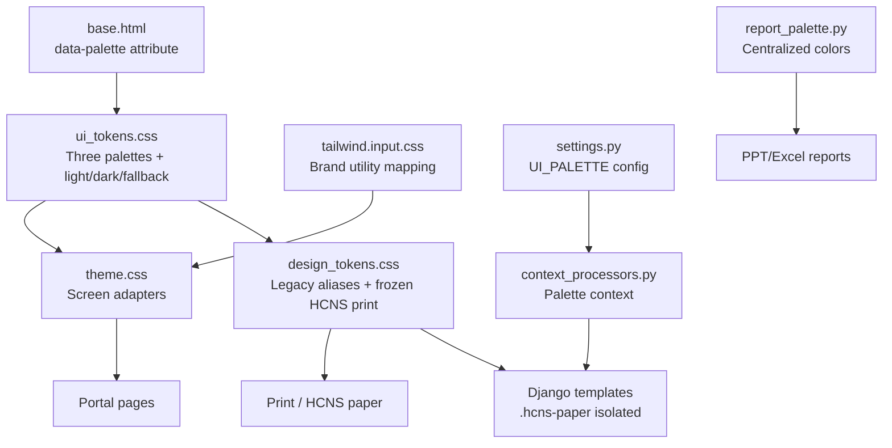
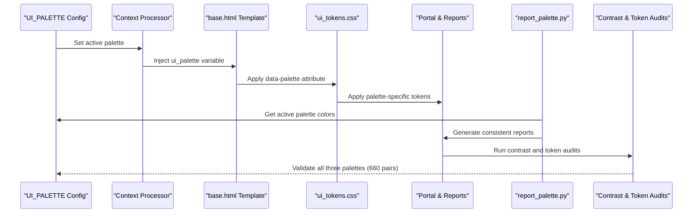
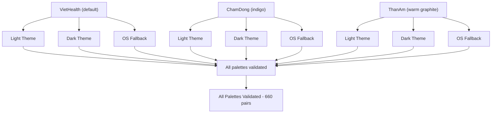
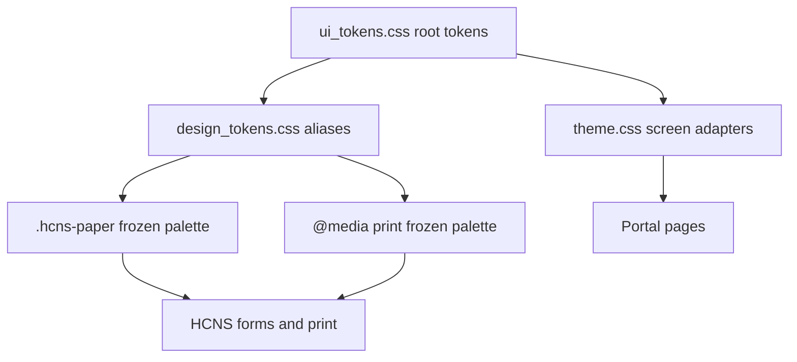
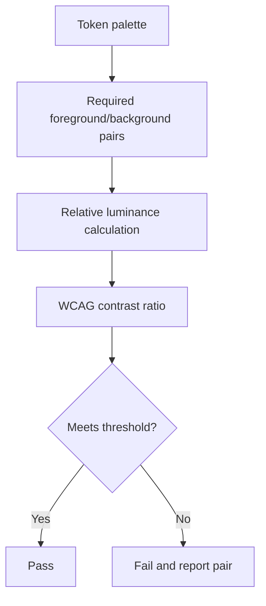
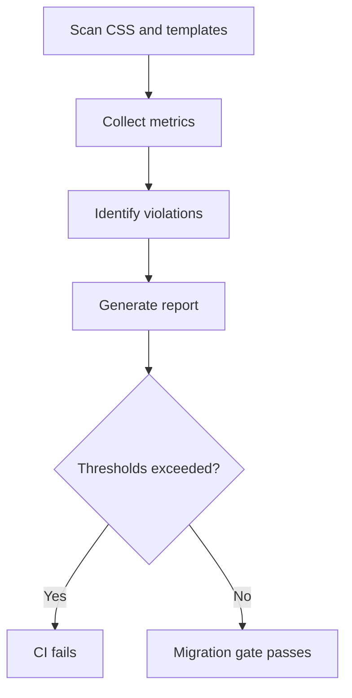
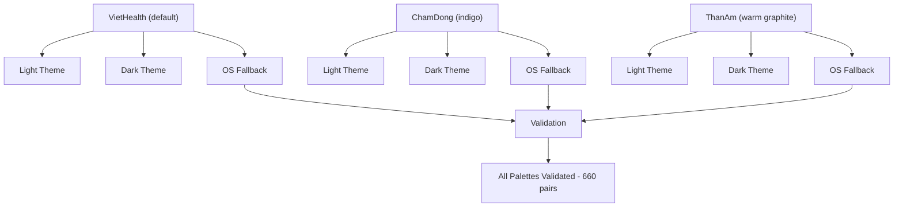
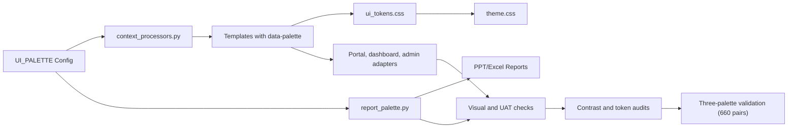

# Brand Palette Migration Planning

<cite>
**Referenced Files in This Document**
- [README.md](file://README.md)
- [DESIGN.md](file://DESIGN.md)
- [UI_DESIGN_SYSTEM.md](file://docs/UI_DESIGN_SYSTEM.md)
- [UI_DESIGN_SYSTEM_PHASE1.md](file://docs/UI_DESIGN_SYSTEM_PHASE1.md)
- [KE_HOACH_DAI_MAU_VIETHEALTH.md](file://docs/KE_HOACH_DAI_MAU_VIETHEALTH.md)
- [ui_tokens.css](file://src/static/css/ui_tokens.css)
- [design_tokens.css](file://src/static/css/design_tokens.css)
- [theme.css](file://src/static/css/theme.css)
- [report_palette.py](file://src/apps/portal/report_palette.py)
- [context_processors.py](file://src/apps/portal/context_processors.py)
- [settings.py](file://src/config/settings.py)
- [test_ui_palette.py](file://src/apps/portal/test_ui_palette.py)
- [check_ui_contrast.py](file://ops/check_ui_contrast.py)
- [test_report_palette.py](file://src/apps/portal/test_report_palette.py)
- [base.html](file://src/templates/base.html)
- [audit_design_tokens.py](file://ops/audit_design_tokens.py)
</cite>

## Update Summary
**Changes Made**
- Updated to reflect comprehensive UI palette system implementation with three complete color schemes (viethealth, chamdong, thanam)
- Added server-side palette selection via UI_PALETTE environment variable and context processor integration
- Documented CSS token restructuring with complete three-palette architecture including light/dark themes and OS fallbacks
- Enhanced reporting system integration with centralized color management through report_palette.py
- Expanded testing infrastructure for palette validation across all three palettes with WCAG accessibility compliance
- Updated contrast checking infrastructure documentation to reflect multi-palette support with 660 total pair measurements

## Table of Contents
1. [Introduction](#introduction)
2. [Project Structure](#project-structure)
3. [Core Components](#core-components)
4. [Architecture Overview](#architecture-overview)
5. [Detailed Component Analysis](#detailed-component-analysis)
6. [Multi-Palette System Implementation](#multi-palette-system-implementation)
7. [Server-Side Palette Selection](#server-side-palette-selection)
8. [Reporting System Integration](#reporting-system-integration)
9. [Testing Infrastructure](#testing-infrastructure)
10. [Dependency Analysis](#dependency-analysis)
11. [Performance Considerations](#performance-considerations)
12. [Troubleshooting Guide](#troubleshooting-guide)
13. [Conclusion](#conclusion)
14. [Appendices](#appendices)

## Introduction
This document plans the migration of IHRMS from its current indigo-based brand palette to a VietHealth green brand palette while preserving business logic, print contracts, permissions, routes, and accessibility thresholds. The system now implements a comprehensive three-palette architecture supporting viethealth (default), chamdong, and thanam color schemes through server-side configuration.

The system is fully tokenized through `--ui-*` CSS variables and includes:
- Three distinct palette implementations with complete light/dark theme support and OS fallback handling
- Server-side palette selection via UI_PALETTE environment variable with safe defaults and validation
- Context processor integration for template rendering with data-palette attributes
- Centralized color management for reporting systems ensuring consistency across PPT/Excel exports
- Comprehensive testing infrastructure validating WCAG accessibility across all 660 contrast pairs per palette

The migration must:
- Keep all business behavior, templates, routes, permissions, and HCNS print layouts unchanged.
- Maintain or improve WCAG contrast for every required pair across all three palettes (220 pairs × 3 palettes = 660 total).
- Replace only color declarations; no new hex literals should be introduced outside token files.
- Preserve frozen HCNS paper/print palettes and separate print form styles.

**Updated** The system now supports three complete palettes with server-side selection, comprehensive testing infrastructure, and centralized color management for reporting outputs, ensuring WCAG accessibility compliance across all theme combinations.

**Section sources**
- [README.md:1-91](file://README.md#L1-L91)
- [UI_DESIGN_SYSTEM.md:1-82](file://docs/UI_DESIGN_SYSTEM.md#L1-L82)
- [KE_HOACH_DAI_MAU_VIETHEALTH.md:1-163](file://docs/KE_HOACH_DAI_MAU_VIETHEALTH.md#L1-L163)

## Project Structure
The brand palette lives in a layered CSS architecture with comprehensive three-palette support:
- `ui_tokens.css` defines the single source of truth for semantic design tokens, including all three palettes with light/dark themes and OS fallback blocks.
- `design_tokens.css` provides legacy aliases and frozen HCNS print palettes.
- `theme.css` adapts third-party UI frameworks and screen-only components to the tokens.
- Tailwind utilities map brand colors to tokens at build time.
- Audit tools validate token usage, typography scale, spacing, and contrast across all palettes.



**Diagram sources**
- [ui_tokens.css:1-760](file://src/static/css/ui_tokens.css#L1-L760)
- [design_tokens.css:1-251](file://src/static/css/design_tokens.css#L1-L251)
- [theme.css:1-37](file://src/static/css/theme.css#L1-L37)
- [context_processors.py:1-45](file://src/apps/portal/context_processors.py#L1-L45)
- [report_palette.py:1-67](file://src/apps/portal/report_palette.py#L1-L67)
- [base.html:1-261](file://src/templates/base.html#L1-L261)

**Section sources**
- [UI_DESIGN_SYSTEM.md:18-46](file://docs/UI_DESIGN_SYSTEM.md#L18-L46)
- [ui_tokens.css:1-760](file://src/static/css/ui_tokens.css#L1-L760)
- [design_tokens.css:1-251](file://src/static/css/design_tokens.css#L1-L251)
- [theme.css:1-37](file://src/static/css/theme.css#L1-L37)

## Core Components
The migration touches these core areas with comprehensive three-palette support:

| Area | Responsibility | Migration impact |
|---|---|---|
| Semantic tokens | Central `--ui-*` variables for background, surface, text, brand, status, sidebar, charts, shadows, and motion across three palettes. | Complete three-palette implementation with viethealth (default), chamdong, and thanam, each with light/dark themes and OS fallback. |
| Legacy aliases | Maps older `ihrms-*` names and Tailwind/Bootstrap color scales to `--ui-*`. | No direct edits expected; they follow token changes automatically. |
| Screen adapters | Applies tokens to Bootstrap, cards, tables, buttons, and portal surfaces. | Verify that theme switching still works and print isolation remains intact across all palettes. |
| Frozen HCNS print palette | Isolated purple-like palette scoped to `.hcns-paper` and `@media print`. | Must remain unchanged unless print contract approval is obtained. |
| Contrast audit | Automated checks for required foreground/background pairs across all three palettes. | New palette must pass existing thresholds for all three color schemes (660 total pairs). |
| Design token audit | Static analysis for hex literals, off-scale sizes, inline styles, and component definitions. | Migration should not introduce new violations across any palette. |
| Server-side selection | UI_PALETTE environment variable controls active palette with validation and safe defaults. | Enables runtime palette switching without code changes, falling back to viethealth for invalid values. |
| Reporting integration | Centralized color management for PPT/Excel exports synchronized with CSS tokens. | Ensures consistent colors across all reporting outputs using the configured palette. |

**Updated** The system now includes comprehensive three-palette support with server-side selection, centralized reporting integration, and extensive testing infrastructure validating WCAG accessibility across all theme combinations.

**Section sources**
- [ui_tokens.css:97-760](file://src/static/css/ui_tokens.css#L97-L760)
- [design_tokens.css:1-120](file://src/static/css/design_tokens.css#L1-L120)
- [design_tokens.css:122-251](file://src/static/css/design_tokens.css#L122-L251)
- [theme.css:1-37](file://src/static/css/theme.css#L1-L37)
- [audit_design_tokens.py:1-253](file://ops/audit_design_tokens.py#L1-L253)
- [check_ui_contrast.py:79-108](file://ops/check_ui_contrast.py#L79-L108)

## Architecture Overview
The brand migration follows a single-source token model with comprehensive three-palette support. Changing palette configuration propagates across the application without editing individual components.



**Diagram sources**
- [settings.py:555-562](file://src/config/settings.py#L555-L562)
- [context_processors.py:7-12](file://src/apps/portal/context_processors.py#L7-L12)
- [base.html:3](file://src/templates/base.html#L3)
- [ui_tokens.css:97-760](file://src/static/css/ui_tokens.css#L97-L760)
- [report_palette.py:59-66](file://src/apps/portal/report_palette.py#L59-L66)

## Detailed Component Analysis

### Current Three-Palette Architecture
The system now implements three complete palettes, each with full light/dark theme support and OS fallback handling:

#### Default Palette: VietHealth (Green)
The default palette uses green as the brand color, derived from logo measurements and adjusted for action semantics:
- Green brand tokens for primary actions, links, focus, hover, and active states (#1F7A3D).
- Neutral backgrounds shifted toward green-tinted grays instead of blue-tinted grays.
- Red reserved for danger semantics, aligned with the logo's red where appropriate.
- Separate light and dark theme blocks covering the same token set.
- OS fallback block matching dark theme exactly for automatic theme detection.

#### Pack 1: ChamDong (Indigo)
The ChamDong pack preserves the previous indigo palette as a fallback option:
- Maintains the established indigo color scheme used before the VietHealth decision.
- Provides continuity for users familiar with the previous interface.
- Full light/dark theme support matching the default palette structure.
- Complete OS fallback implementation with proper contrast ratios.

#### Pack 2: ThanAm (Warm Graphite)
The ThanAm pack offers a warm graphite palette as an alternative option:
- Warm orange-brown brand colors on neutral backgrounds (#9A4A1A).
- Designed as a distinctive alternative to the standard green and indigo options.
- Complete light/dark theme implementation with proper contrast ratios.
- Screen-only application (not applied to print contexts).



**Diagram sources**
- [ui_tokens.css:97-453](file://src/static/css/ui_tokens.css#L97-L453)
- [ui_tokens.css:459-603](file://src/static/css/ui_tokens.css#L459-L603)
- [ui_tokens.css:611-758](file://src/static/css/ui_tokens.css#L611-L758)

**Section sources**
- [ui_tokens.css:97-760](file://src/static/css/ui_tokens.css#L97-L760)
- [UI_DESIGN_SYSTEM.md:1-17](file://docs/UI_DESIGN_SYSTEM.md#L1-L17)

### Frozen HCNS Paper and Print Palettes
HCNS paper and print palettes are intentionally frozen and isolated across all three palettes:
- `.hcns-paper` overrides define a closed palette for HCNS forms and print contexts.
- `@media print` also contains frozen values.
- These must not be changed by the general brand migration unless print contract approvals are obtained.



**Diagram sources**
- [design_tokens.css:122-251](file://src/static/css/design_tokens.css#L122-L251)
- [theme.css:1-37](file://src/static/css/theme.css#L1-L37)

**Section sources**
- [design_tokens.css:122-251](file://src/static/css/design_tokens.css#L122-L251)
- [UI_DESIGN_SYSTEM.md:20-25](file://docs/UI_DESIGN_SYSTEM.md#L20-L25)
- [UI_DESIGN_SYSTEM.md:44-46](file://docs/UI_DESIGN_SYSTEM.md#L44-L46)

### Accessibility and Contrast Gate
Contrast requirements are enforced by both documentation and automated checks across all three palettes:
- Required pairs cover text, muted text, links, borders, focus, brand surfaces, sidebar surfaces, and chart elements.
- Thresholds distinguish between normal text (4.5:1) and large/text-like UI boundaries (3:1).
- The contrast script computes luminance ratios and reports failures for each palette.
- Total of 660 contrast pairs measured (220 pairs × 3 palettes).



**Diagram sources**
- [check_ui_contrast.py:79-108](file://ops/check_ui_contrast.py#L79-L108)
- [UI_DESIGN_SYSTEM_PHASE1.md:13-15](file://docs/UI_DESIGN_SYSTEM_PHASE1.md#L13-L15)

**Section sources**
- [check_ui_contrast.py:79-108](file://ops/check_ui_contrast.py#L79-L108)
- [UI_DESIGN_SYSTEM_PHASE1.md:13-15](file://docs/UI_DESIGN_SYSTEM_PHASE1.md#L13-L15)

### Design Token Audit Gate
The design token audit ensures the migration does not degrade CSS quality across all palettes:
- It scans CSS files and templates for `!important`, ID selectors, fragile `:has()`, hex literals outside tokens, off-scale font sizes, padding/gap/radius diversity, and inline styles.
- It can generate Markdown or JSON reports and fail CI when thresholds are exceeded.



**Diagram sources**
- [audit_design_tokens.py:1-253](file://ops/audit_design_tokens.py#L1-L253)

**Section sources**
- [audit_design_tokens.py:1-253](file://ops/audit_design_tokens.py#L1-L253)

## Multi-Palette System Implementation

**New Section** The comprehensive UI palette system has been implemented with three complete color schemes, each featuring full light/dark theme support and OS fallback handling.

### Three-Palette Architecture
The system implements three distinct palettes, each with complete theme support:



**Diagram sources**
- [ui_tokens.css:97-760](file://src/static/css/ui_tokens.css#L97-L760)
- [check_ui_contrast.py:39-54](file://ops/check_ui_contrast.py#L39-L54)

### CSS Token Structure
Each palette is defined with complete CSS token sets:

- **VietHealth**: Green brand colors with neutral backgrounds, derived from logo measurements
- **ChamDong**: Indigo brand colors preserving the previous palette implementation
- **ThanAm**: Warm graphite palette with orange-brown brand colors

Each palette includes:
- Light theme block with base colors and semantic tokens
- Dark theme block with optimized contrast ratios
- OS fallback block for automatic theme detection (must match dark theme exactly)
- Complete sidebar, chart, and component-specific tokens
- Proper selector specificity for palette switching via `html[data-palette="..."]`

**Section sources**
- [ui_tokens.css:97-760](file://src/static/css/ui_tokens.css#L97-L760)
- [check_ui_contrast.py:39-54](file://ops/check_ui_contrast.py#L39-L54)

## Server-Side Palette Selection

**New Section** The system implements server-side palette selection through Django settings and context processors.

### Environment Configuration
Palette selection is controlled by the `UI_PALETTE` environment variable with validation and safe defaults:

```python
# In settings.py
UI_PALETTE, _ui_palette_invalid = env_choice(
    "UI_PALETTE", ("viethealth", "chamdong", "thanam"), "viethealth"
)
if _ui_palette_invalid:
    logging.getLogger(__name__).warning(
        "UI_PALETTE=%r không hợp lệ (chọn trong: viethealth, chamdong, thanam); dùng mặc định 'viethealth'.",
        _ui_palette_invalid,
    )
```

### Context Processor Integration
The context processor injects the active palette into all templates:

```python
def ui_palette(request):
    """Dải màu giao diện do máy chủ chọn (UI_PALETTE) — gắn vào thẻ <html>.

    Không có nút chọn cho từng người dùng: giá trị chỉ đến từ cấu hình máy chủ.
    """
    return {"ui_palette": settings.UI_PALETTE}
```

### Template Integration
Templates use the palette context to set the HTML attribute:

```html
<html lang="vi" data-palette="{{ ui_palette }}">
```

### Validation and Fallback
The system validates palette values and provides safe defaults:

- Valid values: `viethealth`, `chamdong`, `thanam`
- Invalid values fall back to `viethealth` with warning logs
- Empty values default to `viethealth`
- Case-insensitive processing with whitespace trimming

**Section sources**
- [settings.py:555-562](file://src/config/settings.py#L555-L562)
- [context_processors.py:7-12](file://src/apps/portal/context_processors.py#L7-L12)
- [base.html:3](file://src/templates/base.html#L3)
- [test_ui_palette.py:77-105](file://src/apps/portal/test_ui_palette.py#L77-L105)

## Reporting System Integration

**New Section** The reporting system integrates with the centralized palette management for consistent colors in exported documents.

### Centralized Color Management
The `report_palette.py` module provides Python color constants synchronized with CSS tokens:

```python
PALETTES = {
    "viethealth": {
        "NAVY": "101828",
        "TEAL": "1F7A3D",
        "MINT": "E9F5EE",
        "PAPER": "EDF2EE",
        # ... more colors ...
    },
    "chamdong": {
        "NAVY": "101828",
        "TEAL": "3A4FD0",
        "MINT": "EEF1FD",
        "PAPER": "E7ECF4",
        # ... more colors ...
    },
    "thanam": {
        "NAVY": "1C1917",
        "TEAL": "9A4A1A",
        "MINT": "FAF1E8",
        "PAPER": "EFEBE3",
        # ... more colors ...
    },
}
```

### Active Palette Resolution
Reports automatically use the currently configured palette:

```python
def active():
    """Bảng màu theo UI_PALETTE đang cấu hình."""
    return PALETTES.get(getattr(settings, "UI_PALETTE", "viethealth"), PALETTES["viethealth"])
```

### Consistency Enforcement
Tests ensure Python color constants stay synchronized with CSS tokens:

- Changes to CSS tokens trigger test failures if Python constants aren't updated
- Reports always use light theme colors for PPT/Excel exports
- Color names map directly to CSS token roles (NAVY→text, TEAL→brand, etc.)
- No hardcoded hex literals allowed in export modules

**Section sources**
- [report_palette.py:1-67](file://src/apps/portal/report_palette.py#L1-L67)
- [test_report_palette.py:1-112](file://src/apps/portal/test_report_palette.py#L1-L112)

## Testing Infrastructure

**New Section** Comprehensive testing infrastructure validates the three-palette system across multiple dimensions.

### Palette Context Tests
Tests verify context processor functionality and template integration:

```python
class UiPaletteContextTests(SimpleTestCase):
    def test_context_processor_returns_configured_palette(self):
        request = RequestFactory().get("/")
        for palette in ("viethealth", "chamdong", "thanam"):
            with override_settings(UI_PALETTE=palette):
                self.assertEqual(ui_palette(request), {"ui_palette": palette})

    def test_every_html_tag_carries_data_palette(self):
        # Validates all templates include data-palette attribute
```

### Repository CSS Contrast Gate Tests
Tests run the actual contrast checker against the real CSS file:

```python
class RepoCssContrastGateTests(SimpleTestCase):
    def test_repo_css_passes_gate_for_all_three_palettes(self):
        css = (Path(settings.BASE_DIR) / "static" / "css" / "ui_tokens.css").read_text(encoding="utf-8")
        blocks = self.gate.palette_blocks(css)
        self.assertEqual(set(blocks), {"viethealth", "chamdong", "thanam"})
        rows = self.gate.measure(blocks)
        self.assertEqual(len(rows), 660)  # 220 pairs × 3 palettes
```

### Settings Validation Tests
Tests ensure environment variable handling works correctly:

```python
class UiPaletteSettingsTests(SimpleTestCase):
    def test_default_is_viethealth(self):
        result = self.run_settings(UI_PALETTE="")
        self.assertIn("viethealth", result.stdout)

    def test_invalid_value_falls_back_to_viethealth_with_warning(self):
        result = self.run_settings(UI_PALETTE="xanh-la")
        self.assertIn("viethealth", result.stdout)
        self.assertIn("UI_PALETTE", result.stderr)
```

### Cross-Palette Validation
The testing infrastructure validates:

- All three palettes parse correctly with light, dark, and fallback blocks
- Missing palette blocks raise errors during validation
- Fallback mismatch reporting identifies specific token mismatches per palette
- Cross-palette measurement validates contrast ratios across all combinations
- Extreme ratio validation tests edge cases for contrast calculations
- Report palette synchronization between CSS tokens and Python constants
- No hardcoded hex literals survive in export modules

**Section sources**
- [test_ui_palette.py:1-105](file://src/apps/portal/test_ui_palette.py#L1-L105)
- [test_report_palette.py:1-112](file://src/apps/portal/test_report_palette.py#L1-L112)

## Dependency Analysis
The migration has clear dependency directionality with enhanced three-palette support:



**Diagram sources**
- [settings.py:555-562](file://src/config/settings.py#L555-L562)
- [context_processors.py:7-12](file://src/apps/portal/context_processors.py#L7-L12)
- [ui_tokens.css:97-760](file://src/static/css/ui_tokens.css#L97-L760)
- [report_palette.py:59-66](file://src/apps/portal/report_palette.py#L59-L66)

**Section sources**
- [UI_DESIGN_SYSTEM.md:18-46](file://docs/UI_DESIGN_SYSTEM.md#L18-L46)
- [KE_HOACH_DAI_MAU_VIETHEALTH.md:46-53](file://docs/KE_HOACH_DAI_MAU_VIETHEALTH.md#L46-L53)

## Performance Considerations
- Token-based theming avoids per-component color changes, reducing CSS churn and maintenance cost.
- The migration should not add new CSS rules; it updates variable values, keeping cascade complexity stable.
- Print and HCNS paper palettes remain isolated, preventing unnecessary reflows or repaints in print contexts.
- Theme switching relies on `html[data-theme]` and localStorage, which is lightweight and already implemented.
- Three-palette support adds minimal overhead during development but ensures comprehensive accessibility compliance.
- Server-side palette selection eliminates client-side palette switching overhead.
- CSS custom properties provide efficient theme switching without JavaScript intervention.

## Troubleshooting Guide

### Contrast failures after palette change
Symptoms:
- Automated contrast check exits with failure.
- Specific foreground/background pairs do not meet required thresholds.

Actions:
- Identify failing pairs from the contrast report.
- Adjust token values only if the project owner approves; otherwise revert to the previous palette.
- Confirm that brand tokens used for actionable UI meet 4.5:1 against their backgrounds.
- Re-run the contrast checker before merging.

**Section sources**
- [check_ui_contrast.py:79-108](file://ops/check_ui_contrast.py#L79-L108)
- [UI_DESIGN_SYSTEM_PHASE1.md:13-15](file://docs/UI_DESIGN_SYSTEM_PHASE1.md#L13-L15)

### Three-palette validation failures
**New** Symptoms:
- Missing palette blocks detected during validation.
- Cross-palette contrast measurement failures.
- OS fallback block mismatch errors for specific palettes.

Actions:
- Check which specific palette (viethealth, chamdong, or thanam) is failing validation.
- Verify that all three palettes have complete light, dark, and fallback blocks defined.
- Ensure OS fallback blocks exactly match dark theme blocks for each palette.
- Use the enhanced contrast checker to identify exact token mismatches per palette.
- Verify total of 660 contrast pairs (220 pairs × 3 palettes) are being measured.

**Section sources**
- [check_ui_contrast.py:57-64](file://ops/check_ui_contrast.py#L57-L64)
- [test_ui_palette.py:62-74](file://src/apps/portal/test_ui_palette.py#L62-L74)

### Server-side palette selection issues
**New** Symptoms:
- Templates don't show the expected palette.
- UI_PALETTE environment variable doesn't take effect.
- Invalid palette values cause errors instead of falling back.

Actions:
- Verify UI_PALETTE environment variable is set correctly.
- Check that context processor is registered in settings.py.
- Confirm templates include `data-palette="{{ ui_palette }}"` attribute.
- Review logs for invalid palette warnings.
- Test with valid values: viethealth, chamdong, thanam.
- Verify case-insensitive processing and whitespace trimming.

**Section sources**
- [context_processors.py:7-12](file://src/apps/portal/context_processors.py#L7-L12)
- [test_ui_palette.py:77-105](file://src/apps/portal/test_ui_palette.py#L77-L105)

### Reporting color inconsistencies
**New** Symptoms:
- PPT/Excel reports show different colors than the web interface.
- Python color constants don't match CSS tokens.
- Reports use wrong palette colors.

Actions:
- Verify report_palette.py constants match ui_tokens.css values.
- Check that active() function returns correct palette based on UI_PALETTE.
- Run test_report_palette.py to validate synchronization.
- Ensure reports import from report_palette.py instead of hardcoded colors.
- Verify no hardcoded hex literals exist in export modules.

**Section sources**
- [report_palette.py:1-67](file://src/apps/portal/report_palette.py#L1-L67)
- [test_report_palette.py:62-112](file://src/apps/portal/test_report_palette.py#L62-L112)

### Unexpected hex literals or style drift
Symptoms:
- Design token audit reports hex literals outside token files.
- Inline styles appear in templates.
- Off-scale font sizes or excessive padding/gap/radius values are detected.

Actions:
- Move hardcoded colors into tokens or remove them if they violate policy.
- Remove inline styles and replace with semantic classes.
- Align font sizes and spacing with the allowed scales defined by the audit tool.
- Use `--check` mode to enforce thresholds during development.

**Section sources**
- [audit_design_tokens.py:1-253](file://ops/audit_design_tokens.py#L1-L253)

### HCNS print output changes unexpectedly
Symptoms:
- Printed HCNS forms show brand colors different from the frozen paper palette.
- Print layout or fonts differ from approved business templates.

Actions:
- Verify that `.hcns-paper` and `@media print` blocks were not modified.
- Ensure screen theme changes do not leak into print contexts.
- Confirm that print-specific CSS files remain untouched.

**Section sources**
- [design_tokens.css:122-251](file://src/static/css/design_tokens.css#L122-L251)
- [UI_DESIGN_SYSTEM.md:20-25](file://docs/UI_DESIGN_SYSTEM.md#L20-L25)

### Theme toggle not applying consistently
Symptoms:
- Background flashes on load.
- Theme choice does not persist across tabs.
- Dark theme behaves differently from OS preference.

Actions:
- Confirm theme attribute is applied before stylesheet load.
- Check localStorage key and browser storage permissions.
- Validate fallback behavior for OS-level dark mode.

**Section sources**
- [UI_DESIGN_SYSTEM.md:44-46](file://docs/UI_DESIGN_SYSTEM.md#L44-L46)
- [theme.css:1-37](file://src/static/css/theme.css#L1-L37)

## Conclusion
The VietHealth brand palette migration is a controlled token update backed by a single-source design token architecture, frozen print isolation, and automated accessibility and quality gates. The comprehensive three-palette system now supports viethealth (default), chamdong, and thanam color schemes with server-side selection, centralized reporting integration, and extensive testing infrastructure.

The system provides:
- Three complete palettes with full light/dark theme support and OS fallback handling
- Server-side palette selection via UI_PALETTE environment variable with validation and safe defaults
- Context processor integration for template rendering with data-palette attributes
- Centralized color management for reporting outputs synchronized with CSS tokens
- Comprehensive testing infrastructure validating WCAG accessibility across all 660 contrast pairs
- Automated contrast checking across all three palettes ensuring accessibility compliance

The recommended path is to approve the candidate tokens, replace brand-related values in `ui_tokens.css`, run contrast and token audits, perform visual UAT across light/dark themes and responsive breakpoints, and preserve all business, routing, permission, and print contracts.

**Updated** The comprehensive UI palette system implementation provides robust three-palette support with server-side selection, centralized reporting integration, and extensive testing infrastructure ensuring comprehensive accessibility compliance across all supported palettes and theme combinations.

## Appendices

### Migration Checklist
- [ ] Approve candidate tokens and final brand decisions.
- [ ] Replace brand-related tokens in `ui_tokens.css` for all three palettes.
- [ ] Run `python ops/check_ui_contrast.py` and confirm all required pairs pass for all three palettes (660 total pairs).
- [ ] Verify three-palette validation passes for viethealth, chamdong, and thanam palettes.
- [ ] Confirm OS fallback blocks match dark theme blocks exactly across all palettes.
- [ ] Run `python ops/audit_design_tokens.py --check` and confirm no new violations.
- [ ] Test portal pages in light and dark themes at mobile, tablet, and desktop widths for all palettes.
- [ ] Verify theme toggle persistence and OS preference fallback.
- [ ] Confirm HCNS paper and print outputs remain unchanged.
- [ ] Review dashboard, reports, sidebar, charts, badges, alerts, and disabled states.
- [ ] Test server-side palette selection with UI_PALETTE environment variable.
- [ ] Verify reporting system uses correct palette colors.
- [ ] Update project design documentation if brand decision is approved.

**Section sources**
- [KE_HOACH_DAI_MAU_VIETHEALTH.md:155-163](file://docs/KE_HOACH_DAI_MAU_VIETHEALTH.md#L155-L163)
- [UI_DESIGN_SYSTEM.md:58-65](file://docs/UI_DESIGN_SYSTEM.md#L58-L65)
- [audit_design_tokens.py:212-253](file://ops/audit_design_tokens.py#L212-L253)
- [check_ui_contrast.py:79-108](file://ops/check_ui_contrast.py#L79-L108)

### Three-Palette System Reference
**New Section** The comprehensive UI palette system supports three design palettes with complete validation:

| Palette | Description | Validation Scope | Configuration |
|---------|-------------|------------------|---------------|
| viethealth | Default palette (green, based on logo) | Full light/dark theme + OS fallback validation (220 pairs) | UI_PALETTE=viethealth (default) |
| chamdong | Secondary palette pack (indigo) | Pack-specific light/dark theme + OS fallback validation (220 pairs) | UI_PALETTE=chamdong |
| thanam | Tertiary palette pack (warm graphite) | Pack-specific light/dark theme + OS fallback validation (220 pairs) | UI_PALETTE=thanam |

**Key Features:**
- **CSS Token Parsing**: Automatically parses `data-palette` attributes for multi-palette support
- **Server-Side Selection**: Environment variable controls active palette without client-side switching
- **Context Processor Integration**: Templates receive palette context for HTML attribute injection
- **Centralized Reporting**: Python color constants synchronized with CSS tokens for consistent exports
- **Comprehensive Testing**: Extensive test coverage for palette validation, contrast checking, and settings validation
- **OS Fallback Validation**: Ensures `:root:not([data-theme])` blocks match dark theme blocks exactly
- **Cross-Palette Testing**: Validates contrast ratios across all palette combinations (660 total pairs)
- **WCAG Compliance**: Automated accessibility validation across all theme combinations

**Section sources**
- [ui_tokens.css:97-760](file://src/static/css/ui_tokens.css#L97-L760)
- [context_processors.py:7-12](file://src/apps/portal/context_processors.py#L7-L12)
- [report_palette.py:18-66](file://src/apps/portal/report_palette.py#L18-L66)
- [test_ui_palette.py:1-105](file://src/apps/portal/test_ui_palette.py#L1-L105)
- [test_report_palette.py:1-112](file://src/apps/portal/test_report_palette.py#L1-L112)
