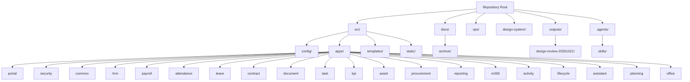
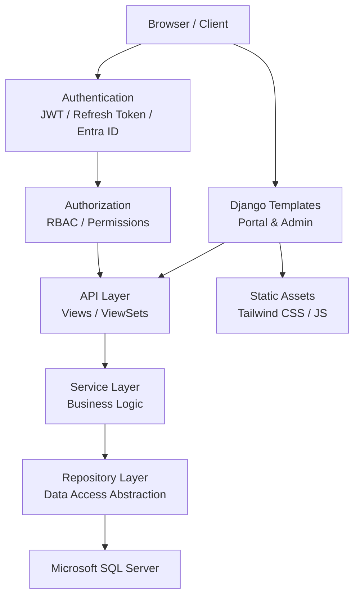
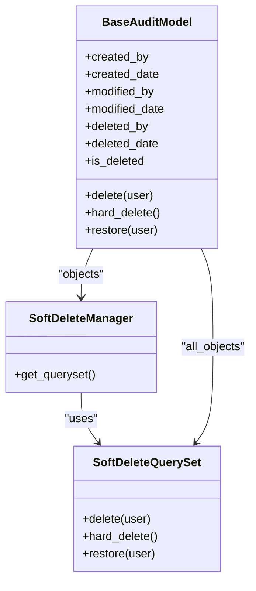
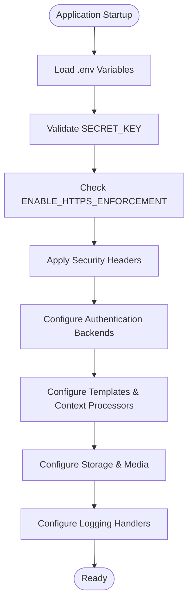
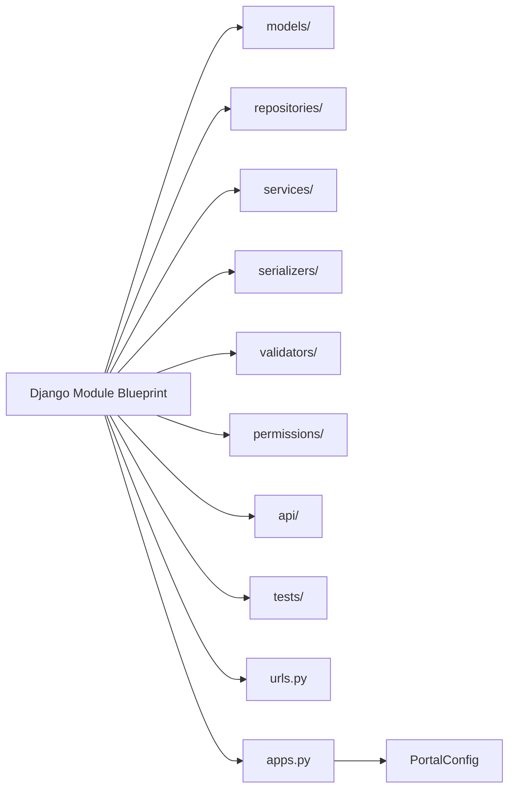
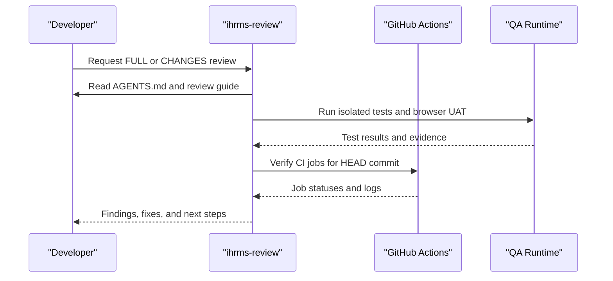
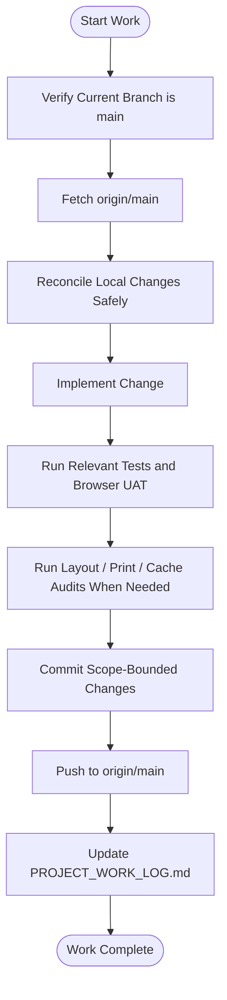
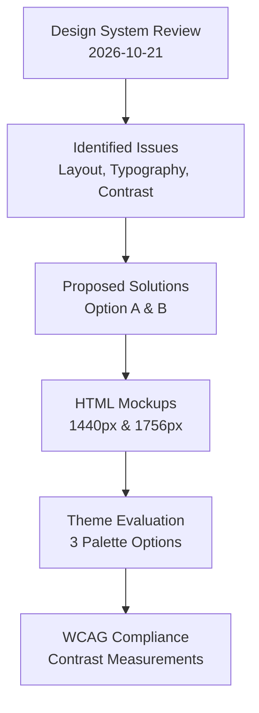
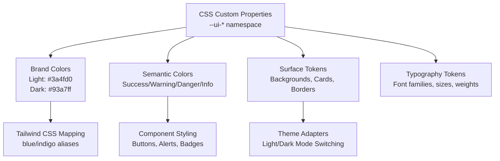

# Development Standards

> Generated reference snapshot (October 2026). Consult AGENTS.md and docs/PROJECT_WORK_LOG.md for current decisions and validation. The PWA shell described here is existing web behavior; the separately approved React Native mobile application has not been implemented by this document.

<cite>
**Referenced Files in This Document**
- [README.md](file://README.md)
- [AGENTS.md](file://AGENTS.md)
- [05_Backend_Standards.md](file://docs/05_Backend_Standards.md)
- [06_Frontend_Standards.md](file://docs/06_Frontend_Standards.md)
- [07_Testing_Standards.md](file://docs/07_Testing_Standards.md)
- [08_Deployment_Standards.md](file://docs/08_Deployment_Standards.md)
- [04_Security_Design.md](file://docs/04_Security_Design.md)
- [16_Django_Module_Blueprint.md](file://docs/16_Django_Module_Blueprint.md)
- [settings.py](file://src/config/settings.py)
- [models.py](file://src/apps/common/models.py)
- [apps.py](file://src/apps/portal/apps.py)
- [package.json](file://package.json)
- [Huong_Dan_Review_Du_An.md](file://docs/Huong_Dan_Review_Du_An.md)
- [.gitignore](file://.gitignore)
- [ci.yml](file://.github/workflows/ci.yml)
- [2026-10-21.md](file://.workbuddy-ai/memory/2026-10-21.md)
- [index.html](file://outputs/design-review-20261021/index.html)
- [themes.html](file://outputs/design-review-20261021/themes.html)
- [SKILL.md](file:.agents/skills/writing-for-agents/SKILL.md)
- [MASTER.md](file://design-system/MASTER.md)
- [design_tokens.css](file://src/static/css/design_tokens.css)
- [theme.css](file://src/static/css/theme.css)
- [manifest.json](file://src/static/manifest.json)
</cite>

## Update Summary
**Changes Made**
- Updated brand palette migration section to reflect comprehensive transition from teal to indigo (Chàm Đông) across all design tokens and visual identity guidelines
- Enhanced frontend standards with new indigo color specifications, CSS custom properties, and PWA manifest updates
- Added detailed design system documentation covering the Chàm Đông palette implementation and token structure
- Updated troubleshooting guide with design system validation procedures for the new color scheme
- Revised performance optimization guidelines to include design token management for the indigo theme

## Table of Contents
1. Introduction
2. Project Structure
3. Core Components
4. Architecture Overview
5. Detailed Component Analysis
6. Design System Review and Deliverables
7. Brand Palette Migration: Teal to Indigo (Chàm Đông)
8. Dependency Analysis
9. Performance Considerations
10. Troubleshooting Guide
11. Conclusion

## Introduction
This document defines the development standards for IHRMS, an internal Django-based Administration and Human Resource Management System. It consolidates backend conventions, frontend architecture, quality gates, security practices, performance guidelines, Git workflow, documentation standards, and contribution procedures. The goal is to make the codebase predictable, secure, testable, and maintainable across development, SIT, UAT, and production environments.

IHRMS uses a modular monolith with Django 5, Microsoft SQL Server as the target database, JWT authentication, and Tailwind CSS for frontend styling. The repository's single working branch policy, strict review process, and automated checks are central to its quality model. Recent enhancements include comprehensive design system reviews, AI-assisted development tools integration, improved CI/CD configurations, and a complete brand palette migration from teal to indigo (Chàm Đông).

**Section sources**
- [README.md:1-90](file://README.md#L1-L90)

## Project Structure
The project follows a clear separation between configuration, business apps, templates, static assets, operational scripts, and design system artifacts:

- `src/config`: Django project configuration, settings, URLs, WSGI/ASGI entry points.
- `src/apps`: Business modules such as HRM, organization, attendance, leave, payroll, contracts, documents, tasks, KPI, assets, procurement, portal, reporting, security, M365 integration, activity, lifecycle, assistant, planning, office, and common utilities.
- `src/templates` and `src/static`: Shared templates, UI components, CSS, and JavaScript.
- `docs`: Standards, design, testing, deployment, security, and user guides.
- `docs/archive`: Historical reviews, migration plans, and archived documentation moved from active directories.
- `ops`: Automated tests, browser UAT, layout audits, backup drills, and utility scripts.
- `design-system`: Design system baseline and reference materials.
- `outputs`: Generated design review deliverables, HTML mockups, and analysis reports.
- `.agents/skills`: AI-assisted development tools and agent skill definitions.

**Diagram sources**
- [settings.py:111-143](file://src/config/settings.py#L111-L143)
- [apps.py:1-7](file://src/apps/portal/apps.py#L1-L7)

**Section sources**
- [README.md:1-90](file://README.md#L1-L90)
- [settings.py:111-143](file://src/config/settings.py#L111-L143)

## Core Components
This section summarizes the core development standards that apply across the system.

### Backend Standards
- Technology stack: Python 3.12, Django 5, Django REST Framework, Microsoft SQL Server, JWT with refresh tokens, and optional Microsoft Entra ID SSO.
- Architectural style: Modular monolith with layered separation (Presentation → API → Service → Repository → Database).
- Module structure: Each app should contain models, repositories, services, serializers, validators, permissions, API endpoints, tests, urls, and apps configuration.
- Naming conventions: Classes use PascalCase; serializers, repositories, services, viewsets, and permissions follow consistent naming patterns.
- Model standards: One model per table, UUID or identity key primary keys, audit fields, soft delete, and shared base model inheritance.
- Repository standard: All data access goes through repositories; direct ORM calls from service layer are prohibited.
- Service layer: Business logic belongs exclusively in services; views and serializers must not contain business rules.
- Validation levels: API validation, business validation, and database constraints must be enforced at appropriate layers.
- API design: RESTful APIs under `/api/v1`, HTTP method semantics, standardized success/error responses, pagination, filtering, sorting, and search.
- File management: Metadata stored in SQL Server; file content stored in SharePoint or OneDrive; no binary files in SQL Server.
- Audit logging: Mandatory for create, update, delete, approve, reject, export, login, logout, and other sensitive actions.
- Workflow requirements: Leave, recruitment, contract, procurement, document, and payroll approval workflows must persist current step, approver, decision, and timestamp.
- Permission enforcement: Every API must authenticate and authorize; bypassing permissions is forbidden.
- Payroll engine: Salary calculation must be implemented in a dedicated engine/service, not in views.

**Section sources**
- [05_Backend_Standards.md:38-114](file://docs/05_Backend_Standards.md#L38-L114)
- [05_Backend_Standards.md:157-183](file://docs/05_Backend_Standards.md#L157-L183)
- [05_Backend_Standards.md:187-243](file://docs/05_Backend_Standards.md#L187-L243)
- [05_Backend_Standards.md:246-313](file://docs/05_Backend_Standards.md#L246-L313)
- [05_Backend_Standards.md:316-404](file://docs/05_Backend_Standards.md#L316-L404)
- [05_Backend_Standards.md:432-466](file://docs/05_Backend_Standards.md#L432-L466)
- [05_Backend_Standards.md:468-628](file://docs/05_Backend_Standards.md#L468-L628)
- [05_Backend_Standards.md:632-727](file://docs/05_Backend_Standards.md#L632-L727)
- [05_Backend_Standards.md:730-794](file://docs/05_Backend_Standards.md#L730-L794)

### Frontend Standards
- Technology stack: Django templates, Tailwind CSS 4 built via local CLI, and shared project CSS.
- Admin interface: Django Admin with Jazzmin when installed; employee portal uses project templates.
- Language stack: HTML5, CSS3, JavaScript ES6, and Django Template Language.
- UI principles: Simple, consistent, business-first, responsive, and data-focused.
- Layout: Top navigation bar, sidebar, content area, optional right notification panel, and footer.
- Color and typography: **Updated** Corporate indigo (Chàm Đông) primary color with semantic colors, Segoe UI font family, and defined size scale. Light theme uses background `#e7ecf4` with white surfaces; dark theme uses near-black blue `#080c18` with elevated surfaces.
- Forms: Two-column desktop layout, one-column mobile layout, required field indicators, and standardized action order.
- Data grids: Columns include code, name, status, created date, modified date, and action.
- Pagination: Default 20 records with options for 20, 50, and 100.
- Search panels: Keyword, date range, status, department, and employee filters where applicable.
- Dashboard: Filter area, KPI area, charts area, and detail area.
- Accessibility and consistency: Use Font Awesome icons, consistent button kinds, and validated contrast.

Tailwind CSS build commands are defined in the frontend package configuration.

**Section sources**
- [06_Frontend_Standards.md:1-66](file://docs/06_Frontend_Standards.md#L1-L66)
- [06_Frontend_Standards.md:70-114](file://docs/06_Frontend_Standards.md#L70-L114)
- [06_Frontend_Standards.md:116-219](file://docs/06_Frontend_Standards.md#L116-L219)
- [06_Frontend_Standards.md:243-355](file://docs/06_Frontend_Standards.md#L243-L355)
- [06_Frontend_Standards.md:365-581](file://docs/06_Frontend_Standards.md#L365-L581)
- [06_Frontend_Standards.md:611-723](file://docs/06_Frontend_Standards.md#L611-L723)
- [06_Frontend_Standards.md:743-800](file://docs/06_Frontend_Standards.md#L743-L800)
- [package.json:1-13](file://package.json#L1-L13)

### Testing Standards
- Objectives: Validate business correctness, data integrity, permissions, workflows, reports, Microsoft 365 integration, performance, and security.
- Environments: Development, SIT, UAT, and post-go-live verification.
- Test types: Unit, integration, system, security, UAT, performance, and regression.
- Test case standard: Each test case includes ID, module, scenario, precondition, steps, expected result, actual result, status, tester, and date.
- Coverage scope: Organization, HRM, recruitment, attendance, leave, payroll, contract, document, task, KPI, asset, procurement, dashboard, and Microsoft 365.
- Browser UAT: Automated browser flows validate dashboard, forms, print layouts, cache behavior, and role-scoped UI.

**Section sources**
- [07_Testing_Standards.md:1-44](file://docs/07_Testing_Standards.md#L1-L44)
- [07_Testing_Standards.md:47-149](file://docs/07_Testing_Standards.md#L47-L149)
- [07_Testing_Standards.md:151-203](file://docs/07_Testing_Standards.md#L151-L203)
- [07_Testing_Standards.md:205-800](file://docs/07_Testing_Standards.md#L205-L800)

### Deployment and Operations Standards
- Deployment model: On-premise physical server hosting a web application on the internal corporate network.
- Environment pipeline: Development → SIT → UAT → Production.
- Server minimums: 8-core CPU, 32 GB RAM, 1 TB SSD, 1 Gbps network.
- Windows Server and IIS: Supported version, required features, dedicated application pool, integrated pipeline, and service account.
- Database: Microsoft SQL Server with environment-specific databases.
- Configuration: Environment-specific `.env` files; secrets must never be committed.
- Branch strategy: `main`, `uat`, `develop`, and `feature/*`.
- Release process: Development → Code Review → Unit Test → SIT → UAT → Production.
- Backup and restore: Daily full backups, transaction log backups, retention policies, quarterly restore drills, and documented reports.
- Monitoring and logging: Application, database, and infrastructure monitoring; structured log levels and rotation.
- Disaster recovery: Incident response, assessment, containment, restore, validation, and business resume.

**Section sources**
- [08_Deployment_Standards.md:1-33](file://docs/08_Deployment_Standards.md#L1-L33)
- [08_Deployment_Standards.md:37-89](file://docs/08_Deployment_Standards.md#L37-L89)
- [08_Deployment_Standards.md:93-183](file://docs/08_Deployment_Standards.md#L93-L183)
- [08_Deployment_Standards.md:187-351](file://docs/08_Deployment_Standards.md#L187-L351)
- [08_Deployment_Standards.md:355-460](file://docs/08_Deployment_Standards.md#L355-L460)
- [08_Deployment_Standards.md:463-620](file://docs/08_Deployment_Standards.md#L463-L620)
- [08_Deployment_Standards.md:623-800](file://docs/08_Deployment_Standards.md#L623-L800)

### Security Standards
- Principles: Least privilege, need-to-know, separation of duties, accountability, defense in depth, and zero-trust internal access.
- Authentication: Local username/password with JWT and refresh token; Microsoft Entra ID SSO.
- Authorization: RBAC with roles including Super Admin, System Admin, HR Manager, HR Officer, Finance Officer, Department Manager, Employee, and Director.
- Data classification: Public, Internal, Confidential, and Highly Confidential categories.
- Sensitive data: Salary, tax, bank information, social insurance, and national ID require strict access control and encryption considerations.
- Input validation: Required fields, type, length, range, format; protection against SQL injection, XSS, and CSRF.
- Session security: Single active session per user; new login invalidates old session.
- API security: JWT required, permission validation required, HTTPS only.
- Audit logging: Comprehensive event capture for critical entities and operations.

**Section sources**
- [04_Security_Design.md:18-83](file://docs/04_Security_Design.md#L18-L83)
- [04_Security_Design.md:86-118](file://docs/04_Security_Design.md#L86-L118)
- [04_Security_Design.md:122-223](file://docs/04_Security_Design.md#L122-L223)
- [04_Security_Design.md:227-312](file://docs/04_Security_Design.md#L227-L312)
- [04_Security_Design.md:315-420](file://docs/04_Security_Design.md#L315-L420)
- [04_Security_Design.md:423-517](file://docs/04_Security_Design.md#L423-L517)
- [04_Security_Design.md:519-617](file://docs/04_Security_Design.md#L519-L617)
- [04_Security_Design.md:619-711](file://docs/04_Security_Design.md#L619-L711)
- [04_Security_Design.md:713-776](file://docs/04_Security_Design.md#L713-L776)

## Architecture Overview
IHRMS follows a layered modular monolith architecture. Requests flow from presentation through API, service, repository, and database layers. Security middleware, authentication backends, and RBAC enforce access control. Templates render UI using shared components and Tailwind-generated CSS.

**Diagram sources**
- [settings.py:145-169](file://src/config/settings.py#L145-L169)
- [settings.py:172-188](file://src/config/settings.py#L172-L188)
- [settings.py:269-279](file://src/config/settings.py#L269-L279)
- [05_Backend_Standards.md:84-114](file://docs/05_Backend_Standards.md#L84-L114)
- [04_Security_Design.md:86-118](file://docs/04_Security_Design.md#L86-L118)

## Detailed Component Analysis

### Base Audit Model and Soft Delete
IHRMS enforces auditability and soft delete through a shared base model. All business models inherit this base to ensure consistent tracking of creation, modification, deletion, and deletion state. The implementation provides:

- A custom query set supporting soft delete, hard delete, and restore operations.
- A manager that filters out soft-deleted records by default.
- Audit fields mapped to explicit database column names.
- Transaction-safe bulk soft delete and restore hooks.

**Diagram sources**
- [models.py:6-53](file://src/apps/common/models.py#L6-L53)
- [models.py:56-92](file://src/apps/common/models.py#L56-L92)

**Section sources**
- [models.py:6-92](file://src/apps/common/models.py#L6-L92)
- [05_Backend_Standards.md:246-313](file://docs/05_Backend_Standards.md#L246-L313)

### Django Settings and Security Posture
Django settings centralize security posture, middleware ordering, authentication backends, template configuration, storage, logging, and environment validation. Key behaviors include:

- Secret key loading from environment variables with explicit failure if missing.
- Conditional HTTPS enforcement controlled by `ENABLE_HTTPS_ENFORCEMENT`.
- Strict validation for UAT and production environments requiring `DEBUG=False`, HTTPS enforcement, strong secret keys, and explicit `ALLOWED_HOSTS`.
- Security headers: content-type sniffing prevention, X-Frame-Options deny, session cookie flags, and CSRF SameSite settings.
- Axes lockout configuration for brute-force protection.
- Template context processors including user permissions.
- Private file storage backend and static file configuration.
- Rotating log handlers with safe exception filtering.

**Diagram sources**
- [settings.py:28-100](file://src/config/settings.py#L28-L100)
- [settings.py:145-188](file://src/config/settings.py#L145-L188)
- [settings.py:269-279](file://src/config/settings.py#L269-L279)
- [settings.py:477-545](file://src/config/settings.py#L477-L545)

**Section sources**
- [settings.py:28-100](file://src/config/settings.py#L28-L100)
- [settings.py:145-188](file://src/config/settings.py#L145-L188)
- [settings.py:269-279](file://src/config/settings.py#L269-L279)
- [settings.py:477-545](file://src/config/settings.py#L477-L545)

### Django Module Blueprint and App Registration
Each Django app follows a standardized blueprint that separates models, repositories, services, serializers, validators, permissions, API endpoints, and tests. The portal app registers itself as a Django app with a descriptive verbose name.

**Diagram sources**
- [16_Django_Module_Blueprint.md:39-65](file://docs/16_Django_Module_Blueprint.md#L39-L65)
- [apps.py:1-7](file://src/apps/portal/apps.py#L1-L7)

**Section sources**
- [16_Django_Module_Blueprint.md:17-65](file://docs/16_Django_Module_Blueprint.md#L17-L65)
- [apps.py:1-7](file://src/apps/portal/apps.py#L1-L7)

### Code Review and Quality Gates
Code review is mandatory and follows a structured process:

- Skill-driven review using `ihrms-review` with FULL or CHANGES scope and REVIEW or FIX mode.
- FULL review scans all modules, not just diffs.
- FIX mode allows confirmed fixes and regression tests but does not deploy production or migrate live databases.
- Standardized commands check Git state, dependency drift, migration state, unit/regression tests, frontend build, and backup safety.
- Browser UAT validates runtime behavior, layout alignment, form contracts, print layouts, button kinds, design tokens, and contrast.
- GitHub Actions must complete successfully for the exact commit being reviewed.

**Diagram sources**
- [Huong_Dan_Review_Du_An.md:8-28](file://docs/Huong_Dan_Review_Du_An.md#L8-L28)
- [Huong_Dan_Review_Du_An.md:91-108](file://docs/Huong_Dan_Review_Du_An.md#L91-L108)
- [Huong_Dan_Review_Du_An.md:110-183](file://docs/Huong_Dan_Review_Du_An.md#L110-L183)
- [Huong_Dan_Review_Du_An.md:185-276](file://docs/Huong_Dan_Review_Du_An.md#L185-L276)
- [Huong_Dan_Review_Du_An.md:278-287](file://docs/Huong_Dan_Review_Du_An.md#L278-L287)

**Section sources**
- [Huong_Dan_Review_Du_An.md:8-28](file://docs/Huong_Dan_Review_Du_An.md#L8-L28)
- [Huong_Dan_Review_Du_An.md:91-108](file://docs/Huong_Dan_Review_Du_An.md#L91-L108)
- [Huong_Dan_Review_Du_An.md:110-183](file://docs/Huong_Dan_Review_Du_An.md#L110-L183)
- [Huong_Dan_Review_Du_An.md:185-276](file://docs/Huong_Dan_Review_Du_An.md#L185-L276)
- [Huong_Dan_Review_Du_An.md:278-287](file://docs/Huong_Dan_Review_Du_An.md#L278-L287)

### Git Workflow and Contribution Process
IHRMS uses a single working branch policy:

- Only `main` is used for development, testing, and deployment unless explicitly requested otherwise.
- One person works at a time; changes must be tested, committed, pushed, and logged before another contributor starts.
- Before each work session, verify branch state, fetch origin, and reconcile local changes safely.
- Migration and schema changes require separate commits, rollback plans, SQL verification, and documented business justification.
- Browser UAT must cover affected flows after changes; print layout and layout alignment audits are mandatory for relevant updates.
- Documentation updates go into a single project work log rather than scattered notes.

**Diagram sources**
- [AGENTS.md:4-18](file://AGENTS.md#L4-L18)
- [AGENTS.md:20-47](file://AGENTS.md#L20-L47)
- [AGENTS.md:49-53](file://AGENTS.md#L49-L53)

**Section sources**
- [AGENTS.md:4-18](file://AGENTS.md#L4-L18)
- [AGENTS.md:20-47](file://AGENTS.md#L20-L47)
- [AGENTS.md:49-53](file://AGENTS.md#L49-L53)

### Naming Conventions
Naming conventions align with Django best practices and Vietnamese business terminology where appropriate:

- Models: PascalCase domain nouns such as `Employee`, `Department`, `RecruitmentRequest`.
- Serializers: `EmployeeSerializer`, `EmployeeCreateSerializer`, `EmployeeUpdateSerializer`.
- Repositories: `EmployeeRepository`, `DepartmentRepository`.
- Services: `EmployeeService`, `PayrollService`, `TaskService`.
- API Views: `EmployeeViewSet`, `DepartmentViewSet`.
- Permissions: `EmployeePermission`, `PayrollPermission`.
- URLs: RESTful paths under `/api/v1`, e.g., `/api/v1/employees/`, `/api/v1/departments/`, `/api/v1/tasks/`.
- Database tables: One model per table, with explicit audit columns and soft-delete flag.

These conventions support readable code, predictable routing, and consistent admin/menu labeling.

**Section sources**
- [05_Backend_Standards.md:187-243](file://docs/05_Backend_Standards.md#L187-L243)
- [05_Backend_Standards.md:468-492](file://docs/05_Backend_Standards.md#L468-L492)
- [05_Backend_Standards.md:246-294](file://docs/05_Backend_Standards.md#L246-L294)

### Documentation Standards
Documentation must be centralized, traceable, and actionable:

- Code comments and inline documentation should explain non-obvious business rules, validation constraints, and security-sensitive logic.
- API specifications should define endpoints, methods, request/response shapes, pagination, filtering, sorting, and error formats.
- User guides and training materials should be maintained alongside technical standards.
- Project work logs record changes, commands, results, limitations, and next actions in a single location.
- Review reports distinguish FULL vs CHANGES scope, REVIEW vs FIX mode, and clearly list untested areas.

**Section sources**
- [AGENTS.md:12-18](file://AGENTS.md#L12-L18)
- [Huong_Dan_Review_Du_An.md:8-28](file://docs/Huong_Dan_Review_Du_An.md#L8-L28)
- [Huong_Dan_Review_Du_An.md:289-294](file://docs/Huong_Dan_Review_Du_An.md#L289-L294)

### Security Coding Practices
Security coding practices are enforced through configuration, middleware, and standards:

- Input validation at API, service, and database layers.
- Protection against SQL injection, XSS, and CSRF.
- HTTPS-only transport in UAT and production.
- Strong secret keys, explicit allowed hosts, and secure cookies.
- Role-based access control and least privilege.
- Audit logging for sensitive operations.
- Secure file storage metadata handling and external storage for content.

**Section sources**
- [04_Security_Design.md:713-776](file://docs/04_Security_Design.md#L713-L776)
- [settings.py:28-100](file://src/config/settings.py#L28-L100)
- [settings.py:145-169](file://src/config/settings.py#L145-L169)

### Performance Optimization Guidelines
Performance optimization should follow these principles:

- Query optimization: Avoid N+1 queries, prefer repository-layer abstractions, and use selective fields and annotations.
- Caching strategies: Use Django caching where appropriate, cache dashboard data, and avoid caching sensitive personal data without proper invalidation.
- Resource loading: Build Tailwind CSS once, serve static files efficiently, and avoid unnecessary template rendering.
- Pagination and filtering: Enforce default page sizes and maximum limits to prevent large payloads.
- Database monitoring: Track slow queries, deadlocks, and database growth.
- Logging hygiene: Rotate logs, avoid excessive verbose logging in production, and filter sensitive exceptions.

**Section sources**
- [05_Backend_Standards.md:554-628](file://docs/05_Backend_Standards.md#L554-L628)
- [settings.py:477-545](file://src/config/settings.py#L477-L545)
- [08_Deployment_Standards.md:623-727](file://docs/08_Deployment_Standards.md#L623-L727)

## Design System Review and Deliverables

### Comprehensive Design System Review (2026-10-21)
A comprehensive design system review was conducted on October 21, 2026, focusing on IHRMS layout and design consistency. The review identified several critical issues and produced extensive HTML deliverables for evaluation.

**Key Findings:**
- `base.html:211` sets `max-w-5xl` (1024px) overriding `--ui-content-max-width` 90rem, losing ~700px at 1756px resolution
- Sidebar vs page background ratios of 1.02:1 (light) / 1.12:1 (dark), card border 1.31/1.64 lacking surface hierarchy
- Breadcrumb positioned within topbar causing content column misalignment
- Seven inconsistent font sizes with group titles only 2px larger than body text
- Primary button placement in middle of 'My Tasks' card
- Duplicate 'Reports' menu items under Reports section
- Date input displaying mm/dd/yyyy format instead of localized format

**Proposed Solutions:**
Two architectural approaches were proposed:
- **Option A 'Refined Foundation'** (recommended): Surface tokens + remove 1024px ceiling + rhythm/type scale, 3 phases, low risk, no exceptions needed
- **Option B 'Executive Space'**: 72px rail + command bar Ctrl+K + KPI strip + sticky toolbar; requires 2 exceptions: 2-column forms, filter panels

**HTML Deliverables:**
The review produced comprehensive HTML mockups and interactive prototypes:
- `outputs/design-review-20261021/index.html`: Main review report with 4 mockup HTML files at 1440/1756px resolutions with light/dark toggle
- `outputs/design-review-20261021/themes.html`: Interactive theme comparison tool with three palette proposals
- Evidence folder containing real screenshots and cropped comparisons

**Theme Proposals:**
Three color palette options were evaluated with WCAG compliance measurements:
- **Teal (Current)**: Medical-friendly, established, zero transition risk
- **Indigo East**: Digital transformation focus, excellent dark mode support, 6.54:1 brand contrast
- **Warm Graphite**: Editorial feel, warm backgrounds, suitable for document-heavy interfaces

All palettes maintain existing `--ui-*` token structure without component changes, size modifications, or layout alterations.

**Diagram sources**
- [2026-10-21.md:1-8](file://.workbuddy-ai/memory/2026-10-21.md#L1-L8)
- [index.html:1-823](file://outputs/design-review-20261021/index.html#L1-L823)
- [themes.html:1-823](file://outputs/design-review-20261021/themes.html#L1-L823)

**Section sources**
- [2026-10-21.md:1-8](file://.workbuddy-ai/memory/2026-10-21.md#L1-L8)
- [index.html:1-823](file://outputs/design-review-20261021/index.html#L1-L823)
- [themes.html:1-823](file://outputs/design-review-20261021/themes.html#L1-L823)

### Project Cleanup and Archive Migration
The project underwent significant cleanup and reorganization to improve maintainability and reduce clutter:

**Archive Migration:**
- 14 completed/replaced documents moved to `docs/archive/` including historical reviews, migration plans, and requests
- Archived locations: `docs/archive/reviews/`, `docs/archive/migration_plans/`, `docs/archive/requests/`
- Active documentation streamlined to essential files only

**Cleanup Actions:**
- Removed `docs/CHANGELOG.md` (redundant with `PROJECT_WORK_LOG.md`)
- Deleted 300 files from `graphify-out/` (~14.3 MB AST/graph/manifest cache)
- Removed artifact `src/qlhcns` (accidental SQLite file)
- Updated relative links across `.md` files with validation script

**Git Ignore Enhancements:**
- Added `graphify-out/` for Graphify analysis cache
- Added `/src/qlhcns*` pattern for accidental SQLite artifacts
- Enhanced existing ignore rules for better workspace cleanliness

**Section sources**
- [PROJECT_WORK_LOG.md:1-8](file://docs/PROJECT_WORK_LOG.md#L1-L8)
- [.gitignore:49-56](file://.gitignore#L49-L56)

### Enhanced CI/CD Configuration
The continuous integration and deployment pipeline has been strengthened with improved configurations:

**GitHub Actions Workflow:**
- Three-job pipeline: backend, frontend, and backup-command-tests
- Backend job: Python 3.12, SQLite testing, dependency auditing, migration checks
- Frontend job: Node.js 22, npm audit, Tailwind CSS build validation
- Backup job: PowerShell backup script testing with mocked sqlcmd

**Dependency Management:**
- Pinned dependencies: `pip-audit==2.9.0`
- Security scanning: Both pip and npm vulnerability checks
- Environment isolation: Disposable databases and media for testing

**Configuration Improvements:**
- Concurrency controls to cancel in-progress runs
- Minimal permissions with `contents: read`
- Submodule exclusion for security
- Timeout limits per job (5-15 minutes)

**Section sources**
- [ci.yml:1-76](file://.github/workflows/ci.yml#L1-L76)
- [.gitignore:1-67](file://.gitignore#L1-L67)

### AI-Assisted Development Tools Integration
IHRMS has integrated a comprehensive AI-assisted development framework through agent skills:

**Agent Skills Framework:**
- 40+ specialized skills covering code review, debugging, architecture improvement, and development workflows
- Skills organized under `.agents/skills/` with YAML frontmatter and markdown documentation
- Integration with Matt Pocock's skills ecosystem for engineering productivity

**Core Skills Include:**
- **Development Workflow**: `implement`, `prototype`, `tdd`, `refactoring-ui`
- **Quality Assurance**: `code-review`, `diagnosing-bugs`, `retro`
- **Architecture**: `codebase-design`, `domain-modeling`, `improve-codebase-architecture`
- **Project Management**: `triage`, `to-spec`, `to-tickets`, `research`
- **Communication**: `writing-for-agents`, `teach`, `grilling`

**Skill Architecture:**
- Each skill contains `SKILL.md` with frontmatter metadata and detailed instructions
- Agent configurations in `agents/openai.yaml` for model-specific settings
- Specialized scripts and templates for complex operations

**Integration Benefits:**
- Consistent development experience across team members
- Automated code review and quality checks
- Streamlined debugging and problem-solving workflows
- Improved documentation generation and maintenance

**Section sources**
- [SKILL.md:1-18](file:.agents/skills/writing-for-agents/SKILL.md#L1-L18)
- [AGENTS.md:24-35](file://AGENTS.md#L24-L35)

## Brand Palette Migration: Teal to Indigo (Chàm Đông)

### Comprehensive Brand Identity Transition
On October 21, 2026, the project leadership approved a comprehensive brand palette migration from teal to indigo (Chàm Đông), representing a strategic shift from medical-friendly aesthetics to digital transformation focus. This change affects all design tokens, color specifications, and visual identity guidelines across the entire IHRMS platform.

### Indigo (Chàm Đông) Color Specifications
The new indigo palette establishes a modern, decisive brand identity while maintaining accessibility and usability standards:

**Primary Brand Colors:**
- Light theme: `#3a4fd0` (primary brand)
- Dark theme: `#93a7ff` (brand highlight)
- Background light: `#e7ecf4` (cool blue-gray canvas)
- Background dark: `#080c18` (near-black blue)

**Semantic Color System:**
- Success: Green tones (`#067647` light, matching dark variant)
- Warning: Amber-orange tones (`#b54708` light, adjusted for dark mode)
- Danger: Red tones (`#b42318` light, consistent dark variant)
- Info: Blue tones (`#175cd3` light, complementary dark variant)

**Sidebar and Navigation:**
- Light theme: White background (`#ffffff`) with dark text (`#1d2939`)
- Dark theme: Deep navy (`#0d1322`) with light text variants
- Maintains established sidebar interaction patterns and hover states

### Design Token Architecture
The migration preserves the existing `--ui-*` token structure while updating underlying color values:

**Diagram sources**
- [design_tokens.css:1-120](file://src/static/css/design_tokens.css#L1-L120)
- [theme.css:1-37](file://src/static/css/theme.css#L1-L37)

### CSS Implementation Details
The indigo palette is implemented through multiple CSS layers ensuring consistent application across all components:

**Core Token Definitions:**
- `design_tokens.css`: Maps legacy color names to new semantic tokens
- `theme.css`: Provides screen-specific theme adapters and Bootstrap compatibility
- `tailwind.input.css`: Defines Tailwind color aliases for the new palette

**PWA Manifest Updates:**
- `background_color`: Updated to `#e7ecf4` (indigo light background)
- `theme_color`: Updated to `#3a4fd0` (indigo brand color)
- Maintains existing icon configurations and app metadata

**Accessibility Compliance:**
- All color combinations maintain WCAG 2.1 AA standards
- Brand contrast ratio: 6.54:1 (exceeds minimum 4.5:1 requirement)
- Dark mode brand contrast: 7.58:1 (enhanced readability)
- Focus indicators and interactive elements maintain proper contrast ratios

### Migration Impact Assessment
The comprehensive migration affects multiple system components:

**Frontend Components:**
- All buttons, links, and interactive elements now use indigo brand colors
- Status indicators (success, warning, danger, info) updated to match new palette
- Dashboard KPIs and data visualizations adapted to indigo theme
- Form controls and validation states refreshed with new color system

**Backend Integration:**
- Email templates and notifications updated to match new branding
- PDF exports and print styles maintain frozen HCNS palette for document consistency
- API responses remain unchanged (visual presentation handled client-side)

**User Experience Considerations:**
- No user-facing theme switching (palette fixed system-wide)
- Smooth transition period for legacy teal references
- Maintained accessibility standards throughout migration
- Preserved existing interaction patterns and component behaviors

### Design System Documentation Updates
The design system documentation has been updated to reflect the new brand identity:

**Master Design System:**
- Updated color palette specifications and usage guidelines
- Revised component contracts with indigo color applications
- Enhanced accessibility requirements for the new palette
- Updated navigation and layout specifications

**Token Management:**
- Centralized token definitions in `ui_tokens.css`
- Consistent mapping across all design system components
- Frozen HCNS paper palette preserved for print and document generation
- Dynamic theme switching maintained for light/dark modes

**Section sources**
- [MASTER.md:29-35](file://design-system/MASTER.md#L29-L35)
- [design_tokens.css:1-120](file://src/static/css/design_tokens.css#L1-L120)
- [theme.css:1-37](file://src/static/css/theme.css#L1-L37)
- [manifest.json:1-26](file://src/static/manifest.json#L1-L26)
- [themes.html:85-408](file://outputs/design-review-20261021/themes.html#L85-L408)

## Dependency Analysis
The application depends on Django, optional Jazzmin admin theme, Axes for login protection, and multiple business apps. Static assets are managed through Django staticfiles and Tailwind CSS build scripts.

```mermaid
graph TB
Django["Django 5"] --> Settings["settings.py"]
Django --> Middleware["Middleware Stack"]
Django --> Apps["Installed Apps"]
Settings --> Jazzmin["Jazzmin Admin Theme"]
Settings --> Axes["Axes Login Protection"]
Settings --> Portal["apps.portal"]
Settings --> Security["apps.security"]
Settings --> Common["apps.common"]
Settings --> Hrm["apps.hrm"]
Settings --> Payroll["apps.payroll"]
Settings --> Attendance["apps.attendance"]
Settings --> Leave["apps.leave"]
Settings --> Contract["apps.contract"]
Settings --> Document["apps.document"]
Settings --> Task["apps.task"]
Settings --> Kpi["apps.kpi"]
Settings --> Asset["apps.asset"]
Settings --> Procurement["apps.procurement"]
Settings --> Reporting["apps.reporting"]
Settings --> M365["apps.m365"]
Settings --> Activity["apps.activity"]
Settings --> Lifecycle["apps.lifecycle"]
Settings --> Assistant["apps.assistant"]
Settings --> Planning["apps.planning"]
Settings --> Office["apps.office"]
Tailwind["Tailwind CSS CLI"] --> StaticCSS["src/static/css/tailwind.css"]
AI["AI Agent Skills"] --> SkillsFramework[".agents/skills/"]
DesignSystem["Design System<br/>Indigo Palette"] --> CSSAssets["CSS Assets<br/>design_tokens.css, theme.css"]
```

**Diagram sources**
- [settings.py:111-143](file://src/config/settings.py#L111-L143)
- [settings.py:145-169](file://src/config/settings.py#L145-L169)
- [package.json:1-13](file://package.json#L1-L13)
- [design_tokens.css:1-120](file://src/static/css/design_tokens.css#L1-L120)

**Section sources**
- [settings.py:111-143](file://src/config/settings.py#L111-L143)
- [settings.py:145-169](file://src/config/settings.py#L145-L169)
- [package.json:1-13](file://package.json#L1-L13)

## Performance Considerations
- Prefer repository-layer queries over ad-hoc ORM calls in services.
- Use pagination consistently for list endpoints and UI grids.
- Limit maximum page size to reduce memory and database load.
- Cache expensive dashboard calculations and report data with explicit invalidation.
- Avoid storing large binaries in SQL Server; store content externally and keep metadata in the database.
- Monitor slow queries and database health.
- Build and serve static assets efficiently; avoid rebuilding CSS unnecessarily.
- **Design Token Optimization**: Manage CSS variables efficiently, avoid redundant theme definitions, and optimize Tailwind builds for the indigo palette.
- **Asset Versioning**: Implement proper cache busting for design system updates and theme changes.
- **Color Palette Performance**: Leverage CSS custom properties for efficient theme switching and minimize repaint/reflow during theme transitions.

[No sources needed since this section provides general guidance]

## Troubleshooting Guide
Common troubleshooting areas include:

- Missing or weak `SECRET_KEY`: Ensure environment variable is present and meets production strength requirements.
- HTTPS redirect loops: Enable HTTPS enforcement only behind a reverse proxy or IIS with correct forwarded protocol headers.
- Login lockouts: Axes may lock accounts after repeated failures; verify failure limits and cool-off settings.
- Migration drift: Use migration checks and state verification without applying migrations to live databases during review.
- Browser UAT failures: Isolate QA runtime, verify Playwright/Edge availability, and compare against baselines.
- Print layout issues: Update asset versioning when changing print CSS and compare PDF output against standards.
- Backup safety: Run backup mock scenarios and verify restore drills periodically.
- **Design System Issues**: Validate CSS custom properties, check theme attribute assignments, verify Tailwind build outputs, and ensure indigo palette tokens are properly loaded.
- **Color Contrast Problems**: Use contrast checking tools to verify WCAG compliance with the new indigo palette, especially in dark mode.
- **PWA Manifest Issues**: Verify background and theme colors match the new indigo palette values.
- **AI Tool Integration**: Verify skill availability, check agent configurations, and validate YAML frontmatter syntax.

**Section sources**
- [settings.py:28-100](file://src/config/settings.py#L28-L100)
- [settings.py:145-169](file://src/config/settings.py#L145-L169)
- [Huong_Dan_Review_Du_An.md:110-183](file://docs/Huong_Dan_Review_Du_An.md#L110-L183)
- [Huong_Dan_Review_Du_An.md:185-276](file://docs/Huong_Dan_Review_Du_An.md#L185-L276)

## Conclusion
IHRMS development standards emphasize disciplined architecture, clear naming, strong security, comprehensive testing, and repeatable deployment. Backend code must follow Django best practices, repository/service separation, and auditability. Frontend code must use Tailwind CSS, consistent UI patterns, and responsive design. Quality gates combine automated checks, browser UAT, and structured code review. Git workflow enforces single-branch discipline, peer review, and thorough logging.

Recent enhancements have significantly strengthened the development process through comprehensive design system reviews, AI-assisted development tools integration, improved CI/CD configurations, systematic project cleanup, and the successful migration from teal to indigo (Chàm Đông) brand palette. The indigo palette provides a modern, digitally-focused brand identity while maintaining accessibility standards and preserving existing component behaviors. These improvements provide a more robust foundation for maintaining code quality, accelerating development cycles, and ensuring consistent user experiences across the IHRMS platform. Following these standards ensures IHRMS remains secure, reliable, and maintainable as it evolves.

[No sources needed since this section summarizes without analyzing specific files]
