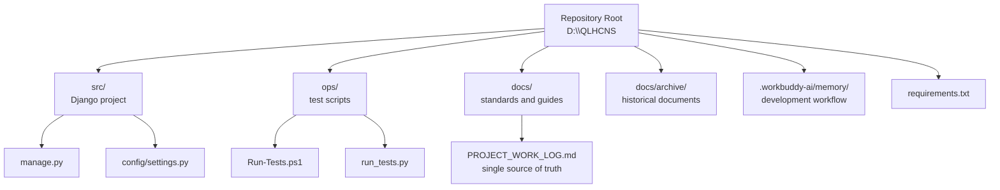
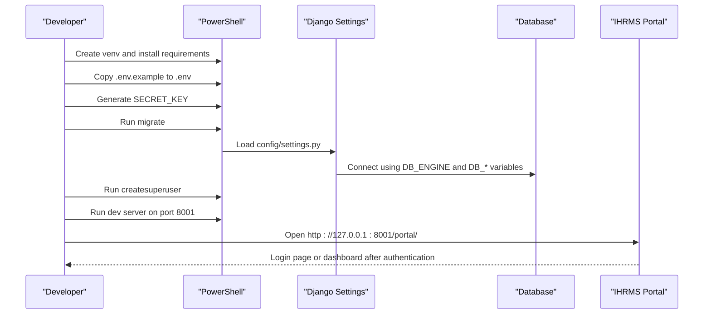
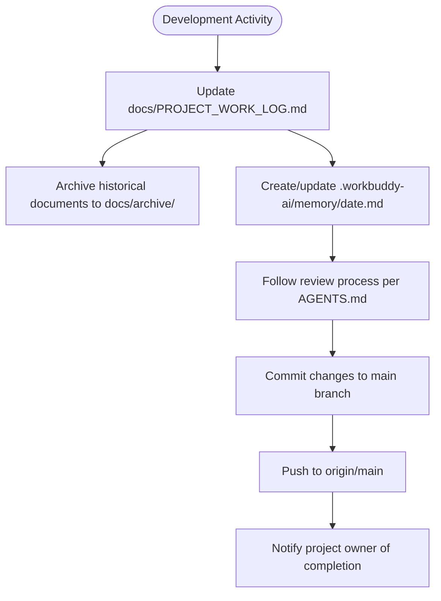
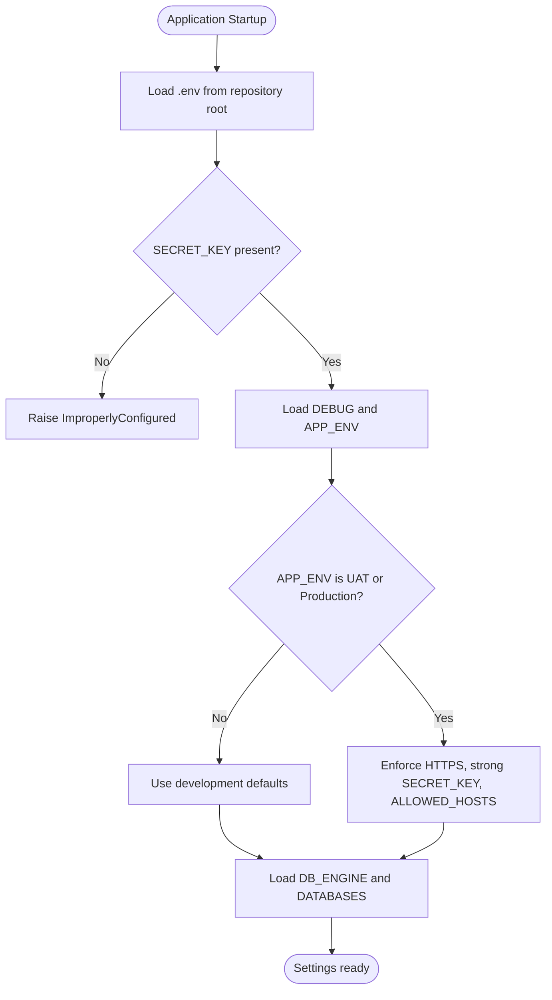
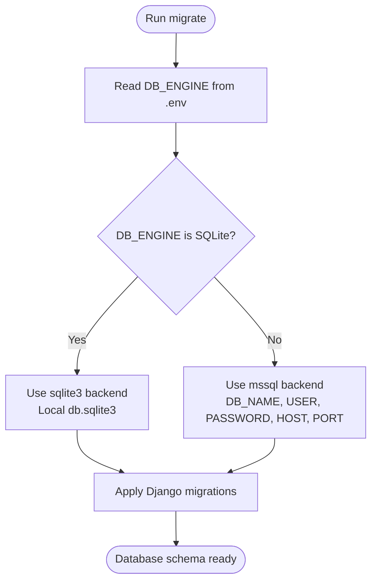
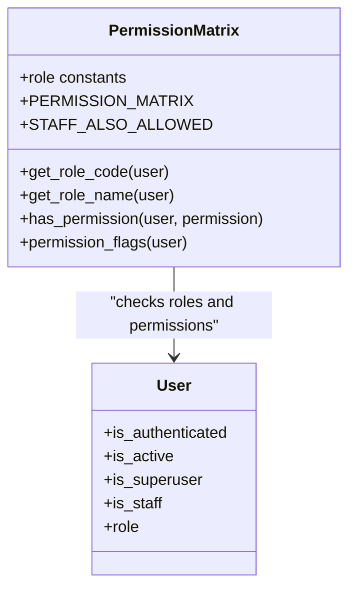
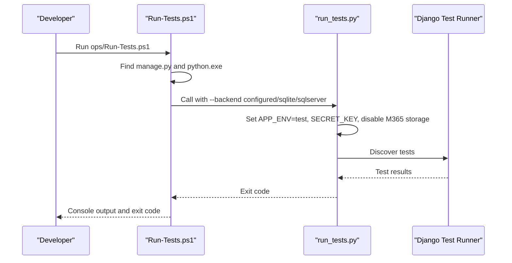
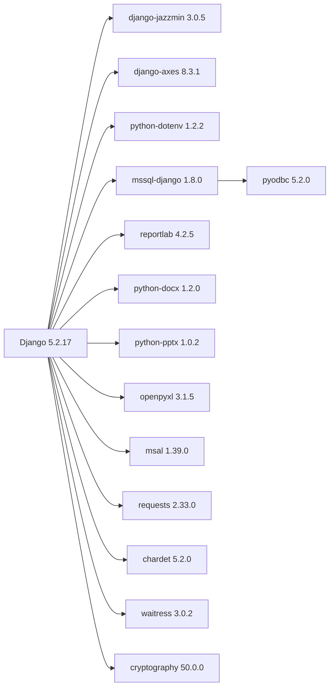

# Getting Started Guide

<cite>
**Referenced Files in This Document**
- [README.md](file://README.md)
- [AGENTS.md](file://AGENTS.md)
- [requirements.txt](file://requirements.txt)
- [src\manage.py](file://src/manage.py)
- [src\config\settings.py](file://src/config/settings.py)
- [ops\Run-Tests.ps1](file://ops/Run-Tests.ps1)
- [ops\run_tests.py](file://ops/run_tests.py)
- [src\apps\security\permissions.py](file://src/apps/security/permissions.py)
- [docs\08_Deployment_Standards.md](file://docs/08_Deployment_Standards.md)
- [docs\PROJECT_WORK_LOG.md](file://docs/PROJECT_WORK_LOG.md)
- [.workbuddy-ai\memory\2026-10-21.md](file://.workbuddy-ai/memory/2026-10-21.md)
</cite>

## Update Summary
**Changes Made**
- Updated Project Structure section to include documentation organization guidelines
- Added new section on Documentation Workflow emphasizing PROJECT_WORK_LOG.md as single source of truth
- Enhanced Introduction to mention docs/archive/ for historical documents
- Added .workbuddy-ai memory integration information for development workflow
- Updated references to reflect current repository structure and documentation practices

## Table of Contents
1. [Introduction](#introduction)
2. [Project Structure](#project-structure)
3. [Core Components](#core-components)
4. [Architecture Overview](#architecture-overview)
5. [Documentation Workflow](#documentation-workflow)
6. [Detailed Component Analysis](#detailed-component-analysis)
7. [Dependency Analysis](#dependency-analysis)
8. [Performance Considerations](#performance-considerations)
9. [Troubleshooting Guide](#troubleshooting-guide)
10. [Conclusion](#conclusion)
11. [Appendices](#appendices)

## Introduction
This guide explains how to set up the IHRMS development environment on Windows and run the application for the first time. It covers Python 3.12 virtual environment creation, dependency installation from `requirements.txt`, `.env` configuration, database migration, superuser creation, running the development server on port 8001, basic navigation to `/portal/`, understanding role-based access control, and running tests with `ops/Run-Tests.ps1`.

IHRMS is a Django 5.2 internal application that provides an employee portal at `/portal/`, a Django admin interface at `/admin/`, and multiple business modules under `src/apps/`. The repository root is `D:\QLHCNS`, and the Django project lives under `src/`.

The project follows strict documentation practices where `docs/PROJECT_WORK_LOG.md` serves as the single source of truth for all project changes, while historical documents like review reports, design critiques, and migration plans are archived in `docs/archive/`. Development workflow also integrates with `.workbuddy-ai/memory/` for tracking development activities.

**Section sources**
- [README.md:1-6](file://README.md#L1-L6)
- [README.md:25-33](file://README.md#L25-L33)
- [README.md:48-69](file://README.md#L48-L69)
- [AGENTS.md:12-18](file://AGENTS.md#L12-L18)

## Project Structure
The relevant parts for getting started are:

| Area | Purpose |
|---|---|
| `src/` | Django project code, apps, templates, static files, and `manage.py` |
| `src/config/settings.py` | Application settings, database configuration, security flags, logging, and environment loading |
| `src/manage.py` | Django management entry point with UTF-8 stream handling |
| `requirements.txt` | Pinned Python dependencies including Django, SQL Server driver, and production WSGI server |
| `ops/Run-Tests.ps1` | PowerShell wrapper for running tests against SQLite or SQL Server |
| `ops/run_tests.py` | Test runner that isolates media storage, sets test environment variables, and enforces non-zero test discovery |
| `src/apps/security/permissions.py` | Centralized role and permission matrix used by the portal and admin UI |
| `docs/` | Project documentation including standards, guides, and the single source of truth work log |
| `docs/archive/` | Historical documents including review reports, design critiques, and migration plans |
| `.workbuddy-ai/memory/` | Development workflow memory files for tracking activities and decisions |
| `docs/08_Deployment_Standards.md` | Deployment, environment separation, backup, and operational standards |

**Diagram sources**
- [README.md:25-33](file://README.md#L25-L33)
- [README.md:48-69](file://README.md#L48-L69)
- [src/manage.py:1-33](file://src/manage.py#L1-L33)
- [src/config/settings.py:1-546](file://src/config/settings.py#L1-L546)
- [ops/Run-Tests.ps1:1-68](file://ops/Run-Tests.ps1#L1-L68)
- [ops/run_tests.py:1-80](file://ops/run_tests.py#L1-L80)
- [requirements.txt:1-21](file://requirements.txt#L1-L21)

**Section sources**
- [README.md:25-33](file://README.md#L25-L33)
- [README.md:48-69](file://README.md#L48-L69)
- [src/manage.py:1-33](file://src/manage.py#L1-L33)
- [src/config/settings.py:1-546](file://src/config/settings.py#L1-L546)
- [requirements.txt:1-21](file://requirements.txt#L1-L21)

## Core Components
For a new developer, the most important components are:

- **Python 3.12 virtual environment**: Keeps IHRMS dependencies isolated from other projects.
- **`requirements.txt`**: Defines pinned versions for Django, SQL Server drivers, reporting libraries, authentication lockout, and the Waitress WSGI server.
- **`.env` file**: Holds `SECRET_KEY`, database engine, database name, user, password, host, port, optional trusted connection, extra parameters, debug flag, HTTPS enforcement, allowed hosts, and Microsoft 365 settings.
- **Database migrations**: Applied through `python src\manage.py migrate`.
- **Superuser account**: Created through `python src\manage.py createsuperuser`.
- **Development server**: Runs locally on port 8001 by default.
- **Test wrapper**: `ops/Run-Tests.ps1` runs tests safely against SQLite or SQL Server without touching production data.
- **Documentation system**: `docs/PROJECT_WORK_LOG.md` as single source of truth, with historical documents in `docs/archive/`.
- **Development workflow**: `.workbuddy-ai/memory/` for tracking development activities and decisions.

**Section sources**
- [README.md:48-87](file://README.md#L48-L87)
- [README.md:25-33](file://README.md#L25-L33)
- [AGENTS.md:12-18](file://AGENTS.md#L12-L18)
- [requirements.txt:1-21](file://requirements.txt#L1-L21)
- [src/config/settings.py:21-35](file://src/config/settings.py#L21-L35)
- [src/config/settings.py:193-225](file://src/config/settings.py#L193-L225)

## Architecture Overview
At startup, Django loads settings from `src/config/settings.py`, which reads `.env` from the repository root. The application then connects to either SQLite or SQL Server based on `DB_ENGINE` and related database variables. Authentication uses Django's built-in backend plus Axes for login attempt tracking. The portal URL is mounted under the main Django URL configuration, and the default login redirect points to the portal dashboard.

**Diagram sources**
- [README.md:48-69](file://README.md#L48-L69)
- [src/config/settings.py:21-35](file://src/config/settings.py#L21-L35)
- [src/config/settings.py:193-225](file://src/config/settings.py#L193-L225)
- [src/config/settings.py:269-273](file://src/config/settings.py#L269-L273)

## Documentation Workflow
IHRMS follows strict documentation practices to maintain clarity and traceability:

### Single Source of Truth
`docs/PROJECT_WORK_LOG.md` is the single source of truth for all project changes. Every significant change must be documented here with:
- Date and objective/scope
- Related files or modules
- Steps taken, testing performed, and results
- Branch/commit information if applicable
- Open items and specific actions needed by the project owner

### Historical Documents
Historical documents including review reports, design critiques, applied migration plans, and processed requirements are stored in `docs/archive/`. This keeps the main documentation clean while preserving important historical context.

### Development Workflow Integration
The `.workbuddy-ai/memory/` directory contains dated memory files that track development activities, decisions, and reviews. These files provide context for AI-assisted development workflows and help maintain continuity across development sessions.

**Diagram sources**
- [AGENTS.md:12-18](file://AGENTS.md#L12-L18)
- [AGENTS.md:24-35](file://AGENTS.md#L24-L35)
- [README.md:25-33](file://README.md#L25-L33)

**Section sources**
- [AGENTS.md:12-18](file://AGENTS.md#L12-L18)
- [AGENTS.md:24-35](file://AGENTS.md#L24-L35)
- [README.md:25-33](file://README.md#L25-L33)

## Detailed Component Analysis

### Windows Development Installation
Follow these steps in PowerShell from the repository root `D:\QLHCNS`:

1. Create a Python 3.12 virtual environment:
   - `py -3.12 -m venv venv`
2. Activate the virtual environment:
   - `.\venv\Scripts\Activate.ps1`
3. Upgrade pip:
   - `python -m pip install --upgrade pip`
4. Install dependencies:
   - `pip install -r requirements.txt`
5. Copy the example environment file:
   - `Copy-Item .env.example .env`
6. Generate a secure `SECRET_KEY`:
   - `python -c "from django.core.management.utils import get_random_secret_key; print(get_random_secret_key())"`
7. Edit `.env` with your development database settings and paste the generated secret key.
8. Validate configuration:
   - `python src\manage.py check`
9. Apply database migrations:
   - `python src\manage.py migrate`
10. Create a superuser:
    - `python src\manage.py createsuperuser`
11. Start the development server:
    - `python src\manage.py runserver`

The README states that the default development server listens on port 8001. You can open `http://127.0.0.1:8001/portal/` after starting the server.

**Section sources**
- [README.md:48-69](file://README.md#L48-L69)

### Environment Configuration
The application loads `.env` from the repository root through `dotenv`. If `SECRET_KEY` is missing, settings raise an explicit configuration error. For development, `DEBUG=True` is appropriate only when using `runserver`; it should not be used on SIT/UAT/production.

Important environment-related behavior:

| Setting | Behavior |
|---|---|
| `SECRET_KEY` | Required; missing value raises `ImproperlyConfigured` |
| `DEBUG` | Boolean flag loaded via helper function |
| `ALLOWED_HOSTS` | Comma-separated list, defaults to local addresses |
| `CSRF_TRUSTED_ORIGINS` | Optional comma-separated list |
| `ENABLE_HTTPS_ENFORCEMENT` | Enables strict HTTPS-related security flags when enabled |
| `APP_ENV` | Defaults to `development`; UAT/production enforce stricter rules |
| `DB_ENGINE` | Defaults to SQLite; non-SQLite uses SQL Server configuration |
| `DB_NAME`, `DB_USER`, `DB_PASSWORD`, `DB_HOST`, `DB_PORT` | Used when `DB_ENGINE` is not SQLite |
| `DB_DRIVER` | Defaults to ODBC Driver 17 for SQL Server |
| `DB_TRUSTED_CONNECTION` | Controls trusted connection option |
| `DB_EXTRA_PARAMS` | Extra driver parameters, especially required in production |

**Diagram sources**
- [src/config/settings.py:21-35](file://src/config/settings.py#L21-L35)
- [src/config/settings.py:75-86](file://src/config/settings.py#L75-L86)
- [src/config/settings.py:193-225](file://src/config/settings.py#L193-L225)

**Section sources**
- [src/config/settings.py:21-35](file://src/config/settings.py#L21-L35)
- [src/config/settings.py:75-86](file://src/config/settings.py#L75-L86)
- [src/config/settings.py:193-225](file://src/config/settings.py#L193-L225)

### Database Setup
By default, the application uses SQLite unless `DB_ENGINE` is changed. When not using SQLite, the settings configure SQL Server through the `mssql` backend with options such as driver, trusted connection, and extra parameters.

Recommended development setup:

- Keep development and production databases separate.
- Use a dedicated development or SIT database.
- Do not run migrations against a shared production database.
- Back up the database before applying migrations.
- For SQL Server, ensure the configured ODBC driver is installed.

**Diagram sources**
- [src/config/settings.py:193-225](file://src/config/settings.py#L193-L225)
- [README.md:64-69](file://README.md#L64-L69)

**Section sources**
- [src/config/settings.py:193-225](file://src/config/settings.py#L193-L225)
- [README.md:64-69](file://README.md#L64-L69)

### First-Time User Guidance
After creating a superuser and starting the server:

1. Open `http://127.0.0.1:8001/portal/`.
2. Log in with the superuser credentials created by `createsuperuser`.
3. After login, Django redirects to the portal dashboard by default.
4. Use the portal navigation to explore employee-facing features.
5. Access `/admin/` for administrative tasks if you have staff/superuser permissions.

The default login URL is the portal login, and the default redirect after login is the portal dashboard.

**Section sources**
- [README.md:64-69](file://README.md#L64-L69)
- [src/config/settings.py:269-273](file://src/config/settings.py#L269-L273)

### Role-Based Access Control System
IHRMS uses a centralized permission matrix rather than scattered role checks. Roles are defined as constants, and each permission maps to one or more roles. Superusers always have all permissions. Some permissions are also allowed for staff accounts, but business permissions must still be explicitly granted through roles.

Key roles include:

| Role Code | Typical Meaning |
|---|---|
| `SUPER_ADMIN` | Highest-level administrator |
| `SYS_ADMIN` | System administrator |
| `DIRECTOR` | Senior leadership |
| `HR_MANAGER` | Human resources manager |
| `HR_OFFICER` | HR operations officer |
| `DEPT_MANAGER` | Department manager |
| `FINANCE_OFFICER` | Finance/accounting officer |
| `PROJECT_MANAGER` | Project manager |
| `PROJECT_COORDINATOR` | Project coordinator |
| `CBDA` | NGO activity role |
| `EMPLOYEE` | Regular employee |

Permissions cover leave approval, timesheet approval, task assignment, KPI scoring, document approval, recruitment, calendar management, reports, HR management, lifecycle cases, finance, office requests, procurement, assets, report center access, and admin menu visibility.

**Diagram sources**
- [src/apps/security/permissions.py:10-23](file://src/apps/security/permissions.py#L10-L23)
- [src/apps/security/permissions.py:28-109](file://src/apps/security/permissions.py#L28-L109)
- [src/apps/security/permissions.py:111-152](file://src/apps/security/permissions.py#L111-L152)

**Section sources**
- [src/apps/security/permissions.py:10-23](file://src/apps/security/permissions.py#L10-L23)
- [src/apps/security/permissions.py:28-109](file://src/apps/security/permissions.py#L28-L109)
- [src/apps/security/permissions.py:111-152](file://src/apps/security/permissions.py#L111-L152)
- [README.md:85-86](file://README.md#L85-L86)

### Testing Commands
Use the provided PowerShell wrapper to run tests safely. From the repository root:

- Default tests (SQLite):
  - `powershell -NoProfile -ExecutionPolicy Bypass -File .\ops\Run-Tests.ps1 -Backend sqlite`
- SQL Server test database:
  - `powershell -NoProfile -ExecutionPolicy Bypass -File .\ops\Run-Tests.ps1 -Backend sqlserver`

The script resolves the correct Python executable, changes into `src`, sets UTF-8 encoding, calls `ops/run_tests.py`, validates that Django discovers tests, and returns a non-zero exit code if no tests are found.

**Diagram sources**
- [ops/Run-Tests.ps1:1-68](file://ops/Run-Tests.ps1#L1-L68)
- [ops/run_tests.py:1-80](file://ops/run_tests.py#L1-L80)

**Section sources**
- [README.md:71-83](file://README.md#L71-L83)
- [ops/Run-Tests.ps1:1-68](file://ops/Run-Tests.ps1#L1-L68)
- [ops/run_tests.py:1-80](file://ops/run_tests.py#L1-L80)

## Dependency Analysis
The project pins major dependencies to specific versions to reduce environment drift. Key categories:

| Category | Dependencies |
|---|---|
| Web framework | Django |
| Environment loading | python-dotenv |
| Admin UI | django-jazzmin |
| Office/report formats | openpyxl, python-docx, python-pptx, reportlab |
| SQL Server support | mssql-django, pyodbc |
| Authentication and security | msal, cryptography, django-axes |
| HTTP client | requests |
| Encoding detection | chardet |
| Production WSGI server | waitress |

**Diagram sources**
- [requirements.txt:1-21](file://requirements.txt#L1-L21)

**Section sources**
- [requirements.txt:1-21](file://requirements.txt#L1-L21)

## Performance Considerations
This section focuses on setup performance and safety rather than runtime tuning:

- Use the pinned `requirements.txt` to avoid slow or incompatible dependency resolution.
- Keep development and production databases separate so migrations do not affect live data.
- Avoid enabling HTTPS enforcement in local development unless you are behind a reverse proxy with TLS.
- Use SQLite for quick local testing when SQL Server is unavailable, but validate critical paths against SQL Server where possible.
- The test wrapper disables real-file storage and Microsoft 365 storage during tests to keep runs fast and isolated.

[No sources needed since this section provides general guidance]

## Troubleshooting Guide

### Missing `.env` or Missing `SECRET_KEY`
**Symptoms:**
- Application fails to start.
- Error mentions missing environment variable `SECRET_KEY`.

**Cause:**
- `.env` was not copied from `.env.example`.
- `SECRET_KEY` was not generated or pasted into `.env`.

**Resolution:**
1. Copy the example file: `Copy-Item .env.example .env`.
2. Generate a new secret key using Django's utility.
3. Paste the generated key into `.env`.
4. Restart the server.

**Section sources**
- [src/config/settings.py:21-35](file://src/config/settings.py#L21-L35)
- [README.md:56-62](file://README.md#L56-L62)

### Database Connection Problems
**Symptoms:**
- Migration or runtime errors connecting to the database.
- SQL Server driver or ODBC errors.

**Likely causes:**
- Wrong `DB_ENGINE`, `DB_NAME`, `DB_USER`, `DB_PASSWORD`, `DB_HOST`, or `DB_PORT`.
- SQL Server ODBC Driver 17 not installed.
- Trusted connection or encryption parameters incorrect.
- Running migrations against the wrong database.

**Resolution:**
1. Confirm `DB_ENGINE` matches your intended backend.
2. For SQL Server, verify driver installation and network connectivity.
3. Ensure `DB_EXTRA_PARAMS` includes required encryption settings for production-like configurations.
4. Back up the target database before running migrations.
5. Re-run `python src\manage.py migrate` only against the intended development or SIT database.

**Section sources**
- [src/config/settings.py:193-225](file://src/config/settings.py#L193-L225)
- [README.md:64-69](file://README.md#L64-L69)
- [docs/08_Deployment_Standards.md:323-351](file://docs/08_Deployment_Standards.md#L323-L351)

### Permission Errors Writing Logs or Media
**Symptoms:**
- Errors writing to `Logs/`.
- Errors creating or accessing `src/media/`.

**Cause:**
- The process lacks write permissions for the repository directory.

**Resolution:**
- Run PowerShell as the correct user with write access to `D:\QLHCNS`.
- Ensure the application user has write access to `Logs/` and `src/media/`.
- On deployment, use a dedicated service account with controlled permissions.

**Section sources**
- [src/config/settings.py:483-484](file://src/config/settings.py#L483-L484)
- [src/config/settings.py:274-279](file://src/config/settings.py#L274-L279)

### Tests Discover Zero Tests
**Symptoms:**
- Test wrapper reports zero discovered tests.
- Running tests directly from the repository root finds no tests.

**Cause:**
- The test wrapper expects to run from the repository root and change into `src`.
- Calling Django directly from the wrong directory can result in zero discovered tests.

**Resolution:**
- Use `ops/Run-Tests.ps1` from the repository root.
- If calling Django directly, run from `D:\QLHCNS\src`.
- Verify the selected backend is supported by the test wrapper.

**Section sources**
- [README.md:71-83](file://README.md#L71-L83)
- [ops/Run-Tests.ps1:1-68](file://ops/Run-Tests.ps1#L1-L68)
- [ops/run_tests.py:1-80](file://ops/run_tests.py#L1-L80)

### HTTPS Redirect Loop in Development
**Symptoms:**
- Browser redirects repeatedly or login fails locally.

**Cause:**
- `ENABLE_HTTPS_ENFORCEMENT` is enabled while running `runserver` over plain HTTP.

**Resolution:**
- Keep `ENABLE_HTTPS_ENFORCEMENT` disabled for local development.
- Enable it only behind a reverse proxy or IIS with TLS configured.

**Section sources**
- [src/config/settings.py:48-73](file://src/config/settings.py#L48-L73)
- [README.md:62](file://README.md#L62)

### Security and Safety Warnings
- Never use a production database for development or testing.
- Do not copy `.env` secrets from another machine.
- Do not commit `.env`, database backups, personnel/payroll data, or uploaded files to Git.
- Store `.env` in a controlled secrets store.
- Use `DEBUG=False` and proper HTTPS configuration on SIT/UAT/production.

**Section sources**
- [README.md:23-24](file://README.md#L23-L24)
- [README.md:87](file://README.md#L87)
- [docs/08_Deployment_Standards.md:371-383](file://docs/08_Deployment_Standards.md#L371-L383)

## Conclusion
You now have the essential information to set up IHRMS on Windows, configure the environment, create a superuser, run the development server on port 8001, navigate to `/portal/`, understand the role-based permission system, and run tests safely. Always keep development and production environments isolated, protect `.env` secrets, and validate database connections before applying migrations.

The project also emphasizes proper documentation practices: use `docs/PROJECT_WORK_LOG.md` as the single source of truth for all changes, archive historical documents in `docs/archive/`, and integrate with `.workbuddy-ai/memory/` for development workflow tracking.

[No sources needed since this section summarizes without analyzing specific files]

## Appendices

### Quick Command Checklist
| Task | Command |
|---|---|
| Create virtual environment | `py -3.12 -m venv venv` |
| Activate virtual environment | `.\venv\Scripts\Activate.ps1` |
| Install dependencies | `pip install -r requirements.txt` |
| Copy environment template | `Copy-Item .env.example .env` |
| Generate secret key | `python -c "from django.core.management.utils import get_random_secret_key; print(get_random_secret_key())"` |
| Validate configuration | `python src\manage.py check` |
| Apply migrations | `python src\manage.py migrate` |
| Create superuser | `python src\manage.py createsuperuser` |
| Run development server | `python src\manage.py runserver` |
| Run default tests | `powershell -NoProfile -ExecutionPolicy Bypass -File .\ops\Run-Tests.ps1 -Backend sqlite` |
| Run SQL Server tests | `powershell -NoProfile -ExecutionPolicy Bypass -File .\ops\Run-Tests.ps1 -Backend sqlserver` |

**Section sources**
- [README.md:48-83](file://README.md#L48-L83)

### Documentation Workflow Checklist
| Task | Location/Action |
|---|---|
| Record project changes | `docs/PROJECT_WORK_LOG.md` (single source of truth) |
| Archive historical documents | `docs/archive/` |
| Track development activities | `.workbuddy-ai/memory/YYYY-MM-DD.md` |
| Follow review process | Per `AGENTS.md` and `ihrms-review` skill |
| Commit changes | `main` branch only |
| Push to remote | `git push origin main` |

**Section sources**
- [AGENTS.md:12-18](file://AGENTS.md#L12-L18)
- [AGENTS.md:24-35](file://AGENTS.md#L24-L35)
- [README.md:25-33](file://README.md#L25-L33)
