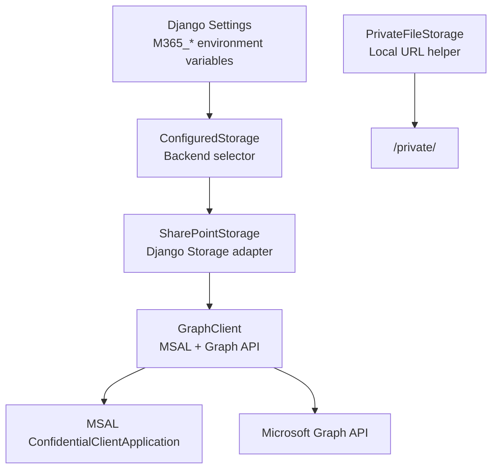
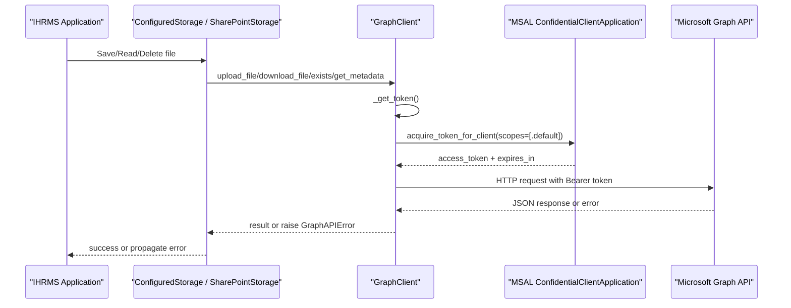
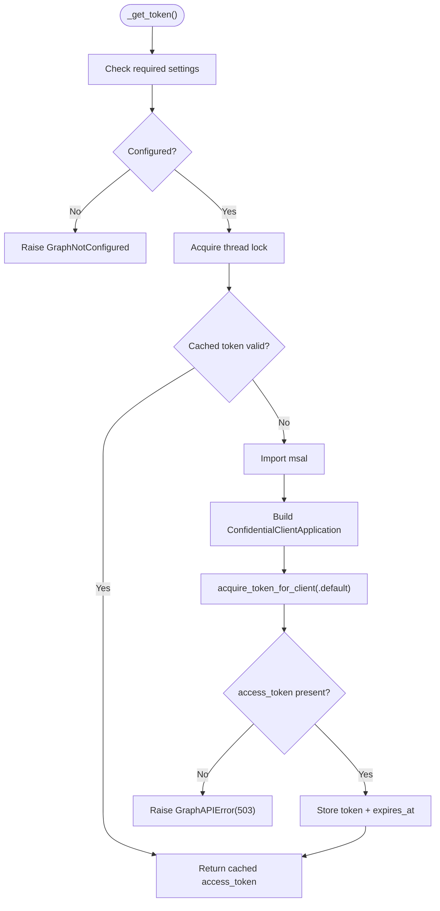
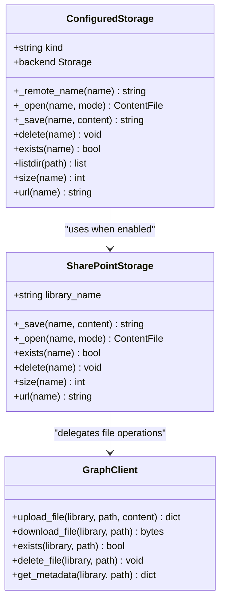
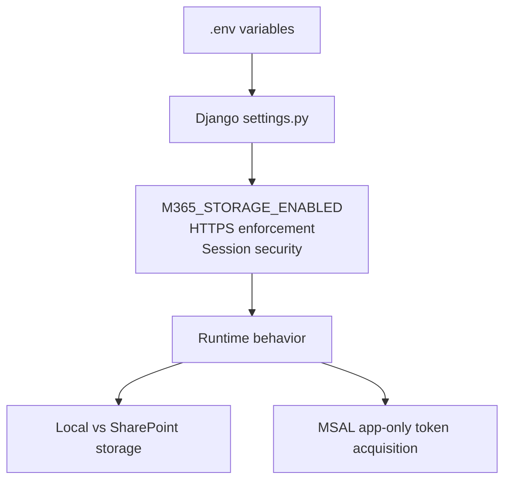
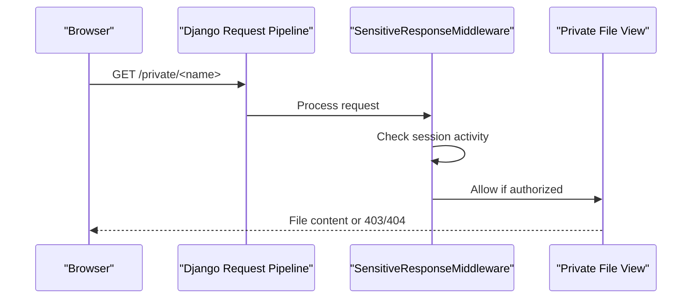
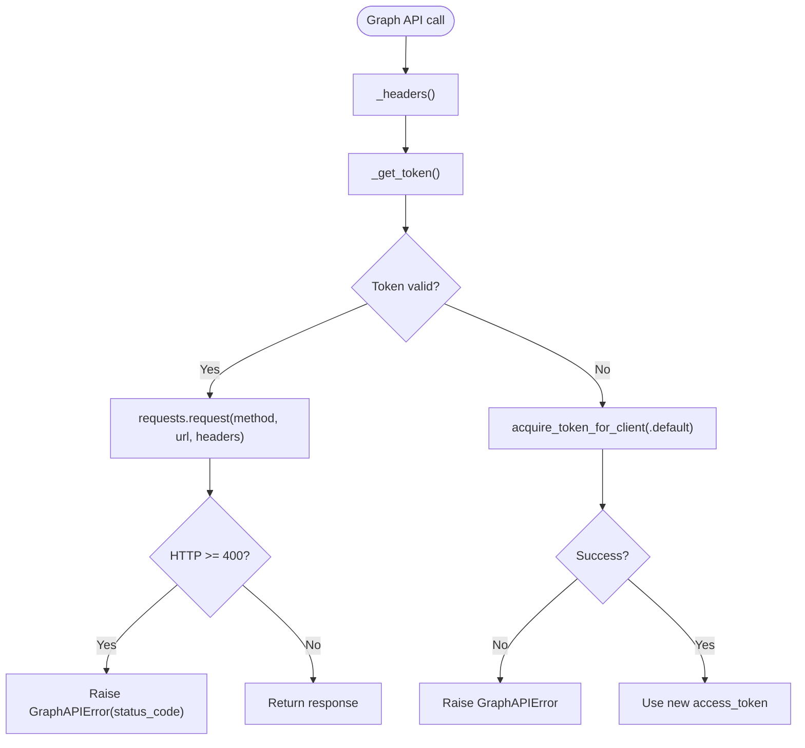
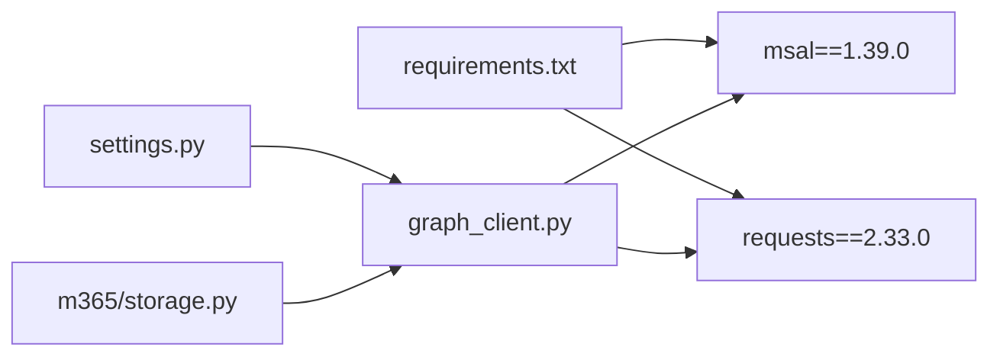

# Authentication & Authorization

<cite>
**Referenced Files in This Document**
- [graph_client.py](file://src/apps/m365/graph_client.py)
- [storage.py](file://src/apps/m365/storage.py)
- [models.py](file://src/apps/m365/models.py)
- [settings.py](file://src/config/settings.py)
- [middleware.py](file://src/apps/security/middleware.py)
- [storage.py](file://src/apps/security/storage.py)
- [requirements.txt](file://requirements.txt)
</cite>

## Table of Contents
1. [Introduction](#introduction)
2. [Project Structure](#project-structure)
3. [Core Components](#core-components)
4. [Architecture Overview](#architecture-overview)
5. [Detailed Component Analysis](#detailed-component-analysis)
6. [Dependency Analysis](#dependency-analysis)
7. [Performance Considerations](#performance-considerations)
8. [Troubleshooting Guide](#troubleshooting-guide)
9. [Conclusion](#conclusion)

## Introduction
This document explains how IHRMS integrates with Microsoft 365 and Azure Active Directory for authentication and authorization, focusing on the implemented Microsoft Graph client and storage layer. The current implementation uses an application-only OAuth 2.0 flow through MSAL to acquire a Microsoft Graph access token for server-side operations such as uploading, downloading, searching, and listing files in SharePoint or OneDrive. It does not implement interactive user login flows such as device code flow or authorization code flow; those are outside the current codebase scope.

The documentation covers:
- MSAL-based token acquisition using `ConfidentialClientApplication`.
- Configuration via environment variables and Django settings.
- Token caching and automatic refresh behavior.
- Storage routing between local filesystem and SharePoint/OneDrive.
- Security controls around sessions, CSRF, HTTPS, and private file access.
- Error handling for network issues, invalid configuration, and Graph API responses.
- Guidance for Azure AD app registration and permission scoping.

## Project Structure
The Microsoft 365 integration is primarily implemented under the `apps.m365` Django application, with supporting security middleware and storage abstractions:

**Diagram sources**
- [settings.py:281-332](file://src/config/settings.py#L281-L332)
- [storage.py:33-169](file://src/apps/m365/storage.py#L33-L169)
- [graph_client.py:57-126](file://src/apps/m365/graph_client.py#L57-L126)
- [storage.py:1-13](file://src/apps/security/storage.py#L1-L13)

**Section sources**
- [settings.py:281-332](file://src/config/settings.py#L281-L332)
- [storage.py:33-169](file://src/apps/m365/storage.py#L33-L169)
- [graph_client.py:57-126](file://src/apps/m365/graph_client.py#L57-L126)
- [storage.py:1-13](file://src/apps/security/storage.py#L1-L13)

## Core Components
- **GraphClient**: Encapsulates Microsoft Graph API calls, tenant/client credentials, site/drive resolution, file operations, search, and folder listing. It acquires tokens via MSAL and caches them per process.
- **SharePointStorage**: A Django `Storage` backend that routes file reads/writes to SharePoint/OneDrive through `GraphClient`.
- **ConfiguredStorage**: A migration-stable wrapper that chooses between local filesystem storage and SharePoint storage based on settings.
- **Settings**: Centralizes all Microsoft 365 configuration values, including tenant ID, client ID, client secret, SharePoint hostname/path, library name, folder mapping, and feature flags.
- **Security Middleware**: Enforces idle session logout, prevents caching of authenticated responses, and adds security headers.
- **Private File Storage**: Ensures local media URLs go through an application-controlled endpoint rather than direct filesystem exposure.

**Section sources**
- [graph_client.py:57-126](file://src/apps/m365/graph_client.py#L57-L126)
- [storage.py:33-169](file://src/apps/m365/storage.py#L33-L169)
- [settings.py:281-332](file://src/config/settings.py#L281-L332)
- [middleware.py:7-28](file://src/apps/security/middleware.py#L7-L28)
- [storage.py:1-13](file://src/apps/security/storage.py#L1-L13)

## Architecture Overview
IHRMS uses a server-side, application-only integration with Microsoft Graph. There is no interactive browser-based OAuth consent flow in this repository. Instead, the backend authenticates itself using configured credentials and obtains a Graph access token to perform operations on behalf of the application.

**Diagram sources**
- [graph_client.py:94-142](file://src/apps/m365/graph_client.py#L94-L142)
- [storage.py:46-69](file://src/apps/m365/storage.py#L46-L69)

## Detailed Component Analysis

### Microsoft Graph Client and Token Acquisition
`GraphClient` implements:
- Credential loading from Django settings (`M365_TENANT_ID`, `M365_CLIENT_ID`, `M365_CLIENT_SECRET`).
- Authority URL construction for Azure AD.
- Token acquisition using `msal.ConfidentialClientApplication.acquire_token_for_client` with the `.default` scope.
- In-process token caching with a safety margin before expiration.
- Thread-safe token refresh using a lock.
- HTTP request wrapping with default timeouts and error normalization into `GraphAPIError`.

**Diagram sources**
- [graph_client.py:94-120](file://src/apps/m365/graph_client.py#L94-L120)

**Section sources**
- [graph_client.py:26-28](file://src/apps/m365/graph_client.py#L26-L28)
- [graph_client.py:69-79](file://src/apps/m365/graph_client.py#L69-L79)
- [graph_client.py:94-126](file://src/apps/m365/graph_client.py#L94-L126)

### Storage Abstraction and SharePoint Routing
`SharePointStorage` adapts Django’s file operations to Microsoft Graph:
- `_save`: uploads bytes via `GraphClient.upload_file`.
- `_open`: downloads content via `GraphClient.download_file`.
- `exists`: delegates to `GraphClient.exists`.
- `delete`: delegates to `GraphClient.delete_file`.
- `size`: retrieves metadata via `GraphClient.get_metadata`.
- `url`: returns a private application URL instead of exposing raw SharePoint links.

`ConfiguredStorage` selects the backend dynamically:
- If `M365_STORAGE_ENABLED` is false, it falls back to local filesystem storage.
- If enabled, it resolves the SharePoint document library and maps internal paths to remote folders.
- It preserves legacy dispatch path mappings for compatibility.

**Diagram sources**
- [storage.py:33-169](file://src/apps/m365/storage.py#L33-L169)
- [graph_client.py:216-286](file://src/apps/m365/graph_client.py#L216-L286)

**Section sources**
- [storage.py:33-169](file://src/apps/m365/storage.py#L33-L169)
- [models.py:8-49](file://src/apps/m365/models.py#L8-L49)

### Configuration and Environment-Specific Behavior
Microsoft 365 configuration is loaded from environment variables and exposed through Django settings:
- Tenant, client, and secret identifiers.
- SharePoint hostname and site path.
- Feature flag `M365_STORAGE_ENABLED`.
- Default document library and folder mapping for different business features.
- Upload prefix mapping for legacy and new attachment routes.

Production guardrails include:
- HTTPS enforcement toggled by `ENABLE_HTTPS_ENFORCEMENT`.
- Strict checks for UAT/production environments requiring secure secrets, explicit allowed hosts, and disabled debug mode.
- Session cookie security flags and idle timeout controls.

**Diagram sources**
- [settings.py:28-100](file://src/config/settings.py#L28-L100)
- [settings.py:281-332](file://src/config/settings.py#L281-L332)

**Section sources**
- [settings.py:28-100](file://src/config/settings.py#L28-L100)
- [settings.py:281-332](file://src/config/settings.py#L281-L332)

### Security Controls and Session Management
Security middleware enforces:
- Idle session logout after `SESSION_IDLE_TIMEOUT`.
- No-cache headers for authenticated responses.
- Referrer policy and permissions policy headers.

Private file access:
- Local media URLs are routed through a dedicated view endpoint rather than direct filesystem paths.
- SharePoint-backed storage also returns private URLs for consistent access control.

**Diagram sources**
- [middleware.py:7-28](file://src/apps/security/middleware.py#L7-L28)
- [storage.py:1-13](file://src/apps/security/storage.py#L1-L13)

**Section sources**
- [middleware.py:7-28](file://src/apps/security/middleware.py#L7-L28)
- [storage.py:1-13](file://src/apps/security/storage.py#L1-L13)

### Azure AD App Registration and Permissions
The current implementation requires:
- An Azure AD app registration with application permissions (not delegated permissions).
- Admin consent granted by a Microsoft 365 administrator.
- Permissions sufficient for SharePoint and file operations, as indicated by the Graph client documentation comments.

Note: The repository comment references `Sites.ReadWrite.All` and `Files.ReadWrite.All`. It does not implement `User.Read` or `Mail.Send` scopes in the Graph client. Those scopes are not part of the current app-only token acquisition flow.

**Section sources**
- [graph_client.py:1-13](file://src/apps/m365/graph_client.py#L1-L13)

### Token Caching, Automatic Refresh, and Expired Credentials
- Tokens are cached in memory per process.
- A 60-second safety margin avoids using tokens near expiration.
- A threading lock ensures only one thread refreshes the token at a time.
- If token acquisition fails, a `GraphAPIError` with status code 503 is raised.
- Network errors are wrapped as `GraphAPIError` with status code 503.
- HTTP errors from Graph are propagated with their original status codes and optional retry-after hints.

**Diagram sources**
- [graph_client.py:122-142](file://src/apps/m365/graph_client.py#L122-L142)
- [graph_client.py:94-120](file://src/apps/m365/graph_client.py#L94-L120)

**Section sources**
- [graph_client.py:94-142](file://src/apps/m365/graph_client.py#L94-L142)

### Interactive Login Flows and User Consent
The repository does not implement:
- Device code flow.
- Authorization code flow.
- Redirect URI setup for browser-based OAuth.
- User consent UI or redirect handling.

The current flow is strictly server-side application authentication against Microsoft Graph. Any future interactive login would require additional views, URL routing, session state management, and MSAL user-token acquisition logic not present in the current codebase.

**Section sources**
- [graph_client.py:94-120](file://src/apps/m365/graph_client.py#L94-L120)

## Dependency Analysis
External dependencies relevant to authentication and storage:
- `msal`: Used to create `ConfidentialClientApplication` and acquire tokens.
- `requests`: Used for HTTP calls to Microsoft Graph.
- Django settings and middleware provide configuration and security posture.

**Diagram sources**
- [requirements.txt:15-16](file://requirements.txt#L15-L16)
- [graph_client.py:100-112](file://src/apps/m365/graph_client.py#L100-L112)
- [settings.py:281-332](file://src/config/settings.py#L281-L332)
- [storage.py:33-169](file://src/apps/m365/storage.py#L33-L169)

**Section sources**
- [requirements.txt:15-16](file://requirements.txt#L15-L16)
- [graph_client.py:100-112](file://src/apps/m365/graph_client.py#L100-L112)

## Performance Considerations
- Token caching reduces repeated authentication overhead within a process.
- Large file uploads use chunked upload sessions to avoid single-request limits.
- Folder listing includes pagination and a hard limit to prevent runaway traversal.
- Default HTTP timeout is applied unless explicitly overridden by callers.
- Site/drive ID lookups are cached in the client instance.

Recommendations:
- Monitor Graph API rate limits and handle `Retry-After` headers where applicable.
- Consider shared token cache strategies if running multiple worker processes.
- Tune chunk size and upload session timeouts according to network conditions.

[No sources needed since this section provides general guidance]

## Troubleshooting Guide
Common issues and handling:

- Missing Microsoft 365 configuration:
  - Symptom: Errors indicating missing tenant ID, client ID, or client secret.
  - Cause: Required environment variables not set.
  - Resolution: Configure `M365_TENANT_ID`, `M365_CLIENT_ID`, `M365_CLIENT_SECRET`.

- MSAL import failure:
  - Symptom: Error indicating missing `msal` library.
  - Cause: Dependency not installed.
  - Resolution: Install requirements including `msal`.

- Authentication failure with Graph:
  - Symptom: `GraphAPIError` with status code 503 during token acquisition.
  - Cause: Invalid credentials, missing admin consent, or service unavailable.
  - Resolution: Verify app registration, client secret, and admin consent.

- Network errors:
  - Symptom: `GraphAPIError` wrapping `requests.RequestException`.
  - Cause: Connectivity issues or DNS failures.
  - Resolution: Check network connectivity and proxy configuration.

- SharePoint library not found:
  - Symptom: Error indicating document library not found.
  - Cause: Incorrect `M365_SHAREPOINT_LIBRARY` or mismatched library name.
  - Resolution: Confirm the exact display name of the SharePoint Document Library.

- Invalid token or expired credentials:
  - Symptom: HTTP 401/403 from Graph.
  - Cause: Token expired or insufficient permissions.
  - Resolution: Ensure token refresh occurs and required application permissions are granted.

- Session and CSRF concerns:
  - Symptom: Users logged out unexpectedly or CSRF validation errors.
  - Cause: Idle timeout or misconfigured trusted origins.
  - Resolution: Adjust `SESSION_IDLE_TIMEOUT`, verify `CSRF_TRUSTED_ORIGINS`, and ensure HTTPS enforcement is correctly configured in production.

**Section sources**
- [graph_client.py:87-120](file://src/apps/m365/graph_client.py#L87-L120)
- [graph_client.py:128-142](file://src/apps/m365/graph_client.py#L128-L142)
- [settings.py:42-100](file://src/config/settings.py#L42-L100)

## Conclusion
IHRMS currently implements a robust, server-side Microsoft Graph integration using MSAL’s application-only flow. It focuses on secure, configurable, and maintainable file operations against SharePoint/OneDrive, with strong attention to token caching, error normalization, and private file access. Interactive user authentication flows such as device code or authorization code flows are not implemented in this repository. For production deployments, administrators must configure environment variables, grant admin consent for application permissions, and enforce HTTPS and session security policies as defined in Django settings.

[No sources needed since this section summarizes without analyzing specific files]