# Graph API Integration

<cite>
**Referenced Files in This Document**
- [graph_client.py](file://src/apps/m365/graph_client.py)
- [storage.py](file://src/apps/m365/storage.py)
- [tests.py](file://src/apps/m365/tests.py)
- [m365_search.py](file://src/apps/assistant/m365_search.py)
- [views.py](file://src/apps/assistant/views.py)
</cite>

## Table of Contents
1. [Introduction](#introduction)
2. [Project Structure](#project-structure)
3. [Core Components](#core-components)
4. [Architecture Overview](#architecture-overview)
5. [Detailed Component Analysis](#detailed-component-analysis)
6. [Dependency Analysis](#dependency-analysis)
7. [Performance Considerations](#performance-considerations)
8. [Troubleshooting Guide](#troubleshooting-guide)
9. [Conclusion](#conclusion)

## Introduction
This document explains the Microsoft Graph API integration used by IHRMS to access SharePoint and OneDrive resources through an application-only token. The implementation centers on a `GraphClient` class that handles authentication, HTTP requests, file operations, folder traversal, and site-scoped search. It also documents how the assistant layer uses this client for secure, policy-driven document search across configured SharePoint libraries.

The current codebase focuses on:
- Application-only authentication via Microsoft Entra ID (formerly Azure AD).
- File upload, download, deletion, existence checks, metadata retrieval, and web URL resolution.
- Site-scoped drive search and recursive folder listing with pagination and boundary validation.
- Django storage backend selection between local filesystem and SharePoint.
- Assistant search flow with fallback from index-based search to directory listing when needed.

User profile synchronization for employees, departments, organizational hierarchy, emails, and calendar events is not implemented in the analyzed files. The integration currently targets SharePoint/OneDrive resources rather than Microsoft 365 identity or mailbox APIs.

## Project Structure
The Graph API integration lives under the `apps/m365` package and is consumed by the assistant feature for document search and by Django models for file storage.

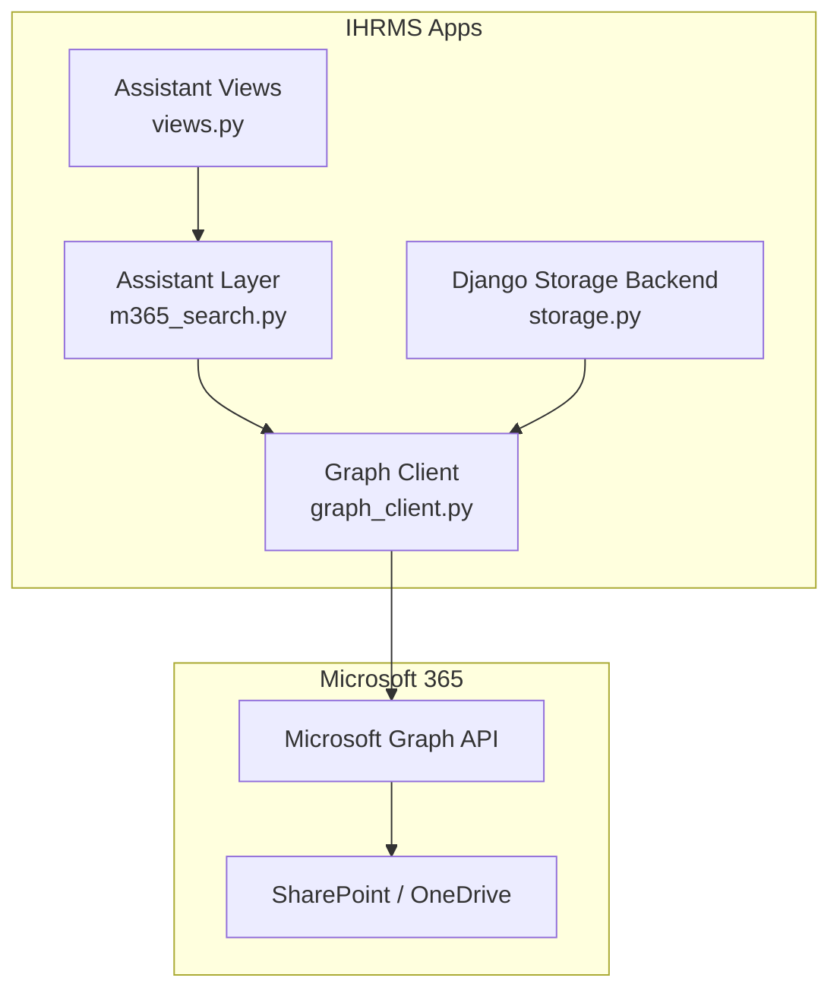

**Diagram sources**
- [m365_search.py:1-423](file://src/apps/assistant/m3365_search.py#L1-L423)
- [views.py:102-135](file://src/apps/assistant/views.py#L102-L135)
- [storage.py:1-169](file://src/apps/m365/storage.py#L1-L169)
- [graph_client.py:1-404](file://src/apps/m365/graph_client.py#L1-L404)

**Section sources**
- [graph_client.py:1-404](file://src/apps/m365/graph_client.py#L1-L404)
- [storage.py:1-169](file://src/apps/m365/storage.py#L1-L169)
- [m365_search.py:1-423](file://src/apps/assistant/m365_search.py#L1-L423)
- [views.py:102-135](file://src/apps/assistant/views.py#L102-L135)

## Core Components
- `GraphClient`: Encapsulates Microsoft Graph API calls, token caching, site/drive discovery, file operations, search, and folder listing.
- `GraphAPIError` and `GraphNotConfigured`: Domain-specific exceptions for network/auth/configuration failures.
- `SharePointStorage` and `ConfiguredStorage`: Django storage adapters that route file operations to local disk or SharePoint depending on configuration.
- `search_sharepoint`: Assistant logic that builds queries, selects allowed folders, performs Graph search, and falls back to recursive listing when necessary.
- Assistant view endpoint that reauthorizes signed search results before reading files through the app-only Graph client.

Key responsibilities:
- Authentication uses `msal.ConfidentialClientApplication` with client credentials and caches the access token per process.
- HTTP requests are wrapped with timeout defaults, error mapping, and retry-after header extraction.
- Drive and site boundaries are enforced to prevent leaking files from other SharePoint sites.
- Large file uploads use chunked upload sessions; small files use direct PUT.
- Search is limited to the configured site prefix and configured library.
- Folder listing supports pagination, recursion, remote shortcut filtering, and next-link boundary validation.

**Section sources**
- [graph_client.py:44-142](file://src/apps/m365/graph_client.py#L44-L142)
- [graph_client.py:147-287](file://src/apps/m365/graph_client.py#L147-L287)
- [graph_client.py:289-392](file://src/apps/m365/graph_client.py#L289-L392)
- [storage.py:33-73](file://src/apps/m365/storage.py#L33-L73)
- [storage.py:84-169](file://src/apps/m365/storage.py#L84-L169)
- [m365_search.py:52-63](file://src/apps/assistant/m365_search.py#L52-L63)
- [m365_search.py:329-423](file://src/apps/assistant/m365_search.py#L329-L423)

## Architecture Overview
The integration follows a layered approach:
1. Assistant UI/API receives a natural-language query.
2. Query parsing determines document type, keywords, date filters, and target folders.
3. Policy checks determine which SharePoint folders the user may access.
4. `GraphClient` authenticates and calls Microsoft Graph.
5. Results are filtered by site and folder boundaries, then scored and returned.

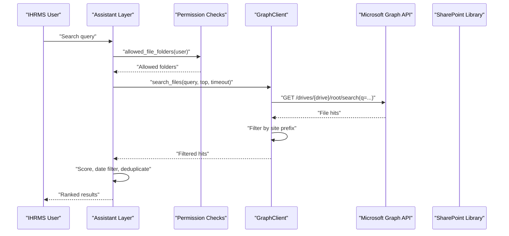

**Diagram sources**
- [m365_search.py:289-423](file://src/apps/assistant/m365_search.py#L289-L423)
- [graph_client.py:329-340](file://src/apps/m365/graph_client.py#L329-L340)

## Detailed Component Analysis

### GraphClient Implementation
`GraphClient` provides:
- Configuration validation (`is_configured`, `_require_configured`).
- Token acquisition and caching using `msal`.
- Centralized HTTP request handling with default timeouts and error mapping.
- Site and drive discovery with in-process caching.
- File operations: upload, download, delete, exists, metadata, web URL.
- Search and folder listing with site-scoped filtering and pagination.

#### Authentication and Token Caching
Authentication uses the client credentials flow:
- Authority URL is built from tenant ID.
- Scope is the default Graph scope.
- Access token is cached until near expiration.
- Missing MSAL dependency raises a clear error.

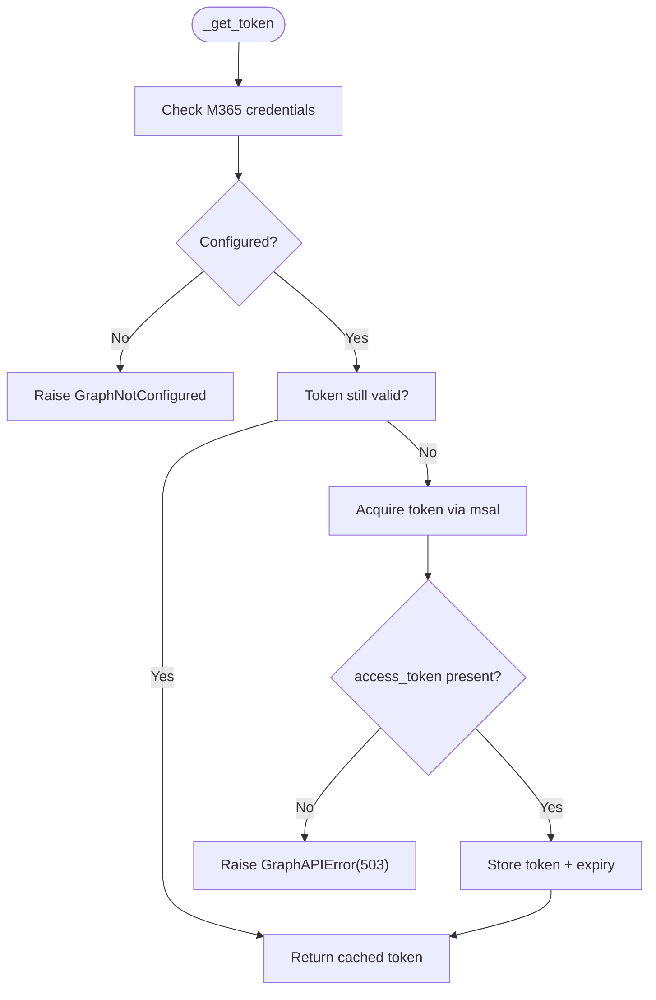

**Diagram sources**
- [graph_client.py:94-120](file://src/apps/m365/graph_client.py#L94-L120)

**Section sources**
- [graph_client.py:69-126](file://src/apps/m365/graph_client.py#L69-L126)

#### HTTP Request Handling and Error Mapping
All outbound calls go through `_request`:
- Default timeout is applied unless explicitly overridden.
- Network errors map to `GraphAPIError(503)`.
- HTTP status codes >= 400 raise `GraphAPIError` with status code and optional `Retry-After`.

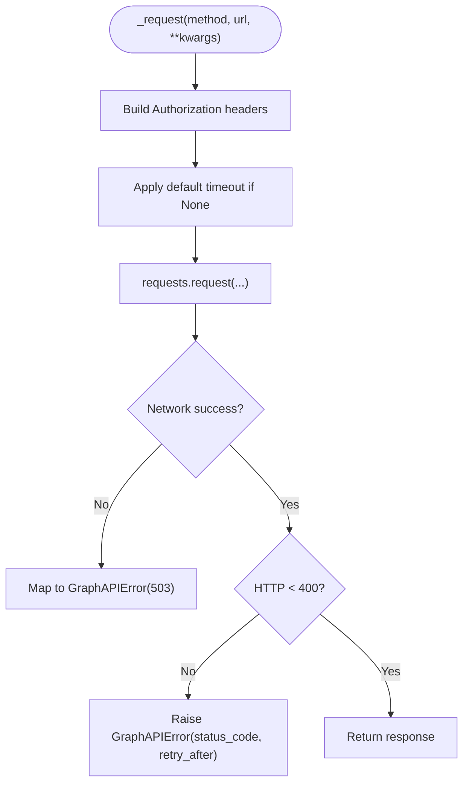

**Diagram sources**
- [graph_client.py:128-142](file://src/apps/m365/graph_client.py#L128-L142)

**Section sources**
- [graph_client.py:128-142](file://src/apps/m365/graph_client.py#L128-L142)

#### Site and Drive Discovery
- `site_id` resolves the configured SharePoint site hostname and path.
- `_drive_id` finds a Document Library by display name within the site.
- Both values are cached in-process to avoid repeated lookups.

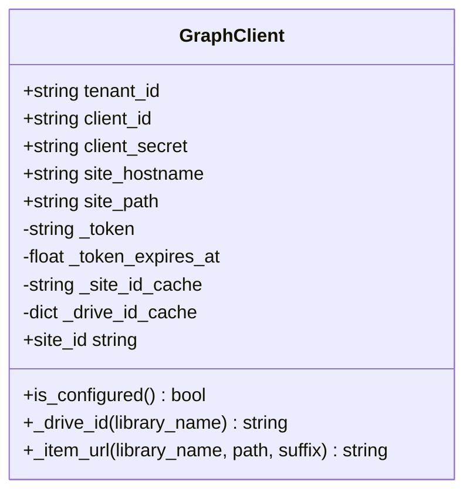

**Diagram sources**
- [graph_client.py:69-80](file://src/apps/m365/graph_client.py#L69-L80)
- [graph_client.py:147-180](file://src/apps/m365/graph_client.py#L147-L180)

**Section sources**
- [graph_client.py:147-180](file://src/apps/m365/graph_client.py#L147-L180)

#### File Operations
- `upload_file`: Creates missing parent folders, chooses simple PUT for small files, or chunked upload session for large files.
- `download_file`: Streams content via GET.
- `delete_file`: Ignores 404; raises other errors.
- `exists`: Returns boolean based on GET result.
- `get_metadata`: Returns Graph metadata dict.
- `get_web_url`: Resolves browser link.

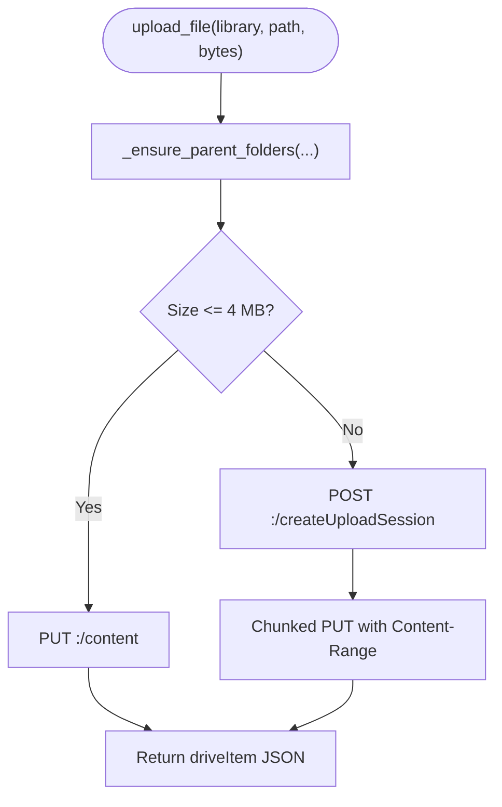

**Diagram sources**
- [graph_client.py:216-260](file://src/apps/m365/graph_client.py#L216-L260)

**Section sources**
- [graph_client.py:182-287](file://src/apps/m365/graph_client.py#L182-L287)

#### Search Capabilities
`search_files` searches the configured drive:
- Escapes and truncates the query.
- Uses `/drives/{drive}/root/search(q=...)`.
- Filters results to the configured site prefix.
- Returns normalized file entries with name, web URL, and last modified time.

Query syntax and filtering:
- The implementation uses Graph’s drive search query parameter.
- No advanced OData-style filters are constructed here; filtering is performed locally by site prefix and folder allowlist in the assistant layer.

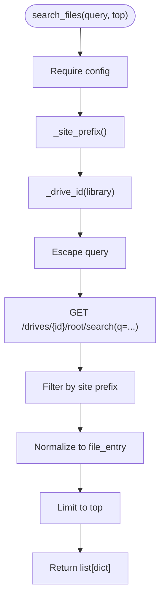

**Diagram sources**
- [graph_client.py:298-340](file://src/apps/m365/graph_client.py#L298-L340)

**Section sources**
- [graph_client.py:298-340](file://src/apps/m365/graph_client.py#L298-L340)

#### Folder Listing and Pagination
`list_folder_files`:
- Lists children of a folder or library root.
- Skips remote shortcuts.
- Supports recursive traversal into subfolders.
- Enforces next-link boundary to prevent following links outside the configured drive.
- Stops after a bounded number of requests to avoid unbounded traversal.

Pagination support:
- Uses `$top` with a page size constant.
- Follows `@odata.nextLink` only if it starts with the expected drive boundary.

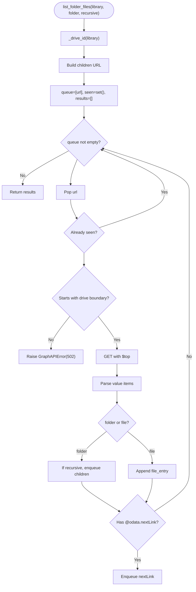

**Diagram sources**
- [graph_client.py:342-373](file://src/apps/m365/graph_client.py#L342-L373)

**Section sources**
- [graph_client.py:342-373](file://src/apps/m365/graph_client.py#L342-L373)

### Django Storage Backend
`SharePointStorage` adapts Django’s storage interface to Graph operations:
- `_save` uploads content.
- `_open` downloads content into a Django `ContentFile`.
- `exists`, `delete`, `size`, and `url` delegate to `GraphClient` or security utilities.

`ConfiguredStorage` selects between local filesystem and SharePoint:
- Reads `M365_STORAGE_ENABLED`.
- Applies upload prefix and folder mapping for stable migration paths.
- Routes all storage methods to the selected backend.

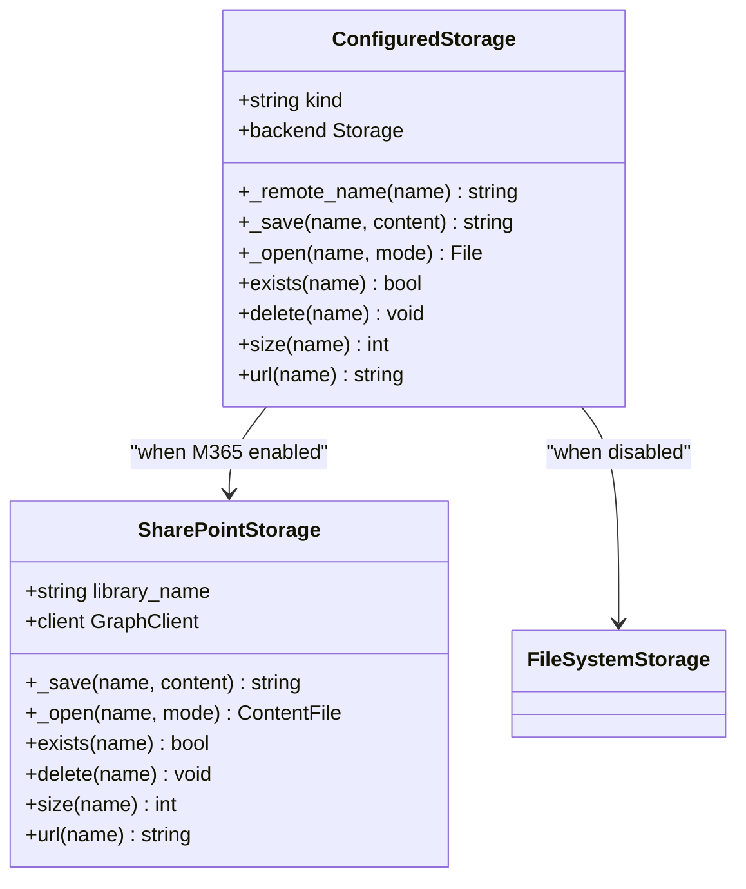

**Diagram sources**
- [storage.py:33-73](file://src/apps/m365/storage.py#L33-L73)
- [storage.py:84-169](file://src/apps/m365/storage.py#L84-L169)

**Section sources**
- [storage.py:33-73](file://src/apps/m365/storage.py#L33-L73)
- [storage.py:84-169](file://src/apps/m365/storage.py#L84-L169)

### Assistant Search Flow
`search_sharepoint` coordinates:
- Feature flag check (`M365_STORAGE_ENABLED`).
- User permission checks.
- Folder selection based on document type and policy.
- Query building and execution.
- Fallback from index search to recursive listing when search is denied or returns no usable results.
- Date filtering and scoring against local criteria.

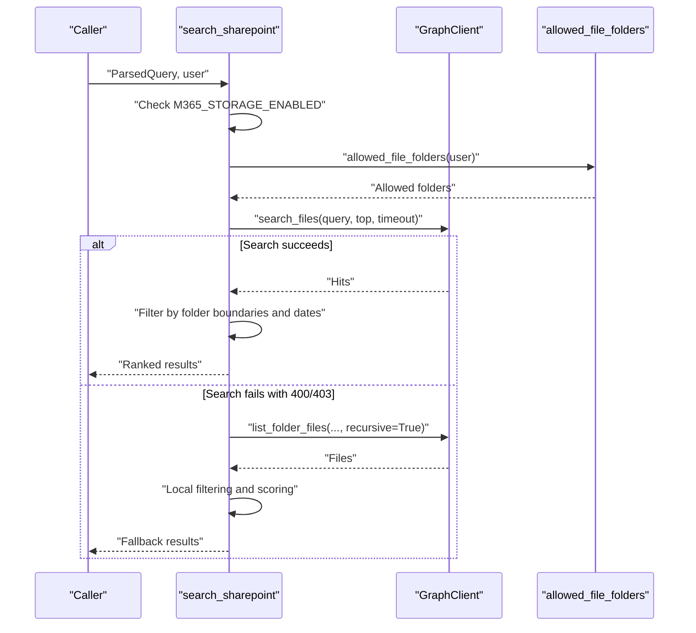

**Diagram sources**
- [m365_search.py:329-423](file://src/apps/assistant/m365_search.py#L329-L423)
- [graph_client.py:329-373](file://src/apps/m365/graph_client.py#L329-L373)

**Section sources**
- [m365_search.py:329-423](file://src/apps/assistant/m365_search.py#L329-L423)

### Assistant View Endpoint
The assistant view endpoint reauthorizes signed search results before allowing read access through the app-only Graph client. It validates:
- Storage feature flag.
- User permission to query SharePoint.
- Signed token integrity and location.
- Allowed folders for the requesting user.

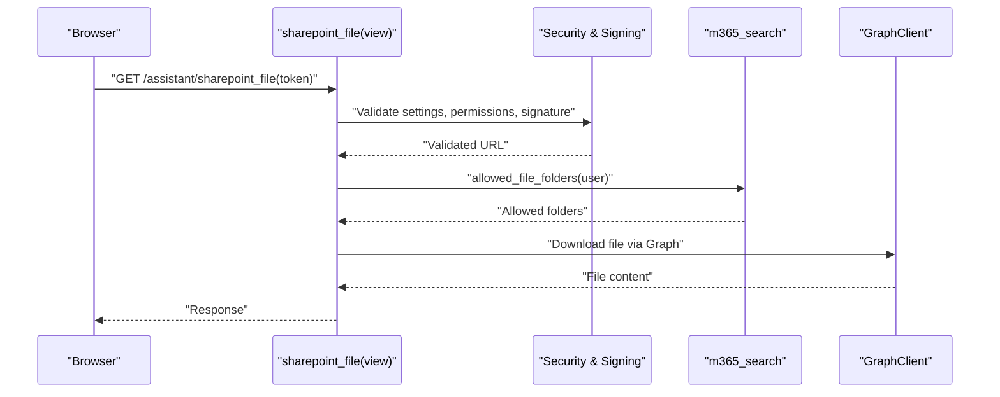

**Diagram sources**
- [views.py:102-135](file://src/apps/assistant/views.py#L102-L135)
- [m365_search.py:309-326](file://src/apps/assistant/m365_search.py#L309-L326)

**Section sources**
- [views.py:102-135](file://src/apps/assistant/views.py#L102-L135)

## Dependency Analysis
The integration has clear boundaries:
- `graph_client.py` depends on Django settings, `requests`, and optionally `msal`.
- `storage.py` depends on `graph_client.py` and Django storage abstractions.
- `m365_search.py` depends on `graph_client.py`, Django settings, and security/permission helpers.
- Tests validate behavior without hitting real networks by mocking `_request`, `_drive_id`, and `get_graph_client`.

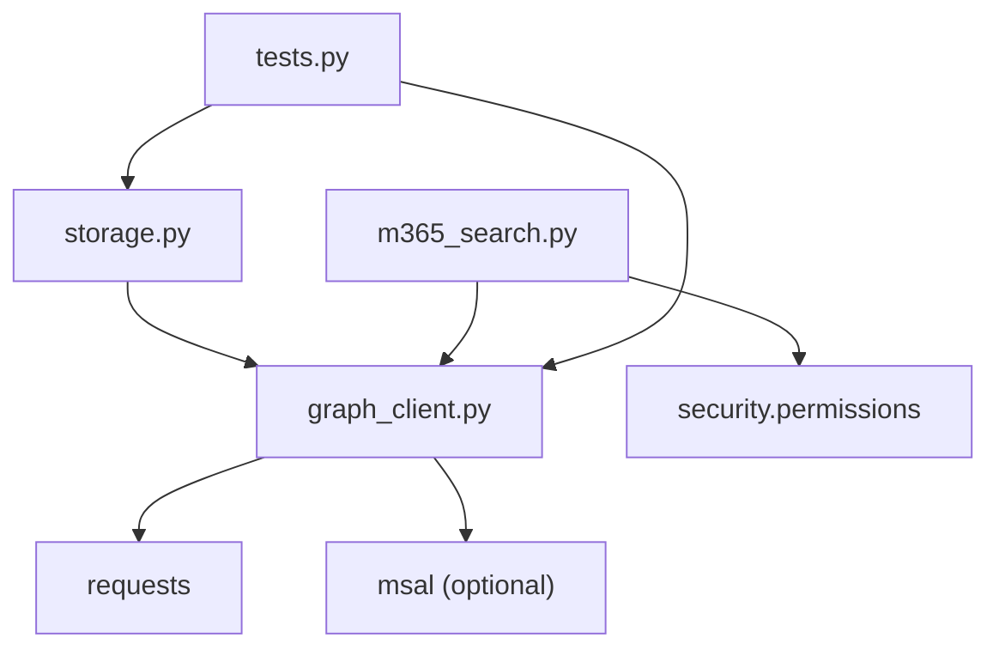

**Diagram sources**
- [graph_client.py:14-28](file://src/apps/m365/graph_client.py#L14-L28)
- [storage.py:23-31](file://src/apps/m365/storage.py#L23-L31)
- [m365_search.py:15-21](file://src/apps/assistant/m365_search.py#L15-L21)
- [tests.py:1-10](file://src/apps/m365/tests.py#L1-L10)

**Section sources**
- [graph_client.py:14-28](file://src/apps/m365/graph_client.py#L14-L28)
- [storage.py:23-31](file://src/apps/m365/storage.py#L23-L31)
- [m365_search.py:15-21](file://src/apps/assistant/m365_search.py#L15-L21)
- [tests.py:1-10](file://src/apps/m365/tests.py#L1-L10)

## Performance Considerations
- Token caching reduces repeated authentication overhead.
- Site and drive IDs are cached in-process.
- Small file uploads use direct PUT; large files use chunked sessions to improve reliability.
- Folder listing uses a bounded queue and stops after a maximum number of requests to avoid excessive traversal.
- Assistant search uses a short timeout for chat interactions to prevent long-running worker blocking.
- Result scoring and filtering occur locally after Graph returns data, minimizing additional API calls.

Recommendations:
- Keep `M365_SHAREPOINT_LIBRARY` and `M365_FOLDER_MAP` accurate to reduce failed lookups.
- Use specific queries to limit Graph search scope.
- Avoid recursive listing over very deep hierarchies unless necessary.
- Prefer targeted folder roots for frequent queries.

[No sources needed since this section provides general guidance]

## Troubleshooting Guide

Common issues and resolutions:
- Missing configuration:
  - Symptoms: `GraphNotConfigured` raised during token acquisition, site lookup, or search.
  - Causes: Missing tenant/client credentials or SharePoint hostname/path/library configuration.
  - Resolution: Set `M365_TENANT_ID`, `M365_CLIENT_ID`, `M365_CLIENT_SECRET`, `M365_SHAREPOINT_HOSTNAME`, `M365_SHAREPOINT_SITE_PATH`, and `M365_SHAREPOINT_LIBRARY`.

- Authentication failure:
  - Symptoms: `GraphAPIError(503)` indicating authentication did not return an access token.
  - Causes: Invalid client credentials, missing admin consent, or unavailable service.
  - Resolution: Verify app registration, scopes, and admin consent; ensure MSAL is installed.

- Permission denial:
  - Symptoms: Graph returns 403; assistant search falls back to directory listing or returns restricted/unavailable notes.
  - Causes: App lacks required permissions or user lacks folder access.
  - Resolution: Grant appropriate Graph permissions and configure folder allowlists.

- Throttling and rate limiting:
  - Symptoms: HTTP 429 or other throttling responses; `Retry-After` header present.
  - Current behavior: Errors are raised with status code and retry-after value; explicit retry/backoff is not implemented in `_request`.
  - Resolution: Implement caller-side retry with exponential backoff using `retry_after`; reduce request frequency; batch operations where possible.

- Malformed requests:
  - Symptoms: HTTP 400 from Graph; assistant search falls back to listing.
  - Causes: Query too long or unsupported syntax.
  - Resolution: Truncate and normalize queries; rely on fallback listing when index search is rejected.

- Pagination and boundary errors:
  - Symptoms: `GraphAPIError(502)` during folder listing.
  - Causes: Next link points outside the configured drive or too many pages traversed.
  - Resolution: Validate drive configuration; avoid overly broad recursive listings.

- File not found:
  - Symptoms: `exists` returns false; delete ignores 404.
  - Causes: Path mismatch or deleted resource.
  - Resolution: Verify library name, folder path, and encoding.

**Section sources**
- [graph_client.py:44-142](file://src/apps/m365/graph_client.py#L44-L142)
- [graph_client.py:147-180](file://src/apps/m365/graph_client.py#L147-L180)
- [graph_client.py:342-373](file://src/apps/m365/graph_client.py#L342-L373)
- [m365_search.py:329-423](file://src/apps/assistant/m365_search.py#L329-L423)

## Conclusion
The IHRMS Graph API integration provides a robust, site-scoped interface to SharePoint and OneDrive through an application-only token. `GraphClient` centralizes authentication, HTTP handling, file operations, search, and folder traversal, while `storage.py` integrates these capabilities into Django’s storage model. The assistant layer adds policy-aware search with fallback mechanisms to ensure resilience when index search is unavailable.

Current scope does not include user profile synchronization, department data, organizational hierarchy, email, or calendar event access. Future enhancements could extend `GraphClient` to support those resources while maintaining strict boundary validation, rate-limit handling, and efficient pagination strategies.

[No sources needed since this section summarizes without analyzing specific files]