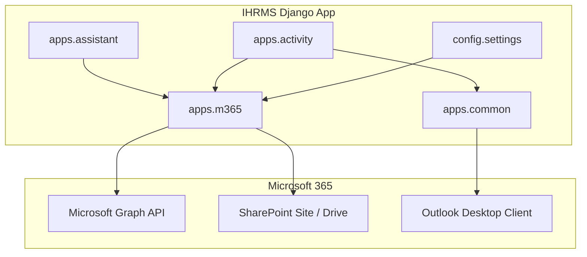
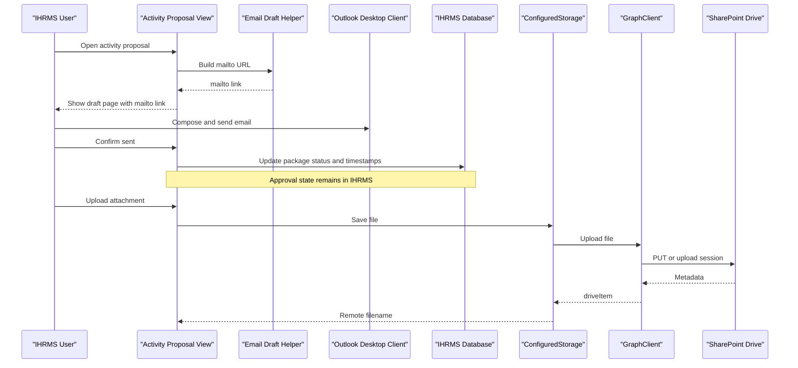
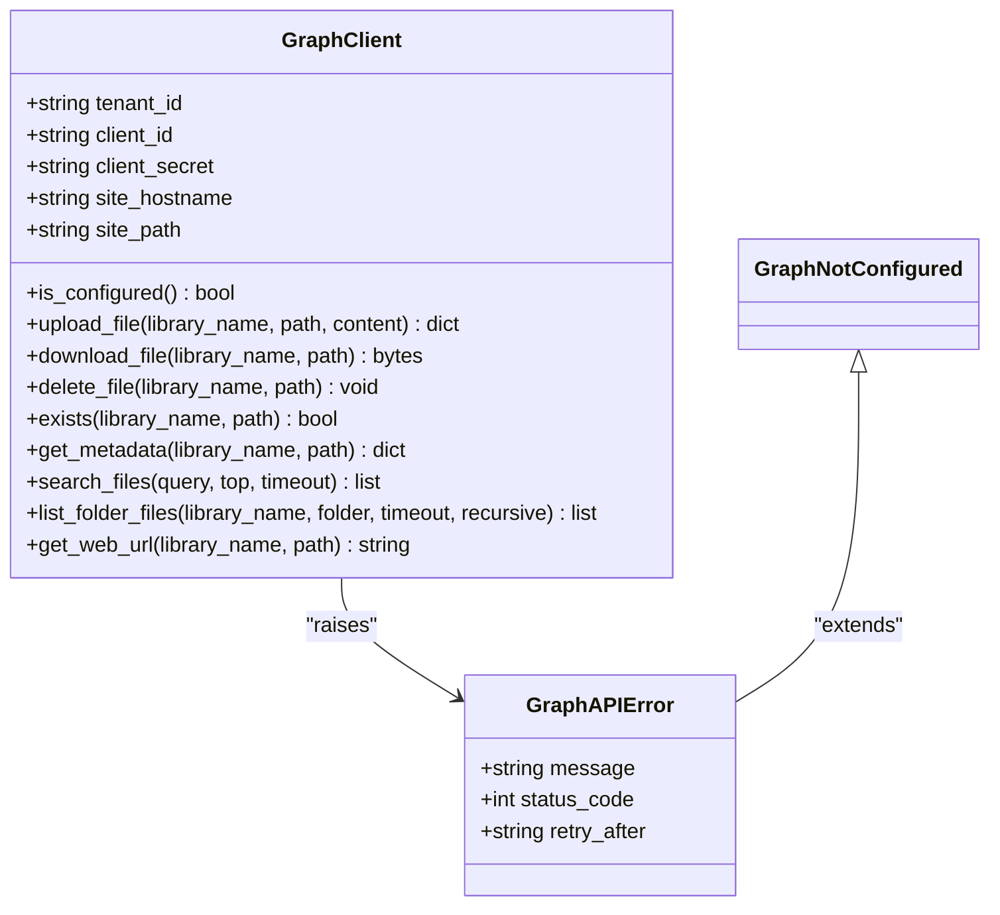
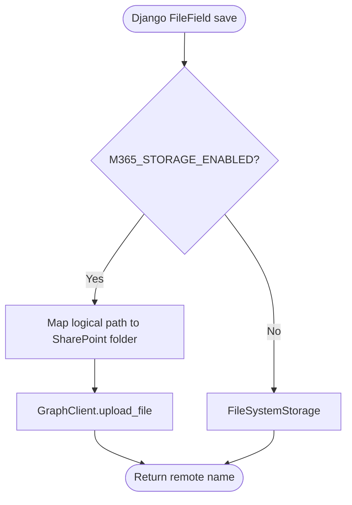
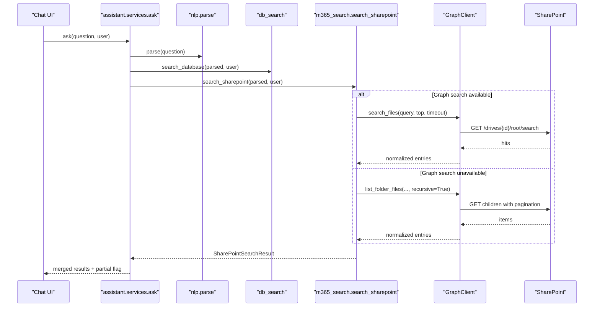
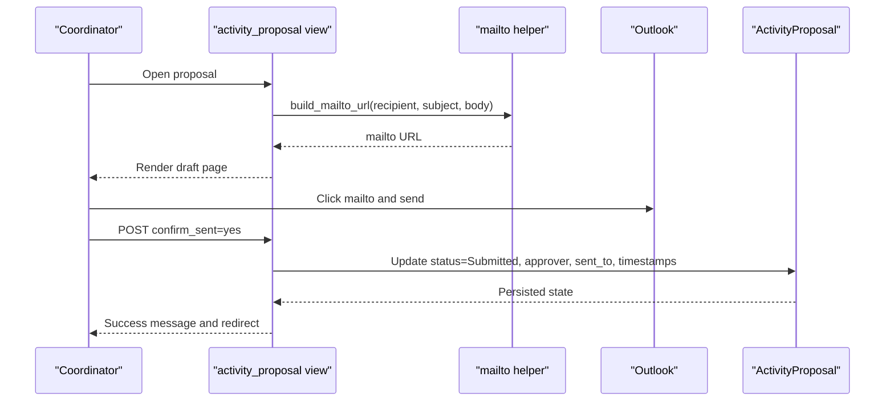
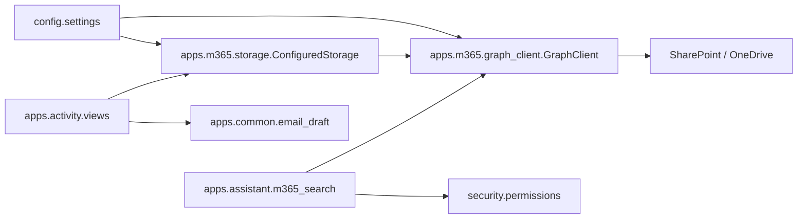

# Microsoft 365 Integration

<cite>
**Referenced Files in This Document**
- [graph_client.py](file://src/apps/m365/graph_client.py)
- [storage.py](file://src/apps/m365/storage.py)
- [models.py](file://src/apps/m365/models.py)
- [apps.py](file://src/apps/m365/apps.py)
- [m365_search.py](file://src/apps/assistant/m365_search.py)
- [services.py](file://src/apps/assistant/services.py)
- [email_draft.py](file://src/apps/common/email_draft.py)
- [views.py](file://src/apps/activity/views.py)
- [settings.py](file://src/config/settings.py)
- [README.md](file://README.md)
</cite>

## Table of Contents
1. [Introduction](#introduction)
2. [Project Structure](#project-structure)
3. [Core Components](#core-components)
4. [Architecture Overview](#architecture-overview)
5. [Detailed Component Analysis](#detailed-component-analysis)
6. [Dependency Analysis](#dependency-analysis)
7. [Performance Considerations](#performance-considerations)
8. [Troubleshooting Guide](#troubleshooting-guide)
9. [Conclusion](#conclusion)
10. [Appendices](#appendices)

## Introduction
This document explains the Microsoft 365 integration implemented in IHRMS. It covers Graph API connectivity for SharePoint storage, assistant-driven search across Microsoft 365 resources, and Outlook-assisted approval workflows where users compose emails in Outlook while approval state remains in IHRMS. The implementation uses an app-only client credentials flow with MSAL to obtain a Microsoft Graph access token, caches it per process, and performs file operations against a configured SharePoint site. Authentication is not user-interaction-based; therefore, Azure AD application permissions are required rather than delegated permissions.

The repository README notes that IHRMS currently does not automatically send email through a server; users compose and send approval emails in their desktop Outlook client, and IHRMS records confirmation after they return. SharePoint storage must be explicitly enabled and configured separately from local media storage.

**Section sources**
- [README.md:34-47](file://README.md#L34-L47)

## Project Structure
The Microsoft 365 integration lives under `src/apps/m365` and is consumed by other features such as the assistant search layer and activity proposal workflows.

**Diagram sources**
- [apps.py:4-7](file://src/apps/m365/apps.py#L4-L7)
- [graph_client.py:1-13](file://src/apps/m365/graph_client.py#L1-L13)
- [storage.py:1-22](file://src/apps/m365/storage.py#L1-L22)
- [m365_search.py:1-7](file://src/apps/assistant/m365_search.py#L1-L7)
- [email_draft.py:1-10](file://src/apps/common/email_draft.py#L1-L10)
- [settings.py:281-332](file://src/config/settings.py#L281-L332)

**Section sources**
- [apps.py:4-7](file://src/apps/m365/apps.py#L4-L7)
- [settings.py:281-332](file://src/config/settings.py#L281-L332)

## Core Components
- GraphClient: A thin wrapper around Microsoft Graph API using app-only authentication via MSAL. It manages tokens, site/drive discovery, folder creation, file upload/download/delete, metadata retrieval, search, and folder listing.
- SharePointStorage and ConfiguredStorage: Django storage adapters that route file operations to SharePoint when enabled, or fall back to local filesystem storage otherwise. They map logical storage kinds to SharePoint folders and library names.
- CompanyMedia model: Demonstrates how a Django model stores only metadata in SQL Server while the actual file is stored on SharePoint/OneDrive through the configured storage adapter.
- Assistant SharePoint search: Parses natural-language queries, selects allowed folders based on user permissions, tries Graph search first, and falls back to recursive folder listing when needed.
- Outlook-assisted workflow: Activity proposal views generate mailto drafts and track submission state in IHRMS after the user confirms sending from Outlook.

**Section sources**
- [graph_client.py:44-126](file://src/apps/m365/graph_client.py#L44-L126)
- [storage.py:33-169](file://src/apps/m365/storage.py#L33-L169)
- [models.py:8-49](file://src/apps/m365/models.py#L8-L49)
- [m365_search.py:52-423](file://src/apps/assistant/m365_search.py#L52-L423)
- [views.py:280-321](file://src/apps/activity/views.py#L280-L321)

## Architecture Overview
The integration follows a layered approach:
- Configuration layer reads tenant, client, secret, hostname, site path, library name, folder mapping, and feature flags from Django settings.
- Storage layer abstracts file operations behind Django’s storage interface.
- Graph client handles authentication, HTTP requests, token caching, and Graph endpoints.
- Assistant layer composes search strategies and enforces security boundaries before calling Graph.
- Workflow layer integrates with Outlook through mailto links and maintains state in IHRMS.

**Diagram sources**
- [views.py:280-321](file://src/apps/activity/views.py#L280-L321)
- [email_draft.py:5-9](file://src/apps/common/email_draft.py#L5-L9)
- [storage.py:46-49](file://src/apps/m365/storage.py#L46-L49)
- [graph_client.py:216-260](file://src/apps/m365/graph_client.py#L216-L260)

## Detailed Component Analysis

### Graph API Connectivity and Token Management
GraphClient implements:
- App-only authentication using MSAL ConfidentialClientApplication with scopes set to the default Graph scope.
- Process-scoped access token cache with a safety margin before expiration.
- Thread-safe token acquisition using a lock.
- HTTP request wrapper that applies bearer tokens, sets default timeouts, and converts network errors and HTTP errors into GraphAPIError with optional retry-after information.
- Site and drive discovery with cached identifiers.
- Folder creation for missing parents before uploads.
- Simple PUT upload for files up to 4 MB and chunked upload sessions for larger files.
- File existence checks, download, delete, metadata retrieval, web URL resolution.
- Search restricted to the configured site prefix and drive, plus recursive folder listing with pagination and boundary validation.

**Diagram sources**
- [graph_client.py:44-126](file://src/apps/m365/graph_client.py#L44-L126)
- [graph_client.py:147-180](file://src/apps/m365/graph_client.py#L147-L180)
- [graph_client.py:216-260](file://src/apps/m365/graph_client.py#L216-L260)
- [graph_client.py:262-391](file://src/apps/m365/graph_client.py#L262-L391)

**Section sources**
- [graph_client.py:1-126](file://src/apps/m365/graph_client.py#L1-L126)
- [graph_client.py:147-180](file://src/apps/m365/graph_client.py#L147-L180)
- [graph_client.py:216-260](file://src/apps/m365/graph_client.py#L216-L260)
- [graph_client.py:262-391](file://src/apps/m365/graph_client.py#L262-L391)

### SharePoint Storage and Django Integration
SharePointStorage adapts GraphClient to Django’s Storage API:
- `_save` uploads bytes to SharePoint.
- `_open` downloads bytes and wraps them in a ContentFile.
- `exists`, `delete`, `size`, and `url` delegate to GraphClient or private file URL helpers.
- ConfiguredStorage chooses between FileSystemStorage and SharePointStorage based on `M365_STORAGE_ENABLED`.
- Path mapping supports legacy dispatch routes and feature-specific folders through `M365_FOLDER_MAP` and `M365_UPLOAD_PREFIX_MAP`.

**Diagram sources**
- [storage.py:33-76](file://src/apps/m365/storage.py#L33-L76)
- [storage.py:79-169](file://src/apps/m365/storage.py#L79-L169)
- [settings.py:296-332](file://src/config/settings.py#L296-L332)

**Section sources**
- [storage.py:33-169](file://src/apps/m365/storage.py#L33-L169)
- [settings.py:296-332](file://src/config/settings.py#L296-L332)

### Models and Metadata Separation
CompanyMedia demonstrates the architecture where SQL Server holds metadata and SharePoint holds binary content:
- Fields include title, description, media type, category, department relationship, and a FileField backed by `get_storage("assets")`.
- The docstring emphasizes compliance with the solution architecture: database stores metadata only.

**Section sources**
- [models.py:8-49](file://src/apps/m365/models.py#L8-L49)
- [storage.py:1-22](file://src/apps/m365/storage.py#L1-L22)

### Assistant Search Across Microsoft 365 Resources
Assistant search composes results from the database and SharePoint:
- Parses natural language into structured filters.
- Determines allowed folders based on user roles and permissions.
- Attempts Graph search with a bounded query length and short timeout.
- Falls back to recursive folder listing when search fails or returns no relevant results.
- Enforces strict origin and path validation to prevent cross-site leakage.
- Returns partial status notes for unavailable or fallback conditions.

**Diagram sources**
- [services.py:46-118](file://src/apps/assistant/services.py#L46-L118)
- [m365_search.py:231-423](file://src/apps/assistant/m365_search.py#L231-L423)
- [graph_client.py:329-387](file://src/apps/m365/graph_client.py#L329-L387)

**Section sources**
- [services.py:1-118](file://src/apps/assistant/services.py#L1-L118)
- [m365_search.py:52-423](file://src/apps/assistant/m365_search.py#L52-L423)

### Outlook-Assisted Approval Workflows
Activity proposal workflows use Outlook as the email client:
- A mailto helper builds a properly encoded mailto URL without sending mail.
- The view renders a draft page with recipient, subject, body, and PDF attachment links.
- After the user sends the email in Outlook, they confirm in IHRMS, which updates the proposal package status, approver, sender email, timestamps, and triggers notifications.

**Diagram sources**
- [email_draft.py:5-9](file://src/apps/common/email_draft.py#L5-L9)
- [views.py:280-321](file://src/apps/activity/views.py#L280-L321)

**Section sources**
- [email_draft.py:1-10](file://src/apps/common/email_draft.py#L1-L10)
- [views.py:280-321](file://src/apps/activity/views.py#L280-L321)

## Dependency Analysis
The integration has clear dependency boundaries:
- Settings provide configuration values for tenant, client, secret, hostname, site path, library, folder mapping, and feature flags.
- GraphClient depends on MSAL and requests; it raises GraphAPIError for failures.
- Storage depends on GraphClient and Django storage abstractions.
- Assistant search depends on GraphClient and security permission helpers.
- Activity views depend on common email draft helpers and IHRMS models.

**Diagram sources**
- [settings.py:281-332](file://src/config/settings.py#L281-L332)
- [graph_client.py:1-126](file://src/apps/m365/graph_client.py#L1-L126)
- [storage.py:33-169](file://src/apps/m365/storage.py#L33-L169)
- [m365_search.py:1-423](file://src/apps/assistant/m365_search.py#L1-L423)
- [email_draft.py:1-10](file://src/apps/common/email_draft.py#L1-L10)
- [views.py:280-321](file://src/apps/activity/views.py#L280-L321)

**Section sources**
- [settings.py:281-332](file://src/config/settings.py#L281-L332)
- [graph_client.py:1-126](file://src/apps/m365/graph_client.py#L1-L126)
- [storage.py:33-169](file://src/apps/m365/storage.py#L33-L169)
- [m365_search.py:1-423](file://src/apps/assistant/m365_search.py#L1-L423)
- [email_draft.py:1-10](file://src/apps/common/email_draft.py#L1-L10)
- [views.py:280-321](file://src/apps/activity/views.py#L280-L321)

## Performance Considerations
- Token caching: Access tokens are cached per process and refreshed proactively before expiration, reducing repeated authentication calls.
- Site and drive ID caching: Site ID and drive IDs are cached to avoid repeated discovery calls.
- Upload strategy: Files up to 4 MB use direct PUT; larger files use chunked upload sessions with 5 MB chunks aligned to Graph requirements.
- Pagination and traversal limits: Folder listing caps next-link traversal and recursion depth to avoid excessive Graph calls.
- Assistant timeouts: Short connect/read timeouts are used for chat queries to prevent long-running worker blocks during fallback listing.
- Batch operations: Graph search reduces round trips compared to full folder scans; fallback listing is used only when necessary.
- Caching responses: While response-level caching is not implemented, token and identifier caching reduce overhead.

[No sources needed since this section provides general guidance]

## Troubleshooting Guide
Common issues and recommended actions:

- Missing configuration:
  - Symptom: GraphNotConfigured raised when tenant/client/secret or SharePoint hostname/path are absent.
  - Action: Set `M365_TENANT_ID`, `M365_CLIENT_ID`, `M365_CLIENT_SECRET`, `M365_SHAREPOINT_HOSTNAME`, and `M365_SHAREPOINT_SITE_PATH` in environment variables.

- Storage disabled:
  - Symptom: SharePoint storage is not used even if credentials exist.
  - Action: Enable `M365_STORAGE_ENABLED`; verify `M365_SHAREPOINT_LIBRARY` and `M365_FOLDER_MAP`.

- Permission denied on Graph:
  - Symptom: HTTP 403 from Graph or search fallback triggered.
  - Action: Ensure Azure AD app registration has application permissions `Sites.ReadWrite.All` and `Files.ReadWrite.All`, and admin consent has been granted.

- Network failures and timeouts:
  - Symptom: GraphAPIError with status 503 or connection exceptions.
  - Action: Check firewall rules, proxy settings, and DNS resolution to `login.microsoftonline.com` and `graph.microsoft.com`. Use retry mechanisms at the caller level and consider increasing timeouts for large uploads.

- Rate limits:
  - Symptom: HTTP 429 or Retry-After headers.
  - Action: Implement exponential backoff with jitter and honor Retry-After. Avoid unnecessary recursive listings; prefer Graph search when possible.

- Certificate problems:
  - Symptom: TLS handshake failures.
  - Action: Update system CA bundle, ensure trusted root certificates are installed, and validate outbound TLS policies.

- Permission denials for shared libraries:
  - Symptom: Assistant search returns restricted or unavailable notes.
  - Action: Verify user roles and permissions (`manage_office`, `access_outgoing_document`, `view_candidate`, `view_all_personnel_decisions`) and ensure folder mappings are correct.

- Outbound email not sent:
  - Symptom: Proposal remains unsubmitted until user confirms.
  - Action: Remind users to click Send in Outlook and then confirm in IHRMS; check mailto link generation and browser behavior.

**Section sources**
- [graph_client.py:44-141](file://src/apps/m365/graph_client.py#L44-L141)
- [m365_search.py:329-423](file://src/apps/assistant/m365_search.py#L329-L423)
- [settings.py:281-332](file://src/config/settings.py#L281-L332)
- [views.py:280-321](file://src/apps/activity/views.py#L280-L321)

## Conclusion
IHRMS integrates with Microsoft 365 primarily through Microsoft Graph API using an app-only client credentials flow. SharePoint serves as the external storage backend, while SQL Server retains metadata. The assistant layer provides resilient search across Graph and local databases, with strict security boundaries and fallback strategies. Outlook-assisted workflows keep approval state in IHRMS while leveraging users’ desktop email clients. Proper configuration, permission grants, and error handling are essential for reliable operation.

[No sources needed since this section summarizes without analyzing specific files]

## Appendices

### Configuration Reference
- Tenant and client credentials:
  - `M365_TENANT_ID`
  - `M365_CLIENT_ID`
  - `M365_CLIENT_SECRET`
- SharePoint site:
  - `M365_SHAREPOINT_HOSTNAME`
  - `M365_SHAREPOINT_SITE_PATH`
- Storage toggle and library:
  - `M365_STORAGE_ENABLED`
  - `M365_SHAREPOINT_LIBRARY`
- Folder mapping and upload prefixes:
  - `M365_FOLDER_MAP`
  - `M365_UPLOAD_PREFIX_MAP`

These values are read from environment variables in Django settings and control whether IHRMS uses SharePoint or local media storage.

**Section sources**
- [settings.py:281-332](file://src/config/settings.py#L281-L332)