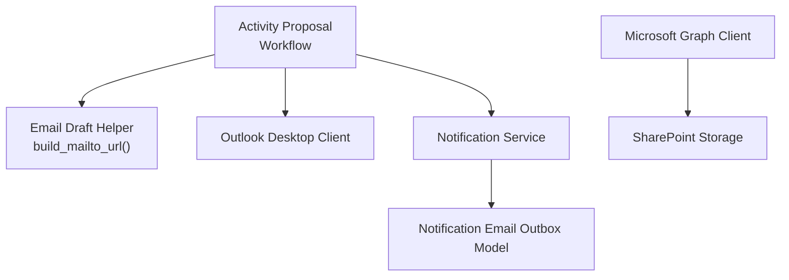
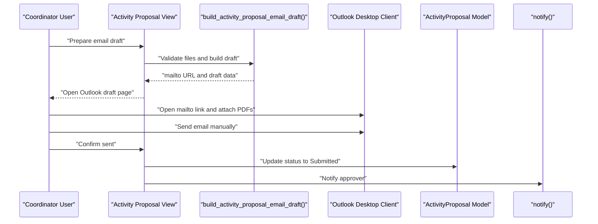
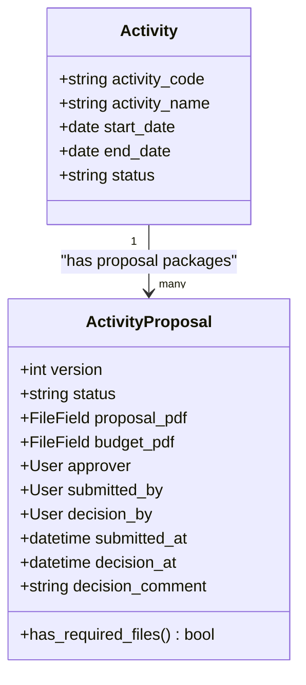
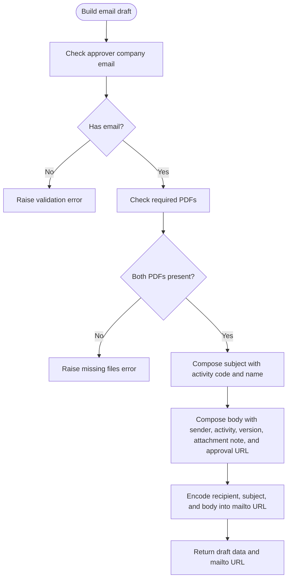
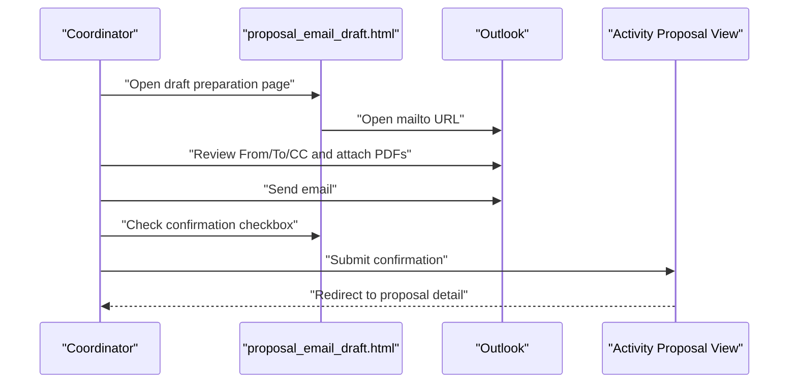
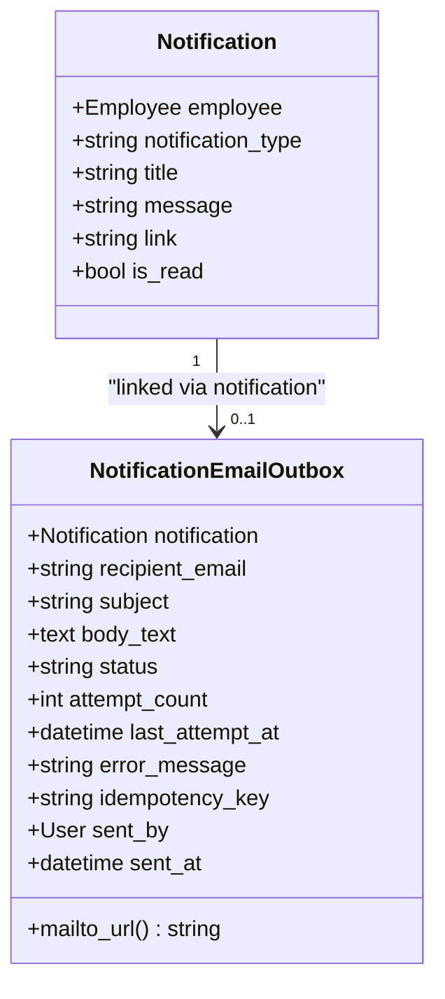
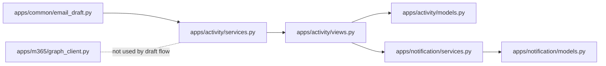

# Outlook Workflow Assistance

<cite>
**Referenced Files in This Document**
- [README.md](file://README.md)
- [email_draft.py](file://src/apps/common/email_draft.py)
- [services.py](file://src/apps/activity/services.py)
- [views.py](file://src/apps/activity/views.py)
- [models.py](file://src/apps/activity/models.py)
- [proposal_email_draft.html](file://src/apps/activity/templates/activity/proposal_email_draft.html)
- [tests.py](file://src/apps/activity/tests.py)
- [graph_client.py](file://src/apps/m365/graph_client.py)
- [models.py](file://src/apps/notification/models.py)
- [services.py](file://src/apps/notification/services.py)
- [HRMS_Next_Features_TechSpec_2026-09-26.md](file://docs/HRMS_Next_Features_TechSpec_2026-09-26.md)
- [PROJECT_WORK_LOG.md](file://docs/PROJECT_WORK_LOG.md)
</cite>

## Table of Contents
1. [Introduction](#introduction)
2. [Project Structure](#project-structure)
3. [Core Components](#core-components)
4. [Architecture Overview](#architecture-overview)
5. [Detailed Component Analysis](#detailed-component-analysis)
6. [Dependency Analysis](#dependency-analysis)
7. [Performance Considerations](#performance-considerations)
8. [Security and Compliance](#security-and-compliance)
9. [Configuration Guide](#configuration-guide)
10. [Troubleshooting Guide](#troubleshooting-guide)
11. [Conclusion](#conclusion)

## Introduction
This document explains how IHRMS assists approval workflows through Outlook email composition. The system does not send emails automatically from the server. Instead, it prepares a standardized draft that opens in the user’s desktop Outlook client. The coordinator reviews recipients, attaches required PDFs, sends the message, and then confirms submission in IHRMS. Approval decisions are recorded inside IHRMS, while Outlook is used only as a composition and delivery channel.

The design also introduces an outbox model for notification-related emails. Outbox entries start as drafts and can later be extended to support automated sending when IT provides a secure SMTP or Microsoft Graph Mail.Send channel.

## Project Structure
The Outlook-assisted workflow spans several Django apps:

- `apps/common/email_draft.py` — shared helper for building `mailto:` URLs.
- `apps/activity` — activity proposal workflow, draft preparation, and state transitions.
- `apps/notification` — in-app notifications and optional email outbox.
- `apps/m365` — Microsoft Graph client used by other features (for example, SharePoint storage), not the current Outlook draft flow.
- Documentation files describe the intended evolution toward automated email channels.

**Diagram sources**
- [services.py:314-339](file://src/apps/activity/services.py#L314-L339)
- [email_draft.py:5-9](file://src/apps/common/email_draft.py#L5-L9)
- [models.py:27-64](file://src/apps/notification/models.py#L27-L64)
- [graph_client.py:57-65](file://src/apps/m365/graph_client.py#L57-L65)

**Section sources**
- [README.md:34-46](file://README.md#L34-L46)
- [email_draft.py:1-10](file://src/apps/common/email_draft.py#L1-L10)
- [services.py:1-10](file://src/apps/activity/services.py#L1-L10)
- [models.py:88-156](file://src/apps/activity/models.py#L88-L156)
- [models.py:27-64](file://src/apps/notification/models.py#L27-L64)
- [graph_client.py:1-13](file://src/apps/m365/graph_client.py#L1-L13)

## Core Components
The Outlook-assisted workflow has three main parts:

1. **Activity proposal package** — stores versioned proposal and budget files, approval target, submission metadata, and decision records.
2. **Draft builder** — validates required files, composes subject and body, and produces a safe `mailto:` URL.
3. **User interaction page** — shows draft details, provides download links for required PDFs, opens Outlook, and records confirmation after the user sends the email.

A separate notification subsystem creates in-app notices and optional email outbox entries. Outbox entries currently represent manual Outlook drafts rather than server-sent messages.

**Section sources**
- [models.py:88-156](file://src/apps/activity/models.py#L88-L156)
- [services.py:314-339](file://src/apps/activity/services.py#L314-L339)
- [proposal_email_draft.html:1-59](file://src/apps/activity/templates/activity/proposal_email_draft.html#L1-L59)
- [models.py:27-64](file://src/apps/notification/models.py#L27-L64)
- [services.py:32-77](file://src/apps/notification/services.py#L32-L77)

## Architecture Overview
The workflow separates system state from email delivery:

- IHRMS owns the approval lifecycle.
- Outlook is a client-side composition tool.
- The server never sends mail directly in this feature.
- Confirmation updates the proposal status to submitted.
- Approver notifications are created inside IHRMS.

**Diagram sources**
- [views.py:264-314](file://src/apps/activity/views.py#L264-L314)
- [services.py:314-339](file://src/apps/activity/services.py#L314-L339)
- [proposal_email_draft.html:33-55](file://src/apps/activity/templates/activity/proposal_email_draft.html#L33-L55)
- [models.py:88-156](file://src/apps/activity/models.py#L88-L156)

## Detailed Component Analysis

### Activity Proposal Package
The activity proposal package represents a versioned approval artifact. It tracks:

- Associated activity.
- Version number.
- Status: draft, submitted, approved, or changes requested.
- Proposal and budget Excel/PDF files.
- Approver assignment.
- Submission metadata: who submitted, when, and where it was sent.
- Decision metadata: who decided, when, and any comments.

**Diagram sources**
- [models.py:9-70](file://src/apps/activity/models.py#L9-L70)
- [models.py:88-156](file://src/apps/activity/models.py#L88-L156)

**Section sources**
- [models.py:88-156](file://src/apps/activity/models.py#L88-L156)

### Email Draft Builder
The draft builder performs validation and template composition before opening Outlook:

- Validates that the approver has a company email address.
- Requires both proposal and budget PDFs.
- Composes a subject including activity code and name.
- Composes a body describing the package, attachments, and approval link.
- Produces a `mailto:` URL using a shared encoder.

**Diagram sources**
- [services.py:314-339](file://src/apps/activity/services.py#L314-L339)
- [email_draft.py:5-9](file://src/apps/common/email_draft.py#L5-L9)

**Section sources**
- [services.py:314-339](file://src/apps/activity/services.py#L314-L339)
- [email_draft.py:1-10](file://src/apps/common/email_draft.py#L1-L10)

### Outlook Draft Page and User Interaction
The draft page guides the coordinator:

- Shows expected sender, recipient, and subject.
- Warns that Outlook uses the default account on the machine.
- Provides download links for the two required PDFs.
- Opens the `mailto:` URL in Outlook.
- Requires explicit confirmation before changing the proposal status.

**Diagram sources**
- [proposal_email_draft.html:1-59](file://src/apps/activity/templates/activity/proposal_email_draft.html#L1-L59)
- [views.py:264-314](file://src/apps/activity/views.py#L264-L314)

**Section sources**
- [proposal_email_draft.html:1-59](file://src/apps/activity/templates/activity/proposal_email_draft.html#L1-L59)
- [views.py:264-314](file://src/apps/activity/views.py#L264-L314)

### Notification and Email Outbox
The notification subsystem supports future automation:

- `Notification` stores in-app alerts.
- `NotificationEmailOutbox` stores draft email content linked to a notification.
- `notify_with_email_draft()` creates both records atomically and prevents duplicate outbox entries using an idempotency key.
- Outbox status defaults to `Draft`; automated sending is intentionally disabled until IT approves a real email channel.

**Diagram sources**
- [models.py:6-24](file://src/apps/notification/models.py#L6-L24)
- [models.py:27-64](file://src/apps/notification/models.py#L27-L64)
- [services.py:32-77](file://src/apps/notification/services.py#L32-L77)

**Section sources**
- [models.py:6-64](file://src/apps/notification/models.py#L6-L64)
- [services.py:32-77](file://src/apps/notification/services.py#L32-L77)

### Microsoft Graph Client Context
The Microsoft Graph client is part of the broader IHRMS integration but is not used for the current Outlook draft workflow. It handles app-only authentication, token caching, SharePoint file operations, and search/listing helpers. This context is important because future email automation could use Graph Mail APIs under similar application-permission patterns.

**Section sources**
- [graph_client.py:1-13](file://src/apps/m365/graph_client.py#L1-L13)
- [graph_client.py:57-120](file://src/apps/m365/graph_client.py#L57-L120)

## Dependency Analysis
The Outlook-assisted workflow depends on:

- Shared email encoding helper.
- Activity proposal model for state and file references.
- Notification service for post-submission alerts.
- Outlook desktop client for actual email delivery.
- Optional Microsoft Graph client for unrelated storage/search functionality.

**Diagram sources**
- [email_draft.py:5-9](file://src/apps/common/email_draft.py#L5-L9)
- [services.py:9](file://src/apps/activity/services.py#L9)
- [services.py:314-339](file://src/apps/activity/services.py#L314-L339)
- [views.py:24](file://src/apps/activity/views.py#L24)
- [models.py:88-156](file://src/apps/activity/models.py#L88-L156)
- [services.py:32-77](file://src/apps/notification/services.py#L32-L77)
- [models.py:27-64](file://src/apps/notification/models.py#L27-L64)
- [graph_client.py:57-65](file://src/apps/m365/graph_client.py#L57-L65)

**Section sources**
- [email_draft.py:1-10](file://src/apps/common/email_draft.py#L1-L10)
- [services.py:314-339](file://src/apps/activity/services.py#L314-L339)
- [views.py:264-314](file://src/apps/activity/views.py#L264-L314)
- [models.py:88-156](file://src/apps/activity/models.py#L88-L156)
- [services.py:32-77](file://src/apps/notification/services.py#L32-L77)
- [models.py:27-64](file://src/apps/notification/models.py#L27-L64)
- [graph_client.py:57-65](file://src/apps/m365/graph_client.py#L57-L65)

## Performance Considerations
- Draft building is lightweight: it validates inputs and encodes strings.
- Opening Outlook is client-side; server load is limited to view rendering and database updates.
- Notification outbox creation uses atomic transactions and idempotency keys to avoid duplicate work.
- Future automated email sending should batch notifications, retry failed messages, and avoid blocking request threads.

[No sources needed since this section provides general guidance]

## Security and Compliance
The current design reduces server-side email risks:

- No server-side SMTP relay is used for the activity proposal draft flow.
- Email content is composed in the user’s Outlook client.
- Required PDFs are downloaded by the user and attached manually.
- Approval decisions remain in IHRMS, not in email replies.
- Notification outbox errors are stored as cleaned error messages without sensitive business data.

Important security considerations include:

- Validate approver email addresses before composing drafts.
- Require both proposal and budget PDFs before allowing draft preparation.
- Do not trust client-selected sender accounts; warn users to verify the Outlook From address.
- Protect approval URLs with login and permission checks.
- Avoid logging full email bodies or sensitive attachment contents.
- Restrict access to outbox management endpoints to authorized roles.
- When enabling automated email channels, use authenticated SMTP or Graph Mail.Send with admin consent and least-privilege permissions.

**Section sources**
- [services.py:314-339](file://src/apps/activity/services.py#L314-L339)
- [proposal_email_draft.html:12-19](file://src/apps/activity/templates/activity/proposal_email_draft.html#L12-L19)
- [models.py:46-48](file://src/apps/notification/models.py#L46-L48)
- [graph_client.py:1-13](file://src/apps/m365/graph_client.py#L1-L13)

## Configuration Guide

### Setting Up Approval Workflows
To enable the activity proposal workflow:

1. Create an activity and assign a coordinator and lead CBDA.
2. Upload both proposal and budget PDFs to the activity proposal package.
3. Assign an approver with a valid company email.
4. Use the “Prepare email draft” action to open the draft page.
5. Confirm that the correct approver and subject are shown.
6. Download the two PDFs and attach them in Outlook.
7. Send the email from Outlook.
8. Return to IHRMS and confirm that the email was sent.
9. The proposal status becomes submitted and the approver receives an in-app notification.

**Section sources**
- [models.py:88-156](file://src/apps/activity/models.py#L88-L156)
- [services.py:314-339](file://src/apps/activity/services.py#L314-L339)
- [proposal_email_draft.html:33-55](file://src/apps/activity/templates/activity/proposal_email_draft.html#L33-L55)
- [views.py:264-314](file://src/apps/activity/views.py#L264-L314)

### Configuring Email Templates
The current implementation composes subject and body programmatically rather than loading external template files. To standardize approval communications:

- Centralize subject construction around activity code, activity name, project name, and version.
- Include a clear instruction to review and record the decision in IHRMS.
- Include the approval URL so approvers can navigate back to the system.
- Keep the body concise and avoid embedding sensitive salary or personal data.
- If templates are introduced later, store them in a controlled location and render them server-side with permission checks.

**Section sources**
- [services.py:314-339](file://src/apps/activity/services.py#L314-L339)
- [HRMS_Next_Features_TechSpec_2026-09-26.md:108-144](file://docs/HRMS_Next_Features_TechSpec_2026-09-26.md#L108-L144)

### Handling User Interactions Through Outlook
Because `mailto:` cannot force a specific sender account or attach files:

- Ensure Windows has Outlook set as the default mail handler if automatic opening is expected.
- Instruct users to check the From address before sending.
- Provide direct download links for required PDFs.
- Require explicit confirmation in IHRMS before updating workflow state.
- Treat email delivery confirmation as user-driven, not system-guaranteed.

**Section sources**
- [PROJECT_WORK_LOG.md:4020-4024](file://docs/PROJECT_WORK_LOG.md#L4020-L4024)
- [proposal_email_draft.html:12-19](file://src/apps/activity/templates/activity/proposal_email_draft.html#L12-L19)
- [tests.py:363-388](file://src/apps/activity/tests.py#L363-L388)

### Outlook Add-in Setup Notes
The current repository implements a `mailto:`-based draft flow, not an Outlook add-in. If an Outlook add-in is added later, configuration should cover:

- App registration and tenant configuration.
- Permissions for reading user profile information and composing drafts.
- Redirect URIs and trusted origins.
- Display name, icon, and help documentation.
- Testing across Outlook desktop, web, and mobile clients.
- Fallback behavior when the add-in is unavailable.

[No sources needed since this section provides general guidance]

## Troubleshooting Guide

### Workflow Synchronization Issues
Symptoms:

- Proposal remains in draft after the user claims to have sent the email.
- Approver did not receive an in-app notification.
- Multiple attempts create duplicate outbox entries.

Checks:

- Verify the coordinator confirmed submission in IHRMS.
- Confirm the approver has a company email address.
- Inspect the proposal status and submitted metadata.
- For notification outbox, check idempotency keys and duplicate prevention.

**Section sources**
- [views.py:294-314](file://src/apps/activity/views.py#L294-L314)
- [services.py:314-339](file://src/apps/activity/services.py#L314-L339)
- [services.py:32-77](file://src/apps/notification/services.py#L32-L77)

### Email Delivery Problems
Symptoms:

- Outlook does not open automatically.
- Wrong sender account is selected.
- Attachments are missing.
- Email is sent but IHRMS still shows draft.

Checks:

- Confirm Outlook is the default mail handler on Windows.
- Ask the user to verify From, To, CC, and attachments.
- Download and reattach the two required PDFs.
- Require the user to return to IHRMS and explicitly confirm sent.

**Section sources**
- [PROJECT_WORK_LOG.md:4020-4024](file://docs/PROJECT_WORK_LOG.md#L4020-L4024)
- [proposal_email_draft.html:33-55](file://src/apps/activity/templates/activity/proposal_email_draft.html#L33-L55)

### User Experience Concerns
Symptoms:

- Users do not understand why they must attach PDFs manually.
- Users think IHRMS sent the email automatically.
- Approver cannot find the approval link.

Mitigations:

- Clearly explain that IHRMS opens a draft and does not send mail.
- Show expected sender, recipient, and subject before opening Outlook.
- Include the approval URL in the email body.
- Provide clear instructions for returning to IHRMS after sending.

**Section sources**
- [proposal_email_draft.html:9-19](file://src/apps/activity/templates/activity/proposal_email_draft.html#L9-L19)
- [services.py:322-331](file://src/apps/activity/services.py#L322-L331)

### Automated Email Channel Readiness
If IT enables automated sending:

- Keep outbox status transitions explicit: Draft → Pending → Sent/Failed.
- Preserve idempotency keys to prevent duplicate sends.
- Log cleaned error messages without sensitive data.
- Test retries, timeouts, and failure handling.
- Validate that the existing schema supports automated sending without migration changes.

**Section sources**
- [models.py:27-64](file://src/apps/notification/models.py#L27-L64)
- [HRMS_Next_Features_TechSpec_2026-09-26.md:171-175](file://docs/HRMS_Next_Features_TechSpec_2026-09-26.md#L171-L175)

## Conclusion
IHRMS integrates with Outlook by preparing standardized approval drafts and letting users compose and send messages from their own client. Approval state remains authoritative in IHRMS, while Outlook serves as a familiar communication channel. The current design avoids server-side email risks, requires explicit user confirmation, and preserves auditability. The notification outbox model provides a foundation for future automated email channels once IT configures a secure sending mechanism.

[No sources needed since this section summarizes without analyzing specific files]