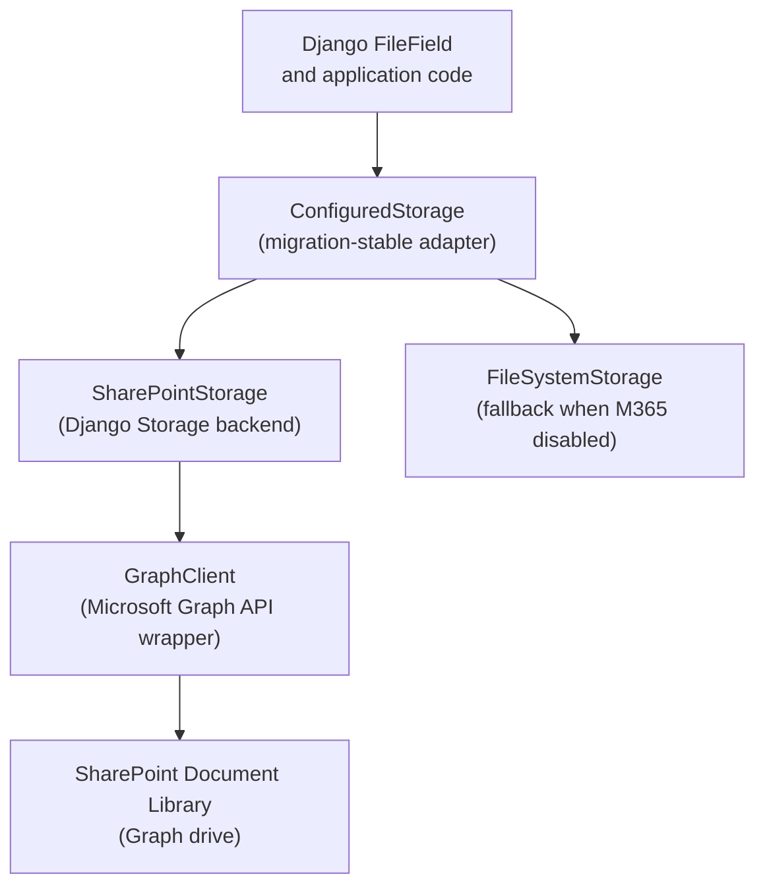
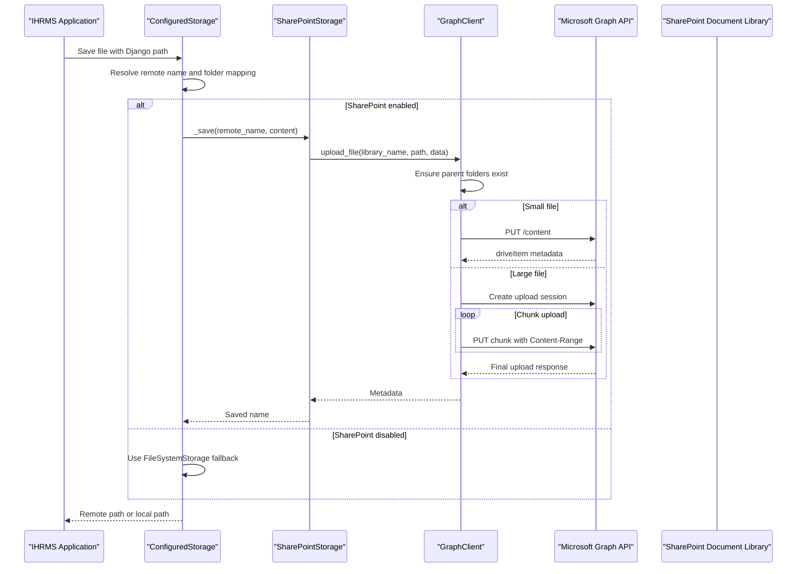
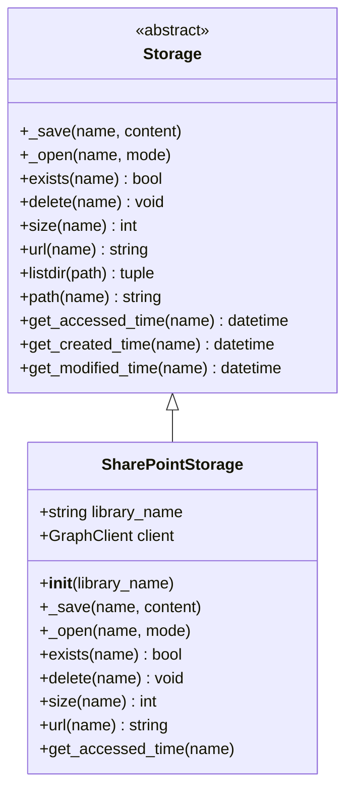
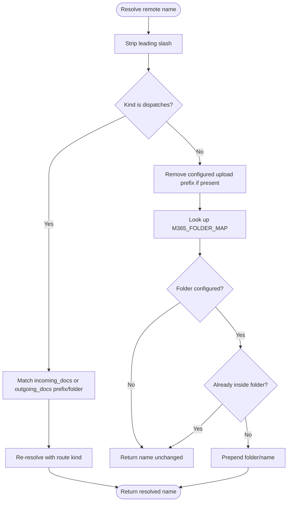
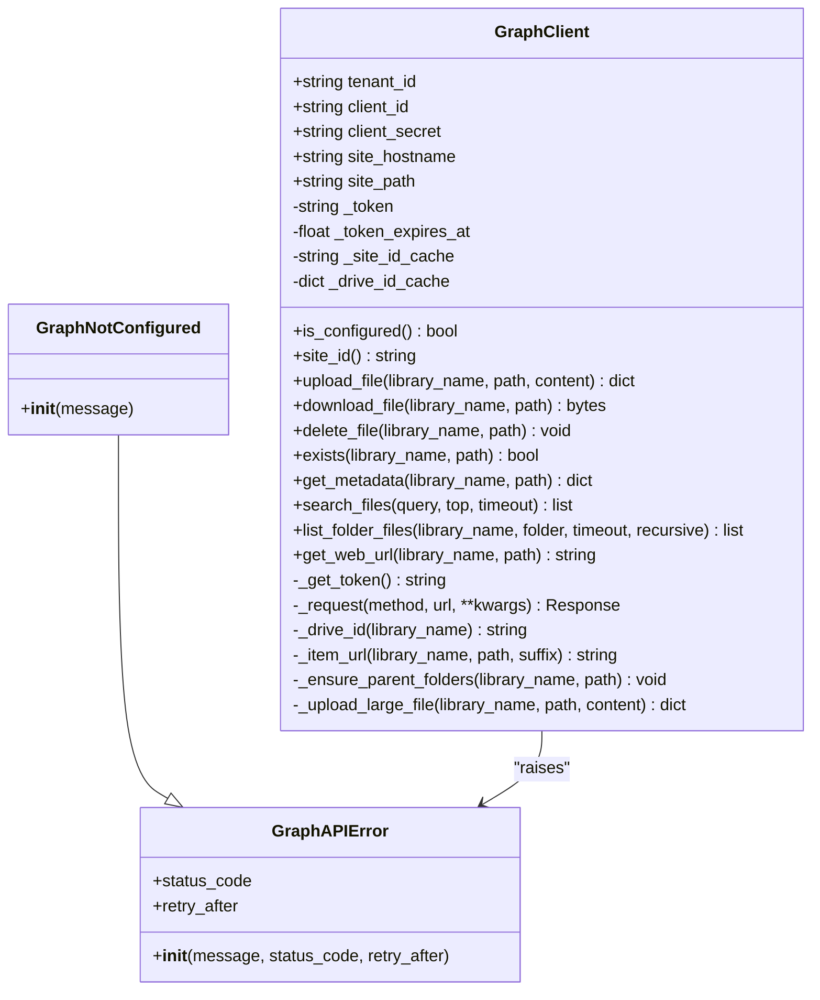
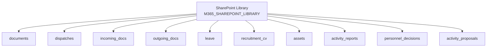
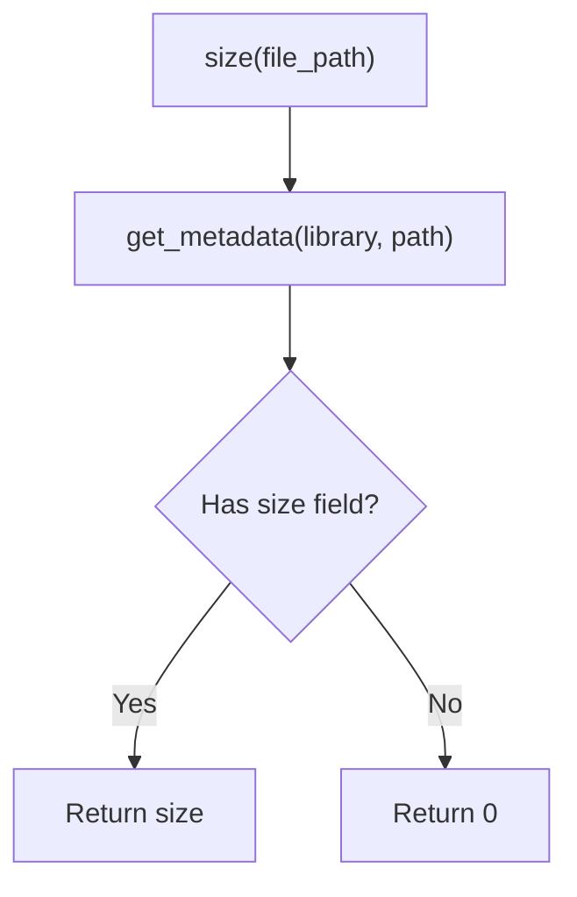
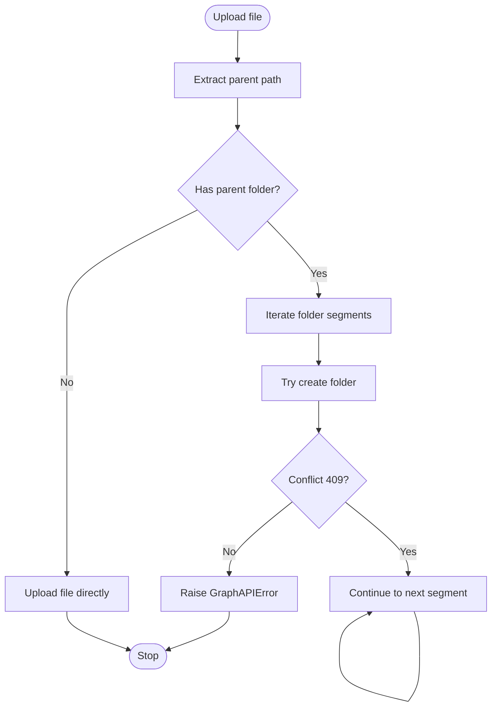
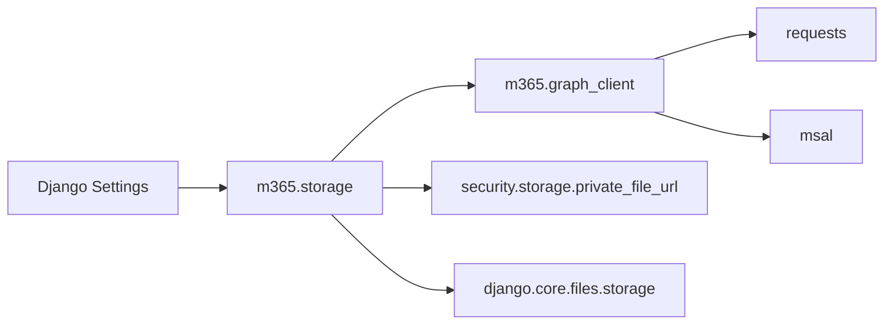

# SharePoint Storage Management

<cite>
**Referenced Files in This Document**
- [storage.py](file://src/apps/m365/storage.py)
- [graph_client.py](file://src/apps/m365/graph_client.py)
- [settings.py](file://src/config/settings.py)
- [tests.py](file://src/apps/m365/tests.py)
- [m365_search.py](file://src/apps/assistant/m365_search.py)
- [tests_db_search.py](file://src/apps/assistant/tests_db_search.py)
</cite>

## Table of Contents
1. [Introduction](#introduction)
2. [Project Structure](#project-structure)
3. [Core Components](#core-components)
4. [Architecture Overview](#architecture-overview)
5. [Detailed Component Analysis](#detailed-component-analysis)
6. [Dependency Analysis](#dependency-analysis)
7. [Performance Considerations](#performance-considerations)
8. [Troubleshooting Guide](#troubleshooting-guide)
9. [Conclusion](#conclusion)

## Introduction
This document explains how IHRMS integrates with SharePoint storage through the `SharePointStorage` class and its supporting Microsoft Graph client. The implementation stores actual file content in a SharePoint document library (Graph drive), while Django metadata such as file names, relative paths, and sizes remains in SQL Server. File operations are routed through a migration-stable adapter that can fall back to local disk storage when SharePoint is disabled.

The integration focuses on:
- Uploading files using simple PUT for small files and chunked upload sessions for large files.
- Downloading files through Microsoft Graph.
- Managing folder hierarchies by creating missing parent folders before upload.
- Mapping Django upload paths to SharePoint folders via configuration.
- Returning secure URLs through IHRMS’s private file URL mechanism.
- Handling network failures, authentication errors, permission issues, and file conflicts at the Graph layer.

## Project Structure
The SharePoint integration lives under the `apps.m365` module and is configured through Django settings.

**Diagram sources**
- [storage.py:33-73](file://src/apps/m365/storage.py#L33-L73)
- [storage.py:84-168](file://src/apps/m365/storage.py#L84-L168)
- [graph_client.py:57-402](file://src/apps/m365/graph_client.py#L57-L402)

**Section sources**
- [storage.py:1-22](file://src/apps/m365/storage.py#L1-L22)
- [settings.py:281-332](file://src/config/settings.py#L281-L332)

## Core Components
The SharePoint integration has two main layers:

| Component | Responsibility | Key Behavior |
|---|---|---|
| `SharePointStorage` | Implements Django’s `Storage` interface for SharePoint | Uploads, downloads, existence checks, deletion, size lookup, and secure URL generation |
| `GraphClient` | Wraps Microsoft Graph API calls | Handles authentication, site/drive discovery, upload sessions, download, delete, exists, metadata, search, and folder listing |
| `ConfiguredStorage` | Migration-stable adapter | Chooses between local disk and SharePoint based on settings; maps Django upload paths to SharePoint folders |
| Settings | Configuration for tenant, credentials, site, library, and folder mapping | Controls whether SharePoint is enabled and which folders map to each feature |

**Section sources**
- [storage.py:33-73](file://src/apps/m365/storage.py#L33-L73)
- [storage.py:75-168](file://src/apps/m365/storage.py#L75-L168)
- [graph_client.py:57-402](file://src/apps/m365/graph_client.py#L57-L402)
- [settings.py:281-332](file://src/config/settings.py#L281-L332)

## Architecture Overview
The end-to-end flow starts from Django’s file handling and ends at Microsoft Graph.

**Diagram sources**
- [storage.py:46-49](file://src/apps/m365/storage.py#L46-L49)
- [storage.py:116-135](file://src/apps/m365/storage.py#L116-L135)
- [graph_client.py:182-228](file://src/apps/m365/graph_client.py#L182-L228)
- [graph_client.py:230-260](file://src/apps/m365/graph_client.py#L230-L260)

## Detailed Component Analysis

### SharePointStorage Class
`SharePointStorage` implements the required Django storage methods and delegates all actual I/O to `GraphClient`.

| Method | Purpose | Implementation Notes |
|---|---|---|
| `_save(name, content)` | Uploads file bytes to SharePoint | Reads full content into memory and calls `upload_file` |
| `_open(name, mode)` | Downloads file content | Returns a `ContentFile` wrapping downloaded bytes |
| `exists(name)` | Checks whether a file exists | Delegates to `client.exists` |
| `delete(name)` | Deletes a file | Delegates to `client.delete_file` |
| `size(name)` | Returns file size | Reads size from Graph metadata |
| `url(name)` | Returns access URL | Uses IHRMS private file URL instead of direct SharePoint link |
| `get_accessed_time(name)` | Access time | Not supported by Graph; raises `NotImplementedError` |

**Diagram sources**
- [storage.py:33-73](file://src/apps/m365/storage.py#L33-L73)

**Section sources**
- [storage.py:33-73](file://src/apps/m365/storage.py#L33-L73)

### ConfiguredStorage Adapter
`ConfiguredStorage` provides a stable storage reference for Django migrations while dynamically selecting the real backend per operation.

Key responsibilities:
- Map Django upload paths to SharePoint folder paths.
- Fall back to `FileSystemStorage` when `M365_STORAGE_ENABLED` is false.
- Raise a clear error when no SharePoint library is configured.
- Delegate most operations to the selected backend.

Path resolution rules:
- Strip leading slashes.
- For dispatches, detect incoming/outgoing routes and resolve them recursively.
- Remove configured upload prefixes before applying folder mapping.
- Prepend the configured folder unless the name already belongs to it.

**Diagram sources**
- [storage.py:91-114](file://src/apps/m365/storage.py#L91-L114)

**Section sources**
- [storage.py:75-168](file://src/apps/m365/storage.py#L75-L168)

### GraphClient and Microsoft Graph Integration
`GraphClient` is the core integration point with Microsoft Graph. It handles:
- Application-only authentication using client credentials.
- Token caching and renewal.
- Site ID and drive ID discovery.
- Simple uploads for files up to 4 MB.
- Chunked upload sessions for larger files.
- Download, delete, exists, and metadata retrieval.
- Search and folder listing with pagination and boundary validation.

**Diagram sources**
- [graph_client.py:44-57](file://src/apps/m365/graph_client.py#L44-L57)
- [graph_client.py:57-402](file://src/apps/m365/graph_client.py#L57-L402)

**Section sources**
- [graph_client.py:1-404](file://src/apps/m365/graph_client.py#L1-L404)

### Folder Structure Organization
IHRMS organizes stored documents by mapping Django storage kinds to SharePoint folders.

Configuration keys:
- `M365_SHAREPOINT_LIBRARY`: Target document library name.
- `M365_FOLDER_MAP`: Maps storage kinds like `documents`, `dispatches`, `incoming_docs`, `outgoing_docs`, `leave`, `recruitment_cv`, `assets`, `activity_reports`, `personnel_decisions`, and `activity_proposals` to SharePoint folder names.
- `M365_UPLOAD_PREFIX_MAP`: Removes application-specific upload prefixes before applying folder mapping.

Examples of mapped kinds include:
- Documents
- Dispatches and legacy incoming/outgoing documents
- Leave requests
- Recruitment CVs
- Company assets and images
- Activity reports
- Personnel decisions
- Activity proposals

**Diagram sources**
- [settings.py:301-332](file://src/config/settings.py#L301-L332)
- [storage.py:91-114](file://src/apps/m365/storage.py#L91-L114)

**Section sources**
- [settings.py:301-332](file://src/config/settings.py#L301-L332)
- [storage.py:91-114](file://src/apps/m365/storage.py#L91-L114)

### Permission Inheritance and Access Control
The current SharePoint integration does not programmatically manage SharePoint permissions or inheritance. Instead, IHRMS enforces access control at the application layer:
- File URLs are returned through IHRMS’s private file URL mechanism.
- Each file access verifies user identity, role, and allowed root folders.
- SharePoint search results are filtered by site boundary and configured drives.
- Tests assert that SharePoint query gates match the same scope as file read gates.

Important constraints:
- No new application permissions or consent are granted by this integration.
- Raw SharePoint ACL changes are outside the scope of the storage layer.
- Security relies on signed URLs, proxy validation, and RBAC checks.

**Section sources**
- [storage.py:67-69](file://src/apps/m365/storage.py#L67-L69)
- [m365_search.py:349-372](file://src/apps/assistant/m365_search.py#L349-L372)
- [tests_db_search.py:282-302](file://src/apps/assistant/tests_db_search.py#L282-L302)

### Metadata Management
Metadata behavior:
- Django models store file-related metadata such as names and paths.
- `SharePointStorage.size()` reads file size from Graph metadata.
- `GraphClient.get_metadata()` returns Graph drive item metadata.
- Web URLs are obtained from metadata when needed.
- Access time is not available from Graph and raises `NotImplementedError`.

**Diagram sources**
- [storage.py:63-65](file://src/apps/m365/storage.py#L63-L65)
- [graph_client.py:284-286](file://src/apps/m365/graph_client.py#L284-L286)

**Section sources**
- [storage.py:63-72](file://src/apps/m365/storage.py#L63-L72)
- [graph_client.py:284-296](file://src/apps/m365/graph_client.py#L284-L296)

### Version Control Integration
The current implementation does not implement explicit version control over uploaded files:
- Upload replaces or creates the target path.
- Parent folders are created if missing.
- There is no logic to create versions, preserve previous versions, or integrate with SharePoint version history.
- If versioning is required, it must be added around the upload path, either by generating versioned names or by calling Graph APIs that support version management.

**Section sources**
- [graph_client.py:216-228](file://src/apps/m365/graph_client.py#L216-L228)
- [graph_client.py:182-212](file://src/apps/m365/graph_client.py#L182-L212)

### File Operations

#### Upload with Progress Tracking
Current behavior:
- Small files up to 4 MB use a single PUT request.
- Larger files use an upload session and send chunks of 5 MB.
- Progress tracking is not exposed by the current implementation; uploads are synchronous and block until completion.

To add progress tracking, callers would need to wrap the upload path and emit events during chunk iteration.

**Section sources**
- [graph_client.py:30-33](file://src/apps/m365/graph_client.py#L30-L33)
- [graph_client.py:216-260](file://src/apps/m365/graph_client.py#L216-L260)

#### Bulk File Operations
Bulk operations are not implemented as a dedicated API. Applications should:
- Iterate over files and call the storage save method.
- Handle retries and rate limits at the caller level.
- Avoid unbounded concurrency without considering Graph rate limits and server resources.

**Section sources**
- [storage.py:46-49](file://src/apps/m365/storage.py#L46-L49)
- [graph_client.py:128-142](file://src/apps/m365/graph_client.py#L128-L142)

#### Download and Listing
- Download returns raw bytes through Graph content endpoints.
- Folder listing supports pagination and optional recursive traversal.
- Results exclude remote shortcuts and enforce drive boundaries.
- Traversal is limited to prevent runaway requests.

**Section sources**
- [graph_client.py:262-264](file://src/apps/m365/graph_client.py#L262-L264)
- [graph_client.py:342-373](file://src/apps/m365/graph_client.py#L342-L373)

### Implementation Examples

#### Creating Document Libraries
The code assumes the SharePoint document library already exists. Administrators must create libraries such as `Documents`, `CongVan`, `DonNghiPhep`, or custom names and configure `M365_SHAREPOINT_LIBRARY` accordingly.

Recommended steps:
1. Create the SharePoint site and document library in Microsoft 365.
2. Grant application permissions `Sites.ReadWrite.All` and `Files.ReadWrite.All` with admin consent.
3. Configure tenant ID, client ID, client secret, hostname, site path, and library name.
4. Set `M365_STORAGE_ENABLED` to enable SharePoint storage.

**Section sources**
- [storage.py:35-43](file://src/apps/m365/storage.py#L35-L43)
- [graph_client.py:1-12](file://src/apps/m365/graph_client.py#L1-L12)
- [settings.py:281-305](file://src/config/settings.py#L281-L305)

#### Managing Folder Hierarchies
Folders are managed automatically during upload:
- Missing parent folders are created before uploading a file.
- Existing folders are ignored unless a non-conflict error occurs.
- Folder creation uses conflict behavior that fails on existing items.

**Diagram sources**
- [graph_client.py:182-212](file://src/apps/m365/graph_client.py#L182-L212)

**Section sources**
- [graph_client.py:182-212](file://src/apps/m365/graph_client.py#L182-L212)

#### Setting Up Access Permissions
Access permissions are enforced by IHRMS rather than by modifying SharePoint ACLs:
- File URLs go through a private URL endpoint.
- Requests are validated against user roles and allowed roots.
- SharePoint search is restricted to configured drives and site boundaries.

Administrators should:
- Keep SharePoint library permissions broad enough for the application service account.
- Rely on IHRMS RBAC for fine-grained access control.
- Audit SharePoint permissions separately if external users need direct access.

**Section sources**
- [storage.py:67-69](file://src/apps/m365/storage.py#L67-L69)
- [m365_search.py:349-372](file://src/apps/assistant/m365_search.py#L349-L372)
- [tests_db_search.py:282-302](file://src/apps/assistant/tests_db_search.py#L282-L302)

## Dependency Analysis
The SharePoint integration has clear layering:

**Diagram sources**
- [storage.py:25-30](file://src/apps/m365/storage.py#L25-L30)
- [graph_client.py:16-24](file://src/apps/m365/graph_client.py#L16-L24)
- [graph_client.py:100-120](file://src/apps/m365/graph_client.py#L100-L120)

Coupling and cohesion:
- `SharePointStorage` depends only on `GraphClient` and Django storage abstractions.
- `ConfiguredStorage` decouples migration stability from runtime backend selection.
- `GraphClient` centralizes HTTP, authentication, and Graph protocol details.
- External dependencies are `requests`, `msal`, and Django components.

Potential risks:
- Global token cache and singleton graph client require careful process lifecycle management.
- Network errors and Graph rate limits must be handled by callers if retries are needed.
- Path resolution logic is sensitive to configuration mismatches.

**Section sources**
- [storage.py:25-30](file://src/apps/m365/storage.py#L25-L30)
- [graph_client.py:16-24](file://src/apps/m365/graph_client.py#L16-L24)
- [graph_client.py:394-402](file://src/apps/m365/graph_client.py#L394-L402)

## Performance Considerations
- Memory usage: `_save` reads the entire file into memory before upload. This is acceptable for moderate file sizes but may be expensive for very large files.
- Upload strategy: Files up to 4 MB use a single PUT; larger files use chunked upload sessions with 5 MB chunks.
- Concurrency: The graph client uses a thread lock for token acquisition, but concurrent uploads share the same process-level state. Callers should limit concurrency to avoid overwhelming Graph or the application process.
- Pagination: Folder listing uses page size 200 and stops after 50 seen URLs to prevent excessive traversal.
- Timeouts: Default request timeout is 60 seconds; upload session chunks use 120 seconds.
- Caching: Site ID and drive ID are cached per process to reduce repeated discovery calls.

Recommendations:
- Add streaming upload for very large files to reduce peak memory.
- Expose upload progress callbacks for long-running uploads.
- Implement retry policies with exponential backoff for transient Graph errors.
- Monitor Graph rate limiting and adjust concurrency accordingly.
- Cache frequently accessed metadata where appropriate.

**Section sources**
- [graph_client.py:30-41](file://src/apps/m365/graph_client.py#L30-L41)
- [graph_client.py:67-79](file://src/apps/m365/graph_client.py#L67-L79)
- [graph_client.py:128-142](file://src/apps/m365/graph_client.py#L128-L142)
- [graph_client.py:216-260](file://src/apps/m365/graph_client.py#L216-L260)
- [graph_client.py:342-373](file://src/apps/m365/graph_client.py#L342-L373)

## Troubleshooting Guide

### Connectivity Problems
Symptoms:
- Authentication fails.
- Graph returns HTTP errors.
- Network timeouts occur.

Checks:
- Verify `M365_TENANT_ID`, `M365_CLIENT_ID`, and `M365_CLIENT_SECRET`.
- Confirm `M365_SHAREPOINT_HOSTNAME` and `M365_SHAREPOINT_SITE_PATH`.
- Ensure app registration has `Sites.ReadWrite.All` and `Files.ReadWrite.All` with admin consent.
- Check network connectivity to `https://graph.microsoft.com/v1.0`.

Recovery:
- `GraphNotConfigured` indicates missing configuration.
- `GraphAPIError` wraps network and HTTP errors with status codes and optional `Retry-After`.
- Retry failed requests according to `retry_after` and status code.

**Section sources**
- [graph_client.py:44-57](file://src/apps/m365/graph_client.py#L44-L57)
- [graph_client.py:84-120](file://src/apps/m365/graph_client.py#L84-L120)
- [graph_client.py:128-142](file://src/apps/m365/graph_client.py#L128-L142)

### Permission Issues
Symptoms:
- File access denied.
- Drive or library not found.
- Search returns empty results.

Checks:
- Confirm the configured library exists and matches `M365_SHAREPOINT_LIBRARY`.
- Verify IHRMS user roles allow access to the requested folder or document type.
- Ensure the application service account has sufficient Graph permissions.

Recovery:
- `GraphAPIError` is raised when a library cannot be found.
- Application-layer gates restrict search and download to authorized folders.
- Do not bypass security by opening raw SharePoint links.

**Section sources**
- [graph_client.py:160-175](file://src/apps/m365/graph_client.py#L160-L175)
- [m365_search.py:349-372](file://src/apps/assistant/m365_search.py#L349-L372)
- [tests_db_search.py:282-302](file://src/apps/assistant/tests_db_search.py#L282-L302)

### File Conflicts and Locking
Symptoms:
- Folder creation fails due to existing folders.
- Upload fails mid-session.
- Delete returns unexpected errors.

Checks:
- Folder creation intentionally fails on existing folders; this is expected behavior.
- Upload session failures include byte offset and HTTP status.
- Delete ignores 404 but raises other errors.

Recovery:
- For folder conflicts, verify the intended path and skip duplicate creation.
- For upload session failures, inspect the chunk range and retry with backoff.
- For delete, treat 404 as success and log other errors.

**Section sources**
- [graph_client.py:182-212](file://src/apps/m365/graph_client.py#L182-L212)
- [graph_client.py:230-260](file://src/apps/m365/graph_client.py#L230-L260)
- [graph_client.py:266-273](file://src/apps/m365/graph_client.py#L266-L273)

### Configuration Errors
Symptoms:
- Fallback to local storage unexpectedly.
- ValueError about missing SharePoint library.
- Path mapping produces wrong folders.

Checks:
- Confirm `M365_STORAGE_ENABLED` is set correctly.
- Confirm `M365_SHAREPOINT_LIBRARY` is non-empty.
- Review `M365_FOLDER_MAP` and `M365_UPLOAD_PREFIX_MAP`.

Recovery:
- Enable SharePoint storage explicitly.
- Provide a valid library name.
- Align Django upload paths with configured folders and prefixes.

**Section sources**
- [storage.py:75-77](file://src/apps/m365/storage.py#L75-L77)
- [storage.py:116-127](file://src/apps/m365/storage.py#L116-L127)
- [settings.py:296-332](file://src/config/settings.py#L296-L332)

### Testing and Validation
Useful test references:
- Basic storage instantiation and backend selection.
- Folder boundary validation through configured drive metadata.
- Rejection of foreign site or file metadata.

**Section sources**
- [tests.py:9-15](file://src/apps/m365/tests.py#L9-L15)
- [tests.py:83-83](file://src/apps/m365/tests.py#L83-L83)
- [tests.py:270-279](file://src/apps/m365/tests.py#L270-L279)

## Conclusion
The IHRMS SharePoint storage integration provides a clean separation between Django file handling and Microsoft Graph operations. `SharePointStorage` implements Django’s storage contract, while `GraphClient` encapsulates authentication, upload strategies, and Graph API interactions. `ConfiguredStorage` ensures migration stability and allows fallback to local storage.

Current limitations include:
- No built-in progress tracking for uploads.
- No explicit version control integration.
- No programmatic SharePoint permission management.
- Synchronous upload that loads full file content into memory.

For production deployments, administrators should:
- Configure SharePoint site, library, and application permissions correctly.
- Enable SharePoint storage only after credentials and site configuration are verified.
- Implement retry and progress tracking at the application layer if required.
- Continue enforcing access control through IHRMS RBAC and private file URLs.