# Project Overview

<cite>
**Referenced Files in This Document**
- [README.md](file://README.md)
- [00_Project_Charter.md](file://docs/00_Project_Charter.md)
- [01_BRD_MASTER.md](file://docs/01_BRD_MASTER.md)
- [02_Solution_Architecture.md](file://docs/02_Solution_Architecture.md)
- [settings.py](file://src/config/settings.py)
- [security/models.py](file://src/apps/security/models.py)
- [organization/models.py](file://src/apps/organization/models.py)
- [hrm/models.py](file://src/apps/hrm/models.py)
- [attendance/models.py](file://src/apps/attendance/models.py)
- [payroll/models.py](file://src/apps/payroll/models.py)
- [mobile_shell.css](file://src/static/css/mobile_shell.css)
- [mobile_tabbar.html](file://src/templates/ui/mobile_tabbar.html)
- [manifest.json](file://src/static/manifest.json)
- [service-worker.js](file://src/static/js/service-worker.js)
- [tests_mobile.py](file://src/apps/portal/tests_mobile.py)
</cite>

## Update Summary
**Changes Made**
- Added comprehensive mobile application shell implementation details for P0 milestone completion
- Documented Progressive Web App (PWA) adoption strategy with manifest and service worker configuration
- Updated architecture overview to include mobile-first responsive design approach
- Added new section on mobile interface components and navigation patterns
- Enhanced technology stack documentation with PWA capabilities and mobile deployment considerations

## Table of Contents
1. [Introduction](#introduction)
2. [Project Structure](#project-structure)
3. [Core Components](#core-components)
4. [Architecture Overview](#architecture-overview)
5. [Mobile Application Shell Implementation](#mobile-application-shell-implementation)
6. [Detailed Component Analysis](#detailed-component-analysis)
7. [Dependency Analysis](#dependency-analysis)
8. [Performance Considerations](#performance-considerations)
9. [Troubleshooting Guide](#troubleshooting-guide)
10. [Conclusion](#conclusion)

## Introduction
IHRMS is the Internal Administration and Human Resource Management System, known in Vietnamese as QLHCNS. It is an integrated administrative and HR platform designed for internal operations, with explicit scope covering organization management, human resources, recruitment, attendance, leave, payroll, contracts, documents, tasks, KPIs, assets, procurement, reporting, and Microsoft 365 integration. The system replaces manual processes such as Excel spreadsheets, email chains, Word templates, shared folders, Teams chat, and paper forms with a single centralized source of truth.

The project charter defines IHRMS as an on-premise enterprise application intended to standardize organizational and employee data, digitize administrative workflows, automate approvals, improve KPI and task tracking, reduce Excel dependency, strengthen auditability, and provide executive dashboards. The business requirement document further maps these goals into functional modules and end-to-end workflows including leave approval, recruitment lifecycle, procurement approval, and task progression.

For newcomers, IHRMS can be understood as the company's central HR and administration system where employees manage personal information, request leave, view attendance and payslips, while managers approve requests and track team performance. For developers, it is a modular Django monolith under `src/`, with business logic split across apps under `src/apps/`, security and roles defined centrally, and database-backed models for each domain.

**Updated** The system now includes a complete mobile application shell implementation (P0 milestone) with Progressive Web App (PWA) capabilities, providing native-like mobile experiences through responsive design and offline asset caching.

**Section sources**
- [00_Project_Charter.md:43-67](file://docs/00_Project_Charter.md#L43-L67)
- [00_Project_Charter.md:106-165](file://docs/00_Project_Charter.md#L106-L165)
- [01_BRD_MASTER.md:8-35](file://docs/01_BRD_MASTER.md#L8-L35)
- [01_BRD_MASTER.md:128-148](file://docs/01_BRD_MASTER.md#L128-L148)

## Project Structure
At a high level, IHRMS consists of:
- A Django application rooted at `src/`.
- Business modules organized as Django apps under `src/apps/`.
- Configuration, URLs, WSGI/ASGI, and environment loading under `src/config/`.
- Templates, static assets, and UI components under `src/templates/` and `src/static/`.
- Documentation, deployment standards, test scripts, and operational runbooks under `docs/` and `ops/`.

The repository README identifies three main user entry points:
- Employee portal at `/portal/`.
- Django admin interface at `/admin/`.
- Business modules exposed through app-specific routes, including reporting and module dashboards.

The configuration layer registers all active apps, sets the custom user model to `security.User`, configures login and dashboard redirects, and enables both SQLite and SQL Server backends depending on environment variables. The production target is Windows Server with SQL Server, while development commonly uses SQLite or a local SQL Server instance.

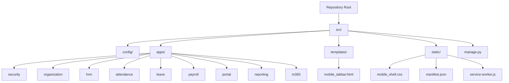

**Diagram sources**
- [settings.py:111-143](file://src/config/settings.py#L111-L143)
- [settings.py:269-279](file://src/config/settings.py#L269-L279)
- [mobile_shell.css:1-12](file://src/static/css/mobile_shell.css#L1-L12)
- [manifest.json:1-26](file://src/static/manifest.json#L1-L26)
- [service-worker.js:1-20](file://src/static/js/service-worker.js#L1-L20)
- [mobile_tabbar.html:1-9](file://src/templates/ui/mobile_tabbar.html#L1-L9)

**Section sources**
- [README.md:1-5](file://README.md#L1-L5)
- [README.md:48-69](file://README.md#L48-L69)
- [settings.py:111-143](file://src/config/settings.py#L111-L143)
- [settings.py:193-225](file://src/config/settings.py#L193-L225)

## Core Components
IHRMS is organized around several core domains that together form the QLHCNS platform:

| Domain | Purpose | Key Models / Concepts | Typical Users |
|---|---|---|---|
| Security | Authentication, roles, permissions, security events | `Role`, `User`, `SecurityEvent` | All users, IT administrators |
| Organization | Company structure, departments, positions, job titles | `Organization`, `Department`, `Position`, `JobTitle` | HR, directors, department managers |
| Human Resources | Employee master data, employment history, transfers, promotions, rewards, discipline | `Employee`, `EmployeeTransfer`, `EmployeePromotion`, `EmployeeReward`, `EmployeeDiscipline` | HR officers, department managers |
| Attendance | Work shifts, daily attendance, holidays, working calendar, timesheet entries, monthly summaries | `WorkShift`, `Attendance`, `Holiday`, `WorkingCalendar`, `TimesheetEntry`, `MonthlyAttendanceSummary` | Employees, department managers, HR |
| Leave | Leave types, requests, balances, approvals | `LeaveRequest`, `LeaveType`, `LeaveBalance`, `LeaveApproval` | Employees, managers, HR |
| Payroll | Salary history, insurance rates, tax brackets, dependents, payroll periods, payroll calculation, payslips | `EmployeeSalary`, `InsuranceRateConfig`, `PersonalIncomeTaxBracket`, `TaxDeductionConfig`, `EmployeeDependent`, `PayrollPeriod`, `Payroll`, `Payslip` | Finance officers, HR, employees |
| Portal | Employee-facing pages, dashboards, personal profile, navigation | Views, templates, context processors, dashboard data | Employees, managers |
| Admin | Django admin interface with Jazzmin styling and role-aware menus | Admin registrations, menu ordering, icons | Administrators, HR, finance |
| Microsoft 365 | SharePoint/OneDrive storage, Graph client, tenant configuration | `M365_*` settings, Graph client, storage backend | IT, document-heavy workflows |
| **Mobile Shell** | **Responsive mobile interface with bottom navigation and PWA capabilities** | **`mobile_shell.css`, `mobile_tabbar.html`, PWA manifest** | **Mobile users, field workers** |

The security module defines the custom user model and role-based access control foundation. The organization module provides the structural backbone for departments and positions. The HR module owns employee records and personnel lifecycle changes. Attendance and payroll are tightly coupled: approved monthly attendance summaries feed payroll calculations, which then produce gross income, insurance deductions, tax, and net pay.

**Updated** The mobile shell component provides a responsive interface optimized for mobile devices with a fixed bottom navigation bar, touch-friendly controls, and Progressive Web App capabilities for installation and offline asset caching.

**Section sources**
- [security/models.py:5-46](file://src/apps/security/models.py#L5-L46)
- [organization/models.py:5-71](file://src/apps/organization/models.py#L5-L71)
- [hrm/models.py:11-71](file://src/apps/hrm/models.py#L11-L71)
- [attendance/models.py:10-52](file://src/apps/attendance/models.py#L10-L52)
- [payroll/models.py:33-53](file://src/apps/payroll/models.py#L33-L53)
- [payroll/models.py:248-369](file://src/apps/payroll/models.py#L248-L369)
- [mobile_shell.css:1-12](file://src/static/css/mobile_shell.css#L1-L12)

## Architecture Overview
IHRMS follows a modular monolith architecture. All business modules run inside one Django application, but they are separated by clear domain boundaries. The logical architecture places end users behind a web browser, optionally behind IIS or another reverse proxy, into the Django application, which persists data to SQL Server and integrates with Microsoft 365 services such as SharePoint, OneDrive, Outlook, and Teams.

The physical architecture targets an on-premise Windows Server environment with SQL Server. Development typically runs locally with Python, VS Code, and either SQLite or a local SQL Server database. Testing uses isolated environments that mirror production configuration without touching live data.

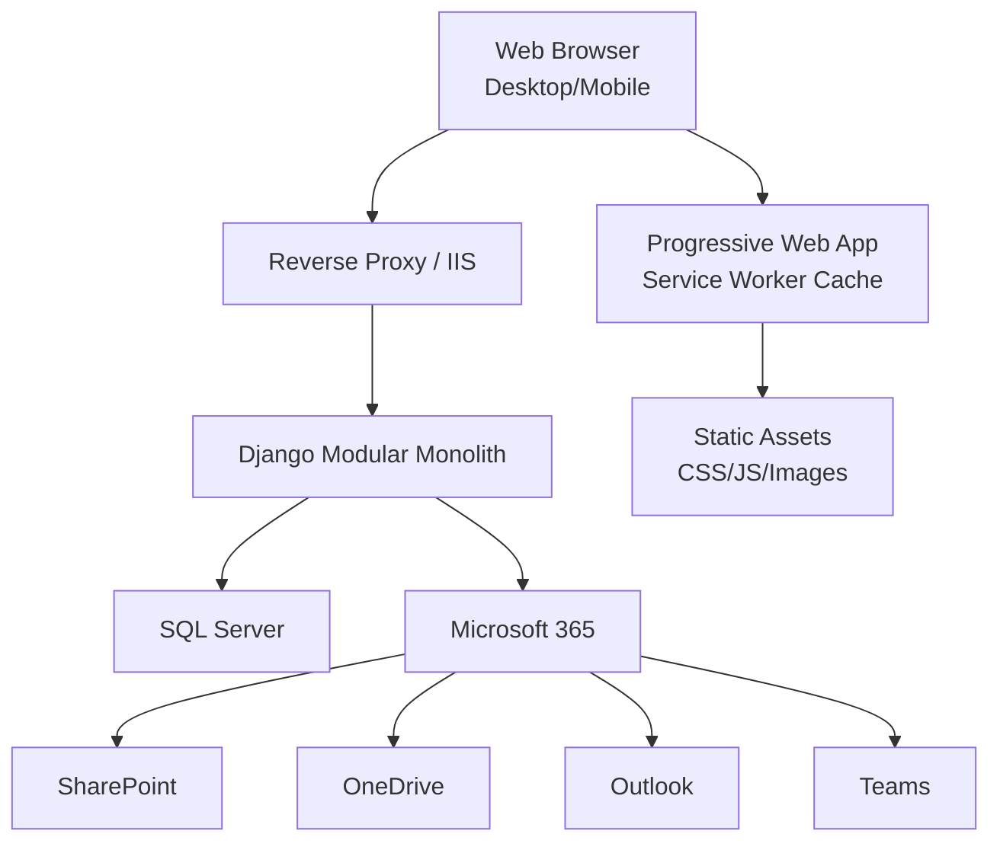

**Diagram sources**
- [02_Solution_Architecture.md:93-125](file://docs/02_Solution_Architecture.md#L93-L125)
- [02_Solution_Architecture.md:129-173](file://docs/02_Solution_Architecture.md#L129-L173)
- [service-worker.js:1-20](file://src/static/js/service-worker.js#L1-L20)
- [manifest.json:1-26](file://src/static/manifest.json#L1-L26)

The technology stack includes:
- Backend: Python 3.12, Django 5.2, Django REST Framework.
- Frontend: HTML5, Bootstrap 5, AdminLTE 3, JavaScript, AJAX, jQuery.
- Database: Microsoft SQL Server.
- Authentication: JWT, refresh tokens, Microsoft Entra ID SSO.
- Authorization: Role-Based Access Control.
- Storage: SharePoint and OneDrive when enabled; local media directory otherwise.
- Server: Windows Server, IIS, or reverse proxy with TLS.
- **Mobile**: Responsive CSS with mobile-first design, Progressive Web App (PWA) with installable interface, service worker for asset caching.

The configuration file enforces HTTPS requirements for UAT and production, configures session timeouts, sets the custom user model, registers all business apps, and prepares Microsoft 365 integration settings such as tenant ID, client credentials, SharePoint hostname, library paths, and folder mappings.

**Updated** The mobile architecture includes a dedicated mobile shell with responsive breakpoints at 1024px, touch-optimized controls with minimum 48px tap targets, and PWA capabilities for offline asset caching and home screen installation.

**Section sources**
- [02_Solution_Architecture.md:175-245](file://docs/02_Solution_Architecture.md#L175-L245)
- [02_Solution_Architecture.md:277-388](file://docs/02_Solution_Architecture.md#L277-L388)
- [settings.py:48-100](file://src/config/settings.py#L48-L100)
- [settings.py:111-143](file://src/config/settings.py#L111-L143)
- [settings.py:281-332](file://src/config/settings.py#L281-L332)
- [mobile_shell.css:17-33](file://src/static/css/mobile_shell.css#L17-L33)

## Mobile Application Shell Implementation

### P0 Milestone Completion
The mobile application shell implementation represents the completion of the P0 milestone, establishing the foundation for mobile-first user experience across the IHRMS platform. This implementation focuses on responsive design principles rather than creating separate native applications, leveraging the existing Django template system with mobile-specific enhancements.

### Mobile Shell Architecture
The mobile shell is implemented through a dedicated CSS stylesheet (`mobile_shell.css`) that activates only below 1024px viewport width, ensuring desktop interfaces remain unchanged. The implementation includes:

- **Responsive Breakpoints**: Mobile styles activate at `max-width: 1024px` with additional optimizations at 639px and 360px
- **Touch-Optimized Controls**: Minimum 48px tap targets for all interactive elements
- **Fixed Bottom Navigation**: Five-tab navigation bar with role-based content switching
- **Adaptive Layouts**: Tables convert to scrollable containers with sticky first columns
- **Form Optimization**: Single-column layouts for small screens with proper input sizing

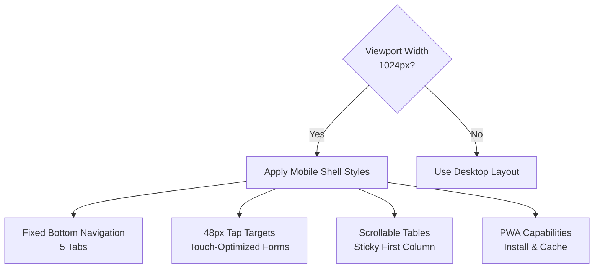

**Diagram sources**
- [mobile_shell.css:38-224](file://src/static/css/mobile_shell.css#L38-L224)
- [mobile_tabbar.html:10-55](file://src/templates/ui/mobile_tabbar.html#L10-L55)

### Progressive Web App (PWA) Implementation
The PWA implementation provides native-like app capabilities through web technologies:

- **Manifest Configuration**: Defines app metadata, icons, and standalone display mode
- **Service Worker**: Caches static assets for faster loading and offline availability
- **Installation Support**: Allows users to add IHRMS to their device home screen
- **Asset Caching Strategy**: Precaches critical CSS and JS files while keeping business data network-only

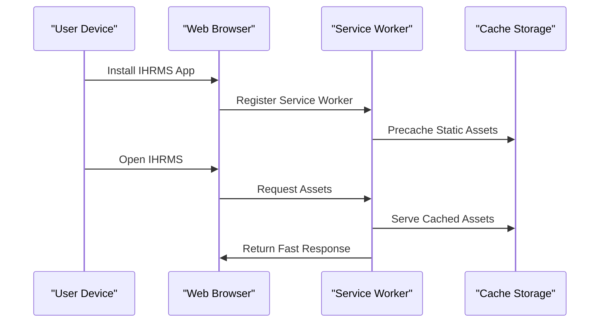

**Diagram sources**
- [manifest.json:1-26](file://src/static/manifest.json#L1-L26)
- [service-worker.js:1-59](file://src/static/js/service-worker.js#L1-L59)

### Mobile Navigation Design
The mobile navigation implements a five-tab bottom bar with role-based content adaptation:

| Tab | Employee View | Manager View | HR/Admin View |
|-----|---------------|--------------|---------------|
| Home | Today's Tasks | Approval Queue + Team KPI | Overview + Profile Alerts |
| Tab 2 | Timesheet Entry | Leave Approvals | Combined Approval Queue |
| Tab 3 | My Leave Requests | Timesheet Approvals | Employee Records |
| More | Module Drawer | Module Drawer | Module Drawer |
| Me | Profile + Payslips | Profile + Payslips | Profile + Settings |

**Section sources**
- [mobile_shell.css:1-239](file://src/static/css/mobile_shell.css#L1-L239)
- [mobile_tabbar.html:1-56](file://src/templates/ui/mobile_tabbar.html#L1-L56)
- [manifest.json:1-26](file://src/static/manifest.json#L1-L26)
- [service-worker.js:1-59](file://src/static/js/service-worker.js#L1-L59)
- [tests_mobile.py:184-274](file://src/apps/portal/tests_mobile.py#L184-L274)

## Detailed Component Analysis

### Security and Identity
The security module extends Django's abstract user model and introduces a role model. Each user can be associated with a role and a corresponding HR employee record. Security events capture access metadata such as action, resource, and timestamp without storing sensitive values.

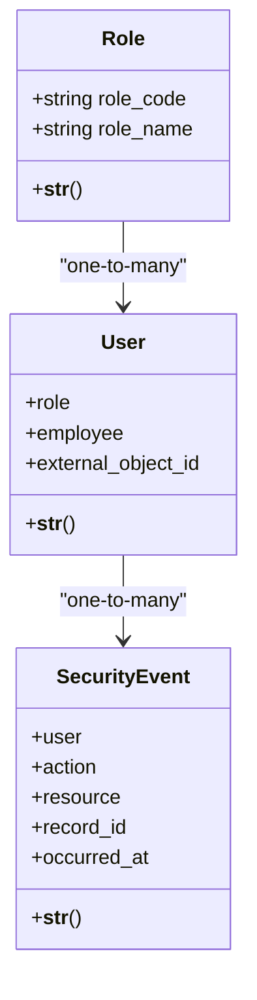

**Diagram sources**
- [security/models.py:5-46](file://src/apps/security/models.py#L5-L46)

Key responsibilities:
- Centralized authentication via Django's auth framework and Axes middleware.
- Role-based authorization through the `Role` model and permission checks enforced by views and admin interfaces.
- Audit-friendly security event logging.
- Optional Entra ID integration through `external_object_id` and Microsoft 365 configuration.

**Section sources**
- [security/models.py:5-46](file://src/apps/security/models.py#L5-L46)
- [settings.py:145-169](file://src/config/settings.py#L145-L169)
- [settings.py:269-272](file://src/config/settings.py#L269-L272)

### Organization Management
Organization management defines the foundational hierarchy used throughout QLHCNS. An organization contains departments, and departments can have managers linked to HR employees. Positions and job titles describe roles independent of specific people.

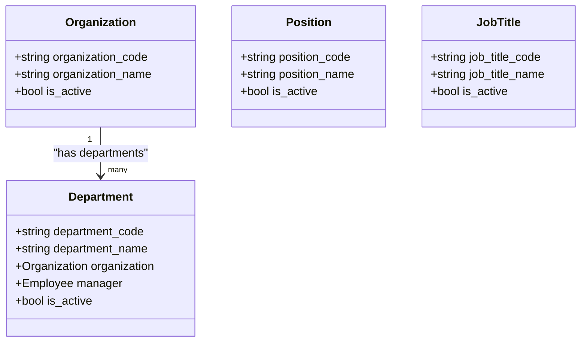

**Diagram sources**
- [organization/models.py:5-41](file://src/apps/organization/models.py#L5-L41)

This module supports:
- Multi-level organizational structures.
- Department ownership and direct reporting relationships.
- Stable reference data for positions and job titles.

**Section sources**
- [organization/models.py:5-71](file://src/apps/organization/models.py#L5-L71)

### Human Resources
The HR module centers on the `Employee` model, which stores personal identity, contact details, employment status, department, position, job title, and direct manager. It also tracks personnel lifecycle events such as transfers, promotions, rewards, and discipline actions.

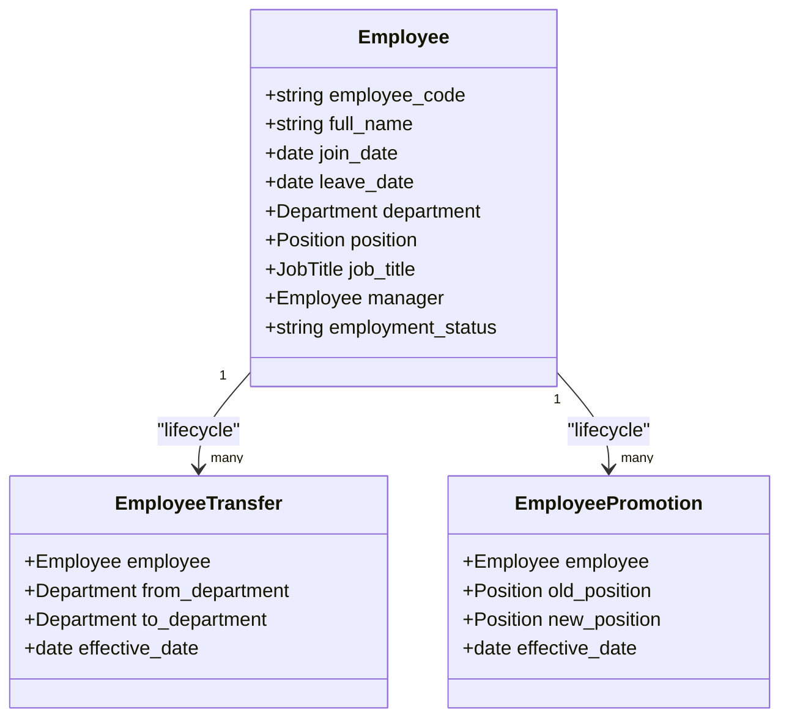

**Diagram sources**
- [hrm/models.py:11-71](file://src/apps/hrm/models.py#L11-L71)
- [hrm/models.py:125-186](file://src/apps/hrm/models.py#L125-L186)

Important behaviors include:
- Unique employee codes and national IDs.
- Employment status transitions.
- Effective-date-driven transfers and promotions.
- Automatic application of due employee changes through service functions triggered after saving lifecycle records.

**Section sources**
- [hrm/models.py:11-71](file://src/apps/hrm/models.py#L11-L71)
- [hrm/models.py:74-124](file://src/apps/hrm/models.py#L74-L124)
- [hrm/models.py:125-186](file://src/apps/hrm/models.py#L125-L186)

### Attendance and Timesheets
Attendance models capture work shifts, daily attendance, holidays, working calendars, project-based timesheet entries, and monthly attendance summaries. Monthly summaries introduce an approval workflow so that only approved leave days affect payroll and reports.

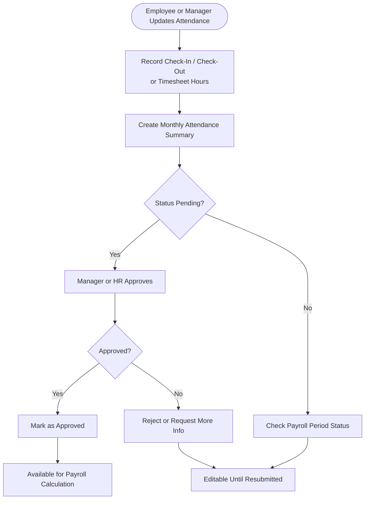

**Diagram sources**
- [attendance/models.py:25-52](file://src/apps/attendance/models.py#L25-L52)
- [attendance/models.py:89-158](file://src/apps/attendance/models.py#L89-L158)
- [attendance/models.py:172-275](file://src/apps/attendance/models.py#L172-L275)

Key constraints and safeguards:
- One attendance record per employee per day.
- Timesheet hours capped at 24 hours per day.
- Monthly summaries must be approved before affecting payroll.
- Locked payroll periods prevent edits to related attendance data.

**Section sources**
- [attendance/models.py:25-52](file://src/apps/attendance/models.py#L25-L52)
- [attendance/models.py:89-158](file://src/apps/attendance/models.py#L89-L158)
- [attendance/models.py:172-275](file://src/apps/attendance/models.py#L172-L275)

### Payroll Processing
Payroll is modeled around salary history, statutory rate configurations, tax brackets, dependents, payroll periods, payroll lines, and payslips. The payroll calculation engine computes standard working days, actual working days, prorated salary, insurance contributions, personal income tax, and net income.

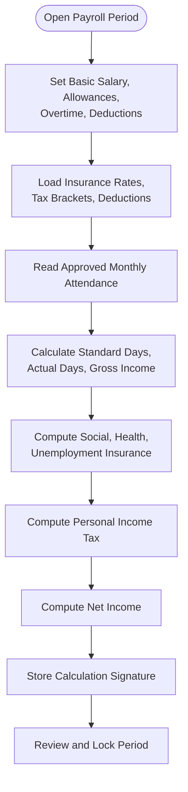

**Diagram sources**
- [payroll/models.py:33-53](file://src/apps/payroll/models.py#L33-L53)
- [payroll/models.py:88-190](file://src/apps/payroll/models.py#L88-L190)
- [payroll/models.py:248-369](file://src/apps/payroll/models.py#L248-L369)
- [payroll/models.py:405-514](file://src/apps/payroll/models.py#L405-L514)

Critical payroll rules include:
- No overlapping salary records for the same employee.
- Time-bound insurance and tax configurations.
- Dependent registration validation to avoid double tax deductions.
- Payroll period locking to prevent retroactive changes.
- Calculation signature verification to ensure locked payroll results match inputs.

**Section sources**
- [payroll/models.py:33-80](file://src/apps/payroll/models.py#L33-L80)
- [payroll/models.py:88-190](file://src/apps/payroll/models.py#L88-L190)
- [payroll/models.py:248-369](file://src/apps/payroll/models.py#L248-L369)
- [payroll/models.py:405-514](file://src/apps/payroll/models.py#L405-L514)

### Employee Onboarding Workflow
A typical onboarding flow connects recruitment, HR setup, organization assignment, and portal access:

1. Recruitment creates a candidate and converts them to an employee.
2. HR assigns the employee to a department, position, and job title.
3. HR sets the initial salary and effective date.
4. IT or HR creates a user account with an appropriate role.
5. The employee logs into `/portal/` and completes their profile.
6. Subsequent workflows such as leave requests, attendance, and payroll begin.

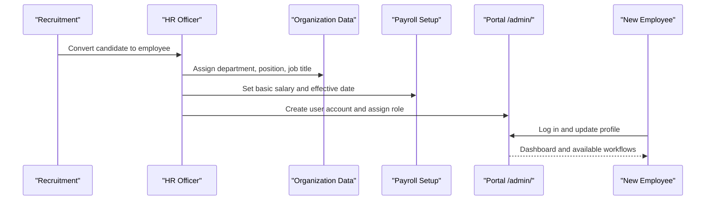

**Diagram sources**
- [hrm/models.py:11-71](file://src/apps/hrm/models.py#L11-L71)
- [payroll/models.py:33-53](file://src/apps/payroll/models.py#L33-L53)
- [security/models.py:17-32](file://src/apps/security/models.py#L17-L32)
- [settings.py:269-272](file://src/config/settings.py#L269-L272)

### Leave Request Workflow
The leave workflow follows the business requirement document's multi-step approval pattern:

1. Employee submits a leave request.
2. Department manager reviews and approves or rejects.
3. HR may review policy compliance and approve.
4. Approved leave reduces leave balance and affects attendance summary.
5. Payroll uses approved unpaid leave days when calculating net pay.

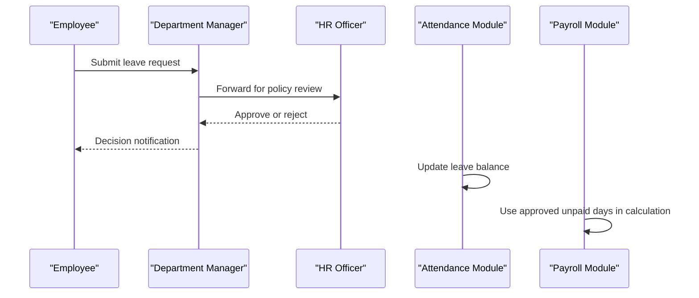

**Diagram sources**
- [01_BRD_MASTER.md:736-745](file://docs/01_BRD_MASTER.md#L736-L745)
- [attendance/models.py:172-275](file://src/apps/attendance/models.py#L172-L275)
- [payroll/models.py:405-514](file://src/apps/payroll/models.py#L405-L514)

### Payroll Processing Workflow
A typical monthly payroll cycle involves:

1. HR or finance opens a payroll period.
2. Attendance summaries are reviewed and approved.
3. Payroll lines are created for active employees.
4. Inputs such as basic salary, allowances, overtime, and deductions are entered.
5. The system calculates gross income, insurance, tax, and net income.
6. Finance reviews and locks the payroll period.
7. Payslips are generated and distributed.

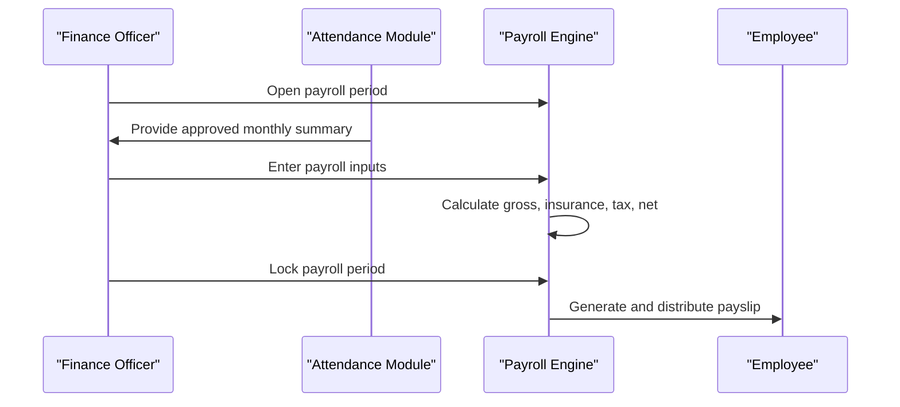

**Diagram sources**
- [payroll/models.py:248-369](file://src/apps/payroll/models.py#L248-L369)
- [payroll/models.py:405-514](file://src/apps/payroll/models.py#L405-L514)

## Dependency Analysis
The Django configuration shows how modules depend on each other through app registration and cross-app model references:

- `apps.security` provides the custom user model and security middleware.
- `apps.organization` supplies organizational structure consumed by HR and managers.
- `apps.hrm` depends on organization for department, position, and job title.
- `apps.attendance` depends on HR for employee records and on payroll for period locking.
- `apps.payroll` depends on HR for employee data, attendance for approved leave days, and organization indirectly through employee assignments.
- `apps.portal` serves employee-facing pages and uses context processors for permissions.
- `apps.m365` integrates with Microsoft 365 settings configured in the main settings file.

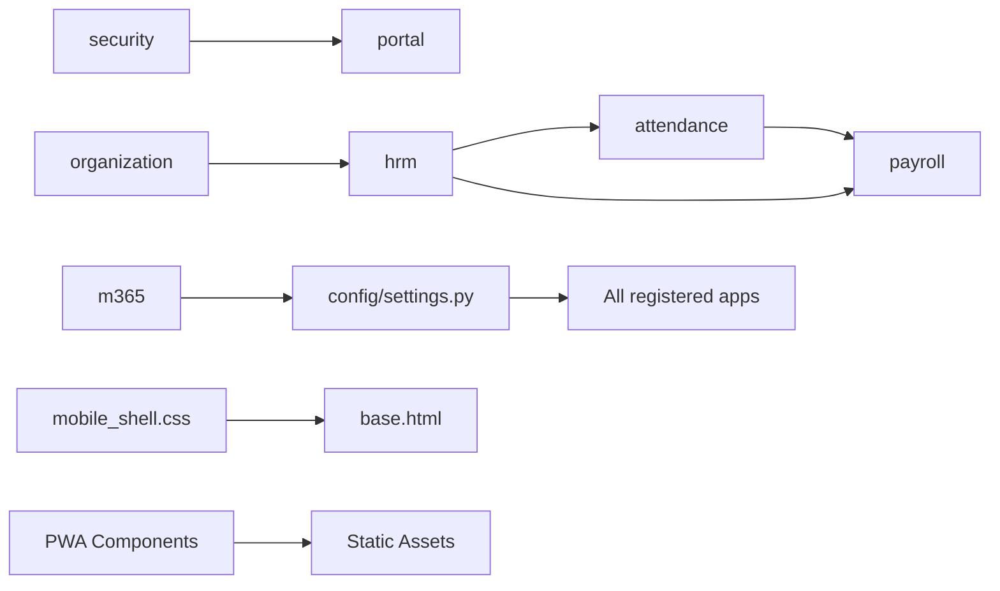

**Diagram sources**
- [settings.py:111-143](file://src/config/settings.py#L111-L143)
- [settings.py:281-332](file://src/config/settings.py#L281-L332)
- [hrm/models.py:43-58](file://src/apps/hrm/models.py#L43-L58)
- [attendance/models.py:31-49](file://src/apps/attendance/models.py#L31-L49)
- [payroll/models.py:405-444](file://src/apps/payroll/models.py#L405-L444)
- [mobile_shell.css:1-12](file://src/static/css/mobile_shell.css#L1-L12)

Coupling is intentional and bounded by domain:
- HR depends on organization but not directly on payroll.
- Attendance depends on HR and payroll only for locking and approved data.
- Payroll depends on attendance only for approved leave days and standard working days.
- Security is a cross-cutting concern applied through middleware and user model configuration.
- Mobile shell is isolated within responsive breakpoints and doesn't affect desktop functionality.

Potential risks include circular imports if business logic is placed directly in models rather than services, which the code mitigates by deferring imports inside methods and using service functions for lifecycle updates.

**Section sources**
- [settings.py:111-143](file://src/config/settings.py#L111-L143)
- [hrm/models.py:146-154](file://src/apps/hrm/models.py#L146-L154)
- [attendance/models.py:113-158](file://src/apps/attendance/models.py#L113-L158)
- [payroll/models.py:405-444](file://src/apps/payroll/models.py#L405-L444)

## Performance Considerations
The solution architecture specifies response time targets of under three seconds for list queries and under five seconds for dashboards, with support for at least 50 concurrent users and scalability toward 200 users. These targets guide indexing, query design, caching decisions, and report generation.

Practical considerations include:
- Avoid heavy computations during page rendering; move complex payroll or reporting logic to background tasks or precomputed views.
- Use approved attendance data rather than recalculating raw attendance for every payroll run.
- Keep Microsoft 365 file operations asynchronous where possible to avoid blocking HTTP requests.
- Monitor SQL Server query performance for large attendance and payroll tables.
- Use pagination and filtering in portal and admin lists.
- **Mobile Performance**: Leverage service worker caching for static assets, optimize images for mobile devices, and minimize JavaScript execution on mobile browsers.

**Updated** Mobile performance considerations include responsive image loading, efficient CSS media queries, and PWA asset caching strategies that reduce network requests and improve load times on mobile devices.

[No sources needed since this section provides general guidance]

## Troubleshooting Guide
Common operational issues and their likely causes:

| Symptom | Likely Cause | Recommended Action |
|---|---|---|
| Login redirect loop on SIT/UAT | HTTPS enforcement enabled without proper reverse proxy headers | Verify `ENABLE_HTTPS_ENFORCEMENT`, `ALLOWED_HOSTS`, and trusted proxy headers |
| Test runner finds zero tests | Running Django test command from wrong directory | Run from repository root using the provided PowerShell script |
| Payroll cannot be locked | Calculated fields do not match input signature | Recalculate payroll after changing attendance, salary, or configuration |
| Cannot edit timesheet or monthly summary | Payroll period is locked or month is already approved | Unlock period or reopen summary for reapproval |
| Overlapping salary error | Multiple active salary records for the same employee | End previous salary record before creating a new effective date |
| Duplicate dependent deduction warning | Same dependent registered with overlapping dates | Merge or adjust dependent registration periods |
| **Mobile layout broken** | CSS media queries conflicting with custom styles | Check `mobile_shell.css` loading order and breakpoint conflicts |
| **PWA not installing** | Missing manifest or HTTPS requirements | Verify `manifest.json` exists and site uses HTTPS or localhost |
| **Service worker not caching** | Cache version mismatch or incorrect scope | Check `STATIC_CACHE` version and service worker registration |

Configuration-related troubleshooting should always start with `src/manage.py check`, migration state verification, and environment variable validation. Production and UAT require `DEBUG=False`, HTTPS enforcement, a strong secret key, and explicit allowed hosts.

**Updated** Mobile-specific troubleshooting includes checking responsive breakpoints, verifying PWA manifest configuration, and validating service worker registration and cache policies.

**Section sources**
- [README.md:19-23](file://README.md#L19-L23)
- [README.md:71-87](file://README.md#L71-L87)
- [settings.py:48-100](file://src/config/settings.py#L48-L100)
- [settings.py:228-244](file://src/config/settings.py#L228-L244)
- [payroll/models.py:335-357](file://src/apps/payroll/models.py#L335-L357)
- [attendance/models.py:214-257](file://src/apps/attendance/models.py#L214-L257)
- [tests_mobile.py:145-175](file://src/apps/portal/tests_mobile.py#L145-L175)

## Conclusion
IHRMS is a mature, modular Django HR and administration platform built for internal organizational use. Its purpose is to centralize HR operations, digitize administrative workflows, and provide reliable data for decision-making. The system combines an employee portal, admin interface, and business modules covering organization, HR, attendance, leave, payroll, contracts, documents, tasks, KPIs, assets, procurement, reporting, and Microsoft 365 integration.

Its maturity is reflected in comprehensive testing coverage, structured documentation, RBAC design, auditability, and deployment standards targeting Windows Server and SQL Server. For newcomers, IHRMS represents the modern QLHCNS system where employees and managers collaborate through standardized workflows. For developers, it is a well-structured Django monolith with clear domain boundaries, secure defaults, and extensible modules ready for further HR automation and reporting enhancements.

**Updated** The recent addition of the mobile application shell implementation (P0 milestone) significantly enhances the platform's accessibility and usability across devices. The Progressive Web App capabilities provide native-like experiences while maintaining the flexibility and maintainability of web technologies. This mobile-first approach ensures that field workers and remote employees can effectively use the system through responsive interfaces optimized for touch interaction and mobile workflows.

The mobile shell implementation demonstrates the platform's commitment to modern web standards, including responsive design principles, progressive enhancement strategies, and offline-capable applications. With 783+ passing tests, comprehensive documentation, and robust architectural patterns, IHRMS continues to evolve as a comprehensive HR management solution that adapts to diverse user needs and technological environments.

[No sources needed since this section summarizes without analyzing specific files]
