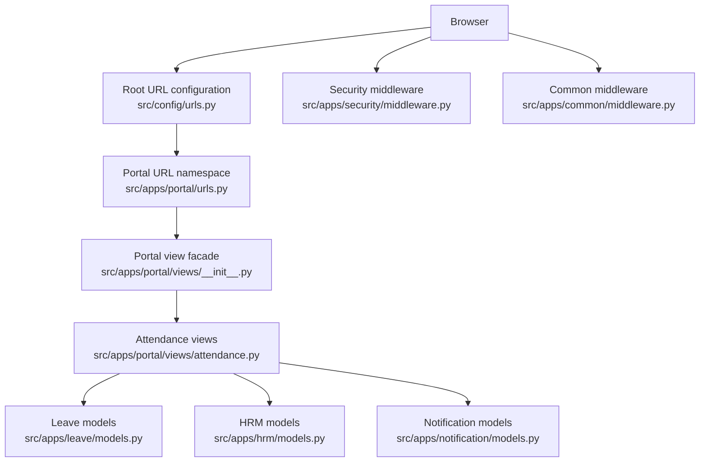
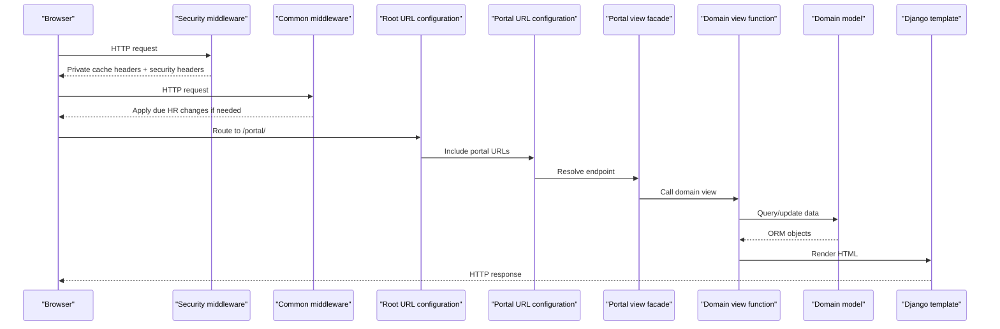
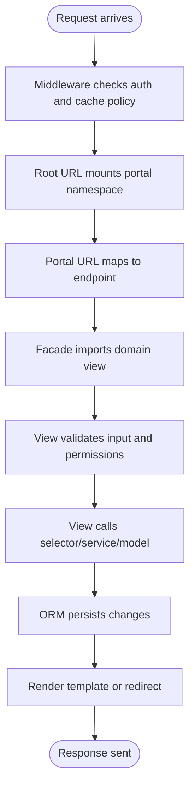
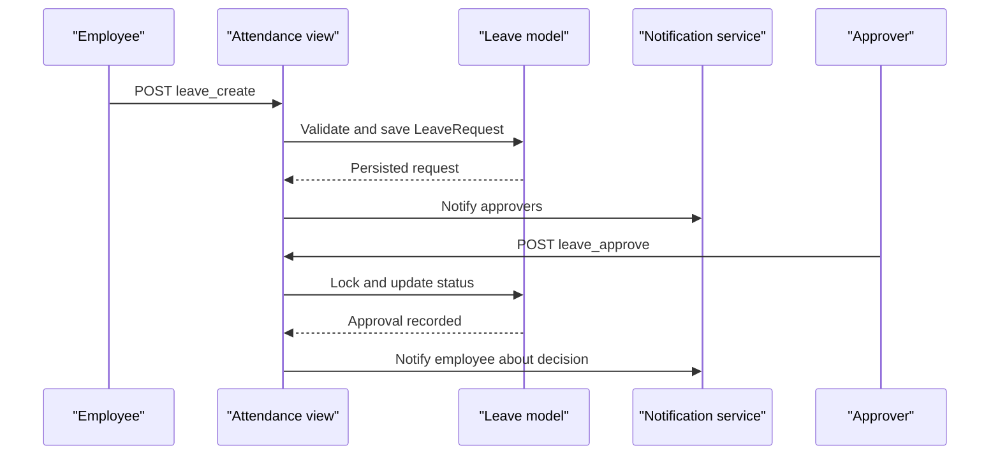
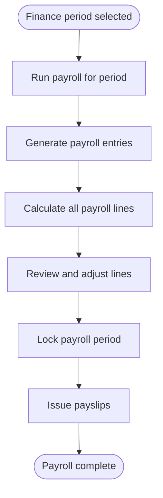
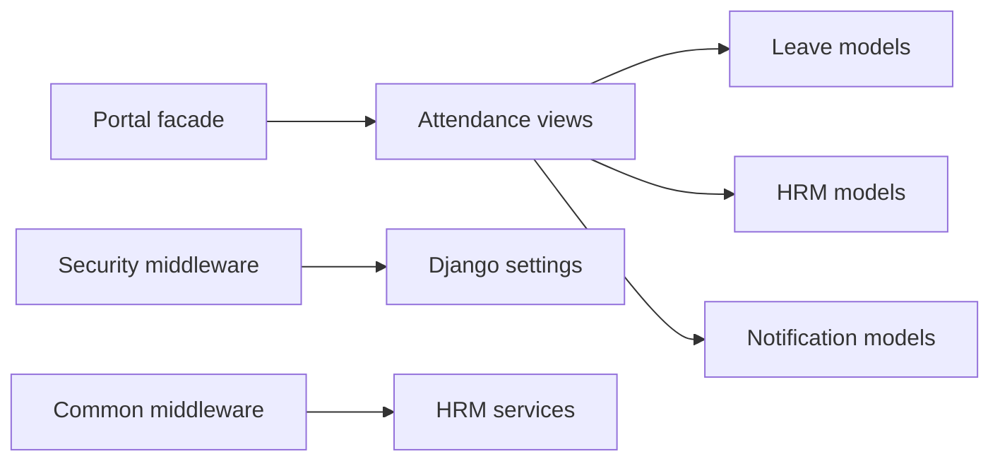

# Data Flow Patterns

<cite>
**Referenced Files in This Document**   
- [README.md](file://README.md)
- [urls.py](file://src/config/urls.py)
- [portal urls.py](file://src/apps/portal/urls.py)
- [security middleware.py](file://src/apps/security/middleware.py)
- [common middleware.py](file://src/apps/common/middleware.py)
- [portal views facade __init__.py](file://src/apps/portal/views/__init__.py)
- [portal attendance views.py](file://src/apps/portal/views/attendance.py)
- [leave models.py](file://src/apps/leave/models.py)
- [hrm models.py](file://src/apps/hrm/models.py)
- [notification models.py](file://src/apps/notification/models.py)
- [workflow definition document](file://docs/11_Workflow_Definition.md)
- [browser UAT leave flow](file://ops/run_browser_uat.py)
</cite>

## Table of Contents
1. [Introduction](#introduction)
2. [Project Structure](#project-structure)
3. [Core Components](#core-components)
4. [Architecture Overview](#architecture-overview)
5. [Detailed Component Analysis](#detailed-component-analysis)
6. [Dependency Analysis](#dependency-analysis)
7. [Performance Considerations](#performance-considerations)
8. [Troubleshooting Guide](#troubleshooting-guide)
9. [Conclusion](#conclusion)

## Introduction
This document explains how requests travel through IHRMS from the browser to the database, and how data is transformed across layers. IHRMS is a Django 5.2 internal application with an employee portal, administration interface, and business modules. The portal uses a centralized URL configuration that delegates to domain-specific view facades. Business logic is separated from HTTP handling: views validate input, enforce permissions, orchestrate cross-module operations, and render templates or redirect responses. Domain services and models encapsulate state, validation, calculations, and persistence. Notifications are persisted as in-app records and email drafts for manual Outlook sending.

The documentation covers:
- Request lifecycle: routing, middleware, view execution, template rendering, response generation.
- Portal facade pattern: `apps.portal.views` re-exports domain-scoped view functions so URLs stay stable while implementations live in feature modules.
- Service layer separation: views call selectors, services, and models rather than embedding complex business rules.
- Data transformation patterns between models, services, and UI components.
- Caching strategy, query optimization, and async processing patterns.
- Concrete flows for leave request approval and payroll calculation.

**Section sources**
- [README.md:1-90](file://README.md#L1-L90)

## Project Structure
IHRMS follows a layered Django structure:
- Top-level URL configuration mounts portal, reports, assistant, admin, and private file routes.
- The portal URL namespace groups all employee-facing endpoints.
- The portal view facade centralizes imports and exposes a stable surface for URL routing.
- Domain apps such as leave, attendance, hrm, notification, payroll, and security own their models, services, and views.
- Middleware handles session expiration, cache control, security headers, and scheduled HR change application.

**Diagram sources**
- [urls.py:1-21](file://src/config/urls.py#L1-L21)
- [portal urls.py:1-157](file://src/apps/portal/urls.py#L1-L157)
- [portal views facade __init__.py:1-194](file://src/apps/portal/views/__init__.py#L1-L194)
- [portal attendance views.py:1-506](file://src/apps/portal/views/attendance.py#L1-L506)
- [leave models.py:1-280](file://src/apps/leave/models.py#L1-L280)
- [hrm models.py:1-224](file://src/apps/hrm/models.py#L1-L224)
- [notification models.py:1-68](file://src/apps/notification/models.py#L1-L68)
- [security middleware.py:1-29](file://src/apps/security/middleware.py#L1-L29)
- [common middleware.py:1-29](file://src/apps/common/middleware.py#L1-L29)

**Section sources**
- [urls.py:1-21](file://src/config/urls.py#L1-L21)
- [portal urls.py:1-157](file://src/apps/portal/urls.py#L1-L157)
- [portal views facade __init__.py:1-194](file://src/apps/portal/views/__init__.py#L1-L194)

## Core Components
- Root URL router redirects to `/portal/`, mounts portal routes, and blocks raw media access.
- Portal URL namespace defines endpoints for dashboard, leave, timesheet, finance/payroll, HR, procurement, assets, inventory, disposal, recruitment, reporting, tasks, notifications, and more.
- Portal view facade re-exports view functions grouped by domain (attendance, finance, hr, office-procurement, recruitment, reports-planning, tasks-kpi).
- Security middleware enforces idle session logout, marks authenticated responses private, and adds security headers.
- Common middleware applies due employee changes once per process per local day on authenticated traffic.
- Leave models define leave types, leave requests, approvals, balances, and quota validation.
- HRM models define employees, profile change requests, transfers, promotions, rewards, and disciplines.
- Notification models define in-app notifications and an email outbox for manual Outlook sending.

Key responsibilities:
- Routing: root and portal URL files map URLs to view functions.
- Security: middleware protects sessions and sensitive responses.
- Orchestration: portal facade keeps URL contracts stable while domain modules implement behavior.
- Persistence: domain models encapsulate validation, relationships, and derived calculations.
- Notifications: workflow actions create in-app notifications and optional email drafts.

**Section sources**
- [urls.py:1-21](file://src/config/urls.py#L1-L21)
- [portal urls.py:1-157](file://src/apps/portal/urls.py#L1-L157)
- [portal views facade __init__.py:1-194](file://src/apps/portal/views/__init__.py#L1-L194)
- [security middleware.py:1-29](file://src/apps/security/middleware.py#L1-L29)
- [common middleware.py:1-29](file://src/apps/common/middleware.py#L1-L29)
- [leave models.py:1-280](file://src/apps/leave/models.py#L1-L280)
- [hrm models.py:1-224](file://src/apps/hrm/models.py#L1-L224)
- [notification models.py:1-68](file://src/apps/notification/models.py#L1-L68)

## Architecture Overview
The request lifecycle in IHRMS follows these stages:
1. Browser sends an HTTP request.
2. Security middleware checks authentication, enforces idle timeout, and sets secure cache-control headers.
3. Common middleware may apply scheduled HR changes once per process per day.
4. Django root URL resolver forwards to the portal namespace.
5. Portal URL resolves to a specific endpoint.
6. Portal facade imports the actual view function from a domain module.
7. View validates input, checks permissions, calls selectors/services, updates models, and renders templates or redirects.
8. Response is returned with appropriate cache and security headers.

**Diagram sources**
- [security middleware.py:1-29](file://src/apps/security/middleware.py#L1-L29)
- [common middleware.py:1-29](file://src/apps/common/middleware.py#L1-L29)
- [urls.py:1-21](file://src/config/urls.py#L1-L21)
- [portal urls.py:1-157](file://src/apps/portal/urls.py#L1-L157)
- [portal views facade __init__.py:1-194](file://src/apps/portal/views/__init__.py#L1-L194)

## Detailed Component Analysis

### Request Lifecycle and Portal Facade Pattern
The portal facade centralizes view exports so URL names remain stable while implementation moves into domain modules. For example, attendance-related endpoints like leave creation and approval are defined in `apps.portal.urls` but implemented in `apps.portal.views.attendance`. The facade re-exports functions such as `leave_list`, `leave_create`, `leave_approval_list`, and `leave_approve`.

Benefits:
- Single import surface for URL routing.
- Clear separation between route definitions and domain logic.
- Easier testing and refactoring within domain modules.

**Diagram sources**
- [portal urls.py:1-157](file://src/apps/portal/urls.py#L1-L157)
- [portal views facade __init__.py:1-194](file://src/apps/portal/views/__init__.py#L1-L194)

**Section sources**
- [portal urls.py:1-157](file://src/apps/portal/urls.py#L1-L157)
- [portal views facade __init__.py:1-194](file://src/apps/portal/views/__init__.py#L1-L194)

### Leave Request Approval Workflow
The leave request workflow is implemented across portal attendance views, leave models, and notification models. A typical flow:
- Employee submits a leave form via `leave_create`.
- View serializes submission using atomic transactions and locks the employee row.
- Leave request is validated and saved; approvers are determined.
- In-app notifications are created for approvers.
- Manager or HR approves/rejects via `leave_approve`.
- View locks the leave request row, prevents self-approval for department managers, updates status, records approval, and notifies the employee.

**Diagram sources**
- [portal attendance views.py:91-209](file://src/apps/portal/views/attendance.py#L91-L209)
- [leave models.py:52-176](file://src/apps/leave/models.py#L52-L176)
- [notification models.py:6-24](file://src/apps/notification/models.py#L6-L24)

**Section sources**
- [portal attendance views.py:91-209](file://src/apps/portal/views/attendance.py#L91-L209)
- [leave models.py:52-176](file://src/apps/leave/models.py#L52-L176)
- [notification models.py:6-24](file://src/apps/notification/models.py#L6-L24)
- [workflow definition document:80-178](file://docs/11_Workflow_Definition.md#L80-L178)

### Payroll Calculation Process
Payroll endpoints are exposed under the portal finance namespace:
- Finance period list and creation.
- Run payroll for a period.
- Generate payroll entries.
- Calculate all payroll lines.
- Lock payroll period.
- Issue payslips.
- Update individual payroll lines.
- Manage salaries, tax configuration, and dependents.

These endpoints coordinate with attendance summaries, leave balances, employee records, and payroll models. Views orchestrate the steps, while services and models perform calculations and persistence.

**Diagram sources**
- [portal urls.py:128-137](file://src/apps/portal/urls.py#L128-L137)
- [portal views facade __init__.py:87-104](file://src/apps/portal/views/__init__.py#L87-L104)

**Section sources**
- [portal urls.py:128-137](file://src/apps/portal/urls.py#L128-L137)
- [portal views facade __init__.py:87-104](file://src/apps/portal/views/__init__.py#L87-L104)

### Data Transformation Patterns
Data flows through several transformations:
- Form inputs → view parameters → model instances.
- Models compute derived values (e.g., leave days, balances).
- Services calculate working days, compensatory days, and attendance totals.
- Views assemble context for templates (lists, pagination, summary metrics).
- Templates render UI components and shared design tokens.

Examples:
- Leave request creation transforms form fields into a validated `LeaveRequest` and computes total working days.
- Timesheet month view aggregates daily entries, holidays, project allocations, and required hours to produce a monthly grid.
- Leave balance properties derive used, pending, remaining, and available days from approved/pending requests.

**Section sources**
- [portal attendance views.py:237-314](file://src/apps/portal/views/attendance.py#L237-L314)
- [leave models.py:85-176](file://src/apps/leave/models.py#L85-L176)
- [leave models.py:206-280](file://src/apps/leave/models.py#L206-L280)

### Caching Strategies
- Authenticated responses are marked private with no-store/no-cache to prevent shared caching.
- Session idle timeout logs out inactive users.
- Referrer-Policy and Permissions-Policy headers restrict sensitive browser features.
- No explicit application-level read cache is present in the analyzed files; performance relies on ORM optimizations and controlled queries.

**Section sources**
- [security middleware.py:7-28](file://src/apps/security/middleware.py#L7-L28)

### Database Query Optimization
- Select related and only fields reduce N+1 queries.
- Atomic transactions and select-for-update protect against race conditions during concurrent approvals.
- Bounded scans limit result sets for search and people matching.
- Indexes on notification email outbox status support efficient filtering.

**Section sources**
- [portal attendance views.py:166-174](file://src/apps/portal/views/attendance.py#L166-L174)
- [portal attendance views.py:249-251](file://src/apps/portal/views/attendance.py#L249-L251)
- [notification models.py:56-60](file://src/apps/notification/models.py#L56-L60)

### Async Processing Patterns
- Email sending is not automated server-side; instead, an outbox model stores draft emails for manual review and sending via Outlook.
- Idempotency keys prevent duplicate email drafts for repeated decisions.
- Scheduled background jobs exist outside the analyzed request path (e.g., activity report reminders), indicating potential async processing for reminders and lifecycle events.

**Section sources**
- [notification models.py:27-68](file://src/apps/notification/models.py#L27-L68)
- [portal attendance views.py:195-208](file://src/apps/portal/views/attendance.py#L195-L208)

## Dependency Analysis
The portal facade depends on domain modules for view implementations. Attendance views depend on leave models, HRM models, attendance models, and notification services. Security middleware depends on settings and Django authentication. Common middleware depends on HRM services for applying due changes.

**Diagram sources**
- [portal views facade __init__.py:1-194](file://src/apps/portal/views/__init__.py#L1-L194)
- [portal attendance views.py:1-506](file://src/apps/portal/views/attendance.py#L1-L506)
- [leave models.py:1-280](file://src/apps/leave/models.py#L1-L280)
- [hrm models.py:1-224](file://src/apps/hrm/models.py#L1-L224)
- [notification models.py:1-68](file://src/apps/notification/models.py#L1-L68)
- [security middleware.py:1-29](file://src/apps/security/middleware.py#L1-L29)
- [common middleware.py:1-29](file://src/apps/common/middleware.py#L1-L29)

**Section sources**
- [portal views facade __init__.py:1-194](file://src/apps/portal/views/__init__.py#L1-L194)
- [portal attendance views.py:1-506](file://src/apps/portal/views/attendance.py#L1-L506)

## Performance Considerations
- Use `select_related` and `only` to minimize database load when rendering lists and dashboards.
- Wrap critical write paths in atomic transactions and use `select_for_update` to avoid race conditions.
- Limit scan ranges for search and people matching to keep queries bounded.
- Avoid loading sensitive fields unless necessary; prefer scoped queries and field whitelisting.
- Prefer idempotent operations for notifications and outbox entries to prevent duplicates.
- Monitor SQL query counts in tests to detect regressions in page complexity.

[No sources needed since this section provides general guidance]

## Troubleshooting Guide
Common issues and resolutions:
- Unauthorized access: Ensure user has required role; check permission helpers like `_can_approve` and `_can_approve_timesheet`.
- Self-approval blocked: Department managers cannot approve their own leave; verify role code and approver identity.
- Race conditions: Concurrent approvals can create duplicate approvals; ensure atomic transactions and row locking are applied.
- Missing employee linkage: Views require an attached employee record; otherwise, redirect with error messages.
- Notification failures: Check in-app notifications and email outbox; verify idempotency keys and manual sending workflow.

**Section sources**
- [portal attendance views.py:137-209](file://src/apps/portal/views/attendance.py#L137-L209)
- [portal attendance views.py:426-462](file://src/apps/portal/views/attendance.py#L426-L462)
- [notification models.py:27-68](file://src/apps/notification/models.py#L27-L68)

## Conclusion
IHRMS implements a clear request lifecycle with strong separation between routing, middleware, view orchestration, domain services, and persistence. The portal facade pattern stabilizes URL contracts while allowing domain modules to evolve independently. Security middleware protects sessions and sensitive responses, while common middleware applies scheduled HR changes. Leave approval and payroll workflows demonstrate transactional safety, bounded queries, and idempotent notifications. Future improvements can include application-level caching, more robust async processing, and continued monitoring of query performance.

[No sources needed since this section summarizes without analyzing specific files]